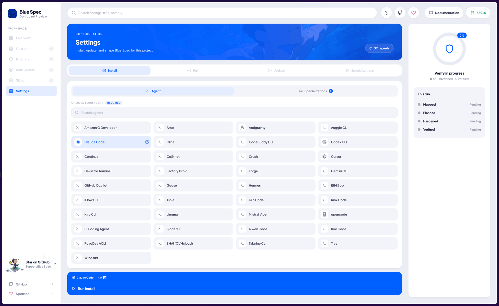
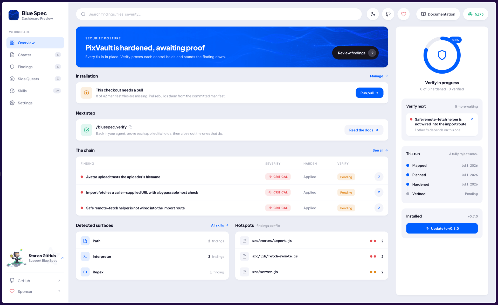
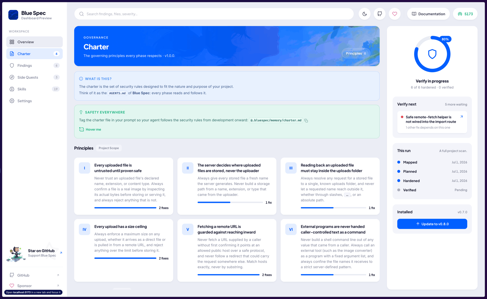
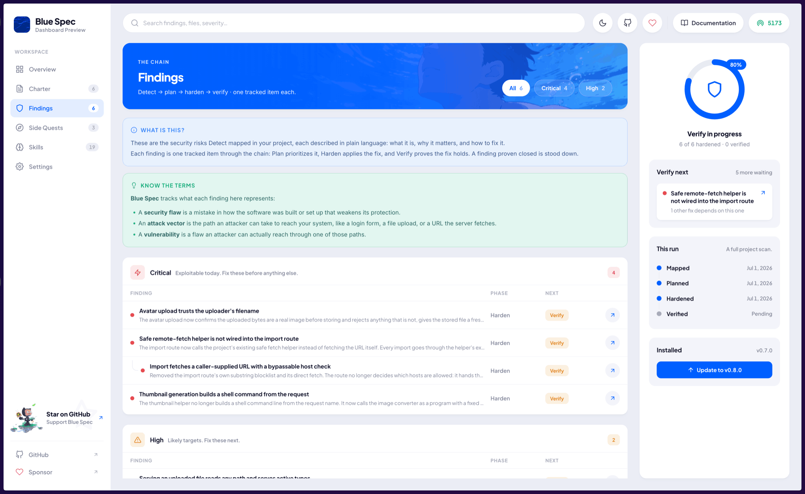
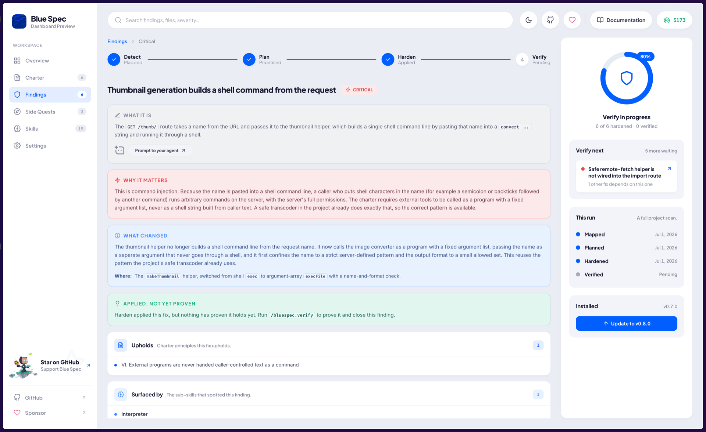
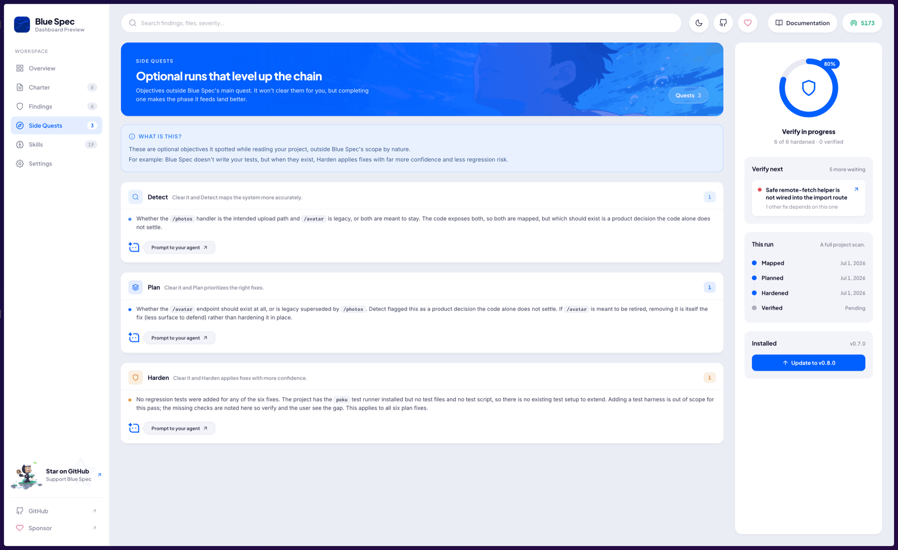

# 🌊 [Lagune AI](https://lagune.ai)

[](https://lagune.ai)
[](https://www.npmjs.com/package/lagune)
[](https://lagune.ai/docs/get-started/install)

**Lagune** helps your AI agent make a project more secure. You point it at your code, and the agent figures out what your system actually does, then guides you through the security work that matters for it.

- **Lagune** works with projects in **any programming language** and installs into the [**agents the skills CLI supports**](https://github.com/vercel-labs/skills#supported-agents) ✨

---

Love **Lagune**? [**Give us a ⭐ on GitHub**](https://github.com/wellwelwel/lagune)!

---

## Table of Contents

- 🌊 [**Get Started**](#get-started)
  - 📦 [**Install**](#install) | [**Dashboard**](#dashboard)
  - 💬 [**Slash Commands**](#slash-commands)
- 💽 [**Requirements**](#requirements)
- 🔐 [**Security**](#security)
- 🤝 [**Contributing**](#contributing)
- 🖖 [**Acknowledgements**](#acknowledgements)
- 🧑‍⚖️ [**License**](#license)

---

## Get Started

**Lagune** adapts to your environment, whether it is a new project or an existing one.

> [!TIP]
>
> See real-world [**Prompt Samples**](https://lagune.ai/docs/examples/prompts) 🪼

---

### Install

Install **Lagune**'s commands into your agent with the [**skills**](https://github.com/vercel-labs/skills) CLI:

```bash
npx skills add wellwelwel/lagune
```

Or paste this prompt into your agent:

```md
Run `npx --yes skills add wellwelwel/lagune` and follow the generated skill instructions now. Read its complete output, redirecting it to a temporary file first if necessary. Resolve relative paths from the supporting-files directory it provides.
```

- 🃏 **Lagune** runs on **Node.js** under the hood, you use whatever language you want.

#### › Update

```bash
npx skills update
```

> [!TIP]
>
> Your charter, the phase artifacts, the tracking, and your own specializations live in `.lagune/` and stay untouched.

#### › Specialization categories

[**/lagune.charter**](https://lagune.ai/docs/commands/charter) records the [**categories**](https://lagune.ai/docs/categories) your project needs. Change them anytime:

```bash
npx --prefer-offline lagune@0.15.0 add --categories javascript
npx --prefer-offline lagune@0.15.0 remove --categories javascript
```

> [!NOTE]
>
> A project set up by the **Lagune** CLI (`npx lagune init`) keeps working as it is. To move it, see [**Migrate**](https://lagune.ai/docs/commands/migrate).

---

### Dashboard

For an interactive live view and follow-up, run:

```bash
npx lagune@latest
```

It serves a dashboard and opens it in a random port:

- [x] **Live Reload**
- [x] **Private** and **Local**
- [x] Follow the findings, fixes, and verdicts, and manage the specialization categories, directly from your browser
- [x] No `node_modules` or `package.json` is needed 📦

<details>
<summary>Overview</summary>
<br />








</details>

> [!TIP]
>
> - 🚪 Use `--port` to specify a custom port.
> - ⏏️ Press `Ctrl+C` to stop.

---

### Slash Commands

Once **Lagune**'s commands are installed, your **AI** agent unlocks a set of slash commands:

#### › Development flow

Harden the work as you build it, guided by the charter, with no flow to follow:

| Command                                               | What it does for you                                                      |
| ----------------------------------------------------- | ------------------------------------------------------------------------- |
| [**/lagune**](https://lagune.ai/docs/commands/lagune) | Enforces security along with your development, on any prompt, at any time |

- Pull in the on-demand specializations in real time while your agent works.
- Combine it with the [**/lagune.charter**](https://lagune.ai/docs/commands/charter) command to shape every build around your project's own security rules.

#### › The Blue Team flow

These five run in order. Each builds on the previous, so following the list top to bottom is all it takes:

| #   | Command                                                        | What it does for you                                                           |
| --- | -------------------------------------------------------------- | ------------------------------------------------------------------------------ |
| 1   | [**/lagune.charter**](https://lagune.ai/docs/commands/charter) | Sets your project's security rules, proposed for you or shaped by what you say |
| 2   | [**/lagune.detect**](https://lagune.ai/docs/commands/detect)   | Reads your code and maps what your system does and where the risks are         |
| 3   | [**/lagune.plan**](https://lagune.ai/docs/commands/plan)       | Turns what detect found into a defense plan, with a fix for each finding       |
| 4   | [**/lagune.harden**](https://lagune.ai/docs/commands/harden)   | Applies the plan's fixes to your code, safely and one at a time                |
| 5   | [**/lagune.verify**](https://lagune.ai/docs/commands/verify)   | Proves each applied fix holds and closes out the ones that do                  |

#### › Special commands

| Command                                                              | What it does                                                                        |
| -------------------------------------------------------------------- | ----------------------------------------------------------------------------------- |
| [**/lagune.specialize**](https://lagune.ai/docs/commands/specialize) | Teaches **Lagune** a new security specialization from articles, exploits, or topics |
| [**/lagune.prove**](https://lagune.ai/docs/commands/prove)           | Turns each detected finding into a runnable proof for responsible disclosure        |

> [!TIP]
>
> Security is not a cost, it is an investment: what you put in upfront, you save many times over in the incidents you never have 🙋🏻‍♂️

> [!IMPORTANT]
>
> See the full [**documentation**](https://lagune.ai/) for usage examples and more.

---

## Requirements

You will need these tools installed on your system:

- [**Node.js (LTS)**](https://nodejs.org/en/download/package-manager)
- At least one of the [**agents the skills CLI supports**](https://github.com/vercel-labs/skills#supported-agents)

---

## Security

To details, report a vulnerability, and see the supported versions, see the [**Security Policy**](https://github.com/wellwelwel/lagune/blob/main/SECURITY.md).

---

## Contributing

See the [**Contributing Guide**](https://github.com/wellwelwel/lagune/blob/main/CONTRIBUTING.md) and please follow our [**Code of Conduct**](https://github.com/wellwelwel/lagune/blob/main/CODE_OF_CONDUCT.md) 🚀

---

## Acknowledgements

### Partners

Partners get an exclusive logo across the repositories and landing pages, plus a spot on a dedicated partners page.

> Help my work grow by [**becoming a partner**](https://weslley.io/?partners) 🖖

### Supporters

Really thanks to everyone who has supported and keeps supporting my work.

[](https://github.com/sponsors/wellwelwel)

> Support my work by [**becoming a sponsor**](https://github.com/sponsors/wellwelwel) too ✨

---

## License

**Lagune** is under the [**MIT License**](https://github.com/wellwelwel/lagune/blob/main/LICENSE).<br />
Copyright © 2026-present [**Weslley Araújo**](https://github.com/wellwelwel) and [**contributors**](https://github.com/wellwelwel/lagune/graphs/contributors).

> [!IMPORTANT]
>
> ### Disclaimer
>
> All product names, trademarks, and registered trademarks mentioned are the property of their respective owners and are used for identification purposes only.
