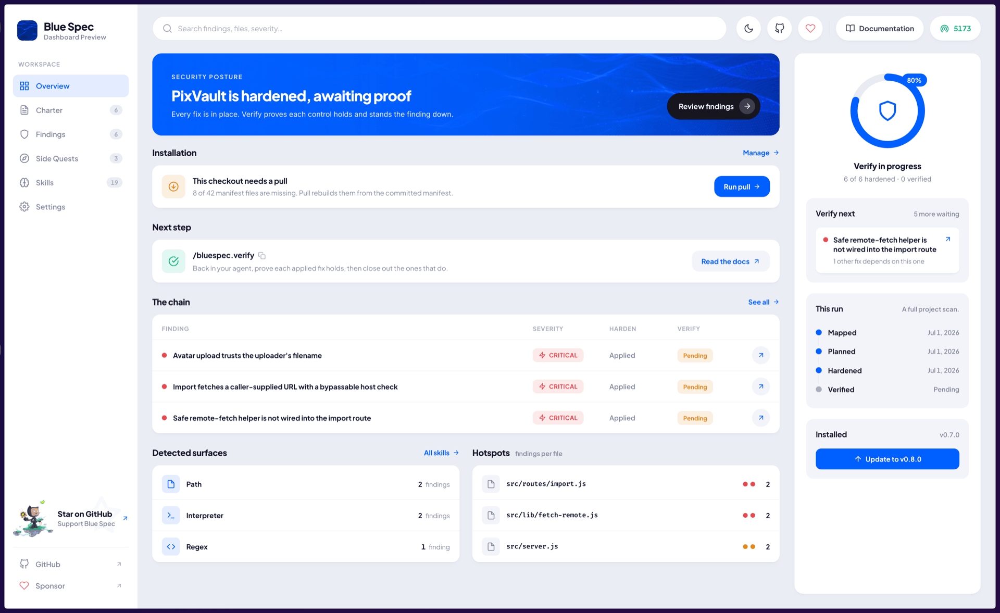
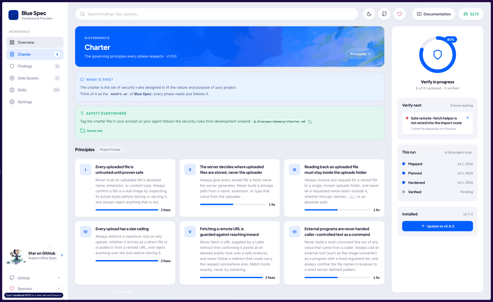
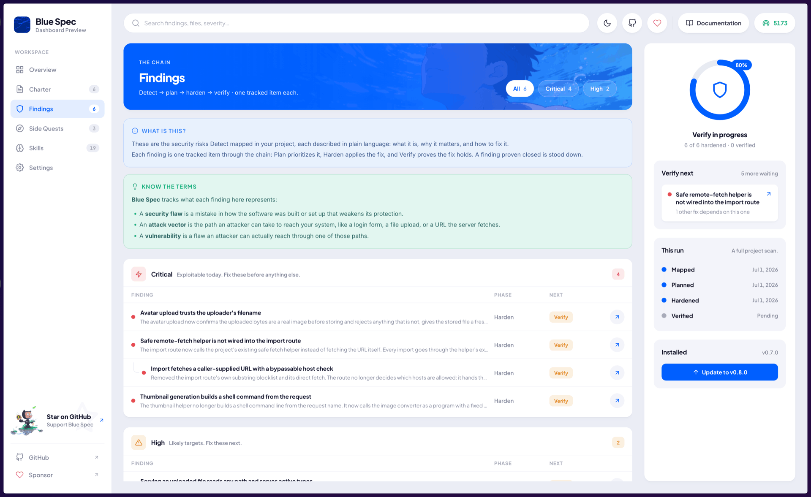
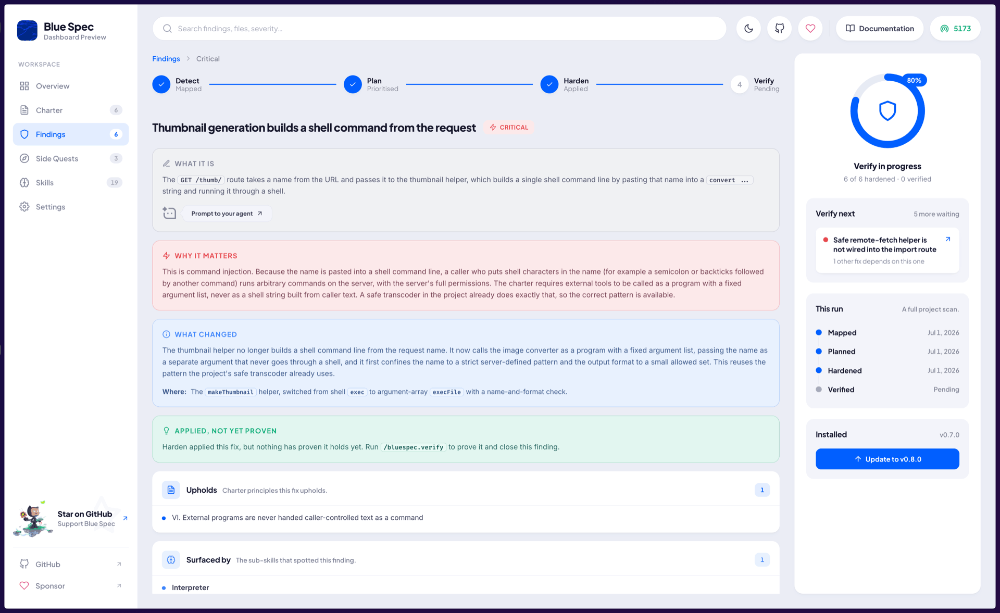
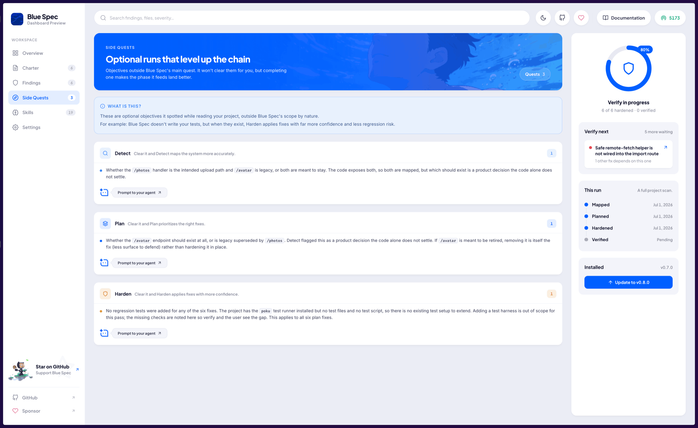

# 🪼 [Lagune AI](https://lagune.ai)

[](https://lagune.ai)
[](https://www.npmjs.com/package/lagune)
[](https://lagune.ai/docs)

**Lagune** helps your AI agent make a project more secure. You point it at your code, and the agent figures out what your system actually does, then guides you through the security work that matters for it.

- **Lagune** works with projects in **any programming language** ✨
- [**Give us a ⭐ on GitHub:**](https://github.com/wellwelwel/lagune) it helps more people discover the project.

---

## Get Started

### Documentation

&nbsp;&nbsp;<a href="https://lagune.ai/docs"><b>English</b></a>&nbsp;&nbsp;·&nbsp;&nbsp;
&nbsp;&nbsp;<a href="https://lagune.ai/pt-BR/docs"><b>Português (Brasil)</b></a>&nbsp;&nbsp;·&nbsp;&nbsp;
&nbsp;&nbsp;<a href="https://lagune.ai/es-ES/docs"><b>Español (España)</b></a>&nbsp;&nbsp;·&nbsp;&nbsp;
&nbsp;&nbsp;<a href="https://lagune.ai/de-DE/docs"><b>Deutsch</b></a>&nbsp;&nbsp;·&nbsp;&nbsp;
&nbsp;&nbsp;<a href="https://lagune.ai/fr-FR/docs"><b>Français</b></a>&nbsp;&nbsp;·&nbsp;&nbsp;
&nbsp;&nbsp;<a href="https://lagune.ai/it-IT/docs"><b>Italiano</b></a>&nbsp;&nbsp;·&nbsp;&nbsp;
&nbsp;&nbsp;<a href="https://lagune.ai/uk-UA/docs"><b>Українська</b></a>&nbsp;&nbsp;·&nbsp;&nbsp;
&nbsp;&nbsp;<a href="https://lagune.ai/ru-RU/docs"><b>Русский</b></a>&nbsp;&nbsp;·&nbsp;&nbsp;
&nbsp;&nbsp;<a href="https://lagune.ai/zh-CN/docs"><b>简体中文</b></a>&nbsp;&nbsp;·&nbsp;&nbsp;
&nbsp;&nbsp;<a href="https://lagune.ai/ja-JP/docs"><b>日本語</b></a>

---

### Install and Update

Pick your agent:

<table>
<tr>
<th width="50%" align="left">Install</th>
<th width="50%" align="left">Update</th>
</tr>
<tr>
<td colspan="2"><picture></picture> <a href="https://lagune.ai/docs/install/claude-code"><b>Claude Code</b></a></td>
</tr>
<tr>
<td>

```bash
claude plugin install lagune --marketplace wellwelwel/lagune
```

</td>
<td>

```bash
claude plugin marketplace update lagune
claude plugin update lagune@lagune
```

</td>
</tr>
<tr>
<td colspan="2"><picture></picture> <a href="https://lagune.ai/docs/install/claude-code"><b>Claude Code Extension</b></a></td>
</tr>
<tr>
<td>

- Type `/plugin` and select **Manage plugins**.
- Add `wellwelwel/lagune` on the **Marketplaces** tab.
- Install `lagune` on the **Plugins** tab.

</td>
<td>

- Type `/plugin` and select **Manage plugins**.
- Open the **Marketplaces** tab.
- Select the refresh icon on `lagune`.

</td>
</tr>
<tr>
<td colspan="2"><picture></picture> <a href="https://lagune.ai/docs/install/codex"><b>Codex</b></a></td>
</tr>
<tr>
<td>

```bash
codex plugin marketplace add wellwelwel/lagune
codex plugin add lagune@lagune
```

</td>
<td>

```bash
codex plugin marketplace upgrade lagune
```

</td>
</tr>
</table>

- <picture></picture> [**Antigravity**](https://lagune.ai/docs/install/antigravity-cli)
- <picture></picture> [**Cursor**](https://lagune.ai/docs/install/cursor)
- <picture></picture> [**Devin for Terminal**](https://lagune.ai/docs/install/devin-cli)
- <picture></picture> [**Factory Droid**](https://lagune.ai/docs/install/factory-droid)
- <picture></picture> [**Gemini CLI**](https://lagune.ai/docs/install/gemini-cli)
- <picture></picture> [**GitHub Copilot**](https://lagune.ai/docs/install/github-copilot-cli)
- <picture></picture> [**Grok Build**](https://lagune.ai/docs/install/grok-build)
- <picture></picture> [**Hermes Agent**](https://lagune.ai/docs/install/hermes-agent)
- <picture></picture> [**Kimi Code**](https://lagune.ai/docs/install/kimi-code)
- <picture></picture> [**Muse Code**](https://lagune.ai/docs/install/muse-code)
- <picture></picture> [**OpenCode**](https://lagune.ai/docs/install/opencode)
- <picture></picture> [**Pi**](https://lagune.ai/docs/install/pi)
- <picture></picture> [**Qwen Code**](https://lagune.ai/docs/install/qwen-code)
- <picture></picture> [**Universal (skills.sh)**](https://lagune.ai/docs/install/universal)

> [!NOTE]
>
> - See the [**Install**](https://lagune.ai/docs) section for **detailed instructions**.
> - [**Migrate from previous Lagune**](https://lagune.ai/docs/commands/migrate) manifest-based setup.

---

### Skills

Once installed, your **AI** agent unlocks a set of commands, all governed by the **charter**: secure new work as you build it, or run the full audit over a project.

> [!TIP]
>
> See real-world [**Prompt Samples**](https://lagune.ai/docs/examples/prompts) 🪼

#### › Build

Harden the work as you write it, with no flow to follow:

| Skill                                                               | What it does for you                                                        |
| ------------------------------------------------------------------- | --------------------------------------------------------------------------- |
| [**/lagune-charter**](https://lagune.ai/docs/commands/charter)      | Sets your project's security rules, the foundation `/lagune` builds against |
| [**/lagune**](https://lagune.ai/docs/commands/lagune) _(Universal)_ | Builds what you ask and hardens it as it is written, guided by the charter  |

#### › Audit: the Blue Team flow

These five run in order. Each builds on the previous, so following the list top to bottom is all it takes:

| #   | Skill                                                          | What it does for you                                                           |
| --- | -------------------------------------------------------------- | ------------------------------------------------------------------------------ |
| 1   | [**/lagune-charter**](https://lagune.ai/docs/commands/charter) | Sets your project's security rules, proposed for you or shaped by what you say |
| 2   | [**/lagune-detect**](https://lagune.ai/docs/commands/detect)   | Reads your code and maps what your system does and where the risks are         |
| 3   | [**/lagune-plan**](https://lagune.ai/docs/commands/plan)       | Turns what detect found into a defense plan, with a fix for each finding       |
| 4   | [**/lagune-harden**](https://lagune.ai/docs/commands/harden)   | Applies the plan's fixes to your code, safely and one at a time                |
| 5   | [**/lagune-verify**](https://lagune.ai/docs/commands/verify)   | Proves each applied fix holds and closes out the ones that do                  |

#### › Special skills

| Skill                                                                | What it does                                                                               |
| -------------------------------------------------------------------- | ------------------------------------------------------------------------------------------ |
| [**/lagune-specialize**](https://lagune.ai/docs/commands/specialize) | Teaches **Lagune** a new security specialization from articles, exploits, or topics        |
| [**/lagune-prove**](https://lagune.ai/docs/commands/prove)           | Turns each detected finding into a runnable, defense-only proof for responsible disclosure |

> [!TIP]
>
> Security is not a cost, it is an investment: what you put in upfront, you save many times over in the incidents you never have 🙋🏻‍♂️

> [!NOTE]
>
> Some agents take the commands under the plugin's name, such as `/lagune:lagune-charter`. Your agent's [**install page**](https://lagune.ai/docs) shows how to type them.

> [!IMPORTANT]
>
> See the full [**documentation**](https://lagune.ai/) for usage examples and more.

---

### Dashboard

For an interactive live view of `.lagune/`, run:

```bash
npx lagune
```

It serves a dashboard and opens it on a random port:

- [x] **Live Reload**
- [x] **Private** and **Local**
- [x] Follow the findings, fixes, and verdicts, and manage the categories, directly from your browser
- [x] No `node_modules` or `package.json` is needed 📦

<details>
<summary>Overview</summary>
<br />







</details>

> [!TIP]
>
> - 🚪 Use `--port` to specify a custom port.
> - ⏏️ Press `Ctrl+C` to stop.

---

## Requirements

You will need [**Node.js (LTS)**](https://nodejs.org/en/download/package-manager) installed on your system.

---

## Security

To report a vulnerability and see the supported versions, check the [**Security Policy**](https://github.com/wellwelwel/lagune/blob/main/SECURITY.md).

---

## Contributing

See the [**Contributing Guide**](https://github.com/wellwelwel/lagune/blob/main/CONTRIBUTING.md) and please follow our [**Code of Conduct**](https://github.com/wellwelwel/lagune/blob/main/CODE_OF_CONDUCT.md) 🚀

---

## Acknowledgements

### Partners

Partners get an exclusive logo across the repositories and landing pages, plus a spot on a dedicated partners page.

> Help my work grow by [**becoming a partner**](https://weslley.io/?partners) 🖖

### Supporters

Really thanks to everyone who has supported and keeps supporting my work.

[](https://github.com/sponsors/wellwelwel)

> Support my work by [**becoming a sponsor**](https://github.com/sponsors/wellwelwel) too ✨

---

## License

**Lagune** is under the [**Apache License 2.0**](https://github.com/wellwelwel/lagune/blob/main/LICENSE).<br />
Copyright © 2026-present [**Weslley Araújo**](https://github.com/wellwelwel) and [**contributors**](https://github.com/wellwelwel/lagune/graphs/contributors).

All product names, trademarks, and registered trademarks mentioned are the property of their respective owners and are used for identification purposes only.
