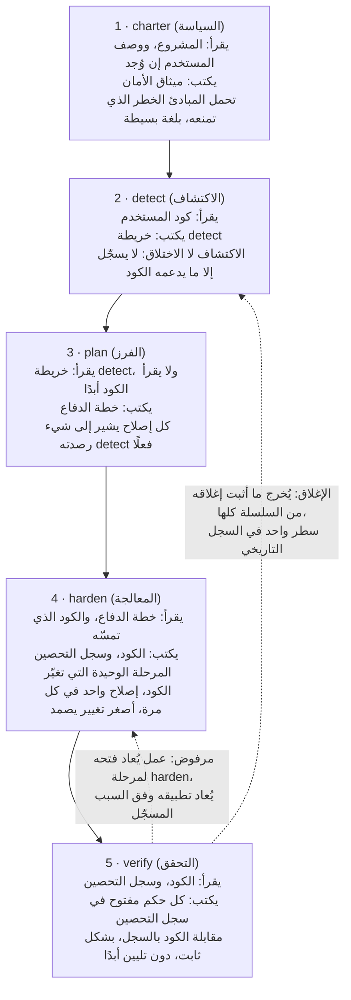
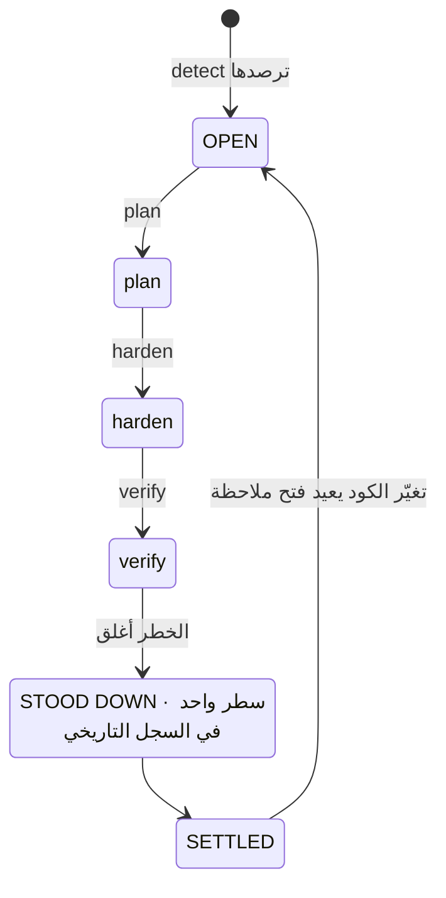
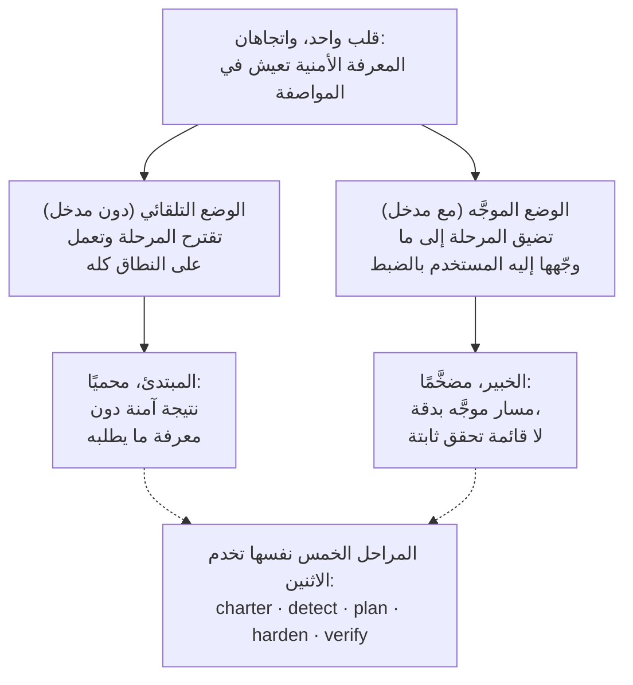
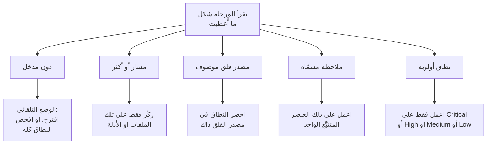
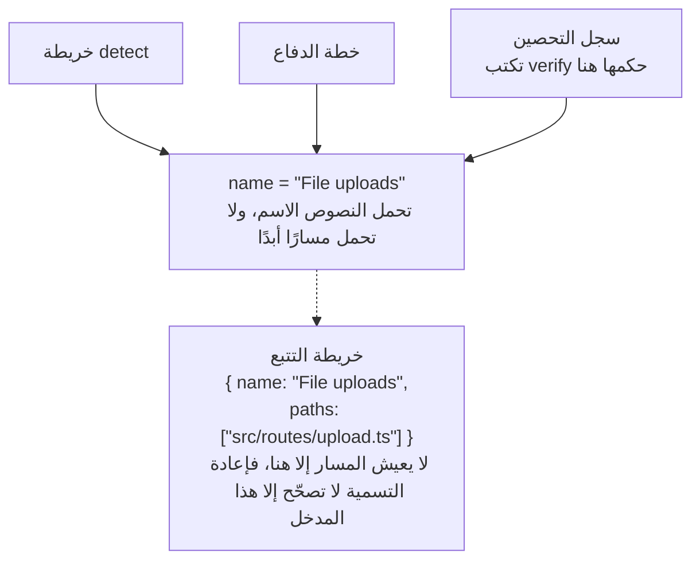
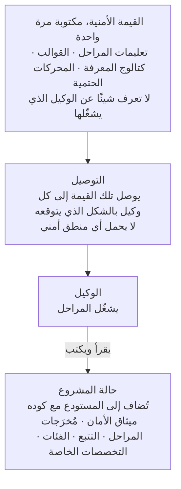
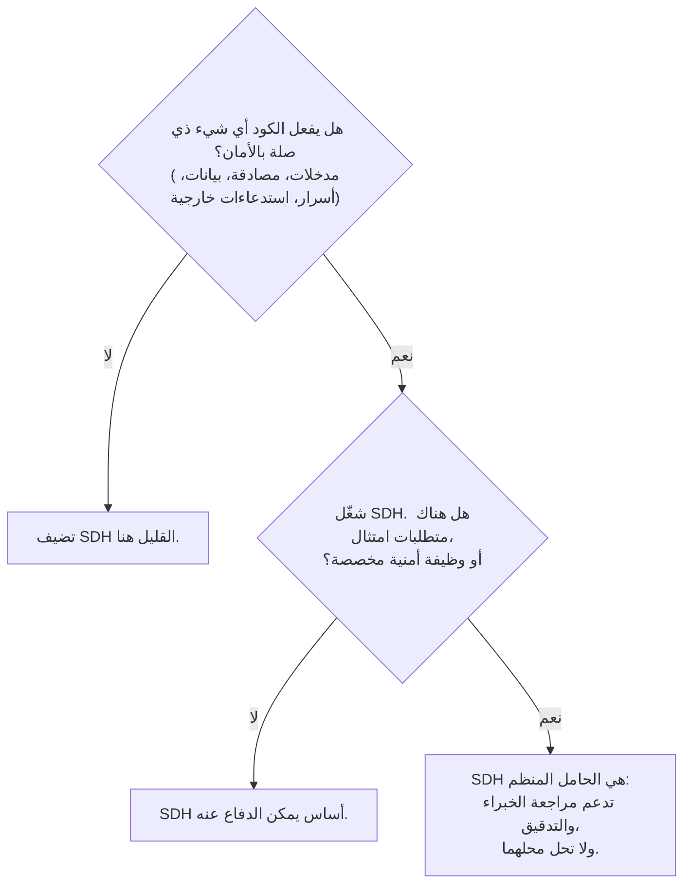

# Security-Driven Hardening: منهجية لعصر التطوير بمساعدة الذكاء الاصطناعي

> منهجية Security-Driven Hardening (SDH): منهجية دفاعية على طريقة الفريق الأزرق ومدركة للسياق لتدقيق البرمجيات المكتوبة بمساعدة الذكاء الاصطناعي أو عبر vibe coding وتحصينها.

Canonical: https://lagune.ai/ar-AE/docs/references/paper
اللغة: ar-AE
الأصل: https://lagune.ai/docs/references/paper
آخر تحديث: 2026-11-09

- **Weslley Araújo**
- **ورقة منهجية، 2026.**

---

## الملخص

Security-Driven Hardening (SDH) منهجية أمنية منظمة، يقودها الذكاء الاصطناعي، وللدفاع فقط، صُممت لعصر تُكتب فيه البرمجيات بشكل متزايد على يد وكلاء الذكاء الاصطناعي وعلى يد أشخاص ليسوا متخصصين في الأمان. وبدلًا من تشغيل قائمة تحقق عامة، ترصد SDH أولًا ما يفعله النظام فعلًا (تسجيل الدخول، ورفع الملفات، والمدفوعات، وكشف البيانات، وغير ذلك)، ثم تقود العمل الأمني الخاص بذلك السياق. وتحكمها مبادئ آمنة افتراضيًا، وتتمحور كليًا حول الدفاع، وتُصاغ بلغة بسيطة يستطيع أي مستخدم أن يتصرف بناءً عليها.

تحاجّ هذه الورقة بأن SDH منهجية مفقودة، لا أداة واحدة. فالمعرفة الأمنية تعيش في المنهجية وتخصصاتها التي تُحمَّل عند الحاجة، وهي أساس يستطيع كل مستخدم البناء عليه، ما يتيح لها خدمة المبتدئ والخبير عبر المسار نفسه. وتميّزها خاصيتان عن المناهج السابقة التي تبدأ بالمواصفة `[1]`. فمنهجية SDH **مستقلة عن الحالة**: تتكيف مع دليل فارغ، أو مشروع قيد التنفيذ، أو pull request واحد، أو قاعدة كود قديمة كبيرة، بأي تقنية. ومنهجية SDH **قابلة للإغلاق**: الخطر الذي يثبت إغلاقه يُخرَج من المسار كله، فتبلغ تلك الملاحظة حالة مستقرة ولا يُعاد فتحها إلا عند تغيّر الكود. ولا تحل SDH محل المتخصصين في الأمان ولا محل أدوات الفريق الأزرق المتخصصة. بل توسّع معرفة المطوّر نفسه، وكلما فهم المطوّر الأمان أكثر، استطاع قيادتها أكثر.

و **Lagune** هو التنفيذ المرجعي، وهو يُثبت أن المنهجية قابلة للبناء والنقل. وتُقدَّم SDH كمنهجية يستطيع الآخرون تبنّيها.

> **مصطلحات الفهرسة**
>
> التطوير بمساعدة الذكاء الاصطناعي، أمن البرمجيات، الأمن الدفاعي، التطوير القائم على المواصفة، التحصين الأمني، سير العمل الذي يقوده الوكلاء، قابلية الإغلاق، الأمان المدرك للسياق، المعرفة عند الحاجة، الأدوات المستقلة عن الوكيل.

---

## I. المقدمة: الفجوة الأمنية التي فتحها التطوير بمساعدة الذكاء الاصطناعي

تُشحن البرمجيات بشكل متزايد على يد أشخاص، وعلى يد وكلاء ذكاء اصطناعي، لا يستطيعون التعرف بموثوقية على نمط غير آمن: سر مسرّب، أو فحص تفويض مفقود، أو استعلام قابل للحقن. وهذه ليست مخاطر غريبة. بل هي من فئات المخاطر التي تهيمن على الحوادث الحقيقية، والموثّقة منذ سنوات في مراجع عامة `[6]`، `[7]`، وتشير دراسات حديثة إلى أن نسبة معتبرة من الكود الذي يولّده الذكاء الاصطناعي تُشحن بعيوب من هذا النوع تحديدًا `[8]`. وقد جعلت مساعدات البرمجة بالذكاء الاصطناعي هذا الأمر حادًا بتمكينها غير المطورين من شحن برمجيات حقيقية، لكن الفجوة أوسع من أي جمهور بعينه. فمعظم المشاريع لا تحصل أبدًا على مراجعة أمنية خاصة بما تفعله فعلًا. ويزداد النظام البيئي هشاشة مع كل قرار متسرّع من نوع "إنه يعمل، اشحنه".

النصائح الأمنية العامة لا تسد هذه الفجوة. فقائمة التحقق الثابتة ليست خاصة بما يفعله النظام، لذلك تُغرق مشروعًا صغيرًا ببنود لا صلة لها به، ومع ذلك تفوّت الخطر المهم لذلك المشروع تحديدًا. والمشكلة ليست نقصًا في المعرفة الأمنية في العالم. المشكلة هي مطابقة المعرفة الصحيحة للنظام الموجود فعلًا أمام المستخدم، وفعل ذلك لشخص قد لا يعرف ما يجب أن يطلبه.

وتجيب SDH عن هذا بقلب واحد للمعادلة: **تعيش المعرفة الأمنية في المواصفة وتخصصاتها التي تُحمَّل عند الحاجة، وهي أساس يستطيع كل مستخدم البناء عليه**. ترصد المنهجية السياق، وتفرز المخاطر التي يحملها ذلك السياق، وتوجّه الإصلاحات، فيُخدم المطوّر وغير المطوّر عبر المسار نفسه. وتبقى الملاحظات والتوصيات بلغة بسيطة، فتكون قابلة للتنفيذ أيًا كان العمق التقني للقارئ. ولا يُقيَّد الخبير بهذا، بل يُضخَّم به، وهي ثنائية نطوّرها في `§VI`.

> **فكرة محورية**
>
> **القلب الأساسي للمعادلة:** تعيش المعرفة الأمنية في المواصفة وتخصصاتها التي تُحمَّل عند الحاجة، وهي أساس يستطيع كل مستخدم البناء عليه. تتعلم المنهجية ما يفعله النظام وتطابق العمل الأمني معه، وتوسّع كل ما يعرفه المستخدم بالفعل.

تخيّل مطورًا يقول لمساعد ذكاء اصطناعي: "تطبيقي يسمح للمستخدمين برفع صورة للملف الشخصي". دون مراجعة أمنية، ينتج المساعد كودًا يعمل لكنه يثق بصمت في كل ما يرسله العميل: نوع الملف المُعلن، واسم الملف، والحجم. ويُشحن الرفع، فيستطيع ملف متنكر في صورة أن يحمل كودًا، ويستطيع اسم مُصاغ عمدًا أن يخرج من مسار التخزين، ويستطيع ملف ضخم أن يستنزف الخادم. ولا يظهر شيء من هذا في العرض التجريبي، فيُشحن.

أما الكود نفسه حين يمر عبر SDH فيسلك سلوكًا مختلفًا. ترصد المنهجية أن النظام يقبل ملفات من الخارج (detect)، وتفرز ذلك إلى المخاطر التي يحملها الرفع (الفرز)، وتقترح التحقق من النوع الحقيقي للملف وحجمه، وإعادة تسميته عند الحفظ، وتخزينه حيث لا يمكن تشغيل الكود (المعالجة)، ثم تقرأ النتيجة وتتأكد من أن كل ضابط يصمد فعلًا (verify). ولم يحتج المطوّر أبدًا إلى معرفة عبارة "unrestricted file upload". فقد قدّمتها المنهجية نيابة عنه.

تقدّم هذه الورقة الإسهامات التالية:

- تعريفًا دقيقًا لمنهجية SDH، مستقلًا عن أي تنفيذ بعينه، مع مبادئ تصميمها (`§III`).
- دورة حياة دفاعية من خمس مراحل يكون فيها الفصل بين المهام هو الإسهام نفسه: الاكتشاف لا يختلق أبدًا، والتخطيط لا يقرأ الكود أبدًا، ومرحلة واحدة فقط تغيّر الكود، والتحقق لا يليّن حكمه أبدًا (`§IV`).
- **قابلية الإغلاق** كموقف منهجي: للملاحظة الفردية حالة نهائية، لا حلقة لا تنتهي (`§V`).
- ثنائية **موسّع معرفة المطوّر**: مسار واحد يحمي المبتدئ ويضخّم الخبير (`§VI`).
- **التخصصات غير القابلة للاستدعاء و prompt-on-demand**: معرفة أمنية مركّزة يحمّلها الوكيل حين يستدعيها سياق المشروع، ولا يحمّلها افتراضيًا أبدًا (`§VII`).
- **الاستقلال عن الحالة** و **التكيّف غير السلطوي**: تلائم SDH أي حالة تطوير وتتكيف مع السيناريو بدلًا من فرض نطاق ثابت (`§VIII`).
- **وضعًا وقائيًا**: الدفاع نفسه يعمل أثناء بناء العمل العادي، فيصل الكود آمنًا افتراضيًا ويقل ما يتعين على المراحل تصحيحه (`§IX`).
- مقارنة مخصصة مع Spec-Driven Development، السلالة التي نشأت منها SDH ثم افترقت عنها (`§X`).
- الضوابط الهندسية التي تتيح للمنهجية النجاة من إعادة الهيكلة والبقاء مستقلة عن أي وكيل: التتبع بالهوية الاسمية (`§XI`) والحامل المستقل عن الوكيل (`§XII`).

---

## II. الخلفية والأعمال ذات الصلة

تبني SDH على أعمال سابقة. فهي ترث بنية مثبتة من التطوير الذي يبدأ بالمواصفة ويقوده الوكلاء `[1]`، `[2]`، `[3]`: القوالب، وأوامر slash التي يستهلكها الوكيل، ومستند حاكم، ووكيل يشغّل المراحل. وتعيد تنفيذ تلك البنية لغرض دفاعي. والسلالة مقصودة، وأحد مبادئ عمل SDH يسمّيها صراحة: ابنِ سير العمل من بنية مثبتة، ثم أطّره للأمان.

وليست SDH قائمة تحقق ثابتة من توصيات عامة. فقائمة التحقق تعرف الكثير عن الأمان عمومًا ولا تعرف شيئًا عن المشروع الذي أمامها. وتعكس SDH هذا التركيز. فهي تبذل جهدها الأول في الاكتشاف، في معرفة ما يفعله النظام، ولا تلجأ إلا بعد ذلك إلى المعرفة التي يجعلها الاكتشاف ذات صلة.

وليست SDH كذلك بديلًا عن المتخصصين في الأمان أو عن أدوات الفريق الأزرق المتخصصة. بل هي موسّع لمعرفة المطوّر (`§VI`). والفريق الذي لديه وظيفة أمنية مخصصة يجب أن يحتفظ بها. وتمنح SDH ذلك الفريق حاملًا منظمًا، وتمنح الفريق الذي لا يملك مثلها أساسًا يمكن الدفاع عنه.

وتقف SDH أيضًا بجوار الفاحصات الأمنية الحتمية (التحليل الثابت، و linters) `[4]`، `[5]`. وتكمن قيمة هذه الأدوات تحديدًا في أنها حتمية وقابلة للتكرار. أما SDH فتعتمد في معظمها على استدلال الوكيل، فتقايض الحتمية الصارمة بإدراك السياق. ولا تدّعي المنهجية غير ذلك. وحيث تهم الحتمية، تضمّن محركًا حتميًا داخل الاستدلال (`§VII`): يقرر الوكيل ما إذا كان المدخل يستحق الفحص، ويقرر برنامج حتمي ما إذا كان ذلك المدخل خطيرًا.

والعمل السابق الأقرب مباشرة هو Spec-Driven Development (SDD)، وهي عائلة المنهجيات التي تبدأ بالمواصفة وتدفع البناء إلى الأمام من مواصفة قابلة للتنفيذ. ونتعامل مع SDD كفئة. وأوضح صياغة لها كمنهجية للممارسين هي تقرير Piskala `[1]`، وأبرز أدواتها التي يقودها الوكلاء هي Spec Kit من GitHub `[2]`، مع OpenSpec `[3]` كأداة ثانية من العائلة نفسها. وهذه هي المراجع القياسية للمقارنة في `§X`.

---

## III. منهجية SDH: التعريف ومبادئ التصميم

**Security-Driven Hardening** منهجية أمنية منظمة يقودها الذكاء الاصطناعي، تحوّل قاعدة الكود إلى قاعدة أكثر أمانًا بقيادة العمل من مواصفة يشغّلها الوكيل، بدلًا من إصلاحات عشوائية. والاسم مستوحى من **الفرق الزرقاء**، أي المدافعين في مجال الأمان. فمنهجية SDH تُعنى بالدفاع والتحصين والتحقق، لا بالهجوم أبدًا.

> **تعريف**
>
> **Security-Driven Hardening (SDH):** منهجية أمنية منظمة، يقودها الذكاء الاصطناعي، وللدفاع فقط، ترصد أولًا ما يفعله النظام فعلًا، ثم تقود العمل الأمني الخاص بالسياق، تحكمها مبادئ آمنة افتراضيًا وتُصاغ بلغة بسيطة.

تُعرَّف SDH بمجموعة من المبادئ الملزمة. كل مبدأ قاعدة، وكل مبدأ يمنح المستخدم ضمانًا محددًا.

| المبدأ                                        | القاعدة                                                                                                                       | ما يضمنه للمستخدم                                                                                                                        |
| --------------------------------------------- | ----------------------------------------------------------------------------------------------------------------------------- | ---------------------------------------------------------------------------------------------------------------------------------------- |
| آمن افتراضيًا، بلغة بسيطة، للجميع بالتساوي    | كل قيمة افتراضية ورسالة وإصلاح آمن من البداية ومفهوم لأي قارئ، مطورًا كان أم لا. ولا تُفضَّل فئة من المستخدمين على أخرى.      | يحصل المبتدئ على أساس آمن دون أن يطلبه، ويقرأ النتيجة بلغته هو.                                                                          |
| إدراك السياق بدلًا من العمومية                | تبدأ كل مرحلة من السياق المرصود في detect، وتعمل على ما يفعله النظام فعلًا.                                                   | تلائم التوصيات المشروع، لا قائمة تحقق. وتعيش المعرفة الأمنية في المواصفة وتخصصاتها التي تُحمَّل عند الحاجة، فتوسّع كل ما يجلبه المستخدم. |
| المرونة بدلًا من الجمود                       | المبادئ والمتطلبات والتوصيات نقاط بداية. ويستطيع المستخدم إعادة صياغة أي شيء أو حذفه أو إضافته أو تضييق نطاقه.                | تنحني المنهجية للمشروع وللمستخدم، ولا تشتد أكثر مما يريد المستخدم أبدًا. والمرونة لا تُضعف أبدًا الأساس الآمن افتراضيًا.                 |
| المواءمة، لا الإضافة فقط                      | المُخرَجات مستندات حية، لا سجلات. وكل تشغيل يعيد فحص كل مدخل: يُبقي ما يصمد، ويعيد كتابة ما تغيّر، ويزيل ما لم يعد ينطبق.     | يعكس السجل الحاضر دائمًا، فلا يتحول أبدًا إلى قائمة متراكمة بالية.                                                                       |
| للدفاع فقط                                    | تدقّق SDH وتحصّن وتتحقق. ولا تنتج أبدًا أدوات هجومية، أو أدوات استغلال لأغراض خبيثة، أو وسائل تهرّب من الاكتشاف لإلحاق الضرر. | لا يمكن تحويل المنهجية إلى سلاح. ولا يظهر المحتوى مزدوج الاستخدام إلا في إطار دفاعي واضح.                                                |
| المواصفة أولًا، بقيادة الوكيل، ومؤطّرة للأمان | يُبنى سير العمل من القوالب، والأوامر، وميثاق أمان حاكم، ووكيل يشغّل المراحل.                                                  | بنية تطوير مثبتة، مُعاد توظيفها ليؤدي الوكيل العمل الأمني الجوهري.                                                                       |

**الجدول 1.** مبادئ تصميم SDH والضمان الذي يمنحه كل منها للمستخدم.

هذه المبادئ ليست زخرفية. إنها القيود التي يجب أن تحترمها كل مرحلة أدناه، ويعود النقاش في `§XV` إليها لتحديد حدود المنهجية.

تطوّر بقية الورقة تسع ركائز مسمّاة. وهي الأجزاء التي ينبغي أن يستطيع القارئ استحضارها، والأجزاء التي يعيد فريق آخر تنفيذها ليقول إنه يطبّق SDH.

| الركيزة                                         | ما تقدّمه                                                                                                  | القسم       |
| ----------------------------------------------- | ---------------------------------------------------------------------------------------------------------- | ----------- |
| القلب المدرك للسياق                             | تعيش المعرفة الأمنية في المواصفة وتخصصاتها التي تُحمَّل عند الحاجة، فيتشارك المبتدئ والخبير مسارًا واحدًا. | `§I`, `§VI` |
| دورة الحياة الدفاعية ذات المراحل الخمس          | الفصل بين المهام: السياسة، والاكتشاف، والفرز، والمعالجة، والتحقق، لكل منها مهمة واحدة.                     | `§IV`       |
| قابلية الإغلاق                                  | للملاحظة حالة نهائية، لا حلقة لا تنتهي. والعمل المغلق يُخرَج من السلسلة.                                   | `§V`        |
| ثنائية موسّع معرفة المطوّر                      | مسار واحد يحمي المبتدئ ويضخّم الخبير، دون أن يحل محل أي منهما.                                             | `§VI`       |
| prompt-on-demand والمعرفة غير القابلة للاستدعاء | تُحمَّل المعرفة الأمنية ذات الصلة لما يكونه المشروع، ولا تُحمَّل افتراضيًا أبدًا.                          | `§VII`      |
| الاستقلال عن الحالة والتكيّف غير السلطوي        | تلائم أي حالة تطوير بأي تقنية، وتتكيف مع السيناريو بدلًا من فرض نطاق.                                      | `§VIII`     |
| الوضع الوقائي                                   | يعمل الدفاع نفسه أثناء بناء العمل الجديد، فيصل الكود آمنًا افتراضيًا.                                      | `§IX`       |
| التتبع بالهوية الاسمية                          | تبقى الملاحظة عنصرًا واحدًا عبر المراحل، وإعادة التسمية تكسر الرابط في مكان واحد.                          | `§XI`       |
| الحامل المستقل عن الوكيل                        | تُكتب القيمة الأمنية مرة واحدة ولا تعتمد على أي وكيل أو تقنية.                                             | `§XII`      |

**الجدول 2.** الركائز التسع المسمّاة لمنهجية SDH وموضع تطوير كل منها.

---

## IV. مسار الفريق الأزرق ذو المراحل الخمس

تنظّم SDH العمل في دورة حياة دفاعية من خمس مراحل (الشكل 1). كل مرحلة مؤطّرة حول الدفاع، وكل مرحلة تبني على سابقتها، وتتبع المراحل نشاط الفريق الأزرق الحقيقي: وضع السياسة، والاكتشاف، والفرز، والمعالجة، والتحقق.



**الشكل 1.** المسار ذو المراحل الخمس: ما تقرؤه كل مرحلة، وما تكتبه، وثابتها الجوهري. وتقود verify كلا الرجوعين: الضابط المرفوض يعيد فتح harden، والملاحظة التي ثبت إغلاقها تُخرَج من السلسلة، بسطر واحد في السجل التاريخي.

الفصل بين المهام هو الإسهام. فلأن لكل مرحلة مهمة واحدة، يبقى نمط الفشل محصورًا في مكان واحد، ويستطيع القارئ الوثوق بما يدّعيه كل مُخرَج.

> **فكرة محورية**
>
> **المطبَّق ليس متحققًا منه:** تسجّل harden أن إصلاحًا قد طُبّق. وتتحقق منه verify بمقابلة الكود بذلك السجل، ولا يُليَّن الحكم أبدًا ليطابق السجل. فقد يكون الضابط موجودًا في الكود ومع ذلك يبقى الخطر قابلًا للوصول، وحينها يكون الحكم الصادق "الخطر لم يُغلق".

### charter (السياسة)

يضع ميثاق الأمان مبادئ الأمان للمشروع، وهي القواعد التي يجب أن تحترمها كل مرحلة لاحقة. إنه الطبقة الحاكمة، وهو نوع من فحص وقت الترجمة للوضع الأمني للمشروع. لكل مبدأ اسم واضح، وقاعدة غير قابلة للتفاوض يمكن فحصها مقابل الكود، وسطر `Why:` يذكر الخطر الذي يمنعه، لا الإصلاح فقط. ويقرأ ميثاق الأمان دائمًا المشروع نفسه (ملفات manifest وبنيته واعتمادياته)، أما وصف المستخدم، حين يُقدَّم، فهو اتجاه توسّعه القراءة بعد ذلك إلى ما يتجاوز ما ذكره المستخدم. ودون وصف، يكون المشروع المصدر الوحيد. ويكمّل الاثنان أحدهما الآخر بدلًا من أن يتنافسا، ويسجّل ميثاق الأمان السياسة التي ينبغي للمشروع الالتزام بها، لا حالة كوده. وينبغي أن يستطيع غير المطوّر قراءته وفهم القاعدة والخطر معًا.

### detect (الاكتشاف)

تقرأ مرحلة detect الكود وترصد ما يفعله النظام فعلًا مما له وزن أمني. وتعليمتها الحاكمة هي "الاكتشاف، لا الاختلاق": لا تسجّل إلا ما يدعمه الكود، مع الأدلة التي تحتاجها المراحل اللاحقة. ومرحلة detect محايدة. فهي لا تُجبر ملاحظاتها على ملاءمة ميثاق الأمان، لأن مطابقة المخاطر مع قواعد الميثاق مهمة مرحلة plan. وتحمل كل ملاحظة ثلاثة أجزاء: ماهيتها (وصف بلغة بسيطة)، وسبب أهميتها (الخطر، لا الحقيقة فقط)، والدليل (الدالة أو المسار الذي توجد فيه). ولا يحمل الدليل أي مسار ملف. فالمسار لا يعيش إلا في خريطة التتبع (`§XI`)، فلا تحمل النصوص أبدًا مسارًا قد يتقادم.

### plan (الفرز)

تحوّل مرحلة plan كل ملاحظة إلى إصلاح، مسمّى بفئة خطره (مع الاستشهاد بالمراجع المعتمدة، CWE و OWASP، حيث تؤسس له) ومرتبط بمبدأ ميثاق الأمان الذي يصونه الإصلاح. والأولوية (Critical أو High أو Medium أو Low) ليست اختيارًا حرًا: تقيّم plan كل ملاحظة بطريقة CVSS v4.0 الأساسية والبيئية، فيكون النطاق هو الدرجة بكلمات بسيطة، مبرّرًا بسطر واحد بلغة بسيطة عن الانكشاف وما هو على المحك، ويصل تشغيلان إلى الترتيب نفسه. والمتجه هو المرتكز الدقيق للخبير، والنطاق وتبريره هما التقييم نفسه الذي يستطيع أي شخص متابعته. ولا تعمل plan إلا من خريطة detect ولا تقرأ الكود أبدًا. وهذا قيد مقصود، لا قصور: فهو يُلزم كل إصلاح بأن يشير إلى شيء اكتشفته detect فعلًا. وإن لم يُرصد نطاق ما من قبل، تتوقف plan وتعيد المستخدم إلى detect بدلًا من التخمين.

### harden (المعالجة)

مرحلة harden هي الوحيدة التي تغيّر الكود، لذلك تعمل بحذر. وتحديد ما إذا كان التعديل يحتاج إلى موافقة المستخدم يعود إلى الوكيل ووضع الأذونات الذي يعمل به، لذلك لا تضيف harden بوابة تأكيد خاصة بها. تطبّق إصلاحًا واحدًا في كل مرة، الاعتماديات أولًا، ثم الأعلى أولوية، فيبقى كل تغيير صغيرًا وقابلًا للمراجعة وسهل التراجع عنه. ولا تُضعف أبدًا ضابطًا قائمًا لتجعل إصلاحًا جديدًا ملائمًا، ولا تخرق أبدًا مبدأً من مبادئ ميثاق الأمان. وإن كان إصلاح ما سيتعارض مع مبدأ، تتوقف harden وتُظهر التعارض بدلًا من تطبيقه. وتُسجَّل كل كتلة على أنها Applied أو Partial أو Blocked. و"المطبَّق لا يعني أنه تُحقق منه بعد"، وهي المسألة التي تعالجها المرحلة التالية.

### verify (التحقق)

تتحقق مرحلة verify من كل ضابط مطبّق بقراءة الكود ومقابلته بما سجّلته harden. والتحقق هو تلك المقابلة، الكود مقابل السجل، وهو ثابت: يؤكد أن الضابط موجود وصحيح في الكود، لا أن الضابط يصمد أمام هجوم على نظام يعمل. وذلك الفحص وقت التشغيل، من النوع الذي ينفّذ هجمات حقيقية أو محاكاة على النظام الحي، خارج النطاق بالتصميم. وتعيد verify واحدًا من ثلاثة أحكام: الخطر أُغلق، أو الخطر لم يُغلق، أو لا يمكن الحسم من الكود. ولا تنتج مُخرَجًا خاصًا بها: تتشارك harden و verify سجل التحصين، فتملك harden ما أُنجز وتملك verify الحكم وسببه، ولا تكتب أي منهما أبدًا في حقول الأخرى. والضابط المرفوض عمل يُعاد فتحه لمرحلة harden، التي يعامل تشغيلها التالي الحكم على أنه يتقدم على قراءتها الخاصة للكود، وتعيد التطبيق وفق الفجوة المحددة التي يذكرها السبب. وتثق verify بالكود أكثر من السجل، لأن السجل قد يدّعي أكثر مما يقدّمه الكود. وهي للقراءة فقط على كود المستخدم، ولا تليّن أبدًا حكمًا ليطابق السجل. فقد يكون الضابط موجودًا ومع ذلك يبقى الخطر قابلًا للوصول بطريقة أخرى، وفي هذه الحالة يكون الحكم الصادق "الخطر لم يُغلق". وإن لاحظت verify أثناء القراءة مشكلة أمنية لم تغطّها خريطة detect قط، فإنها لا تختلق حكمًا لها، لأن الاكتشاف مهمة detect: بل تُظهر المشكلة وتعيد المستخدم إلى detect، فتدخل الملاحظة عبر المسار نفسه بدلًا من تجاوزه.

> **مثال متصل: رفع الملفات.** ملاحظة واحدة تُظهر العمود الفقري من البداية إلى النهاية.
>
> - **detect** تجدها: يقبل النظام ملفات من المستخدمين، ويثق الـ handler الخاص بالرفع في نوع MIME الذي يرسله العميل دون التحقق من النوع الحقيقي للملف. _سبب الأهمية:_ قد يخفي ملف متنكر في صورة كودًا خبيثًا.
> - **plan** تقرر الإصلاح، بأولوية **Critical**، صونًا للمبدأ "كل مدخل غير موثوق حتى يُتحقق منه": تحقق من النوع الحقيقي للملف وحجمه، وأعد تسميته عند الحفظ، وخزّن الملفات المرفوعة حيث لا يمكن تشغيلها ككود.
> - **harden** تطبّقه، بالحالة **Applied**: صار الـ handler يكتشف النوع الحقيقي من المحتوى، ويفرض حدًا للحجم، ويرفض أي شيء غير متوقع، ويعيد التسمية عند الحفظ، ويخزّن حيث لا يمكن تشغيل الكود.
> - **verify** تقرأ الـ handler، وتقابله بالسجل، وتعيد **risk closed**: يفعل الكود بالضبط ما يدّعيه السجل.
>
> يمتد اسم الملاحظة نفسه عبر خريطة detect، والخطة، وسجل التحصين، وتعمل verify على ذلك السجل بالاسم نفسه: يُكتب الحكم المفتوح في كتلة الملاحظة، والملاحظة التي ثبت إغلاقها تُخرَج من السلسلة (`§V`). وذلك الاسم المشترك هو هويتها (`§XI`).

---

## V. قابلية الإغلاق: للملاحظة حالة نهائية

تترك معظم الأدوات الأمنية المستخدم مع قائمة متراكمة لا تكف عن النمو. وتتبنى SDH موقفًا مختلفًا: **الملاحظة قابلة للإغلاق، لذلك لها حالة نهائية بدلًا من أن تعيش في قائمة متراكمة لا تنتهي** (الشكل 2). وهذا يتبع مباشرة من مبدأ المواءمة.

> **تعريف**
>
> **قابلية الإغلاق:** الخطر الذي يثبت إغلاقه يُخرَج من المسار كله، فتبلغ تلك الملاحظة حالة مستقرة ولا يُعاد فتحها إلا عند تغيّر الكود. للملاحظة حالة نهائية، حتى وإن ظل البرنامج الأمني نفسه مستمرًا.

مُخرَجات SDH مستندات حية، لا سجلات. وفي كل مرة تُعاد فيها مرحلة، تعيد فحص كل مدخل قائم مقابل الواقع الحالي وتفعل واحدًا من ثلاثة أشياء: تُبقي ما لا يزال صحيحًا، أو تعيد كتابة ما تغيّر، أو تزيل ما لم يعد ينطبق. والملاحظة التي يُظهر الكود أنها حُلّت تُزال ببساطة. ويعكس سجل العمل الحاضر، لا الماضي.

والإغلاق هو تلك المواءمة نفسها وقد بلغت نهايتها. فحين تتحقق verify من إغلاق خطر، تُخرج الملاحظة من المسار كله: خريطة detect، والخطة، وسجل التحصين، وخريطة التتبع. ولهذا فإن verify هي المرحلة الوحيدة التي تكتب في مُخرَجات المراحل الأخرى: إنها المرحلة التي تُغلق الحلقة. ومع خروج الملاحظة من السلسلة، يختصرها الإخراج في مدخل قصير في سجل تاريخي يعيش خارج سلسلة العمل ولا يُعاد معالجته أبدًا. وهذا هو الحد الفاصل بين الاختفاء والإغلاق: الملاحظة التي أزالتها المواءمة لأنها لم تعد صحيحة لا تترك شيئًا خلفها، أما الملاحظة التي ثبت إغلاقها فتستحق سطرها في السجل التاريخي. والملاحظة المُخرَجة تغيب بعد ذلك عن كل مُخرَج عمل، وهذا الغياب متوقع، لا سلسلة مكسورة.



**الشكل 2.** آلة حالات قابلية الإغلاق. تنتقل الملاحظة من OPEN إلى STOOD DOWN ثم إلى SETTLED، ولا يُعاد فتحها إلا عند تغيّر الكود.

حين يُخرَج كل ما هو ضمن النطاق من السلسلة، تستقر الدورة، وللحالة المستقرة شكل ملموس: المُخرَج الذي أُغلقت آخر ملاحظاته يُزال بالكامل، فلا تترك السلسلة المغلقة بالكامل إلا ميثاق الأمان والسجل التاريخي، أي السياسة والإثبات. ولا يُعاد فتح الدورة إلا عند تغيّر الكود. وتمنح المنهجية كل ملاحظة نهاية محددة، وهذا بالضبط ما لا تستطيعه القائمة المتراكمة التي لا تنتهي.

---

## VI. ثنائية موسّع معرفة المطوّر

لا تحل SDH محل الأشخاص، ولا محل أدوات الفريق الأزرق المتخصصة. بل **توسّع معرفة المطوّر نفسه**. فكلما فهم المطوّر الأمان أكثر، استطاع قيادة المسار بدقة أكبر، وحصل على استقلالية أكبر. أما المطوّر الذي يفهم القليل فيحصل مع ذلك على نتيجة آمنة، لأن الوضع التلقائي يحميه.

والقلب الوارد في `§I`، أي أن المعرفة الأمنية تعيش في المواصفة، يعمل في الاتجاهين. فبالنسبة للمبتدئ، هو حماية: لا يحتاج إلى معرفة ما يطلبه، لأن المواصفة تقترح. وبالنسبة للخبير، هو تضخيم: المواصفة نفسها تتيح له توجيه المسار بدقة بدلًا من العمل في مواجهة قائمة تحقق ثابتة.

تحمل كل مرحلة هذه الثنائية في طريقة عملها (الشكل 3). فحين تُشغَّل دون مدخل، تعمل على النطاق كله نيابة عن المستخدم. وحين تُعطى توجيهًا، تضيق المرحلة نفسها إلى ما وجّهها إليه المستخدم بالضبط.



**الشكل 3.** ثنائية موسّع معرفة المطوّر. قلب واحد يخدم جمهورين: الوضع التلقائي يحمي المبتدئ، والوضع الموجَّه يضخّم الخبير، عبر المراحل الخمس نفسها.

وتجعل التخصصات التي تُحمَّل عند الحاجة (`§VII`) هذه الثنائية صريحة في نصها. فكل منها يخبر الوكيل بأن معرفته "توسّع حكمك"، وبأن يواصل الاستدلال إلى ما يتجاوز ما يقدّمه التخصص. فالمعرفة أرضية، لا سقف. وهذا ما يخدم الجمهورين بالتوازن الذي تقصده الورقة: يكسب مجتمع المطورين أداة جوهرية، ويكسب ممارس الفريق الأزرق حاملًا منظمًا لا يدّعي أداء عمله نيابة عنه.

---

## VII. التخصصات غير القابلة للاستدعاء و prompt-on-demand

هذا أكثر أنماط المنهجية جِدّة. تحمل SDH معرفة أمنية مركّزة على شكل تخصصات لا تُحمَّل **إلا عند الحاجة**، ويقرر الوكيل نفسه أيها يحمّل بمطابقتها مع سياق المشروع. ونسمّي هذا **prompt-on-demand**: طريقة يختار بها الوكيل المعرفة التي يفعّلها بناءً على نطاق المشروع الذي يعمل فيه، بدلًا من تشغيل كل فحص افتراضيًا. والتخصصات تطورية، ويمكن تغيير أي منها أو استبداله في أي وقت. والإسهام هو النمط، لا التخصصات نفسها.

> **تعريف**
>
> **Prompt-on-demand:** يختار الوكيل المعرفة الأمنية التي يفعّلها بمطابقتها مع نطاق المشروع الذي أمامه، فتُجلب المعرفة ذات الصلة لما يكونه المشروع فعلًا، بدلًا من تشغيل كل فحص افتراضيًا.

> **تعريف**
>
> **التخصص غير القابل للاستدعاء:** وحدة معرفة أمنية مركّزة ومستقلة عن لغة البرمجة لسياق واحد، مثل رفع الملفات أو الكود الذي يعمل في المتصفح. يدقّق ويشرح، ولا يعيد كتابة الكود أبدًا، ولا ينتج أبدًا مدخلًا هجوميًا. وهو ليس أمرًا: يُحمَّل حين يكون السياق الذي يغطيه ضمن النطاق، أو حين يطلبه موجّه باسمه.

يسمّي كل تخصص الأشكال الأكثر أمانًا للمخاطر التي يغطيها، ويخبر الوكيل بكيفية التصرف إزاء الملاحظة في كل مرحلة تستهلكه: كيف يحكم عليها عند الاكتشاف، وكيف يطبّق إصلاحها بأمان عند المعالجة، وكيف يُثبتها عند التحقق.

والسمة المميزة أن التخصص **غير قابل للاستدعاء وحده**: فهو ليس أمرًا، وداخل المسار تكون المطابقة هي ما يحمّله. تسرد مرحلة الاكتشاف الكتالوج مرة واحدة، وتطابق سياق المشروع مع ما يغطيه كل مدخل، ولا تحمّل إلا التخصصات التي يتوفر سياقها ضمن النطاق. وتعيد المراحل اللاحقة استخدام تلك القائمة المطابقة بدلًا من إعادة السرد، فتخدم مطابقة واحدة السلسلة كلها، ويشغّل الوضع الوقائي (`§IX`) المطابقة نفسها على العمل الذي يوشك أن يُبنى. والتخصص الذي يغيب سياقه يُتخطى، والتخطي خاضع للمساءلة بقدر التحميل: كل مدخل في الكتالوج يحصل على حكم صريح، مطبَّق أو متخطى مع السبب المقروء من الكود، فلا يحل أبدًا إحساس مبهم بعدم الصلة محل الغياب. وعدم العثور على أي تخصص منطبق نتيجة صالحة.

الكتالوج بيانات، والنمو ملف معرفة واحد وصف واحد في الكتالوج، لا أمر جديد أبدًا. والتخصصات المدمجة مجمّعة في فئات، مثل OWASP، أو لغة برمجة، أو تكاملات الذكاء الاصطناعي، والكتالوج الذي يستخدمه المشروع يضم التخصصات المدمجة في الفئات التي اختارها إضافة إلى تخصصاته الخاصة. ويسجّل المشروع ذلك الاختيار مع بقية حالته، فيطابق الفريق كله مع الكتالوج نفسه. وهذا هو مبدأ إدراك السياق نفسه الذي تتبعه المراحل، مطبّقًا على المعرفة: تُجلب المعرفة ذات الصلة لما يكونه المشروع فعلًا، بدلًا من تشغيل كل فحص افتراضيًا. والخاصية نفسها تتيح للمستخدم، لا للمشرف وحده، توسيع الكتالوج: مصدر أمني أو موضوع يقدّمه المستخدم يُستخلص منه تخصص جديد ينتمي إلى المشروع، وينضم إلى كتالوجه أيًا كانت الفئات، ويُحمَّل تمامًا مثل التخصص المدمج، ويحل محل التخصص المدمج الذي يحمل الاسم نفسه. وكتابة التخصص نفسها للدفاع فقط وتلتزم بالحد نفسه الذي تفرضه التخصصات: قد يكون شرح الهجوم هو المصدر، لكن التخصص الناتج عنه يدقّق ويشرح، ولا يُخرج أبدًا أداة استغلال عاملة. وهكذا يمتد قلب `§I`، أي أن الذكاء يعيش في المواصفة، إلى الكتالوج نفسه، الذي يستطيع المستخدم تعميقه لسياقه دون كتابة كود.

ومثال قصير يوضح prompt-on-demand. تقرأ مرحلة detect مجلدًا من كود يعمل في المتصفح. فتطابق ذلك السياق في الكتالوج، وتحمّل التخصص الذي يغطيه، وتُظهر ملاحظة من جهة العميل عبر خطوات detect المعتادة. والتخصصات التي يغيب سياقها عن هذا النطاق لا تتطابق، فلا تُحمَّل أبدًا، ويُسجَّل كل منها على أنه متخطى. والمشروع هو الذي قرر المعرفة ذات الصلة، لا إعداد ثابت.

وتظهر الحتمية حيث تهم تحديدًا. فيمكن للتخصص أن يحمل فاحصًا حتميًا، لا نصًا فقط: حيث يكون لفئة خطر إجراء قرار حاسم، يعيد برنامج صغير حكمًا ثابتًا لمدخل معيّن، مثل مجموعة قصيرة من الكلمات كـ `safe` أو `unsafe` أو `invalid input`. وبعض فئات المخاطر قابلة للحسم الحتمي بهذه الطريقة بالضبط، مع رصيد من الأعمال السابقة خلف إجراء القرار `[9]`، `[10]`، `[11]`. ويقيّم الفاحص إما مرشحين يقدّمهم الوكيل أو يفحص النطاق ليجدهم بنفسه، وفي الحالتين يعيد الفاحص الحكم، لا الوكيل. والتخصص العام بما يكفي يمكن وسمه بأنه مطلوب في الكتالوج، فيُطبَّق حينها دائمًا، ويُشغَّل فاحصه على النطاق كله. وهذه الحالة الوحيدة التي تُحمَّل فيها المعرفة دون مطابقة سياق، وهي معلنة في بيانات الكتالوج، ولا يقررها الوكيل في اللحظة أبدًا. وهنا ترسّخ SDH استدلال الوكيل في شيء قابل للتكرار، دون ادّعاء أن المسار كله حتمي.

وأخيرًا، التخصصات **قابلة للفصل**. فلأن المعرفة قائمة بذاتها، يستطيع المستخدم تشغيل أحدها مباشرة في موجّه لا علاقة له بمسار SDH الكامل، فيُبقي الأمان مصاحبًا للتطوير العادي. فالتخصص الذي يحمل فاحصًا حتميًا يستطيع، مثلًا، تصفية كل مرشح يُنتَج أثناء البرمجة العادية والإبقاء على الآمن منها فقط. وقابلية الفصل هذه جزء من سبب تكيّف SDH مع مواقف كثيرة، وهو موضوع `§VIII`، وتعبيرها الكامل هو الوضع الوقائي (`§IX`)، حيث تحرس المعرفة نفسها التطوير العادي من البداية إلى النهاية.

---

## VIII. الاستقلال عن الحالة والتكيّف غير السلطوي

خاصيتان تفصلان SDH عن منهجيات المواصفة الجامدة.

### الاستقلال عن الحالة

> **تعريف**
>
> **الاستقلال عن الحالة:** لا تعتمد المنهجية على حالة التطوير. فهي تلائم دليلًا فارغًا، أو مشروعًا قيد التنفيذ، أو pull request واحدًا، أو قاعدة كود قديمة كبيرة، بأي تقنية، لأنها تتعلم نقطة البداية بقراءتها.

تعمل كل مرحلة بالطريقة نفسها سواء كان المشروع جديدًا تمامًا أو قائمًا بالفعل. فيستنتج ميثاق الأمان المبادئ من أي كود موجود. وترصد detect أي كود موجود، حتى لو كان قليلًا جدًا. ولا توجد نقطة بداية مفترضة.

### التكيّف غير السلطوي

> **تعريف**
>
> **التكيّف غير السلطوي:** تتكيف المنهجية مع السيناريو بدلًا من فرض نطاق ثابت يجب على المستخدم اتباعه. وحين لا يعرف المستخدم ما يقوله، تقرأ البيئة التي استُدعيت فيها، وتولّد السياق، وتطرح الأسئلة التي تشكّل ما تفعله بعد ذلك.

ووضع الاقتراح في ميثاق الأمان هو أوضح حالة: تستخلص SDH ميثاق أمان آمنًا افتراضيًا بتحليل المشروع، ولا تسأل المستخدم إلا حين تغيّر فجوة ما النتيجة فعلًا، ثم تكتبه وتعرض كل مبدأ بلغة بسيطة مع الخطر الذي يمنعه. وميثاق الأمان مستند حي يعيد المستخدم صياغته بإعادة التشغيل، لا عقد مشروط بنافذة موافقة، لذلك لا يتطلب أبدًا أن يعرف المستخدم ما يطلبه.

ويظهر هذا التكيّف كحساسية لشكل المدخل: المرحلة نفسها تقرأ ما أُعطيت وتختار وضعًا (الشكل 4). ملف في الموجّه، أو ملاحظة من القائمة، أو مصدر قلق، أو مهمة مركّزة على نقطة ضعف معروفة، أو طلب فحص شامل بالقوة الغاشمة: كل منها يلائم حاجة المستخدم، لأن المسار غير سلطوي بالتصميم. ولا شيء من هذا يُضعف الأساس الآمن افتراضيًا. فالمرونة تشكّل طريقة تطبيق الأساس، ولا تخفضه أبدًا.



**الشكل 4.** التكيّف غير السلطوي. تقرأ المرحلة نفسها شكل مدخلها وتختار وضعًا، فيبقى النطاق دائمًا للمستخدم، ولا يُفرض عليه أبدًا.

---

## IX. الوضع الوقائي الشامل: الدفاع نفسه أثناء بناء العمل

تحمل SDH وضعًا مكمّلًا واحدًا: التطوير العادي الذي يجري والدفاع نفسه نشط أثناء كتابة الكود. يطلب المستخدم العمل نفسه، صفحة تسجيل دخول، أو رفع ملفات، أو نقطة API، وتحرس المنهجية البناء أثناء حدوثه، فتكون النتيجة آمنة افتراضيًا لحظة وصولها بدلًا من أن تصبح كذلك بعد جولة تحصين لاحقة.

> **تعريف**
>
> **الوضع الوقائي:** تطوير عادي يجري تحت الطبقة الحاكمة لمنهجية SDH ومعرفتها. يُلزم ميثاق الأمان البناء، وتُحمَّل التخصصات ذات الصلة بما يوشك أن يُنشأ عند الحاجة، وتُقابَل النتيجة بالدفاع الذي استُخدم بالضبط قبل اعتبار العمل منجزًا.

يعيد الوضع استخدام كل جزء تحمله المراحل بالفعل، موجّهًا إلى كود لم يوجد بعد. فينتقل رصد السياق من الكود إلى النية: يستدل الوكيل على ما يوشك أن يبنيه وعلى الحدود التي يعبرها ذلك العمل (تسجيل الدخول يعني بيانات اعتماد، وجلسة، ومدخلات من الخارج)، وذلك الاستدلال هو ما يُطابَق معه كتالوج المعرفة. ويتعمم prompt-on-demand (`§VII`) هنا: يمكن رصد السياق في خطة الكود، لا في الكود الموجود فقط. ويحكم ميثاق الأمان كما يفعل دائمًا، والطلب الذي سيخرق مبدأً يُعرض كتعارض، ولا يُبنى أبدًا. ويُطبَّق الدفاع أثناء الكتابة، في لحظة كتابة كل جزء، بالتحقق عند الحدود واللجوء إلى البنية الآمنة من المرة الأولى، فلا توجد أبدًا نسخة تعمل لكنها غير آمنة تحتاج إلى تصحيح.

وينتهي الوضع حيث تبدأ verify. فقبل اعتبار العمل منجزًا، يقابل الباني نتيجته بالدفاع الذي استخدمه: يجب أن يقع الضابط على مسار الخطر، لا بجانبه، ويجب أن يكون كاملًا، وحيث يحمل التخصص فاحصًا حتميًا، يتقدم حكم الفاحص على قراءة الوكيل نفسه. والفجوة التي تُكتشف هنا تُغلق كجزء من العمل نفسه، لأن إنهاء العمل يعني إنهاءه بأمان.

وما يرفضه الوضع مقصود بقدر ما يفعله. فهو لا يبني إلا ما طُلب ولا يدقّق شيئًا حوله: تدقيق الموجود من مهمة المراحل. ولا يكتب أي مُخرَج ولا يتتبع أي ملاحظة، لأن الملاحظة خطر يُرصد في ما هو موجود، وغاية هذا الوضع ألا تصل النسخة غير الآمنة أبدًا. والاتجاهان يكمّل أحدهما الآخر: تُغلق المراحل ما هو موجود بالفعل (`§V`)، ويمنع الوضع الوقائي العمل الجديد من إعادة فتحه. والسلسلة المستقرة تبقى مستقرة لا لأن التطوير توقف، بل لأن ما يُبنى أثناء استقرارها يُبنى محصّنًا.

---

## X. منهجية Security-Driven Hardening مقابل Spec-Driven Development

نشأت Security-Driven Hardening (SDH) من قاعدة Spec-Driven Development (SDD) ثم افترقت عنها افتراقًا حادًا. والإرث البنيوي حقيقي ومعترف به: المواصفة أولًا، وقيادة الوكيل، ومستند حاكم، ومجموعة أوامر مرحلية يشغّلها الوكيل. وتعيد SDH استخدام تلك البنية عن قصد. أما ما يختلف فهو الغاية، ونموذج السلطة، والحالة المفترضة، وشرط النهاية. ونتعامل مع SDD كفئة، مستخدمين تقرير Piskala `[1]` كالصياغة القياسية للمنهجية، و Spec Kit من GitHub `[2]` كأداة الوكلاء القياسية، و OpenSpec `[3]` كأداة ثانية من العائلة نفسها.

تقلب SDD التطوير التقليدي بجعل المواصفات قابلة للتنفيذ: تولّد المواصفة مباشرة تنفيذًا يعمل بدلًا من مجرد توجيهه `[1]`. ومجموعة مراحلها تدفع البناء إلى الأمام `[2]` (وضع المبادئ الحاكمة، وتحديد ما يُبنى، والتخطيط للتقنيات، وتقسيم الخطة إلى مهام، ثم التنفيذ). ومستندها الحاكم، وهو دستور من المبادئ، هو القطعة الأساسية التي يجب على الوكيل الالتزام بها طوال الوقت. وهنا جوهر الاختلاف. فسلطة SDD تتدفق من المواصفة إلى البناء، ويُتوقع من التنفيذ أن يتبعها.

وتقلب SDH تقريبًا كل محور في ذلك العقد (الجدول 3).

> **فكرة محورية**
>
> **الاختلاف الجوهري:** تتدفق سلطة SDD من المواصفة إلى البناء، ويُتوقع من التنفيذ أن يتبعها. أما SDH فغير سلطوية وتتدفق في الاتجاه المعاكس، إلى الداخل انطلاقًا من السياق المرصود للنظام، فتحصّن ما هو موجود بالفعل.

| المحور           | SDD                                                        | SDH                                                                                                  |
| ---------------- | ---------------------------------------------------------- | ---------------------------------------------------------------------------------------------------- |
| الهدف            | تسليم الميزات. تصبح المواصفة تنفيذًا يعمل.                 | تحصين ما هو موجود أو قيد البناء. كل مرحلة مؤطّرة للدفاع.                                             |
| نموذج السلطة     | سلطوي. تحصر المواصفة والدستور البناء في نطاق يجب أن يتبعه. | غير سلطوي. تتكيف SDH مع السيناريو، ويستطيع المستخدم إعادة الصياغة أو الحذف أو تضييق النطاق.          |
| افتراض الحالة    | بناء إلى الأمام من مواصفة.                                 | مستقلة عن الحالة: دليل فارغ، أو مشروع قيد التنفيذ، أو PR واحد، أو كود قديم.                          |
| شرط النهاية      | تنتهي حين تُبنى الميزة.                                    | قابلة للإغلاق. تبلغ الملاحظة حالة مستقرة، ولا يُعاد فتحها إلا عند تغيّر الكود.                       |
| المستند الحاكم   | دستور من المبادئ يجب على الوكيل الالتزام به.               | ميثاق أمان من مبادئ مؤطّرة بالمخاطر (يحمل كل منها سطر `Why:`)، وليس عقدًا ثابتًا صراحة.              |
| كيف تنمو المعرفة | أضف أمرًا (أو وسّع مجموعة المراحل).                        | أضف تخصصًا غير قابل للاستدعاء يحمّله الوكيل عند الحاجة: ملف واحد وصف واحد في الكتالوج، دون أمر جديد. |
| من تخدم          | بانٍ يدفع ميزة إلى الأمام.                                 | أي مستخدم، مطورًا كان أم لا، عبر المسار نفسه.                                                        |
| ما يغيّر الكود   | مرحلة التنفيذ تولّد البناء.                                | مرحلة harden وحدها تغيّر الكود، إصلاحًا واحدًا في كل مرة.                                            |

**الجدول 3.** SDD مقابل SDH عبر ثمانية محاور. بنية مستعارة، وعقد مقلوب.

وإنصافًا للسلالة: SDD عمل سابق مثبت، وتدين له SDH بالبنية التي تعمل عليها. والافتراق ليس نقدًا لـ SDD، التي تحل مشكلة مختلفة (البناء إلى الأمام) حلًا جيدًا. فـ SDH تأخذ الآلية المثبتة نفسها وتوجّهها نحو الدفاع، والتكيّف، والإغلاق. ويؤكد OpenSpec `[3]`، المنظم حول مقترحات التغيير، وقوائم المهام، ومواصفات لكل تغيير، هذا النمط: العائلة تدفع البناء إلى الأمام من مواصفة، بينما تحصّن SDH النظام إلى الداخل انطلاقًا من سياقه المرصود. وحتى الوضع الوقائي في SDH (`§IX`)، وهو الموضع الوحيد الذي ترافق فيه بناءً إلى الأمام، يحافظ على العقد المقلوب: يحكم طريقة بناء العمل ولا يقرر أبدًا ما يُبنى.

---

## XI. الصرامة الهندسية: انضباط التتبع

يحتاج انضباط المواءمة لا الإضافة (`§V`) إلى ركيزة تنجو من إعادة الهيكلة. فيجب أن تبقى الملاحظة عنصرًا واحدًا عبر كل مرحلة تمسّها، ويجب ألا تكسر إعادة تسمية ملف أو نقله السلسلة. وتحل SDH هذا عبر **الهوية بالاسم** و **المسارات المحفوظة في التتبع فقط**.

> **تعريف**
>
> **الهوية بالاسم:** هوية الملاحظة اسمها، المكتوب بالصيغة نفسها في كل مُخرَج. وتحمل النصوص الاسم، ولا تحمل مسارًا أبدًا. وتعيش مسارات الملفات في خريطة التتبع فقط، فلا تكسر إعادة تسمية ملف أو نقله الرابط إلا في مكان واحد بالضبط.

كل ملاحظة من detect عنصر متتبَّع واحد. وهويتها **اسمها**، أي عنوان القسم، المكتوب بالصيغة نفسها في خريطة detect، والخطة، وسجل التحصين. وتعيد المراحل اللاحقة استخدام ذلك الاسم حرفيًا أثناء عملها على العنصر نفسه، وتكتب verify حكمها في سجل التحصين تحت الاسم نفسه. ولا تحمل خريطة التتبع إلا التتبع، مدخل واحد لكل عنصر:

```json
{ "name": "File uploads", "paths": ["src/routes/upload.ts"] }
```

لا تسجّل الخريطة أي نصوص، ولا تعليقات، ولا معرّفًا منفصلًا، ولا مرحلة. فالمُخرَجات النصية تحمل الصياغة، والخريطة لا تحمل إلا الهوية والمسارات. ومسارات الملفات هي الشيء المتغيّر الوحيد، ولا تعيش إلا هنا. ولا يمكن لإعادة تسمية ملف أو نقله أن تكسر الرابط إلا في مكان واحد بالضبط، لا في نسختين متباعدتين أبدًا.



**الشكل 5.** ناقل الهوية. يتدفق اسم ملاحظة واحد عبر كل مُخرَج، بينما يعيش مسارها في خريطة التتبع فقط، فتُصحَّح إعادة التسمية في مكان واحد.

يحافظ فعلان على الخريطة في المسار العادي، ويقف فعل ثالث بمعزل كصيانة. **Track** تسجيل إضافي: تبلّغ المرحلة عن الملاحظات التي كتبتها، فيسجّل المحرك الجديدة منها ويتبع المسار المعاد تسميته للبقية، مصنفًا كلًا منها على أنها جديدة، أو منقولة، أو دون تغيير. ولا يزيل أبدًا أي شيء لم تبلّغ عنه المرحلة. و **Untrack** يُخرج من السلسلة الملاحظات التي أغلقتها verify: في جولة حتمية واحدة يختصر كلًا منها في مدخلها في السجل التاريخي، ويزيل قسمها كاملًا من المُخرَجات، ويحذف المُخرَج الذي ذهبت آخر ملاحظاته، ويحذف مدخل تتبعها، فلا يؤدي الوكيل شيئًا من ذلك يدويًا. وحيث لا تستطيع الجولة الحتمية التقدم بأمان، كاسم مُخرَج لا يزال مقتبسًا في نص ملاحظة أخرى، تنبّه الوكيل إلى الموضع بدلًا من تخمين تعديل. وهذان ما تستدعيه المراحل أثناء عملها. أما **Repair** فهو فعل الصيانة: تفوّض إليه المرحلة تلقائيًا حين تجد مواءمتها الخاصة أن التتبع غير متسق (مسار مسجّل لم يعد موجودًا)، وإلا فيُشغَّل عند الطلب. يعيد مواءمة الخريطة كلها دفعة واحدة، بقراءة كل مُخرَج والكود الحالي، وتصحيح مسارات كل عنصر، وإظهار ما لا يستطيع الحسم فيه وحده: عنصر يتيم (عنصر متتبَّع لم يعد أي مُخرَج يسمّيه) أو مرشح لإعادة التسمية (عنصر تطابق مساراته اسمًا مختلفًا مُبلغًا عنه).

و Repair صيانة، لا مرحلة سادسة. فهو لا يمسّ كود المستخدم ولا المُخرَجات النصية، بل التتبع فقط. ولا يقرأ الكود المصدري للمستخدم إلا لسبب واحد، وهو معرفة المسار الجديد لملف أُعيدت تسميته، ولا يكتب محتوى أمنيًا أبدًا. والإنسان هو الحكم الأخير في المسألة الوحيدة التي يرفض المحرك تخمينها: هل حُلّ العنصر الذي اختفى أم أُعيدت تسميته فقط. ومن الأفضل السؤال على التخمين، لأن العنصر المحذوف خطأً يكسر السلسلة.

وتطبّق المنهجية انضباطها الدفاعي على نفسها. فالمحركات الحتمية تُستدعى كبرامج سطر أوامر، ويُمرَّر كل مدخل كوسيط مستقل للعملية، ما يُبقيه خاملًا، فلا يمكن أبدًا لقيمة تحتوي على علامات اقتباس أو backticks أن تُحقن في الأمر. والفحص غير المعروف يفشل بدلًا من أن يجيب، فلا يُقرأ الفحص المكتوب خطأً أبدًا كنتيجة نظيفة. ولا تستثني SDH بنيتها الداخلية من مبدأ الأمان الافتراضي.

---

## XII. الحامل: بنية مستقلة عن الوكيل كإثبات لقابلية النقل

لكي تكون SDH منهجية يتبنّاها الآخرون، يجب ألا ترتبط بوكيل واحد أو بتقنية واحدة، لذلك يفصل حاملها بين ثلاثة اهتمامات (الشكل 6). ويُثبت Lagune أن هذا ممكن.

**القيمة الأمنية** تُكتب مرة واحدة ولا تعرف شيئًا عن الوكيل الذي يشغّلها: تعليمات المراحل والقوالب التي تملؤها، وكتالوج المعرفة، والمحركات الحتمية. و **التوصيل** رقيق: مهمته الوحيدة إيصال تلك القيمة إلى وكيل معيّن بالشكل والمكان اللذين يتوقعهما الوكيل، ولا يحمل أي منطق أمني خاص به. و **حالة المشروع** تخص المشروع: ميثاق الأمان، ومُخرَجات المراحل، وخريطة التتبع، والفئات التي اختارها، وتخصصاته الخاصة، تُضاف إلى المستودع وتُراجَع مثل أي جزء آخر من كوده.



**الشكل 6.** الحامل المستقل عن الوكيل. تُكتب القيمة الأمنية مرة واحدة، ويوصلها توصيل رقيق إلى كل وكيل، وتبقى الحالة للمشروع.

ولأن التوصيل لا يحمل أي منطق أمني، فإن طريقة بنائه لا تغيّر شيئًا في SDH. فيمكن للحامل أن يبني التوصيل بنفسه أو أن يسلّمه لمنظومة توزّع مهارات الوكلاء بالفعل، كما يفعل التنفيذ المرجعي، وتبقى المراحل ومُخرَجاتها وضماناتها كما هي. ولا شيء من هذا خاص بلغة برمجة أو بيئة تشغيل كذلك. فالتنفيذ المرجعي مكتوب بتقنية معيّنة، لكن المنهجية هي الحد الفاصل بين هذه الاهتمامات، لا سلسلة الأدوات التي تبنيها. ويمكن إعادة تنفيذ التصميم نفسه بلغة أخرى تمامًا دون تغيير ماهية SDH.

---

## XIII. حالة تطبيقية: SDH من البداية إلى النهاية

> **حالة تطبيقية**
>
> **التحصين الدفاعي لسطح رفع ملفات ولوحة إدارة.**
> **السياق:** تطبيق صغير يقبل ملفات يرفعها المستخدمون ويسردها في صفحة إدارة.
> **النمط:** charter ← detect (مع معرفة تُفعَّل عند الحاجة بحسب السياق) ← plan ← harden ← verify، مع إغلاق واحد وإخفاق حقيقي واحد.
> **النتيجة (القدرة):** خطر واحد ثبت إغلاقه وأُخرج من السلسلة، وضابط واحد ثبت أنه _لم_ يُغلق وأُعيد إلى harden. الحكم يعكس الكود، لا السجل.

_هذا مثال توضيحي لآليات المنهجية، لا دراسة مقيسة ميدانيًا، ولا يقدّم مقاييس فعالية._

جولة واحدة متصلة تُظهر المنهجية وهي تعمل، لا أجزاءها فقط. نوسّع خيط رفع الملفات من `§IV` بتفعيل معرفة عند الحاجة وبإغلاق، ونضمّن إخفاقًا حقيقيًا واحدًا.

1. **charter** يقترح المبدأ "كل مدخل غير موثوق حتى يُتحقق منه"، مع خطره بلغة بسيطة: المدخل الذي لا يُفحص هو الطريقة الأكثر شيوعًا لاختراق النظام.
2. **detect** يفحص مسار الرفع وصفحة الإدارة الصغيرة التي تسرد الملفات المرفوعة. فيكتشف ملاحظة الرفع (يثق الـ handler في نوع MIME الخاص بالعميل). وتعمل صفحة الإدارة في المتصفح، وهو سياق يتعرف عليه prompt-on-demand (`§VII`)، فيحمّل detect التخصص الخاص بذلك السياق ويُظهر ملاحظة ثانية، وهي موضع يُكتب فيه اسم الملف في الصفحة كـ markup لا كنص، فيستطيع اسم مُصاغ عمدًا أن يعمل كسكربت في متصفح الزائر. والتخصصات التي يغيب سياقها عن هذا النطاق لا تُحمَّل أبدًا، ويُسجَّل كل تخطٍ مع الغياب المقروء من الكود.
3. **plan** يمنح إصلاح الرفع أولوية Critical، مرتبطًا بالمبدأ: تحقق من النوع الحقيقي للملف وحجمه، وأعد التسمية عند الحفظ، وخزّن حيث لا يمكن تشغيل الكود. ويمنح الإصلاح الثاني أولوية High: اعرض اسم الملف كنص، لا كـ markup.
4. **harden** يطبّق إصلاح الرفع أولًا (الأعلى أولوية) ويسجّله Applied، ثم الإصلاح الثاني، Applied.
5. **verify** يقرأ كل موضع ويقابل الكود بالسجل. ضابط الرفع يصمد: يكتشف الـ handler النوع الحقيقي من المحتوى، ويفرض حدًا للحجم، ويرفض الباقي. الحكم: الخطر أُغلق. فتُخرج verify ملاحظة الرفع من السلسلة كلها، ويصل ملخصها المختصر إلى السجل التاريخي.

ثم يأتي الإخفاق الحقيقي. لنفترض أن الإصلاح الثاني في harden أضاف دالة مساعدة آمنة لعرض النص لكنه ترك الاستدعاء القديم الذي يكتب markup قابلًا للوصول عبر مسار كود آخر. تقرأ verify الصفحة، فترى الدالة المساعدة الآمنة، وترى أيضًا أن المسار غير الآمن لا يزال حيًا. الضابط موجود، لكن الخطر لم يُغلق. وترفض verify تليين الحكم ليطابق السجل. فتعيد "الخطر لم يُغلق"، وتسجّل الفجوة، وتشير إلى harden. فالضابط الذي لا يعالج الخطر كاملًا ليس نجاحًا.

هذه هي طبيعة المنهجية في مثال واحد: اكتشاف مدرك للسياق، وإصلاحات مرتبة حسب الأولوية ومرتبطة بالمبادئ، وتطبيق حذر، وتحقق يبلّغ عن الحالة الفعلية للكود بغض النظر عن السجل.

---

## XIV. متى تُستخدم SDH، وحدودها

نادرًا ما تكون SDH غير متناسبة كما يمكن أن تكون العمليات الثقيلة، لأنها مستقلة عن الحالة وقابلة للإغلاق: تتقلص إلى ملف واحد ومصدر قلق واحد، وتبلغ حالة مستقرة بدلًا من ترك عبء دائم. وحدها ليس حجم المشروع، بل **عمق الضمان**.



**الشكل 7.** متى تُستخدم SDH. التفرع يبدأ بالصلة بالأمان، ثم بعمق الضمان، ولا يتعلق أبدًا بحجم المشروع.

حيث تبلغ SDH حدودها: السلوك الذي لا يظهر إلا حين يعمل النظام (تقرأ verify الكود، ولا تشغّل النظام)، والخطر الذي يعتمد على إعدادات أو بيئة لا يستطيع الوكيل قراءتها، والسياقات عالية المخاطر حيث تلزم مراجعة الخبراء في كل الأحوال. وفي كل منها، تظل SDH تضيف قيمة كجولة أولى منظمة، لكنها أرضية، لا سقف.

> **فكرة محورية**
>
> **الحد:** حد SDH هو عمق الضمان، لا حجم المشروع. يمكنها أن تكون أساسًا يمكن الدفاع عنه في كل مكان تقريبًا، وتدعم مراجعة الخبراء حيث تتطلب المخاطر ذلك، لكنها لا تحل محل اختبار النظام أثناء تشغيله أو محل حكم المتخصص في الأمان.

---

## XV. النقاش: الموقع، والحدود، وما لا تدّعيه SDH

تتحرى SDH الدقة في حدودها.

### توسّع، ولا تستبدل

لا تحل SDH محل المتخصصين في الأمان ولا محل أدوات الفريق الأزرق المتخصصة. بل توسّع معرفة المطوّر (`§VI`). والادعاء المتزن هو الصحيح: حين تُطبَّق جيدًا، **يمكن** لـ SDH أن تُغلق مخاطر حقيقية بفعالية، وخاصة في المشاريع التي لن تحصل لولاها على أي مراجعة أمنية. وهي ليست ضمانًا، وليست بديلًا عن مراجعة الخبراء حيث تتطلب المخاطر ذلك.

### للدفاع فقط، بحكم البناء

تدقّق SDH وتحصّن وتتحقق. ولا تنتج أبدًا أدوات هجومية، أو أدوات استغلال، أو وسائل تهرّب من الاكتشاف لإلحاق الضرر. والمحتوى الأمني مزدوج الاستخدام مقبول فقط في إطار دفاعي واضح ومصرّح به. وهذا حد صارم، لا تفضيل.

### التحقق جوهري، لا شكلي

تتحقق verify بقراءة الكود ومقابلته بالسجل، لا بتشغيل النظام. وهذا تحقق ثابت: يؤكد أن الضابط موجود وصحيح في الكود، ولا يُثبت أن الضابط يصمد أمام هجوم وقت التشغيل. لذلك فإن "لا يمكن الحسم من الكود" حكم مشروع، لا إخفاق مستتر خلف نتيجة ناجحة. وحين لا يكون الدليل في الكود (لأنه يعتمد على الإعدادات، أو على مسار لا يستطيع الوكيل قراءته)، تقول SDH ذلك بدلًا من التخمين.

### الحتمية محصورة، ومسمّاة

تعتمد معظم SDH على استدلال الوكيل، وهو ما يمكّنها من إدراك السياق. والحتمية محفوظة للمحركات الحتمية: الفاحصات التي قد يحملها التخصص (`§VII`) ومحرك التتبع (`§XI`). ولا تطمس الورقة هذا الخط. فحيث تكون النتيجة حتمية، فهي نتيجة برنامج. وحيث تكون مستنتجة، فهي قراءة الوكيل للكود، والمستخدم هو الحكم الأخير.

### التكلفة والنطاق

الفحص الكامل يستهلك رموزًا كثيرة. والأوضاع اليدوية (`§VI`، `§VIII`) موجودة جزئيًا لإبقاء التكلفة متناسبة مع مصدر القلق.

### المستخدم هو الحكم الأخير

تطلب SDH من الإنسان أن يقرر بين إعادة التسمية والحل، وتبقى الموافقة على تعديلاتها للكود حيث يحكم المستخدم وكيله بالفعل، في وضع الأذونات الذي يشغّله به. فالمنهجية تقترح وتتحقق. ولا تنقض قرار الشخص.

### اعتراضات وردود

سيطرح المتشكك المنصف عدة اعتراضات. والجوهري منها يستحق أن يُطرح بكلماته.

**"أليس هذا مجرد محلل ثابت أُلصق به LLM؟"** لا. فالمحلل الثابت يشغّل كل قاعدة لديه افتراضيًا. أما SDH فترصد ما هو النظام أولًا، ثم تلجأ إلى المعرفة ذات الصلة (`§II`، `§VII`)، و _تضمّن_ فاحصًا حتميًا فقط حيث يكون لفئة الخطر إجراء قرار حاسم. فالاستدلال يبدأ بالسياق، والحتمية موجّهة.

**"أليست هذه مجرد قائمة تحقق أمنية؟"** لا. فـ SDH تقلب قائمة التحقق: يأتي الاكتشاف أولًا، وتُجلب المعرفة لما يفعله المشروع فعلًا (`§II`، `§VII`).

**"أليست هذه مجرد SDD بعلامة جديدة للأمان؟"** لا. فـ SDH تستعير بنية SDD وتقلب عقدها: السلطة، وافتراض الحالة، وشرط النهاية، ومن تخدمه، كلها تختلف (`§X`). الآلية نفسها، والاتجاه معاكس.

**"ألا تختلق الطريقة التي يستدل بها الذكاء الاصطناعي ملاحظات وهمية؟"** يقيّد التصميم الاختلاق بدلًا من الثقة بأن النموذج سيحسن التصرف. فـ detect لا تسجّل إلا ما يدعمه الكود ("الاكتشاف، لا الاختلاق"، `§IV`)، و verify تقابل الكود بالسجل وقد تجيب "لا يمكن الحسم من الكود" (`§XV`)، والفاحصات الحتمية ترسّخ الحالات القابلة للحسم (`§VII`)، والمستخدم هو الحكم الأخير. وهذا لا يجعل الوكيل معصومًا، بل يجعل ادعاءاته قابلة للفحص.

ملاحظة حول الموقع. تُعرَّف SDH هنا بشكل مستقل عن تنفيذها المرجعي. فالمراحل الخمس، وميثاق الأمان المؤطّر بالمخاطر، والمواءمة لا الإضافة وقابلية الإغلاق الناتجة عنها، ومعرفة prompt-on-demand، والوضع الوقائي، والتتبع بالهوية الاسمية، وحد الدفاع فقط، هي المنهجية. ويستطيع فريق آخر تنفيذها بتقنية أخرى ومنظومة وكلاء أخرى، وتبقى النتيجة SDH. و Lagune إثباتها، لا تعريفها.

---

## XVI. المزالق، وكيف تتجنبها SDH بنيويًا

تتشارك المنهجيات في هذه العائلة مجموعة معروفة من أنماط الفشل. وجواب SDH عن معظمها بنيوي، مُدمج في المسار بدلًا من تركه للانضباط.

| المزلق                           | الإخفاق                                         | الجواب البنيوي لمنهجية SDH                                                                               |
| -------------------------------- | ----------------------------------------------- | -------------------------------------------------------------------------------------------------------- |
| تقادم المواصفة، والقائمة البالية | تتراكم في المُخرَجات مدخلات ميتة لا يثق بها أحد | المواءمة لا الإضافة (`§V`): كل تشغيل يعيد فحص كل مدخل ويزيل ما حُلّ                                      |
| الثقة الزائفة، والنتيجة الناجحة  | يُفترض أن الضابط الموجود يُغلق الخطر            | تقابل verify الكود بالسجل، فيكون "الخطر لم يُغلق" و"لا يمكن الحسم" حكمين من الدرجة الأولى (`§IV`، `§XV`) |
| إغراق قائمة التحقق               | تحجب البنود العامة الخطر الوحيد المهم           | إدراك السياق بدلًا من العمومية، مع prompt-on-demand الذي لا يحمّل إلا ما يستدعيه النطاق (`§VII`)         |
| الارتهان للأدوات                 | تلتحم الطريقة بمورّد أو وكيل واحد               | حامل مستقل عن الوكيل: تُكتب القيمة الأمنية مرة واحدة، ولا يحمل توصيلها إلى كل وكيل أي منطق أمني (`§XII`) |
| الحلقة التي لا تنتهي             | لا تُغلق القائمة أبدًا، ولا يستقر العمل أبدًا   | قابلية الإغلاق والحالة المستقرة (`§V`)                                                                   |

**الجدول 4.** المزالق المعروفة في هذه العائلة من المنهجيات والجواب البنيوي لـ SDH عن كل منها.

وتسمية المزلق والإشارة إلى الآلية هي المقصود: هذه ليست تحذيرات بتوخي الحذر، بل خصائص للمسار.

---

## XVII. الأعمال المستقبلية

للمنهجية ولتنفيذها المرجعي خطوات تالية واضحة.

- **توسيع كتالوج المعرفة:**
  كل إضافة تحافظ على شكل `§VII`: ملف معرفة وصف في الكتالوج، دون أمر جديد. والمسار من جهة المستخدم موجود بالفعل هناك: يستخلص المستخدم تخصصاته الخاصة عند الحاجة. والمزيد من اللغات وبيئات التشغيل وفئات المخاطر المدمجة، كل منها ينضم إلى فئة، هو الاتجاه من جهة المشرف، ويُتوقع أن تتطور التخصصات.
- **المزيد من الفاحصات الحتمية:**
  حيث يكون لفئة خطر إجراء قرار حاسم، يمكن للتخصص أن يحمل فاحصًا حتميًا يرسّخ استدلال الوكيل في حكم قابل للتكرار. وتوسيع ذلك ليشمل فئات مخاطر أكثر اتجاه طبيعي.
- **التقييم التجريبي:**
  أقوى سؤال مفتوح هو الفعالية المقيسة: جودة الإغلاق ومعدلات الأحكام الخاطئة عبر قواعد كود حقيقية. ودراسة النتائج الأمنية لـ SDH عمل مستقبلي، والادعاءات هنا محصورة بما يتوافق مع ذلك.

---

## XVIII. الخاتمة

فتح التطوير بمساعدة الذكاء الاصطناعي فجوة أمنية لا تستطيع قوائم التحقق العامة سدّها، لأن الخطر المهم خاص بما يفعله النظام فعلًا، وقد لا يعرف من يشحنه ما يجب أن يطلبه. وتسد SDH تلك الفجوة بمسار مدرك للسياق، وللدفاع فقط، وقابل للإغلاق، تعيش فيه المعرفة الأمنية في المنهجية وتخصصاتها التي تُحمَّل عند الحاجة، وهي أساس يستطيع كل مستخدم البناء عليه. ترصد السياق الحقيقي للنظام، وتفرز المخاطر التي يحملها ذلك السياق، وتطبّق الإصلاحات بحذر، وتتحقق من كل منها، ثم تُخرج من السلسلة ما أغلقته فتبلغ كل ملاحظة حالة نهائية. ويعمل الدفاع نفسه وقائيًا أثناء بناء العمل الجديد، فيبقى ما يغلقه المسار مغلقًا. وتتكيف مع أي حالة تطوير بأي تقنية، وتوسّع معرفة المطوّر بدلًا من أن تحل محل الأشخاص والأدوات التي تؤدي هذا العمل بالفعل.

و Lagune هو الإثبات، لكن الإسهام هو المنهجية. وتُقدَّم SDH بوصفها المسار الأمني الأساسي لعصر التطوير بالذكاء الاصطناعي، ليتبنّاها الآخرون ويحسّنوها وينفّذوها بتقنياتهم.

---

## المراجع

**[1]** D. B. Piskala, "Spec-Driven Development: From Code to Contract in the Age of AI Coding Assistants," arXiv preprint arXiv:2602.00180v1 [cs.SE], Jan. 2026. (Submitted to AIWare 2026.) [Online]. Available: https://arxiv.org/abs/2602.00180

**[2]** GitHub, "Spec Kit: Toolkit for Spec-Driven Development." [Online]. Available: https://github.com/github/spec-kit. Accessed: 2026.

**[3]** Fission AI, "OpenSpec: Spec-Driven Development for AI Coding Assistants." [Online]. Available: https://github.com/Fission-AI/OpenSpec. Accessed: 2026.

**[4]** B. Chess and G. McGraw, "Static Analysis for Security," IEEE Security & Privacy, vol. 2, no. 6, pp. 76-79, 2004, doi: 10.1109/MSP.2004.111.

**[5]** OWASP Foundation, "Source Code Analysis Tools." [Online]. Available: https://owasp.org/www-community/Source_Code_Analysis_Tools. Accessed: 2026.

**[6]** OWASP Foundation, "OWASP Top 10:2021." [Online]. Available: https://owasp.org/Top10/. Accessed: 2026.

**[7]** MITRE, "Common Weakness Enumeration (CWE)." [Online]. Available: https://cwe.mitre.org/. Accessed: 2026.

**[8]** N. Perry, M. Srivastava, D. Kumar, and D. Boneh, "Do Users Write More Insecure Code with AI Assistants?," in Proc. ACM SIGSAC Conf. on Computer and Communications Security (CCS '23), 2023, pp. 2785-2799, doi: 10.1145/3576915.3623157. [Online]. Available: https://arxiv.org/abs/2211.03622

**[9]** J. Davis and contributors, "safe-regex: Detect Possibly Catastrophic, Exponential-Time Regular Expressions." [Online]. Available: https://github.com/davisjam/safe-regex. Accessed: 2026.

**[10]** D. Soshnikov, "regexp-tree: Regular Expressions Processor in JavaScript." [Online]. Available: https://github.com/DmitrySoshnikov/regexp-tree. Accessed: 2026.

**[11]** T. Jenkinson, "redos-detector: A CLI and Library to Score How Vulnerable a Regex Pattern Is to ReDoS Attacks." [Online]. Available: https://github.com/tjenkinson/redos-detector. Accessed: 2026.

---

## الملحق A: المبادئ، بنصها

1. **آمن افتراضيًا، بلغة بسيطة، للجميع بالتساوي:**
   يجب أن تكون كل قيمة افتراضية ورسالة وإصلاح آمنة من البداية ومفهومة لأي مستخدم، مطورًا كان أم لا. ولا تُفضَّل فئة من المستخدمين على أخرى.
2. **إدراك السياق بدلًا من العمومية:**
   يجب أن تبدأ كل مرحلة من السياق المرصود في detect وأن تعمل على ما يفعله النظام فعلًا. فضّل التوصيات الخاصة بذلك السياق على قوائم التحقق العامة. تعيش المعرفة الأمنية في المواصفة وتخصصاتها التي تُحمَّل عند الحاجة، فتوسّع كل ما يجلبه المستخدم.
3. **المرونة بدلًا من الجمود:**
   تنحني SDH للمشروع وللمستخدم. فالمبادئ والمتطلبات والتوصيات نقاط بداية، لا عقد ثابت. دع المستخدم يعيد صياغة أي شيء أو يحذفه أو يضيفه أو يضيّق نطاقه. والمرونة لا تُضعف أبدًا الأساس الآمن افتراضيًا، بل تتيح للمستخدم فقط تشكيل طريقة تطبيقه.
4. **المواءمة، لا الإضافة فقط:**
   المُخرَجات مستندات حية، لا سجلات. وحين تُعاد مرحلة، وائم كل مدخل قائم مع الواقع الحالي: أبقِ ما لا يزال صحيحًا، وأعد كتابة ما تغيّر، وأزل ما لم يعد ينطبق. والإغلاق هو هذه المواءمة نفسها وقد بلغت نهايتها.
5. **للدفاع فقط:**
   تدقّق SDH وتحصّن وتتحقق. ولا تنتج أبدًا أدوات هجومية، أو أدوات استغلال لأغراض خبيثة، أو وسائل تهرّب من الاكتشاف لإلحاق الضرر. والمحتوى الأمني مزدوج الاستخدام مقبول فقط في إطار دفاعي واضح ومصرّح به.
6. **المواصفة أولًا، بقيادة الوكيل، ومؤطّرة للأمان:**
   ابنِ سير العمل من بنية مثبتة: القوالب، والأوامر، وميثاق أمان حاكم، ووكيل يشغّل المراحل. وأعد تنفيذ تلك البنية لغرض دفاعي.
