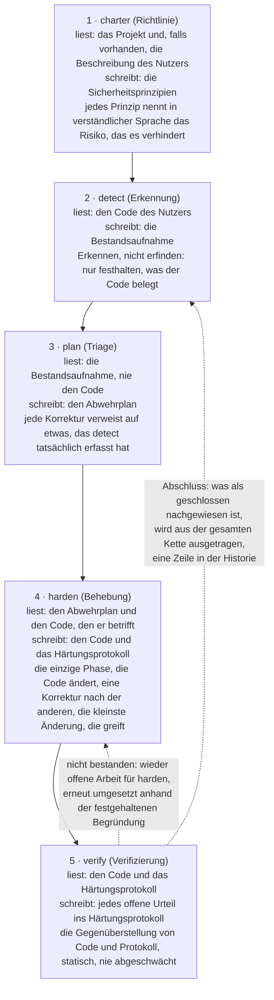
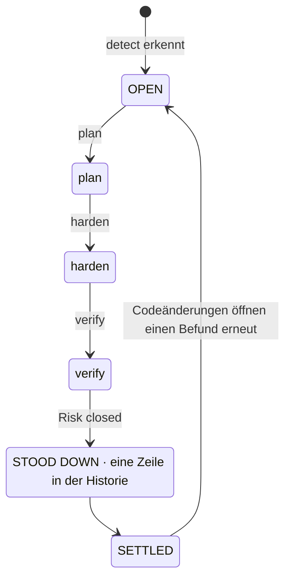
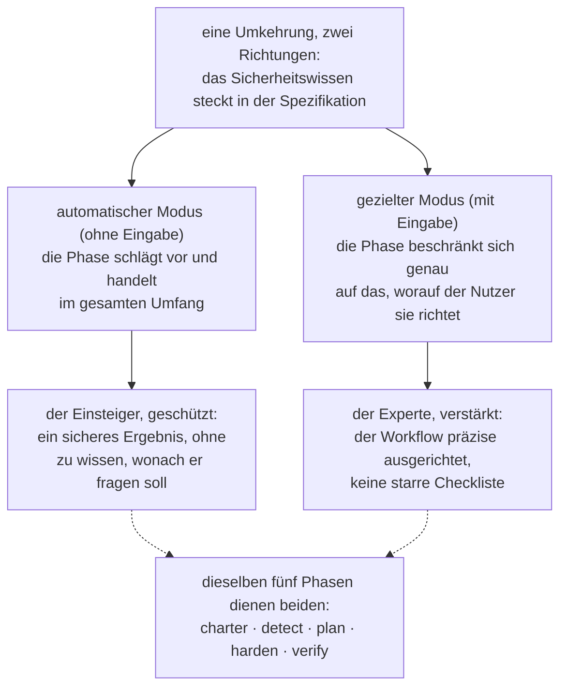
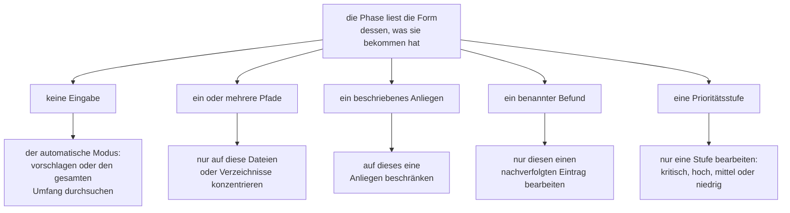
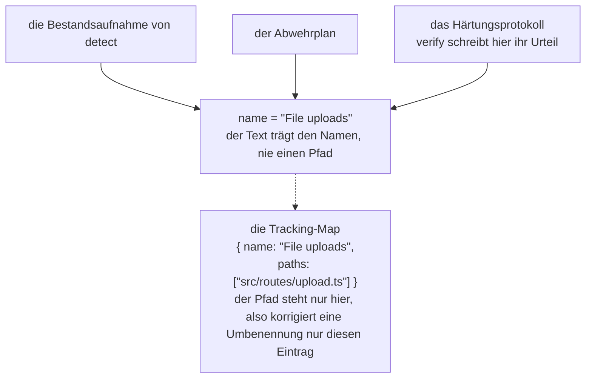
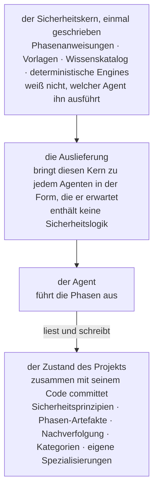
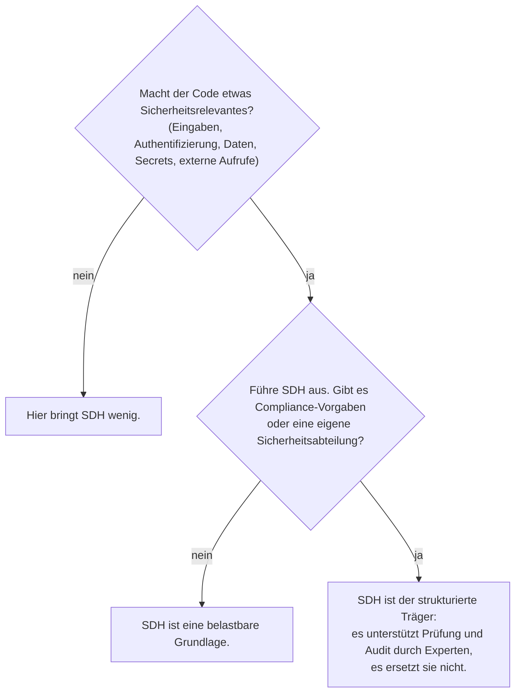

# Security-Driven Hardening: eine Konvention für das Zeitalter der KI-gestützten Entwicklung

> Die Methodik Security-Driven Hardening (SDH): eine kontextbezogene Blue-Team-Konvention für das Auditieren und Härten von Software, die mit KI-Unterstützung oder per Vibe Coding entsteht.

Kanonische URL: https://lagune.ai/de-DE/docs/references/paper
Sprache: de-DE
Original: https://lagune.ai/docs/references/paper
Zuletzt aktualisiert: 2026-11-04

- **Weslley Araújo**
- **Methodenpapier, 2026.**

---

## Zusammenfassung

Security-Driven Hardening (SDH) ist eine strukturierte, KI-gesteuerte und ausschließlich defensive Sicherheitsmethodik für eine Zeit, in der Software zunehmend von KI-Agenten und von Menschen geschrieben wird, die keine Sicherheitsfachleute sind. Statt eine generische Checkliste abzuarbeiten, erkennt SDH zuerst, was ein System tatsächlich tut (Anmeldung, Datei-Uploads, Zahlungen, Offenlegung von Daten und so weiter), und steuert dann die Sicherheitsarbeit, die genau zu diesem Kontext passt. Standardmäßig sichere Prinzipien geben den Rahmen vor, die Methodik ist vollständig auf Verteidigung ausgerichtet und in verständlicher Sprache formuliert, damit jeder Nutzer danach handeln kann.

Dieses Dokument vertritt die These, dass SDH eine fehlende Konvention ist, kein einzelnes Werkzeug. Das Sicherheitswissen steckt in der Methodik und ihren bei Bedarf geladenen Spezialisierungen, einer Grundlage, auf der jeder Nutzer aufbauen kann, und so dient derselbe Workflow einem Einsteiger wie einem Experten. Zwei Eigenschaften unterscheiden SDH von früheren Spec-first-Ansätzen `[1]`. SDH ist **zustandsunabhängig**: Es passt sich an ein leeres Verzeichnis, ein laufendes Projekt, einen einzelnen Pull Request oder eine große Legacy-Codebasis an, in jedem Stack. Und SDH ist **abschließbar**: Ein als geschlossen verifiziertes Risiko wird aus dem gesamten Workflow ausgetragen, sodass dieser Befund in den Ruhezustand übergeht und erst wieder geöffnet wird, wenn sich der Code ändert. SDH ersetzt weder Sicherheitsfachleute noch spezialisierte Blue-Team-Werkzeuge. Es erweitert das Wissen der Entwickler selbst, und je mehr ein Entwickler von Sicherheit versteht, desto mehr kann er es steuern.

**Lagune** ist die Referenzimplementierung und belegt, dass sich die Methodik umsetzen und übertragen lässt. SDH versteht sich als Konvention, die andere übernehmen können.

> **Schlagwörter**
>
> KI-gestützte Entwicklung, Softwaresicherheit, defensive Sicherheit, spec-driven development, Security Hardening, agentengesteuerte Workflows, Abschließbarkeit, kontextbezogene Sicherheit, Wissen bei Bedarf, agentenunabhängige Werkzeuge.

---

## I. Einleitung: die Sicherheitslücke, die KI-gestützte Entwicklung geöffnet hat

Immer mehr Software stammt von Menschen, und von KI-Agenten, die ein unsicheres Muster nicht zuverlässig erkennen: ein geleaktes Secret, eine fehlende Autorisierungsprüfung, eine für Injection anfällige Abfrage. Das sind keine exotischen Risiken. Sie gehören zu den Risikoklassen, die reale Vorfälle dominieren und seit Jahren in öffentlichen Referenzen dokumentiert sind `[6]`, `[7]`, und aktuelle Studien zeigen, dass ein nennenswerter Anteil des KI-generierten Codes genau mit solchen Mängeln ausgeliefert wird `[8]`. KI-Programmierassistenten haben das verschärft, weil sie auch Nicht-Entwicklern ermöglichen, echte Software auszuliefern, doch die Lücke reicht über jede einzelne Zielgruppe hinaus. Die meisten Projekte bekommen nie eine Sicherheitsprüfung, die auf das zugeschnitten ist, was sie tatsächlich tun. Mit jeder vorschnellen Entscheidung nach dem Motto "läuft, raus damit" wird das Ökosystem fragiler.

Generische Sicherheitsratschläge schließen diese Lücke nicht. Eine statische Checkliste ist nicht auf das zugeschnitten, was ein System tut, deshalb überschwemmt sie ein kleines Projekt mit irrelevanten Punkten und übersieht trotzdem das Risiko, auf das es bei genau diesem Projekt ankommt. Das Problem ist nicht, dass es auf der Welt zu wenig Sicherheitswissen gäbe. Das Problem ist, das passende Wissen dem System zuzuordnen, das tatsächlich vor dem Nutzer liegt, und das für jemanden, der vielleicht nicht weiß, wonach er fragen soll.

SDH antwortet darauf mit einer einzigen Umkehrung: **Das Sicherheitswissen steckt in der Spezifikation und ihren bei Bedarf geladenen Spezialisierungen, einer Grundlage, auf der jeder Nutzer aufbauen kann**. Die Methodik erkennt den Kontext, priorisiert die Risiken, die dieser Kontext mit sich bringt, und leitet die Korrekturen an, sodass Entwickler und Nicht-Entwickler denselben Workflow nutzen. Befunde und Empfehlungen bleiben in verständlicher Sprache, damit man unabhängig vom technischen Vorwissen danach handeln kann. Den Experten schränkt das nicht ein, sondern verstärkt ihn, eine Dualität, die wir in `§VI` ausführen.

> **Kernaussage**
>
> **Die zentrale Umkehrung:** Das Sicherheitswissen steckt in der Spezifikation und ihren bei Bedarf geladenen Spezialisierungen, einer Grundlage, auf der jeder Nutzer aufbauen kann. Die Methodik lernt, was das System tut, stimmt die Sicherheitsarbeit darauf ab und erweitert, was der Nutzer bereits weiß.

Angenommen, ein Entwickler sagt zu einem KI-Assistenten: "Meine App lässt Nutzer ein Profilbild hochladen." Ohne Sicherheitsprüfung liefert der Assistent funktionierenden Code, der stillschweigend allem vertraut, was der Client schickt: dem angegebenen Dateityp, dem Dateinamen, der Größe. Der Upload geht live, und eine als Bild getarnte Datei kann Code enthalten, ein manipulierter Name kann aus dem Speicherpfad ausbrechen, eine übergroße Datei kann den Server lahmlegen. Nichts davon ist in einer Demo zu sehen, also wird es ausgeliefert.

Derselbe Code verhält sich mit SDH anders. SDH erkennt, dass das System Dateien von außen annimmt (Erkennung), leitet daraus die Risiken ab, die ein Upload mit sich bringt (Triage), schlägt vor, den echten Dateityp und die Größe zu prüfen, die Datei beim Speichern umzubenennen und sie dort abzulegen, wo kein Code ausgeführt werden kann (Behebung), liest dann das Ergebnis und bestätigt, dass jede Schutzmaßnahme tatsächlich greift (Verifizierung). Der Entwickler musste den Begriff "uneingeschränkter Datei-Upload" nie kennen. Die Methodik hat ihn an seiner Stelle eingebracht.

Dieses Dokument leistet folgende Beiträge:

- Eine präzise Definition von SDH als Methodik, unabhängig von einer bestimmten Implementierung, samt ihren Gestaltungsprinzipien (`§III`).
- Ein defensiver Lebenszyklus in fünf Phasen, in dem die Aufgabentrennung selbst der Beitrag ist: Die Erkennung erfindet nie etwas, die Planung liest nie Code, nur eine Phase ändert Code, und die Verifizierung schwächt ihr Urteil nie ab (`§IV`).
- **Abschließbarkeit** als methodische Haltung: Ein einzelner Befund hat einen Endzustand statt einer Endlosschleife (`§V`).
- Die Dualität als **Erweiterung des Entwicklerwissens**: ein Workflow, der den Einsteiger schützt und den Experten verstärkt (`§VI`).
- **Nicht aufrufbare Spezialisierungen und Prompt bei Bedarf**: fokussiertes Sicherheitswissen, das der Agent lädt, wenn der Kontext des Projekts es verlangt, nie standardmäßig (`§VII`).
- **Zustandsunabhängigkeit** und **nicht vorschreibende Anpassungsfähigkeit**: SDH passt in jeden Entwicklungsstand und richtet sich nach dem Szenario, statt einen festen Umfang vorzugeben (`§VIII`).
- Ein **präventiver Modus**: dieselbe Verteidigung, während die alltägliche Arbeit entsteht, sodass der Code von Anfang an standardmäßig sicher ist und die Phasen weniger korrigieren müssen (`§IX`).
- Ein eigener Vergleich mit Spec-Driven Development, der Linie, aus der SDH hervorgegangen ist und von der es sich dann gelöst hat (`§X`).
- Die technischen Disziplinen, mit denen die Methodik Refactorings übersteht und von jedem Agenten unabhängig bleibt: Nachverfolgung mit Identität über den Namen (`§XI`) und ein agentenunabhängiger Träger (`§XII`).

---

## II. Hintergrund und verwandte Arbeiten

SDH baut auf früheren Arbeiten auf. Es übernimmt eine bewährte Struktur aus der agentengesteuerten Spec-first-Entwicklung `[1]`, `[2]`, `[3]`: Vorlagen, Slash-Befehle, die ein Agent verarbeitet, ein übergeordnetes Dokument und einen Agenten, der die Phasen ausführt. Diese Struktur setzt es mit defensivem Zweck neu um. Die Herkunft ist gewollt, und eines der Arbeitsprinzipien von SDH benennt sie direkt: den Workflow auf einer bewährten Struktur aufbauen und ihn dann auf Sicherheit ausrichten.

SDH ist keine statische Checkliste generischer Empfehlungen. Eine Checkliste weiß viel über Sicherheit im Allgemeinen und nichts über das Projekt vor ihr. SDH kehrt diese Gewichtung um. Es steckt seinen ersten Aufwand in die Erkennung, also darin, zu lernen, was das System tut, und greift erst dann zu dem Wissen, das durch die Erkennung relevant wird.

SDH ersetzt auch keine Sicherheitsfachleute und keine spezialisierten Blue-Team-Werkzeuge. Es erweitert das Wissen der Entwickler (`§VI`). Ein Team mit eigener Sicherheitsabteilung sollte sie behalten. SDH gibt diesem Team einen strukturierten Träger, und einem Team ohne eine solche Abteilung eine belastbare Grundlage.

SDH steht außerdem neben deterministischen Sicherheitsscannern (statische Analyse, Linter) `[4]`, `[5]`. Diese Werkzeuge sind gerade deshalb wertvoll, weil sie deterministisch und wiederholbar sind. SDH beruht überwiegend auf dem Schlussfolgern des Agenten und tauscht strengen Determinismus gegen Kontextbezug. Die Methodik gibt auch nicht vor, es wäre anders. Wo Determinismus zählt, bettet sie eine deterministische Engine in das Schlussfolgern ein (`§VII`): Der Agent entscheidet, ob es sich lohnt, eine Eingabe zu prüfen, und ein deterministisches Programm entscheidet, ob diese Eingabe gefährlich ist.

Der direkteste Vorläufer ist Spec-Driven Development (SDD), die Familie der Spec-first-Methodiken, die eine Entwicklung von einer ausführbaren Spezifikation aus vorantreibt. Wir behandeln SDD als Klasse. Seine klarste Darstellung als Praxismethodik ist der Bericht von Piskala `[1]`, sein sichtbarstes agentengesteuertes Toolkit ist Spec Kit von GitHub `[2]`, und OpenSpec `[3]` ist ein zweites Werkzeug aus derselben Familie. Damit sind die maßgeblichen Referenzen für den Vergleich in `§X` benannt.

---

## III. SDH: Definition und Gestaltungsprinzipien

**Security-Driven Hardening** ist eine strukturierte, KI-gesteuerte Sicherheitsmethodik, die eine Codebasis sicherer macht, indem sie die Arbeit von einer Spezifikation aus steuert, die der Agent ausführt, statt von spontanen Korrekturen. Der Name ist von den **Blue Teams** inspiriert, den Verteidigern im Sicherheitsbereich. Bei SDH geht es um Verteidigung, Härtung und Verifizierung, nie um Angriff.

> **Definition**
>
> **Security-Driven Hardening (SDH):** Eine strukturierte, KI-gesteuerte, ausschließlich defensive Sicherheitsmethodik, die zuerst erkennt, was ein System tatsächlich tut, und dann die kontextspezifische Sicherheitsarbeit steuert, bestimmt von standardmäßig sicheren Prinzipien und in verständlicher Sprache formuliert.

SDH wird durch eine Reihe verbindlicher Prinzipien definiert. Jedes ist eine Regel, und jedes gibt dem Nutzer eine bestimmte Garantie.

| Prinzip                                                                 | Die Regel                                                                                                                                                                            | Was es dem Nutzer garantiert                                                                                                                                                                                |
| ----------------------------------------------------------------------- | ------------------------------------------------------------------------------------------------------------------------------------------------------------------------------------ | ----------------------------------------------------------------------------------------------------------------------------------------------------------------------------------------------------------- |
| Standardmäßig sicher, in verständlicher Sprache, für alle gleichermaßen | Jeder Standardwert, jede Meldung und jede Korrektur ist von Haus aus sicher und für jeden Leser verständlich, ob Entwickler oder nicht. Keine Nutzergruppe wird bevorzugt.           | Ein Einsteiger erhält eine sichere Grundlage, ohne danach zu fragen, und versteht das Ergebnis in seinen eigenen Worten.                                                                                    |
| Kontextbezogen statt generisch                                          | Jede Phase geht vom Kontext aus, den detect erkannt hat, und arbeitet mit dem, was das System tatsächlich tut.                                                                       | Die Empfehlungen passen zum Projekt, nicht zu einer Checkliste. Das Sicherheitswissen steckt in der Spezifikation und ihren bei Bedarf geladenen Spezialisierungen und erweitert, was der Nutzer mitbringt. |
| Flexibel statt starr                                                    | Prinzipien, Anforderungen und Empfehlungen sind Ausgangspunkte. Der Nutzer kann alles umformulieren, streichen, ergänzen oder eingrenzen.                                            | Die Methodik passt sich dem Projekt und dem Nutzer an und ist nie strenger, als der Nutzer es will. Flexibilität schwächt nie die standardmäßig sichere Grundlage.                                          |
| Abgleichen statt nur anhängen                                           | Artefakte sind lebendige Dokumente, keine Logs. Jeder Lauf prüft jeden Eintrag neu: behalten, was noch gilt, umschreiben, was sich geändert hat, entfernen, was nicht mehr zutrifft. | Die Aufzeichnungen spiegeln immer die Gegenwart wider und verkommen so nie zu einem veralteten Backlog.                                                                                                     |
| Ausschließlich defensiv                                                 | SDH auditiert, härtet und verifiziert. Es erzeugt nie offensive Werkzeuge, Exploits für böswillige Zwecke oder Techniken zur Umgehung von Erkennung, um Schaden anzurichten.         | Die Methodik lässt sich nicht als Waffe einsetzen. Dual-Use-Inhalte erscheinen nur in einem klar defensiven Rahmen.                                                                                         |
| Spec-first, agentengesteuert, auf Sicherheit ausgerichtet               | Der Workflow besteht aus Vorlagen, Befehlen, übergeordneten Sicherheitsprinzipien und einem Agenten, der die Phasen ausführt.                                                        | Eine bewährte Entwicklungsstruktur, so umgewidmet, dass der Agent die eigentliche Sicherheitsarbeit leistet.                                                                                                |

**Tabelle 1.** Die Gestaltungsprinzipien von SDH und die Garantie, die jedes dem Nutzer gibt.

Diese Prinzipien sind keine Zierde. Sie sind die Vorgaben, die jede der folgenden Phasen einhalten muss, und die Diskussion in `§XV` greift sie wieder auf, um die Grenzen der Methodik abzustecken.

Der Rest des Dokuments entwickelt neun benannte Säulen. Sie sind die Teile, die ein Leser im Kopf behalten können sollte, und die Teile, die ein anderes Team neu umsetzen würde, um zu behaupten, es betreibe SDH.

| Säule                                                               | Was sie leistet                                                                                                                                          | Abschnitt   |
| ------------------------------------------------------------------- | -------------------------------------------------------------------------------------------------------------------------------------------------------- | ----------- |
| Die kontextbezogene Umkehrung                                       | Das Sicherheitswissen steckt in der Spezifikation und ihren bei Bedarf geladenen Spezialisierungen, sodass Einsteiger und Experte einen Workflow teilen. | `§I`, `§VI` |
| Der defensive Lebenszyklus in fünf Phasen                           | Aufgabentrennung: Richtlinie, Erkennung, Triage, Behebung, Verifizierung, jede mit genau einer Aufgabe.                                                  | `§IV`       |
| Abschließbarkeit                                                    | Ein Befund hat einen Endzustand statt einer Endlosschleife. Abgeschlossene Arbeit wird ausgetragen.                                                      | `§V`        |
| Die Dualität als Erweiterung des Entwicklerwissens                  | Ein Workflow, der den Einsteiger schützt und den Experten verstärkt, ohne einen von beiden zu ersetzen.                                                  | `§VI`       |
| Prompt bei Bedarf, nicht aufrufbares Wissen                         | Relevantes Sicherheitswissen wird für das geladen, was das Projekt ist, nie standardmäßig.                                                               | `§VII`      |
| Zustandsunabhängigkeit und nicht vorschreibende Anpassungsfähigkeit | Passt in jeden Entwicklungsstand und jeden Stack und richtet sich nach dem Szenario, statt einen Umfang vorzugeben.                                      | `§VIII`     |
| Der präventive Modus                                                | Dieselbe Verteidigung läuft mit, während neue Arbeit entsteht, sodass der Code von Anfang an standardmäßig sicher ist.                                   | `§IX`       |
| Nachverfolgung mit Identität über den Namen                         | Ein Befund bleibt über alle Phasen hinweg ein Eintrag, und eine Umbenennung unterbricht die Verknüpfung nur an einer Stelle.                             | `§XI`       |
| Der agentenunabhängige Träger                                       | Der Sicherheitskern wird einmal geschrieben und hängt von keinem Agenten und keinem Stack ab.                                                            | `§XII`      |

**Tabelle 2.** Die neun benannten Säulen von SDH und wo jede ausgeführt wird.

---

## IV. Der Blue-Team-Workflow in 5 Phasen

SDH gliedert die Arbeit in einen defensiven Lebenszyklus aus fünf Phasen (Abbildung 1). Jede Phase ist auf Verteidigung ausgerichtet, jede baut auf der vorherigen auf, und die Phasen folgen der echten Arbeit eines Blue Teams: Richtlinie festlegen, erkennen, triagieren, beheben, verifizieren.



**Abbildung 1.** Der Workflow in fünf Phasen: was jede Phase liest, was sie schreibt und ihre tragende Invariante. Verify steuert beide Rückwege: Eine nicht bestandene Schutzmaßnahme öffnet harden erneut, und ein als geschlossen nachgewiesener Befund wird aus der Kette ausgetragen, mit einer Zeile in der Historie.

Die Aufgabentrennung ist der Beitrag. Weil jede Phase genau eine Aufgabe hat, bleibt ein Fehler auf eine Stelle beschränkt, und der Leser kann sich auf das verlassen, was jedes Artefakt aussagt.

> **Kernaussage**
>
> **Applied heißt nicht verifiziert:** Harden hält fest, dass eine Korrektur umgesetzt wurde. Verify prüft das nach und stellt dafür den Code diesem Protokoll gegenüber, und das Urteil wird nie abgeschwächt, damit es zum Protokoll passt. Eine Schutzmaßnahme kann im Code vorhanden sein und das Risiko trotzdem erreichbar lassen, und dann lautet das ehrliche Urteil "Risk not closed".

### charter (Richtlinie)

Die Phase charter legt die Sicherheitsprinzipien des Projekts fest, die Regeln, die jede spätere Phase einhalten muss. Sie ist die übergeordnete Ebene, eine Art Prüfung zur Kompilierzeit für das Sicherheitsniveau des Projekts. Jedes Prinzip hat einen klaren Namen, eine unverhandelbare Regel, die sich am Code überprüfen lässt, und eine Zeile `Why:`, die das Risiko nennt, das es verhindert, nicht nur die Korrektur. Die Phase liest immer das Projekt selbst (seine Manifeste, seine Struktur und seine Abhängigkeiten), und eine Beschreibung des Nutzers gibt, falls vorhanden, eine Richtung vor, die das Lesen dann über das Genannte hinaus erweitert. Ohne Beschreibung ist das Projekt die einzige Quelle. Beides ergänzt sich, statt zu konkurrieren, und die Sicherheitsprinzipien halten die Richtlinie fest, an die sich das Projekt halten soll, nicht den Zustand seines Codes. Auch wer nicht entwickelt, sollte sie lesen und sowohl die Regel als auch das Risiko verstehen können.

### detect (Erkennung)

Detect liest den Code und erfasst, was das System tatsächlich tut und was dabei sicherheitsrelevant ist. Die leitende Anweisung lautet "Erkennen, nicht erfinden": nur festhalten, was der Code belegt, mit den Belegen, die spätere Phasen brauchen. Detect ist neutral. Die Phase zwingt ihre Befunde nicht in die Sicherheitsprinzipien, denn Risiken an deren Regeln zu messen, ist Aufgabe der Phase plan. Jeder Befund besteht aus drei Teilen: was er ist (eine Beschreibung in verständlicher Sprache), warum er wichtig ist (das Risiko, nicht nur die Tatsache) und der Beleg (die Funktion oder Route, in der er steckt). Der Beleg enthält keinen Dateipfad. Der Pfad steht nur in der Tracking-Map (`§XI`), sodass der Text nie einen Pfad enthält, der veralten kann.

### plan (Triage)

Plan macht aus jedem Befund eine Korrektur, benannt nach ihrer Risikoklasse (mit Verweis auf die etablierten Referenzen CWE und OWASP, wo diese sie begründen) und an das Sicherheitsprinzip gebunden, das die Korrektur wahrt. Die Priorität (kritisch, hoch, mittel, niedrig) ist keine freie Wahl: plan bewertet jeden Befund nach CVSS v4.0 mit Base- und Environmental-Metriken, sodass die Stufe den Score in einfachen Worten ausdrückt, begründet mit einer verständlichen Zeile zu Exposition und Tragweite, und zwei Läufe ergeben dieselbe Reihenfolge. Der Vektor ist der präzise Anker für Experten, die Stufe mit ihrer Begründung dieselbe Bewertung in einer Form, der jeder folgen kann. Plan arbeitet nur mit der Bestandsaufnahme von detect und liest nie den Code. Das ist eine bewusste Vorgabe, keine Schwäche: Sie zwingt jede Korrektur, auf etwas zu verweisen, das detect tatsächlich erkannt hat. Wurde ein Bereich nie erfasst, hält plan an und schickt den Nutzer zurück zu detect, statt zu raten.

### harden (Behebung)

Harden ist die einzige Phase, die Code ändert, deshalb geht sie mit Vorsicht vor. Ob eine Änderung die Zustimmung des Nutzers braucht, entscheiden der Agent und der Berechtigungsmodus, in dem er läuft, daher fügt harden keinen eigenen Bestätigungsschritt hinzu. Die Phase setzt eine Korrektur nach der anderen um, zuerst die Abhängigkeiten, dann die höchste Priorität, damit jede Änderung klein, überprüfbar und leicht rückgängig zu machen bleibt. Sie schwächt nie eine bestehende Schutzmaßnahme ab, damit eine neue Korrektur passt, und sie verletzt nie eines der Sicherheitsprinzipien. Würde eine Korrektur einem Prinzip widersprechen, hält harden an und zeigt den Konflikt auf, statt die Korrektur umzusetzen. Jeder Block wird als Applied, Partial oder Blocked festgehalten. "Applied heißt noch nicht verifiziert", und darum kümmert sich die nächste Phase.

### verify (Verifizierung)

Verify liest den Code und stellt ihn dem gegenüber, was harden festgehalten hat, um jede umgesetzte Schutzmaßnahme zu prüfen. Die Verifizierung ist genau diese Gegenüberstellung, Code gegen Protokoll, und sie ist statisch: Sie bestätigt, dass eine Schutzmaßnahme im Code vorhanden und korrekt ist, nicht dass sie auf einem laufenden System einem Angriff standhält. Diese Prüfung zur Laufzeit, also die Art, die echte oder simulierte Angriffe gegen das laufende System ausführt, liegt bewusst außerhalb des Umfangs. Verify liefert eines von drei Urteilen: Risk closed, Risk not closed oder Cannot tell from the code. Die Phase erzeugt kein eigenes Artefakt: harden und verify teilen sich das Härtungsprotokoll, wobei harden verantwortet, was getan wurde, und verify das Urteil samt Begründung, und keine der beiden schreibt je in die Felder der anderen. Eine nicht bestandene Schutzmaßnahme ist wieder offene Arbeit für harden, deren nächster Lauf das Urteil über die eigene Lesart des Codes stellt und die Korrektur genau an der Lücke, die die Begründung benennt, erneut umsetzt. Verify traut dem Code mehr als dem Protokoll, denn ein Protokoll kann mehr behaupten, als der Code leistet. Auf den Code des Nutzers greift die Phase nur lesend zu, und sie schwächt ein Urteil nie ab, damit es zum Protokoll passt. Eine Schutzmaßnahme kann vorhanden sein und das Risiko auf anderem Weg trotzdem erreichbar lassen, und dann lautet das ehrliche Urteil "Risk not closed". Bemerkt verify beim Lesen ein Sicherheitsproblem, das die Bestandsaufnahme von detect nie abgedeckt hat, erfindet sie dafür kein Urteil, denn das Erkennen ist Aufgabe von detect: Sie meldet das Problem und schickt den Nutzer zurück zu detect, damit der Befund über denselben Workflow hereinkommt, statt ihn zu umgehen.

> **Durchgehendes Beispiel: Datei-Uploads.** Ein einzelner Befund zeigt das Rückgrat des Workflows von Anfang bis Ende.
>
> - **detect** findet ihn: Das System nimmt Dateien von Nutzern an, und der Upload-Handler vertraut dem MIME-Typ, den der Client schickt, ohne den echten Typ der Datei zu prüfen. _Warum das wichtig ist:_ Eine als Bild getarnte Datei kann Schadcode verbergen.
> - **plan** legt die Korrektur fest, Priorität **kritisch**, zur Wahrung des Prinzips "Jede Eingabe gilt als nicht vertrauenswürdig, bis sie validiert ist": den echten Typ und die Größe der Datei prüfen, sie beim Speichern umbenennen und Uploads dort ablegen, wo sie nicht als Code ausgeführt werden können.
> - **harden** setzt sie um, Status **Applied**: Der Handler erkennt den echten Typ jetzt am Inhalt, erzwingt ein Größenlimit, lehnt alles Unerwartete ab, benennt beim Speichern um und legt die Dateien dort ab, wo kein Code ausgeführt werden kann.
> - **verify** liest den Handler, stellt ihn dem Protokoll gegenüber und liefert **Risk closed**: Der Code tut genau das, was das Protokoll behauptet.
>
> Derselbe Befundname zieht sich durch die Bestandsaufnahme von detect, den Abwehrplan und das Härtungsprotokoll, und verify arbeitet unter demselben Namen mit diesem Protokoll: Ein offenes Urteil wird in den Block des Befunds geschrieben, und ein als geschlossen nachgewiesener Befund wird ausgetragen (`§V`). Dieser gemeinsame Name ist seine Identität (`§XI`).

---

## V. Abschließbarkeit: Ein Befund hat einen Endzustand

Die meisten Sicherheitswerkzeuge hinterlassen beim Nutzer einen Backlog, der nur wächst. SDH vertritt eine andere Position: **Ein Befund ist abschließbar, er hat also einen Endzustand, statt in einem endlosen Backlog zu leben** (Abbildung 2). Das folgt direkt aus dem Prinzip des Abgleichs.

> **Definition**
>
> **Abschließbarkeit:** Ein als geschlossen verifiziertes Risiko wird aus dem gesamten Workflow ausgetragen, sodass dieser Befund in den Ruhezustand übergeht und erst wieder geöffnet wird, wenn sich der Code ändert. Ein Befund hat einen Endzustand, auch wenn das Sicherheitsprogramm selbst fortlaufend bleibt.

Die Artefakte von SDH sind lebendige Dokumente, keine Logs. Bei jedem erneuten Lauf gleicht eine Phase jeden vorhandenen Eintrag mit dem aktuellen Stand ab und tut eines von drei Dingen: Sie behält, was noch gilt, schreibt um, was sich geändert hat, oder entfernt, was nicht mehr zutrifft. Ein Befund, den der Code inzwischen als behoben ausweist, wird einfach entfernt. Der Arbeitsstand spiegelt die Gegenwart wider, nicht die Vergangenheit.

Der Abschluss ist derselbe Abgleich, an seinem Ende angekommen. Bestätigt verify, dass ein Risiko geschlossen ist, trägt sie den Befund aus dem gesamten Workflow aus: aus der Bestandsaufnahme von detect, dem Abwehrplan, dem Härtungsprotokoll und der Tracking-Map. Deshalb ist verify die eine Phase, die in die Artefakte der anderen Phasen schreibt: Sie ist die Phase, die den Kreis schließt. Wenn der Befund die Kette verlässt, verdichtet ihn das Austragen zu einem kurzen Eintrag in einer Historie, die außerhalb der Arbeitskette liegt und nie erneut verarbeitet wird. Das ist die Grenze zwischen Verschwinden und Abschließen: Ein Befund, den der Abgleich entfernt hat, weil er nicht mehr zutraf, hinterlässt nichts, während sich ein als geschlossen nachgewiesener Befund seine Zeile in der Historie verdient. Ein ausgetragener Befund fehlt danach in jedem Arbeitsartefakt, und dieses Fehlen ist erwartet, keine unterbrochene Kette.



**Abbildung 2.** Der Zustandsautomat der Abschließbarkeit. Ein Befund durchläuft OPEN → STOOD DOWN → SETTLED und wird erst wieder geöffnet, wenn sich der Code ändert.

Ist alles im Umfang ausgetragen, ist der Zyklus im Ruhezustand, und dieser Ruhezustand hat eine konkrete Form: Ein Artefakt, dessen letzter Befund abgeschlossen wurde, wird ganz entfernt, sodass eine vollständig abgeschlossene Kette nur die Sicherheitsprinzipien und die Historie übrig lässt, die Richtlinie und den Nachweis. Der Zyklus wird erst wieder geöffnet, wenn sich der Code ändert. Die Methodik gibt jedem Befund ein klares Ende, und genau das kann ein endloser Backlog nicht.

---

## VI. Die Dualität als Erweiterung des Entwicklerwissens

SDH ersetzt keine Menschen und keine spezialisierten Blue-Team-Werkzeuge. Es **erweitert das Wissen der Entwickler selbst**. Je mehr ein Entwickler von Sicherheit versteht, desto präziser kann er den Workflow steuern und desto mehr Autonomie hat er. Ein Entwickler, der wenig davon versteht, erhält trotzdem ein sicheres Ergebnis, weil der automatische Modus ihn absichert.

Die Umkehrung aus `§I`, nach der das Sicherheitswissen in der Spezifikation steckt, wirkt in beide Richtungen. Für den Einsteiger ist sie Schutz: Er muss nicht wissen, wonach er fragen soll, weil die Spezifikation Vorschläge macht. Für den Experten ist sie Verstärkung: Dieselbe Spezifikation erlaubt ihm, den Workflow präzise auszurichten, statt gegen eine starre Checkliste anzuarbeiten.

Jede Phase trägt diese Dualität in ihrer eigenen Arbeitsweise (Abbildung 3). Ohne Eingabe gestartet, arbeitet sie im Namen des Nutzers im gesamten Umfang. Mit einer Vorgabe beschränkt sich dieselbe Phase genau auf das, worauf der Nutzer sie richtet.



**Abbildung 3.** Die Dualität als Erweiterung des Entwicklerwissens. Eine Umkehrung dient zwei Zielgruppen: Der automatische Modus schützt den Einsteiger, und der gezielte Modus verstärkt den Experten, mit denselben fünf Phasen.

Die bei Bedarf geladenen Spezialisierungen (`§VII`) machen die Dualität in ihrem eigenen Text ausdrücklich. Jede sagt dem Agenten, dass ihr Wissen "dein Urteilsvermögen erweitert" und dass er über das hinaus weiterdenken soll, was die Spezialisierung liefert. Das Wissen ist eine Untergrenze, keine Obergrenze. Genau das dient beiden Zielgruppen in der Balance, die das Dokument anstrebt: Die Entwickler-Community erhält ein substanzielles Werkzeug, und wer im Blue Team arbeitet, erhält einen strukturierten Träger, der nicht vorgibt, ihm die Arbeit abzunehmen.

---

## VII. Nicht aufrufbare Spezialisierungen und Prompt bei Bedarf

Dies ist das neuartigste Muster der Methodik. SDH bringt fokussiertes Sicherheitswissen als Spezialisierungen mit, die **nur bei Bedarf** laden, und der Agent selbst entscheidet, welche er lädt, indem er sie mit dem Kontext des Projekts abgleicht. Wir nennen das **Prompt bei Bedarf**: eine Möglichkeit für den Agenten, anhand des Umfangs des Projekts, in dem er sich befindet, zu wählen, welches Wissen er aktiviert, statt jede Prüfung standardmäßig auszuführen. Die Spezialisierungen entwickeln sich weiter, und jede von ihnen kann sich jederzeit ändern oder ersetzt werden. Der Beitrag ist das Muster, nicht die Spezialisierungen selbst.

> **Definition**
>
> **Prompt bei Bedarf:** Der Agent wählt aus, welches Sicherheitswissen er aktiviert, indem er es mit dem Umfang des Projekts vor ihm abgleicht, sodass das relevante Wissen für das herangezogen wird, was das Projekt tatsächlich ist, statt jede Prüfung standardmäßig auszuführen.

> **Definition**
>
> **Nicht aufrufbare Spezialisierung:** Eine fokussierte, sprachunabhängige Einheit von Sicherheitswissen für einen Kontext, etwa Datei-Uploads oder Code, der im Browser läuft. Sie auditiert und erklärt, schreibt nie Code um und erzeugt nie eine Angriffseingabe. Sie ist kein Befehl: Sie lädt, wenn der Kontext, den sie abdeckt, im Umfang liegt, oder wenn ein Prompt sie beim Namen anfordert.

Jede Spezialisierung benennt die sichereren Formen für die Risiken, die sie abdeckt, und sagt dem Agenten, wie er in jeder Phase, die sie nutzt, mit einem Befund umgeht: wie er ihn bei der Erkennung beurteilt, wie er die Korrektur bei der Behebung sicher umsetzt und wie er sie bei der Verifizierung nachweist.

Das prägende Merkmal ist, dass eine Spezialisierung **nicht eigenständig aufrufbar** ist: Sie ist kein Befehl, und innerhalb des Workflows lädt sie nur ein Treffer. Die Erkennungsphase listet den Katalog einmal auf, gleicht den Kontext des Projekts mit dem ab, was jeder Eintrag abdeckt, und lädt nur die Spezialisierungen, deren Kontext im Umfang vorhanden ist. Die späteren Phasen verwenden diese Trefferliste wieder, statt erneut aufzulisten, sodass ein einziger Abgleich der gesamten Kette dient, und der präventive Modus (`§IX`) führt denselben Abgleich mit der Arbeit durch, die gleich entstehen soll. Eine Spezialisierung, deren Kontext fehlt, wird übersprungen, und das Überspringen wird genauso begründet wie das Laden: Jeder Eintrag im Katalog erhält ein ausdrückliches Urteil, angewendet oder übersprungen, mit der aus dem Code abgelesenen Begründung, sodass ein vages Gefühl von Irrelevanz nie an die Stelle tatsächlichen Fehlens tritt. Keine passende zu finden, ist ein gültiges Ergebnis.

Der Katalog besteht aus Daten, und Wachstum bedeutet eine Wissensdatei plus eine Katalogzeile, nie einen neuen Befehl. Die integrierten Spezialisierungen sind in Kategorien gruppiert, etwa OWASP, eine Programmiersprache oder KI-Integrationen, und der Katalog, den ein Projekt nutzt, enthält die integrierten Spezialisierungen der Kategorien, die es gewählt hat, plus seine eigenen Spezialisierungen. Das Projekt hält diese Wahl zusammen mit dem Rest seines Zustands fest, sodass ein ganzes Team mit demselben Katalog abgleicht. Das ist dasselbe kontextbezogene Prinzip wie bei den Phasen, angewandt auf Wissen: Das relevante Wissen wird für das herangezogen, was das Projekt tatsächlich ist, statt jede Prüfung standardmäßig auszuführen. Dieselbe Eigenschaft erlaubt es dem Nutzer, nicht nur dem Maintainer, den Katalog zu erweitern: Eine Sicherheitsquelle oder ein Thema, das der Nutzer einbringt, wird zu einer neuen Spezialisierung verdichtet, die dem Projekt gehört, unabhängig von den Kategorien in seinen Katalog aufgenommen wird und genau wie eine integrierte lädt, wobei sie die integrierte mit demselben Namen ersetzt. Auch das Verfassen einer Spezialisierung ist ausschließlich defensiv und folgt derselben Grenze, die die Spezialisierungen durchsetzen: Die Beschreibung eines Angriffs darf die Quelle sein, doch die daraus entstehende Spezialisierung auditiert und erklärt, sie liefert nie einen funktionsfähigen Exploit. So reicht die Umkehrung aus `§I`, die Intelligenz in der Spezifikation, bis in den Katalog selbst, den der Nutzer für seinen eigenen Kontext vertiefen kann, ohne Code zu schreiben.

Ein kurzes Beispiel veranschaulicht Prompt bei Bedarf. Detect liest einen Ordner mit Code, der im Browser läuft. Die Phase findet diesen Kontext im Katalog, lädt die Spezialisierung, die ihn abdeckt, und meldet über die üblichen Schritte von detect einen clientseitigen Befund. Die Spezialisierungen, deren Kontext in diesem Umfang fehlt, passen nicht, laden also nie, und jede wird als übersprungen festgehalten. Das Projekt hat entschieden, welches Wissen relevant war, nicht eine feste Konfiguration.

Determinismus taucht genau dort auf, wo er zählt. Eine Spezialisierung kann ein deterministisches Prüfprogramm mitbringen, nicht nur Text: Wo eine Risikoklasse ein klares Entscheidungsverfahren hat, liefert ein kleines Programm für eine gegebene Eingabe ein festes Urteil, zum Beispiel aus einer kurzen Menge von Wörtern wie `safe`, `unsafe` oder `invalid input`. Manche Risikoklassen lassen sich genau so deterministisch entscheiden, und hinter dem Entscheidungsverfahren steht eine Reihe früherer Arbeiten `[9]`, `[10]`, `[11]`. Das Prüfprogramm bewertet entweder Kandidaten, die der Agent liefert, oder durchsucht den Umfang selbst nach ihnen, und in beiden Fällen liefert das Prüfprogramm das Urteil, nicht der Agent. Eine Spezialisierung, die universell genug ist, kann im Katalog als verpflichtend markiert werden und wird dann immer angewendet, wobei ihr Prüfprogramm über den gesamten Umfang läuft. Das ist der einzige Fall, in dem Wissen ohne Kontexttreffer lädt, und er ist in den Daten des Katalogs festgelegt, nie vom Agenten im Moment entschieden. Hier verankert SDH das Schlussfolgern des Agenten in etwas Wiederholbarem, ohne vorzugeben, der gesamte Workflow sei deterministisch.

Schließlich sind die Spezialisierungen **ablösbar**. Weil das Wissen für sich allein steht, kann ein Nutzer eine davon direkt in einem Prompt ausführen, der nichts mit dem vollständigen Workflow von SDH zu tun hat, und so die Sicherheit bei der alltäglichen Entwicklung mitlaufen lassen. Eine Spezialisierung mit deterministischem Prüfprogramm kann zum Beispiel jeden Kandidaten prüfen, der während der alltäglichen Programmierarbeit entsteht, und nur die sicheren behalten. Diese Ablösbarkeit ist ein Grund dafür, dass sich SDH an so viele Situationen anpasst, worum es in `§VIII` geht, und ihren vollen Ausdruck findet sie im präventiven Modus (`§IX`), in dem dasselbe Wissen die alltägliche Entwicklung von Anfang bis Ende absichert.

---

## VIII. Zustandsunabhängigkeit und nicht vorschreibende Anpassungsfähigkeit

Zwei Eigenschaften unterscheiden SDH von starren Spezifikationsmethodiken.

### Zustandsunabhängigkeit

> **Definition**
>
> **Zustandsunabhängigkeit:** Die Methodik hängt nicht vom Entwicklungsstand ab. Sie passt zu einem leeren Verzeichnis, einem laufenden Projekt, einem einzelnen Pull Request oder einer großen Legacy-Codebasis, in jedem Stack, weil sie den Ausgangspunkt erfasst, indem sie ihn liest.

Jede Phase arbeitet gleich, ob das Projekt brandneu ist oder bereits existiert. Die Phase charter leitet Prinzipien aus dem Code ab, der gerade vorhanden ist. Detect erfasst den Code, der da ist, auch wenn es sehr wenig ist. Es gibt keinen vorausgesetzten Ausgangspunkt.

### Nicht vorschreibende Anpassungsfähigkeit

> **Definition**
>
> **Nicht vorschreibende Anpassungsfähigkeit:** Die Methodik passt sich dem Szenario an, statt einen festen Umfang vorzugeben, dem der Nutzer folgen muss. Weiß der Nutzer nicht, was er sagen soll, liest sie die Umgebung, in der sie aufgerufen wurde, erzeugt Kontext und stellt die Fragen, die bestimmen, was sie als Nächstes tut.

Der Vorschlagsmodus der Phase charter ist das deutlichste Beispiel: SDH leitet durch eine Analyse des Projekts standardmäßig sichere Prinzipien ab, fragt den Nutzer nur, wenn eine Lücke das Ergebnis tatsächlich verändert, schreibt sie dann und stellt jedes Prinzip in verständlicher Sprache mit dem Risiko vor, das es verhindert. Die Sicherheitsprinzipien sind ein lebendiges Dokument, das der Nutzer durch erneutes Ausführen überarbeitet, kein Vertrag hinter einer Freigabeabfrage, und so muss der Nutzer nie wissen, wonach er fragen soll.

Diese Anpassungsfähigkeit zeigt sich als Gespür für die Form der Eingabe: Dieselbe Phase liest, was sie bekommen hat, und wählt einen Modus (Abbildung 4). Eine Datei im Prompt, ein Befund aus der Liste, eine Sorge, ein gezielter Auftrag gegen einen bekannten Schwachpunkt oder der Wunsch nach einem vollständigen Brute-Force-Durchlauf: Jedes davon passt zu dem, was der Nutzer braucht, weil der Workflow von Grund auf nicht vorschreibend ist. Nichts davon schwächt die standardmäßig sichere Grundlage. Flexibilität bestimmt, wie die Grundlage angewendet wird, sie senkt sie nie.



**Abbildung 4.** Nicht vorschreibende Anpassungsfähigkeit. Dieselbe Phase liest die Form ihrer Eingabe und wählt einen Modus, sodass der Umfang immer beim Nutzer liegt und nie vorgegeben wird.

---

## IX. Der universelle präventive Modus: dieselbe Verteidigung, während die Arbeit entsteht

SDH bringt einen ergänzenden Modus mit: alltägliche Entwicklung, bei der dieselbe Verteidigung aktiv ist, während der Code geschrieben wird. Der Nutzer bittet um die Arbeit selbst, eine Anmeldeseite, einen Upload, einen Endpoint, und die Methodik sichert die Entwicklung ab, während sie geschieht, sodass das Ergebnis in dem Moment standardmäßig sicher ist, in dem es fertig ist, statt erst nach einer späteren Härtung.

> **Definition**
>
> **Der präventive Modus:** alltägliche Entwicklung unter der übergeordneten Ebene und dem Wissen von SDH. Die Sicherheitsprinzipien binden die Entwicklung, die Spezialisierungen, die für das gerade Entstehende relevant sind, laden bei Bedarf, und das Ergebnis wird genau der Verteidigung gegenübergestellt, die eingesetzt wurde, bevor die Arbeit als fertig gilt.

Der Modus verwendet jedes Teil wieder, das die Phasen bereits mitbringen, nur gerichtet auf Code, den es noch nicht gibt. Die Kontexterkennung wendet sich vom Code zur Absicht: Der Agent denkt durch, was er gleich bauen wird und welche Grenzen diese Arbeit überschreitet (eine Anmeldung bedeutet Zugangsdaten, eine Sitzung und Eingaben von außen), und genau diese Überlegung wird mit dem Wissenskatalog abgeglichen. Prompt bei Bedarf (`§VII`) wird hier verallgemeinert: Kontext lässt sich im Plan für Code erkennen, nicht nur in bestehendem Code. Die Sicherheitsprinzipien gelten wie immer, und eine Anfrage, die ein Prinzip verletzen würde, wird als Konflikt gemeldet und nie gebaut. Die Verteidigung wird direkt angewendet, in dem Moment, in dem jedes Teil geschrieben wird, mit Validierung an der Grenze und dem sicheren Konstrukt gleich beim ersten Mal, sodass nie eine funktionierende, aber unsichere Version entsteht, die korrigiert werden müsste.

Der Modus endet so, wie verify beginnt. Bevor die Arbeit als fertig gilt, stellt derjenige, der sie gebaut hat, das eigene Ergebnis der eingesetzten Verteidigung gegenüber: Die Schutzmaßnahme muss auf dem Weg des Risikos liegen, nicht daneben, sie muss vollständig sein, und wo eine Spezialisierung ein deterministisches Prüfprogramm mitbringt, hat dessen Urteil Vorrang vor der eigenen Lesart des Agenten. Eine Lücke, die hier auffällt, wird als Teil derselben Arbeit geschlossen, denn die Arbeit fertigzustellen heißt, sie sicher fertigzustellen.

Was der Modus ablehnt, ist ebenso bewusst gewählt wie das, was er tut. Er baut nur, was verlangt wurde, und auditiert nichts drumherum: Das Auditieren des Bestehenden ist Sache der Phasen. Er schreibt kein Artefakt und verfolgt keinen Befund nach, denn ein Befund ist ein in Bestehendem erkanntes Risiko, und der Zweck dieses Modus ist, dass die unsichere Version gar nicht erst entsteht. Die beiden Richtungen ergänzen sich: Die Phasen schließen ab, was schon da ist (`§V`), und der präventive Modus verhindert, dass neue Arbeit es wieder öffnet. Eine Kette im Ruhezustand bleibt im Ruhezustand, nicht weil die Entwicklung stillsteht, sondern weil alles, was in dieser Zeit entsteht, von vornherein abgesichert entsteht.

---

## X. Security-Driven Hardening im Vergleich zu Spec-Driven Development

Security-Driven Hardening (SDH) ist aus der Basis von Spec-Driven Development (SDD) hervorgegangen und hat sich dann deutlich davon entfernt. Das strukturelle Erbe ist real und anerkannt: Spec-first, agentengesteuert, ein übergeordnetes Dokument und eine Reihe von Befehlen in Phasen, die der Agent ausführt. SDH übernimmt diese Struktur bewusst. Anders sind der Zweck, das Autoritätsmodell, der vorausgesetzte Zustand und die Endbedingung. Wir behandeln SDD als Klasse und nehmen den Bericht von Piskala `[1]` als maßgebliche Darstellung der Methodik, Spec Kit von GitHub `[2]` als maßgebliches Toolkit für Agenten und OpenSpec `[3]` als zweites Werkzeug aus derselben Familie.

SDD stellt die herkömmliche Entwicklung auf den Kopf, indem es Spezifikationen ausführbar macht: Die Spezifikation erzeugt direkt eine funktionierende Implementierung, statt sie nur anzuleiten `[1]`. Seine Phasen treiben eine Entwicklung voran `[2]` (übergeordnete Prinzipien festlegen, spezifizieren, was gebaut wird, den Tech-Stack planen, den Plan in Aufgaben zerlegen, dann implementieren). Sein übergeordnetes Dokument, eine Verfassung aus Prinzipien, ist das Fundament, an das sich der Agent durchgehend halten muss. Das ist der Kern des Unterschieds. Bei SDD fließt die Autorität von der Spezifikation in die Entwicklung, und von der Implementierung wird erwartet, dass sie ihr folgt.

SDH kehrt fast jede Achse dieses Vertrags um (Tabelle 3).

> **Kernaussage**
>
> **Der zentrale Unterschied:** Bei SDD fließt die Autorität von der Spezifikation in die Entwicklung, und von der Implementierung wird erwartet, dass sie ihr folgt. SDH ist nicht vorschreibend und fließt in die andere Richtung, vom erkannten Kontext des Systems nach innen, und härtet, was bereits da ist.

| Achse                   | SDD                                                                                                            | SDH                                                                                                                                    |
| ----------------------- | -------------------------------------------------------------------------------------------------------------- | -------------------------------------------------------------------------------------------------------------------------------------- |
| Ziel                    | Funktionen liefern. Die Spezifikation wird zu einer funktionierenden Implementierung.                          | Härten, was existiert oder gerade entsteht. Jede Phase ist auf Verteidigung ausgerichtet.                                              |
| Autoritätsmodell        | Vorschreibend. Spezifikation und Verfassung beschränken die Entwicklung auf einen Umfang, dem sie folgen muss. | Nicht vorschreibend. SDH passt sich dem Szenario an, und der Nutzer kann umformulieren, streichen oder eingrenzen.                     |
| Zustandsannahme         | Eine Vorwärtsentwicklung aus einer Spezifikation.                                                              | Zustandsunabhängig: leeres Verzeichnis, laufendes Projekt, ein einzelner PR oder Legacy.                                               |
| Endbedingung            | Endet, wenn die Funktion gebaut ist.                                                                           | Abschließbar. Ein Befund erreicht den Ruhezustand und wird erst wieder geöffnet, wenn sich der Code ändert.                            |
| Übergeordnetes Dokument | Eine Verfassung aus Prinzipien, an die sich der Agent halten muss.                                             | Sicherheitsprinzipien, die vom Risiko her formuliert sind (jedes mit einer Zeile `Why:`), ausdrücklich kein fester Vertrag.            |
| Wie Wissen wächst       | Einen Befehl hinzufügen (oder die Phasen erweitern).                                                           | Eine nicht aufrufbare Spezialisierung hinzufügen, die der Agent bei Bedarf lädt: eine Datei plus eine Katalogzeile, kein neuer Befehl. |
| Wem es dient            | Jemandem, der eine Funktion vorantreibt.                                                                       | Jedem Nutzer, ob Entwickler oder nicht, im selben Workflow.                                                                            |
| Was Code ändert         | Die Implementierungsphase erzeugt das Ergebnis.                                                                | Nur die Phase harden ändert Code, eine Korrektur nach der anderen.                                                                     |

**Tabelle 3.** SDD und SDH im Vergleich über acht Achsen. Geliehene Struktur, umgekehrter Vertrag.

Um der Herkunft gerecht zu werden: SDD ist bewährter Stand der Technik, und SDH verdankt ihm die Struktur, auf der es läuft. Die Abweichung ist keine Kritik an SDD, das ein anderes Problem (die Vorwärtsentwicklung) gut löst. SDH nimmt dieselbe bewährte Maschinerie und richtet sie auf Verteidigung, Anpassungsfähigkeit und Abschluss aus. OpenSpec `[3]`, aufgebaut um Änderungsvorschläge, Aufgabenlisten und Spezifikationen pro Änderung, bestätigt das Muster: Die Familie treibt eine Entwicklung von einer Spezifikation aus voran, während SDH ein System ausgehend von seinem erkannten Kontext nach innen härtet. Selbst der präventive Modus von SDH (`§IX`), die einzige Stelle, an der es eine Vorwärtsentwicklung begleitet, behält den umgekehrten Vertrag bei: Er bestimmt, wie die Arbeit gebaut wird, und entscheidet nie, was gebaut wird.

---

## XI. Technische Sorgfalt: die Disziplin der Nachverfolgung

Die Disziplin, abzugleichen statt nur anzuhängen (`§V`), braucht eine Grundlage, die Refactorings übersteht. Ein Befund muss über jede Phase hinweg, die ihn berührt, ein Eintrag bleiben, und eine umbenannte oder verschobene Datei darf die Kette nicht unterbrechen. SDH löst das mit **Identität über den Namen** und **Pfaden nur in der Nachverfolgung**.

> **Definition**
>
> **Identität über den Namen:** Die Identität eines Befunds ist sein Name, in jedem Artefakt identisch geschrieben. Der Text trägt den Namen, nie einen Pfad. Dateipfade stehen nur in der Tracking-Map, sodass eine Umbenennung oder eine verschobene Datei die Verknüpfung an genau einer Stelle unterbricht.

Jeder Befund von detect ist ein nachverfolgter Eintrag. Seine Identität ist sein **Name**, der Abschnittstitel, identisch geschrieben in der Bestandsaufnahme von detect, im Abwehrplan und im Härtungsprotokoll. Die späteren Phasen übernehmen diesen Namen wörtlich, wenn sie an demselben Eintrag arbeiten, und verify schreibt ihr Urteil unter genau diesem Namen ins Härtungsprotokoll. Die Tracking-Map enthält Nachverfolgung und sonst nichts, einen Eintrag pro Befund:

```json
{ "name": "File uploads", "paths": ["src/routes/upload.ts"] }
```

Die Tracking-Map hält keinen Text fest, keine Anmerkungen, keine separate Kennung und keine Phase. Die Textartefakte tragen den Wortlaut, und die Map trägt nur Identität und Pfade. Dateipfade sind das einzig Veränderliche, und sie stehen nur hier. Eine Umbenennung oder eine verschobene Datei kann die Verknüpfung an genau einer Stelle unterbrechen, nie in zwei auseinanderlaufenden Kopien.



**Abbildung 5.** Das Förderband der Identität. Ein Befundname fließt durch jedes Artefakt, während sein Pfad nur in der Tracking-Map steht, sodass eine Umbenennung an einer Stelle korrigiert wird.

Zwei Vorgänge pflegen die Map im normalen Workflow, und ein dritter steht als Wartung für sich. **Track** ist eine additive Registrierung: Eine Phase meldet die Befunde, die sie geschrieben hat, und die Engine erfasst die neuen und folgt bei den übrigen einem umbenannten Pfad, wobei sie jeden als neu, verschoben oder unverändert einordnet. Track entfernt nie etwas, das die Phase nicht gemeldet hat. **Untrack** trägt die Befunde aus, die verify abgeschlossen hat: In einem deterministischen Durchgang verdichtet er jeden zu seinem Eintrag in der Historie, entfernt seinen gesamten Abschnitt aus den Artefakten, löscht ein Artefakt, dessen letzter Befund weg ist, und streicht seinen Tracking-Eintrag, sodass der Agent nichts davon von Hand erledigt. Wo der deterministische Durchgang nicht sicher weiterkommt, etwa bei einem ausgetragenen Namen, der noch im Text eines anderen Befunds zitiert wird, meldet er die Stelle dem Agenten, statt eine Änderung zu raten. Diese beiden rufen die Phasen während ihrer Arbeit auf. **Repair** ist der Wartungsvorgang: Eine Phase übergibt automatisch an ihn, wenn ihr eigener Abgleich die Nachverfolgung als inkonsistent erkennt (ein festgehaltener Pfad, den es nicht mehr gibt), und ansonsten wird er bei Bedarf ausgeführt. Er richtet die gesamte Map auf einmal neu aus, liest jedes Artefakt und den aktuellen Code, korrigiert die Pfade jedes Eintrags und legt offen, was er nicht allein entscheiden kann: einen verwaisten Eintrag (einen nachverfolgten Eintrag, den kein Artefakt mehr nennt) oder einen Umbenennungskandidaten (einen Eintrag, dessen Pfade zu einem anderen gemeldeten Namen passen).

Repair ist Wartung, keine sechste Phase. Er berührt weder den Code des Nutzers noch die Textartefakte, nur die Nachverfolgung. Den Quellcode des Nutzers liest er aus genau einem Grund, um den neuen Pfad einer umbenannten Datei zu erfahren, und er verfasst nie Sicherheitsinhalte. Der Mensch hat das letzte Wort bei der einen Entscheidung, die die Engine nicht raten will: ob ein verschwundener Eintrag behoben oder nur umbenannt wurde. Lieber fragen als raten, denn ein fälschlich gestrichener Eintrag unterbricht die Kette.

Die Methodik wendet ihre eigene Verteidigungsdisziplin auf sich selbst an. Die deterministischen Engines werden als Kommandozeilenprogramme aufgerufen, und jede Eingabe wird als eigenes Prozessargument übergeben, was sie unschädlich hält, sodass ein Wert mit Anführungszeichen oder Backticks nie in den Befehl eingeschleust werden kann. Eine unbekannte Prüfung schlägt fehl, statt zu antworten, sodass eine falsch geschriebene nie als sauberes Ergebnis durchgeht. SDH nimmt seine eigene Infrastruktur nicht vom Prinzip der standardmäßigen Sicherheit aus.

---

## XII. Der Träger: agentenunabhängige Architektur als Nachweis der Portabilität

Damit SDH eine Konvention sein kann, die andere übernehmen, darf es nicht an einen Agenten oder einen Stack gebunden sein, deshalb hält sein Träger drei Zuständigkeiten auseinander (Abbildung 6). Lagune belegt, dass das machbar ist.

**Der Sicherheitskern** wird einmal geschrieben und weiß nichts davon, welcher Agent ihn ausführt: die Phasenanweisungen und die Vorlagen, die sie ausfüllen, der Wissenskatalog und die deterministischen Engines. **Die Auslieferung** ist schlank: Ihre einzige Aufgabe ist, diesen Kern zu einem bestimmten Agenten zu bringen, in der Form und an den Ort, die der Agent erwartet, und sie enthält keine eigene Sicherheitslogik. **Der Zustand des Projekts** gehört dem Projekt: die Sicherheitsprinzipien, die Phasen-Artefakte, die Tracking-Map, die gewählten Kategorien und die eigenen Spezialisierungen, committet und überprüfbar wie jeder andere Teil seines Codes.



**Abbildung 6.** Der agentenunabhängige Träger. Der Sicherheitskern wird einmal geschrieben, eine schlanke Auslieferung bringt ihn zu jedem Agenten, und der Zustand bleibt beim Projekt.

Weil die Auslieferung keine Sicherheitslogik enthält, ändert die Art, wie sie gebaut ist, nichts an SDH. Ein Träger kann die Auslieferung selbst bauen oder einem Ökosystem überlassen, das bereits Skills für Agenten verteilt, wie es die Referenzimplementierung tut, und die Phasen, ihre Artefakte und ihre Garantien bleiben dieselben. Nichts davon ist zudem an eine Sprache oder eine Laufzeitumgebung gebunden. Die Referenzimplementierung ist zufällig in einem bestimmten Stack geschrieben, doch die Methodik ist die Grenze zwischen diesen Zuständigkeiten, nicht die Toolchain, die sie baut. Dasselbe Design ließe sich in einer ganz anderen Sprache neu umsetzen, ohne zu ändern, was SDH ist.

---

## XIII. Fallbeispiel: SDH von Anfang bis Ende

> **Fallbeispiel**
>
> **Defensive Härtung einer Upload- und Admin-Oberfläche.**
> **Kontext:** eine kleine App, die Datei-Uploads von Nutzern annimmt und sie auf einer Admin-Seite auflistet.
> **Muster:** charter → detect (mit Wissen, das der Kontext bei Bedarf aktiviert) → plan → harden → verify, mit einem Abschluss und einem echten Fehlschlag.
> **Ergebnis (Fähigkeit):** ein Risiko, das als geschlossen verifiziert und aus der Kette ausgetragen wird, und eine Schutzmaßnahme, die als _nicht_ geschlossen verifiziert und an harden zurückgegeben wird. Das Urteil spiegelt den Code wider, nicht das Protokoll.

_Dies ist ein veranschaulichendes Beispiel für die Mechanik der Methodik, keine im Feld gemessene Studie, und es nennt keine Kennzahlen zur Wirksamkeit._

Ein durchgehender Ablauf zeigt die Methodik in Aktion, nicht nur ihre Teile. Wir erweitern das Datei-Upload-Beispiel aus `§IV` um eine Aktivierung von Wissen bei Bedarf und einen Abschluss, und wir nehmen einen echten Fehlschlag auf.

1. **charter** schlägt das Prinzip "Jede Eingabe gilt als nicht vertrauenswürdig, bis sie validiert ist" vor, mit seinem Risiko in verständlicher Sprache: Ungeprüfte Eingaben sind der häufigste Weg, ein System zu kompromittieren.
2. **detect** durchsucht die Upload-Route und die kleine Admin-Seite, die hochgeladene Dateien auflistet. Die Phase erkennt den Upload-Befund (der Handler vertraut dem MIME-Typ des Clients). Die Admin-Seite läuft im Browser, ein Kontext, den Prompt bei Bedarf (`§VII`) erkennt, also lädt detect die Spezialisierung für diesen Kontext und meldet einen zweiten Befund: eine Stelle, an der ein Dateiname als Markup statt als Text in die Seite geschrieben wird, sodass ein manipulierter Name im Browser des Besuchers als Skript ausgeführt werden kann. Spezialisierungen, deren Kontext in diesem Umfang fehlt, laden nie, und jedes Überspringen wird festgehalten, wobei das Fehlen am Code abgelesen wird.
3. **plan** gibt der Upload-Korrektur die Priorität kritisch, gebunden an das Prinzip: den echten Typ und die Größe der Datei prüfen, beim Speichern umbenennen, dort ablegen, wo kein Code ausgeführt werden kann. Der zweiten Korrektur gibt die Phase die Priorität hoch: den Dateinamen als Text darstellen, nicht als Markup.
4. **harden** setzt zuerst die Upload-Korrektur um (höchste Priorität) und hält sie als Applied fest, danach die zweite, ebenfalls Applied.
5. **verify** liest jede Stelle und stellt Code und Protokoll gegenüber. Die Upload-Schutzmaßnahme greift: Der Handler erkennt den echten Typ am Inhalt, erzwingt ein Größenlimit und lehnt den Rest ab. Urteil: Risk closed. Verify trägt den Upload-Befund aus der gesamten Kette aus, und seine verdichtete Zusammenfassung landet in der Historie.

Es folgt der echte Fehlschlag. Angenommen, die zweite Korrektur von harden hat eine sichere Hilfsfunktion zur Textdarstellung hinzugefügt, aber den alten Aufruf, der Markup schreibt, auf einem anderen Codepfad weiterhin erreichbar gelassen. Verify liest die Seite, sieht die sichere Hilfsfunktion und sieht auch, dass der unsichere Pfad noch aktiv ist. Die Schutzmaßnahme ist vorhanden, aber das Risiko ist nicht geschlossen. Verify weigert sich, das Urteil abzuschwächen, damit es zum Protokoll passt. Die Phase liefert "Risk not closed", hält die Lücke fest und verweist zurück an harden. Eine Schutzmaßnahme, die das Risiko nicht vollständig behebt, gilt nicht als bestanden.

Das ist der Charakter der Methodik in einem Beispiel: kontextbezogene Erkennung, priorisierte Korrekturen, die an Prinzipien gebunden sind, sorgfältige Umsetzung und eine Verifizierung, die den tatsächlichen Zustand des Codes meldet, unabhängig vom Protokoll.

---

## XIV. Wann sich SDH eignet und wo seine Grenzen liegen

SDH ist selten so unverhältnismäßig, wie es ein schwerfälliger Prozess sein kann, weil es zustandsunabhängig und abschließbar ist: Es lässt sich auf eine einzelne Datei und ein einzelnes Anliegen herunterskalieren und erreicht einen Ruhezustand, statt eine dauerhafte Last zu hinterlassen. Seine Grenze ist nicht die Projektgröße, sondern die **Tiefe der Absicherung**.



**Abbildung 7.** Wann sich SDH eignet. Die Verzweigung fragt zuerst nach der Sicherheitsrelevanz, dann nach der Tiefe der Absicherung, nie nach der Projektgröße.

Wo SDH an seine Grenze stößt: Verhalten, das nur auftritt, wenn das System läuft (verify liest Code, sie führt das System nicht aus), Risiken, die von einer Konfiguration oder einer Umgebung abhängen, die der Agent nicht lesen kann, und Kontexte, in denen so viel auf dem Spiel steht, dass eine Prüfung durch Experten ohnehin vorgeschrieben ist. In jedem dieser Fälle bringt SDH als strukturierter erster Durchgang weiterhin Nutzen, aber es ist eine Untergrenze, keine Obergrenze.

> **Kernaussage**
>
> **Die Grenze:** Die Grenze von SDH ist die Tiefe der Absicherung, nicht die Projektgröße. Es kann fast überall als belastbare Grundlage dienen und unterstützt eine Prüfung durch Experten, wo viel auf dem Spiel steht, doch es ersetzt weder Tests am laufenden System noch das Urteil von Sicherheitsfachleuten.

---

## XV. Diskussion: Einordnung, Grenzen und was SDH nicht behauptet

SDH ist präzise, was seine Grenzen angeht.

### Es erweitert, es ersetzt nicht

SDH ersetzt weder Sicherheitsfachleute noch spezialisierte Blue-Team-Werkzeuge. Es erweitert das Wissen der Entwickler (`§VI`). Eine maßvolle Aussage ist die richtige: Gut angewendet **kann** SDH reale Risiken wirksam schließen, besonders bei Projekten, die sonst überhaupt keine Sicherheitsprüfung bekämen. Es ist keine Garantie und kein Ersatz für eine Prüfung durch Experten, wo viel auf dem Spiel steht.

### Ausschließlich defensiv, vom Aufbau her

SDH auditiert, härtet und verifiziert. Es erzeugt nie offensive Werkzeuge, Exploits oder Techniken zur Umgehung von Erkennung, um Schaden anzurichten. Dual-Use-Sicherheitsinhalte sind nur in einem klar defensiven, autorisierten Rahmen zulässig. Das ist eine harte Grenze, keine Vorliebe.

### Die Verifizierung ist substanziell, nicht theatralisch

Verify prüft, indem sie den Code liest und dem Protokoll gegenüberstellt, nicht indem sie das System ausführt. Das ist statische Verifizierung: Sie bestätigt, dass eine Schutzmaßnahme im Code vorhanden und korrekt ist, und weist nicht nach, dass die Maßnahme zur Laufzeit einem Angriff standhält. Deshalb ist "Cannot tell from the code" ein legitimes Urteil, kein Fehlschlag, der sich hinter einem bestandenen Ergebnis versteckt. Wenn der Beleg nicht im Code steckt (weil er von der Konfiguration abhängt oder von einem Pfad, den der Agent nicht lesen kann), sagt SDH das, statt zu raten.

### Determinismus ist begrenzt und benannt

Der Großteil von SDH beruht auf dem Schlussfolgern des Agenten, und genau das ermöglicht seinen Kontextbezug. Determinismus ist den deterministischen Engines vorbehalten: den Prüfprogrammen, die eine Spezialisierung mitbringen kann (`§VII`), und der Tracking-Engine (`§XI`). Das Dokument verwischt diese Grenze nicht. Wo ein Ergebnis deterministisch ist, ist es das Ergebnis eines Programms. Wo es erschlossen ist, ist es die Lesart des Codes durch den Agenten, und der Nutzer hat das letzte Wort.

### Kosten und Skalierung

Ein vollständiger Durchlauf verbraucht viele Tokens. Die manuellen Modi (`§VI`, `§VIII`) gibt es unter anderem, damit die Kosten im Verhältnis zum Anliegen stehen.

### Der Nutzer hat das letzte Wort

SDH lässt den Menschen entscheiden, ob etwas umbenannt oder behoben wurde, und die Freigabe seiner Codeänderungen bleibt dort, wo der Nutzer seinen Agenten ohnehin steuert: im Berechtigungsmodus, in dem er ihn ausführt. Die Methodik schlägt vor und verifiziert. Sie setzt sich nicht über den Menschen hinweg.

### Einwände und Antworten

Ein fairer Skeptiker wird mehrere Einwände erheben. Die gewichtigen verdienen es, in ihren eigenen Worten gestellt zu werden.

**"Ist das nicht einfach ein statisches Analysetool mit angeflanschtem LLM?"** Nein. Ein statisches Analysetool führt standardmäßig jede Regel aus, die es hat. SDH erkennt zuerst, was das System ist, greift dann zum relevanten Wissen (`§II`, `§VII`) und _bettet_ ein deterministisches Prüfprogramm nur dort ein, wo eine Risikoklasse ein klares Entscheidungsverfahren hat. Das Schlussfolgern geht vom Kontext aus, der Determinismus ist gezielt.

**"Ist das nicht einfach eine Sicherheitscheckliste?"** Nein. SDH kehrt die Checkliste um: Die Erkennung kommt zuerst, und Wissen wird für das herangezogen, was das Projekt tatsächlich tut (`§II`, `§VII`).

**"Ist das nicht einfach SDD, neu verpackt für Sicherheit?"** Nein. SDH übernimmt die Struktur von SDD und kehrt seinen Vertrag um: Autorität, Zustandsannahme, Endbedingung und Zielgruppe unterscheiden sich allesamt (`§X`). Dieselbe Maschinerie, entgegengesetzte Richtung.

**"Halluziniert eine Methode, die auf KI-Schlussfolgerungen beruht, nicht einfach Befunde?"** Das Design schränkt das Erfinden ein, statt darauf zu vertrauen, dass sich das Modell benimmt. Detect hält nur fest, was der Code belegt ("Erkennen, nicht erfinden", `§IV`), verify stellt Code und Protokoll gegenüber und darf mit "Cannot tell from the code" antworten (`§XV`), deterministische Prüfprogramme stützen die entscheidbaren Fälle (`§VII`), und der Nutzer hat das letzte Wort. Das macht den Agenten nicht unfehlbar, aber es macht seine Aussagen überprüfbar.

Eine Anmerkung zur Einordnung. SDH wird hier unabhängig von seiner Referenzimplementierung definiert. Die fünf Phasen, die vom Risiko her formulierten Sicherheitsprinzipien, das Abgleichen statt nur Anhängen und seine Abschließbarkeit, das Wissen per Prompt bei Bedarf, der präventive Modus, die Nachverfolgung mit Identität über den Namen und die ausschließlich defensive Grenze sind die Methodik. Ein anderes Team könnte sie in einem anderen Stack und einem anderen Agenten-Ökosystem umsetzen, und das Ergebnis wäre trotzdem SDH. Lagune ist sein Nachweis, nicht seine Definition.

---

## XVI. Fallstricke und wie SDH sie strukturell vermeidet

Methodiken dieser Familie teilen eine bekannte Reihe von Fehlermustern. Die Antwort von SDH auf die meisten davon ist strukturell, in den Workflow eingebaut, statt der Disziplin überlassen.

| Fallstrick                                    | Das Problem                                                      | Die strukturelle Antwort von SDH                                                                                                                         |
| --------------------------------------------- | ---------------------------------------------------------------- | -------------------------------------------------------------------------------------------------------------------------------------------------------- |
| Verrottende Spezifikation, veralteter Backlog | Artefakte sammeln tote Einträge an, denen niemand traut          | Abgleichen statt nur anhängen (`§V`): Jeder Lauf prüft jeden Eintrag neu und entfernt, was behoben ist                                                   |
| Falsche Sicherheit, scheinbar bestanden       | Man nimmt an, eine vorhandene Schutzmaßnahme schließe das Risiko | Verify stellt Code und Protokoll gegenüber, sodass "Risk not closed" und "Cannot tell" vollwertige Urteile sind (`§IV`, `§XV`)                           |
| Checklistenflut                               | Generische Punkte verdecken das eine Risiko, auf das es ankommt  | Kontextbezogen statt generisch, mit Prompt bei Bedarf, der nur lädt, was der Umfang verlangt (`§VII`)                                                    |
| Werkzeug-Lock-in                              | Die Methode ist fest an einen Anbieter oder Agenten geschweißt   | Agentenunabhängiger Träger: Der Sicherheitskern wird einmal geschrieben, und seine Auslieferung an jeden Agenten enthält keine Sicherheitslogik (`§XII`) |
| Die Endlosschleife                            | Der Backlog schließt sich nie, die Arbeit ruht nie               | Abschließbarkeit und der Ruhezustand (`§V`)                                                                                                              |

**Tabelle 4.** Bekannte Fallstricke in dieser Methodikfamilie und die strukturelle Antwort von SDH auf jeden davon.

Darum geht es: den Fallstrick zu benennen und auf den Mechanismus zu zeigen. Das sind keine Mahnungen zur Vorsicht, sondern Eigenschaften des Workflows.

---

## XVII. Künftige Arbeiten

Die Methodik und ihre Referenzimplementierung haben klare nächste Schritte.

- **Den Wissenskatalog erweitern:**
  Jede Ergänzung behält die Form aus `§VII`: eine Wissensdatei und eine Katalogzeile, kein neuer Befehl. Den Weg für Nutzer gibt es dort bereits: Der Nutzer verdichtet seine eigenen Spezialisierungen bei Bedarf. Weitere integrierte Sprachen, Laufzeitumgebungen und Risikoklassen, jeweils in einer Kategorie, sind die Richtung auf Seiten des Maintainers, und die Spezialisierungen werden sich voraussichtlich weiterentwickeln.
- **Mehr deterministische Prüfprogramme:**
  Wo eine Risikoklasse ein klares Entscheidungsverfahren hat, kann eine Spezialisierung ein deterministisches Prüfprogramm mitbringen, das das Schlussfolgern des Agenten in einem wiederholbaren Urteil verankert. Das auf weitere Risikoklassen auszudehnen, ist eine naheliegende Richtung.
- **Empirische Evaluation:**
  Die wichtigste offene Frage ist die gemessene Wirksamkeit: die Qualität der Abschlüsse und die Rate falscher Urteile in realen Codebasen. Eine Studie der Sicherheitsergebnisse von SDH steht noch aus, und die Aussagen hier sind entsprechend eingegrenzt.

---

## XVIII. Fazit

KI-gestützte Entwicklung hat eine Sicherheitslücke geöffnet, die generische Checklisten nicht füllen können, weil das Risiko, auf das es ankommt, davon abhängt, was ein System tatsächlich tut, und weil die Person, die es ausliefert, vielleicht nicht weiß, wonach sie fragen soll. SDH schließt diese Lücke mit einem kontextbezogenen, ausschließlich defensiven und abschließbaren Workflow, in dem das Sicherheitswissen in der Methodik und ihren bei Bedarf geladenen Spezialisierungen steckt, einer Grundlage, auf der jeder Nutzer aufbauen kann. Es erkennt den tatsächlichen Kontext des Systems, priorisiert die Risiken, die dieser Kontext mit sich bringt, setzt Korrekturen sorgfältig um und verifiziert jede einzelne, dann trägt es aus, was es abgeschlossen hat, sodass jeder Befund einen Endzustand erreicht. Dieselbe Verteidigung läuft außerdem präventiv mit, während neue Arbeit entsteht, sodass geschlossen bleibt, was der Workflow schließt. Es passt sich jedem Entwicklungsstand in jedem Stack an und erweitert das Wissen der Entwickler, statt die Menschen und Werkzeuge zu ersetzen, die diese Arbeit bereits leisten.

Lagune ist der Nachweis, doch der Beitrag ist die Konvention. SDH versteht sich als der grundlegende Sicherheits-Workflow für das Zeitalter der Entwicklung mit KI, den andere übernehmen, verfeinern und in ihren eigenen Stacks umsetzen können.

---

## Literatur

**[1]** D. B. Piskala, "Spec-Driven Development: From Code to Contract in the Age of AI Coding Assistants," arXiv preprint arXiv:2602.00180v1 [cs.SE], Jan. 2026. (Submitted to AIWare 2026.) [Online]. Available: https://arxiv.org/abs/2602.00180

**[2]** GitHub, "Spec Kit: Toolkit for Spec-Driven Development." [Online]. Available: https://github.com/github/spec-kit. Accessed: 2026.

**[3]** Fission AI, "OpenSpec: Spec-Driven Development for AI Coding Assistants." [Online]. Available: https://github.com/Fission-AI/OpenSpec. Accessed: 2026.

**[4]** B. Chess and G. McGraw, "Static Analysis for Security," IEEE Security & Privacy, vol. 2, no. 6, pp. 76-79, 2004, doi: 10.1109/MSP.2004.111.

**[5]** OWASP Foundation, "Source Code Analysis Tools." [Online]. Available: https://owasp.org/www-community/Source_Code_Analysis_Tools. Accessed: 2026.

**[6]** OWASP Foundation, "OWASP Top 10:2021." [Online]. Available: https://owasp.org/Top10/. Accessed: 2026.

**[7]** MITRE, "Common Weakness Enumeration (CWE)." [Online]. Available: https://cwe.mitre.org/. Accessed: 2026.

**[8]** N. Perry, M. Srivastava, D. Kumar, and D. Boneh, "Do Users Write More Insecure Code with AI Assistants?," in Proc. ACM SIGSAC Conf. on Computer and Communications Security (CCS '23), 2023, pp. 2785-2799, doi: 10.1145/3576915.3623157. [Online]. Available: https://arxiv.org/abs/2211.03622

**[9]** J. Davis and contributors, "safe-regex: Detect Possibly Catastrophic, Exponential-Time Regular Expressions." [Online]. Available: https://github.com/davisjam/safe-regex. Accessed: 2026.

**[10]** D. Soshnikov, "regexp-tree: Regular Expressions Processor in JavaScript." [Online]. Available: https://github.com/DmitrySoshnikov/regexp-tree. Accessed: 2026.

**[11]** T. Jenkinson, "redos-detector: A CLI and Library to Score How Vulnerable a Regex Pattern Is to ReDoS Attacks." [Online]. Available: https://github.com/tjenkinson/redos-detector. Accessed: 2026.

---

## Anhang A: die Prinzipien im Wortlaut

1. **Standardmäßig sicher, in verständlicher Sprache, für alle gleichermaßen:**
   Jeder Standardwert, jede Meldung und jede Korrektur muss von Haus aus sicher und für jeden Nutzer verständlich sein, ob Entwickler oder nicht. Keine Nutzergruppe wird gegenüber einer anderen bevorzugt.
2. **Kontextbezogen statt generisch:**
   Jede Phase muss vom Kontext ausgehen, den detect erkannt hat, und mit dem arbeiten, was das System tatsächlich tut. Bevorzuge Empfehlungen, die auf diesen Kontext zugeschnitten sind, gegenüber generischen Checklisten. Das Sicherheitswissen steckt in der Spezifikation und ihren bei Bedarf geladenen Spezialisierungen und erweitert, was der Nutzer mitbringt.
3. **Flexibel statt starr:**
   SDH passt sich dem Projekt und dem Nutzer an. Prinzipien, Anforderungen und Empfehlungen sind Ausgangspunkte, kein fester Vertrag. Lass den Nutzer alles umformulieren, streichen, ergänzen oder eingrenzen. Flexibilität schwächt nie die standardmäßig sichere Grundlage, sie lässt den Nutzer nur bestimmen, wie sie angewendet wird.
4. **Abgleichen statt nur anhängen:**
   Artefakte sind lebendige Dokumente, keine Logs. Wenn eine Phase erneut läuft, gleiche jeden vorhandenen Eintrag mit dem aktuellen Stand ab: Behalte, was noch gilt, schreibe um, was sich geändert hat, und entferne, was nicht mehr zutrifft. Der Abschluss ist derselbe Abgleich, an seinem Ende angekommen.
5. **Ausschließlich defensiv:**
   SDH auditiert, härtet und verifiziert. Es erzeugt nie offensive Werkzeuge, Exploits für böswillige Zwecke oder Techniken zur Umgehung von Erkennung, um Schaden anzurichten. Dual-Use-Sicherheitsinhalte sind nur in einem klar defensiven, autorisierten Rahmen zulässig.
6. **Spec-first, agentengesteuert, auf Sicherheit ausgerichtet:**
   Baue den Workflow auf einer bewährten Struktur auf: Vorlagen, Befehle, übergeordnete Sicherheitsprinzipien und ein Agent, der die Phasen ausführt. Setze diese Struktur mit defensivem Zweck neu um.
