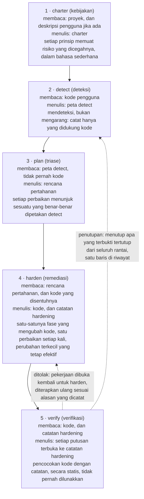
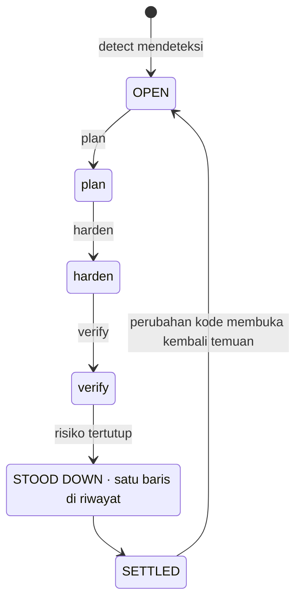
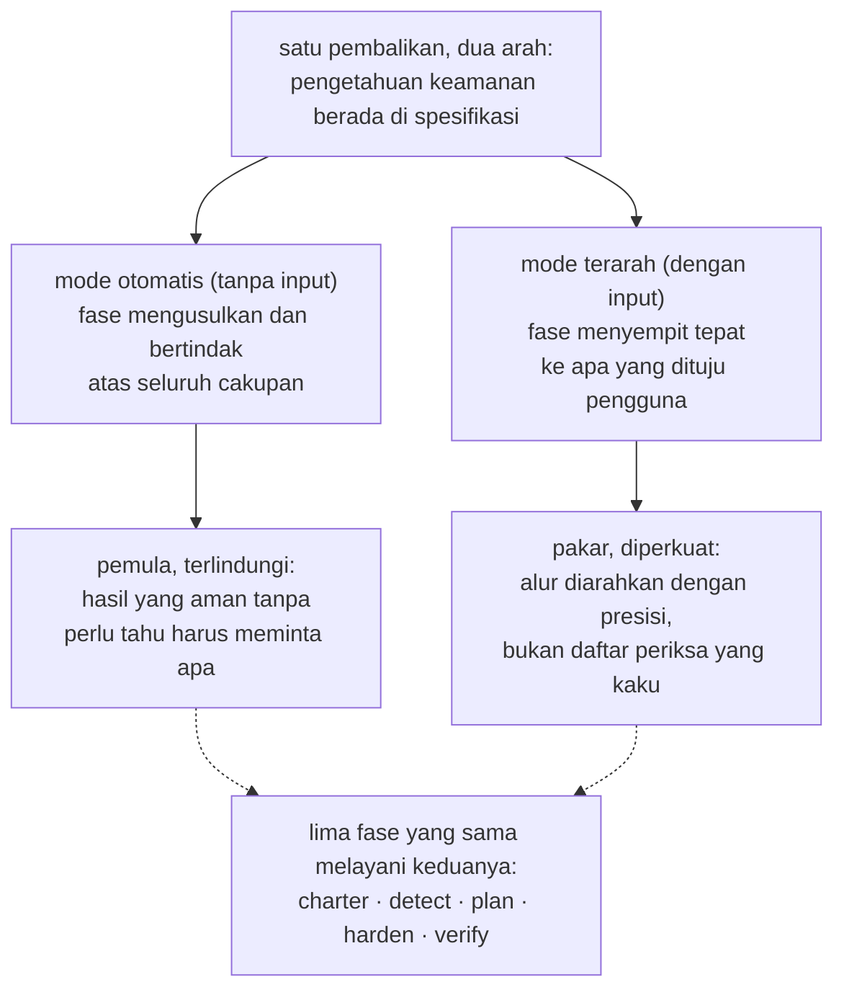
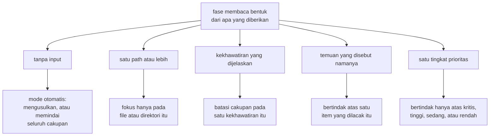
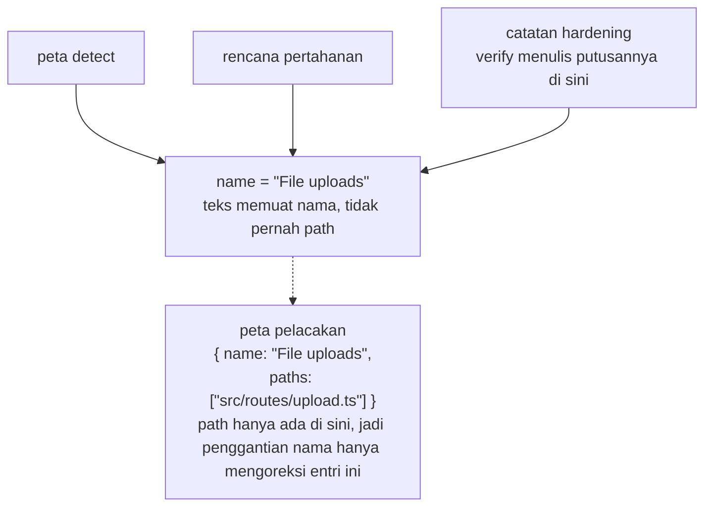
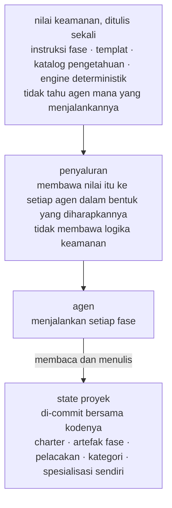
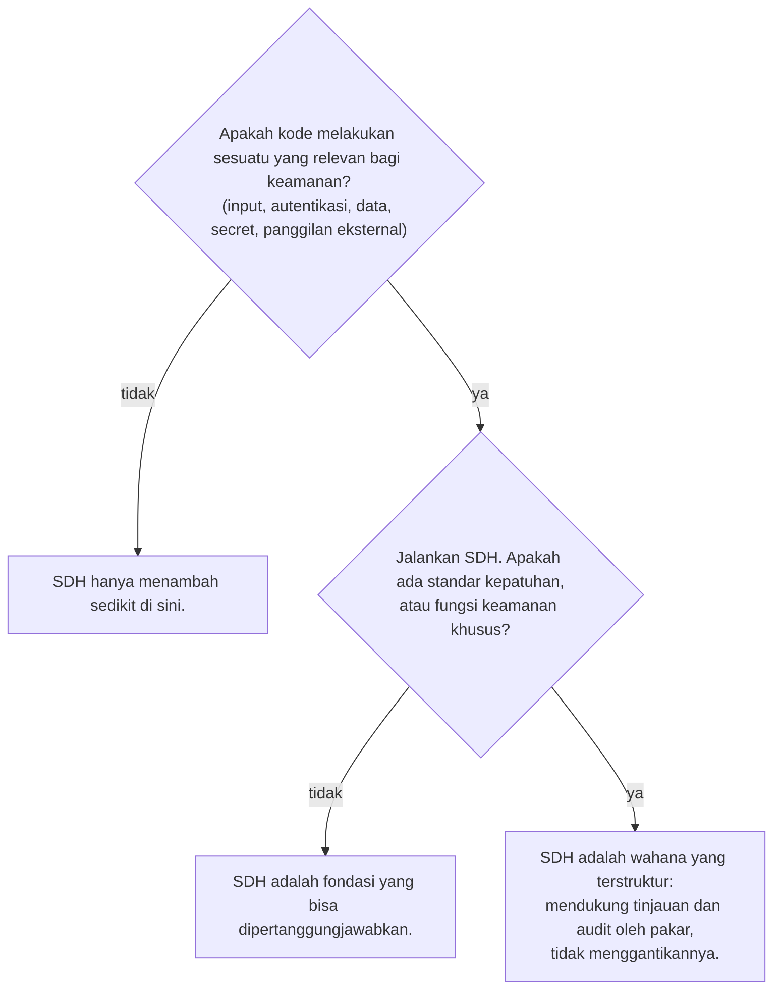

# Security-Driven Hardening: konvensi untuk era pengembangan berbantuan AI

> Metodologi Security-Driven Hardening (SDH): konvensi Blue Team yang peka konteks untuk mengaudit dan memperkuat keamanan perangkat lunak yang dibuat dengan bantuan AI dan vibe coding.

Kanonis: https://lagune.ai/id-ID/docs/references/paper
Bahasa: id-ID
Asli: https://lagune.ai/docs/references/paper
Terakhir diperbarui: 2026-11-06

- **Weslley Araújo**
- **Makalah metodologi, 2026.**

---

## Abstrak

Security-Driven Hardening (SDH) adalah metodologi keamanan yang terstruktur, digerakkan oleh AI, dan khusus pertahanan, untuk era ketika perangkat lunak makin banyak ditulis oleh agen AI dan oleh orang yang bukan spesialis keamanan. Alih-alih menjalankan daftar periksa generik, SDH lebih dulu mendeteksi apa yang sebenarnya dilakukan sebuah sistem (login, unggahan file, pembayaran, paparan data, dan sebagainya), lalu menggerakkan pekerjaan keamanan yang spesifik untuk konteks itu. SDH diatur oleh prinsip aman secara bawaan, sepenuhnya berorientasi pada pertahanan, dan disampaikan dalam bahasa sederhana sehingga pengguna mana pun bisa menindaklanjutinya.

Dokumen ini berargumen bahwa SDH adalah konvensi yang selama ini belum ada, bukan sekadar satu alat. Pengetahuan keamanan berada di dalam metodologi dan spesialisasinya yang dimuat hanya saat dibutuhkan, sebuah fondasi yang bisa dikembangkan setiap pengguna, sehingga pemula dan pakar bisa dilayani lewat alur yang sama. Dua sifat membedakannya dari pendekatan spec-first sebelumnya `[1]`. SDH **independen terhadap kondisi**: SDH menyesuaikan diri dengan direktori kosong, proyek yang sedang berjalan, satu pull request, maupun basis kode lama yang besar, di stack apa pun. Dan SDH **bisa dituntaskan**: risiko yang terverifikasi tertutup akan ditutup dari seluruh alur, sehingga temuan itu mencapai kondisi tuntas dan baru dibuka kembali saat kode berubah. SDH tidak menggantikan profesional keamanan atau tool Blue Team khusus. SDH memperluas pengetahuan developer itu sendiri, dan makin paham seorang developer tentang keamanan, makin jauh ia bisa mengarahkannya.

**Lagune** adalah implementasi referensinya, dan membuktikan bahwa metodologi ini bisa dibangun dan dibawa ke lingkungan lain. SDH ditawarkan sebagai konvensi yang bisa diadopsi pihak lain.

> **Kata kunci**
>
> Pengembangan berbantuan AI, keamanan perangkat lunak, keamanan defensif, spec-driven development, hardening keamanan, alur kerja yang digerakkan agen, ketertuntasan, keamanan peka konteks, pengetahuan yang dimuat saat dibutuhkan, tool yang tidak terikat agen.

---

## I. Pendahuluan: celah keamanan yang dibuka oleh pengembangan berbantuan AI

Perangkat lunak makin banyak dirilis oleh orang, dan oleh agen AI, yang tidak bisa diandalkan untuk mengenali pola yang tidak aman: secret yang bocor, pemeriksaan otorisasi yang terlewat, query yang bisa diinjeksi. Ini bukan risiko yang langka. Semuanya termasuk kelas risiko yang mendominasi insiden nyata, terdokumentasi selama bertahun-tahun dalam referensi publik `[6]`, `[7]`, dan studi terbaru melaporkan bahwa porsi yang cukup berarti dari kode buatan AI dirilis dengan cacat seperti itu `[8]`. Asisten coding AI memperparahnya dengan memungkinkan orang yang bukan developer merilis perangkat lunak sungguhan, tetapi celahnya lebih luas daripada satu kelompok pengguna mana pun. Sebagian besar proyek tidak pernah mendapat pemeriksaan keamanan yang spesifik untuk apa yang sebenarnya mereka lakukan. Ekosistemnya makin rapuh setiap kali keputusan prematur "sudah jalan, rilis saja" diambil.

Saran keamanan generik tidak menutup celah ini. Daftar periksa statis tidak spesifik untuk apa yang dilakukan sebuah sistem, sehingga proyek kecil dibanjiri item yang tidak relevan, sementara risiko yang penting bagi proyek itu tetap terlewat. Masalahnya bukan kurangnya pengetahuan keamanan di dunia. Masalahnya adalah mencocokkan pengetahuan yang tepat dengan sistem yang benar-benar ada di hadapan pengguna, dan melakukannya untuk seseorang yang mungkin tidak tahu harus meminta apa.

SDH menjawabnya dengan satu pembalikan: **pengetahuan keamanan berada di spesifikasi dan spesialisasinya yang dimuat hanya saat dibutuhkan, sebuah fondasi yang bisa dikembangkan setiap pengguna**. Metodologi ini mendeteksi konteks, melakukan triase atas risiko yang dibawa konteks itu, dan memandu perbaikannya, sehingga developer dan bukan developer dilayani lewat alur yang sama. Temuan dan rekomendasinya tetap dalam bahasa sederhana, sehingga bisa ditindaklanjuti berapa pun kedalaman teknis pembacanya. Pakar tidak dibatasi olehnya, justru diperkuat, sebuah dualitas yang kami kembangkan di `§VI`.

> **Wawasan kunci**
>
> **Pembalikan inti:** Pengetahuan keamanan berada di spesifikasi dan spesialisasinya yang dimuat hanya saat dibutuhkan, sebuah fondasi yang bisa dikembangkan setiap pengguna. Metodologi ini mempelajari apa yang dilakukan sistem, mencocokkan pekerjaan keamanan dengannya, dan memperluas apa pun yang sudah diketahui pengguna.

Bayangkan seorang developer yang berkata kepada asisten AI, "aplikasi saya memungkinkan pengguna mengunggah foto profil." Tanpa pemeriksaan keamanan, asisten itu menghasilkan kode yang berfungsi tetapi diam-diam memercayai apa pun yang dikirim klien: jenis file yang dinyatakan, nama file, ukurannya. Fitur unggahan itu dirilis, lalu file yang menyamar sebagai gambar bisa membawa kode, nama yang sengaja dirancang bisa keluar dari path penyimpanan, dan file yang terlalu besar bisa menghabiskan sumber daya server. Semua ini tidak terlihat dalam demo, jadi semuanya ikut dirilis.

Kode yang sama, bila dijalankan lewat SDH, berperilaku lain. SDH mendeteksi bahwa sistem menerima file dari luar (deteksi), menerjemahkannya menjadi risiko yang dibawa sebuah unggahan (triase), mengusulkan pemeriksaan jenis dan ukuran file yang sebenarnya, penggantian nama saat disimpan, dan penyimpanan di tempat kode tidak bisa dijalankan (remediasi), lalu membaca hasilnya dan memastikan setiap kontrol benar-benar tetap efektif (verifikasi). Developer itu tidak perlu tahu istilah "unggahan file tanpa batasan". Metodologi inilah yang menyediakannya untuknya.

Dokumen ini memberikan kontribusi berikut:

- Definisi yang tepat tentang SDH sebagai metodologi, terlepas dari implementasi mana pun, beserta prinsip desainnya (`§III`).
- Siklus hidup defensif lima fase yang pemisahan tugasnya justru menjadi kontribusinya: deteksi tidak pernah mengarang, perencanaan tidak pernah membaca kode, hanya satu fase yang mengubah kode, dan verifikasi tidak pernah melunakkan penilaiannya (`§IV`).
- **Ketertuntasan** sebagai sikap metodologis: setiap temuan punya titik akhir, bukan putaran tanpa akhir (`§V`).
- Dualitas **perluasan pengetahuan developer**: satu alur yang melindungi pemula dan memperkuat pakar (`§VI`).
- **Spesialisasi yang tidak bisa dipanggil langsung dan prompt-on-demand**: pengetahuan keamanan terfokus yang dimuat agen saat konteks proyek membutuhkannya, tidak pernah secara default (`§VII`).
- **Independensi kondisi** dan **adaptivitas non-otoritatif**: SDH cocok untuk kondisi pengembangan apa pun dan menyesuaikan diri dengan skenario alih-alih memaksakan cakupan yang tetap (`§VIII`).
- **Mode preventif**: pertahanan yang sama dijalankan selagi pekerjaan biasa dibangun, sehingga kode langsung aman secara bawaan dan setiap fase punya lebih sedikit hal untuk dikoreksi (`§IX`).
- Perbandingan khusus dengan Spec-Driven Development, akar tempat SDH tumbuh lalu memisahkan diri (`§X`).
- Disiplin rekayasa yang membuat metodologi ini bertahan dari refactor dan tetap tidak terikat agen mana pun: pelacakan identitas berdasarkan nama (`§XI`) dan wahana yang tidak terikat agen (`§XII`).

---

## II. Latar belakang dan karya terkait

SDH dibangun di atas karya sebelumnya. SDH mewarisi struktur yang sudah terbukti dari pengembangan spec-first yang digerakkan agen `[1]`, `[2]`, `[3]`: templat, perintah slash yang dikonsumsi agen, dokumen yang mengarahkan, dan agen yang menjalankan setiap fase. SDH mengimplementasikan ulang struktur itu dengan tujuan defensif. Silsilah ini disengaja, dan salah satu prinsip kerja SDH menyebutnya secara langsung: bangun alur kerja dari struktur yang sudah terbukti, lalu arahkan untuk keamanan.

SDH bukan daftar periksa statis berisi rekomendasi generik. Daftar periksa tahu banyak tentang keamanan secara umum, tetapi tidak tahu apa-apa tentang proyek di hadapannya. SDH membalik penekanan itu. Upaya pertamanya dicurahkan untuk deteksi, untuk mempelajari apa yang dilakukan sistem, dan baru setelah itu SDH meraih pengetahuan yang menjadi relevan berkat deteksi tersebut.

SDH juga bukan pengganti praktisi keamanan atau tool Blue Team khusus. SDH memperluas pengetahuan developer (`§VI`). Tim yang punya fungsi keamanan khusus sebaiknya tetap mempertahankannya. SDH memberi tim itu wahana yang terstruktur, dan memberi tim yang tidak memilikinya sebuah fondasi yang bisa dipertanggungjawabkan.

SDH juga berdampingan dengan pemindai keamanan deterministik (analisis statis, linter) `[4]`, `[5]`. Tool semacam itu berharga justru karena deterministik dan bisa diulang. SDH sebagian besar bekerja dengan penalaran agen, yang menukar determinisme ketat dengan kepekaan terhadap konteks. Metodologi ini tidak berpura-pura sebaliknya. Di tempat determinisme penting, SDH menanamkan engine deterministik di dalam penalaran itu (`§VII`): agen memutuskan apakah sebuah input layak diperiksa, dan program deterministik memutuskan apakah input itu berbahaya.

Karya sebelumnya yang paling dekat adalah Spec-Driven Development (SDD), keluarga metodologi spec-first yang menggerakkan pembangunan maju dari spesifikasi yang bisa dieksekusi. Kami memperlakukan SDD sebagai satu kelas. Rumusan paling jelasnya sebagai metodologi praktisi adalah laporan Piskala `[1]`, dan toolkit berbasis agen yang paling dikenal adalah Spec Kit dari GitHub `[2]`, dengan OpenSpec `[3]` sebagai tool kedua dari keluarga yang sama. Ketiganya menjadi referensi kanonis untuk perbandingan di `§X`.

---

## III. SDH: definisi dan prinsip desain

**Security-Driven Hardening** adalah metodologi keamanan yang terstruktur dan digerakkan AI, yang membuat basis kode menjadi lebih aman dengan menggerakkan pekerjaan dari spesifikasi yang dijalankan agen, bukan dari perbaikan ad hoc. Namanya terinspirasi dari **Blue Team**, pihak bertahan dalam dunia keamanan. SDH berfokus pada pertahanan, hardening, dan verifikasi, tidak pernah pada serangan.

> **Definisi**
>
> **Security-Driven Hardening (SDH):** Metodologi keamanan yang terstruktur, digerakkan AI, dan khusus pertahanan, yang lebih dulu mendeteksi apa yang sebenarnya dilakukan sebuah sistem, lalu menggerakkan pekerjaan keamanan yang spesifik untuk konteks itu, diatur oleh prinsip aman secara bawaan dan disampaikan dalam bahasa sederhana.

SDH didefinisikan oleh serangkaian prinsip yang mengikat. Masing-masing adalah aturan, dan masing-masing memberi pengguna jaminan tertentu.

| Prinsip                                                       | Aturannya                                                                                                                                                                        | Apa yang dijamin bagi pengguna                                                                                                                                                                               |
| ------------------------------------------------------------- | -------------------------------------------------------------------------------------------------------------------------------------------------------------------------------- | ------------------------------------------------------------------------------------------------------------------------------------------------------------------------------------------------------------ |
| Aman secara bawaan, dalam bahasa sederhana, setara bagi semua | Setiap default, pesan, dan perbaikan aman sejak awal dan bisa dipahami pembaca mana pun, developer atau bukan. Tidak ada tingkatan pengguna yang diistimewakan.                  | Pemula mendapat fondasi yang aman tanpa harus memintanya, dan membaca hasilnya dengan istilahnya sendiri.                                                                                                    |
| Peka konteks, bukan generik                                   | Setiap fase dimulai dari konteks yang terdeteksi di fase detect, dan bertindak atas apa yang sebenarnya dilakukan sistem.                                                        | Rekomendasinya sesuai dengan proyek, bukan dengan daftar periksa. Pengetahuan keamanan berada di spesifikasi dan spesialisasinya yang dimuat hanya saat dibutuhkan, memperluas apa pun yang dibawa pengguna. |
| Fleksibel, bukan kaku                                         | Prinsip, persyaratan, dan rekomendasi adalah titik awal. Pengguna bisa mengubah kata-katanya, menghapus, menambah, atau mempersempit cakupan apa pun.                            | Metodologi ini menyesuaikan diri dengan proyek dan pengguna, dan tidak pernah lebih ketat daripada yang diinginkan pengguna. Fleksibilitas tidak pernah melemahkan fondasi yang aman secara bawaan.          |
| Selaraskan, jangan sekadar menambah                           | Artefak adalah dokumen hidup, bukan log. Setiap eksekusi memeriksa ulang setiap entri: pertahankan yang masih berlaku, tulis ulang yang berubah, hapus yang sudah tidak relevan. | Catatannya selalu mencerminkan kondisi terkini, sehingga tidak pernah membusuk menjadi backlog yang usang.                                                                                                   |
| Khusus pertahanan                                             | SDH mengaudit, memperkuat, dan memverifikasi. SDH tidak pernah menghasilkan tool ofensif, eksploit untuk tujuan jahat, atau teknik penghindaran deteksi untuk merugikan.         | Metodologi ini tidak bisa diubah menjadi senjata. Konten dwiguna hanya muncul dalam kerangka yang jelas-jelas defensif.                                                                                      |
| Spec-first, digerakkan agen, diarahkan untuk keamanan         | Alur kerjanya dibangun dari templat, perintah, charter yang mengarahkan, dan agen yang menjalankan setiap fase.                                                                  | Struktur pengembangan yang sudah terbukti, dialihfungsikan agar agen mengerjakan pekerjaan keamanan yang substansial.                                                                                        |

**Tabel 1.** Prinsip desain SDH dan jaminan yang diberikan masing-masing kepada pengguna.

Prinsip ini bukan hiasan. Semuanya adalah batasan yang wajib dipatuhi setiap fase di bawah, dan pembahasan di `§XV` kembali ke prinsip ini untuk menandai batas metodologi.

Bagian selanjutnya dari dokumen ini mengembangkan sembilan pilar bernama. Pilar inilah bagian yang perlu bisa diingat pembaca, sekaligus bagian yang akan diimplementasikan ulang oleh tim lain jika ingin menyatakan bahwa mereka menjalankan SDH.

| Pilar                                                            | Apa yang diberikan                                                                                                                             | Bagian      |
| ---------------------------------------------------------------- | ---------------------------------------------------------------------------------------------------------------------------------------------- | ----------- |
| Pembalikan yang peka konteks                                     | Pengetahuan keamanan berada di spesifikasi dan spesialisasinya yang dimuat hanya saat dibutuhkan, sehingga pemula dan pakar berbagi satu alur. | `§I`, `§VI` |
| Siklus hidup defensif lima fase                                  | Pemisahan tugas: kebijakan, deteksi, triase, remediasi, verifikasi, masing-masing dengan satu tugas.                                           | `§IV`       |
| Ketertuntasan                                                    | Temuan punya titik akhir, bukan putaran tanpa akhir. Pekerjaan yang sudah tertutup pun ditutup.                                                | `§V`        |
| Dualitas perluasan pengetahuan developer                         | Satu alur yang melindungi pemula dan memperkuat pakar, tanpa pernah menggantikan keduanya.                                                     | `§VI`       |
| Prompt-on-demand, pengetahuan yang tidak bisa dipanggil langsung | Pengetahuan keamanan yang relevan dimuat sesuai dengan apa proyek itu, tidak pernah secara default.                                            | `§VII`      |
| Independensi kondisi dan adaptivitas non-otoritatif              | Cocok untuk kondisi pengembangan apa pun di stack apa pun, dan menyesuaikan diri dengan skenario alih-alih memaksakan cakupan.                 | `§VIII`     |
| Mode preventif                                                   | Pertahanan yang sama berjalan selagi pekerjaan baru dibangun, sehingga kode langsung aman secara bawaan.                                       | `§IX`       |
| Pelacakan identitas berdasarkan nama                             | Sebuah temuan tetap menjadi satu item di semua fase, dan penggantian nama hanya memutus tautan di satu tempat.                                 | `§XI`       |
| Wahana yang tidak terikat agen                                   | Nilai keamanannya ditulis sekali dan tidak bergantung pada agen atau stack mana pun.                                                           | `§XII`      |

**Tabel 2.** Sembilan pilar bernama SDH dan tempat masing-masing dikembangkan.

---

## IV. Alur Blue Team 5 fase

SDH menyusun pekerjaan sebagai siklus hidup defensif lima fase (Gambar 1). Setiap fase berorientasi pada pertahanan, setiap fase dibangun di atas fase sebelumnya, dan urutan fasenya mengikuti aktivitas Blue Team yang nyata: menetapkan kebijakan, mendeteksi, melakukan triase, meremediasi, dan memverifikasi.



**Gambar 1.** Alur lima fase: apa yang dibaca setiap fase, apa yang ditulisnya, dan invarian yang menopangnya. Verify menggerakkan kedua jalur balik: kontrol yang ditolak membuka kembali harden, dan temuan yang terbukti tuntas ditutup dari seluruh rantai, dengan satu baris di riwayat.

Pemisahan tugas itulah kontribusinya. Karena setiap fase hanya punya satu tugas, kegagalan terkurung di satu tempat, dan pembaca bisa memercayai apa yang dinyatakan setiap artefak.

> **Wawasan kunci**
>
> **Applied bukan berarti terverifikasi:** Harden mencatat bahwa sebuah perbaikan sudah diterapkan. Verify memverifikasinya dengan mencocokkan kode dengan catatan itu, dan putusannya tidak pernah dilunakkan agar sesuai dengan catatan. Sebuah kontrol bisa ada di kode, tetapi risikonya tetap bisa dijangkau, dan dalam kasus itu putusan yang jujur adalah "risiko belum tertutup."

### charter (kebijakan)

Charter menetapkan prinsip keamanan proyek, aturan yang wajib dipatuhi setiap fase sesudahnya. Charter adalah lapisan yang mengarahkan semua fase, semacam pemeriksaan saat kompilasi untuk postur keamanan proyek. Setiap prinsip punya nama yang jelas, aturan yang tidak bisa ditawar dan bisa diperiksa terhadap kode, serta baris `Why:` yang menyatakan risiko yang dicegahnya, bukan sekadar perbaikannya. Charter selalu membaca proyek itu sendiri (manifest, struktur, dan dependensinya), dan deskripsi pengguna, jika diberikan, menjadi arahan yang kemudian diperluas oleh pembacaan itu melampaui apa yang disebut pengguna. Tanpa deskripsi, proyek menjadi satu-satunya sumber. Keduanya saling melengkapi, bukan bersaing, dan charter mencatat kebijakan yang seharusnya dipegang proyek, bukan kondisi kodenya. Orang yang bukan developer pun harus bisa membacanya dan memahami aturan sekaligus risikonya.

### detect (deteksi)

Detect membaca kode dan memetakan apa yang sebenarnya dilakukan sistem yang punya bobot keamanan. Instruksi yang mengarahkannya adalah "mendeteksi, bukan mengarang": catat hanya yang didukung kode, beserta bukti yang dibutuhkan fase berikutnya. Detect bersifat netral. Fase ini tidak memaksa temuannya agar cocok dengan charter, karena mencocokkan risiko dengan aturan charter adalah tugas fase plan. Setiap temuan memuat tiga bagian: apa temuan itu (deskripsi dalam bahasa sederhana), mengapa penting (risikonya, bukan sekadar faktanya), dan buktinya (fungsi atau rute tempatnya berada). Bukti itu tidak memuat path file. Path hanya disimpan di peta pelacakan (`§XI`), sehingga teksnya tidak pernah menyimpan path yang bisa menjadi usang.

### plan (triase)

Plan mengubah setiap temuan menjadi perbaikan, dinamai menurut kelas risikonya (dengan merujuk referensi yang sudah mapan, CWE dan OWASP, jika memang mendasarinya) dan dikaitkan dengan prinsip charter yang ditegakkan perbaikan itu. Prioritasnya (kritis, tinggi, sedang, rendah) bukan pilihan bebas: plan memberi skor setiap temuan dengan metode Base-and-Environmental dari CVSS v4.0, sehingga tingkatnya adalah skor itu dalam kata-kata sederhana, dibenarkan oleh satu baris berbahasa sederhana tentang paparan dan taruhannya, dan dua kali menjalankan akan menghasilkan urutan yang sama. Vektornya adalah jangkar yang presisi bagi pakar, sedangkan tingkat beserta pembenarannya adalah penilaian yang sama yang bisa diikuti siapa pun. Plan hanya bekerja dari peta detect dan tidak pernah membaca kode. Ini batasan yang disengaja, bukan keterbatasan: batasan ini memaksa setiap perbaikan menunjuk sesuatu yang benar-benar dideteksi detect. Jika suatu cakupan belum pernah dipetakan, plan berhenti dan mengarahkan pengguna kembali ke detect alih-alih menebak.

### harden (remediasi)

Harden adalah satu-satunya fase yang mengubah kode, jadi fase ini bergerak dengan hati-hati. Apakah sebuah suntingan memerlukan persetujuan pengguna ditentukan oleh agen dan mode izin tempat agen itu berjalan, sehingga harden tidak menambahkan gerbang konfirmasi sendiri. Harden menerapkan satu perbaikan setiap kali, dependensi lebih dulu, lalu prioritas tertinggi, agar setiap perubahan tetap kecil, mudah ditinjau, dan mudah dibatalkan. Harden tidak pernah melemahkan kontrol yang sudah ada demi memuat perbaikan baru, dan tidak pernah melanggar prinsip charter. Jika sebuah perbaikan akan bertentangan dengan suatu prinsip, harden berhenti dan menampilkan konfliknya alih-alih menerapkannya. Setiap blok dicatat sebagai Applied, Partial, atau Blocked. "Applied belum berarti terverifikasi", dan itulah yang ditangani fase berikutnya.

### verify (verifikasi)

Verify memverifikasi setiap kontrol yang diterapkan dengan membaca kode dan mencocokkannya dengan apa yang dicatat harden. Verifikasinya adalah pencocokan itu, kode dengan catatan, dan sifatnya statis: verifikasi ini memastikan sebuah kontrol ada dan benar di dalam kode, bukan bahwa kontrol itu bertahan dari serangan pada sistem yang sedang berjalan. Pemeriksaan runtime semacam itu, yang menjalankan serangan nyata atau simulasi terhadap sistem yang aktif, sengaja berada di luar cakupan. Verify mengembalikan salah satu dari tiga putusan: risiko tertutup, risiko belum tertutup, atau tidak bisa dipastikan dari kode. Verify tidak menghasilkan artefak sendiri: harden dan verify berbagi catatan hardening, harden memiliki apa yang sudah dikerjakan dan verify memiliki putusan beserta alasannya, dan keduanya tidak pernah menulis field milik yang lain. Kontrol yang ditolak menjadi pekerjaan yang dibuka kembali untuk harden, yang pada eksekusi berikutnya memperlakukan putusan itu sebagai lebih kuat daripada pembacaannya sendiri atas kode dan menerapkan ulang perbaikan tepat pada celah yang disebut alasan itu. Verify lebih memercayai kode daripada catatan, karena catatan bisa mengklaim lebih dari yang diberikan kode. Verify hanya membaca kode pengguna, dan tidak pernah melunakkan putusan agar sesuai dengan catatan. Sebuah kontrol bisa ada, tetapi risikonya tetap bisa dijangkau lewat jalan lain, dan dalam kasus itu putusan yang jujur adalah "risiko belum tertutup." Jika, saat membaca, verify melihat masalah keamanan yang tidak pernah tercakup oleh peta detect, verify tidak mengarang putusan untuknya, karena deteksi adalah tugas detect: verify menampilkan masalah itu dan mengarahkan pengguna kembali ke detect, sehingga temuannya masuk lewat alur yang sama alih-alih melompatinya.

> **Benang merah: unggahan file.** Satu temuan menunjukkan tulang punggung alur ini dari awal sampai akhir.
>
> - **detect** menemukannya: sistem menerima file dari pengguna, dan handler unggahan memercayai jenis MIME yang dikirim klien tanpa memeriksa jenis file yang sebenarnya. _Mengapa ini penting:_ file yang menyamar sebagai gambar bisa menyembunyikan kode berbahaya.
> - **plan** menentukan perbaikannya, prioritas **kritis**, dengan menegakkan prinsip "Semua input tidak tepercaya sampai divalidasi": periksa jenis dan ukuran file yang sebenarnya, ganti namanya saat disimpan, dan simpan unggahan di tempat file itu tidak bisa dijalankan sebagai kode.
> - **harden** menerapkannya, status **Applied**: handler kini mendeteksi jenis sebenarnya dari isi file, memberlakukan batas ukuran, menolak apa pun yang tidak terduga, mengganti nama saat menyimpan, dan menyimpan di tempat kode tidak bisa dijalankan.
> - **verify** membaca handler itu, mencocokkannya dengan catatan, dan mengembalikan **risiko tertutup**: kode melakukan persis apa yang diklaim catatan.
>
> Nama temuan yang sama terbawa melalui peta detect, rencana, dan catatan hardening, dan verify bertindak atas catatan itu dengan nama yang sama: putusan yang masih terbuka ditulis ke blok temuan tersebut, dan temuan yang terbukti tuntas pun ditutup (`§V`). Nama bersama itulah identitasnya (`§XI`).

---

## V. Ketertuntasan: setiap temuan punya titik akhir

Sebagian besar tool keamanan meninggalkan pengguna dengan backlog yang terus bertambah. SDH mengambil posisi yang berbeda: **sebuah temuan bisa dituntaskan, sehingga punya titik akhir alih-alih tinggal di backlog tanpa akhir** (Gambar 2). Ini mengikuti langsung dari prinsip penyelarasan.

> **Definisi**
>
> **Ketertuntasan:** Risiko yang terverifikasi tertutup akan ditutup dari seluruh alur, sehingga temuan itu mencapai kondisi tuntas dan baru dibuka kembali saat kode berubah. Sebuah temuan punya titik akhir, meskipun program keamanannya sendiri tetap berkelanjutan.

Artefak SDH adalah dokumen hidup, bukan log. Setiap kali sebuah fase dijalankan ulang, fase itu memeriksa ulang setiap entri yang ada terhadap kondisi terkini dan melakukan salah satu dari tiga hal: mempertahankan yang masih berlaku, menulis ulang yang berubah, atau menghapus yang sudah tidak relevan. Temuan yang menurut kode sudah teratasi cukup dihapus. Catatan kerjanya mencerminkan masa kini, bukan masa lalu.

Penutupan adalah penyelarasan yang sama yang mencapai kesimpulannya. Saat verify memverifikasi sebuah risiko sudah tertutup, verify menutup temuan itu dari seluruh alur: peta detect, rencana, catatan hardening, dan peta pelacakan. Inilah sebabnya verify menjadi satu-satunya fase yang menulis ke artefak fase lain: verify adalah fase yang menutup putaran. Saat temuan keluar dari rantai, proses penutupan menyarikannya menjadi entri singkat di catatan riwayat yang berada di luar rantai kerja dan tidak pernah diproses ulang. Inilah batas antara menghilang dan ditutup: temuan yang dihapus oleh penyelarasan karena tidak lagi benar tidak meninggalkan apa pun, sedangkan temuan yang terbukti tertutup mendapat satu baris di riwayat. Temuan yang sudah ditutup tidak lagi muncul di artefak kerja mana pun sesudahnya, dan ketiadaan itu memang diharapkan, bukan tanda rantai yang rusak.



**Gambar 2.** Mesin status ketertuntasan. Sebuah temuan bergerak dari OPEN → STOOD DOWN → SETTLED, dan baru dibuka kembali saat kode berubah.

Saat semua yang berada dalam cakupan sudah ditutup, siklus pun tuntas, dan kondisi tuntas itu punya bentuk yang nyata: artefak yang temuan terakhirnya tertutup dihapus seluruhnya, sehingga rantai yang sepenuhnya tertutup hanya menyisakan charter dan riwayat, kebijakan dan buktinya. Siklus baru dibuka kembali saat kode berubah. Metodologi ini memberi setiap temuan akhir yang pasti, sesuatu yang justru tidak bisa diberikan backlog tanpa akhir.

---

## VI. Dualitas perluasan pengetahuan developer

SDH tidak menggantikan orang, dan tidak menggantikan tool Blue Team khusus. SDH **memperluas pengetahuan developer itu sendiri**. Makin paham seorang developer tentang keamanan, makin presisi ia bisa mengarahkan alurnya, dan makin besar otonominya. Developer yang hanya paham sedikit tetap mendapat hasil yang aman, karena mode otomatis melindunginya.

Pembalikan dari `§I`, bahwa pengetahuan keamanan berada di spesifikasi, berlaku ke dua arah. Bagi pemula, itu perlindungan: mereka tidak perlu tahu harus meminta apa, karena spesifikasilah yang mengusulkan. Bagi pakar, itu penguatan: spesifikasi yang sama memungkinkan mereka mengarahkan alur dengan presisi, alih-alih melawan daftar periksa yang kaku.

Setiap fase membawa dualitas ini dalam cara kerjanya sendiri (Gambar 3). Dijalankan tanpa input, fase itu bertindak atas seluruh cakupan atas nama pengguna. Jika diberi arahan, fase yang sama menyempit tepat ke apa yang dituju pengguna.



**Gambar 3.** Dualitas perluasan pengetahuan developer. Satu pembalikan melayani dua kelompok: mode otomatis melindungi pemula, dan mode terarah memperkuat pakar, lewat lima fase yang sama.

Spesialisasi yang dimuat saat dibutuhkan (`§VII`) menyatakan dualitas ini secara eksplisit di dalam teksnya sendiri. Setiap spesialisasi memberi tahu agen bahwa pengetahuannya "memperluas penilaianmu" dan agar agen terus bernalar melampaui apa yang diberikan spesialisasi itu. Pengetahuan itu adalah lantai, bukan langit-langit. Inilah yang melayani kedua kelompok dalam keseimbangan yang dimaksud dokumen ini: komunitas developer mendapat instrumen yang substansial, dan praktisi Blue Team mendapat wahana terstruktur yang tidak berpura-pura mengerjakan pekerjaan mereka.

---

## VII. Spesialisasi yang tidak bisa dipanggil langsung dan prompt-on-demand

Inilah pola paling baru dari metodologi ini. SDH membawa pengetahuan keamanan yang terfokus dalam bentuk spesialisasi yang dimuat **hanya saat dibutuhkan**, dan agen sendirilah yang memutuskan mana yang dimuat dengan mencocokkan konteks proyek. Kami menyebutnya **prompt-on-demand**: cara bagi agen untuk memilih pengetahuan mana yang diaktifkan berdasarkan cakupan proyek tempat ia berada, alih-alih menjalankan setiap pemeriksaan secara default. Spesialisasinya terus berkembang, dan mana pun bisa berubah atau diganti kapan saja. Kontribusinya adalah polanya, bukan spesialisasinya.

> **Definisi**
>
> **Prompt-on-demand:** Agen memilih pengetahuan keamanan mana yang diaktifkan dengan mencocokkannya dengan cakupan proyek di hadapannya, sehingga pengetahuan yang relevan dimuat sesuai dengan apa proyek itu sebenarnya, alih-alih menjalankan setiap pemeriksaan secara default.

> **Definisi**
>
> **Spesialisasi yang tidak bisa dipanggil langsung:** Unit pengetahuan keamanan yang terfokus dan tidak terikat bahasa pemrograman untuk satu konteks, seperti unggahan file atau kode yang berjalan di browser. Spesialisasi mengaudit dan menjelaskan, tidak pernah menulis ulang kode, dan tidak pernah menghasilkan input serangan. Spesialisasi bukan perintah: ia dimuat saat konteks yang ditanganinya masuk dalam cakupan, atau saat sebuah prompt memintanya berdasarkan nama.

Setiap spesialisasi menyebutkan bentuk yang lebih aman untuk risiko yang ditanganinya dan memberi tahu agen cara bertindak atas temuan di setiap fase yang memakainya: cara menilainya saat deteksi, cara menerapkan perbaikannya dengan aman saat remediasi, dan cara membuktikannya saat verifikasi.

Ciri penentunya adalah bahwa spesialisasi **tidak bisa dipanggil secara langsung**: ia bukan perintah, dan di dalam alur, kecocokanlah yang memuatnya. Fase deteksi menampilkan katalog sekali, mencocokkan konteks proyek dengan apa yang dicakup setiap entri, dan hanya memuat spesialisasi yang konteksnya ada dalam cakupan. Fase sesudahnya memakai ulang daftar hasil pencocokan itu alih-alih menampilkan katalog lagi, sehingga satu pencocokan melayani seluruh rantai, dan mode preventif (`§IX`) menjalankan pencocokan yang sama terhadap pekerjaan yang akan dibangun. Spesialisasi yang konteksnya tidak ada akan dilewati, dan melewatinya sama-sama harus dipertanggungjawabkan seperti memuatnya: setiap entri di katalog menerima putusan eksplisit, diterapkan atau dilewati, dengan alasan yang dibaca dari kode, sehingga kesan samar bahwa sesuatu tidak relevan tidak pernah menggantikan ketiadaan yang nyata. Tidak menemukan satu pun yang berlaku adalah hasil yang sah.

Katalog adalah data, dan pertumbuhannya berarti satu file pengetahuan ditambah satu baris katalog, tidak pernah perintah baru. Spesialisasi bawaan dikelompokkan ke dalam kategori, seperti OWASP, sebuah bahasa pemrograman, atau integrasi AI, dan katalog yang dipakai sebuah proyek berisi spesialisasi bawaan dari kategori yang dipilihnya ditambah spesialisasi miliknya sendiri. Proyek mencatat pilihan itu bersama state proyek lainnya, sehingga seluruh tim mencocokkan dengan katalog yang sama. Ini adalah prinsip peka konteks yang sama seperti pada setiap fase, diterapkan pada pengetahuan: pengetahuan yang relevan dimuat sesuai dengan apa proyek itu sebenarnya, alih-alih menjalankan setiap pemeriksaan secara default. Sifat yang sama memungkinkan pengguna, bukan hanya pengelola, menumbuhkan katalog: sumber atau topik keamanan yang diberikan pengguna disarikan menjadi spesialisasi baru milik proyek, masuk ke katalognya apa pun kategorinya, dan dimuat persis seperti spesialisasi bawaan, menggantikan spesialisasi bawaan yang bernama sama. Menyusun spesialisasi pun bersifat khusus pertahanan dan mematuhi batas yang sama yang ditegakkan spesialisasi: tulisan tentang serangan boleh menjadi sumbernya, tetapi spesialisasi yang dihasilkannya mengaudit dan menjelaskan, tidak pernah menghasilkan eksploit yang berfungsi. Dengan begitu, pembalikan dari `§I`, yaitu kecerdasan yang berada di spesifikasi, meluas ke katalog itu sendiri, yang bisa diperdalam pengguna untuk konteksnya sendiri tanpa menulis kode.

Contoh singkat berikut menggambarkan prompt-on-demand. Detect membaca folder berisi kode yang berjalan di browser. Detect mencocokkan konteks itu di katalog, memuat spesialisasi yang menanganinya, dan menampilkan temuan sisi klien lewat langkah normal detect. Spesialisasi yang konteksnya tidak ada dalam cakupan ini tidak cocok, sehingga tidak pernah dimuat, dan masing-masing dicatat sebagai dilewati. Proyeklah yang menentukan pengetahuan mana yang relevan, bukan konfigurasi yang tetap.

Determinisme muncul tepat di tempat yang penting. Spesialisasi bisa membawa checker deterministik, bukan hanya teks: jika suatu kelas risiko punya prosedur keputusan yang tegas, sebuah program kecil mengembalikan putusan tetap untuk input tertentu, misalnya sekumpulan kecil kata seperti `safe`, `unsafe`, atau `invalid input`. Sebagian kelas risiko memang bisa diputuskan secara deterministik dengan cara ini, dengan sejumlah karya sebelumnya di balik prosedur keputusannya `[9]`, `[10]`, `[11]`. Checker itu menilai kandidat yang diberikan agen atau memindai cakupan untuk menemukannya sendiri, dan dalam kedua kasus, checker-lah, bukan agen, yang mengembalikan putusan. Spesialisasi yang cukup universal bisa ditandai wajib di katalog sehingga selalu diterapkan, dengan checker-nya dijalankan di seluruh cakupan. Inilah satu-satunya kasus ketika pengetahuan dimuat tanpa kecocokan konteks, dan hal itu dinyatakan di data katalog, tidak pernah diputuskan agen saat itu juga. Di sinilah SDH menambatkan penalaran agennya pada sesuatu yang bisa diulang, tanpa berpura-pura bahwa seluruh alurnya deterministik.

Terakhir, spesialisasi bersifat **bisa dilepas**. Karena pengetahuannya berdiri sendiri, pengguna bisa menjalankan satu spesialisasi langsung di prompt yang tidak ada hubungannya dengan alur SDH lengkap, sehingga keamanan tetap menyertai pengembangan sehari-hari. Spesialisasi dengan checker deterministik, misalnya, bisa menyaring setiap kandidat yang dihasilkan selama coding biasa dan hanya menyisakan yang aman. Kemampuan dilepas inilah sebagian alasan SDH bisa menyesuaikan diri dengan begitu banyak situasi, yang menjadi pokok bahasan `§VIII`, dan wujud penuhnya adalah mode preventif (`§IX`), tempat pengetahuan yang sama menjaga pengembangan biasa dari awal sampai akhir.

---

## VIII. Independensi kondisi dan adaptivitas non-otoritatif

Dua sifat membedakan SDH dari metodologi spesifikasi yang kaku.

### Independensi kondisi

> **Definisi**
>
> **Independensi kondisi:** Metodologi ini tidak bergantung pada kondisi pengembangan. SDH cocok untuk direktori kosong, proyek yang sedang berjalan, satu pull request, atau basis kode lama yang besar, di stack apa pun, karena SDH mempelajari titik awalnya dengan membacanya.

Setiap fase bekerja dengan cara yang sama, baik proyeknya benar-benar baru maupun sudah ada. Charter menyimpulkan prinsip dari kode apa pun yang ada. Detect memetakan kode apa pun yang tersedia, sekalipun sangat sedikit. Tidak ada titik awal yang diasumsikan.

### Adaptivitas non-otoritatif

> **Definisi**
>
> **Adaptivitas non-otoritatif:** Metodologi ini menyesuaikan diri dengan skenario alih-alih memaksakan cakupan tetap yang harus diikuti pengguna. Saat pengguna tidak tahu harus berkata apa, SDH membaca lingkungan tempat ia dipanggil, membangun konteks, dan mengajukan pertanyaan yang menentukan langkah berikutnya.

Mode usulan charter adalah contoh paling jelas: SDH menurunkan charter yang aman secara bawaan dengan menganalisis proyek, bertanya kepada pengguna hanya jika sebuah celah benar-benar mengubah hasilnya, lalu menuliskannya dan menyajikan setiap prinsip dalam bahasa sederhana beserta risiko yang dicegahnya. Charter adalah dokumen hidup yang dirombak pengguna dengan menjalankannya ulang, bukan kontrak yang tertahan di balik permintaan persetujuan, sehingga pengguna tidak pernah dituntut tahu harus meminta apa.

Adaptivitas ini tampak sebagai kepekaan terhadap bentuk input: fase yang sama membaca apa yang diberikan kepadanya dan memilih mode (Gambar 4). Sebuah file di prompt, satu temuan dari daftar, sebuah kekhawatiran, misi terfokus terhadap titik lemah yang sudah diketahui, atau permintaan pemindaian brute-force menyeluruh: masing-masing sesuai dengan kebutuhan pengguna, karena alurnya memang dirancang non-otoritatif. Semua ini tidak melemahkan fondasi yang aman secara bawaan. Fleksibilitas membentuk cara fondasi itu diterapkan, tidak pernah menurunkannya.



**Gambar 4.** Adaptivitas non-otoritatif. Fase yang sama membaca bentuk inputnya dan memilih mode, sehingga cakupannya selalu milik pengguna, tidak pernah dipaksakan.

---

## IX. Mode preventif universal: pertahanan yang sama selagi pekerjaan dibangun

SDH membawa satu mode pelengkap: pengembangan biasa yang dikerjakan dengan pertahanan yang sama tetap aktif selagi kode ditulis. Pengguna meminta pekerjaannya sendiri, halaman login, unggahan, endpoint, dan metodologi ini menjaga proses pembangunan saat sedang berlangsung, sehingga hasilnya aman secara bawaan begitu selesai, bukan setelah putaran hardening berikutnya.

> **Definisi**
>
> **Mode preventif:** pengembangan biasa yang dijalankan di bawah lapisan pengarah dan pengetahuan SDH. Charter mengikat proses pembangunan, spesialisasi yang relevan dengan apa yang akan dibuat dimuat hanya saat dibutuhkan, dan hasilnya dicocokkan dengan persis pertahanan yang dipakai sebelum pekerjaan dinyatakan selesai.

Mode ini memakai ulang setiap bagian yang sudah dibawa setiap fase, diarahkan ke kode yang belum ada. Deteksi konteks beralih dari kode ke niat: agen menalar apa yang akan dibangunnya dan batas yang dilintasi pekerjaan itu (login berarti kredensial, sesi, dan input dari luar), dan penalaran itulah yang dicocokkan dengan katalog pengetahuan. Prompt-on-demand (`§VII`) digeneralisasi di sini: konteks bisa dideteksi dari rencana pembuatan kode, bukan hanya dari kode yang sudah ada. Charter mengarahkan seperti biasa, dan permintaan yang akan melanggar sebuah prinsip ditampilkan sebagai konflik, tidak pernah dibangun. Pertahanan diterapkan langsung, pada saat setiap bagian ditulis, dengan memvalidasi di batas dan memakai konstruksi yang aman sejak pertama kali, sehingga versi yang berfungsi tetapi tidak aman tidak pernah ada untuk dikoreksi.

Mode ini berakhir dengan cara verify dimulai. Sebelum pekerjaan dinyatakan selesai, pihak yang membangun mencocokkan hasilnya sendiri dengan pertahanan yang dipakainya: kontrol harus berada di jalur risiko, bukan di sampingnya, kontrol harus lengkap, dan jika sebuah spesialisasi membawa checker deterministik, putusan checker itu mengalahkan pembacaan agen sendiri. Celah yang ditemukan di sini ditutup sebagai bagian dari pekerjaan yang sama, karena menyelesaikan pekerjaan berarti menyelesaikannya dengan aman.

Apa yang ditolak mode ini sama disengajanya dengan apa yang dilakukannya. Mode ini hanya membangun apa yang diminta dan tidak mengaudit apa pun di sekitarnya: mengaudit apa yang sudah ada adalah tugas kelima fase. Mode ini tidak menulis artefak dan tidak melacak temuan, karena temuan adalah risiko yang terdeteksi pada apa yang sudah ada, dan tujuan mode ini adalah agar versi yang tidak aman tidak pernah masuk sama sekali. Kedua arah ini saling melengkapi: kelima fase menutup apa yang sudah ada (`§V`), dan mode preventif menjaga agar pekerjaan baru tidak membukanya kembali. Rantai yang sudah tuntas tetap tuntas bukan karena pengembangan berhenti, tetapi karena apa yang dibangun selama rantai itu tuntas dibangun dengan pertahanan.

---

## X. Security-Driven Hardening versus Spec-Driven Development

Security-Driven Hardening (SDH) tumbuh dari fondasi Spec-Driven Development (SDD), lalu menyimpang tajam. Warisan strukturalnya nyata dan diakui: spec-first, digerakkan agen, dokumen yang mengarahkan, dan serangkaian perintah berfase yang dijalankan agen. SDH memakai ulang struktur itu dengan sengaja. Yang berbeda adalah tujuannya, model otoritasnya, kondisi yang diasumsikan, dan kondisi akhirnya. Kami memperlakukan SDD sebagai satu kelas, dengan laporan Piskala `[1]` sebagai rumusan kanonis metodologinya, Spec Kit dari GitHub `[2]` sebagai toolkit agen yang kanonis, dan OpenSpec `[3]` sebagai tool kedua dari keluarga yang sama.

SDD membalik pengembangan tradisional dengan membuat spesifikasi bisa dieksekusi: spesifikasi langsung menghasilkan implementasi yang berfungsi, bukan sekadar memandunya `[1]`. Rangkaian fasenya menggerakkan pembangunan maju `[2]` (menetapkan prinsip pengarah, menentukan apa yang dibangun, merencanakan stack teknis, memecah rencana menjadi tugas, lalu mengimplementasikan). Dokumen pengarahnya, sebuah konstitusi berisi prinsip, adalah bagian fondasional yang wajib dipatuhi agen dari awal sampai akhir. Di situlah inti perbedaannya. Otoritas SDD mengalir dari spesifikasi ke pembangunan, dan implementasinya diharapkan mengikutinya.

SDH membalik hampir setiap sumbu dari kontrak itu (Tabel 3).

> **Wawasan kunci**
>
> **Perbedaan inti:** Otoritas SDD mengalir dari spesifikasi ke pembangunan, dan implementasinya diharapkan mengikutinya. SDH bersifat non-otoritatif dan mengalir ke arah sebaliknya, ke dalam dari konteks sistem yang terdeteksi, memperkuat keamanan apa yang sudah ada.

| Sumbu                      | SDD                                                                                           | SDH                                                                                                                                                     |
| -------------------------- | --------------------------------------------------------------------------------------------- | ------------------------------------------------------------------------------------------------------------------------------------------------------- |
| Tujuan                     | Menghadirkan fitur. Spesifikasi menjadi implementasi yang berfungsi.                          | Memperkuat keamanan apa yang sudah ada atau sedang dibangun. Setiap fase diarahkan untuk pertahanan.                                                    |
| Model otoritas             | Otoritatif. Spesifikasi dan konstitusi membatasi pembangunan pada cakupan yang harus diikuti. | Non-otoritatif. SDH menyesuaikan diri dengan skenario, dan pengguna bisa mengubah kata-kata, menghapus, atau mempersempit cakupan.                      |
| Asumsi kondisi             | Pembangunan maju dari sebuah spesifikasi.                                                     | Independen terhadap kondisi: direktori kosong, proyek yang sedang berjalan, satu PR, atau kode lama.                                                    |
| Kondisi akhir              | Selesai saat fitur sudah dibangun.                                                            | Bisa dituntaskan. Sebuah temuan mencapai kondisi tuntas, dan baru dibuka kembali saat kode berubah.                                                     |
| Dokumen pengarah           | Konstitusi berisi prinsip yang wajib dipatuhi agen.                                           | Charter berisi prinsip berbasis risiko (masing-masing memuat baris `Why:`), secara eksplisit bukan kontrak yang kaku.                                   |
| Cara pengetahuan bertambah | Menambah perintah (atau memperluas rangkaian fase).                                           | Menambah spesialisasi yang tidak bisa dipanggil langsung, yang dimuat agen saat dibutuhkan: satu file ditambah satu baris katalog, tanpa perintah baru. |
| Siapa yang dilayani        | Pembangun yang mendorong sebuah fitur maju.                                                   | Pengguna mana pun, developer atau bukan, dilayani lewat alur yang sama.                                                                                 |
| Apa yang mengubah kode     | Fase implementasi menghasilkan hasil pembangunan.                                             | Hanya fase harden yang mengubah kode, satu perbaikan setiap kali.                                                                                       |

**Tabel 3.** SDD dibandingkan SDH di delapan sumbu. Struktur yang dipinjam, kontrak yang dibalik.

Agar adil terhadap silsilahnya: SDD adalah karya sebelumnya yang sudah terbukti, dan SDH berutang kepada SDD atas struktur tempatnya berjalan. Penyimpangan ini bukan kritik terhadap SDD, yang menyelesaikan masalah yang berbeda (membangun maju) dengan baik. SDH mengambil mesin yang sama yang sudah terbukti dan mengarahkannya ke pertahanan, adaptivitas, dan penutupan. OpenSpec `[3]`, yang disusun di sekitar usulan perubahan, daftar tugas, dan spesifikasi per perubahan, menegaskan polanya: keluarga ini menggerakkan pembangunan maju dari spesifikasi, sementara SDH memperkuat sistem ke dalam dari konteks yang terdeteksi. Bahkan mode preventif SDH (`§IX`), satu-satunya tempat SDH mengiringi pembangunan maju, tetap memegang kontrak yang dibalik: mode ini mengatur bagaimana pekerjaan dibangun dan tidak pernah memutuskan apa yang dibangun.

---

## XI. Ketelitian rekayasa: disiplin pelacakan

Disiplin selaraskan-jangan-sekadar-menambah (`§V`) membutuhkan landasan yang bertahan dari refactor. Sebuah temuan harus tetap menjadi satu item di setiap fase yang menyentuhnya, dan file yang diganti namanya atau dipindahkan tidak boleh memutus rantai. SDH menyelesaikannya dengan **identitas berdasarkan nama** dan **path yang hanya disimpan di pelacakan**.

> **Definisi**
>
> **Identitas berdasarkan nama:** Identitas sebuah temuan adalah namanya, ditulis sama persis di setiap artefak. Teksnya memuat nama, tidak pernah path. Path file hanya disimpan di peta pelacakan, sehingga penggantian nama atau pemindahan file hanya memutus tautan di tepat satu tempat.

Setiap temuan detect adalah satu item yang dilacak. Identitasnya adalah **namanya**, judul bagiannya, yang ditulis sama persis di peta detect, rencana, dan catatan hardening. Fase berikutnya memakai ulang nama itu kata demi kata saat bertindak atas item yang sama, dan verify menulis putusannya ke catatan hardening dengan nama yang sama. Peta pelacakan hanya berisi pelacakan, tidak ada yang lain, satu entri per item:

```json
{ "name": "File uploads", "paths": ["src/routes/upload.ts"] }
```

Peta itu tidak mencatat teks, anotasi, pengenal terpisah, maupun fase. Artefak teks memuat redaksinya, dan peta hanya memuat identitas dan path. Path file adalah satu-satunya hal yang mudah berubah, dan path hanya disimpan di sini. Penggantian nama atau pemindahan file hanya bisa memutus tautan di tepat satu tempat, tidak pernah di dua salinan yang saling menyimpang.



**Gambar 5.** Ban berjalan identitas. Satu nama temuan mengalir melalui setiap artefak, sementara path-nya hanya ada di peta pelacakan, sehingga penggantian nama dikoreksi di satu tempat.

Dua tindakan memelihara peta itu dalam alur normal, dan tindakan ketiga berdiri terpisah sebagai pemeliharaan. **Track** adalah pendaftaran yang bersifat menambah: sebuah fase melaporkan temuan yang ditulisnya, lalu engine mencatat temuan yang baru dan mengikuti path yang diganti namanya untuk sisanya, sambil mengelompokkan masing-masing sebagai baru, dipindahkan, atau tidak berubah. Track tidak pernah menghapus apa pun yang tidak dilaporkan fase itu. **Untrack** menutup temuan yang sudah dinyatakan tertutup oleh verify: dalam satu putaran deterministik, untrack menyarikan masing-masing menjadi entri riwayatnya, menghapus seluruh bagiannya dari artefak, menghapus artefak yang temuan terakhirnya sudah hilang, dan membuang entri pelacakannya, sehingga agen tidak mengerjakan satu pun dari itu secara manual. Di tempat yang tidak bisa dijangkau putaran deterministik itu dengan aman, misalnya nama yang sudah ditutup tetapi masih dikutip di teks temuan lain, untrack menandai titik itu untuk agen alih-alih menebak suntingannya. Keduanya inilah yang dipanggil fase selagi berjalan. **Repair** adalah tindakan pemeliharaan: sebuah fase mendelegasikan kepadanya secara otomatis saat penyelarasannya sendiri menemukan pelacakan yang tidak konsisten (path tercatat yang sudah tidak ada), dan di luar itu repair dijalankan saat dibutuhkan. Repair menyelaraskan ulang seluruh peta sekaligus, dengan membaca setiap artefak dan kode terkini, mengoreksi path setiap item, dan menampilkan apa yang tidak bisa diputuskannya sendiri: item yatim (item yang dilacak tetapi tidak lagi disebut artefak mana pun) atau kandidat ganti nama (item yang path-nya cocok dengan nama lain yang dilaporkan).

Repair adalah pemeliharaan, bukan fase keenam. Repair tidak menyentuh kode pengguna maupun artefak teks, hanya pelacakan. Repair membaca kode sumber pengguna hanya untuk satu alasan, yaitu mengetahui path baru dari file yang diganti namanya, dan tidak pernah menulis konten keamanan. Manusia adalah penentu akhir untuk satu-satunya keputusan yang tidak mau ditebak engine: apakah item yang hilang sudah teratasi atau hanya diganti namanya. Lebih baik bertanya daripada menebak, karena item yang terhapus secara keliru akan memutus rantai.

Metodologi ini menerapkan disiplin pertahanannya pada dirinya sendiri. Engine deterministik dipanggil sebagai program command line, dan setiap input diteruskan sebagai argumen proses tersendiri, sehingga input itu tetap inert, dan nilai yang mengandung tanda kutip atau backtick tidak akan pernah bisa menyusup ke perintah. Pemeriksaan yang tidak dikenal akan gagal alih-alih menjawab, sehingga pemeriksaan yang salah ketik tidak pernah terbaca sebagai hasil yang bersih. SDH tidak mengecualikan perangkat internalnya sendiri dari prinsip aman secara bawaan.

---

## XII. Wahana: arsitektur yang tidak terikat agen sebagai bukti portabilitas

Agar SDH menjadi konvensi yang diadopsi pihak lain, SDH tidak boleh terikat pada satu agen atau satu stack, sehingga wahananya memisahkan tiga urusan (Gambar 6). Lagune membuktikan bahwa hal ini bisa dicapai.

**Nilai keamanan** ditulis sekali dan tidak tahu apa pun tentang agen mana yang menjalankannya: instruksi fase dan templat yang diisinya, katalog pengetahuan, dan engine deterministik. **Penyaluran** dibuat tipis: satu-satunya tugasnya adalah membawa nilai itu ke agen tertentu dalam bentuk dan tempat yang diharapkan agen tersebut, dan penyaluran tidak membawa logika keamanan sendiri. **State proyek** adalah milik proyek: charter, artefak fase, peta pelacakan, kategori yang dipilihnya, dan spesialisasi miliknya sendiri, di-commit dan bisa ditinjau seperti bagian lain dari kodenya.



**Gambar 6.** Wahana yang tidak terikat agen. Nilai keamanan ditulis sekali, penyaluran yang tipis membawanya ke setiap agen, dan state tetap milik proyek.

Karena penyaluran tidak membawa logika keamanan, cara membangunnya tidak mengubah apa pun dalam SDH. Sebuah wahana bisa membangun penyalurannya sendiri atau menyerahkannya ke ekosistem yang sudah mendistribusikan skill agen, seperti yang dilakukan implementasi referensi, sementara fase, artefaknya, dan jaminannya tetap sama. Semua ini juga tidak spesifik untuk bahasa atau runtime tertentu. Implementasi referensinya kebetulan ditulis dalam satu stack, tetapi metodologinya adalah batas di antara ketiga urusan ini, bukan toolchain yang membangunnya. Desain yang sama bisa diimplementasikan ulang dalam bahasa yang sama sekali berbeda tanpa mengubah hakikat SDH.

---

## XIII. Studi kasus: SDH dari awal sampai akhir

> **Studi kasus**
>
> **Hardening defensif untuk permukaan unggahan dan admin.**
> **Konteks:** aplikasi kecil yang menerima unggahan file dari pengguna dan menampilkan daftarnya di halaman admin.
> **Pola:** charter → detect (dengan pengetahuan yang diaktifkan konteks saat dibutuhkan) → plan → harden → verify, dengan satu penutupan dan satu kegagalan nyata.
> **Hasil (kemampuan):** satu risiko terverifikasi tertutup dan ditutup dari seluruh rantai, dan satu kontrol terverifikasi _belum_ tertutup lalu dikembalikan ke harden. Putusannya mencerminkan kode, bukan catatan.

_Ini adalah contoh ilustratif tentang mekanisme metodologi, bukan studi yang diukur di lapangan, dan tidak melaporkan metrik efektivitas apa pun._

Satu penelusuran utuh menunjukkan metodologi ini bekerja, bukan hanya bagian-bagiannya. Kami melanjutkan benang merah unggahan file dari `§IV` dengan aktivasi pengetahuan saat dibutuhkan dan sebuah penutupan, dan kami menyertakan satu kegagalan nyata.

1. **charter** mengusulkan prinsip "Semua input tidak tepercaya sampai divalidasi," beserta risikonya dalam bahasa sederhana: input yang tidak diperiksa adalah cara paling umum sebuah sistem dibobol.
2. **detect** memindai rute unggahan dan halaman admin kecil yang menampilkan daftar file yang diunggah. Detect mendeteksi temuan unggahan (handler memercayai jenis MIME dari klien). Halaman admin berjalan di browser, konteks yang dikenali prompt-on-demand (`§VII`), sehingga detect memuat spesialisasi untuk konteks itu dan menampilkan temuan kedua: sebuah titik tempat nama file ditulis ke halaman sebagai markup, bukan teks, sehingga nama yang sengaja dirancang bisa berjalan sebagai script di browser pengunjung. Spesialisasi yang konteksnya tidak ada dalam cakupan ini tidak pernah dimuat, dan setiap spesialisasi yang dilewati dicatat beserta ketiadaannya yang terbaca dari kode.
3. **plan** memberi perbaikan unggahan prioritas kritis, yang dikaitkan dengan prinsip itu: periksa jenis dan ukuran file yang sebenarnya, ganti nama saat disimpan, simpan di tempat kode tidak bisa dijalankan. Perbaikan kedua diberi prioritas tinggi: tampilkan nama file sebagai teks, bukan markup.
4. **harden** menerapkan perbaikan unggahan lebih dulu (prioritas tertinggi) dan mencatatnya sebagai Applied, lalu perbaikan kedua, juga Applied.
5. **verify** membaca setiap titik dan mencocokkan kode dengan catatan. Kontrol unggahan tetap efektif: handler mendeteksi jenis sebenarnya dari isi file, memberlakukan batas ukuran, dan menolak sisanya. Putusan: risiko tertutup. Verify menutup temuan unggahan dari seluruh rantai, dan ringkasan hasil penyariannya masuk ke riwayat.

Kegagalan nyatanya menyusul. Misalkan perbaikan kedua dari harden menambahkan helper aman untuk menampilkan teks, tetapi membiarkan pemanggilan lama yang menulis markup tetap bisa dijangkau lewat jalur kode lain. Verify membaca halaman itu, melihat helper yang aman, dan juga melihat bahwa jalur yang tidak aman masih aktif. Kontrolnya ada, tetapi risikonya belum tertutup. Verify menolak melunakkan putusan agar sesuai dengan catatan. Verify mengembalikan "risiko belum tertutup," mencatat celahnya, dan mengarahkan kembali ke harden. Kontrol yang tidak sepenuhnya menangani risiko bukanlah kelulusan.

Inilah karakter metodologi ini dalam satu contoh: deteksi yang peka konteks, perbaikan berprioritas yang dikaitkan dengan prinsip, penerapan yang hati-hati, dan verifikasi yang melaporkan kondisi kode yang sebenarnya, apa pun isi catatannya.

---

## XIV. Kapan memakai SDH, dan batasnya

SDH jarang terasa berlebihan seperti proses yang berat, karena SDH independen terhadap kondisi dan bisa dituntaskan: SDH bisa diperkecil hingga satu file dan satu kekhawatiran, dan mencapai kondisi tuntas alih-alih meninggalkan beban yang terus ada. Batasnya bukan ukuran proyek, melainkan **kedalaman jaminan**.



**Gambar 7.** Kapan memakai SDH. Percabangannya adalah relevansi keamanan lebih dulu, lalu kedalaman jaminan, tidak pernah ukuran proyek.

Titik tempat SDH mencapai batasnya: perilaku yang hanya muncul saat sistem berjalan (verify membaca kode, tidak menjalankan sistem), risiko yang bergantung pada konfigurasi atau lingkungan yang tidak bisa dibaca agen, dan konteks berisiko tinggi yang tetap membutuhkan tinjauan pakar. Dalam setiap kasus ini, SDH tetap memberi nilai sebagai pemeriksaan awal yang terstruktur, tetapi SDH adalah lantai, bukan langit-langit.

> **Wawasan kunci**
>
> **Batasnya:** Batas SDH adalah kedalaman jaminan, bukan ukuran proyek. SDH bisa menjadi fondasi yang bisa dipertanggungjawabkan hampir di mana saja, dan mendukung tinjauan pakar di tempat taruhannya menuntut, tetapi SDH tidak menggantikan pengujian pada sistem yang berjalan maupun penilaian seorang profesional keamanan.

---

## XV. Diskusi: posisi, batas, dan apa yang tidak diklaim SDH

SDH bersikap tegas tentang batasnya.

### SDH memperluas, bukan menggantikan

SDH tidak menggantikan profesional keamanan atau tool Blue Team khusus. SDH memperluas pengetahuan developer (`§VI`). Klaim yang terukur adalah klaim yang tepat: bila diterapkan dengan baik, SDH **bisa** menutup risiko nyata secara efektif, terutama untuk proyek yang tanpa SDH tidak akan mendapat pemeriksaan keamanan sama sekali. SDH bukan jaminan, dan bukan pengganti tinjauan pakar di tempat taruhannya menuntut hal itu.

### Khusus pertahanan, sejak rancangannya

SDH mengaudit, memperkuat, dan memverifikasi. SDH tidak pernah menghasilkan tool ofensif, eksploit, atau teknik penghindaran deteksi untuk merugikan. Konten keamanan dwiguna hanya bisa diterima dalam kerangka yang jelas-jelas defensif dan berizin. Ini batas yang tegas, bukan preferensi.

### Verifikasi bersifat substansial, bukan sandiwara

Verify memverifikasi dengan membaca kode dan mencocokkannya dengan catatan, bukan dengan menjalankan sistem. Ini verifikasi statis: verifikasi ini memastikan sebuah kontrol ada dan benar di dalam kode, dan tidak membuktikan bahwa kontrol itu bertahan dari serangan saat runtime. Jadi "tidak bisa dipastikan dari kode" adalah putusan yang sah, bukan kegagalan yang disembunyikan di balik hasil lulus. Jika buktinya tidak ada di kode (bergantung pada konfigurasi, atau pada path yang tidak bisa dibaca agen), SDH mengatakannya alih-alih menebak.

### Determinisme dibatasi, dan disebutkan dengan jelas

Sebagian besar SDH bekerja dengan penalaran agen, dan itulah yang memungkinkan kepekaannya terhadap konteks. Determinisme dikhususkan untuk engine deterministik: checker yang bisa dibawa spesialisasi (`§VII`) dan engine pelacakan (`§XI`). Dokumen ini tidak mengaburkan garis itu. Jika sebuah hasil deterministik, itu hasil sebuah program. Jika hasil penalaran, itu adalah pembacaan agen atas kode, dengan pengguna sebagai penentu akhir.

### Biaya dan skala

Pemindaian penuh memakan banyak token. Mode manual (`§VI`, `§VIII`) ada sebagian untuk menjaga biaya tetap sebanding dengan kekhawatirannya.

### Pengguna adalah penentu akhir

SDH meminta manusia memutuskan antara diganti namanya atau sudah teratasi, dan persetujuan atas suntingan kodenya tetap berada di tempat pengguna sudah mengatur agennya, yaitu di mode izin tempat agen itu dijalankan. Metodologi ini mengusulkan dan memverifikasi. Metodologi ini tidak mengesampingkan keputusan orangnya.

### Keberatan dan tanggapan

Seorang skeptis yang adil akan mengajukan beberapa keberatan. Yang substansial layak diajukan dengan kata-kata mereka sendiri.

**"Bukankah ini cuma penganalisis statis yang ditempeli LLM?"** Bukan. Penganalisis statis menjalankan setiap aturan yang dimilikinya secara default. SDH lebih dulu mendeteksi apa sistem itu, lalu meraih pengetahuan yang relevan (`§II`, `§VII`), dan SDH _menanamkan_ checker deterministik hanya jika suatu kelas risiko punya prosedur keputusan yang tegas. Penalarannya mengutamakan konteks, determinismenya tepat sasaran.

**"Bukankah ini cuma daftar periksa keamanan?"** Bukan. SDH membalik daftar periksa: deteksi didahulukan, dan pengetahuan dimuat sesuai dengan apa yang sebenarnya dilakukan proyek (`§II`, `§VII`).

**"Bukankah ini cuma SDD yang diberi label baru untuk keamanan?"** Bukan. SDH meminjam struktur SDD dan membalik kontraknya: otoritas, asumsi kondisi, kondisi akhir, dan siapa yang dilayani semuanya berbeda (`§X`). Mesin yang sama, arah yang berlawanan.

**"Bukankah metode yang bernalar dengan AI hanya akan berhalusinasi soal temuan?"** Desainnya membatasi pengarangan alih-alih memercayai model untuk berperilaku baik. Detect hanya mencatat apa yang didukung kode ("mendeteksi, bukan mengarang," `§IV`), verify mencocokkan kode dengan catatan dan boleh menjawab "tidak bisa dipastikan dari kode" (`§XV`), checker deterministik menjadi pijakan untuk kasus yang bisa diputuskan (`§VII`), dan pengguna adalah penentu akhir. Ini tidak membuat agen bebas dari kesalahan, tetapi membuat klaimnya bisa diperiksa.

Catatan tentang posisi. SDH didefinisikan di sini secara terlepas dari implementasi referensinya. Lima fase, charter berbasis risiko, prinsip selaraskan-jangan-sekadar-menambah beserta ketertuntasannya, pengetahuan prompt-on-demand, mode preventif, pelacakan identitas berdasarkan nama, dan batas khusus pertahanan, itulah metodologinya. Tim lain bisa mengimplementasikannya di stack lain dan ekosistem agen lain, dan hasilnya tetap SDH. Lagune adalah buktinya, bukan definisinya.

---

## XVI. Jebakan, dan bagaimana SDH menghindarinya secara struktural

Metodologi dalam keluarga ini punya sejumlah mode kegagalan yang sudah dikenal. Jawaban SDH untuk sebagian besar di antaranya bersifat struktural, tertanam di dalam alur alih-alih diserahkan pada kedisiplinan.

| Jebakan                              | Kegagalannya                                                 | Jawaban struktural SDH                                                                                                                        |
| ------------------------------------ | ------------------------------------------------------------ | --------------------------------------------------------------------------------------------------------------------------------------------- |
| Spesifikasi membusuk, backlog usang  | Artefak menumpuk entri mati yang tidak dipercaya siapa pun   | Selaraskan, jangan sekadar menambah (`§V`): setiap eksekusi memeriksa ulang setiap entri dan menghapus yang sudah teratasi                    |
| Rasa percaya diri palsu, hasil lulus | Kontrol yang ada dianggap sudah menutup risiko               | Verify mencocokkan kode dengan catatan, sehingga "risiko belum tertutup" dan "tidak bisa dipastikan" adalah putusan kelas satu (`§IV`, `§XV`) |
| Banjir daftar periksa                | Item generik menutupi satu risiko yang penting               | Peka konteks, bukan generik, dengan prompt-on-demand yang hanya memuat apa yang dibutuhkan cakupan (`§VII`)                                   |
| Ketergantungan pada tool             | Metode ini terpaku pada satu vendor atau agen                | Wahana yang tidak terikat agen: nilai keamanan ditulis sekali, dan penyalurannya ke setiap agen tidak membawa logika keamanan (`§XII`)        |
| Putaran tanpa akhir                  | Backlog tidak pernah tertutup, pekerjaan tidak pernah tuntas | Ketertuntasan dan kondisi tuntas (`§V`)                                                                                                       |

**Tabel 4.** Jebakan yang dikenal dalam keluarga metodologi ini dan jawaban struktural SDH untuk masing-masing.

Intinya adalah menyebut jebakannya dan menunjuk mekanismenya: ini bukan peringatan agar berhati-hati, melainkan sifat dari alur itu sendiri.

---

## XVII. Pekerjaan selanjutnya

Metodologi ini dan implementasi referensinya punya langkah lanjutan yang jelas.

- **Menumbuhkan katalog pengetahuan:**
  Setiap tambahan mempertahankan bentuk `§VII`: satu file pengetahuan dan satu baris katalog, tanpa perintah baru. Jalur dari sisi pengguna sudah ada di sana: pengguna menyarikan spesialisasinya sendiri saat dibutuhkan. Lebih banyak bahasa, runtime, dan kelas risiko bawaan, masing-masing bergabung ke sebuah kategori, adalah arah dari sisi pengelola, dan spesialisasinya diharapkan terus berkembang.
- **Lebih banyak checker deterministik:**
  Jika suatu kelas risiko punya prosedur keputusan yang tegas, sebuah spesialisasi bisa membawa checker deterministik yang menambatkan penalaran agen pada putusan yang bisa diulang. Memperluasnya ke lebih banyak kelas risiko adalah arah yang wajar.
- **Evaluasi empiris:**
  Pertanyaan terbuka yang paling besar adalah efektivitas yang terukur: kualitas penutupan dan tingkat putusan keliru di basis kode nyata. Studi tentang hasil keamanan SDH adalah pekerjaan selanjutnya, dan klaim di sini dibatasi sesuai dengan itu.

---

## XVIII. Kesimpulan

Pengembangan berbantuan AI membuka celah keamanan yang tidak bisa ditutup oleh daftar periksa generik, karena risiko yang penting bersifat spesifik pada apa yang sebenarnya dilakukan sebuah sistem, dan orang yang merilisnya mungkin tidak tahu harus meminta apa. SDH menutup celah itu dengan alur yang peka konteks, khusus pertahanan, dan bisa dituntaskan, tempat pengetahuan keamanan berada di dalam metodologi dan spesialisasinya yang dimuat hanya saat dibutuhkan, sebuah fondasi yang bisa dikembangkan setiap pengguna. SDH mendeteksi konteks nyata sistem, melakukan triase atas risiko yang dibawa konteks itu, menerapkan perbaikan dengan hati-hati, dan memverifikasi masing-masing, lalu menutup apa yang sudah dituntaskannya sehingga setiap temuan mencapai titik akhir. Pertahanan yang sama juga berjalan secara preventif selagi pekerjaan baru dibangun, sehingga apa yang sudah ditutup alur ini tetap tertutup. SDH menyesuaikan diri dengan kondisi pengembangan apa pun di stack apa pun, dan memperluas pengetahuan developer alih-alih menggantikan orang dan tool yang sudah mengerjakan tugas itu.

Lagune adalah buktinya, tetapi kontribusinya adalah konvensi itu sendiri. SDH ditawarkan sebagai alur keamanan yang esensial untuk era pengembangan dengan AI, untuk diadopsi, disempurnakan, dan diimplementasikan pihak lain di stack mereka sendiri.

---

## Referensi

**[1]** D. B. Piskala, "Spec-Driven Development: From Code to Contract in the Age of AI Coding Assistants," arXiv preprint arXiv:2602.00180v1 [cs.SE], Jan. 2026. (Diajukan ke AIWare 2026.) [Online]. Tersedia: https://arxiv.org/abs/2602.00180

**[2]** GitHub, "Spec Kit: Toolkit for Spec-Driven Development." [Online]. Tersedia: https://github.com/github/spec-kit. Diakses: 2026.

**[3]** Fission AI, "OpenSpec: Spec-Driven Development for AI Coding Assistants." [Online]. Tersedia: https://github.com/Fission-AI/OpenSpec. Diakses: 2026.

**[4]** B. Chess dan G. McGraw, "Static Analysis for Security," IEEE Security & Privacy, vol. 2, no. 6, pp. 76-79, 2004, doi: 10.1109/MSP.2004.111.

**[5]** OWASP Foundation, "Source Code Analysis Tools." [Online]. Tersedia: https://owasp.org/www-community/Source_Code_Analysis_Tools. Diakses: 2026.

**[6]** OWASP Foundation, "OWASP Top 10:2021." [Online]. Tersedia: https://owasp.org/Top10/. Diakses: 2026.

**[7]** MITRE, "Common Weakness Enumeration (CWE)." [Online]. Tersedia: https://cwe.mitre.org/. Diakses: 2026.

**[8]** N. Perry, M. Srivastava, D. Kumar, dan D. Boneh, "Do Users Write More Insecure Code with AI Assistants?," in Proc. ACM SIGSAC Conf. on Computer and Communications Security (CCS '23), 2023, pp. 2785-2799, doi: 10.1145/3576915.3623157. [Online]. Tersedia: https://arxiv.org/abs/2211.03622

**[9]** J. Davis dan kontributor, "safe-regex: Detect Possibly Catastrophic, Exponential-Time Regular Expressions." [Online]. Tersedia: https://github.com/davisjam/safe-regex. Diakses: 2026.

**[10]** D. Soshnikov, "regexp-tree: Regular Expressions Processor in JavaScript." [Online]. Tersedia: https://github.com/DmitrySoshnikov/regexp-tree. Diakses: 2026.

**[11]** T. Jenkinson, "redos-detector: A CLI and Library to Score How Vulnerable a Regex Pattern Is to ReDoS Attacks." [Online]. Tersedia: https://github.com/tjenkinson/redos-detector. Diakses: 2026.

---

## Lampiran A: Prinsip, kata demi kata

1. **Aman secara bawaan, dalam bahasa sederhana, setara bagi semua:**
   Setiap default, pesan, dan perbaikan harus aman sejak awal dan bisa dipahami pengguna mana pun, developer atau bukan. Tidak ada tingkatan pengguna yang diistimewakan di atas yang lain.
2. **Peka konteks, bukan generik:**
   Setiap fase harus dimulai dari konteks yang terdeteksi di fase detect dan bertindak atas apa yang sebenarnya dilakukan sistem. Utamakan rekomendasi yang spesifik untuk konteks itu daripada daftar periksa generik. Pengetahuan keamanan berada di spesifikasi dan spesialisasinya yang dimuat hanya saat dibutuhkan, memperluas apa pun yang dibawa pengguna.
3. **Fleksibel, bukan kaku:**
   SDH menyesuaikan diri dengan proyek dan pengguna. Prinsip, persyaratan, dan rekomendasi adalah titik awal, bukan kontrak yang kaku. Biarkan pengguna mengubah kata-kata, menghapus, menambah, atau mempersempit cakupan apa pun. Fleksibilitas tidak pernah melemahkan fondasi yang aman secara bawaan, hanya memungkinkan pengguna membentuk cara fondasi itu diterapkan.
4. **Selaraskan, jangan sekadar menambah:**
   Artefak adalah dokumen hidup, bukan log. Saat sebuah fase dijalankan ulang, selaraskan setiap entri yang ada dengan kondisi terkini: pertahankan yang masih berlaku, tulis ulang yang berubah, dan hapus yang sudah tidak relevan. Penutupan adalah penyelarasan yang sama yang mencapai kesimpulannya.
5. **Khusus pertahanan:**
   SDH mengaudit, memperkuat, dan memverifikasi. SDH tidak pernah menghasilkan tool ofensif, eksploit untuk tujuan jahat, atau teknik penghindaran deteksi untuk merugikan. Konten keamanan dwiguna hanya bisa diterima dalam kerangka yang jelas-jelas defensif dan berizin.
6. **Spec-first, digerakkan agen, diarahkan untuk keamanan:**
   Bangun alur kerja dari struktur yang sudah terbukti: templat, perintah, charter yang mengarahkan, dan agen yang menjalankan setiap fase. Implementasikan ulang struktur itu dengan tujuan defensif.
