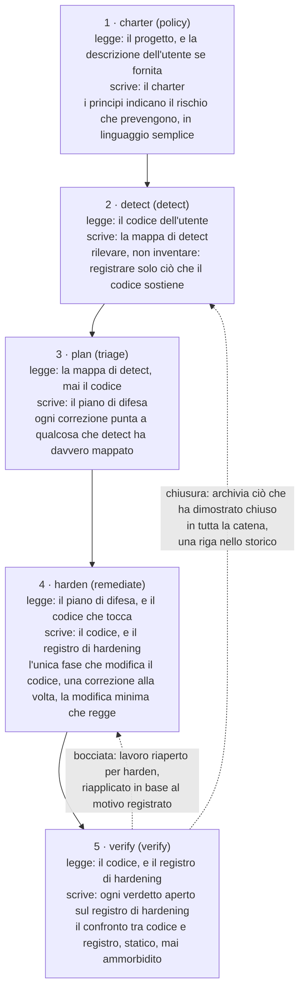
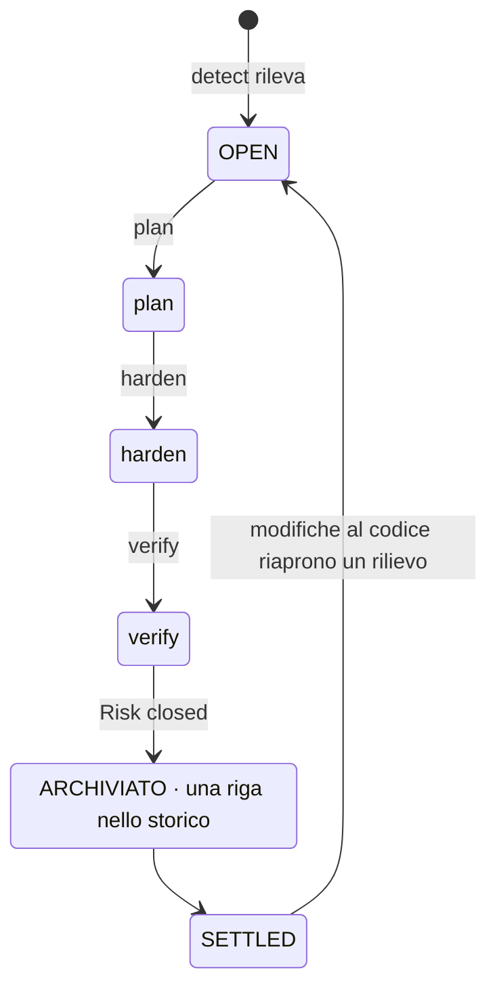
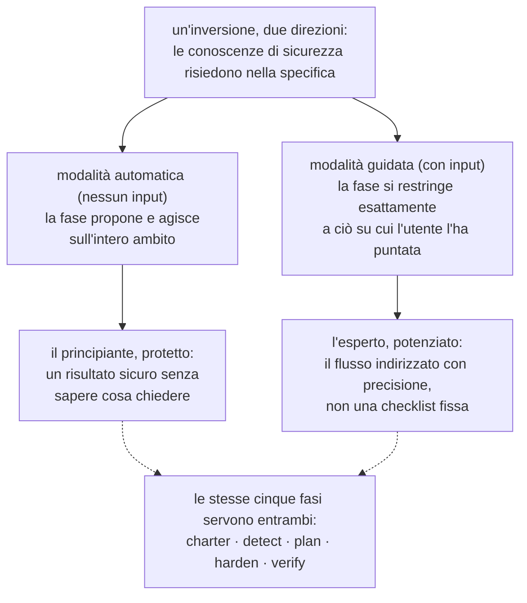
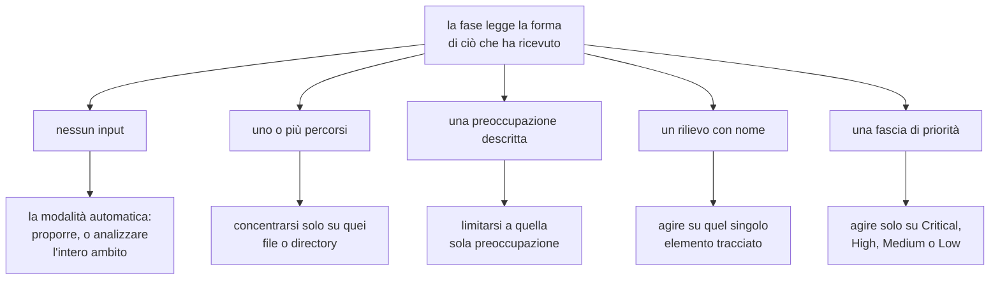
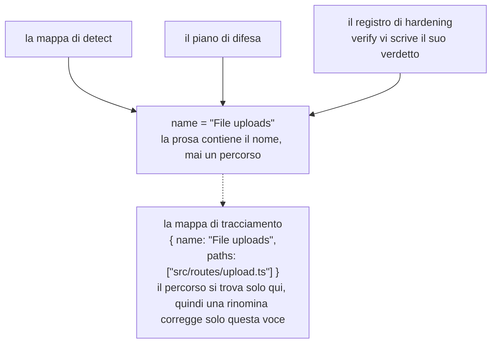
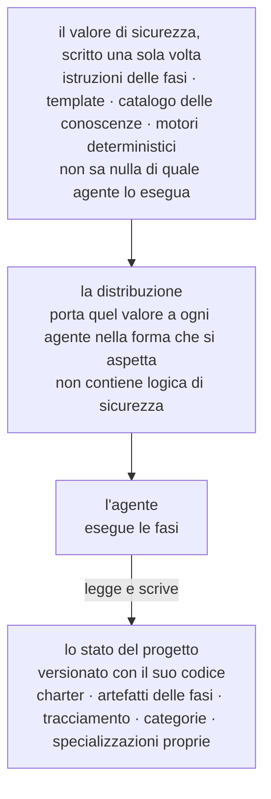
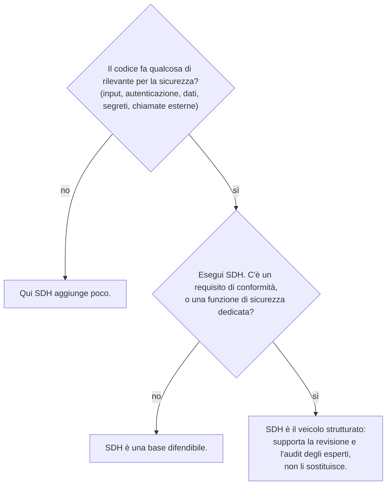

# Security-Driven Hardening: una convenzione per l'era dello sviluppo assistito dall'IA

> La metodologia Security-Driven Hardening (SDH): una convenzione blue team sensibile al contesto per verificare e mettere in sicurezza il software sviluppato con l'aiuto dell'IA o in vibe coding.

Canonico: https://lagune.ai/it-IT/docs/references/paper
Lingua: it-IT
Originale: https://lagune.ai/docs/references/paper
Ultimo aggiornamento: 2026-11-05

- **Weslley Araújo**
- **Articolo sulla metodologia, 2026.**

---

## Abstract

Security-Driven Hardening (SDH) è una metodologia di sicurezza strutturata, guidata dall'IA ed esclusivamente difensiva, pensata per un'epoca in cui il software viene scritto sempre più spesso da agenti IA e da persone che non sono specialisti di sicurezza. Invece di seguire una checklist generica, SDH rileva prima cosa fa davvero un sistema (login, caricamento di file, pagamenti, esposizione di dati e così via) e poi guida il lavoro di sicurezza specifico per quel contesto. È governata da principi sicuri per impostazione predefinita, è interamente orientata alla difesa ed è espressa in linguaggio semplice, così che qualsiasi utente possa agire di conseguenza.

Questo documento sostiene che SDH è una convenzione mancante, non un singolo strumento. Le conoscenze di sicurezza risiedono nella metodologia e nelle sue specializzazioni su richiesta, una base su cui ogni utente può costruire, e questo le permette di servire un principiante e un esperto attraverso lo stesso flusso. Due proprietà la distinguono dagli approcci spec-first precedenti `[1]`. SDH è **indipendente dallo stato**: si adatta a una directory vuota, a un progetto in corso, a una singola pull request o a una grande codebase legacy, in qualsiasi stack. E SDH **si può chiudere**: un rischio verificato come chiuso viene archiviato e tolto dall'intero flusso, così quel rilievo raggiunge uno stato definitivo e viene riaperto solo quando il codice cambia. SDH non sostituisce i professionisti della sicurezza né gli strumenti Blue Team specializzati. Estende le conoscenze dello sviluppatore stesso, e più uno sviluppatore capisce di sicurezza, più può guidarla.

**Lagune** è l'implementazione di riferimento, e dimostra che la metodologia è realizzabile e portabile. SDH viene proposta come una convenzione che altri possono adottare.

> **Parole chiave**
>
> Sviluppo assistito dall'IA, sicurezza del software, sicurezza difensiva, spec-driven development, hardening di sicurezza, flussi di lavoro guidati da agenti, chiudibilità, sicurezza sensibile al contesto, conoscenza su richiesta, strumenti indipendenti dall'agente.

---

## I. Introduzione: la lacuna di sicurezza aperta dallo sviluppo assistito dall'IA

Il software viene rilasciato sempre più spesso da persone, e da agenti IA, che non sanno riconoscere in modo affidabile un pattern non sicuro: un segreto esposto, un controllo di autorizzazione mancante, una query vulnerabile all'injection. Non sono rischi esotici. Rientrano tra le classi di rischio che dominano gli incidenti reali, documentate da anni in riferimenti pubblici `[6]`, `[7]`, e studi recenti riportano che una quota significativa del codice generato dall'IA viene rilasciata proprio con difetti di questo tipo `[8]`. Gli assistenti di programmazione con IA hanno reso il problema acuto permettendo a chi non è sviluppatore di rilasciare software reale, ma la lacuna è più ampia di qualsiasi singolo pubblico. La maggior parte dei progetti non riceve mai un passaggio di sicurezza specifico per ciò che fa davvero. L'ecosistema diventa più fragile a ogni decisione prematura del tipo "funziona, rilascialo".

I consigli di sicurezza generici non colmano questa lacuna. Una checklist statica non è specifica per ciò che fa un sistema, quindi sommerge un piccolo progetto di voci irrilevanti e manca comunque il rischio che conta per quel progetto. Il problema non è la scarsità di conoscenze di sicurezza nel mondo. Il problema è abbinare la conoscenza giusta al sistema che l'utente ha davvero davanti, e farlo per qualcuno che potrebbe non sapere cosa chiedere.

SDH risponde con un'unica inversione: **le conoscenze di sicurezza risiedono nella specifica e nelle sue specializzazioni su richiesta, una base su cui ogni utente può costruire**. La metodologia rileva il contesto, classifica i rischi che quel contesto comporta e guida le correzioni, così uno sviluppatore e chi non lo è vengono serviti attraverso lo stesso flusso. I rilievi e le raccomandazioni restano in linguaggio semplice, quindi sono utilizzabili qualunque sia la preparazione tecnica di chi legge. L'esperto non ne è limitato, ma potenziato, una dualità che sviluppiamo in `§VI`.

> **Concetto chiave**
>
> **L'inversione centrale:** le conoscenze di sicurezza risiedono nella specifica e nelle sue specializzazioni su richiesta, una base su cui ogni utente può costruire. La metodologia scopre cosa fa il sistema, vi abbina il lavoro di sicurezza ed estende ciò che l'utente già sa.

Prendi uno sviluppatore che dice a un assistente IA: "la mia app permette agli utenti di caricare una foto del profilo". Senza un passaggio di sicurezza, l'assistente produce codice funzionante che si fida in silenzio di tutto ciò che invia il client: il tipo di file dichiarato, il nome del file, la dimensione. Il caricamento va in produzione, e un file camuffato da immagine può contenere codice, un nome costruito ad arte può uscire dal percorso di archiviazione, un file troppo grande può esaurire le risorse del server. Niente di tutto questo si vede in una demo, quindi va in produzione.

Lo stesso codice, passato attraverso SDH, si comporta in modo diverso. SDH rileva che il sistema accetta file dall'esterno (detect), lo traduce nei rischi che un caricamento comporta (triage), propone di controllare il tipo reale e la dimensione del file, di rinominarlo al salvataggio e di conservarlo dove il codice non può essere eseguito (remediate), poi legge il risultato e conferma che ogni controllo regga davvero (verify). Lo sviluppatore non ha mai dovuto conoscere l'espressione "unrestricted file upload". Gliel'ha fornita la metodologia.

Questo documento offre i seguenti contributi:

- Una definizione precisa di SDH come metodologia, indipendente da qualsiasi implementazione, con i suoi principi di progettazione (`§III`).
- Un ciclo di vita difensivo in cinque fasi in cui la separazione dei compiti è essa stessa il contributo: il rilevamento non inventa mai, la pianificazione non legge mai il codice, una sola fase modifica il codice e la verifica non ammorbidisce mai il proprio giudizio (`§IV`).
- La **chiudibilità** come presa di posizione metodologica: un singolo rilievo ha uno stato finale, non un ciclo infinito (`§V`).
- La dualità dell'**estensore delle conoscenze dello sviluppatore**: un unico flusso che protegge il principiante e potenzia l'esperto (`§VI`).
- **Specializzazioni non invocabili e prompt su richiesta**: conoscenze di sicurezza mirate che l'agente carica quando il contesto del progetto lo richiede, mai per impostazione predefinita (`§VII`).
- **Indipendenza dallo stato** e **adattività non autoritaria**: SDH si adatta a qualsiasi stato di sviluppo e allo scenario, invece di imporre un ambito fisso (`§VIII`).
- Una **modalità preventiva**: la stessa difesa eseguita mentre si costruisce il lavoro ordinario, così il codice nasce sicuro per impostazione predefinita e le fasi hanno meno da correggere (`§IX`).
- Un confronto dedicato con lo Spec-Driven Development, la tradizione da cui SDH è nata e da cui poi si è distaccata (`§X`).
- Le discipline di ingegneria che permettono alla metodologia di sopravvivere ai refactoring e di restare indipendente da qualsiasi agente: il tracciamento dell'identità per nome (`§XI`) e un veicolo indipendente dall'agente (`§XII`).

---

## II. Contesto e lavori correlati

SDH si basa su lavori precedenti. Eredita una struttura collaudata dallo sviluppo spec-first guidato da agenti `[1]`, `[2]`, `[3]`: template, comandi slash consumati da un agente, un documento di governo e un agente che esegue le fasi. Reimplementa quella struttura con uno scopo difensivo. La discendenza è voluta, e uno dei principi di lavoro di SDH la nomina esplicitamente: costruire il flusso di lavoro a partire da una struttura collaudata, poi inquadrarlo per la sicurezza.

SDH non è una checklist statica di raccomandazioni generiche. Una checklist sa moltissimo della sicurezza in generale e nulla del progetto che ha davanti. SDH ribalta questa enfasi. Dedica il suo primo sforzo al rilevamento, a scoprire cosa fa il sistema, e solo dopo attinge alla conoscenza che il rilevamento rende pertinente.

SDH non sostituisce nemmeno le persone che si occupano di sicurezza o gli strumenti Blue Team specializzati. È un estensore delle conoscenze dello sviluppatore (`§VI`). Un team con una funzione di sicurezza dedicata dovrebbe mantenerla. SDH dà a quel team un veicolo strutturato, e a un team che non ne ha una dà una base difendibile.

SDH si affianca anche agli scanner di sicurezza deterministici (analisi statica, linter) `[4]`, `[5]`. Quegli strumenti sono preziosi proprio perché sono deterministici e ripetibili. SDH si basa soprattutto sul ragionamento dell'agente, e scambia il determinismo rigoroso con la sensibilità al contesto. La metodologia non finge il contrario. Dove il determinismo conta, incorpora un motore deterministico all'interno del ragionamento (`§VII`): l'agente decide se vale la pena controllare un input, e un programma deterministico decide se quell'input è pericoloso.

Il precedente più diretto è lo Spec-Driven Development (SDD), la famiglia di metodologie spec-first che porta avanti uno sviluppo a partire da una specifica eseguibile. Trattiamo l'SDD come una classe. La sua formulazione più chiara come metodologia per professionisti è il report di Piskala `[1]`, e il suo toolkit guidato da agenti più visibile è Spec Kit di GitHub `[2]`, con OpenSpec `[3]` come secondo strumento della stessa famiglia. Questi sono i riferimenti canonici per il confronto in `§X`.

---

## III. SDH: definizione e principi di progettazione

**Security-Driven Hardening** è una metodologia di sicurezza strutturata e guidata dall'IA che rende una codebase più sicura portando avanti il lavoro a partire da una specifica eseguita dall'agente, invece che da correzioni improvvisate. Il nome si ispira ai **Blue Team**, i difensori nel campo della sicurezza. SDH riguarda la difesa, l'hardening e la verifica, mai l'attacco.

> **Definizione**
>
> **Security-Driven Hardening (SDH):** una metodologia di sicurezza strutturata, guidata dall'IA ed esclusivamente difensiva che rileva prima cosa fa davvero un sistema, poi guida il lavoro di sicurezza specifico per quel contesto, governata da principi sicuri per impostazione predefinita ed espressa in linguaggio semplice.

SDH è definita da un insieme di principi vincolanti. Ognuno è una regola, e ognuno offre all'utente una garanzia specifica.

| Principio                                                                               | La regola                                                                                                                                                                     | Cosa garantisce all'utente                                                                                                                                                                                   |
| --------------------------------------------------------------------------------------- | ----------------------------------------------------------------------------------------------------------------------------------------------------------------------------- | ------------------------------------------------------------------------------------------------------------------------------------------------------------------------------------------------------------ |
| Sicuro per impostazione predefinita, in linguaggio semplice, per tutti allo stesso modo | Ogni impostazione predefinita, messaggio e correzione è sicuro fin da subito e comprensibile a chiunque legga, sviluppatore o no. Nessuna categoria di utenti è privilegiata. | Un principiante riceve una base sicura senza chiederla, e legge il risultato con parole sue.                                                                                                                 |
| Sensibile al contesto più che generico                                                  | Ogni fase parte dal contesto rilevato in detect e agisce su ciò che il sistema fa davvero.                                                                                    | Le raccomandazioni si adattano al progetto, non a una checklist. Le conoscenze di sicurezza risiedono nella specifica e nelle sue specializzazioni su richiesta, ed estendono ciò che l'utente porta con sé. |
| Flessibile più che rigido                                                               | Principi, requisiti e raccomandazioni sono punti di partenza. L'utente può riformulare, eliminare, aggiungere o restringere qualsiasi cosa.                                   | La metodologia si piega al progetto e all'utente, e mai più rigidamente di quanto l'utente voglia. La flessibilità non indebolisce mai la base sicura per impostazione predefinita.                          |
| Riconciliare, mai solo aggiungere                                                       | Gli artefatti sono documenti vivi, non log. Ogni esecuzione ricontrolla ogni voce: mantiene ciò che regge, riscrive ciò che è cambiato, rimuove ciò che non vale più.         | Il registro riflette sempre il presente, quindi non degenera mai in un arretrato superato.                                                                                                                   |
| Solo difesa                                                                             | SDH verifica, mette in sicurezza e controlla. Non produce mai strumenti offensivi, exploit per uso malevolo o tecniche di elusione del rilevamento per nuocere.               | La metodologia non può essere trasformata in un'arma. I contenuti a doppio uso compaiono solo in un contesto chiaramente difensivo.                                                                          |
| Spec-first, guidato da agenti, orientato alla sicurezza                                 | Il flusso di lavoro è costruito a partire da template, comandi, un charter di governo e un agente che esegue le fasi.                                                         | Una struttura di sviluppo collaudata, riadattata perché sia l'agente a svolgere il lavoro di sicurezza sostanziale.                                                                                          |

**Tabella 1.** I principi di progettazione di SDH e la garanzia che ognuno offre all'utente.

Questi principi non sono ornamentali. Sono i vincoli che ogni fase descritta qui sotto deve rispettare, e la discussione in `§XV` vi ritorna per segnare i limiti della metodologia.

Il resto del documento sviluppa nove pilastri con un nome. Sono le parti che chi legge dovrebbe riuscire a tenere a mente, e quelle che un altro team dovrebbe reimplementare per poter dire di fare SDH.

| Pilastro                                                      | Cosa offre                                                                                                                                                     | Sezione     |
| ------------------------------------------------------------- | -------------------------------------------------------------------------------------------------------------------------------------------------------------- | ----------- |
| L'inversione sensibile al contesto                            | Le conoscenze di sicurezza risiedono nella specifica e nelle sue specializzazioni su richiesta, così un principiante e un esperto condividono un unico flusso. | `§I`, `§VI` |
| Il ciclo di vita difensivo in cinque fasi                     | Separazione dei compiti: policy, detect, triage, remediate, verify, ognuna con un solo compito.                                                                | `§IV`       |
| La chiudibilità                                               | Un rilievo ha uno stato finale, non un ciclo infinito. Il lavoro chiuso viene archiviato.                                                                      | `§V`        |
| La dualità dell'estensore delle conoscenze dello sviluppatore | Un unico flusso che protegge il principiante e potenzia l'esperto, senza mai sostituire nessuno dei due.                                                       | `§VI`       |
| Prompt su richiesta, conoscenza non invocabile                | La conoscenza di sicurezza pertinente viene caricata per ciò che è il progetto, mai per impostazione predefinita.                                              | `§VII`      |
| Indipendenza dallo stato e adattività non autoritaria         | Si adatta a qualsiasi stato di sviluppo in qualsiasi stack, e allo scenario invece di imporre un ambito.                                                       | `§VIII`     |
| La modalità preventiva                                        | La stessa difesa agisce mentre si costruisce il nuovo lavoro, così il codice nasce sicuro per impostazione predefinita.                                        | `§IX`       |
| Il tracciamento dell'identità per nome                        | Un rilievo resta un unico elemento attraverso le fasi, e una rinomina rompe il collegamento in un solo punto.                                                  | `§XI`       |
| Il veicolo indipendente dall'agente                           | Il valore di sicurezza viene scritto una sola volta e non dipende da alcun agente o stack.                                                                     | `§XII`      |

**Tabella 2.** I nove pilastri di SDH e dove viene sviluppato ciascuno.

---

## IV. Il flusso Blue Team in cinque fasi

SDH struttura il lavoro come un ciclo di vita difensivo in cinque fasi (Figura 1). Ogni fase è orientata alla difesa, ognuna si basa sulla precedente, e le fasi seguono la reale attività di un Blue Team: stabilire una policy, rilevare, classificare, porre rimedio, verificare.



**Figura 1.** Il flusso in cinque fasi: cosa legge ogni fase, cosa scrive e la sua invariante portante. Verify guida entrambi i ritorni: un controllo bocciato riapre harden, e un rilievo dimostrato chiuso viene archiviato in tutta la catena, con una riga nello storico.

La separazione dei compiti è il contributo. Dato che ogni fase ha un solo compito, una modalità di guasto resta confinata in un punto, e chi legge può fidarsi di ciò che ogni artefatto dichiara.

> **Concetto chiave**
>
> **Applicata non significa verificata:** harden registra che una correzione è stata applicata. Verify la verifica confrontando il codice con quel registro, e il verdetto non viene mai ammorbidito per farlo coincidere con il registro. Un controllo può essere presente nel codice e lasciare comunque raggiungibile il rischio, e allora il verdetto onesto è "Risk not closed".

### charter (policy)

Il charter stabilisce i principi di sicurezza del progetto, le regole che ogni fase successiva deve rispettare. È il livello di governo, una sorta di controllo in fase di compilazione della postura di sicurezza del progetto. Ogni principio ha un nome chiaro, una regola non negoziabile che si può verificare sul codice e una riga `Why:` che indica il rischio che previene, non solo la correzione. Il charter legge sempre il progetto stesso (i suoi manifest, la sua struttura e le sue dipendenze), e la descrizione dell'utente, quando c'è, è una direzione che la lettura poi allarga oltre ciò che l'utente ha nominato. Senza descrizione, il progetto è l'unica fonte. Le due si sommano invece di competere, e il charter registra la policy a cui il progetto dovrebbe attenersi, non lo stato del suo codice. Chi non è sviluppatore dovrebbe poterlo leggere e capire sia la regola sia il rischio.

### detect (detect)

Detect legge il codice e mappa ciò che il sistema fa davvero e che ha un peso per la sicurezza. L'istruzione guida è "rilevare, non inventare": registrare solo ciò che il codice sostiene, con le evidenze di cui hanno bisogno le fasi successive. Detect è neutrale. Non costringe i suoi rilievi ad adattarsi al charter, perché confrontare i rischi con le regole del charter è compito della fase plan. Ogni rilievo ha tre parti: cos'è (descrizione in linguaggio semplice), perché conta (il rischio, non solo il fatto) e l'evidenza (la funzione o la route in cui si trova). L'evidenza non contiene alcun percorso di file. Il percorso si trova solo nella mappa di tracciamento (`§XI`), così la prosa non contiene mai un percorso che possa diventare obsoleto.

### plan (triage)

Plan trasforma ogni rilievo in una correzione, indicata con la sua classe di rischio (citando i riferimenti consolidati, CWE e OWASP, dove la sostengono) e legata al principio del charter che la correzione rispetta. La priorità (Critical, High, Medium, Low) non è una scelta libera: plan valuta ogni rilievo con il metodo Base ed Environmental di CVSS v4.0, quindi la fascia è il punteggio espresso a parole, giustificato da una riga in linguaggio semplice su esposizione e posta in gioco, e due esecuzioni producono lo stesso ordine. Il vettore è l'ancora precisa per un esperto, la fascia e la sua giustificazione la stessa valutazione che chiunque può seguire. Plan lavora solo a partire dalla mappa di detect e non legge mai il codice. È un vincolo voluto, non un limite: obbliga ogni correzione a puntare a qualcosa che detect ha davvero rilevato. Se un ambito non è mai stato mappato, plan si ferma e rimanda l'utente a detect invece di tirare a indovinare.

### harden (remediate)

Harden è l'unica fase che modifica il codice, quindi procede con cautela. Se una modifica richieda l'approvazione dell'utente dipende dall'agente e dalla modalità di permessi in cui viene eseguito, quindi harden non aggiunge alcun passaggio di conferma proprio. Applica una correzione alla volta, prima le dipendenze, poi la priorità più alta, così ogni modifica resta piccola, revisionabile e facile da annullare. Non indebolisce mai un controllo esistente per far quadrare una nuova correzione, e non viola mai un principio del charter. Se una correzione entrasse in conflitto con un principio, harden si ferma e fa emergere il conflitto invece di applicarla. Ogni blocco viene registrato come Applied, Partial o Blocked. "Applicata non significa ancora verificata", ed è la questione di cui si occupa la fase successiva.

### verify (verify)

Verify verifica ogni controllo applicato leggendo il codice e confrontandolo con ciò che harden ha registrato. La verifica è proprio quel confronto, codice contro registro, ed è statica: conferma che un controllo è presente e corretto nel codice, non che il controllo regga sotto attacco su un sistema in esecuzione. Quel controllo a runtime, del tipo che esegue attacchi reali o simulati contro il sistema in produzione, è fuori ambito per scelta progettuale. Verify restituisce uno di tre verdetti: Risk closed, Risk not closed o Cannot tell from the code. Non produce alcun artefatto proprio: harden e verify condividono il registro di hardening, harden possiede ciò che è stato fatto e verify il verdetto e il suo motivo, e nessuno dei due scrive mai nei campi dell'altro. Un controllo bocciato è lavoro riaperto per harden, la cui esecuzione successiva considera il verdetto prevalente sulla propria lettura del codice e riapplica la correzione sulla lacuna esatta indicata dal motivo. Verify si fida del codice più che del registro, perché un registro può dichiarare più di quanto il codice offra. È in sola lettura sul codice dell'utente, e non ammorbidisce mai un verdetto per farlo coincidere con il registro. Un controllo può essere presente e lasciare comunque il rischio raggiungibile per un'altra via, e in quel caso il verdetto onesto è "Risk not closed". Se, durante la lettura, verify nota un problema di sicurezza che la mappa di detect non ha mai coperto, non inventa un verdetto, perché rilevare è compito di detect: fa emergere il problema e rimanda l'utente a detect, così il rilievo entra attraverso lo stesso flusso invece di aggirarlo.

> **Filo conduttore: il caricamento di file.** Un singolo rilievo mostra la spina dorsale dall'inizio alla fine.
>
> - **detect** lo trova: il sistema accetta file dagli utenti, e l'handler del caricamento si fida del tipo MIME inviato dal client senza controllare il tipo reale del file. _Perché conta:_ un file camuffato da immagine può nascondere codice malevolo.
> - **plan** decide la correzione, priorità **Critical**, nel rispetto del principio "Ogni input è non attendibile finché non viene validato": controllare il tipo reale e la dimensione del file, rinominarlo al salvataggio e conservare i caricamenti dove non possono essere eseguiti come codice.
> - **harden** la applica, stato **Applied**: ora l'handler rileva il tipo reale dal contenuto, impone un limite di dimensione, rifiuta tutto ciò che è inatteso, rinomina al salvataggio e conserva dove il codice non può essere eseguito.
> - **verify** legge l'handler, lo confronta con il registro e restituisce **Risk closed**: il codice fa esattamente ciò che dichiara il registro.
>
> Lo stesso nome del rilievo attraversa la mappa di detect, il piano e il registro di hardening, e verify agisce su quel registro con lo stesso nome: un verdetto aperto viene scritto nel blocco del rilievo, e un rilievo dimostrato chiuso viene archiviato (`§V`). Quel nome condiviso è la sua identità (`§XI`).

---

## V. Chiudibilità: un rilievo ha uno stato finale

La maggior parte degli strumenti di sicurezza lascia all'utente un arretrato che non fa che crescere. SDH adotta una posizione diversa: **un rilievo si può chiudere, quindi ha uno stato finale invece di vivere in un arretrato infinito** (Figura 2). Questo deriva direttamente dal principio di riconciliazione.

> **Definizione**
>
> **Chiudibilità:** un rischio verificato come chiuso viene archiviato e tolto dall'intero flusso, così quel rilievo raggiunge uno stato definitivo e viene riaperto solo quando il codice cambia. Un rilievo ha uno stato finale, anche se il programma di sicurezza in sé resta continuo.

Gli artefatti di SDH sono documenti vivi, non log. Ogni volta che una fase viene rieseguita, ricontrolla ogni voce esistente rispetto alla verità attuale e fa una di tre cose: mantiene ciò che è ancora valido, riscrive ciò che è cambiato o rimuove ciò che non vale più. Un rilievo che il codice mostra ormai risolto viene semplicemente rimosso. Il registro di lavoro riflette il presente, non il passato.

La chiusura è quella stessa riconciliazione che arriva alla sua conclusione. Quando verify verifica che un rischio è chiuso, archivia il rilievo in tutto il flusso: la mappa di detect, il piano, il registro di hardening e la mappa di tracciamento. Per questo verify è l'unica fase che scrive negli artefatti delle altre fasi: è la fase che chiude il cerchio. Mentre il rilievo lascia la catena, l'archiviazione lo distilla in una breve voce di un registro storico che vive fuori dalla catena di lavoro e non viene mai rielaborato. È questo il confine tra sparire e chiudersi: un rilievo che la riconciliazione ha rimosso perché ha smesso di essere vero non lascia nulla dietro di sé, mentre un rilievo dimostrato chiuso si guadagna la sua riga nello storico. Un rilievo archiviato è poi assente da ogni artefatto di lavoro, e questa assenza è attesa, non una catena rotta.



**Figura 2.** La macchina a stati della chiudibilità. Un rilievo passa da OPEN ad ARCHIVIATO a SETTLED, e si riapre solo quando il codice cambia.

Quando tutto ciò che rientra nell'ambito è archiviato, il ciclo è a riposo, e lo stato di riposo ha una forma concreta: un artefatto il cui ultimo rilievo è stato chiuso viene rimosso per intero, quindi una catena completamente chiusa lascia solo il charter e lo storico, la policy e la prova. Il ciclo si riapre solo quando il codice cambia. La metodologia dà a ogni rilievo una fine definita, ed è esattamente ciò che un arretrato infinito non può fare.

---

## VI. La dualità dell'estensore delle conoscenze dello sviluppatore

SDH non sostituisce le persone, e non sostituisce gli strumenti Blue Team specializzati. **Estende le conoscenze dello sviluppatore stesso**. Più uno sviluppatore capisce di sicurezza, più precisamente può guidare il flusso, e più autonomia ha. Uno sviluppatore che ne capisce poco riceve comunque un risultato sicuro, perché la modalità automatica lo tutela.

L'inversione di `§I`, le conoscenze di sicurezza che risiedono nella specifica, vale in entrambe le direzioni. Per il principiante è protezione: non ha bisogno di sapere cosa chiedere, perché la specifica propone. Per l'esperto è potenziamento: la stessa specifica gli permette di indirizzare il flusso con precisione invece di lavorare contro una checklist fissa.

Ogni fase porta questa dualità nel proprio funzionamento (Figura 3). Eseguita senza input, agisce sull'intero ambito per conto dell'utente. Con un'indicazione, la stessa fase si restringe esattamente a ciò su cui l'utente l'ha puntata.



**Figura 3.** La dualità dell'estensore delle conoscenze dello sviluppatore. Un'unica inversione serve due pubblici: la modalità automatica protegge il principiante e la modalità guidata potenzia l'esperto, attraverso le stesse cinque fasi.

Le specializzazioni su richiesta (`§VII`) rendono esplicita la dualità nel loro stesso testo. Ognuna dice all'agente che la sua conoscenza "estende il tuo giudizio" e di continuare a ragionare oltre ciò che la specializzazione fornisce. La conoscenza è un pavimento, non un soffitto. È questo che serve entrambi i pubblici nell'equilibrio voluto dal documento: la comunità degli sviluppatori ottiene uno strumento sostanziale, e il professionista Blue Team ottiene un veicolo strutturato che non finge di fare il suo lavoro al posto suo.

---

## VII. Specializzazioni non invocabili e prompt su richiesta

È lo schema più innovativo della metodologia. SDH porta conoscenze di sicurezza mirate sotto forma di specializzazioni che si caricano **solo su richiesta**, ed è l'agente stesso a decidere quali caricare, abbinandole al contesto del progetto. Lo chiamiamo **prompt su richiesta**: un modo per l'agente di scegliere quale conoscenza attivare in base all'ambito del progetto in cui si trova, invece di eseguire ogni controllo per impostazione predefinita. Le specializzazioni sono evolutive, e ognuna può cambiare o essere sostituita in qualsiasi momento. Il contributo è lo schema, non le specializzazioni in sé.

> **Definizione**
>
> **Prompt su richiesta:** l'agente seleziona quale conoscenza di sicurezza attivare confrontandola con l'ambito del progetto che ha davanti, così la conoscenza pertinente viene richiamata per ciò che il progetto è davvero, invece di eseguire ogni controllo per impostazione predefinita.

> **Definizione**
>
> **Specializzazione non invocabile:** un'unità di conoscenza di sicurezza mirata e indipendente dal linguaggio per un singolo contesto, come il caricamento di file o il codice che gira nel browser. Verifica e spiega, non riscrive mai il codice e non produce mai un input di attacco. Non è un comando: si carica quando il contesto che copre rientra nell'ambito, o quando un prompt la richiede per nome.

Ogni specializzazione indica le forme più sicure per i rischi che copre e dice all'agente come agire su un rilievo in ogni fase che la utilizza: come giudicarlo nel rilevamento, come applicarne la correzione in sicurezza nel rimedio e come dimostrarla nella verifica.

Il tratto distintivo è che una specializzazione è **non invocabile da sola**: non è un comando, e all'interno del flusso è una corrispondenza a caricarla. La fase di rilevamento elenca il catalogo una volta, confronta il contesto del progetto con ciò che copre ogni voce e carica solo le specializzazioni il cui contesto è presente nell'ambito. Le fasi successive riutilizzano quell'elenco invece di rielencare, così un'unica corrispondenza serve l'intera catena, e la modalità preventiva (`§IX`) esegue la stessa corrispondenza sul lavoro che sta per essere costruito. Una specializzazione il cui contesto è assente viene saltata, e il salto deve essere giustificato quanto il caricamento: ogni voce del catalogo riceve un verdetto esplicito, applicata o saltata con il motivo ricavato dal codice, così una vaga impressione di irrilevanza non prende mai il posto dell'assenza. Non trovarne nessuna applicabile è un esito valido.

Il catalogo è fatto di dati, e la crescita è un file di conoscenza più una riga di catalogo, mai un nuovo comando. Le specializzazioni integrate sono raggruppate in categorie, come OWASP, un linguaggio o le integrazioni di IA, e il catalogo usato da un progetto contiene le specializzazioni integrate delle categorie scelte più le sue specializzazioni. Il progetto registra quella scelta insieme al resto del suo stato, così tutto il team lavora sullo stesso catalogo. È lo stesso principio di sensibilità al contesto delle fasi, applicato alla conoscenza: la conoscenza pertinente viene richiamata per ciò che il progetto è davvero, invece di eseguire ogni controllo per impostazione predefinita. La stessa proprietà permette all'utente, non solo al maintainer, di far crescere il catalogo: una fonte o un tema di sicurezza fornito dall'utente viene distillato in una nuova specializzazione che appartiene al progetto, entra nel suo catalogo qualunque siano le categorie e si carica esattamente come una integrata, sostituendo quella integrata con lo stesso nome. Anche scrivere una specializzazione è un'attività esclusivamente difensiva e rispetta lo stesso confine che le specializzazioni fanno valere: la descrizione di un attacco può essere la fonte, ma la specializzazione che ne deriva verifica e spiega, e non emette mai un exploit funzionante. Così l'inversione di `§I`, l'intelligenza che risiede nella specifica, si estende al catalogo stesso, che l'utente può approfondire per il proprio contesto senza scrivere codice.

Un breve esempio illustra il prompt su richiesta. Detect legge una cartella di codice che gira nel browser. Abbina quel contesto nel catalogo, carica la specializzazione che lo copre e fa emergere un rilievo lato client attraverso i normali passi di detect. Le specializzazioni il cui contesto è assente da questo ambito non corrispondono, quindi non si caricano mai, e ognuna viene registrata come saltata. È stato il progetto a decidere quale conoscenza fosse pertinente, non una configurazione fissa.

Il determinismo compare proprio dove conta. Una specializzazione può portare con sé un controllo deterministico, non solo prosa: dove una classe di rischio ha una procedura di decisione netta, un piccolo programma restituisce un verdetto fisso per un dato input, per esempio un breve insieme di parole come `safe`, `unsafe` o `invalid input`. Alcune classi di rischio si possono decidere in modo deterministico esattamente così, con un corpus di lavori precedenti alla base della procedura di decisione `[9]`, `[10]`, `[11]`. Il controllo valuta i candidati forniti dall'agente oppure analizza l'ambito per trovarli da solo, e in entrambi i casi è il controllo, non l'agente, a restituire il verdetto. Una specializzazione abbastanza universale può essere contrassegnata come obbligatoria nel catalogo e viene allora sempre applicata, con il suo controllo eseguito sull'intero ambito. È l'unico caso in cui la conoscenza si carica senza una corrispondenza di contesto, ed è dichiarato nei dati del catalogo, mai deciso dall'agente sul momento. È qui che SDH ancora il ragionamento dell'agente a qualcosa di ripetibile, senza fingere che l'intero flusso sia deterministico.

Infine, le specializzazioni sono **separabili**. Dato che la conoscenza sta in piedi da sola, un utente può eseguirne una direttamente in un prompt che non ha nulla a che fare con il flusso SDH completo, tenendo la sicurezza accanto allo sviluppo ordinario. Una specializzazione con un controllo deterministico può, per esempio, vagliare ogni candidato prodotto durante la normale scrittura del codice e tenere solo quelli sicuri. Questa separabilità è uno dei motivi per cui SDH si adatta a così tante situazioni, che sono l'oggetto di `§VIII`, e la sua espressione completa è la modalità preventiva (`§IX`), in cui la stessa conoscenza protegge lo sviluppo ordinario dall'inizio alla fine.

---

## VIII. Indipendenza dallo stato e adattività non autoritaria

Due proprietà separano SDH dalle metodologie di specifica rigide.

### Indipendenza dallo stato

> **Definizione**
>
> **Indipendenza dallo stato:** la metodologia non dipende dallo stato di sviluppo. Si adatta a una directory vuota, a un progetto in corso, a una singola pull request o a una grande codebase legacy, in qualsiasi stack, perché scopre il punto di partenza leggendolo.

Ogni fase funziona allo stesso modo, che il progetto sia nuovo di zecca o esista già. Il charter deduce i principi da qualunque codice sia presente. Detect mappa qualunque codice ci sia, anche se è pochissimo. Non c'è alcun punto di partenza presupposto.

### Adattività non autoritaria

> **Definizione**
>
> **Adattività non autoritaria:** la metodologia si adatta allo scenario invece di imporre un ambito fisso che l'utente deve seguire. Quando l'utente non sa cosa dire, legge l'ambiente in cui è stata invocata, genera contesto e pone le domande che orientano ciò che farà dopo.

La modalità di proposta del charter è il caso più chiaro: SDH ricava un charter sicuro per impostazione predefinita analizzando il progetto, chiedendo all'utente solo quando una lacuna cambia davvero il risultato, poi lo scrive e presenta ogni principio in linguaggio semplice con il rischio che previene. Il charter è un documento vivo che l'utente rielabora rieseguendolo, non un contratto subordinato a una richiesta di approvazione, quindi non richiede mai all'utente di sapere cosa chiedere.

Questa adattività si manifesta come sensibilità alla forma dell'input: la stessa fase legge ciò che ha ricevuto e sceglie una modalità (Figura 4). Un file nel prompt, un rilievo dall'elenco, un timore, una missione mirata contro un punto debole noto o la richiesta di un'analisi completa a tappeto: ognuno risponde al bisogno dell'utente, perché il flusso è non autoritario per scelta progettuale. Niente di tutto questo indebolisce la base sicura per impostazione predefinita. La flessibilità plasma il modo in cui la base viene applicata, non la abbassa mai.



**Figura 4.** Adattività non autoritaria. La stessa fase legge la forma del suo input e sceglie una modalità, così l'ambito è sempre dell'utente, mai imposto.

---

## IX. La modalità preventiva universale: la stessa difesa mentre si costruisce il lavoro

SDH porta con sé una modalità complementare: lo sviluppo ordinario svolto con la stessa difesa attiva mentre il codice viene scritto. L'utente chiede il lavoro in sé, una pagina di login, un caricamento, un endpoint, e la metodologia protegge lo sviluppo mentre avviene, così il risultato è sicuro per impostazione predefinita nel momento in cui arriva, invece che dopo un successivo passaggio di hardening.

> **Definizione**
>
> **La modalità preventiva:** lo sviluppo ordinario eseguito sotto il livello di governo e la conoscenza di SDH. Il charter vincola lo sviluppo, le specializzazioni pertinenti a ciò che sta per essere creato si caricano su richiesta, e il risultato viene confrontato esattamente con la difesa usata prima che il lavoro sia considerato concluso.

La modalità riutilizza ogni elemento che le fasi già portano con sé, puntato su codice che non esiste ancora. Il rilevamento del contesto passa dal codice all'intento: l'agente ragiona su ciò che sta per costruire e sui confini che quel lavoro attraversa (un login implica credenziali, una sessione e input dall'esterno), ed è con quel ragionamento che viene confrontato il catalogo delle conoscenze. Il prompt su richiesta (`§VII`) si generalizza qui: il contesto si può rilevare nel piano per il codice, non solo nel codice che esiste. Il charter governa come sempre, e una richiesta che violerebbe un principio viene fatta emergere come conflitto, mai costruita. La difesa viene applicata in linea, nel momento in cui ogni parte viene scritta, validando al confine e scegliendo il costrutto sicuro fin dalla prima volta, così una versione funzionante ma non sicura non esiste mai e non c'è nulla da correggere.

La modalità finisce dove inizia verify. Prima che il lavoro sia considerato concluso, chi lo costruisce confronta il proprio risultato con la difesa che ha usato: il controllo deve trovarsi sul percorso del rischio, non accanto, deve essere completo e, dove una specializzazione porta con sé un controllo deterministico, il verdetto del controllo prevale sulla lettura dell'agente stesso. Una lacuna trovata qui viene chiusa come parte dello stesso lavoro, perché finire il lavoro significa finirlo in sicurezza.

Ciò che la modalità rifiuta è voluto quanto ciò che fa. Costruisce solo ciò che è stato chiesto e non verifica nulla di ciò che sta intorno: verificare ciò che esiste spetta alle fasi. Non scrive alcun artefatto e non traccia alcun rilievo, perché un rilievo è un rischio individuato in ciò che esiste, e lo scopo di questa modalità è che la versione non sicura non arrivi mai. Le due direzioni si completano a vicenda: le fasi chiudono ciò che c'è già (`§V`), e la modalità preventiva impedisce al nuovo lavoro di riaprirlo. Una catena a riposo resta a riposo non perché lo sviluppo si sia fermato, ma perché ciò che si costruisce mentre riposa viene costruito già difeso.

---

## X. Security-Driven Hardening a confronto con lo Spec-Driven Development

Security-Driven Hardening (SDH) è nata dalla base dello Spec-Driven Development (SDD) e poi se n'è distaccata nettamente. L'eredità strutturale è reale e riconosciuta: spec-first, guidato da agenti, un documento di governo e una serie di comandi a fasi che l'agente esegue. SDH riutilizza quella struttura deliberatamente. Ciò che cambia è lo scopo, il modello di autorità, lo stato presupposto e la condizione finale. Trattiamo l'SDD come una classe, usando il report di Piskala `[1]` come formulazione canonica della metodologia, Spec Kit di GitHub `[2]` come toolkit canonico per agenti e OpenSpec `[3]` come secondo strumento della stessa famiglia.

L'SDD capovolge lo sviluppo tradizionale rendendo eseguibili le specifiche: la specifica genera direttamente un'implementazione funzionante invece di limitarsi a guidarla `[1]`. Il suo insieme di fasi porta avanti uno sviluppo `[2]` (stabilire i principi di governo, specificare cosa costruire, pianificare lo stack tecnologico, suddividere il piano in task, poi implementare). Il suo documento di governo, una costituzione di principi, è l'elemento fondante a cui l'agente deve attenersi in ogni momento. È questo il cuore della differenza. Nell'SDD l'autorità scorre dalla specifica verso lo sviluppo, e ci si aspetta che l'implementazione la segua.

SDH ribalta quasi ogni asse di quel contratto (Tabella 3).

> **Concetto chiave**
>
> **La differenza centrale:** nell'SDD l'autorità scorre dalla specifica verso lo sviluppo, e ci si aspetta che l'implementazione la segua. SDH è non autoritaria e scorre nella direzione opposta, verso l'interno a partire dal contesto rilevato del sistema, mettendo in sicurezza ciò che c'è già.

| Asse                      | SDD                                                                                        | SDH                                                                                                                                       |
| ------------------------- | ------------------------------------------------------------------------------------------ | ----------------------------------------------------------------------------------------------------------------------------------------- |
| Obiettivo                 | Consegnare funzionalità. La specifica diventa un'implementazione funzionante.              | Mettere in sicurezza ciò che esiste o che si sta costruendo. Ogni fase è orientata alla difesa.                                           |
| Modello di autorità       | Autoritario. La specifica e la costituzione confinano lo sviluppo in un ambito da seguire. | Non autoritario. SDH si adatta allo scenario, e l'utente può riformulare, eliminare o restringere.                                        |
| Stato presupposto         | Uno sviluppo in avanti a partire da una specifica.                                         | Indipendente dallo stato: directory vuota, progetto in corso, una singola PR o codice legacy.                                             |
| Condizione finale         | Finisce quando la funzionalità è costruita.                                                | Si può chiudere. Un rilievo raggiunge uno stato definitivo e si riapre solo quando il codice cambia.                                      |
| Documento di governo      | Una costituzione di principi a cui l'agente deve attenersi.                                | Un charter di principi formulati in termini di rischio (ognuno con una riga `Why:`), esplicitamente non un contratto fisso.               |
| Come cresce la conoscenza | Si aggiunge un comando (o si estende l'insieme di fasi).                                   | Si aggiunge una specializzazione non invocabile che l'agente carica su richiesta: un file più una riga di catalogo, nessun nuovo comando. |
| Chi serve                 | Chi costruisce e porta avanti una funzionalità.                                            | Qualsiasi utente, sviluppatore o no, servito attraverso lo stesso flusso.                                                                 |
| Cosa modifica il codice   | La fase di implementazione genera lo sviluppo.                                             | Solo la fase harden modifica il codice, una correzione alla volta.                                                                        |

**Tabella 3.** SDD e SDH a confronto su otto assi. Struttura presa in prestito, contratto ribaltato.

Per correttezza nei confronti della tradizione: l'SDD è un precedente collaudato, e SDH gli deve la struttura su cui gira. Il distacco non è una critica all'SDD, che risolve bene un problema diverso (costruire in avanti). SDH prende lo stesso meccanismo collaudato e lo punta verso la difesa, l'adattività e la chiusura. OpenSpec `[3]`, organizzato intorno a proposte di modifica, elenchi di task e specifiche per ogni modifica, conferma lo schema: la famiglia porta avanti uno sviluppo a partire da una specifica, mentre SDH mette in sicurezza un sistema verso l'interno a partire dal suo contesto rilevato. Anche la modalità preventiva di SDH (`§IX`), l'unico punto in cui accompagna uno sviluppo in avanti, mantiene il contratto ribaltato: governa il modo in cui il lavoro viene costruito e non decide mai cosa costruire.

---

## XI. Rigore ingegneristico: la disciplina del tracciamento

La disciplina del riconciliare senza mai solo aggiungere (`§V`) ha bisogno di un substrato che sopravviva ai refactoring. Un rilievo deve restare un unico elemento in ogni fase che lo tocca, e un file rinominato o spostato non deve rompere la catena. SDH risolve il problema con l'**identità per nome** e con **i percorsi conservati solo nel tracciamento**.

> **Definizione**
>
> **Identità per nome:** l'identità di un rilievo è il suo nome, scritto in modo identico in ogni artefatto. La prosa contiene il nome, mai un percorso. I percorsi dei file si trovano solo nella mappa di tracciamento, così un file rinominato o spostato rompe il collegamento esattamente in un punto.

Ogni rilievo di detect è un elemento tracciato. La sua identità è il suo **nome**, il titolo della sezione, scritto in modo identico nella mappa di detect, nel piano e nel registro di hardening. Le fasi successive riutilizzano quel nome alla lettera mentre agiscono sullo stesso elemento, e verify scrive il suo verdetto nel registro di hardening con quello stesso nome. La mappa di tracciamento contiene il tracciamento e nient'altro, una voce per elemento:

```json
{ "name": "File uploads", "paths": ["src/routes/upload.ts"] }
```

La mappa non registra prosa, annotazioni, identificatori separati né fasi. Gli artefatti in prosa contengono la formulazione, e la mappa contiene solo identità e percorsi. I percorsi dei file sono l'unico elemento volatile, e si trovano solo qui. Un file rinominato o spostato può rompere il collegamento esattamente in un punto, mai in due copie divergenti.



**Figura 5.** Il trasportatore dell'identità. Il nome di un rilievo attraversa ogni artefatto, mentre il suo percorso si trova solo nella mappa di tracciamento, così una rinomina viene corretta in un solo punto.

Due atti mantengono la mappa nel flusso normale, e un terzo si distingue come manutenzione. **Track** è una registrazione additiva: una fase riporta i rilievi che ha scritto, e il motore registra quelli nuovi e segue un percorso rinominato per gli altri, classificandoli come nuovi, spostati o invariati. Non rimuove mai nulla che la fase non abbia riportato. **Untrack** archivia i rilievi che verify ha chiuso: in un unico passaggio deterministico distilla ognuno nella sua voce di storico, rimuove la sua intera sezione dagli artefatti, elimina un artefatto il cui ultimo rilievo non c'è più ed elimina la sua voce di tracciamento, così l'agente non fa nulla di tutto ciò a mano. Dove il passaggio deterministico non può procedere in sicurezza, un nome archiviato ancora citato nella prosa di un altro rilievo, segnala il punto all'agente invece di tirare a indovinare una modifica. Questi due sono gli atti che le fasi richiamano durante l'esecuzione. **Repair** è l'atto di manutenzione: una fase lo delega automaticamente quando la propria riconciliazione trova il tracciamento incoerente (un percorso registrato che non esiste più), e altrimenti viene eseguito su richiesta. Riallinea l'intera mappa in una volta sola, leggendo ogni artefatto e il codice attuale, correggendo i percorsi di ogni elemento e facendo emergere ciò che non può decidere da solo, un orfano (un elemento tracciato che nessun artefatto nomina più) o un candidato alla rinomina (un elemento i cui percorsi corrispondono a un nome riportato diverso).

Repair è manutenzione, non una sesta fase. Non tocca né il codice dell'utente né gli artefatti in prosa, solo il tracciamento. Legge il sorgente dell'utente per un unico motivo, scoprire il nuovo percorso di un file rinominato, e non scrive mai contenuti di sicurezza. La persona è l'arbitro finale sull'unica decisione che il motore si rifiuta di indovinare: se un elemento scomparso sia stato risolto o soltanto rinominato. Meglio chiedere che indovinare, perché un elemento eliminato per errore rompe la catena.

La metodologia applica a se stessa la propria disciplina difensiva. I motori deterministici vengono invocati come programmi da riga di comando, e ogni input viene passato come argomento di processo a sé stante, il che lo mantiene inerte, così un valore con virgolette o backtick non può mai iniettare nulla nel comando. Un controllo sconosciuto fallisce invece di rispondere, così un nome scritto male non risulta mai come un esito pulito. SDH non esenta la propria infrastruttura dal principio della sicurezza per impostazione predefinita.

---

## XII. Il veicolo: un'architettura indipendente dall'agente come prova di portabilità

Perché SDH sia una convenzione che altri adottano, non deve essere legata a un solo agente o a un solo stack, quindi il suo veicolo tiene separate tre responsabilità (Figura 6). Lagune dimostra che è possibile.

**Il valore di sicurezza** viene scritto una sola volta e non sa nulla di quale agente lo esegua: le istruzioni delle fasi e i template che compilano, il catalogo delle conoscenze e i motori deterministici. **La distribuzione** è sottile: il suo unico compito è portare quel valore a un dato agente nella forma e nel posto che l'agente si aspetta, e non contiene alcuna logica di sicurezza propria. **Lo stato del progetto** appartiene al progetto: il charter, gli artefatti delle fasi, la mappa di tracciamento, le categorie scelte e le sue specializzazioni, versionati e revisionabili come qualsiasi altra parte del suo codice.



**Figura 6.** Il veicolo indipendente dall'agente. Il valore di sicurezza viene scritto una sola volta, una distribuzione sottile lo porta a ogni agente, e lo stato resta del progetto.

Dato che la distribuzione non contiene logica di sicurezza, il modo in cui viene costruita non cambia nulla in SDH. Un veicolo può costruire la distribuzione da sé o affidarla a un ecosistema che già distribuisce skill per agenti, come fa l'implementazione di riferimento, e le fasi, i loro artefatti e le loro garanzie restano gli stessi. Niente di tutto questo è specifico di un linguaggio o di un runtime. L'implementazione di riferimento è scritta in un certo stack, ma la metodologia è il confine tra queste responsabilità, non la toolchain che le costruisce. Lo stesso progetto si potrebbe reimplementare in un linguaggio completamente diverso senza cambiare ciò che SDH è.

---

## XIII. Caso pratico: SDH dall'inizio alla fine

> **Caso pratico**
>
> **Hardening difensivo di una superficie di caricamento e di amministrazione.**
> **Contesto:** una piccola app che accetta file caricati dagli utenti e li elenca in una pagina di amministrazione.
> **Schema:** charter → detect (con conoscenza su richiesta attivata dal contesto) → plan → harden → verify, con una chiusura e un fallimento reale.
> **Esito (capacità):** un rischio verificato come chiuso e archiviato in tutta la catena, e un controllo verificato come _non_ chiuso e rimandato a harden. Il verdetto riflette il codice, non il registro.

_Questo è un esempio illustrativo dei meccanismi della metodologia, non uno studio misurato sul campo, e non riporta metriche di efficacia._

Un'unica dimostrazione continua mostra la metodologia in azione, non solo le sue parti. Estendiamo il filo del caricamento di file di `§IV` con un'attivazione di conoscenza su richiesta e una chiusura, e includiamo un fallimento reale.

1. **charter** propone il principio "Ogni input è non attendibile finché non viene validato", con il suo rischio in linguaggio semplice: l'input non controllato è il modo più comune in cui un sistema viene violato.
2. **detect** analizza la route del caricamento e la piccola pagina di amministrazione che elenca i file caricati. Rileva il rilievo sul caricamento (l'handler si fida del tipo MIME del client). La pagina di amministrazione gira nel browser, un contesto che il prompt su richiesta (`§VII`) riconosce, quindi detect carica la specializzazione per quel contesto e fa emergere un secondo rilievo, un punto in cui il nome di un file viene scritto nella pagina come markup invece che come testo, così un nome costruito ad arte può essere eseguito come script nel browser del visitatore. Le specializzazioni il cui contesto è assente da questo ambito non si caricano mai, e ogni salto viene registrato con l'assenza ricavata dal codice.
3. **plan** assegna alla correzione del caricamento la priorità Critical, legata al principio: controllare il tipo reale e la dimensione del file, rinominarlo al salvataggio, conservarlo dove il codice non può essere eseguito. Assegna alla seconda correzione la priorità High: mostrare il nome del file come testo, non come markup.
4. **harden** applica prima la correzione del caricamento (priorità più alta) e la registra come Applied, poi la seconda, anch'essa Applied.
5. **verify** legge ogni punto e confronta il codice con il registro. Il controllo sul caricamento regge: l'handler rileva il tipo reale dal contenuto, impone un limite di dimensione e rifiuta il resto. Verdetto: Risk closed. Verify archivia il rilievo sul caricamento in tutta la catena, e il suo riepilogo distillato finisce nello storico.

Segue il fallimento reale. Supponiamo che la seconda correzione di harden abbia aggiunto un helper sicuro per mostrare il testo, ma abbia lasciato la vecchia chiamata che scrive markup ancora raggiungibile da un altro percorso del codice. Verify legge la pagina, vede l'helper sicuro e vede anche che il percorso non sicuro è ancora attivo. Il controllo è presente, ma il rischio non è chiuso. Verify si rifiuta di ammorbidire il verdetto per farlo coincidere con il registro. Restituisce "Risk not closed", registra la lacuna e rimanda a harden. Un controllo che non affronta completamente il rischio non è un via libera.

Questo è il carattere della metodologia in un solo esempio: rilevamento sensibile al contesto, correzioni con priorità legate ai principi, applicazione attenta e una verifica che riporta lo stato reale del codice, qualunque cosa dica il registro.

---

## XIV. Quando usare SDH, e i suoi limiti

SDH è raramente sproporzionata come può esserlo un processo pesante, perché è indipendente dallo stato e si può chiudere: si riduce fino a un singolo file e a una singola preoccupazione, e raggiunge uno stato definitivo invece di lasciare un peso permanente. Il suo confine non è la dimensione del progetto, è la **profondità della garanzia**.



**Figura 7.** Quando usare SDH. La diramazione riguarda prima la rilevanza per la sicurezza, poi la profondità della garanzia, mai la dimensione del progetto.

Dove SDH raggiunge il suo confine: i comportamenti che emergono solo quando il sistema è in esecuzione (verify legge il codice, non esegue il sistema), i rischi che dipendono da una configurazione o da un ambiente che l'agente non può leggere, e i contesti ad alto rischio in cui la revisione di un esperto è comunque necessaria. In ognuno di questi casi SDH aggiunge comunque valore come primo passaggio strutturato, ma è un pavimento, non un soffitto.

> **Concetto chiave**
>
> **Il confine:** il limite di SDH è la profondità della garanzia, non la dimensione del progetto. Può fare da base difendibile quasi ovunque e supporta la revisione degli esperti dove la posta in gioco lo richiede, ma non sostituisce i test sul sistema in esecuzione né il giudizio di un professionista della sicurezza.

---

## XV. Discussione: posizionamento, limiti e ciò che SDH non afferma

SDH è precisa sui propri confini.

### Estende, non sostituisce

SDH non sostituisce i professionisti della sicurezza né gli strumenti Blue Team specializzati. Estende le conoscenze dello sviluppatore (`§VI`). L'affermazione corretta è misurata: applicata bene, SDH **può** chiudere rischi reali in modo efficace, soprattutto per i progetti che altrimenti non riceverebbero alcun passaggio di sicurezza. Non è una garanzia, e non sostituisce la revisione di un esperto dove la posta in gioco la richiede.

### Solo difesa, per costruzione

SDH verifica, mette in sicurezza e controlla. Non produce mai strumenti offensivi, exploit o tecniche di elusione del rilevamento per nuocere. I contenuti di sicurezza a doppio uso sono accettabili solo in un contesto chiaramente difensivo e autorizzato. È un confine rigido, non una preferenza.

### La verifica è sostanziale, non scenica

Verify verifica leggendo il codice e confrontandolo con il registro, non eseguendo il sistema. È una verifica statica: conferma che un controllo è presente e corretto nel codice, e non dimostra che il controllo regga sotto attacco a runtime. Per questo "Cannot tell from the code" è un verdetto legittimo, non un fallimento nascosto dietro un esito positivo. Quando l'evidenza non è nel codice (dipende dalla configurazione, o da un percorso che l'agente non può leggere), SDH lo dice invece di tirare a indovinare.

### Il determinismo è circoscritto, e dichiarato

Gran parte di SDH si basa sul ragionamento dell'agente, ed è questo che ne permette la sensibilità al contesto. Il determinismo è riservato ai motori deterministici: i controlli che una specializzazione può portare con sé (`§VII`) e il motore di tracciamento (`§XI`). Il documento non sfuma questo confine. Dove un risultato è deterministico, è il risultato di un programma. Dove è ragionato, è la lettura del codice da parte dell'agente, con l'utente come arbitro finale.

### Costi e scala

Un'analisi completa consuma molti token. Le modalità manuali (`§VI`, `§VIII`) esistono in parte per mantenere il costo proporzionato alla preoccupazione.

### L'utente è l'arbitro finale

SDH chiede alla persona di decidere tra rinominato e risolto, e l'approvazione delle sue modifiche al codice resta dove l'utente già governa il proprio agente, nella modalità di permessi in cui lo esegue. La metodologia propone e verifica. Non scavalca la persona.

### Obiezioni e risposte

Uno scettico onesto solleverà diverse obiezioni. Quelle sostanziali meritano di essere poste con parole loro.

**"Non è solo un analizzatore statico con un LLM attaccato sopra?"** No. Un analizzatore statico esegue per impostazione predefinita ogni regola che ha. SDH rileva prima che cos'è il sistema, poi attinge alla conoscenza pertinente (`§II`, `§VII`), e _incorpora_ un controllo deterministico solo dove una classe di rischio ha una procedura di decisione netta. Il ragionamento parte dal contesto, il determinismo è mirato.

**"Non è solo una checklist di sicurezza?"** No. SDH ribalta la checklist: il rilevamento viene prima, e la conoscenza viene richiamata per ciò che il progetto fa davvero (`§II`, `§VII`).

**"Non è solo l'SDD rinominato per la sicurezza?"** No. SDH prende in prestito la struttura dell'SDD e ne ribalta il contratto: autorità, stato presupposto, condizione finale e destinatari sono tutti diversi (`§X`). Stesso meccanismo, direzione opposta.

**"Un metodo basato sul ragionamento dell'IA non finisce per allucinare i rilievi?"** Il progetto limita l'invenzione invece di confidare che il modello si comporti bene. Detect registra solo ciò che il codice sostiene ("rilevare, non inventare", `§IV`), verify confronta il codice con il registro e può rispondere "Cannot tell from the code" (`§XV`), i controlli deterministici ancorano i casi decidibili (`§VII`) e l'utente è l'arbitro finale. Questo non rende l'agente infallibile, rende verificabili le sue affermazioni.

Una nota sul posizionamento. SDH è definita qui indipendentemente dalla sua implementazione di riferimento. Le cinque fasi, il charter formulato in termini di rischio, il riconciliare senza mai solo aggiungere e la sua chiudibilità, la conoscenza su richiesta, la modalità preventiva, il tracciamento dell'identità per nome e il confine esclusivamente difensivo sono la metodologia. Un altro team potrebbe implementarli in un altro stack e in un altro ecosistema di agenti, e il risultato sarebbe ancora SDH. Lagune ne è la prova, non la definizione.

---

## XVI. Le insidie, e come SDH le evita per struttura

Le metodologie di questa famiglia condividono un insieme noto di modalità di fallimento. La risposta di SDH alla maggior parte di esse è strutturale, incorporata nel flusso invece di essere lasciata alla disciplina.

| Insidia                                       | Il fallimento                                              | La risposta strutturale di SDH                                                                                                                                        |
| --------------------------------------------- | ---------------------------------------------------------- | --------------------------------------------------------------------------------------------------------------------------------------------------------------------- |
| Specifiche che marciscono, arretrato superato | Gli artefatti accumulano voci morte di cui nessuno si fida | Riconciliare senza mai solo aggiungere (`§V`): ogni esecuzione ricontrolla ogni voce e rimuove ciò che è risolto                                                      |
| Falsa sicurezza, esito positivo               | Si presume che un controllo presente chiuda il rischio     | Verify confronta il codice con il registro, quindi "Risk not closed" e "Cannot tell" sono verdetti a pieno titolo (`§IV`, `§XV`)                                      |
| Valanga di checklist                          | Le voci generiche nascondono l'unico rischio che conta     | Sensibile al contesto più che generico, con il prompt su richiesta che carica solo ciò che l'ambito richiede (`§VII`)                                                 |
| Dipendenza da uno strumento                   | Il metodo è saldato a un solo fornitore o agente           | Veicolo indipendente dall'agente: il valore di sicurezza viene scritto una sola volta, e la sua distribuzione a ogni agente non contiene logica di sicurezza (`§XII`) |
| Il ciclo infinito                             | L'arretrato non si chiude mai, il lavoro non si ferma mai  | La chiudibilità e lo stato di riposo (`§V`)                                                                                                                           |

**Tabella 4.** Le insidie note di questa famiglia di metodologie e la risposta strutturale di SDH a ciascuna.

Il punto è nominare l'insidia e indicare il meccanismo: non sono inviti alla prudenza, sono proprietà del flusso.

---

## XVII. Sviluppi futuri

La metodologia e la sua implementazione di riferimento hanno passi successivi chiari.

- **Far crescere il catalogo delle conoscenze:**
  Ogni aggiunta mantiene la forma di `§VII`: un file di conoscenza e una riga di catalogo, nessun nuovo comando. La via dal lato dell'utente esiste già: l'utente distilla su richiesta le proprie specializzazioni. Più linguaggi, runtime e classi di rischio integrati, ognuno inserito in una categoria, sono la direzione dal lato del maintainer, e ci si aspetta che le specializzazioni evolvano.
- **Più controlli deterministici:**
  Dove una classe di rischio ha una procedura di decisione netta, una specializzazione può portare con sé un controllo deterministico che ancora il ragionamento dell'agente a un verdetto ripetibile. Estenderlo a più classi di rischio è una direzione naturale.
- **Valutazione empirica:**
  La questione aperta più importante è l'efficacia misurata: la qualità delle chiusure e il tasso di verdetti errati su codebase reali. Uno studio sui risultati di sicurezza di SDH è uno sviluppo futuro, e le affermazioni qui sono limitate di conseguenza.

---

## XVIII. Conclusione

Lo sviluppo assistito dall'IA ha aperto una lacuna di sicurezza che le checklist generiche non possono colmare, perché il rischio che conta è specifico di ciò che un sistema fa davvero, e chi lo rilascia potrebbe non sapere cosa chiedere. SDH colma questa lacuna con un flusso sensibile al contesto, esclusivamente difensivo e che si può chiudere, in cui le conoscenze di sicurezza risiedono nella metodologia e nelle sue specializzazioni su richiesta, una base su cui ogni utente può costruire. Rileva il contesto reale del sistema, classifica i rischi che quel contesto comporta, applica le correzioni con attenzione e verifica ognuna, poi archivia ciò che ha chiuso, così ogni rilievo raggiunge uno stato finale. La stessa difesa agisce anche in modo preventivo mentre si costruisce il nuovo lavoro, così ciò che il flusso chiude resta chiuso. Si adatta a qualsiasi stato di sviluppo in qualsiasi stack, ed estende le conoscenze dello sviluppatore invece di sostituire le persone e gli strumenti che già svolgono quel compito.

Lagune è la prova, ma il contributo è la convenzione. SDH viene proposta come il flusso di sicurezza essenziale per l'era dello sviluppo con l'IA, perché altri la adottino, la affinino e la implementino nei propri stack.

---

## Riferimenti

**[1]** D. B. Piskala, "Spec-Driven Development: From Code to Contract in the Age of AI Coding Assistants," arXiv preprint arXiv:2602.00180v1 [cs.SE], Jan. 2026. (Submitted to AIWare 2026.) [Online]. Available: https://arxiv.org/abs/2602.00180

**[2]** GitHub, "Spec Kit: Toolkit for Spec-Driven Development." [Online]. Available: https://github.com/github/spec-kit. Accessed: 2026.

**[3]** Fission AI, "OpenSpec: Spec-Driven Development for AI Coding Assistants." [Online]. Available: https://github.com/Fission-AI/OpenSpec. Accessed: 2026.

**[4]** B. Chess and G. McGraw, "Static Analysis for Security," IEEE Security & Privacy, vol. 2, no. 6, pp. 76-79, 2004, doi: 10.1109/MSP.2004.111.

**[5]** OWASP Foundation, "Source Code Analysis Tools." [Online]. Available: https://owasp.org/www-community/Source_Code_Analysis_Tools. Accessed: 2026.

**[6]** OWASP Foundation, "OWASP Top 10:2021." [Online]. Available: https://owasp.org/Top10/. Accessed: 2026.

**[7]** MITRE, "Common Weakness Enumeration (CWE)." [Online]. Available: https://cwe.mitre.org/. Accessed: 2026.

**[8]** N. Perry, M. Srivastava, D. Kumar, and D. Boneh, "Do Users Write More Insecure Code with AI Assistants?," in Proc. ACM SIGSAC Conf. on Computer and Communications Security (CCS '23), 2023, pp. 2785-2799, doi: 10.1145/3576915.3623157. [Online]. Available: https://arxiv.org/abs/2211.03622

**[9]** J. Davis and contributors, "safe-regex: Detect Possibly Catastrophic, Exponential-Time Regular Expressions." [Online]. Available: https://github.com/davisjam/safe-regex. Accessed: 2026.

**[10]** D. Soshnikov, "regexp-tree: Regular Expressions Processor in JavaScript." [Online]. Available: https://github.com/DmitrySoshnikov/regexp-tree. Accessed: 2026.

**[11]** T. Jenkinson, "redos-detector: A CLI and Library to Score How Vulnerable a Regex Pattern Is to ReDoS Attacks." [Online]. Available: https://github.com/tjenkinson/redos-detector. Accessed: 2026.

---

## Appendice A: i principi, alla lettera

1. **Sicuro per impostazione predefinita, in linguaggio semplice, per tutti allo stesso modo:**
   Ogni impostazione predefinita, messaggio e correzione deve essere sicuro fin da subito e comprensibile a qualsiasi utente, sviluppatore o no. Nessuna categoria di utenti è privilegiata rispetto a un'altra.
2. **Sensibile al contesto più che generico:**
   Ogni fase deve partire dal contesto rilevato in detect e agire su ciò che il sistema fa davvero. Preferisci raccomandazioni specifiche per quel contesto alle checklist generiche. Le conoscenze di sicurezza risiedono nella specifica e nelle sue specializzazioni su richiesta, ed estendono ciò che l'utente porta con sé.
3. **Flessibile più che rigido:**
   SDH si adatta al progetto e all'utente. Principi, requisiti e raccomandazioni sono punti di partenza, non un contratto fisso. Lascia che l'utente riformuli, elimini, aggiunga o restringa qualsiasi cosa. La flessibilità non indebolisce mai la base sicura per impostazione predefinita, permette solo all'utente di plasmare il modo in cui viene applicata.
4. **Riconciliare, mai solo aggiungere:**
   Gli artefatti sono documenti vivi, non log. Quando una fase viene rieseguita, riconcilia ogni voce esistente con la verità attuale: mantieni ciò che è ancora valido, riscrivi ciò che è cambiato e rimuovi ciò che non vale più. La chiusura è questa stessa riconciliazione che arriva alla sua conclusione.
5. **Solo difesa:**
   SDH verifica, mette in sicurezza e controlla. Non produce mai strumenti offensivi, exploit per uso malevolo o tecniche di elusione del rilevamento per nuocere. I contenuti di sicurezza a doppio uso sono accettabili solo in un contesto chiaramente difensivo e autorizzato.
6. **Spec-first, guidato da agenti, orientato alla sicurezza:**
   Costruisci il flusso di lavoro a partire da una struttura collaudata: template, comandi, un charter di governo e un agente che esegue le fasi. Reimplementa quella struttura con uno scopo difensivo.
