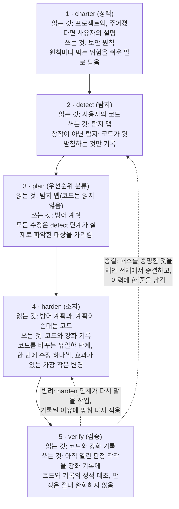
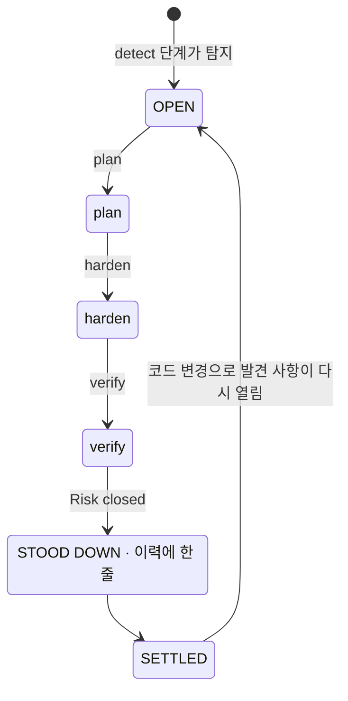
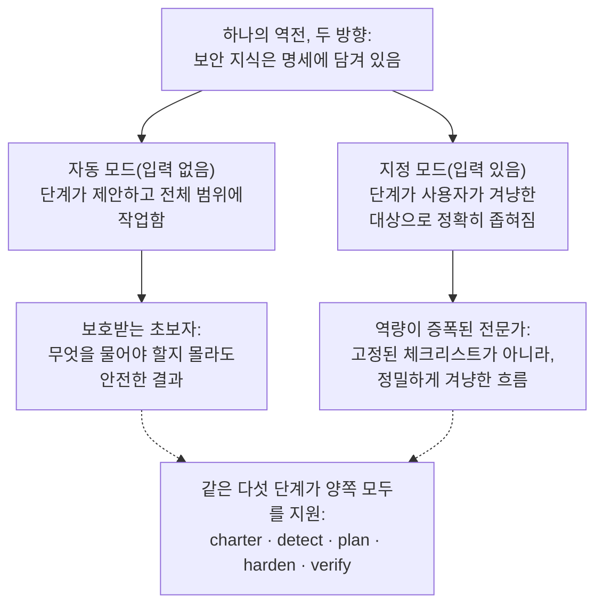
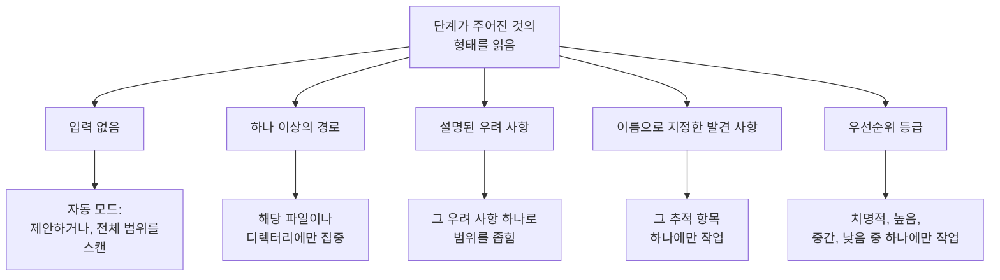
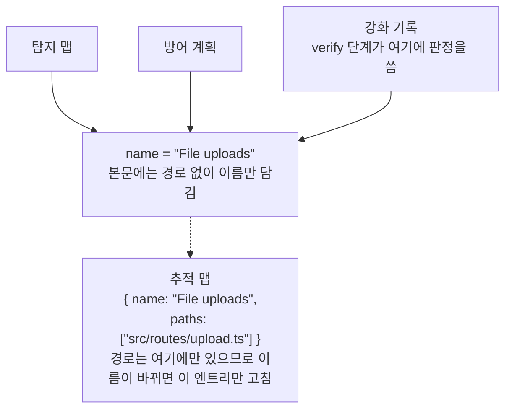
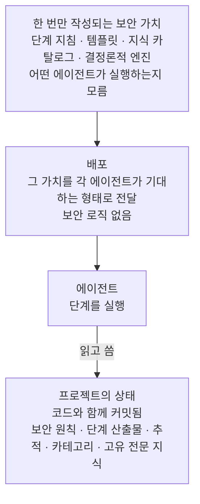
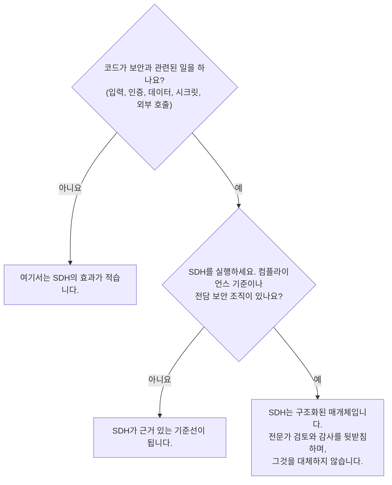

# Security-Driven Hardening: AI 지원 개발 시대를 위한 컨벤션

> Security-Driven Hardening(SDH) 방법론: AI 지원 개발과 바이브 코딩으로 만든 소프트웨어를 점검하고 보안을 강화하는, 컨텍스트를 인식하는 Blue Team 컨벤션입니다.

표준 URL: https://lagune.ai/ko-KR/docs/references/paper
언어: ko-KR
원문: https://lagune.ai/docs/references/paper
마지막 업데이트: 2026-11-05

- **Weslley Araújo**
- **방법론 논문, 2026년**

---

## 초록

Security-Driven Hardening(SDH)은 AI 에이전트와 보안 전문가가 아닌 사람들이 소프트웨어를 작성하는 일이 점점 늘어나는 시대를 위한, AI가 주도하는 구조화된 방어 전용 보안 방법론입니다. SDH는 일반적인 체크리스트를 실행하는 대신, 먼저 시스템이 실제로 무엇을 하는지(로그인, 파일 업로드, 결제, 데이터 노출 등) 탐지한 다음 그 컨텍스트에 특화된 보안 작업을 이끌어 갑니다. 기본적으로 안전한 원칙을 따르고, 전적으로 방어를 중심으로 짜여 있으며, 어떤 사용자든 바로 행동에 옮길 수 있도록 쉬운 말로 표현됩니다.

이 문서는 SDH가 하나의 도구가 아니라 그동안 빠져 있던 컨벤션이라고 주장합니다. 보안 지식은 방법론과 필요할 때만 불러오는 전문 지식에 담겨 있으며, 모든 사용자가 그 위에 쌓아 갈 수 있는 기준선이 됩니다. 덕분에 초보자와 전문가를 같은 흐름으로 지원할 수 있습니다. 기존의 명세 우선 접근 방식 `[1]` 대비 SDH를 구별하는 속성은 두 가지입니다. SDH는 **상태 독립적**이어서 빈 디렉터리, 진행 중인 프로젝트, 단일 풀 리퀘스트, 대규모 레거시 코드베이스 어디에든, 어떤 스택에서든 적응합니다. 또한 SDH는 **종결 가능**합니다. 해소가 검증된 위험은 흐름 전체에서 종결되므로, 그 발견 사항은 안정 상태에 이르고 코드가 바뀔 때만 다시 열립니다. SDH는 보안 전문가나 전문적인 Blue Team 도구를 대체하지 않습니다. 개발자 자신의 지식을 확장하며, 개발자가 보안을 깊이 이해할수록 SDH를 더 많이 주도할 수 있습니다.

**Lagune**은 참조 구현이며, 이 방법론이 실제로 구축할 수 있고 이식할 수 있다는 것을 증명합니다. 다른 이들도 채택할 수 있는 컨벤션으로 SDH를 제안합니다.

> **색인어**
>
> AI 지원 개발, 소프트웨어 보안, 방어 보안, 명세 주도 개발, 보안 강화, 에이전트 주도 워크플로, 종결 가능성, 컨텍스트를 인식하는 보안, 필요할 때만 불러오는 지식, 에이전트 독립적 도구.

---

## I. 서론: AI 지원 개발이 연 보안 공백

유출된 시크릿, 빠진 인가 검사, 인젝션이 가능한 쿼리처럼 안전하지 않은 패턴을 제대로 알아보지 못하는 사람과 AI 에이전트가 소프트웨어를 배포하는 일이 점점 늘고 있습니다. 이는 특이한 위험이 아닙니다. 실제 사고의 대부분을 차지하는 위험 유형에 속하며, 수년 동안 공개 레퍼런스에 문서화되어 왔습니다 `[6]`, `[7]`. 최근 연구도 AI가 생성한 코드의 상당 부분이 바로 이런 결함을 안은 채 배포된다고 보고합니다 `[8]`. AI 코딩 어시스턴트 덕분에 개발자가 아닌 사람도 실제 소프트웨어를 배포할 수 있게 되면서 이 문제는 더 심각해졌지만, 이 공백은 특정 사용자층에 국한되지 않습니다. 대부분의 프로젝트는 자신이 실제로 하는 일에 맞춘 보안 점검을 한 번도 받지 못합니다. "작동하니까 배포하자"라는 섣부른 결정이 내려질 때마다 생태계는 더 취약해집니다.

일반적인 보안 조언으로는 이 공백을 메울 수 없습니다. 고정된 체크리스트는 시스템이 하는 일에 맞춰져 있지 않으므로, 작은 프로젝트에 관련 없는 항목을 쏟아 내면서도 정작 그 프로젝트에 중요한 위험은 놓칩니다. 문제는 세상에 보안 지식이 부족하다는 것이 아닙니다. 사용자 앞에 실제로 놓인 시스템에 맞는 지식을 연결하는 것, 그것도 무엇을 물어야 할지 모를 수도 있는 사람을 위해 그렇게 하는 것이 문제입니다.

SDH는 단 하나의 역전으로 이 문제에 답합니다. 바로 **보안 지식은 명세와 필요할 때만 불러오는 전문 지식에 담겨 있으며, 모든 사용자가 그 위에 쌓아 갈 수 있는 기준선이 된다**는 것입니다. 방법론이 컨텍스트를 탐지하고, 그 컨텍스트가 지닌 위험의 우선순위를 정하고, 수정을 안내하므로, 개발자와 비개발자 모두 같은 흐름으로 지원받습니다. 발견 사항과 권장 사항은 쉬운 말로 남아 있으므로, 읽는 사람의 기술적 깊이와 관계없이 바로 실행에 옮길 수 있습니다. 전문가는 이 방식에 제약받지 않고 오히려 역량이 증폭되며, 이 이중성은 뒤에서 자세히 다룹니다(`§VI`).

> **핵심 통찰**
>
> **핵심 역전**: 보안 지식은 명세와 필요할 때만 불러오는 전문 지식에 담겨 있으며, 모든 사용자가 그 위에 쌓아 갈 수 있는 기준선이 됩니다. 방법론은 시스템이 무엇을 하는지 파악해 그에 맞는 보안 작업을 연결하고, 사용자가 이미 아는 것이 무엇이든 그것을 확장합니다.

어떤 개발자가 AI 어시스턴트에게 "내 앱에서 사용자가 프로필 사진을 올릴 수 있어"라고 말한다고 해 보겠습니다. 보안 점검이 없으면 어시스턴트는 작동은 하지만 클라이언트가 보내는 것, 즉 선언된 파일 형식, 파일 이름, 크기를 아무 의심 없이 믿는 코드를 만들어 냅니다. 업로드 기능은 그대로 배포되고, 이미지로 위장한 파일에 코드가 숨어 들어올 수 있으며, 조작된 이름이 저장 경로를 벗어날 수 있고, 지나치게 큰 파일이 서버 자원을 고갈시킬 수 있습니다. 데모에서는 이 중 어느 것도 보이지 않으므로, 결국 배포됩니다.

같은 코드라도 SDH를 거치면 다르게 다뤄집니다. 시스템이 외부에서 파일을 받는다는 것을 탐지하고(탐지), 업로드가 지닌 위험의 우선순위를 정하고(우선순위 분류), 실제 파일 형식과 크기를 확인하고, 저장할 때 이름을 바꾸고, 코드가 실행될 수 없는 곳에 저장하자고 제안한 뒤(조치), 결과를 읽어 각 통제가 실제로 효과가 있는지 확인합니다(검증). 개발자는 "제한 없는 파일 업로드(unrestricted file upload)"라는 용어를 알 필요가 없었습니다. 방법론이 대신 그것을 챙겼습니다.

이 문서의 기여는 다음과 같습니다.

- 특정 구현과 무관한 방법론으로서 SDH의 정확한 정의와 그 설계 원칙(`§III`).
- 책임 분리 자체가 기여인 다섯 단계의 방어 수명 주기: 탐지는 지어내지 않고, 계획은 코드를 읽지 않으며, 코드를 바꾸는 단계는 하나뿐이고, 검증은 판단을 완화하지 않습니다(`§IV`).
- 방법론적 입장으로서의 **종결 가능성**: 개별 발견 사항에는 끝없는 루프가 아니라 최종 상태가 있습니다(`§V`).
- **개발자 지식 확장**의 이중성: 하나의 흐름이 초보자를 보호하고 전문가의 역량을 증폭합니다(`§VI`).
- **호출할 수 없는 전문 지식과 프롬프트 온디맨드**: 에이전트가 기본으로 불러오지 않고, 프로젝트의 컨텍스트가 요구할 때만 불러오는 집중된 보안 지식(`§VII`).
- **상태 독립성**과 **비강제적 적응성**: SDH는 어떤 개발 상태에도 맞고, 고정된 범위를 강요하지 않고 상황에 적응합니다(`§VIII`).
- **예방 모드**: 일상적인 작업을 만드는 동안 같은 방어를 실행해, 코드가 처음부터 기본적으로 안전하게 들어오고 단계가 바로잡을 것이 줄어듭니다(`§IX`).
- SDH가 출발했다가 갈라져 나온 계보인 Spec-Driven Development와의 비교(`§X`).
- 방법론이 리팩터링을 견디고 어떤 에이전트에도 종속되지 않게 하는 엔지니어링 규율: 이름 기반 식별 추적(`§XI`), 그리고 에이전트 독립적 매개체(`§XII`).

---

## II. 배경과 관련 연구

SDH는 선행 연구를 토대로 합니다. 명세 우선, 에이전트 주도 개발이 검증해 온 구조, 즉 템플릿, 에이전트가 사용하는 슬래시 명령어, 모든 단계를 규율하는 문서, 단계를 실행하는 에이전트를 물려받습니다 `[1]`, `[2]`, `[3]`. 그리고 이 구조를 방어 목적으로 다시 구현합니다. 이 계보는 의도된 것이며, SDH의 작업 원칙 중 하나가 이를 직접 밝힙니다. 검증된 구조로 워크플로를 만든 다음, 그 틀을 보안에 맞추라는 원칙입니다.

SDH는 일반적인 권장 사항을 모아 둔 고정된 체크리스트가 아닙니다. 체크리스트는 보안 전반에 대해서는 많이 알지만, 눈앞의 프로젝트에 대해서는 아무것도 모릅니다. SDH는 그 무게중심을 뒤집습니다. 먼저 탐지, 즉 시스템이 무엇을 하는지 파악하는 데 힘을 쏟고, 그다음에야 탐지를 통해 관련성이 드러난 지식을 찾아 씁니다.

SDH는 보안 인력이나 전문적인 Blue Team 도구를 대체하지도 않습니다. 개발자의 지식을 확장하는 역할을 합니다(`§VI`). 전담 보안 조직이 있는 팀이라면 그 조직을 유지해야 합니다. SDH는 그런 팀에게는 구조화된 매개체를, 그런 조직이 없는 팀에게는 근거 있는 기준선을 제공합니다.

SDH는 결정론적 보안 스캐너(정적 분석, 린터)와도 나란히 자리합니다 `[4]`, `[5]`. 이런 도구는 결정론적이고 반복 가능하다는 바로 그 점 때문에 가치가 있습니다. SDH는 대부분 에이전트의 추론에 의존하며, 엄격한 결정론을 내주는 대신 컨텍스트 인식을 얻습니다. 방법론은 이를 숨기지 않습니다. 결정론이 중요한 곳에서는 추론 안에 결정론적 엔진을 넣습니다(`§VII`). 즉, 입력을 검사할 가치가 있는지는 에이전트가 판단하고, 그 입력이 위험한지는 결정론적 프로그램이 판단합니다.

가장 직접적인 선행 사례는 Spec-Driven Development(SDD)로, 실행 가능한 명세에서 출발해 빌드를 앞으로 밀고 나가는 명세 우선 방법론 계열입니다. 이 문서는 SDD를 하나의 부류로 다룹니다. 실무 방법론으로서 가장 명확하게 정리한 Piskala의 보고서 `[1]`, 가장 눈에 띄는 에이전트 주도 도구 모음인 GitHub의 Spec Kit `[2]`, 같은 계열의 두 번째 도구인 OpenSpec `[3]`, 이 세 가지가 비교의 대표 기준입니다(`§X`).

---

## III. SDH: 정의와 설계 원칙

**Security-Driven Hardening**은 임시방편식 수정이 아니라 에이전트가 실행하는 명세에서 작업을 이끌어 내어, 코드베이스를 더 안전하게 바꾸는 구조화된 AI 주도 보안 방법론입니다. 이름은 보안의 방어자인 **Blue Team**에서 영감을 받았습니다. SDH가 다루는 것은 방어, 보안 강화, 검증이며, 공격은 결코 다루지 않습니다.

> **정의**
>
> **Security-Driven Hardening(SDH)**: 먼저 시스템이 실제로 무엇을 하는지 탐지한 다음 그 컨텍스트에 특화된 보안 작업을 이끌어 가는, AI가 주도하는 구조화된 방어 전용 보안 방법론입니다. 기본적으로 안전한 원칙을 따르고 쉬운 말로 표현됩니다.

SDH는 반드시 지켜야 하는 원칙들로 정의됩니다. 각 원칙은 하나의 규칙이며, 각각 사용자에게 구체적인 보장을 제공합니다.

| 원칙                                              | 규칙                                                                                                                                                                         | 사용자에게 보장하는 것                                                                                                                                                 |
| ------------------------------------------------- | ---------------------------------------------------------------------------------------------------------------------------------------------------------------------------- | ---------------------------------------------------------------------------------------------------------------------------------------------------------------------- |
| 기본적으로 안전하게, 쉬운 말로, 모두에게 동등하게 | 모든 기본값, 메시지, 수정은 처음부터 안전하며, 개발자든 아니든 누구나 이해할 수 있습니다. 어떤 사용자층도 특별 대우를 받지 않습니다.                                         | 초보자도 따로 요청하지 않아도 안전한 기준선을 받고, 결과를 자신이 이해하는 말로 읽습니다.                                                                              |
| 일반론보다 컨텍스트 인식                          | 모든 단계는 detect 단계에서 탐지한 컨텍스트에서 출발하며, 시스템이 실제로 하는 일에 따라 행동합니다.                                                                         | 권장 사항이 체크리스트가 아니라 프로젝트에 맞춰집니다. 보안 지식은 명세와 필요할 때만 불러오는 전문 지식에 담겨 있어, 사용자가 가진 지식이 무엇이든 그것을 확장합니다. |
| 경직성보다 유연성                                 | 원칙, 요구 사항, 권장 사항은 출발점입니다. 사용자는 무엇이든 고쳐 쓰고, 빼고, 더하고, 범위를 좁힐 수 있습니다.                                                               | 방법론은 프로젝트와 사용자에 맞춰 유연하게 바뀌며, 사용자가 원하는 것보다 더 엄격해지지 않습니다. 유연성이 기본적으로 안전한 기준선을 약화하는 일은 없습니다.          |
| 덧붙이기만 하지 않고, 현재 상태와 대조해 갱신하기 | 산출물은 로그가 아니라 살아 있는 문서입니다. 실행할 때마다 모든 항목을 다시 확인해, 여전히 유효한 것은 유지하고, 바뀐 것은 다시 쓰고, 더 이상 해당하지 않는 것은 제거합니다. | 기록이 언제나 현재를 반영하므로, 낡은 백로그로 썩어 가지 않습니다.                                                                                                     |
| 방어 전용                                         | SDH는 점검하고, 보안을 강화하고, 검증합니다. 공격 도구, 악의적인 용도의 익스플로잇, 피해를 목적으로 한 탐지 회피 기법은 절대 만들지 않습니다.                                | 방법론을 무기로 바꿀 수 없습니다. 이중 용도의 내용은 명확히 방어적인 맥락에서만 등장합니다.                                                                            |
| 명세 우선, 에이전트 주도, 보안 중심               | 워크플로는 템플릿, 명령어, 모든 단계를 규율하는 보안 원칙, 단계를 실행하는 에이전트로 구성됩니다.                                                                            | 검증된 개발 구조를, 에이전트가 실질적인 보안 작업을 하도록 용도에 맞게 바꾼 것입니다.                                                                                  |

**표 1.** SDH의 설계 원칙과 각 원칙이 사용자에게 제공하는 보장.

이 원칙은 장식이 아닙니다. 아래의 모든 단계가 지켜야 하는 제약이며, 방법론의 한계를 짚을 때 다시 이 원칙으로 돌아옵니다(`§XV`).

이 문서의 나머지 부분에서는 이름을 붙인 아홉 개의 기둥을 전개합니다. 독자가 기억해 두어야 할 부분이자, 다른 팀이 SDH를 한다고 말하려면 다시 구현해야 할 부분입니다.

| 기둥                                   | 제공하는 것                                                                                                   | 절          |
| -------------------------------------- | ------------------------------------------------------------------------------------------------------------- | ----------- |
| 컨텍스트를 인식하는 역전               | 보안 지식이 명세와 필요할 때만 불러오는 전문 지식에 담겨 있어, 초보자와 전문가가 하나의 흐름을 공유합니다.    | `§I`, `§VI` |
| 다섯 단계의 방어 수명 주기             | 책임 분리: 정책, 탐지, 우선순위 분류, 조치, 검증이 각각 한 가지 일만 맡습니다.                                | `§IV`       |
| 종결 가능성                            | 발견 사항에는 끝없는 루프가 아니라 최종 상태가 있습니다. 해소된 작업은 종결됩니다.                            | `§V`        |
| 개발자 지식 확장의 이중성              | 하나의 흐름이 초보자를 보호하고 전문가의 역량을 증폭하며, 어느 쪽도 대체하지 않습니다.                        | `§VI`       |
| 프롬프트 온디맨드, 호출할 수 없는 지식 | 관련 보안 지식은 기본으로 불러오지 않고, 프로젝트의 실체에 맞춰 불러옵니다.                                   | `§VII`      |
| 상태 독립성과 비강제적 적응성          | 어떤 스택의 어떤 개발 상태에도 맞고, 범위를 강요하지 않고 상황에 적응합니다.                                  | `§VIII`     |
| 예방 모드                              | 새 작업을 만드는 동안 같은 방어가 작동하므로, 코드가 처음부터 기본적으로 안전하게 들어옵니다.                 | `§IX`       |
| 이름 기반 식별 추적                    | 발견 사항은 여러 단계를 거치는 동안 하나의 항목으로 유지되며, 이름 변경으로 연결이 끊기는 곳은 한 곳뿐입니다. | `§XI`       |
| 에이전트 독립적 매개체                 | 보안 가치는 한 번만 작성되며, 어떤 에이전트나 스택에도 의존하지 않습니다.                                     | `§XII`      |

**표 2.** SDH의 아홉 기둥과 각 기둥을 다루는 절.

---

## IV. 5단계 Blue Team 흐름

SDH는 작업을 다섯 단계의 방어 수명 주기로 구성합니다(그림 1). 각 단계는 방어를 중심으로 짜여 있고 앞 단계 위에 쌓이며, 정책 수립, 탐지, 우선순위 분류, 조치, 검증이라는 실제 Blue Team 활동을 따릅니다.



**그림 1.** 다섯 단계의 흐름: 각 단계가 읽는 것, 쓰는 것, 그리고 흐름을 떠받치는 불변 조건. 두 갈래의 되돌림은 모두 verify 단계가 이끕니다. 반려된 통제는 harden 단계를 다시 열고, 해소가 증명된 발견 사항은 체인 전체에서 종결되어 이력에 한 줄로 남습니다.

책임 분리가 곧 이 방법론의 기여입니다. 각 단계가 한 가지 일만 맡으므로 실패 양상은 한 곳에 갇히고, 독자는 각 산출물이 주장하는 내용을 신뢰할 수 있습니다.

> **핵심 통찰**
>
> **Applied는 검증된 것이 아닙니다**: harden 단계는 수정이 적용되었다고 기록합니다. verify 단계는 코드를 그 기록과 대조해 이를 검증하며, 기록에 맞추려고 판정을 완화하는 일은 결코 없습니다. 통제가 코드에 있는데도 여전히 위험에 도달할 수 있는 경우가 있으며, 그때 정직한 판정은 "Risk not closed"입니다.

### charter (정책)

charter 단계는 프로젝트의 보안 원칙, 즉 이후의 모든 단계가 지켜야 하는 규칙을 세웁니다. charter는 모든 단계를 규율하는 계층이며, 프로젝트 보안 태세에 대한 일종의 컴파일 타임 검사 역할을 합니다. 각 원칙에는 분명한 이름, 코드와 대조해 확인할 수 있는 타협 불가능한 규칙, 그리고 수정 방법만이 아니라 그 원칙이 막는 위험을 밝히는 `Why:` 줄이 있습니다. charter 단계는 언제나 프로젝트 자체(매니페스트, 구조, 의존성)를 읽습니다. 사용자가 설명을 주면 그 설명은 방향이 되고, 프로젝트를 읽는 범위는 거기서 사용자가 언급한 것 너머로 넓어집니다. 설명이 없으면 프로젝트가 유일한 출처입니다. 둘은 서로 경쟁하지 않고 더해지며, charter 단계가 기록하는 것은 코드의 현재 상태가 아니라 프로젝트가 지켜야 할 정책입니다. 개발자가 아닌 사람도 이를 읽고 규칙과 위험을 모두 이해할 수 있어야 합니다.

### detect (탐지)

detect 단계는 코드를 읽고, 시스템이 실제로 하는 일 가운데 보안상 의미가 있는 것을 파악합니다. 이 단계를 이끄는 지침은 "창작이 아닌 탐지"입니다. 코드가 뒷받침하는 것만, 이후 단계에 필요한 근거와 함께 기록합니다. detect 단계는 중립적입니다. 발견 사항을 보안 원칙에 억지로 맞추지 않습니다. 위험을 보안 원칙의 규칙과 맞춰 보는 것은 plan 단계의 일이기 때문입니다. 각 발견 사항은 세 부분으로 이루어집니다. 무엇인지(쉬운 말로 된 설명), 왜 중요한지(사실만이 아니라 위험), 그리고 근거(그 발견 사항이 있는 함수나 라우트)입니다. 근거에는 파일 경로가 들어가지 않습니다. 경로는 추적 맵에만 있습니다(`§XI`). 그래서 본문에는 낡을 수 있는 경로가 결코 들어가지 않습니다.

### plan (우선순위 분류)

plan 단계는 각 발견 사항을 수정으로 바꿉니다. 수정에는 위험 유형에 따른 이름을 붙이고(근거가 되는 경우 CWE와 OWASP 같은 확립된 레퍼런스를 인용합니다), 그 수정이 지키는 보안 원칙과 연결합니다. 우선순위(치명적, 높음, 중간, 낮음)는 임의로 고르는 것이 아닙니다. plan 단계는 CVSS v4.0의 Base 및 Environmental 방식으로 각 발견 사항에 점수를 매기므로, 등급은 그 점수를 쉬운 말로 옮긴 것이고, 노출 정도와 피해 규모를 설명하는 쉬운 말 한 줄로 근거를 밝히며, 두 번 실행해도 같은 순서가 나옵니다. 벡터는 전문가를 위한 정밀한 기준점이고, 등급과 그 근거는 누구나 따라갈 수 있는 같은 평가입니다. plan 단계는 탐지 맵만 보고 작업하며 코드를 절대 읽지 않습니다. 이는 한계가 아니라 의도된 제약입니다. 모든 수정이 detect 단계가 실제로 탐지한 대상을 가리키도록 강제하기 때문입니다. 파악된 적 없는 범위가 있으면 plan 단계는 추측하지 않고 멈춘 뒤 사용자를 detect 단계로 돌려보냅니다.

### harden (조치)

harden 단계는 코드를 바꾸는 유일한 단계이므로 신중하게 진행합니다. 편집에 사용자의 승인이 필요한지는 에이전트와 에이전트를 실행하는 권한 모드가 결정할 일이므로, harden 단계는 별도의 확인 절차를 두지 않습니다. 의존하는 대상을 먼저, 그다음 우선순위가 높은 것부터 한 번에 수정 하나씩 적용하므로, 각 변경은 작고 검토하기 쉬우며 되돌리기도 쉽습니다. 새 수정을 맞추려고 기존 통제를 약화하지 않으며, 보안 원칙을 어기지도 않습니다. 수정이 원칙과 충돌한다면 harden 단계는 적용하지 않고 멈춘 뒤 그 충돌을 알립니다. 각 블록은 Applied, Partial, Blocked 중 하나로 기록됩니다. 다만 "Applied가 곧 검증되었다는 뜻은 아닙니다". 이 문제는 다음 단계가 다룹니다.

### verify (검증)

verify 단계는 코드를 읽고 harden 단계가 기록한 내용과 대조해, 적용된 각 통제를 검증합니다. 검증이란 바로 이 대조, 즉 코드와 기록을 맞대어 보는 일이며, 정적으로 이루어집니다. 통제가 코드에 존재하고 올바르다는 것을 확인할 뿐, 실행 중인 시스템에서 공격을 받아도 통제가 실제로 효과가 있다는 것까지 확인하지는 않습니다. 실제 공격이나 모의 공격을 운영 중인 시스템에 실행하는 런타임 검사는 설계상 범위 밖입니다. verify 단계는 Risk closed, Risk not closed, Cannot tell from the code 세 가지 판정 중 하나를 내립니다. verify 단계는 자체 산출물을 만들지 않습니다. harden 단계와 verify 단계는 강화 기록을 공유하며, 무엇을 했는지는 harden 단계가, 판정과 그 이유는 verify 단계가 맡고, 어느 쪽도 상대의 필드에 쓰지 않습니다. 반려된 통제는 harden 단계가 다시 맡을 작업이 되며, harden 단계는 다음 실행에서 코드를 직접 읽은 결과보다 그 판정을 우선하고, 이유에 적힌 바로 그 빈틈을 겨냥해 수정을 다시 적용합니다. verify 단계는 기록보다 코드를 신뢰합니다. 기록은 코드가 실제로 해내는 것보다 더 많은 것을 주장할 수 있기 때문입니다. 사용자의 코드에 대해서는 읽기만 하며, 기록에 맞추려고 판정을 완화하는 일은 결코 없습니다. 통제가 있어도 다른 경로로 위험에 도달할 수 있다면, 그때 정직한 판정은 "Risk not closed"입니다. 읽는 도중 탐지 맵이 다룬 적 없는 보안 문제를 발견하더라도, 탐지는 detect 단계의 일이므로 verify 단계는 그 문제에 대한 판정을 지어내지 않습니다. 대신 문제를 알리고 사용자를 detect 단계로 돌려보내, 발견 사항이 흐름을 건너뛰지 않고 같은 흐름을 통해 들어오게 합니다.

> **이어지는 예시: 파일 업로드**. 발견 사항 하나로 흐름의 뼈대를 처음부터 끝까지 보여 줍니다.
>
> - **detect** 단계가 이를 찾아냅니다. 시스템은 사용자에게서 파일을 받으며, 업로드 핸들러는 파일의 실제 형식을 확인하지 않고 클라이언트가 보낸 MIME 타입을 그대로 믿습니다. _중요한 이유_: 이미지로 위장한 파일에 악성 코드를 숨길 수 있습니다.
> - **plan** 단계가 "모든 입력은 검증되기 전까지 신뢰할 수 없습니다"라는 원칙을 지키는 수정을 정하며, 우선순위는 **치명적**입니다. 파일의 실제 형식과 크기를 확인하고, 저장할 때 이름을 바꾸고, 업로드한 파일은 코드로 실행될 수 없는 곳에 저장합니다.
> - **harden** 단계가 이를 적용하고 상태를 **Applied**로 기록합니다. 이제 핸들러는 내용에서 실제 형식을 판별하고, 크기 제한을 적용하고, 예상하지 못한 것은 거부하고, 저장할 때 이름을 바꾸고, 코드가 실행될 수 없는 곳에 저장합니다.
> - **verify** 단계가 핸들러를 읽고 기록과 대조한 뒤 **Risk closed** 판정을 내립니다. 코드가 기록이 주장하는 그대로 동작합니다.
>
> 같은 발견 사항 이름이 탐지 맵, 방어 계획, 강화 기록을 관통하며, verify 단계도 같은 이름으로 그 기록에 작업합니다. 아직 열린 판정은 해당 발견 사항의 블록에 기록되고, 해소가 증명된 발견 사항은 종결됩니다(`§V`). 이 공유된 이름이 곧 발견 사항의 식별자입니다(`§XI`).

---

## V. 종결 가능성: 최종 상태가 있는 발견 사항

대부분의 보안 도구는 사용자에게 늘어나기만 하는 백로그를 남깁니다. SDH는 다른 입장을 취합니다. **발견 사항은 종결할 수 있으므로, 끝없는 백로그에 머무르지 않고 최종 상태에 이릅니다**(그림 2). 이는 현재 상태와 대조해 갱신하는 원칙에서 곧바로 나옵니다.

> **정의**
>
> **종결 가능성**: 해소가 검증된 위험은 흐름 전체에서 종결되므로, 그 발견 사항은 안정 상태에 이르고 코드가 바뀔 때만 다시 열립니다. 보안 활동 자체는 계속되더라도 발견 사항에는 최종 상태가 있습니다.

SDH의 산출물은 로그가 아니라 살아 있는 문서입니다. 단계를 다시 실행할 때마다 기존 항목을 하나하나 현재 사실과 대조하고, 세 가지 중 하나를 합니다. 여전히 유효한 것은 유지하고, 바뀐 것은 다시 쓰고, 더 이상 해당하지 않는 것은 제거합니다. 이제 해결되었다는 것이 코드로 드러난 발견 사항은 그냥 제거됩니다. 작업 기록은 과거가 아니라 현재를 반영합니다.

종결은 바로 그 대조와 갱신이 결론에 이른 것입니다. verify 단계가 위험이 해소되었음을 검증하면, 그 발견 사항을 흐름 전체, 즉 탐지 맵, 방어 계획, 강화 기록, 추적 맵에서 종결합니다. verify 단계가 다른 단계의 산출물에 쓰는 유일한 단계인 이유가 여기에 있습니다. 루프를 닫는 단계이기 때문입니다. 발견 사항이 체인을 떠날 때, 종결 과정은 그 핵심을 짧은 항목으로 정리해 이력 기록에 남깁니다. 이 이력은 작업 체인 밖에 있으며 다시 처리되지 않습니다. 사라지는 것과 종결되는 것의 경계가 바로 여기에 있습니다. 더 이상 사실이 아니어서 대조와 갱신 과정에서 제거된 발견 사항은 아무것도 남기지 않지만, 해소가 증명된 발견 사항은 이력에 한 줄을 남깁니다. 종결된 발견 사항은 이후 어떤 작업 산출물에도 나타나지 않으며, 그 부재는 체인이 깨진 것이 아니라 예상된 결과입니다.



**그림 2.** 종결 가능성의 상태 기계. 발견 사항은 OPEN(열림) → STOOD DOWN(종결) → SETTLED(안정 상태) 순으로 이동하며, 코드가 바뀔 때만 다시 열립니다.

범위 안의 모든 것이 종결되면 사이클은 안정 상태가 되며, 이 안정 상태에는 구체적인 형태가 있습니다. 마지막 발견 사항이 종결된 산출물은 통째로 제거되므로, 완전히 종결된 체인에는 보안 원칙과 이력, 즉 정책과 증명만 남습니다. 사이클은 코드가 바뀔 때만 다시 열립니다. 방법론은 각 발견 사항에 분명한 끝을 주며, 이것이야말로 끝없는 백로그가 할 수 없는 일입니다.

---

## VI. 개발자 지식 확장의 이중성

SDH는 사람을 대체하지 않으며, 전문적인 Blue Team 도구도 대체하지 않습니다. SDH는 **개발자 자신의 지식을 확장합니다**. 개발자가 보안을 잘 이해할수록 흐름을 더 정밀하게 이끌 수 있고, 더 많은 자율성을 갖습니다. 보안을 잘 모르는 개발자도 자동 모드가 보호해 주므로 여전히 안전한 결과를 얻습니다.

보안 지식이 명세에 담겨 있다는 역전은 양방향으로 작용합니다(`§I`). 초보자에게 이것은 보호입니다. 명세가 먼저 제안하므로 무엇을 물어야 할지 몰라도 됩니다. 전문가에게 이것은 증폭입니다. 같은 명세 덕분에 고정된 체크리스트와 씨름하는 대신 흐름을 정밀하게 겨냥할 수 있습니다.

모든 단계는 자신의 동작 안에 이 이중성을 지니고 있습니다(그림 3). 입력 없이 실행하면 사용자를 대신해 전체 범위에 작업합니다. 방향을 주면 같은 단계가 사용자가 겨냥한 대상으로 정확히 좁혀집니다.



**그림 3.** 개발자 지식 확장의 이중성. 하나의 역전이 두 독자층을 지원합니다. 같은 다섯 단계를 거치며 자동 모드는 초보자를 보호하고, 지정 모드는 전문가의 역량을 증폭합니다.

필요할 때만 불러오는 전문 지식은 그 본문에서 이 이중성을 명시적으로 드러냅니다(`§VII`). 각 전문 지식은 에이전트에게 자신의 지식이 "판단을 넓혀 준다"는 점을 알리고, 전문 지식이 제공하는 것 너머까지 계속 추론하라고 말합니다. 지식은 하한이지 상한이 아닙니다. 이것이 이 문서가 의도한 균형 속에서 두 독자층을 모두 지원하는 방식입니다. 개발자 커뮤니티는 실질적인 도구를 얻고, Blue Team 실무자는 자신의 일을 대신해 주는 척하지 않는 구조화된 매개체를 얻습니다.

---

## VII. 호출할 수 없는 전문 지식과 프롬프트 온디맨드

이것이 이 방법론에서 가장 새로운 패턴입니다. SDH는 특정 분야에 집중한 보안 지식을 **필요할 때만** 불러오는 전문 지식으로 담고 있으며, 어떤 전문 지식을 불러올지는 에이전트가 프로젝트의 컨텍스트와 맞춰 보고 직접 정합니다. 이를 **프롬프트 온디맨드**(prompt-on-demand)라고 부릅니다. 모든 검사를 기본으로 실행하는 대신, 에이전트가 자신이 놓인 프로젝트의 범위에 따라 활성화할 지식을 고르는 방식입니다. 전문 지식은 계속 진화하며, 어느 것이든 언제든지 바뀌거나 대체될 수 있습니다. 기여는 전문 지식 자체가 아니라 이 패턴입니다.

> **정의**
>
> **프롬프트 온디맨드**: 에이전트가 눈앞의 프로젝트 범위와 맞춰 보며 활성화할 보안 지식을 고르는 것으로, 모든 검사를 기본으로 실행하는 대신 프로젝트의 실체에 맞는 지식을 끌어옵니다.

> **정의**
>
> **호출할 수 없는 전문 지식**: 파일 업로드나 브라우저에서 실행되는 코드처럼 하나의 컨텍스트에 집중한, 특정 언어에 종속되지 않는 보안 지식 단위입니다. 점검하고 설명할 뿐, 코드를 다시 쓰지 않으며 공격 입력도 만들지 않습니다. 명령어가 아니며, 다루는 컨텍스트가 범위 안에 있거나 프롬프트가 이름으로 요청할 때 불러옵니다.

각 전문 지식은 다루는 위험에 대해 더 안전한 형태를 제시하고, 그 지식을 사용하는 각 단계에서 발견 사항을 어떻게 다룰지 에이전트에게 알려 줍니다. 탐지에서는 어떻게 판단할지, 조치에서는 수정을 어떻게 안전하게 적용할지, 검증에서는 어떻게 증명할지입니다.

결정적인 특징은 전문 지식을 **그 자체로는 호출할 수 없다**는 점입니다. 전문 지식은 명령어가 아니며, 흐름 안에서는 매칭이 전문 지식을 불러옵니다. 탐지 단계는 카탈로그를 한 번 나열하고, 프로젝트의 컨텍스트를 각 항목이 다루는 내용과 맞춰 본 뒤, 컨텍스트가 범위 안에 있는 전문 지식만 불러옵니다. 이후 단계는 다시 나열하지 않고 그 매칭 목록을 재사용하므로 한 번의 매칭이 체인 전체에 쓰이며, 예방 모드도 같은 매칭을 이제 만들 작업에 적용합니다(`§IX`). 컨텍스트가 없는 전문 지식은 건너뛰며, 건너뛴 것도 불러온 것만큼 책임 있게 다룹니다. 카탈로그의 모든 항목이 명시적인 판정을 받습니다. 적용했는지, 아니면 코드에서 읽어 낸 이유와 함께 건너뛰었는지를 밝히므로, 막연히 관련 없어 보인다는 느낌이 부재를 대신하는 일은 없습니다. 적용할 것이 하나도 없다는 결과도 유효합니다.

카탈로그는 데이터이며, 카탈로그를 늘리는 데 필요한 것은 지식 파일 하나와 카탈로그 행 하나뿐이고, 새 명령어는 필요 없습니다. 내장 전문 지식은 OWASP, 특정 언어, AI 통합 같은 카테고리로 묶여 있으며, 프로젝트가 사용하는 카탈로그에는 프로젝트가 고른 카테고리의 내장 전문 지식과 프로젝트 고유의 전문 지식이 담깁니다. 프로젝트는 이 선택을 나머지 상태와 함께 기록하므로, 팀 전체가 같은 카탈로그로 매칭합니다. 이는 단계에 적용되는 것과 같은 컨텍스트 인식 원칙을 지식에 적용한 것입니다. 모든 검사를 기본으로 실행하는 대신, 프로젝트의 실체에 맞는 지식을 끌어옵니다. 같은 속성 덕분에 메인테이너뿐 아니라 사용자도 카탈로그를 키울 수 있습니다. 사용자가 제공한 보안 자료나 주제는 핵심이 정리되어 프로젝트에 속하는 새 전문 지식이 되고, 카테고리와 관계없이 그 카탈로그에 합류하며, 내장 전문 지식과 똑같이 불러와지고, 같은 이름의 내장 전문 지식을 대체합니다. 전문 지식을 작성하는 일 자체도 방어 전용이며, 전문 지식이 강제하는 것과 같은 경계를 따릅니다. 공격 분석 글이 출처가 될 수는 있지만, 그로부터 만들어진 전문 지식은 점검하고 설명할 뿐, 실제로 작동하는 익스플로잇을 내놓지 않습니다. 그래서 지능이 명세에 담긴다는 역전은 카탈로그 자체로까지 이어집니다(`§I`). 사용자는 코드를 작성하지 않고도 자신의 컨텍스트에 맞게 카탈로그를 더 깊게 만들 수 있습니다.

짧은 예로 프롬프트 온디맨드를 살펴보겠습니다. detect 단계가 브라우저에서 실행되는 코드 폴더를 읽습니다. 카탈로그에서 그 컨텍스트와 매칭되는 전문 지식을 찾아 불러오고, detect 단계의 일반적인 절차를 거쳐 클라이언트 측 발견 사항을 드러냅니다. 이 범위에 컨텍스트가 없는 전문 지식은 매칭되지 않으므로 불러오지 않으며, 각각 건너뛴 것으로 기록됩니다. 어떤 지식이 관련 있는지는 고정된 설정이 아니라 프로젝트가 정했습니다.

결정론은 정확히 필요한 곳에 등장합니다. 전문 지식은 글뿐 아니라 결정론적 검사기도 담을 수 있습니다. 위험 유형에 명확한 판정 절차가 있다면, 작은 프로그램이 주어진 입력에 대해 고정된 판정을 돌려줍니다. 예를 들면 `safe`, `unsafe`, `invalid input` 같은 몇 가지 짧은 단어입니다. 일부 위험 유형은 바로 이런 방식으로 결정론적으로 판정할 수 있으며, 그 판정 절차 뒤에는 선행 연구가 쌓여 있습니다 `[9]`, `[10]`, `[11]`. 검사기는 에이전트가 제공한 후보에 점수를 매기거나 직접 범위를 스캔해 후보를 찾으며, 어느 경우든 판정을 내리는 것은 에이전트가 아니라 검사기입니다. 충분히 범용적인 전문 지식은 카탈로그에서 필수로 표시할 수 있으며, 그러면 항상 적용되고 그 검사기가 전체 범위에 실행됩니다. 이는 컨텍스트 매칭 없이 지식을 불러오는 유일한 경우이며, 에이전트가 그때그때 정하는 것이 아니라 카탈로그 데이터에 선언됩니다. 바로 이 지점에서 SDH는 흐름 전체가 결정론적인 척하지 않으면서도, 에이전트의 추론을 반복 가능한 무언가에 근거하게 합니다.

마지막으로 전문 지식은 **떼어 내어 쓸 수 있습니다**. 지식이 독립적으로 성립하므로, 사용자는 SDH 전체 흐름과 무관한 프롬프트에서도 전문 지식을 바로 실행해 일상적인 개발과 함께 보안을 챙길 수 있습니다. 예를 들어 결정론적 검사기가 있는 전문 지식은 일반 코딩 중에 만들어진 후보를 하나하나 걸러 안전한 것만 남길 수 있습니다. 이 분리 가능성은 SDH가 그토록 다양한 상황에 적응하는 이유 중 하나로, 다음 절의 주제입니다(`§VIII`). 그리고 이 분리 가능성이 가장 온전하게 드러나는 것은 같은 지식이 일상적인 개발을 처음부터 끝까지 지키는 예방 모드입니다(`§IX`).

---

## VIII. 상태 독립성과 비강제적 적응성

두 가지 속성이 SDH를 경직된 명세 방법론과 구별합니다.

### 상태 독립성

> **정의**
>
> **상태 독립성**: 방법론이 개발 상태에 의존하지 않습니다. 시작점을 직접 읽어 파악하므로, 빈 디렉터리, 진행 중인 프로젝트, 단일 풀 리퀘스트, 대규모 레거시 코드베이스 어디에든, 어떤 스택에서든 맞습니다.

모든 단계는 프로젝트가 완전히 새것이든 이미 존재하든 같은 방식으로 작동합니다. charter 단계는 있는 코드가 무엇이든 거기서 원칙을 추론합니다. detect 단계는 코드가 아주 적더라도 있는 코드를 그대로 파악합니다. 전제된 시작점은 없습니다.

### 비강제적 적응성

> **정의**
>
> **비강제적 적응성**: 방법론은 사용자가 따라야 할 고정된 범위를 강요하지 않고 상황에 적응합니다. 사용자가 무엇을 말해야 할지 모를 때는 자신이 호출된 환경을 읽고, 컨텍스트를 만들어 내고, 다음 행동을 결정할 질문을 던집니다.

가장 분명한 예는 charter 단계의 제안 모드입니다. SDH는 프로젝트를 분석해 기본적으로 안전한 보안 원칙을 도출하고, 빈틈이 실제로 결과를 바꿀 때만 사용자에게 묻고, 그다음 보안 원칙을 작성해 각 원칙을 그것이 막는 위험과 함께 쉬운 말로 제시합니다. 보안 원칙은 승인 프롬프트 뒤에 묶인 계약이 아니라 사용자가 다시 실행해 고쳐 나가는 살아 있는 문서이므로, 사용자가 무엇을 요청해야 할지 알 필요가 전혀 없습니다.

이 적응성은 입력의 형태에 민감하게 반응하는 모습으로 나타납니다. 같은 단계가 주어진 것을 읽고 모드를 고릅니다(그림 4). 프롬프트에 담긴 파일, 목록의 발견 사항 하나, 걱정거리, 알려진 약점을 겨냥한 집중 임무, 전체를 무차별로 훑는 스캔 요청까지, 흐름이 설계상 비강제적이므로 어느 것이든 사용자의 필요에 맞춰집니다. 이 중 어떤 것도 기본적으로 안전한 기준선을 약화하지 않습니다. 유연성은 기준선을 적용하는 방식을 바꿀 뿐, 기준선을 낮추지는 않습니다.



**그림 4.** 비강제적 적응성. 같은 단계가 입력의 형태를 읽고 모드를 고르므로, 범위는 강요되지 않고 언제나 사용자가 정합니다.

---

## IX. 범용 예방 모드: 작업을 만드는 동안 작동하는 같은 방어

SDH에는 보완적인 모드가 하나 있습니다. 코드를 작성하는 동안 같은 방어를 켜 둔 채 진행하는 일상적인 개발입니다. 사용자는 로그인 페이지, 업로드, 엔드포인트처럼 작업 자체를 요청하고, 방법론은 빌드가 진행되는 동안 이를 지키므로, 결과물은 나중의 보안 강화 작업을 거친 뒤가 아니라 반영되는 순간부터 기본적으로 안전합니다.

> **정의**
>
> **예방 모드**: SDH의 모든 단계를 규율하는 계층과 지식 아래에서 진행하는 일상적인 개발입니다. 보안 원칙이 빌드를 구속하고, 이제 만들 대상과 관련된 전문 지식을 필요할 때만 불러오며, 작업을 완료라고 하기 전에 결과를 사용한 방어 그대로와 대조합니다.

이 모드는 단계들이 이미 갖춘 요소를 하나하나 재사용하되, 아직 존재하지 않는 코드를 향하게 합니다. 컨텍스트 탐지의 대상은 코드에서 의도로 바뀝니다. 에이전트는 이제 만들 것과 그 작업이 넘나드는 경계를 추론하며(로그인이라면 자격 증명, 세션, 외부에서 들어오는 입력이 따릅니다), 지식 카탈로그는 바로 이 추론과 매칭됩니다. 프롬프트 온디맨드는 여기서 일반화됩니다(`§VII`). 컨텍스트는 이미 있는 코드뿐 아니라 코드를 만들 계획에서도 탐지할 수 있습니다. 보안 원칙은 언제나처럼 규율하며, 원칙을 어기게 될 요청은 충돌로 알려지고 결코 구현되지 않습니다. 방어는 각 부분을 작성하는 바로 그 순간 코드 안에서 적용되어, 경계에서 검증하고 처음부터 안전한 구조를 택하므로, 작동은 하지만 안전하지 않아 나중에 고쳐야 할 버전은 아예 생기지 않습니다.

이 모드는 verify 단계가 시작하는 방식으로 끝납니다. 작업을 완료라고 하기 전에, 만든 쪽은 자신의 결과를 사용한 방어와 대조합니다. 통제는 위험의 경로 옆이 아니라 경로 위에 있어야 하고, 빠짐이 없어야 하며, 전문 지식에 결정론적 검사기가 있다면 검사기의 판정이 에이전트 자신의 해석보다 우선합니다. 여기서 발견된 빈틈은 같은 작업의 일부로 메웁니다. 작업을 끝낸다는 것은 안전하게 끝낸다는 뜻이기 때문입니다.

이 모드가 하지 않는 일도 하는 일만큼 의도된 것입니다. 요청받은 것만 만들고 그 주변은 점검하지 않습니다. 이미 있는 것을 점검하는 일은 단계들의 몫입니다. 산출물을 쓰지 않고 발견 사항도 추적하지 않습니다. 발견 사항은 이미 있는 것에서 탐지된 위험이며, 이 모드의 목적은 안전하지 않은 버전이 애초에 들어오지 않게 하는 것이기 때문입니다. 두 방향은 서로를 완성합니다. 단계들은 이미 있는 것을 종결하고(`§V`), 예방 모드는 새 작업이 그것을 다시 열지 않게 합니다. 안정 상태의 체인이 안정 상태로 남는 것은 개발이 멈춰서가 아니라, 안정 상태인 동안 만든 것이 방어를 갖춘 채 만들어지기 때문입니다.

---

## X. Security-Driven Hardening과 Spec-Driven Development 비교

Security-Driven Hardening(SDH)은 Spec-Driven Development(SDD)를 토대로 자라났다가 이후 크게 갈라졌습니다. 구조적 계승은 실제로 있으며, 이를 분명히 인정합니다. 명세 우선, 에이전트 주도, 모든 단계를 규율하는 문서, 에이전트가 실행하는 단계별 명령어 집합이 그것입니다. SDH는 이 구조를 의도적으로 재사용합니다. 달라지는 것은 목적, 강제력 모델, 전제하는 상태, 종료 조건입니다. 이 문서는 SDD를 하나의 부류로 다루며, 다음 세 가지를 기준으로 삼습니다: 방법론의 대표 기술인 Piskala의 보고서 `[1]`, 대표 에이전트 도구 모음인 GitHub의 Spec Kit `[2]`, 같은 계열의 두 번째 도구인 OpenSpec `[3]`.

SDD는 명세를 실행 가능하게 만들어 전통적인 개발을 뒤집습니다. 명세가 구현을 안내하는 데 그치지 않고 작동하는 구현을 직접 만들어 냅니다 `[1]`. SDD의 단계 구성(모든 단계를 규율하는 원칙 수립, 무엇을 만들지 명세, 기술 스택 계획, 계획을 작업으로 분할, 구현)은 빌드를 앞으로 밀고 나갑니다 `[2]`. SDD를 규율하는 문서인 원칙의 헌법(constitution)은 에이전트가 처음부터 끝까지 따라야 하는 토대입니다. 바로 여기에 차이의 핵심이 있습니다. SDD에서 강제력은 명세에서 빌드로 흐르며, 구현은 명세를 따를 것으로 기대됩니다.

SDH는 그 계약의 거의 모든 축을 뒤집습니다(표 3).

> **핵심 통찰**
>
> **핵심 차이**: SDD에서 강제력은 명세에서 빌드로 흐르며, 구현은 명세를 따를 것으로 기대됩니다. SDH는 비강제적이며 반대 방향으로, 즉 시스템에서 탐지한 컨텍스트에서 안쪽으로 흘러 이미 있는 것의 보안을 강화합니다.

| 축                 | SDD                                                                     | SDH                                                                                                                                     |
| ------------------ | ----------------------------------------------------------------------- | --------------------------------------------------------------------------------------------------------------------------------------- |
| 목표               | 기능을 제공합니다. 명세가 작동하는 구현이 됩니다.                       | 이미 있거나 만들어지고 있는 것의 보안을 강화합니다. 모든 단계가 방어를 위해 짜여 있습니다.                                              |
| 강제력 모델        | 강제적입니다. 명세와 헌법이 빌드를 반드시 따라야 할 범위 안에 가둡니다. | 비강제적입니다. SDH가 상황에 적응하며, 사용자는 고쳐 쓰고, 빼고, 범위를 좁힐 수 있습니다.                                               |
| 상태 전제          | 명세에서 출발해 앞으로 나아가는 빌드입니다.                             | 상태 독립적입니다. 빈 디렉터리, 진행 중인 프로젝트, 단일 PR, 레거시 어디서든 작동합니다.                                                |
| 종료 조건          | 기능이 완성되면 끝납니다.                                               | 종결 가능합니다. 발견 사항은 안정 상태에 이르며, 코드가 바뀔 때만 다시 열립니다.                                                        |
| 규율 문서          | 에이전트가 반드시 따라야 하는 원칙의 헌법입니다.                        | 위험을 중심으로 짠 보안 원칙(각 원칙에 `Why:` 줄이 있음)으로, 명시적으로 고정된 계약이 아닙니다.                                        |
| 지식을 늘리는 방법 | 명령어를 추가합니다(또는 단계 구성을 확장합니다).                       | 에이전트가 필요할 때만 불러오는, 호출할 수 없는 전문 지식을 추가합니다. 파일 하나와 카탈로그 행 하나면 되고, 새 명령어는 필요 없습니다. |
| 지원 대상          | 기능을 앞으로 밀고 나가는 개발자입니다.                                 | 개발자든 아니든 모든 사용자를 같은 흐름으로 지원합니다.                                                                                 |
| 코드를 바꾸는 주체 | 구현 단계가 빌드를 만들어 냅니다.                                       | harden 단계만 코드를 바꾸며, 한 번에 수정 하나씩 적용합니다.                                                                            |

**표 3.** 여덟 가지 축으로 본 SDD와 SDH. 구조는 빌려 오고, 계약은 뒤집었습니다.

계보를 공정하게 평가하자면, SDD는 검증된 선행 사례이며 SDH가 돌아가는 구조는 SDD에서 빌려 온 것입니다. 이 갈라짐은 SDD에 대한 비판이 아닙니다. SDD는 다른 문제(앞으로 만들어 나가는 일)를 잘 해결합니다. SDH는 같은 검증된 장치를 가져와 방어, 적응성, 종결로 향하게 합니다. 변경 제안, 작업 목록, 변경별 명세를 중심으로 구성된 OpenSpec `[3]` 역시 이 패턴을 확인해 줍니다. 이 계열은 명세에서 출발해 빌드를 앞으로 밀고 나가는 반면, SDH는 탐지한 컨텍스트에서 안쪽으로 시스템의 보안을 강화합니다. 예방 모드는 SDH가 앞으로 나아가는 빌드에 동행하는 유일한 곳이지만(`§IX`), 여기서도 뒤집힌 계약은 유지됩니다. 작업을 어떻게 만들지를 규율할 뿐, 무엇을 만들지는 결코 정하지 않습니다.

---

## XI. 엔지니어링의 엄밀함: 추적 규율

덧붙이지 않고 대조해 갱신하는 규율에는 리팩터링을 견디는 기반이 필요합니다(`§V`). 발견 사항은 자신을 다루는 모든 단계에서 하나의 항목으로 유지되어야 하며, 파일 이름이 바뀌거나 파일이 옮겨져도 체인이 끊겨서는 안 됩니다. SDH는 **이름 기반 식별**과 **추적에만 보관하는 경로**로 이 문제를 해결합니다.

> **정의**
>
> **이름 기반 식별**: 발견 사항의 식별자는 모든 산출물에 똑같이 적히는 그 이름입니다. 본문에는 이름만 담기고 경로는 담기지 않습니다. 파일 경로는 추적 맵에만 있으므로, 파일 이름이 바뀌거나 파일이 옮겨져도 연결이 끊기는 곳은 정확히 한 곳뿐입니다.

detect 단계의 각 발견 사항은 하나의 추적 항목입니다. 그 식별자는 **이름**, 즉 절 제목이며, 탐지 맵, 방어 계획, 강화 기록에 똑같이 적힙니다. 이후 단계는 같은 항목에 작업할 때 그 이름을 글자 그대로 재사용하며, verify 단계는 같은 이름 아래 강화 기록에 판정을 씁니다. 추적 맵에는 추적 정보 외에는 아무것도 담기지 않으며, 항목마다 엔트리가 하나씩 있습니다.

```json
{ "name": "File uploads", "paths": ["src/routes/upload.ts"] }
```

맵에는 본문도, 주석도, 별도의 식별자도, 단계도 기록되지 않습니다. 문구는 본문 산출물이 담고, 맵은 식별자와 경로만 담습니다. 파일 경로는 유일하게 자주 바뀌는 정보이며, 오직 여기에만 있습니다. 파일 이름이 바뀌거나 파일이 옮겨지면 연결이 끊길 수 있는 곳은 정확히 한 곳뿐이며, 서로 어긋나는 두 사본에서 끊기는 일은 없습니다.



**그림 5.** 식별자 컨베이어. 하나의 발견 사항 이름이 모든 산출물을 거쳐 흐르는 반면 경로는 추적 맵에만 있으므로, 이름 변경은 한 곳에서 바로잡힙니다.

일반적인 흐름에서는 두 가지 동작이 맵을 관리하고, 세 번째 동작은 유지 보수용으로 따로 있습니다. **Track**은 추가 전용 등록입니다. 단계가 자신이 쓴 발견 사항을 보고하면, 엔진은 새 발견 사항을 기록하고 나머지는 바뀐 경로를 따라가며, 각각을 새 항목, 이동, 변경 없음으로 분류합니다. 단계가 보고하지 않은 것은 절대 제거하지 않습니다. **Untrack**은 verify 단계가 해소를 확인한 발견 사항을 종결합니다. 한 번의 결정론적 처리로 각 발견 사항의 핵심을 이력 항목으로 정리하고, 산출물에서 해당 절 전체를 제거하고, 마지막 발견 사항이 사라진 산출물을 삭제하고, 추적 엔트리를 지우므로, 에이전트는 이 중 어느 것도 직접 하지 않습니다. 종결된 이름이 다른 발견 사항의 본문에 아직 인용되어 있는 경우처럼 결정론적 처리가 안전하게 진행할 수 없는 곳에서는, 편집을 추측하지 않고 그 지점을 잡아내 에이전트에게 알립니다. 이 두 가지가 단계들이 실행 중에 호출하는 동작입니다. **Repair**는 유지 보수 동작입니다. 단계는 자체 대조 과정에서 추적 정보가 일관되지 않음(기록된 경로가 더 이상 존재하지 않음)을 발견하면 자동으로 Repair에 작업을 넘기며, 그 밖의 경우에는 필요할 때 실행합니다. Repair는 모든 산출물과 현재 코드를 읽고 각 항목의 경로를 바로잡아 맵 전체를 한 번에 다시 맞추며, 혼자 결정할 수 없는 것, 즉 고아 항목(더 이상 어떤 산출물도 이름을 언급하지 않는 추적 항목)이나 이름 변경 후보(경로가 보고된 다른 이름과 일치하는 항목)를 드러냅니다.

Repair는 여섯 번째 단계가 아니라 유지 보수입니다. 사용자의 코드도, 본문 산출물도 건드리지 않고 추적 정보만 다룹니다. 사용자의 소스를 읽는 이유는 이름이 바뀐 파일의 새 경로를 알아내는 것 하나뿐이며, 보안 내용을 직접 작성하지 않습니다. 엔진이 추측하기를 거부하는 단 하나의 판단, 즉 사라진 항목이 해결된 것인지 이름만 바뀐 것인지에 대해서는 사람이 최종 결정권자입니다. 잘못 지운 항목은 체인을 끊으므로, 추측하기보다는 물어보는 편이 낫습니다.

방법론은 자신의 방어 규율을 스스로에게도 적용합니다. 결정론적 엔진은 명령줄 프로그램으로 호출되며, 각 입력을 독립된 프로세스 인수로 전달해 단순한 데이터로만 취급되게 하므로, 따옴표나 백틱이 들어간 값이 명령에 주입될 수 없습니다. 알 수 없는 검사는 답을 내놓는 대신 실패하므로, 철자가 틀린 검사가 문제없는 결과로 읽히는 일은 없습니다. SDH는 자신의 내부 구조도 기본적으로 안전한 원칙에서 예외로 두지 않습니다.

---

## XII. 매개체: 이식성을 증명하는 에이전트 독립적 아키텍처

SDH가 다른 이들이 채택하는 컨벤션이 되려면 특정 에이전트나 스택에 묶여서는 안 되므로, SDH의 매개체는 세 가지 관심사를 분리합니다(그림 6). Lagune은 이것이 가능하다는 것을 증명합니다.

**보안 가치**는 한 번만 작성되며 어떤 에이전트가 자신을 실행하는지 전혀 알지 못합니다. 단계 지침과 그 지침이 채우는 템플릿, 지식 카탈로그, 결정론적 엔진이 여기에 속합니다. **배포**는 얇습니다. 유일한 역할은 그 가치를 각 에이전트에게 그 에이전트가 기대하는 형태와 위치로 전달하는 것이며, 자체적인 보안 로직은 전혀 없습니다. **프로젝트의 상태**는 프로젝트의 것입니다. 보안 원칙, 단계 산출물, 추적 맵, 프로젝트가 고른 카테고리, 프로젝트 고유의 전문 지식이 여기에 속하며, 다른 코드와 마찬가지로 커밋되고 검토할 수 있습니다.



**그림 6.** 에이전트 독립적 매개체. 보안 가치는 한 번만 작성되고, 얇은 배포 계층이 이를 각 에이전트에 전달하며, 상태는 프로젝트의 것으로 남습니다.

배포에는 보안 로직이 없으므로, 배포를 어떻게 구축하든 SDH는 달라지지 않습니다. 매개체는 배포를 직접 구축할 수도 있고, 참조 구현처럼 이미 에이전트 스킬을 배포하는 생태계에 맡길 수도 있으며, 어느 쪽이든 단계와 그 산출물, 그 보장은 그대로입니다. 또한 이 중 어느 것도 특정 언어나 런타임에 국한되지 않습니다. 참조 구현은 우연히 하나의 스택으로 작성되었을 뿐, 방법론은 이 관심사들 사이의 경계이지 그것을 만드는 툴체인이 아닙니다. 같은 설계를 완전히 다른 언어로 다시 구현해도 SDH의 본질은 바뀌지 않습니다.

---

## XIII. 적용 사례: SDH 전 과정

> **적용 사례**
>
> **업로드 및 관리자 공격 표면의 방어적 보안 강화**.
> **컨텍스트**: 사용자가 올린 파일을 받아 관리자 페이지에 목록으로 보여 주는 작은 앱.
> **패턴**: charter → detect(컨텍스트에 따라 필요할 때만 불러오는 지식 활성화) → plan → harden → verify, 그리고 종결 한 건과 실제 실패 한 건.
> **결과(역량)**: 해소가 검증되어 체인 전체에서 종결된 위험 하나, 그리고 *해소되지 않았다*고 검증되어 harden 단계로 돌려보낸 통제 하나. 판정은 기록이 아니라 코드를 반영합니다.

_이 예시는 방법론의 작동 방식을 보여 주기 위한 설명용 사례로, 현장에서 측정한 연구가 아니며 효과 지표도 보고하지 않습니다._

하나로 이어지는 시연은 방법론의 부분만이 아니라 방법론이 실제로 작동하는 모습을 보여 줍니다. 여기서는 파일 업로드 예시(`§IV`)를 확장해 필요할 때만 불러오는 지식의 활성화와 종결을 더하고, 실제 실패도 하나 포함합니다.

1. **charter** 단계가 "모든 입력은 검증되기 전까지 신뢰할 수 없습니다"라는 원칙을 제안하고, 그 위험을 쉬운 말로 덧붙입니다. 확인하지 않은 입력은 시스템이 뚫리는 가장 흔한 경로입니다.
2. **detect** 단계가 업로드 라우트와, 업로드된 파일 목록을 보여 주는 작은 관리자 페이지를 스캔합니다. 업로드 발견 사항(핸들러가 클라이언트의 MIME 타입을 그대로 믿음)을 탐지합니다. 관리자 페이지는 브라우저에서 실행되며, 프롬프트 온디맨드는 이 컨텍스트를 인식합니다(`§VII`). 그래서 detect 단계는 그 컨텍스트에 맞는 전문 지식을 불러와 두 번째 발견 사항을 드러냅니다. 파일 이름이 텍스트가 아니라 마크업으로 페이지에 쓰여, 조작된 이름이 방문자의 브라우저에서 스크립트로 실행될 수 있는 지점입니다. 이 범위에 컨텍스트가 없는 전문 지식은 불러오지 않으며, 건너뛸 때마다 코드에서 확인한 부재와 함께 기록됩니다.
3. **plan** 단계는 업로드 수정에 치명적 등급의 우선순위를 매기고 원칙과 연결합니다. 파일의 실제 형식과 크기를 확인하고, 저장할 때 이름을 바꾸고, 코드가 실행될 수 없는 곳에 저장하는 수정입니다. 두 번째 수정에는 높음 등급의 우선순위를 매깁니다. 파일 이름을 마크업이 아니라 텍스트로 렌더링하는 수정입니다.
4. **harden** 단계는 업로드 수정을 먼저(우선순위가 가장 높으므로) 적용해 Applied로 기록하고, 이어서 두 번째 수정도 적용해 Applied로 기록합니다.
5. **verify** 단계는 각 지점을 읽고 코드와 기록을 대조합니다. 업로드 통제는 실제로 효과가 있습니다. 핸들러가 내용에서 실제 형식을 판별하고, 크기 제한을 적용하고, 나머지는 거부합니다. 판정: Risk closed. verify 단계는 업로드 발견 사항을 체인 전체에서 종결하며, 핵심을 정리한 요약이 이력에 남습니다.

이제 실제 실패입니다. harden 단계의 두 번째 수정이 텍스트를 안전하게 렌더링하는 헬퍼를 추가했지만, 마크업을 쓰는 예전 호출이 다른 코드 경로에서 여전히 도달 가능한 상태로 남았다고 가정해 보겠습니다. verify 단계는 페이지를 읽고 안전한 헬퍼를 확인하지만, 안전하지 않은 경로가 아직 살아 있다는 것도 확인합니다. 통제는 있지만 위험은 해소되지 않았습니다. verify 단계는 기록에 맞추려고 판정을 완화하기를 거부합니다. "Risk not closed" 판정을 내리고, 빈틈을 기록하고, harden 단계로 돌려보냅니다. 위험을 완전히 해결하지 못한 통제는 통과가 아닙니다.

이 예시 하나에 방법론의 성격이 담겨 있습니다. 컨텍스트를 인식하는 탐지, 원칙과 연결되고 우선순위가 정해진 수정, 신중한 적용, 그리고 기록과 관계없이 코드의 실제 상태를 보고하는 검증입니다.

---

## XIV. SDH를 써야 할 때와 그 한계

SDH는 상태 독립적이고 종결 가능하므로, 무거운 프로세스처럼 과해지는 일이 드뭅니다. 파일 하나, 우려 사항 하나로까지 규모를 줄일 수 있고, 계속 남는 부담을 남기지 않고 안정 상태에 이릅니다. SDH의 경계는 프로젝트 규모가 아니라 **보증의 깊이**입니다.



**그림 7.** SDH를 써야 할 때. 분기 기준은 먼저 보안 관련성, 그다음 보증의 깊이이며, 프로젝트 규모는 기준이 아닙니다.

SDH가 경계에 닿는 곳은 다음과 같습니다. 시스템이 실행될 때만 드러나는 동작(verify 단계는 코드를 읽을 뿐 시스템을 실행하지 않습니다), 에이전트가 읽을 수 없는 설정이나 환경에 좌우되는 위험, 그리고 어떤 경우든 전문가 검토가 필요한 위험도가 높은 상황입니다. 이 모든 경우에도 SDH는 구조화된 1차 점검으로서 여전히 가치를 더하지만, 그것은 하한이지 상한이 아닙니다.

> **핵심 통찰**
>
> **경계**: SDH의 한계는 프로젝트 규모가 아니라 보증의 깊이입니다. 거의 어디서든 근거 있는 기준선 역할을 할 수 있고, 위험이 큰 곳에서는 전문가 검토를 뒷받침하지만, 실행 중인 시스템에 대한 테스트나 보안 전문가의 판단을 대체하지는 않습니다.

---

## XV. 논의: 위치 설정, 한계, SDH가 주장하지 않는 것

SDH는 자신의 경계를 정확히 밝힙니다.

### 대체가 아닌 확장

SDH는 보안 전문가나 전문적인 Blue Team 도구를 대체하지 않습니다. 개발자의 지식을 확장합니다(`§VI`). 신중한 주장이 옳은 주장입니다. 잘 적용하면 SDH는 실제 위험을 효과적으로 해소**할 수 있습니다**. 그렇지 않으면 보안 점검을 전혀 받지 못했을 프로젝트라면 더욱 그렇습니다. 그렇다고 보장은 아니며, 위험이 커서 전문가 검토가 필요한 곳에서 그것을 대신하지도 않습니다.

### 설계상 방어 전용

SDH는 점검하고, 보안을 강화하고, 검증합니다. 공격 도구, 익스플로잇, 피해를 목적으로 한 탐지 회피 기법은 결코 만들지 않습니다. 이중 용도의 보안 내용은 명확히 방어적이고 승인된 맥락에서만 허용됩니다. 이것은 선호가 아니라 절대적인 경계입니다.

### 보여 주기식이 아닌 실질적인 검증

verify 단계는 시스템을 실행하는 것이 아니라 코드를 읽고 기록과 대조해 검증합니다. 이것은 정적 검증입니다. 통제가 코드에 존재하고 올바르다는 것을 확인할 뿐, 런타임에 공격을 받아도 통제가 실제로 효과가 있다는 것을 증명하지는 않습니다. 따라서 "Cannot tell from the code"는 통과 결과 뒤에 숨긴 실패가 아니라 정당한 판정입니다. 근거가 코드에 없을 때(설정이나 에이전트가 읽을 수 없는 경로에 좌우될 때) SDH는 추측하지 않고 그렇다고 말합니다.

### 범위가 정해지고 명시된 결정론

SDH의 대부분은 에이전트의 추론에 의존하며, 바로 이것이 컨텍스트 인식을 가능하게 합니다. 결정론은 결정론적 엔진에만 쓰입니다. 전문 지식에 담길 수 있는 검사기(`§VII`), 그리고 추적 엔진(`§XI`)입니다. 이 문서는 이 경계를 흐리지 않습니다. 결정론적인 결과는 프로그램이 낸 결과입니다. 추론한 결과는 에이전트가 코드를 읽은 해석이며, 최종 결정권자는 사용자입니다.

### 비용과 규모

전체 스캔은 토큰을 많이 사용합니다. 수동 모드가 있는 이유 중 하나는 비용을 우려 사항의 크기에 비례하게 유지하기 위해서입니다(`§VI`, `§VIII`).

### 최종 결정권자는 사용자

SDH는 이름이 바뀐 것인지 해결된 것인지를 사람이 결정하도록 요청하며, 코드 편집의 승인은 사용자가 이미 에이전트를 관리하는 곳, 즉 에이전트를 실행하는 권한 모드에 그대로 남습니다. 방법론은 제안하고 검증할 뿐, 사람의 결정을 뒤집지 않습니다.

### 반론과 답변

공정한 회의론자라면 몇 가지 반론을 제기할 것입니다. 그중 실질적인 반론은 그들의 말 그대로 제기해 볼 만합니다.

**"정적 분석기에 LLM을 덧붙인 것에 불과하지 않나요?"** 아닙니다. 정적 분석기는 가진 규칙을 기본적으로 전부 실행합니다. SDH는 먼저 시스템이 무엇인지 탐지한 다음 관련 지식을 찾아 씁니다(`§II`, `§VII`). 그리고 위험 유형에 명확한 판정 절차가 있는 곳에서만 결정론적 검사기를 *내장*합니다. 추론은 컨텍스트가 먼저이고, 결정론은 필요한 곳을 겨냥해 쓰입니다.

**"그냥 보안 체크리스트 아닌가요?"** 아닙니다. SDH는 체크리스트를 뒤집습니다. 탐지가 먼저 오고, 지식은 프로젝트가 실제로 하는 일에 맞춰 끌어옵니다(`§II`, `§VII`).

**"보안용으로 이름만 바꾼 SDD 아닌가요?"** 아닙니다. SDH는 SDD의 구조를 빌려 오되 그 계약을 뒤집습니다. 강제력, 상태 전제, 종료 조건, 지원 대상이 모두 다릅니다(`§X`). 같은 장치, 반대 방향입니다.

**"AI가 추론하는 방법은 결국 발견 사항을 환각으로 지어내지 않나요?"** 이 설계는 모델이 올바르게 행동하리라 믿는 대신 지어내기 자체를 제약합니다. detect 단계는 코드가 뒷받침하는 것만 기록합니다("창작이 아닌 탐지", `§IV`). verify 단계는 코드와 기록을 대조하며 "Cannot tell from the code"라고 답할 수 있습니다(`§XV`). 결정론적 검사기는 판정할 수 있는 경우에 근거를 제공합니다(`§VII`). 그리고 최종 결정권자는 사용자입니다. 이것이 에이전트를 오류 없는 존재로 만들지는 않지만, 에이전트의 주장을 확인할 수 있게 만듭니다.

위치 설정에 대해 덧붙입니다. 이 문서는 SDH를 참조 구현과 독립적으로 정의합니다. 다섯 단계, 위험을 중심으로 짠 보안 원칙, 덧붙이지 않고 대조해 갱신하는 원칙과 그에 따른 종결 가능성, 프롬프트 온디맨드 지식, 예방 모드, 이름 기반 식별 추적, 방어 전용이라는 경계, 이것이 방법론입니다. 다른 팀이 다른 스택과 다른 에이전트 생태계에서 이를 구현하더라도 결과는 여전히 SDH입니다. Lagune은 SDH의 정의가 아니라 증명입니다.

---

## XVI. 함정, 그리고 SDH가 구조적으로 이를 피하는 방법

이 계열의 방법론은 잘 알려진 실패 양상을 공유합니다. SDH는 그 대부분에 구조로 답합니다. 규율에 맡기지 않고 흐름 자체에 녹여 넣었습니다.

| 함정                   | 실패                                          | SDH의 구조적 답                                                                                         |
| ---------------------- | --------------------------------------------- | ------------------------------------------------------------------------------------------------------- |
| 명세 부패, 낡은 백로그 | 아무도 믿지 않는 죽은 항목이 산출물에 쌓임    | 덧붙이지 않고 대조해 갱신하기(`§V`): 실행할 때마다 모든 항목을 다시 확인하고 해결된 것은 제거           |
| 잘못된 확신, 통과 결과 | 통제가 있으면 위험이 해소되었다고 가정함      | verify 단계가 코드와 기록을 대조하므로 "Risk not closed"와 "Cannot tell"도 정식 판정이 됨(`§IV`, `§XV`) |
| 체크리스트 범람        | 일반적인 항목이 정작 중요한 위험을 가림       | 일반론보다 컨텍스트 인식, 그리고 범위에 필요한 것만 불러오는 프롬프트 온디맨드(`§VII`)                  |
| 도구 종속              | 방법이 하나의 벤더나 에이전트에 단단히 묶임   | 에이전트 독립적 매개체: 보안 가치는 한 번만 작성되고, 각 에이전트로의 배포에는 보안 로직이 없음(`§XII`) |
| 끝없는 루프            | 백로그가 결코 닫히지 않고, 작업이 끝나지 않음 | 종결 가능성과 안정 상태(`§V`)                                                                           |

**표 4.** 이 방법론 계열의 알려진 함정과 각각에 대한 SDH의 구조적 답.

핵심은 함정의 이름을 붙이고 그것을 막는 장치를 가리키는 데 있습니다. 이것은 조심하라는 경고가 아니라 흐름 자체의 속성입니다.

---

## XVII. 향후 과제

방법론과 참조 구현에는 분명한 다음 단계가 있습니다.

- **지식 카탈로그 키우기**:
  무엇을 추가하든 지식 파일 하나와 카탈로그 행 하나라는, 새 명령어 없는 형태를 유지합니다(`§VII`). 사용자 쪽 경로는 그곳에 이미 마련되어 있습니다. 사용자는 필요할 때 자신만의 전문 지식의 핵심을 정리해 만듭니다. 각각 하나의 카테고리에 속하는 더 많은 내장 언어, 런타임, 위험 유형은 메인테이너 쪽의 방향이며, 전문 지식은 계속 진화할 것으로 예상됩니다.
- **더 많은 결정론적 검사기**:
  위험 유형에 명확한 판정 절차가 있다면, 전문 지식은 에이전트의 추론을 반복 가능한 판정에 근거하게 하는 결정론적 검사기를 담을 수 있습니다. 이를 더 많은 위험 유형으로 넓히는 것이 자연스러운 방향입니다.
- **실증 평가**:
  가장 큰 미해결 질문은 측정된 효과, 즉 실제 코드베이스 전반에서의 종결 품질과 잘못된 판정의 비율입니다. SDH의 보안 성과에 대한 연구는 향후 과제이며, 이 문서의 주장은 그에 맞게 범위를 한정합니다.

---

## XVIII. 결론

AI 지원 개발은 일반적인 체크리스트로는 메울 수 없는 보안 공백을 열었습니다. 중요한 위험은 시스템이 실제로 하는 일에 따라 달라지고, 그것을 배포하는 사람은 무엇을 물어야 할지 모를 수 있기 때문입니다. SDH는 컨텍스트를 인식하고, 방어 전용이며, 종결 가능한 흐름으로 이 공백을 메웁니다. 이 흐름에서 보안 지식은 방법론과 필요할 때만 불러오는 전문 지식에 담겨 있으며, 모든 사용자가 그 위에 쌓아 갈 수 있는 기준선이 됩니다. SDH는 시스템의 실제 컨텍스트를 탐지하고, 그 컨텍스트가 지닌 위험의 우선순위를 정하고, 수정을 신중하게 적용하고, 각 수정을 검증한 다음, 해소한 것을 종결해 각 발견 사항이 최종 상태에 이르게 합니다. 새 작업을 만드는 동안에도 같은 방어가 예방적으로 작동하므로, 흐름이 종결한 것은 종결된 상태로 남습니다. SDH는 어떤 스택의 어떤 개발 상태에도 적응하며, 이미 그 일을 하는 사람과 도구를 대체하는 대신 개발자의 지식을 확장합니다.

Lagune은 증명이지만, 기여는 컨벤션입니다. 다른 이들이 채택하고, 다듬고, 각자의 스택에서 구현할 수 있도록 SDH를 AI와 함께하는 개발 시대의 필수 보안 흐름으로 제안합니다.

---

## 참고 문헌

**[1]** D. B. Piskala, "Spec-Driven Development: From Code to Contract in the Age of AI Coding Assistants," arXiv preprint arXiv:2602.00180v1 [cs.SE], Jan. 2026. (Submitted to AIWare 2026.) [Online]. Available: https://arxiv.org/abs/2602.00180

**[2]** GitHub, "Spec Kit: Toolkit for Spec-Driven Development." [Online]. Available: https://github.com/github/spec-kit. Accessed: 2026.

**[3]** Fission AI, "OpenSpec: Spec-Driven Development for AI Coding Assistants." [Online]. Available: https://github.com/Fission-AI/OpenSpec. Accessed: 2026.

**[4]** B. Chess and G. McGraw, "Static Analysis for Security," IEEE Security & Privacy, vol. 2, no. 6, pp. 76-79, 2004, doi: 10.1109/MSP.2004.111.

**[5]** OWASP Foundation, "Source Code Analysis Tools." [Online]. Available: https://owasp.org/www-community/Source_Code_Analysis_Tools. Accessed: 2026.

**[6]** OWASP Foundation, "OWASP Top 10:2021." [Online]. Available: https://owasp.org/Top10/. Accessed: 2026.

**[7]** MITRE, "Common Weakness Enumeration (CWE)." [Online]. Available: https://cwe.mitre.org/. Accessed: 2026.

**[8]** N. Perry, M. Srivastava, D. Kumar, and D. Boneh, "Do Users Write More Insecure Code with AI Assistants?," in Proc. ACM SIGSAC Conf. on Computer and Communications Security (CCS '23), 2023, pp. 2785-2799, doi: 10.1145/3576915.3623157. [Online]. Available: https://arxiv.org/abs/2211.03622

**[9]** J. Davis and contributors, "safe-regex: Detect Possibly Catastrophic, Exponential-Time Regular Expressions." [Online]. Available: https://github.com/davisjam/safe-regex. Accessed: 2026.

**[10]** D. Soshnikov, "regexp-tree: Regular Expressions Processor in JavaScript." [Online]. Available: https://github.com/DmitrySoshnikov/regexp-tree. Accessed: 2026.

**[11]** T. Jenkinson, "redos-detector: A CLI and Library to Score How Vulnerable a Regex Pattern Is to ReDoS Attacks." [Online]. Available: https://github.com/tjenkinson/redos-detector. Accessed: 2026.

---

## 부록 A: 원칙 전문

1. **기본적으로 안전하게, 쉬운 말로, 모두에게 동등하게**:
   모든 기본값, 메시지, 수정은 처음부터 안전해야 하며, 개발자든 아니든 어떤 사용자도 이해할 수 있어야 합니다. 어떤 사용자층도 다른 사용자층보다 우대받지 않습니다.
2. **일반론보다 컨텍스트 인식**:
   모든 단계는 detect 단계에서 탐지한 컨텍스트에서 출발해 시스템이 실제로 하는 일에 따라 행동해야 합니다. 일반적인 체크리스트보다 그 컨텍스트에 특화된 권장 사항을 우선합니다. 보안 지식은 명세와 필요할 때만 불러오는 전문 지식에 담겨 있으며, 사용자가 가진 지식이 무엇이든 그것을 확장합니다.
3. **경직성보다 유연성**:
   SDH는 프로젝트와 사용자에 맞춰 유연하게 바뀝니다. 원칙, 요구 사항, 권장 사항은 고정된 계약이 아니라 출발점입니다. 사용자가 무엇이든 고쳐 쓰고, 빼고, 더하고, 범위를 좁힐 수 있게 합니다. 유연성은 기본적으로 안전한 기준선을 결코 약화하지 않으며, 사용자가 그 기준선을 적용하는 방식을 다듬을 수 있게 할 뿐입니다.
4. **덧붙이기만 하지 않고, 현재 상태와 대조해 갱신하기**:
   산출물은 로그가 아니라 살아 있는 문서입니다. 단계를 다시 실행할 때는 기존 항목을 하나하나 현재 사실과 대조해 갱신합니다. 여전히 유효한 것은 유지하고, 바뀐 것은 다시 쓰고, 더 이상 해당하지 않는 것은 제거합니다. 종결은 바로 이 대조와 갱신이 결론에 이른 것입니다.
5. **방어 전용**:
   SDH는 점검하고, 보안을 강화하고, 검증합니다. 공격 도구, 악의적인 용도의 익스플로잇, 피해를 목적으로 한 탐지 회피 기법은 결코 만들지 않습니다. 이중 용도의 보안 내용은 명확히 방어적이고 승인된 맥락에서만 허용됩니다.
6. **명세 우선, 에이전트 주도, 보안 중심**:
   검증된 구조, 즉 템플릿, 명령어, 모든 단계를 규율하는 보안 원칙, 단계를 실행하는 에이전트로 워크플로를 만듭니다. 그 구조를 방어 목적으로 다시 구현합니다.
