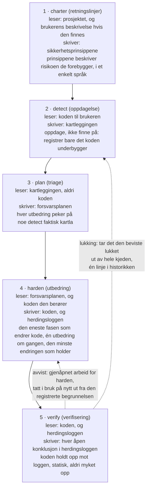
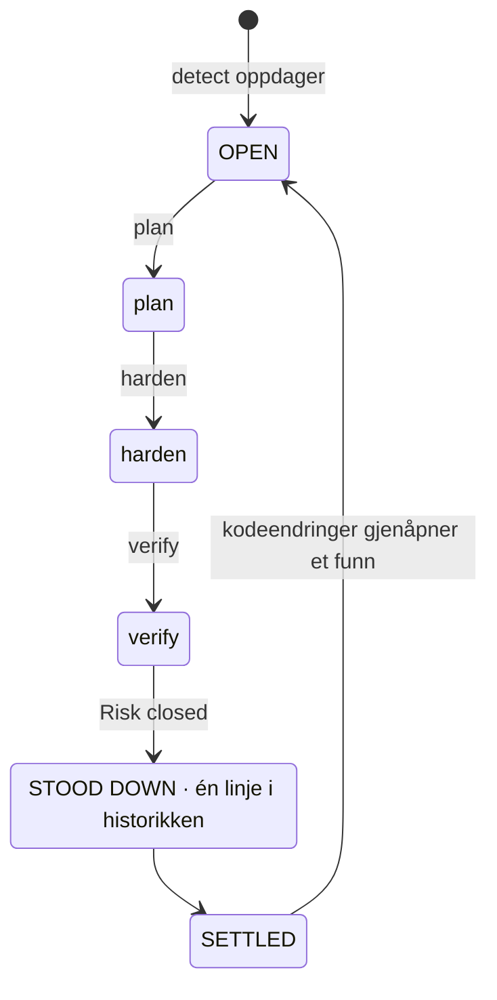
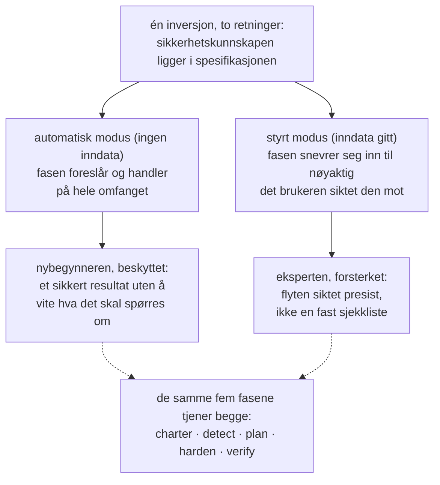
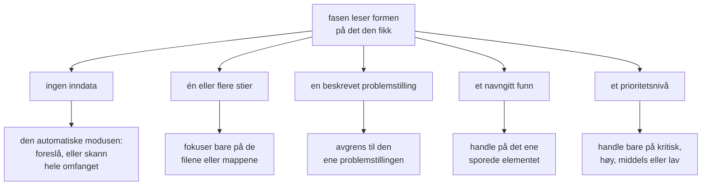
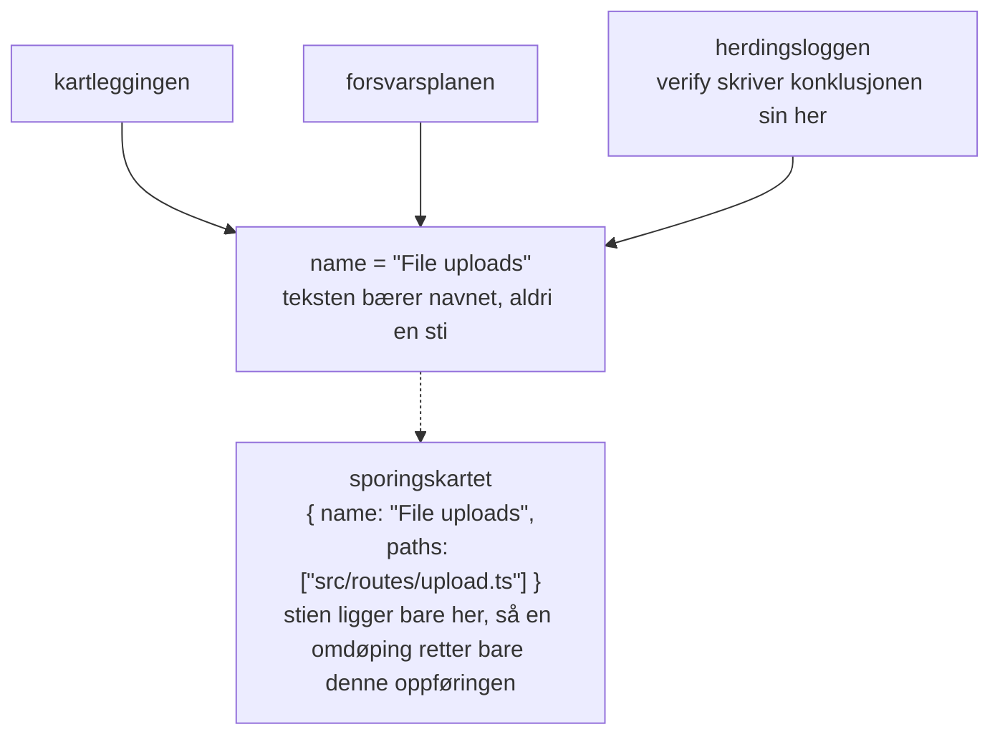
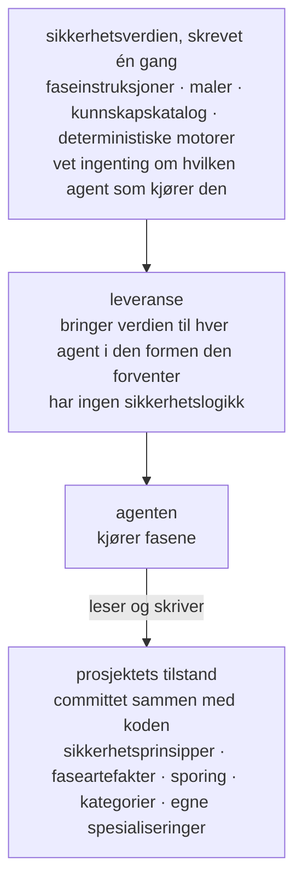
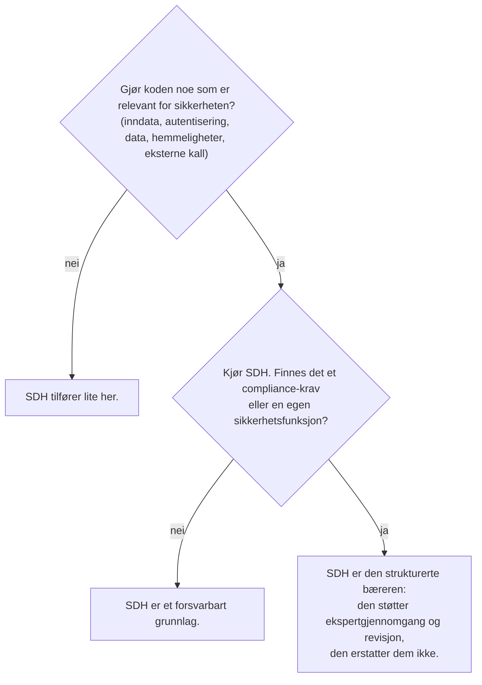

# Security-Driven Hardening: en konvensjon for tiden med KI-assistert utvikling

> Metodikken Security-Driven Hardening (SDH): en kontekstbevisst Blue Team-konvensjon for revisjon og herding av programvare som er KI-assistert eller vibe-kodet.

Kanonisk URL: https://lagune.ai/no-NO/docs/references/paper
Språk: no-NO
Original: https://lagune.ai/docs/references/paper
Sist oppdatert: 2026-11-09

- **Weslley Araújo**
- **Metodeartikkel, 2026.**

---

## Sammendrag

Security-Driven Hardening (SDH) er en strukturert, KI-drevet og kun defensiv sikkerhetsmetodikk for en tid der programvare i økende grad skrives av KI-agenter og av mennesker som ikke er sikkerhetsspesialister. I stedet for å kjøre en generisk sjekkliste oppdager SDH først hva et system faktisk gjør (innlogging, filopplasting, betalinger, dataeksponering og så videre), og driver deretter sikkerhetsarbeidet som er spesifikt for den konteksten. Metodikken styres av prinsipper som er sikre som standard, er rammet inn helt rundt forsvar og uttrykt i et enkelt språk, slik at enhver bruker kan handle ut fra den.

Dette dokumentet argumenterer for at SDH er en manglende konvensjon, ikke ett enkelt verktøy. Sikkerhetskunnskapen ligger i metodikken og spesialiseringene som lastes ved behov, et grunnlag enhver bruker kan bygge videre på, og det lar den tjene en nybegynner og en ekspert gjennom den samme flyten. To egenskaper skiller den fra tidligere spec-first-tilnærminger `[1]`. SDH er **tilstandsuavhengig**: Den tilpasser seg en tom mappe, et prosjekt under arbeid, én enkelt pull request eller en stor eldre kodebase, i hvilken som helst stack. Og SDH er **lukkbar**: En risiko som er verifisert lukket, tas ut av hele flyten, slik at funnet kommer til ro og åpnes igjen først når koden endres. SDH erstatter ikke sikkerhetsfolk eller spesialiserte Blue Team-verktøy. Den utvider utviklerens egen kunnskap, og jo mer en utvikler forstår av sikkerhet, desto mer kan vedkommende styre den.

**Lagune** er referanseimplementasjonen, og den beviser at metodikken kan bygges og overføres. SDH tilbys som en konvensjon andre kan ta i bruk.

> **Stikkord**
>
> KI-assistert utvikling, programvaresikkerhet, defensiv sikkerhet, spec-driven development, sikkerhetsherding, agentdrevne arbeidsflyter, lukkbarhet, kontekstbevisst sikkerhet, kunnskap ved behov, agentuavhengige verktøy.

---

## I. Innledning: sikkerhetsgapet KI-assistert utvikling åpnet

Programvare blir i økende grad levert av mennesker, og av KI-agenter, som ikke pålitelig kan gjenkjenne et usikkert mønster: en lekket hemmelighet, en manglende autorisasjonssjekk, en spørring som kan injiseres. Dette er ikke eksotiske risikoer. De hører til risikoklassene som dominerer virkelige hendelser, dokumentert i årevis i offentlige referanser `[6]`, `[7]`, og nyere studier viser at en betydelig andel av KI-generert kode leveres med nettopp slike feil `[8]`. KI-kodeassistenter gjorde dette akutt ved å la ikke-utviklere levere ekte programvare, men gapet er bredere enn én enkelt målgruppe. De fleste prosjekter får aldri en sikkerhetsgjennomgang som er spesifikk for det de faktisk gjør. Økosystemet blir skjørere for hver forhastet beslutning av typen "det funker, send det ut".

Generiske sikkerhetsråd lukker ikke dette gapet. En statisk sjekkliste er ikke spesifikk for det et system gjør, så den oversvømmer et lite prosjekt med irrelevante punkter og går likevel glipp av risikoen som betyr noe for akkurat det prosjektet. Problemet er ikke mangel på sikkerhetskunnskap i verden. Problemet er å matche riktig kunnskap med systemet brukeren faktisk har foran seg, og å gjøre det for noen som kanskje ikke vet hva det skal spørres om.

SDH svarer på dette med én enkelt inversjon: **sikkerhetskunnskapen ligger i spesifikasjonen og spesialiseringene som lastes ved behov, et grunnlag enhver bruker kan bygge videre på**. Metodikken oppdager konteksten, prioriterer risikoene den konteksten fører med seg og veileder utbedringene, så en utvikler og en ikke-utvikler bruker den samme flyten. Funnene og anbefalingene holdes i et enkelt språk, så de kan følges opp uansett hvor teknisk leseren er. Eksperten blir ikke begrenset av dette, men forsterket, en dualitet vi utdyper i `§VI`.

> **Kjerneinnsikt**
>
> **Kjerneinversjonen:** Sikkerhetskunnskapen ligger i spesifikasjonen og spesialiseringene som lastes ved behov, et grunnlag enhver bruker kan bygge videre på. Metodikken lærer hva systemet gjør og tilpasser sikkerhetsarbeidet til det, og den utvider det brukeren allerede kan.

Tenk deg en utvikler som sier til en KI-assistent: "Appen min lar brukere laste opp et profilbilde." Uten en sikkerhetsgjennomgang lager assistenten fungerende kode som i det stille stoler på alt klienten sender: den oppgitte filtypen, filnavnet, størrelsen. Opplastingen går i produksjon, og en fil forkledd som et bilde kan inneholde kode, et manipulert navn kan bryte ut av lagringsstien, en overdimensjonert fil kan tømme serveren for ressurser. Ingenting av dette synes i en demo, så det går i produksjon.

Den samme koden oppfører seg annerledes når den kjøres gjennom SDH. Metodikken oppdager at systemet tar imot filer utenfra (oppdagelse), omsetter det til risikoene en opplasting fører med seg (triage), foreslår å sjekke den faktiske filtypen og størrelsen, gi filen nytt navn ved lagring og lagre den der kode ikke kan kjøres (utbedring), og leser deretter resultatet og bekrefter at hvert sikringstiltak faktisk holder (verifisering). Utvikleren trengte aldri å kjenne uttrykket "ubegrenset filopplasting". Metodikken leverte det på utviklerens vegne.

Dette dokumentet gir følgende bidrag:

- En presis definisjon av SDH som metodikk, uavhengig av en bestemt implementasjon, med designprinsippene (`§III`).
- En defensiv livssyklus i fem faser der selve ansvarsdelingen er bidraget: Oppdagelsen finner aldri på, planleggingen leser aldri kode, bare én fase endrer kode, og verifiseringen myker aldri opp vurderingen sin (`§IV`).
- **Lukkbarhet** som metodisk standpunkt: Et enkelt funn har en sluttilstand, ikke en endeløs løkke (`§V`).
- Dualiteten der metodikken **utvider utviklerens kunnskap**: én flyt som beskytter nybegynneren og forsterker eksperten (`§VI`).
- **Ikke-kallbare spesialiseringer og prompt-on-demand**: fokusert sikkerhetskunnskap agenten laster når konteksten i prosjektet krever det, aldri som standard (`§VII`).
- **Tilstandsuavhengighet** og **ikke-autoritativ tilpasningsevne**: SDH passer til enhver utviklingstilstand og tilpasser seg scenarioet i stedet for å påtvinge et fast omfang (`§VIII`).
- En **forebyggende modus**: Det samme forsvaret kjøres mens vanlig arbeid bygges, så koden blir sikker som standard fra start og fasene har mindre å rette opp (`§IX`).
- En egen sammenligning med Spec-Driven Development, slekten SDH vokste ut av og deretter skilte lag med (`§X`).
- Ingeniørdisiplinene som lar metodikken overleve refaktoreringer og forbli uavhengig av enhver agent: sporing med identitet etter navn (`§XI`) og en agentuavhengig bærer (`§XII`).

---

## II. Bakgrunn og relatert arbeid

SDH bygger på tidligere arbeid. Den arver en velprøvd struktur fra spec-first, agentdrevet utvikling `[1]`, `[2]`, `[3]`: maler, skråstrekkommandoer en agent bruker, et styrende dokument og en agent som kjører fasene. Den implementerer den strukturen på nytt med et defensivt formål. Slektskapet er bevisst, og et av arbeidsprinsippene i SDH sier det rett ut: Bygg arbeidsflyten på en velprøvd struktur, og ramm den deretter inn for sikkerhet.

SDH er ikke en statisk sjekkliste med generiske anbefalinger. En sjekkliste vet mye om sikkerhet generelt og ingenting om prosjektet foran den. SDH snur denne vektleggingen. Den bruker den første innsatsen på oppdagelse, på å lære hva systemet gjør, og først deretter henter den kunnskapen som oppdagelsen gjør relevant.

SDH erstatter heller ikke sikkerhetsfolk eller spesialiserte Blue Team-verktøy. Den utvider utviklerens kunnskap (`§VI`). Et team med en egen sikkerhetsfunksjon bør beholde den. SDH gir det teamet en strukturert bærer, og den gir et team uten en slik funksjon et forsvarbart grunnlag.

SDH står også ved siden av deterministiske sikkerhetsskannere (statisk analyse, lintere) `[4]`, `[5]`. Disse verktøyene er verdifulle nettopp fordi de er deterministiske og repeterbare. SDH bygger for det meste på agentens resonnering, som bytter streng determinisme mot kontekstbevissthet. Metodikken later ikke som noe annet. Der determinisme betyr noe, bygger den inn en deterministisk motor i resonneringen (`§VII`): Agenten avgjør om en inngangsverdi er verdt å sjekke, og et deterministisk program avgjør om verdien er farlig.

Den mest direkte forgjengeren er Spec-Driven Development (SDD), familien av spec-first-metodikker som driver et bygg fremover fra en kjørbar spesifikasjon. Vi behandler SDD som en klasse. Den tydeligste formuleringen av den som praktikermetodikk er rapporten til Piskala `[1]`, og det mest synlige agentdrevne verktøysettet er Spec Kit fra GitHub `[2]`, med OpenSpec `[3]` som et annet verktøy fra samme familie. Disse er de kanoniske referansene for sammenligningen i `§X`.

---

## III. SDH: definisjon og designprinsipper

**Security-Driven Hardening** er en strukturert, KI-drevet sikkerhetsmetodikk som gjør en kodebase sikrere ved å drive arbeidet fra en spesifikasjon agenten kjører, i stedet for fra ad hoc-utbedringer. Navnet er inspirert av **Blue Teams**, forsvarerne innen sikkerhet. SDH handler om forsvar, herding og verifisering, aldri angrep.

> **Definisjon**
>
> **Security-Driven Hardening (SDH):** En strukturert, KI-drevet og kun defensiv sikkerhetsmetodikk som først oppdager hva et system faktisk gjør og deretter driver det kontekstspesifikke sikkerhetsarbeidet, styrt av prinsipper som er sikre som standard og uttrykt i et enkelt språk.

SDH defineres av et sett bindende prinsipper. Hvert av dem er en regel, og hvert gir brukeren en bestemt garanti.

| Prinsipp                                              | Regelen                                                                                                                                                                           | Hva det garanterer brukeren                                                                                                                                                        |
| ----------------------------------------------------- | --------------------------------------------------------------------------------------------------------------------------------------------------------------------------------- | ---------------------------------------------------------------------------------------------------------------------------------------------------------------------------------- |
| Sikker som standard, i et enkelt språk, likt for alle | Hver standardinnstilling, melding og utbedring er sikker fra start og forståelig for enhver leser, utvikler eller ikke. Ingen brukergruppe er privilegert.                        | En nybegynner får et sikkert grunnlag uten å be om det, og leser resultatet på sine egne premisser.                                                                                |
| Kontekstbevisst fremfor generisk                      | Hver fase starter fra konteksten som ble oppdaget i detect, og handler ut fra det systemet faktisk gjør.                                                                          | Anbefalingene passer prosjektet, ikke en sjekkliste. Sikkerhetskunnskapen ligger i spesifikasjonen og spesialiseringene som lastes ved behov, og utvider det brukeren tar med seg. |
| Fleksibel fremfor rigid                               | Prinsipper, krav og anbefalinger er utgangspunkter. Brukeren kan omformulere, droppe, legge til eller snevre inn hva som helst.                                                   | Metodikken tilpasser seg prosjektet og brukeren, og blir aldri strengere enn brukeren ønsker. Fleksibilitet svekker aldri grunnlaget som er sikkert som standard.                  |
| Avstem, aldri bare legg til                           | Artefakter er levende dokumenter, ikke logger. Hver kjøring sjekker hver oppføring på nytt: behold det som holder, skriv om det som er endret, fjern det som ikke lenger gjelder. | Det som er registrert, gjenspeiler alltid nåtiden, så det forfaller aldri til et utdatert etterslep.                                                                               |
| Kun defensiv                                          | SDH reviderer, herder og verifiserer. Den lager aldri offensive verktøy, exploits for ondsinnet bruk eller teknikker for å unngå deteksjon for å gjøre skade.                     | Metodikken kan ikke gjøres om til et våpen. Innhold med dobbel bruk forekommer bare i en tydelig defensiv ramme.                                                                   |
| Spec-first, agentdrevet, innrettet mot sikkerhet      | Arbeidsflyten bygges av maler, kommandoer, styrende sikkerhetsprinsipper og en agent som kjører fasene.                                                                           | En velprøvd utviklingsstruktur, tatt i bruk på nytt slik at agenten gjør det vesentlige sikkerhetsarbeidet.                                                                        |

**Tabell 1.** Designprinsippene i SDH og garantien hvert av dem gir brukeren.

Disse prinsippene er ikke pynt. De er begrensningene hver fase nedenfor må respektere, og diskusjonen i `§XV` vender tilbake til dem for å markere grensene for metodikken.

Resten av dokumentet utvikler ni navngitte pilarer. Det er delene en leser bør kunne holde i hodet, og delene et annet team ville implementert på nytt for å kunne si at de praktiserer SDH.

| Pilar                                                     | Hva den gir                                                                                                                            | Seksjon     |
| --------------------------------------------------------- | -------------------------------------------------------------------------------------------------------------------------------------- | ----------- |
| Den kontekstbevisste inversjonen                          | Sikkerhetskunnskapen ligger i spesifikasjonen og spesialiseringene som lastes ved behov, så en nybegynner og en ekspert deler én flyt. | `§I`, `§VI` |
| Den defensive livssyklusen i fem faser                    | Ansvarsdeling: retningslinjer, oppdagelse, triage, utbedring, verifisering, hver med én oppgave.                                       | `§IV`       |
| Lukkbarhet                                                | Et funn har en sluttilstand, ikke en endeløs løkke. Lukket arbeid tas ut.                                                              | `§V`        |
| Dualiteten som utvider utviklerens kunnskap               | Én flyt som beskytter nybegynneren og forsterker eksperten, uten å erstatte noen av dem.                                               | `§VI`       |
| Prompt-on-demand, ikke-kallbar kunnskap                   | Relevant sikkerhetskunnskap lastes for det prosjektet er, aldri som standard.                                                          | `§VII`      |
| Tilstandsuavhengighet og ikke-autoritativ tilpasningsevne | Passer til enhver utviklingstilstand i enhver stack, og tilpasser seg scenarioet i stedet for å påtvinge et omfang.                    | `§VIII`     |
| Den forebyggende modusen                                  | Det samme forsvaret kjører mens nytt arbeid bygges, så koden blir sikker som standard fra start.                                       | `§IX`       |
| Sporing med identitet etter navn                          | Et funn forblir ett element på tvers av fasene, og en omdøping bryter koblingen på bare ett sted.                                      | `§XI`       |
| Den agentuavhengige bæreren                               | Sikkerhetsverdien skrives én gang og er ikke avhengig av noen agent eller stack.                                                       | `§XII`      |

**Tabell 2.** De ni navngitte pilarene i SDH og hvor hver av dem utvikles.

---

## IV. Blue Team-flyten i 5 faser

SDH strukturerer arbeidet som en defensiv livssyklus i fem faser (figur 1). Hver fase er rammet inn rundt forsvar, hver bygger på den forrige, og fasene følger reell Blue Team-aktivitet: fastsette retningslinjer, oppdage, triagere, utbedre, verifisere.



**Figur 1.** Flyten i fem faser: hva hver fase leser, hva den skriver, og den bærende invarianten. Verify styrer begge returene: Et avvist sikringstiltak gjenåpner harden, og et funn som er bevist lukket, tas ut av hele kjeden, med én linje i historikken.

Ansvarsdelingen er bidraget. Fordi hver fase har én oppgave, holdes en feil til ett sted, og leseren kan stole på det hver artefakt hevder.

> **Kjerneinnsikt**
>
> **Applied er ikke verifisert:** Harden registrerer at en utbedring er tatt i bruk. Verify verifiserer den ved å holde koden opp mot den registreringen, og konklusjonen mykes aldri opp for å passe loggen. Et sikringstiltak kan finnes i koden og likevel la risikoen være nåbar, og da er den ærlige konklusjonen "Risk not closed".

### charter (retningslinjer)

Fasen charter fastsetter sikkerhetsprinsippene for prosjektet, reglene hver senere fase må respektere. Det er det overordnede laget, en slags kompileringstidskontroll for sikkerhetsnivået i prosjektet. Hvert prinsipp har et tydelig navn, en ufravikelig regel som kan kontrolleres mot koden, og en linje `Why:` som oppgir risikoen det forebygger, ikke bare utbedringen. Fasen leser alltid selve prosjektet (manifestene, strukturen og avhengighetene), og en beskrivelse fra brukeren, når den gis, er en retning som lesingen deretter utvider ut over det brukeren nevnte. Uten beskrivelse er prosjektet den eneste kilden. De to legges sammen i stedet for å konkurrere, og sikkerhetsprinsippene registrerer retningslinjene prosjektet bør følge, ikke tilstanden i koden. En ikke-utvikler skal kunne lese dem og forstå både regelen og risikoen.

### detect (oppdagelse)

Detect leser koden og kartlegger det systemet faktisk gjør som har sikkerhetsmessig betydning. Den styrende instruksen er "oppdage, ikke finne på": Registrer bare det koden underbygger, med belegget de senere fasene trenger. Detect er nøytral. Den tvinger ikke funnene sine til å passe sikkerhetsprinsippene, fordi det å holde risikoer opp mot reglene i sikkerhetsprinsippene er jobben til fasen plan. Hvert funn har tre deler: hva det er (en beskrivelse i et enkelt språk), hvorfor det betyr noe (risikoen, ikke bare faktumet) og belegget (funksjonen eller ruten der det ligger). Belegget inneholder ingen filsti. Stien ligger bare i sporingskartet (`§XI`), så teksten inneholder aldri en sti som kan bli utdatert.

### plan (triage)

Plan gjør hvert funn om til en utbedring, navngitt etter risikoklassen (med henvisning til de etablerte referansene, CWE og OWASP, der de underbygger den) og knyttet til sikkerhetsprinsippet utbedringen ivaretar. Prioriteten (kritisk, høy, middels, lav) er ikke et fritt valg: Plan vurderer hvert funn med CVSS v4.0 og metrikkene Base og Environmental, så nivået er scoren uttrykt med vanlige ord, begrunnet med én linje i et enkelt språk om eksponering og hva som står på spill, og to kjøringer gir samme rekkefølge. Vektoren er det presise ankeret for en ekspert, nivået og begrunnelsen den samme vurderingen i en form alle kan følge. Plan arbeider bare ut fra kartleggingen og leser aldri koden. Dette er en bevisst begrensning, ikke en svakhet: Den tvinger hver utbedring til å peke på noe detect faktisk oppdaget. Hvis et omfang aldri ble kartlagt, stopper plan og sender brukeren tilbake til detect i stedet for å gjette.

### harden (utbedring)

Harden er den eneste fasen som endrer kode, så den går forsiktig frem. Om en endring trenger brukerens godkjenning, avgjøres av agenten og tillatelsesmodusen den kjører i, så harden legger ikke til noe eget bekreftelsestrinn. Den tar i bruk én utbedring om gangen, avhengighetene først og deretter høyeste prioritet, slik at hver endring forblir liten, lett å gjennomgå og lett å angre. Den svekker aldri et eksisterende sikringstiltak for å få en ny utbedring til å passe, og den bryter aldri et sikkerhetsprinsipp. Hvis en utbedring ville komme i konflikt med et prinsipp, stopper harden og viser konflikten i stedet for å ta den i bruk. Hver blokk registreres som Applied, Partial eller Blocked. "Applied betyr ikke at den er verifisert ennå", og det er dette den neste fasen håndterer.

### verify (verifisering)

Verify verifiserer hvert sikringstiltak som er tatt i bruk, ved å lese koden og holde den opp mot det harden registrerte. Verifiseringen er nettopp dette, koden holdt opp mot loggen, og den er statisk: Den bekrefter at et sikringstiltak finnes og er korrekt i koden, ikke at det holder under angrep på et kjørende system. Den kontrollen under kjøring, den typen som utfører ekte eller simulerte angrep mot det kjørende systemet, er bevisst utenfor omfanget. Verify gir én av tre konklusjoner: Risk closed, Risk not closed eller Cannot tell from the code. Den lager ingen egen artefakt: Harden og verify deler herdingsloggen, der harden eier det som ble gjort og verify eier konklusjonen og begrunnelsen, og ingen av dem skriver noen gang i den andres felt. Et avvist sikringstiltak er gjenåpnet arbeid for harden, som ved neste kjøring lar konklusjonen gå foran sin egen lesning av koden og tar utbedringen i bruk på nytt mot nøyaktig det gapet begrunnelsen peker på. Verify stoler mer på koden enn på loggen, fordi en logg kan påstå mer enn koden leverer. Den har bare lesetilgang til koden til brukeren, og den myker aldri opp en konklusjon for å passe loggen. Et sikringstiltak kan finnes og likevel la risikoen være nåbar på en annen måte, og da er den ærlige konklusjonen "Risk not closed". Hvis verify under lesingen legger merke til et sikkerhetsproblem kartleggingen aldri dekket, finner den ikke på en konklusjon for det, fordi oppdagelse er jobben til detect: Den melder fra om problemet og sender brukeren tilbake til detect, slik at funnet kommer inn gjennom den samme flyten i stedet for å gå utenom den.

> **Gjennomgående eksempel: filopplasting.** Ett enkelt funn viser hele ryggraden fra start til slutt.
>
> - **detect** finner det: Systemet tar imot filer fra brukere, og opplastingshandleren stoler på MIME-typen klienten sender, uten å sjekke den faktiske filtypen. _Hvorfor det betyr noe:_ En fil forkledd som et bilde kan skjule ondsinnet kode.
> - **plan** bestemmer utbedringen, prioritet **kritisk**, i tråd med prinsippet "Alle inndata er ikke-klarerte til de er validert": Sjekk den faktiske filtypen og størrelsen, gi filen nytt navn ved lagring, og lagre opplastinger der de ikke kan kjøres som kode.
> - **harden** tar den i bruk, status **Applied**: Handleren oppdager nå den faktiske typen ut fra innholdet, håndhever en størrelsesgrense, avviser alt uventet, gir nytt navn ved lagring og lagrer der kode ikke kan kjøres.
> - **verify** leser handleren, holder den opp mot loggen og returnerer **Risk closed**: Koden gjør nøyaktig det loggen hevder.
>
> Det samme funnavnet går gjennom kartleggingen, forsvarsplanen og herdingsloggen, og verify handler på den loggen under det samme navnet: En åpen konklusjon skrives i blokken til funnet, og et funn som er bevist lukket, tas ut (`§V`). Det felles navnet er identiteten (`§XI`).

---

## V. Lukkbarhet: et funn har en sluttilstand

De fleste sikkerhetsverktøy etterlater brukeren med et etterslep som bare vokser. SDH inntar et annet standpunkt: **Et funn er lukkbart, så det har en sluttilstand i stedet for å leve i et endeløst etterslep** (figur 2). Dette følger direkte av prinsippet om avstemming.

> **Definisjon**
>
> **Lukkbarhet:** En risiko som er verifisert lukket, tas ut av hele flyten, slik at funnet kommer til ro og åpnes igjen først når koden endres. Et funn har en sluttilstand, selv om selve sikkerhetsprogrammet fortsetter kontinuerlig.

Artefaktene i SDH er levende dokumenter, ikke logger. Hver gang en fase kjøres på nytt, sjekker den hver eksisterende oppføring mot den nåværende sannheten og gjør én av tre ting: Den beholder det som fortsatt holder, skriver om det som er endret, eller fjerner det som ikke lenger gjelder. Et funn som koden viser at nå er løst, fjernes ganske enkelt. Arbeidsdokumentasjonen gjenspeiler nåtiden, ikke fortiden.

Lukking er den samme avstemmingen, ført helt til ende. Når verify verifiserer at en risiko er lukket, tar den funnet ut av hele flyten: kartleggingen, forsvarsplanen, herdingsloggen og sporingskartet. Det er derfor verify er den ene fasen som skriver til artefaktene til de andre fasene: Den er fasen som lukker sløyfen. Når funnet forlater kjeden, destillerer uttaket det til en kort oppføring i en historikk som ligger utenfor arbeidskjeden og aldri behandles på nytt. Dette er skillet mellom å forsvinne og å lukkes: Et funn som avstemmingen fjernet fordi det sluttet å være sant, etterlater ingenting, mens et funn som er bevist lukket, gjør seg fortjent til sin linje i historikken. Et funn som er tatt ut, mangler i hver arbeidsartefakt etterpå, og det fraværet er forventet, ikke en brutt kjede.



**Figur 2.** Tilstandsmaskinen for lukkbarhet. Et funn går gjennom OPEN → STOOD DOWN → SETTLED og åpnes igjen først når koden endres.

Når alt innenfor omfanget er tatt ut, er syklusen i ro, og tilstanden i ro har en konkret form: En artefakt der det siste funnet ble lukket, fjernes helt, så en helt lukket kjede etterlater bare sikkerhetsprinsippene og historikken, retningslinjene og beviset. Syklusen åpnes igjen først når koden endres. Metodikken gir hvert funn en tydelig slutt, og det er nettopp det et endeløst etterslep ikke kan.

---

## VI. Dualiteten som utvider utviklerens kunnskap

SDH erstatter ikke mennesker, og den erstatter ikke spesialiserte Blue Team-verktøy. Den **utvider utviklerens egen kunnskap**. Jo mer en utvikler forstår av sikkerhet, desto mer presist kan vedkommende styre flyten, og desto mer selvstendighet får vedkommende. En utvikler som forstår lite, får likevel et sikkert resultat, fordi den automatiske modusen beskytter vedkommende.

Inversjonen fra `§I`, at sikkerhetskunnskapen ligger i spesifikasjonen, virker i begge retninger. For nybegynneren er den beskyttelse: Nybegynneren trenger ikke å vite hva det skal spørres om, fordi spesifikasjonen kommer med forslag. For eksperten er den forsterkning: Den samme spesifikasjonen lar eksperten sikte flyten presist i stedet for å jobbe mot en fast sjekkliste.

Hver fase bærer denne dualiteten i sin egen virkemåte (figur 3). Kjøres fasen uten inndata, handler den på hele omfanget på vegne av brukeren. Får den en retning, snevrer den samme fasen seg inn til nøyaktig det brukeren siktet den mot.



**Figur 3.** Dualiteten som utvider utviklerens kunnskap. Én inversjon tjener to målgrupper: Den automatiske modusen beskytter nybegynneren, og den styrte modusen forsterker eksperten, gjennom de samme fem fasene.

Spesialiseringene som lastes ved behov (`§VII`), gjør dualiteten eksplisitt i sin egen tekst. Hver av dem forteller agenten at kunnskapen "utvider din vurdering", og at den skal fortsette å resonnere ut over det spesialiseringen gir. Kunnskapen er et gulv, ikke et tak. Det er dette som tjener begge målgruppene i den balansen dokumentet sikter mot: Utviklermiljøet får et betydelig instrument, og Blue Team-praktikeren får en strukturert bærer som ikke later som den gjør jobben for vedkommende.

---

## VII. Ikke-kallbare spesialiseringer og prompt-on-demand

Dette er det mest nyskapende mønsteret i metodikken. SDH bærer fokusert sikkerhetskunnskap som spesialiseringer som **bare lastes ved behov**, og agenten avgjør selv hvilke som skal lastes ved å matche konteksten i prosjektet. Vi kaller dette **prompt-on-demand**: en måte for agenten å velge hvilken kunnskap som skal aktiveres ut fra omfanget av prosjektet den er i, i stedet for å kjøre hver kontroll som standard. Spesialiseringene er i stadig utvikling, og hvilken som helst av dem kan endres eller erstattes når som helst. Bidraget er mønsteret, ikke spesialiseringene i seg selv.

> **Definisjon**
>
> **Prompt-on-demand:** Agenten velger hvilken sikkerhetskunnskap som skal aktiveres ved å matche den mot omfanget av prosjektet foran seg, slik at den relevante kunnskapen hentes inn ut fra hva prosjektet faktisk er, i stedet for at hver kontroll kjører som standard.

> **Definisjon**
>
> **Ikke-kallbar spesialisering:** En fokusert, språkuavhengig enhet med sikkerhetskunnskap for én kontekst, som filopplasting eller kode som kjører i nettleseren. Den reviderer og forklarer, skriver aldri om kode og lager aldri angrepsinndata. Den er ikke en kommando: Den lastes når konteksten den dekker, er innenfor omfanget, eller når en prompt ber om den ved navn.

Hver spesialisering navngir de tryggere formene for risikoene den dekker, og forteller agenten hvordan den skal handle på et funn i hver fase som bruker den: hvordan funnet skal vurderes under oppdagelsen, hvordan utbedringen tas trygt i bruk under utbedringen, og hvordan den bevises under verifiseringen.

Det definerende trekket er at en spesialisering **ikke kan kalles på egen hånd**: Den er ikke en kommando, og inne i flyten er det et treff som laster den. Oppdagelsesfasen lister katalogen én gang, matcher konteksten i prosjektet mot det hver oppføring dekker, og laster bare spesialiseringene hvis kontekst finnes innenfor omfanget. De senere fasene gjenbruker den matchede listen i stedet for å liste på nytt, så én matching tjener hele kjeden, og den forebyggende modusen (`§IX`) kjører den samme matchingen mot arbeidet som skal bygges. En spesialisering hvis kontekst mangler, hoppes over, og det å hoppe over er like etterprøvbart som å laste: Hver oppføring i katalogen får en eksplisitt konklusjon, tatt i bruk eller hoppet over, med begrunnelsen lest ut av koden, så en vag følelse av irrelevans aldri erstatter faktisk fravær. Å ikke finne noen som gjelder, er et gyldig utfall.

Katalogen er data, og vekst er én kunnskapsfil pluss én katalograd, aldri en ny kommando. De innebygde spesialiseringene er gruppert i kategorier, som OWASP, et språk eller KI-integrasjoner, og katalogen et prosjekt bruker, inneholder de innebygde fra kategoriene det valgte pluss prosjektets egne spesialiseringer. Prosjektet registrerer det valget sammen med resten av tilstanden sin, så et helt team matcher mot den samme katalogen. Dette er det samme kontekstbevisste prinsippet som i fasene, brukt på kunnskap: Den relevante kunnskapen hentes inn ut fra hva prosjektet faktisk er, i stedet for at hver kontroll kjører som standard. Den samme egenskapen lar brukeren, ikke bare vedlikeholderen, utvide katalogen: En sikkerhetskilde eller et tema brukeren gir, destilleres til en ny spesialisering som tilhører prosjektet, blir med i katalogen uansett kategorier og lastes nøyaktig som en innebygd, og den overstyrer den innebygde med samme navn. Å skrive en spesialisering er i seg selv kun defensivt og følger den samme grensen spesialiseringene håndhever: En beskrivelse av et angrep kan være kilden, men spesialiseringen den gir, reviderer og forklarer og lager aldri en fungerende exploit. Slik strekker inversjonen fra `§I`, at intelligensen ligger i spesifikasjonen, seg til selve katalogen, som brukeren kan utdype for sin egen kontekst uten å skrive kode.

Et kort eksempel illustrerer prompt-on-demand. Detect leser en mappe med kode som kjører i nettleseren. Den matcher den konteksten i katalogen, laster spesialiseringen som dekker den, og viser et funn på klientsiden gjennom de vanlige stegene i detect. Spesialiseringene hvis kontekst mangler i dette omfanget, gir ikke treff, så de lastes aldri, og hver av dem registreres som hoppet over. Det var prosjektet som avgjorde hvilken kunnskap som var relevant, ikke en fast konfigurasjon.

Determinisme dukker opp nettopp der den betyr noe. En spesialisering kan ha en deterministisk kontroll, ikke bare tekst: Der en risikoklasse har en skarp beslutningsprosedyre, returnerer et lite program en fast konklusjon for en gitt verdi, for eksempel et lite sett ord som `safe`, `unsafe` eller `invalid input`. Noen risikoklasser kan avgjøres deterministisk på nettopp denne måten, med et etablert fagarbeid bak beslutningsprosedyren `[9]`, `[10]`, `[11]`. Kontrollen vurderer enten kandidater agenten leverer, eller skanner omfanget for å finne dem selv, og i begge tilfeller er det kontrollen, ikke agenten, som returnerer konklusjonen. En spesialisering som er universell nok, kan merkes som påkrevd i katalogen og tas da alltid i bruk, med kontrollen kjørt over hele omfanget. Dette er det ene tilfellet der kunnskap lastes uten et konteksttreff, og det deklareres i dataene i katalogen, aldri avgjort av agenten der og da. Det er her SDH forankrer agentens resonnering i noe repeterbart, uten å late som hele flyten er deterministisk.

Til slutt er spesialiseringene **løsrivbare**. Fordi kunnskapen står på egne ben, kan en bruker kjøre en av dem direkte i en prompt som ikke har noe med hele SDH-flyten å gjøre, og holde sikkerheten med i vanlig utvikling. En spesialisering med en deterministisk kontroll kan for eksempel sjekke hver kandidat som produseres under vanlig koding og bare beholde de trygge. Denne løsrivbarheten er en del av grunnen til at SDH tilpasser seg så mange situasjoner, som er temaet for `§VIII`, og det fulle uttrykket for den er den forebyggende modusen (`§IX`), der den samme kunnskapen vokter vanlig utvikling fra start til slutt.

---

## VIII. Tilstandsuavhengighet og ikke-autoritativ tilpasningsevne

To egenskaper skiller SDH fra rigide spec-metodikker.

### Tilstandsuavhengighet

> **Definisjon**
>
> **Tilstandsuavhengighet:** Metodikken er ikke avhengig av utviklingstilstanden. Den passer til en tom mappe, et prosjekt under arbeid, én enkelt pull request eller en stor eldre kodebase, i hvilken som helst stack, fordi den lærer utgangspunktet ved å lese det.

Hver fase fungerer likt enten prosjektet er helt nytt eller allerede finnes. Fasen charter utleder prinsipper fra den koden som finnes. Detect kartlegger den koden som er der, selv om det er svært lite. Det finnes ikke noe forutsatt utgangspunkt.

### Ikke-autoritativ tilpasningsevne

> **Definisjon**
>
> **Ikke-autoritativ tilpasningsevne:** Metodikken tilpasser seg scenarioet i stedet for å påtvinge et fast omfang brukeren må følge. Når brukeren ikke vet hva som skal sies, leser den miljøet den ble kalt i, skaper kontekst og stiller spørsmålene som former hva den gjør videre.

Forslagsmodusen i fasen charter er det tydeligste eksempelet: SDH utleder sikkerhetsprinsipper som er sikre som standard, ved å analysere prosjektet, spør brukeren bare når et hull faktisk endrer resultatet, skriver dem deretter og presenterer hvert prinsipp i et enkelt språk med risikoen det forebygger. Sikkerhetsprinsippene er et levende dokument brukeren omarbeider ved å kjøre fasen på nytt, ikke en kontrakt låst bak en godkjenningsforespørsel, så brukeren trenger aldri å vite hva det skal spørres om.

Denne tilpasningsevnen viser seg som en følsomhet for formen på inndataene: Den samme fasen leser det den fikk, og velger en modus (figur 4). En fil i prompten, et funn fra listen, en bekymring, et fokusert oppdrag mot et kjent svakt punkt eller en forespørsel om en full brute force-gjennomgang: Hver av dem passer brukerens behov, fordi flyten er ikke-autoritativ av design. Ingenting av dette svekker grunnlaget som er sikkert som standard. Fleksibilitet former hvordan grunnlaget brukes, den senker det aldri.



**Figur 4.** Ikke-autoritativ tilpasningsevne. Den samme fasen leser formen på inndataene og velger en modus, så omfanget er alltid brukerens, aldri påtvunget.

---

## IX. Den universelle forebyggende modusen: det samme forsvaret mens arbeidet bygges

SDH har én utfyllende modus: vanlig utvikling utført med det samme forsvaret aktivt mens koden skrives. Brukeren ber om selve arbeidet, en innloggingsside, en opplasting, et endepunkt, og metodikken vokter byggingen mens den skjer, så resultatet er sikkert som standard i det øyeblikket det lander, i stedet for etter en senere herdingsrunde.

> **Definisjon**
>
> **Den forebyggende modusen:** vanlig utvikling kjørt under det overordnede laget og kunnskapen i SDH. Sikkerhetsprinsippene binder byggingen, spesialiseringene som er relevante for det som skal lages, lastes ved behov, og resultatet holdes opp mot nøyaktig det forsvaret som ble brukt, før arbeidet regnes som ferdig.

Modusen gjenbruker hver del fasene allerede har, rettet mot kode som ikke finnes ennå. Kontekstoppdagelsen flyttes fra koden til intensjonen: Agenten resonnerer seg gjennom det den skal til å bygge og grensene det arbeidet krysser (en innlogging innebærer påloggingsdetaljer, en økt og inndata utenfra), og det er den resonneringen kunnskapskatalogen matches mot. Prompt-on-demand (`§VII`) generaliseres her: Kontekst kan oppdages i planen for kode, ikke bare i kode som finnes. Sikkerhetsprinsippene styrer som alltid, og en forespørsel som ville bryte et prinsipp, vises som en konflikt og bygges aldri. Forsvaret brukes underveis, i det øyeblikket hver del skrives, med validering ved grensen og den trygge konstruksjonen valgt første gang, så en versjon som fungerer, men er usikker, aldri finnes og trenger å rettes.

Modusen slutter slik verify begynner. Før arbeidet regnes som ferdig, holder den som bygger, sitt eget resultat opp mot forsvaret den brukte: Sikringstiltaket må ligge på risikoens vei, ikke ved siden av den, det må være komplett, og der en spesialisering har en deterministisk kontroll, går kontrollens konklusjon foran agentens egen lesning. Et hull som blir funnet her, lukkes som en del av det samme arbeidet, fordi å gjøre arbeidet ferdig betyr å gjøre det ferdig på en sikker måte.

Det modusen avviser, er like bevisst som det den gjør. Den bygger bare det som ble bedt om, og reviderer ingenting rundt det: Å revidere det som finnes, hører til fasene. Den skriver ingen artefakt og sporer ingen funn, fordi et funn er en risiko oppdaget i det som finnes, og formålet med denne modusen er at den usikre versjonen aldri lander i det hele tatt. De to retningene utfyller hverandre: Fasene lukker det som allerede er der (`§V`), og den forebyggende modusen hindrer nytt arbeid i å gjenåpne det. En kjede i ro forblir i ro, ikke fordi utviklingen stoppet, men fordi det som bygges mens den er i ro, bygges med forsvaret på plass.

---

## X. Security-Driven Hardening versus Spec-Driven Development

Security-Driven Hardening (SDH) vokste ut av grunnlaget i Spec-Driven Development (SDD) og skilte deretter tydelig lag med det. Den strukturelle arven er reell og anerkjent: spec-first, agentdrevet, et styrende dokument og et sett kommandoer i faser som agenten kjører. SDH gjenbruker den strukturen bevisst. Det som skiller seg, er formålet, autoritetsmodellen, den forutsatte tilstanden og sluttbetingelsen. Vi behandler SDD som en klasse og bruker rapporten til Piskala `[1]` som den kanoniske formuleringen av metodikken, Spec Kit fra GitHub `[2]` som det kanoniske agentverktøysettet og OpenSpec `[3]` som et annet verktøy fra samme familie.

SDD snur tradisjonell utvikling på hodet ved å gjøre spesifikasjoner kjørbare: Spesifikasjonen genererer direkte en fungerende implementasjon i stedet for bare å veilede den `[1]`. Fasesettet driver et bygg fremover `[2]` (fastsett styrende prinsipper, spesifiser hva som skal bygges, planlegg teknologistakken, del planen opp i oppgaver og implementer). Det styrende dokumentet, en konstitusjon av prinsipper, er grunnsteinen agenten må følge hele veien. Det er kjernen i forskjellen. I SDD flyter autoriteten fra spesifikasjonen inn i byggingen, og implementasjonen forventes å følge den.

SDH snur nesten hver akse i den kontrakten (tabell 3).

> **Kjerneinnsikt**
>
> **Kjerneforskjellen:** I SDD flyter autoriteten fra spesifikasjonen inn i byggingen, og implementasjonen forventes å følge den. SDH er ikke-autoritativ og flyter motsatt vei, innover fra den oppdagede konteksten til systemet, og herder det som allerede er der.

| Akse                      | SDD                                                                                            | SDH                                                                                                              |
| ------------------------- | ---------------------------------------------------------------------------------------------- | ---------------------------------------------------------------------------------------------------------------- |
| Mål                       | Levere funksjoner. Spesifikasjonen blir en fungerende implementasjon.                          | Herde det som finnes eller bygges. Hver fase er rammet inn for forsvar.                                          |
| Autoritetsmodell          | Autoritativ. Spesifikasjonen og konstitusjonen begrenser byggingen til et omfang den må følge. | Ikke-autoritativ. SDH tilpasser seg scenarioet, og brukeren kan omformulere, droppe eller snevre inn.            |
| Forutsatt tilstand        | Et bygg fremover fra en spesifikasjon.                                                         | Tilstandsuavhengig: tom mappe, prosjekt under arbeid, én enkelt PR eller eldre kode.                             |
| Sluttbetingelse           | Slutter når funksjonen er bygget.                                                              | Lukkbar. Et funn kommer til ro og åpnes igjen først når koden endres.                                            |
| Styrende dokument         | En konstitusjon av prinsipper agenten må følge.                                                | Sikkerhetsprinsipper rammet inn rundt risiko (hvert har en linje `Why:`), uttrykkelig ikke en fast kontrakt.     |
| Hvordan kunnskapen vokser | Legg til en kommando (eller utvid fasesettet).                                                 | Legg til en ikke-kallbar spesialisering agenten laster ved behov: én fil pluss én katalograd, ingen ny kommando. |
| Hvem den tjener           | En utvikler som driver en funksjon fremover.                                                   | Enhver bruker, utvikler eller ikke, gjennom den samme flyten.                                                    |
| Hva som endrer kode       | Implementasjonsfasen genererer byggingen.                                                      | Bare fasen harden endrer kode, én utbedring om gangen.                                                           |

**Tabell 3.** SDD versus SDH langs åtte akser. Lånt struktur, snudd kontrakt.

For å yte slekten rettferdighet: SDD er velprøvd forgjengerarbeid, og SDH skylder den strukturen den kjører på. Avviket er ikke en kritikk av SDD, som løser et annet problem (å bygge fremover) godt. SDH tar det samme velprøvde maskineriet og retter det mot forsvar, tilpasningsevne og lukking. OpenSpec `[3]`, organisert rundt endringsforslag, oppgavelister og spesifikasjoner per endring, bekrefter mønsteret: Familien driver et bygg fremover fra en spesifikasjon, mens SDH herder et system innover fra den oppdagede konteksten. Selv den forebyggende modusen i SDH (`§IX`), det ene stedet den følger et bygg fremover, beholder den snudde kontrakten: Den styrer hvordan arbeidet bygges og avgjør aldri hva som skal bygges.

---

## XI. Ingeniørmessig grundighet: sporingsdisiplinen

Disiplinen "avstem, aldri bare legg til" (`§V`) trenger et underlag som overlever refaktoreringer. Et funn må forbli ett element gjennom hver fase som berører det, og en omdøpt eller flyttet fil må ikke bryte kjeden. SDH løser dette med **identitet etter navn** og **stier som bare finnes i sporingen**.

> **Definisjon**
>
> **Identitet etter navn:** Identiteten til et funn er navnet, skrevet likt i hver artefakt. Teksten inneholder navnet, aldri en sti. Filstier ligger bare i sporingskartet, så en omdøpt eller flyttet fil bryter koblingen på nøyaktig ett sted.

Hvert funn fra detect er ett sporet element. Identiteten er **navnet**, seksjonstittelen, skrevet likt i kartleggingen, forsvarsplanen og herdingsloggen. De senere fasene gjenbruker navnet ordrett når de handler på det samme elementet, og verify skriver konklusjonen sin i herdingsloggen under det samme navnet. Sporingskartet inneholder sporing og ingenting annet, én oppføring per element:

```json
{ "name": "File uploads", "paths": ["src/routes/upload.ts"] }
```

Kartet registrerer ingen tekst, ingen merknader, ingen separat identifikator og ingen fase. Tekstartefaktene bærer formuleringene, og kartet bærer bare identitet og stier. Filstier er det eneste flyktige, og de ligger bare her. En omdøpt eller flyttet fil kan bryte koblingen på nøyaktig ett sted, aldri i to kopier som glir fra hverandre.



**Figur 5.** Transportbåndet for identitet. Ett funnavn går gjennom hver artefakt, mens stien bare ligger i sporingskartet, så en omdøping rettes på ett sted.

To handlinger vedlikeholder kartet i den vanlige flyten, og en tredje står for seg selv som vedlikehold. **Track** er tilleggsregistrering: En fase rapporterer funnene den skrev, og motoren registrerer de nye og følger en omdøpt sti for resten, og klassifiserer hvert funn som nytt, flyttet eller uendret. Den fjerner aldri noe fasen ikke rapporterte. **Untrack** tar ut funnene verify lukket: I én deterministisk gjennomgang destillerer den hvert av dem til en historikkoppføring, fjerner hele seksjonen fra artefaktene, sletter en artefakt der det siste funnet er borte, og fjerner sporingsoppføringen, så agenten gjør ingenting av dette for hånd. Der den deterministiske gjennomgangen ikke trygt kan gå videre (et uttatt navn som fortsatt siteres i teksten til et annet funn), flagger den stedet for agenten i stedet for å gjette en endring. Disse to er det fasene kaller mens de kjører. **Repair** er vedlikeholdshandlingen: En fase delegerer automatisk til den når dens egen avstemming finner sporingen inkonsistent (en registrert sti som ikke lenger finnes), og ellers kjøres den ved behov. Den justerer hele kartet på én gang, leser hver artefakt og den nåværende koden, retter stiene for hvert element og viser frem det den ikke kan avgjøre alene: et foreldreløst element (et sporet element ingen artefakt nevner lenger) eller en mulig omdøping (et element der stiene matcher et annet rapportert navn).

Repair er vedlikehold, ikke en sjette fase. Den rører verken koden til brukeren eller tekstartefaktene, bare sporingen. Den leser kildekoden til brukeren av bare én grunn, for å finne den nye stien til en omdøpt fil, og den skriver aldri sikkerhetsinnhold. Mennesket har siste ord i den ene avgjørelsen motoren nekter å gjette: om et element som har forsvunnet, ble løst eller bare fikk nytt navn. Det er bedre å spørre enn å gjette, fordi et element som droppes ved en feil, bryter kjeden.

Metodikken bruker sin egen forsvarsdisiplin på seg selv. De deterministiske motorene kalles som kommandolinjeprogrammer, og hver verdi sendes som et eget prosessargument, som holder den uskadelig, så en verdi med anførselstegn eller backticks aldri kan injiseres i kommandoen. En ukjent kontroll feiler i stedet for å svare, så en feilstavet kontroll aldri leses som et rent resultat. SDH unntar ikke sin egen infrastruktur fra prinsippet om sikker som standard.

---

## XII. Bæreren: agentuavhengig arkitektur som bevis på portabilitet

For at SDH skal bli en konvensjon andre tar i bruk, kan den ikke være bundet til én agent eller én stack, så bæreren holder tre ansvarsområder adskilt (figur 6). Lagune beviser at dette er mulig.

**Sikkerhetsverdien** skrives én gang og vet ingenting om hvilken agent som kjører den: faseinstruksjonene og malene de fyller ut, kunnskapskatalogen og de deterministiske motorene. **Leveransen** er tynn: Den eneste oppgaven er å bringe den verdien til en gitt agent i den formen og på det stedet agenten forventer, og den har ingen egen sikkerhetslogikk. **Prosjektets tilstand** hører til prosjektet: sikkerhetsprinsippene, faseartefaktene, sporingskartet, kategoriene det valgte og prosjektets egne spesialiseringer, committet og mulig å gjennomgå som enhver annen del av koden.



**Figur 6.** Den agentuavhengige bæreren. Sikkerhetsverdien skrives én gang, en tynn leveranse bringer den til hver agent, og tilstanden forblir prosjektets.

Fordi leveransen ikke har noen sikkerhetslogikk, endrer måten den bygges på ingenting i SDH. En bærer kan bygge leveransen selv eller overlate den til et økosystem som allerede distribuerer skills for agenter, slik referanseimplementasjonen gjør, og fasene, artefaktene og garantiene deres forblir de samme. Ingenting av dette er heller spesifikt for et språk eller en kjøretid. Referanseimplementasjonen er tilfeldigvis skrevet i én stack, men metodikken er grensen mellom disse ansvarsområdene, ikke verktøykjeden som bygger dem. Det samme designet kunne vært implementert på nytt i et helt annet språk uten å endre hva SDH er.

---

## XIII. Gjennomgått eksempel: SDH fra start til slutt

> **Gjennomgått eksempel**
>
> **Defensiv herding av en opplastings- og adminflate.**
> **Kontekst:** en liten app som tar imot filopplastinger fra brukere og lister dem på en adminside.
> **Mønster:** charter → detect (med kunnskap ved behov aktivert av konteksten) → plan → harden → verify, med én lukking og én reell feil.
> **Resultat (evne):** én risiko verifisert lukket og tatt ut av hele kjeden, og ett sikringstiltak verifisert som _ikke_ lukket og sendt tilbake til harden. Konklusjonen gjenspeiler koden, ikke loggen.

_Dette er et illustrerende eksempel på mekanikken i metodikken, ikke en studie målt i felt, og det rapporterer ingen måltall for effekt._

Én sammenhengende gjennomgang viser metodikken i drift, ikke bare delene. Vi utvider tråden om filopplasting fra `§IV` med en aktivering av kunnskap ved behov og en lukking, og vi tar med én reell feil.

1. **charter** foreslår prinsippet "Alle inndata er ikke-klarerte til de er validert", med risikoen i et enkelt språk: Inndata som ikke sjekkes, er den vanligste måten et system blir brutt på.
2. **detect** skanner opplastingsruten og den lille adminsiden som lister opplastede filer. Den oppdager funnet for opplastingen (handleren stoler på MIME-typen fra klienten). Adminsiden kjører i nettleseren, en kontekst som prompt-on-demand (`§VII`) gjenkjenner, så detect laster spesialiseringen for den konteksten og viser et funn nummer to: et sted der et filnavn skrives inn i siden som markup i stedet for tekst, så et manipulert navn kan kjøre som skript i nettleseren til den besøkende. Spesialiseringer hvis kontekst mangler i dette omfanget, lastes aldri, og hver gang en hoppes over, registreres det med fraværet lest ut av koden.
3. **plan** gir utbedringen for opplastingen prioritet kritisk, knyttet til prinsippet: Sjekk den faktiske filtypen og størrelsen, gi filen nytt navn ved lagring, lagre der kode ikke kan kjøres. Den gir den andre utbedringen prioritet høy: Vis filnavnet som tekst, ikke markup.
4. **harden** tar i bruk utbedringen for opplastingen først (høyeste prioritet) og registrerer den som Applied, og deretter den andre, Applied.
5. **verify** leser hvert sted og holder koden opp mot loggen. Sikringstiltaket for opplastingen holder: Handleren oppdager den faktiske typen ut fra innholdet, håndhever en størrelsesgrense og avviser resten. Konklusjon: Risk closed. Verify tar funnet for opplastingen ut av hele kjeden, og det destillerte sammendraget havner i historikken.

Den reelle feilen følger. Anta at den andre utbedringen fra harden la til en trygg hjelpefunksjon for tekstvisning, men lot det gamle kallet som skriver markup, fortsatt være nåbart via en annen kodesti. Verify leser siden, ser den trygge hjelpefunksjonen og ser også at den usikre stien fortsatt er aktiv. Sikringstiltaket finnes, men risikoen er ikke lukket. Verify nekter å myke opp konklusjonen for å passe loggen. Den returnerer "Risk not closed", registrerer gapet og peker tilbake til harden. Et sikringstiltak som ikke håndterer risikoen fullt ut, er ikke godkjent.

Dette er metodikkens karakter i ett eksempel: kontekstbevisst oppdagelse, prioriterte utbedringer knyttet til prinsipper, forsiktig gjennomføring og en verifisering som rapporterer den faktiske tilstanden i koden, uansett hva loggen sier.

---

## XIV. Når du bør bruke SDH, og grensene

SDH er sjelden uforholdsmessig slik en tung prosess kan være, fordi den er tilstandsuavhengig og lukkbar: Den kan skaleres ned til én enkelt fil og én enkelt problemstilling, og den kommer til ro i stedet for å etterlate en varig byrde. Grensen er ikke prosjektets størrelse, men **dybden i sikkerhetsgarantien**.



**Figur 7.** Når du bør bruke SDH. Forgreningen spør først om sikkerhetsrelevans, deretter om dybden i sikkerhetsgarantien, aldri om prosjektets størrelse.

Der SDH når grensen sin: atferd som bare viser seg når systemet kjører (verify leser kode, den kjører ikke systemet), risiko som avhenger av konfigurasjon eller et miljø agenten ikke kan lese, og kontekster med mye på spill der ekspertgjennomgang uansett er påkrevd. I hvert av disse tilfellene tilfører SDH fortsatt verdi som en strukturert første gjennomgang, men den er et gulv, ikke et tak.

> **Kjerneinnsikt**
>
> **Grensen:** Begrensningen til SDH er dybden i sikkerhetsgarantien, ikke prosjektets størrelse. Den kan fungere som et forsvarbart grunnlag nesten overalt, og den støtter ekspertgjennomgang der mye står på spill, men den erstatter ikke testing av et kjørende system eller vurderingen til en sikkerhetsekspert.

---

## XV. Diskusjon: posisjonering, grenser og hva SDH ikke hevder

SDH er presis om grensene sine.

### Den utvider, den erstatter ikke

SDH erstatter ikke sikkerhetsfolk eller spesialiserte Blue Team-verktøy. Den utvider utviklerens kunnskap (`§VI`). En nøktern påstand er den riktige: Brukt godt **kan** SDH lukke reelle risikoer effektivt, særlig for prosjekter som ellers ikke ville fått noen sikkerhetsgjennomgang i det hele tatt. Den er ingen garanti, og den er ingen erstatning for ekspertgjennomgang der mye står på spill.

### Kun defensiv, per konstruksjon

SDH reviderer, herder og verifiserer. Den lager aldri offensive verktøy, exploits eller teknikker for å unngå deteksjon for å gjøre skade. Sikkerhetsinnhold med dobbel bruk er bare akseptabelt i en tydelig defensiv og autorisert ramme. Dette er en absolutt grense, ikke en preferanse.

### Verifiseringen er reell, ikke teater

Verify verifiserer ved å lese koden og holde den opp mot loggen, ikke ved å kjøre systemet. Dette er statisk verifisering: Den bekrefter at et sikringstiltak finnes og er korrekt i koden, og den beviser ikke at sikringstiltaket holder under angrep ved kjøring. Derfor er "Cannot tell from the code" en legitim konklusjon, ikke en feil skjult bak et bestått resultat. Når belegget ikke finnes i koden (det avhenger av konfigurasjon, eller av en sti agenten ikke kan lese), sier SDH det i stedet for å gjette.

### Determinismen er avgrenset og navngitt

Det meste av SDH bygger på agentens resonnering, og det er det som gjør kontekstbevisstheten mulig. Determinisme er forbeholdt de deterministiske motorene: kontrollene en spesialisering kan ha (`§VII`), og sporingsmotoren (`§XI`). Dokumentet visker ikke ut dette skillet. Der et resultat er deterministisk, er det resultatet fra et program. Der det er resonnert, er det agentens lesning av koden, med brukeren som den som har siste ord.

### Kostnad og skala

En full gjennomgang bruker mange tokens. De manuelle modusene (`§VI`, `§VIII`) finnes delvis for å holde kostnaden i forhold til problemstillingen.

### Brukeren har siste ord

SDH ber mennesket avgjøre om et element fikk nytt navn eller ble løst, og godkjenningen av kodeendringene ligger der brukeren allerede styrer agenten sin, i tillatelsesmodusen agenten kjører i. Metodikken foreslår og verifiserer. Den overstyrer ikke personen.

### Innvendinger og svar

En rettferdig skeptiker vil komme med flere innvendinger. De vesentlige er verdt å stille med skeptikerens egne ord.

**"Er ikke dette bare en statisk analysator med en LLM skrudd på?"** Nei. En statisk analysator kjører alle reglene den har som standard. SDH oppdager først hva systemet er, og henter deretter den relevante kunnskapen (`§II`, `§VII`), og den _bygger inn_ en deterministisk kontroll bare der en risikoklasse har en skarp beslutningsprosedyre. Resonneringen starter med konteksten, og determinismen er målrettet.

**"Er ikke dette bare en sikkerhetssjekkliste?"** Nei. SDH snur sjekklisten: Oppdagelsen kommer først, og kunnskapen hentes inn for det prosjektet faktisk gjør (`§II`, `§VII`).

**"Er ikke dette bare SDD med ny merkevare for sikkerhet?"** Nei. SDH låner strukturen fra SDD og snur kontrakten: Autoritet, forutsatt tilstand, sluttbetingelse og hvem den tjener, er alle forskjellige (`§X`). Samme maskineri, motsatt retning.

**"Hallusinerer ikke en metode basert på KI-resonnering bare funn?"** Designet begrenser muligheten til å finne på i stedet for å stole på at modellen oppfører seg. Detect registrerer bare det koden underbygger ("oppdage, ikke finne på", `§IV`), verify holder koden opp mot loggen og kan svare "Cannot tell from the code" (`§XV`), deterministiske kontroller forankrer de avgjørbare tilfellene (`§VII`), og brukeren har siste ord. Det gjør ikke agenten ufeilbarlig, men det gjør påstandene den kommer med, mulige å kontrollere.

En merknad om posisjonering. SDH defineres her uavhengig av referanseimplementasjonen. De fem fasene, sikkerhetsprinsippene rammet inn rundt risiko, "avstem, aldri bare legg til" og lukkbarheten som følger av det, kunnskap via prompt-on-demand, den forebyggende modusen, sporing med identitet etter navn og grensen om kun forsvar er metodikken. Et annet team kunne implementert dem i en annen stack og et annet agentøkosystem, og resultatet ville fortsatt vært SDH. Lagune er beviset, ikke definisjonen.

---

## XVI. Fallgruver, og hvordan SDH unngår dem strukturelt

Metodikker i denne familien har et kjent sett med feilmoduser. Svaret SDH har på de fleste av dem, er strukturelt, bygget inn i flyten i stedet for overlatt til disiplin.

| Fallgruve                                    | Feilen                                                   | Det strukturelle svaret i SDH                                                                                             |
| -------------------------------------------- | -------------------------------------------------------- | ------------------------------------------------------------------------------------------------------------------------- |
| Forfalne spesifikasjoner, utdatert etterslep | Artefakter samler døde oppføringer ingen stoler på       | "Avstem, aldri bare legg til" (`§V`): Hver kjøring sjekker hver oppføring på nytt og fjerner det som er løst              |
| Falsk trygghet, bestått resultat             | Et sikringstiltak som finnes, antas å lukke risikoen     | Verify holder koden opp mot loggen, så "Risk not closed" og "Cannot tell" er fullverdige konklusjoner (`§IV`, `§XV`)      |
| Sjekklisteflom                               | Generiske punkter skjuler den ene risikoen som betyr noe | Kontekstbevisst fremfor generisk, med prompt-on-demand som bare laster det omfanget krever (`§VII`)                       |
| Innlåsing i verktøy                          | Metoden er sveiset fast til én leverandør eller agent    | Agentuavhengig bærer: Sikkerhetsverdien skrives én gang, og leveransen til hver agent har ingen sikkerhetslogikk (`§XII`) |
| Den endeløse løkken                          | Etterslepet lukkes aldri, arbeidet kommer aldri til ro   | Lukkbarhet og tilstanden i ro (`§V`)                                                                                      |

**Tabell 4.** Kjente fallgruver i denne metodikkfamilien og det strukturelle svaret SDH har på hver av dem.

Poenget er å navngi fallgruven og peke på mekanismen: Dette er ikke advarsler om å være forsiktig, men egenskaper ved flyten.

---

## XVII. Videre arbeid

Metodikken og referanseimplementasjonen har tydelige neste steg.

- **Utvide kunnskapskatalogen:**
  Hvert tillegg beholder formen fra `§VII`: en kunnskapsfil og en katalograd, ingen ny kommando. Veien på brukersiden finnes allerede der: Brukeren destillerer sine egne spesialiseringer ved behov. Flere innebygde språk, kjøretider og risikoklasser, hver i en kategori, er retningen på vedlikeholdersiden, og spesialiseringene forventes å utvikle seg.
- **Flere deterministiske kontroller:**
  Der en risikoklasse har en skarp beslutningsprosedyre, kan en spesialisering ha en deterministisk kontroll som forankrer agentens resonnering i en repeterbar konklusjon. Å utvide dette til flere risikoklasser er en naturlig retning.
- **Empirisk evaluering:**
  Det viktigste åpne spørsmålet er målt effekt: kvaliteten på lukkingen og andelen feilaktige konklusjoner på tvers av virkelige kodebaser. En studie av sikkerhetsresultatene til SDH er fremtidig arbeid, og påstandene her er avgrenset deretter.

---

## XVIII. Konklusjon

KI-assistert utvikling åpnet et sikkerhetsgap som generiske sjekklister ikke kan fylle, fordi risikoen som betyr noe, er spesifikk for det et system faktisk gjør, og personen som leverer det, kanskje ikke vet hva det skal spørres om. SDH lukker dette gapet med en kontekstbevisst, kun defensiv og lukkbar flyt der sikkerhetskunnskapen ligger i metodikken og spesialiseringene som lastes ved behov, et grunnlag enhver bruker kan bygge videre på. Den oppdager den reelle konteksten til systemet, prioriterer risikoene den konteksten fører med seg, tar i bruk utbedringer med omhu og verifiserer hver av dem, og tar deretter ut det den har lukket, så hvert funn når en sluttilstand. Det samme forsvaret kjører også forebyggende mens nytt arbeid bygges, så det flyten lukker, forblir lukket. Den tilpasser seg enhver utviklingstilstand i enhver stack, og den utvider utviklerens kunnskap i stedet for å erstatte menneskene og verktøyene som allerede gjør den jobben.

Lagune er beviset, men bidraget er konvensjonen. SDH tilbys som den essensielle sikkerhetsflyten for tiden med KI-assistert utvikling, slik at andre kan ta den i bruk, forbedre den og implementere den i sine egne stacker.

---

## Referanser

**[1]** D. B. Piskala, "Spec-Driven Development: From Code to Contract in the Age of AI Coding Assistants," arXiv preprint arXiv:2602.00180v1 [cs.SE], Jan. 2026. (Submitted to AIWare 2026.) [Online]. Available: https://arxiv.org/abs/2602.00180

**[2]** GitHub, "Spec Kit: Toolkit for Spec-Driven Development." [Online]. Available: https://github.com/github/spec-kit. Accessed: 2026.

**[3]** Fission AI, "OpenSpec: Spec-Driven Development for AI Coding Assistants." [Online]. Available: https://github.com/Fission-AI/OpenSpec. Accessed: 2026.

**[4]** B. Chess and G. McGraw, "Static Analysis for Security," IEEE Security & Privacy, vol. 2, no. 6, pp. 76-79, 2004, doi: 10.1109/MSP.2004.111.

**[5]** OWASP Foundation, "Source Code Analysis Tools." [Online]. Available: https://owasp.org/www-community/Source_Code_Analysis_Tools. Accessed: 2026.

**[6]** OWASP Foundation, "OWASP Top 10:2021." [Online]. Available: https://owasp.org/Top10/. Accessed: 2026.

**[7]** MITRE, "Common Weakness Enumeration (CWE)." [Online]. Available: https://cwe.mitre.org/. Accessed: 2026.

**[8]** N. Perry, M. Srivastava, D. Kumar, and D. Boneh, "Do Users Write More Insecure Code with AI Assistants?," in Proc. ACM SIGSAC Conf. on Computer and Communications Security (CCS '23), 2023, pp. 2785-2799, doi: 10.1145/3576915.3623157. [Online]. Available: https://arxiv.org/abs/2211.03622

**[9]** J. Davis and contributors, "safe-regex: Detect Possibly Catastrophic, Exponential-Time Regular Expressions." [Online]. Available: https://github.com/davisjam/safe-regex. Accessed: 2026.

**[10]** D. Soshnikov, "regexp-tree: Regular Expressions Processor in JavaScript." [Online]. Available: https://github.com/DmitrySoshnikov/regexp-tree. Accessed: 2026.

**[11]** T. Jenkinson, "redos-detector: A CLI and Library to Score How Vulnerable a Regex Pattern Is to ReDoS Attacks." [Online]. Available: https://github.com/tjenkinson/redos-detector. Accessed: 2026.

---

## Vedlegg A: prinsippene, ordrett

1. **Sikker som standard, i et enkelt språk, likt for alle:**
   Hver standardinnstilling, melding og utbedring må være sikker fra start og forståelig for enhver bruker, utvikler eller ikke. Ingen brukergruppe er privilegert fremfor en annen.
2. **Kontekstbevisst fremfor generisk:**
   Hver fase må starte fra konteksten som ble oppdaget i detect, og handle ut fra det systemet faktisk gjør. Foretrekk anbefalinger som er spesifikke for den konteksten, fremfor generiske sjekklister. Sikkerhetskunnskapen ligger i spesifikasjonen og spesialiseringene som lastes ved behov, og utvider det brukeren tar med seg.
3. **Fleksibel fremfor rigid:**
   SDH tilpasser seg prosjektet og brukeren. Prinsipper, krav og anbefalinger er utgangspunkter, ikke en fast kontrakt. La brukeren omformulere, droppe, legge til eller snevre inn hva som helst. Fleksibilitet svekker aldri grunnlaget som er sikkert som standard, den lar bare brukeren forme hvordan det brukes.
4. **Avstem, aldri bare legg til:**
   Artefakter er levende dokumenter, ikke logger. Avstem hver eksisterende oppføring mot den nåværende sannheten når en fase kjøres på nytt: Behold det som fortsatt holder, skriv om det som er endret, og fjern det som ikke lenger gjelder. Lukking er den samme avstemmingen, ført helt til ende.
5. **Kun defensiv:**
   SDH reviderer, herder og verifiserer. Den lager aldri offensive verktøy, exploits for ondsinnet bruk eller teknikker for å unngå deteksjon for å gjøre skade. Sikkerhetsinnhold med dobbel bruk er bare akseptabelt i en tydelig defensiv og autorisert ramme.
6. **Spec-first, agentdrevet, innrettet mot sikkerhet:**
   Bygg arbeidsflyten på en velprøvd struktur: maler, kommandoer, styrende sikkerhetsprinsipper og en agent som kjører fasene. Implementer den strukturen på nytt med et defensivt formål.
