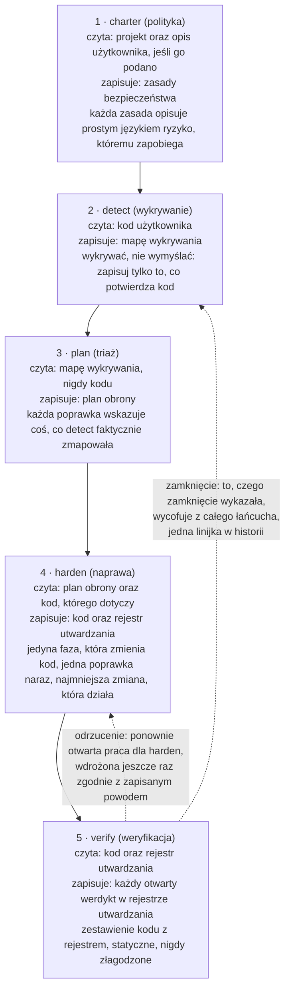
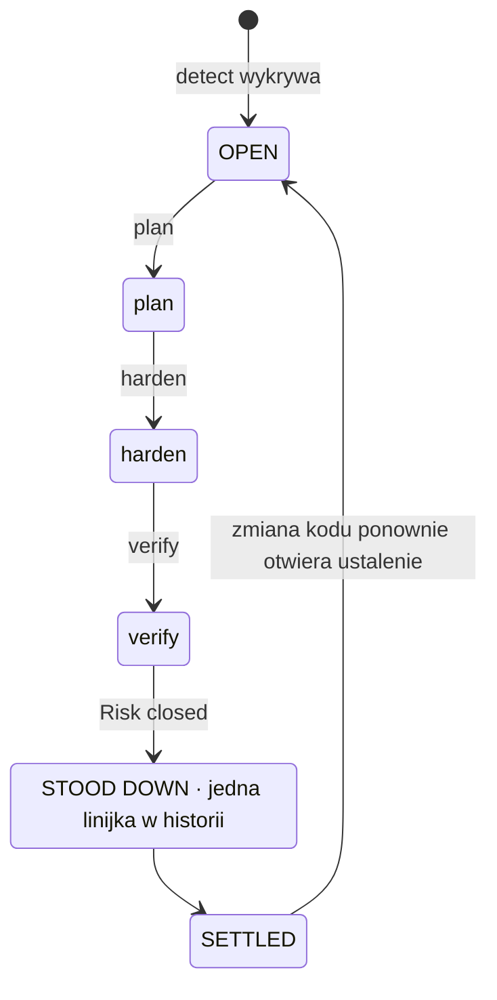
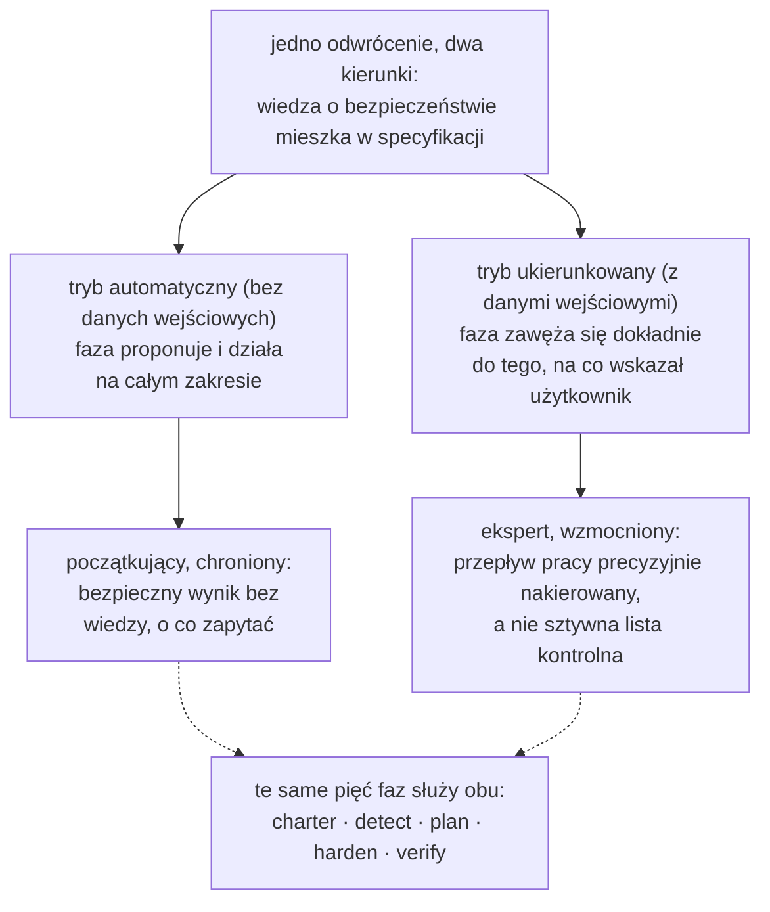
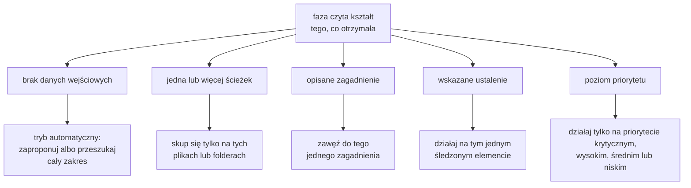
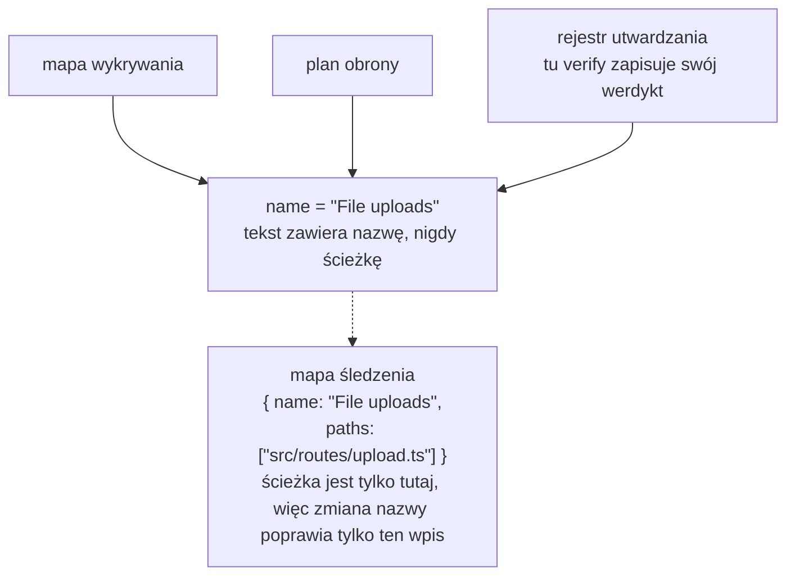
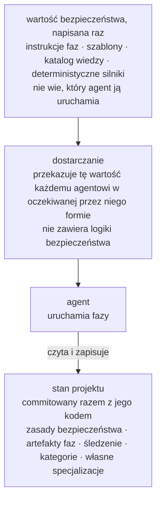
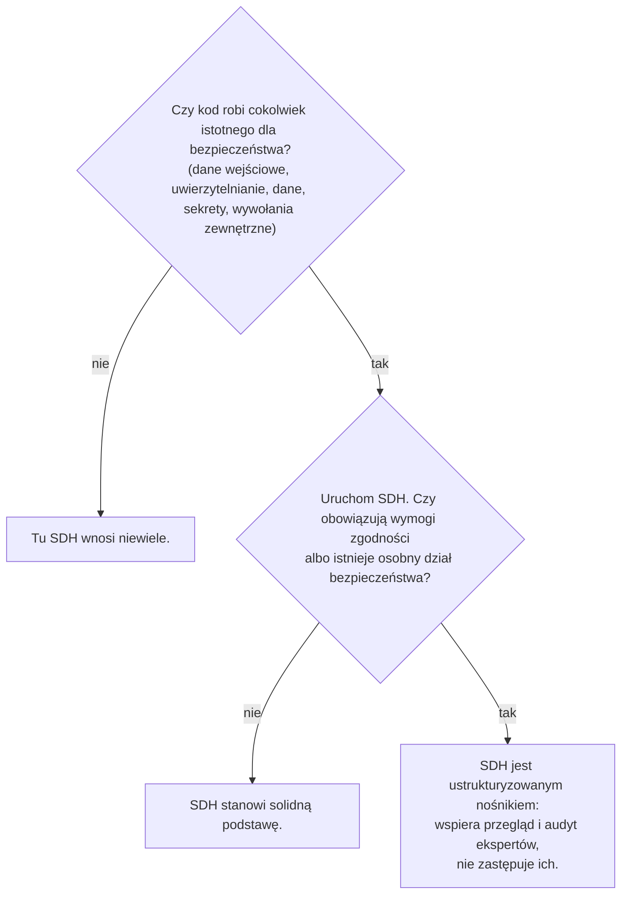

# Security-Driven Hardening: Konwencja na erę programowania wspieranego przez AI

> Metodologia Security-Driven Hardening (SDH): dopasowana do kontekstu konwencja w duchu Blue Team do audytowania i utwardzania oprogramowania tworzonego z pomocą AI lub metodą vibe codingu.

Adres kanoniczny: https://lagune.ai/pl-PL/docs/references/paper
Język: pl-PL
Oryginał: https://lagune.ai/docs/references/paper
Ostatnia aktualizacja: 2026-11-09

- **Weslley Araújo**
- **Artykuł metodologiczny, 2026.**

---

## Streszczenie

Security-Driven Hardening (SDH) to ustrukturyzowana, prowadzona przez AI i wyłącznie defensywna metodologia bezpieczeństwa na czasy, w których oprogramowanie coraz częściej piszą agenci AI oraz ludzie niebędący specjalistami od bezpieczeństwa. Zamiast przechodzić przez ogólną listę kontrolną, SDH najpierw wykrywa, co system naprawdę robi (logowanie, przesyłanie plików, płatności, ujawnianie danych i tak dalej), a potem prowadzi prace nad bezpieczeństwem właściwe dla tego kontekstu. Kierują nią domyślnie bezpieczne zasady, jest w całości nastawiona na obronę i wyrażona prostym językiem, tak aby każdy użytkownik mógł na jej podstawie działać.

Ten dokument przekonuje, że SDH jest brakującą konwencją, a nie pojedynczym narzędziem. Wiedza o bezpieczeństwie mieszka w metodologii i jej specjalizacjach wczytywanych na żądanie, czyli w podstawie, na której każdy użytkownik może budować, dzięki czemu ten sam przepływ pracy służy zarówno początkującemu, jak i ekspertowi. Od wcześniejszych podejść typu spec-first `[1]` odróżniają ją dwie własności. SDH jest **niezależna od stanu**: dopasowuje się do pustego folderu, projektu w toku, pojedynczego pull requesta czy dużej bazy kodu legacy, w dowolnym stosie technologicznym. SDH jest też **możliwa do zamknięcia**: ryzyko, którego zamknięcie zweryfikowano, zostaje wycofane z całego przepływu pracy, więc ustalenie przechodzi w stan spoczynku i otwiera się ponownie dopiero wtedy, gdy zmieni się kod. SDH nie zastępuje specjalistów od bezpieczeństwa ani wyspecjalizowanych narzędzi Blue Team. Rozszerza wiedzę samego programisty, a im lepiej programista rozumie bezpieczeństwo, tym precyzyjniej może nią kierować.

**Lagune** to implementacja referencyjna, która pokazuje, że metodologię da się zbudować i przenieść. SDH jest proponowana jako konwencja, którą mogą przyjąć inni.

> **Słowa kluczowe**
>
> Programowanie wspierane przez AI, bezpieczeństwo oprogramowania, bezpieczeństwo defensywne, spec-driven development, utwardzanie zabezpieczeń, przepływy pracy prowadzone przez agentów, zamykalność, bezpieczeństwo dopasowane do kontekstu, wiedza na żądanie, narzędzia niezależne od agenta.

---

## I. Wprowadzenie: luka w bezpieczeństwie, którą otworzyło programowanie wspierane przez AI

Oprogramowanie coraz częściej dostarczają ludzie, a także agenci AI, którzy nie potrafią niezawodnie rozpoznać niebezpiecznego wzorca: wycieku sekretu, braku sprawdzenia autoryzacji, zapytania podatnego na wstrzyknięcie. Nie są to egzotyczne ryzyka. Należą do klas ryzyka, które dominują w prawdziwych incydentach i od lat są opisywane w publicznych źródłach `[6]`, `[7]`, a najnowsze badania pokazują, że znacząca część kodu generowanego przez AI trafia do użytku właśnie z takimi wadami `[8]`. Asystenci AI do programowania zaostrzyli ten problem, bo pozwolili osobom, które nie są programistami, dostarczać prawdziwe oprogramowanie, ale luka jest szersza niż jakakolwiek pojedyncza grupa odbiorców. Większość projektów nigdy nie przechodzi przeglądu bezpieczeństwa dopasowanego do tego, co faktycznie robi. Ekosystem staje się bardziej kruchy z każdą przedwczesną decyzją w stylu "działa, wypuszczamy".

Ogólne porady dotyczące bezpieczeństwa nie zamykają tej luki. Statyczna lista kontrolna nie jest dopasowana do tego, co robi system, więc zalewa mały projekt nieistotnymi punktami, a mimo to pomija ryzyko, które w tym jednym projekcie ma znaczenie. Problemem nie jest niedobór wiedzy o bezpieczeństwie na świecie. Problemem jest dopasowanie właściwej wiedzy do systemu, który użytkownik faktycznie ma przed sobą, i to dla kogoś, kto może nie wiedzieć, o co zapytać.

SDH odpowiada na to jednym odwróceniem: **wiedza o bezpieczeństwie mieszka w specyfikacji i jej specjalizacjach wczytywanych na żądanie, czyli w podstawie, na której każdy użytkownik może budować**. Metodologia wykrywa kontekst, przeprowadza triaż ryzyk, które ten kontekst niesie, i prowadzi poprawki, więc programista i osoba, która nie programuje, korzystają z tego samego przepływu pracy. Ustalenia i rekomendacje pozostają w prostym języku, aby dało się na ich podstawie działać niezależnie od wiedzy technicznej czytelnika. Ekspert nie jest tym ograniczony, lecz wzmocniony, a tę dwoistość rozwijamy w `§VI`.

> **Kluczowy wniosek**
>
> **Główne odwrócenie:** Wiedza o bezpieczeństwie mieszka w specyfikacji i jej specjalizacjach wczytywanych na żądanie, czyli w podstawie, na której każdy użytkownik może budować. Metodologia poznaje, co robi system, dopasowuje do tego prace nad bezpieczeństwem i rozszerza wszystko, co użytkownik już wie.

Weźmy programistę, który mówi asystentowi AI: "moja aplikacja pozwala użytkownikom przesłać zdjęcie profilowe". Bez przeglądu bezpieczeństwa asystent tworzy działający kod, który po cichu ufa wszystkiemu, co przyśle klient: zadeklarowanemu typowi pliku, nazwie pliku, rozmiarowi. Funkcja przesyłania trafia na produkcję, a plik podszywający się pod obraz może zawierać kod, spreparowana nazwa może wyjść poza ścieżkę zapisu, a zbyt duży plik może wyczerpać zasoby serwera. Nic z tego nie widać na demonstracji, więc trafia to na produkcję.

Ten sam kod przepuszczony przez SDH zachowuje się inaczej. Metodologia wykrywa, że system przyjmuje pliki z zewnątrz (wykrywanie), przekłada to na ryzyka, które niesie przesyłanie plików (triaż), proponuje sprawdzanie rzeczywistego typu i rozmiaru pliku, zmianę nazwy przy zapisie i przechowywanie tam, gdzie kod nie może się uruchomić (naprawa), a potem czyta wynik i potwierdza, że każde zabezpieczenie rzeczywiście działa (weryfikacja). Programista nigdy nie musiał znać wyrażenia "nieograniczone przesyłanie plików". Metodologia dostarczyła je za niego.

Ten dokument wnosi następujący wkład:

- Precyzyjną definicję SDH jako metodologii, niezależną od jakiejkolwiek implementacji, wraz z jej zasadami projektowymi (`§III`).
- Pięciofazowy defensywny cykl życia, w którym wkładem jest sam podział obowiązków: wykrywanie nigdy niczego nie wymyśla, planowanie nigdy nie czyta kodu, tylko jedna faza zmienia kod, a weryfikacja nigdy nie łagodzi swojej oceny (`§IV`).
- **Zamykalność** jako postawę metodologiczną: pojedyncze ustalenie ma stan końcowy, a nie nieskończoną pętlę (`§V`).
- Dwoistość **rozszerzania wiedzy programisty**: jeden przepływ pracy, który chroni początkującego i wzmacnia eksperta (`§VI`).
- **Niewywoływalne specjalizacje i prompt na żądanie**: skupioną wiedzę o bezpieczeństwie, którą agent wczytuje, gdy wymaga tego kontekst projektu, nigdy domyślnie (`§VII`).
- **Niezależność od stanu** i **nienarzucającą adaptacyjność**: SDH pasuje do każdego etapu rozwoju projektu i dopasowuje się do scenariusza, zamiast narzucać stały zakres (`§VIII`).
- **Tryb prewencyjny**: tę samą obronę uruchamianą podczas zwykłej pracy, aby kod od razu powstawał domyślnie bezpieczny, a fazy miały mniej do poprawiania (`§IX`).
- Osobne porównanie ze Spec-Driven Development, nurtem, z którego SDH wyrosła, a potem się od niego oddzieliła (`§X`).
- Dyscypliny inżynierskie, dzięki którym metodologia przetrwa refaktoryzacje i pozostaje niezależna od agenta: śledzenie z tożsamością opartą na nazwie (`§XI`) oraz nośnik niezależny od agenta (`§XII`).

---

## II. Tło i prace pokrewne

SDH opiera się na wcześniejszych pracach. Dziedziczy sprawdzoną strukturę z programowania typu spec-first prowadzonego przez agentów `[1]`, `[2]`, `[3]`: szablony, polecenia z ukośnikiem, z których korzysta agent, dokument nadrzędny i agenta, który uruchamia fazy. Odtwarza tę strukturę w celu defensywnym. To pochodzenie jest zamierzone, a jedna z zasad pracy SDH nazywa je wprost: zbuduj przepływ pracy na sprawdzonej strukturze, a potem nastaw go na bezpieczeństwo.

SDH nie jest statyczną listą kontrolną ogólnych rekomendacji. Lista kontrolna wie bardzo dużo o bezpieczeństwie w ogóle i nic o projekcie, który ma przed sobą. SDH odwraca te proporcje. Pierwszy wysiłek wkłada w wykrywanie, czyli w poznanie tego, co robi system, i dopiero potem sięga po wiedzę, którą wykrywanie uczyniło istotną.

SDH nie zastępuje też specjalistów od bezpieczeństwa ani wyspecjalizowanych narzędzi Blue Team. Rozszerza wiedzę programisty (`§VI`). Zespół z własnym działem bezpieczeństwa powinien go zachować. SDH daje takiemu zespołowi ustrukturyzowany nośnik, a zespołowi bez takiego działu solidną podstawę.

SDH działa też obok deterministycznych skanerów bezpieczeństwa (analiza statyczna, lintery) `[4]`, `[5]`. Te narzędzia są cenne właśnie dlatego, że są deterministyczne i powtarzalne. SDH opiera się głównie na rozumowaniu agenta, co oznacza wymianę ścisłego determinizmu na dopasowanie do kontekstu. Metodologia nie udaje, że jest inaczej. Tam, gdzie determinizm ma znaczenie, osadza w rozumowaniu deterministyczny silnik (`§VII`): agent decyduje, czy dane wejściowe warto sprawdzić, a deterministyczny program decyduje, czy są niebezpieczne.

Najbliższym wcześniejszym rozwiązaniem jest Spec-Driven Development (SDD), rodzina metodologii typu spec-first, które prowadzą budowę naprzód na podstawie wykonywalnej specyfikacji. Traktujemy SDD jako klasę. Jej najjaśniejszym ujęciem jako metodologii praktycznej jest raport Piskali `[1]`, jej najbardziej widocznym zestawem narzędzi dla agentów jest Spec Kit firmy GitHub `[2]`, a OpenSpec `[3]` to drugie narzędzie z tej samej rodziny. To one stanowią kanoniczne odniesienia dla porównania w `§X`.

---

## III. SDH: definicja i zasady projektowe

**Security-Driven Hardening** to ustrukturyzowana, prowadzona przez AI metodologia bezpieczeństwa, która czyni bazę kodu bezpieczniejszą, kierując pracą na podstawie specyfikacji uruchamianej przez agenta, a nie doraźnych poprawek. Nazwa nawiązuje do zespołów **Blue Team**, czyli obrońców w świecie bezpieczeństwa. SDH dotyczy obrony, utwardzania i weryfikacji, nigdy ataku.

> **Definicja**
>
> **Security-Driven Hardening (SDH):** Ustrukturyzowana, prowadzona przez AI, wyłącznie defensywna metodologia bezpieczeństwa, która najpierw wykrywa, co system naprawdę robi, a potem prowadzi prace nad bezpieczeństwem właściwe dla kontekstu, w ramach domyślnie bezpiecznych zasad i w prostym języku.

SDH definiuje zestaw wiążących zasad. Każda z nich jest regułą i każda daje użytkownikowi określoną gwarancję.

| Zasada                                                                         | Reguła                                                                                                                                                                                         | Co gwarantuje użytkownikowi                                                                                                                                                                          |
| ------------------------------------------------------------------------------ | ---------------------------------------------------------------------------------------------------------------------------------------------------------------------------------------------- | ---------------------------------------------------------------------------------------------------------------------------------------------------------------------------------------------------- |
| Domyślnie bezpiecznie, prostym językiem, dla wszystkich na równi               | Każde ustawienie domyślne, komunikat i poprawka są bezpieczne od razu i zrozumiałe dla każdego czytelnika, programisty czy nie. Żadna grupa użytkowników nie jest uprzywilejowana.             | Początkujący dostaje bezpieczną podstawę, nie prosząc o nią, i rozumie wynik we własnych kategoriach.                                                                                                |
| Dopasowanie do kontekstu zamiast ogólników                                     | Każda faza zaczyna od kontekstu wykrytego w fazie detect i działa na tym, co system faktycznie robi.                                                                                           | Rekomendacje pasują do projektu, a nie do listy kontrolnej. Wiedza o bezpieczeństwie mieszka w specyfikacji i jej specjalizacjach wczytywanych na żądanie i rozszerza wszystko, co wnosi użytkownik. |
| Elastyczność zamiast sztywności                                                | Zasady, wymagania i rekomendacje są punktami wyjścia. Użytkownik może dowolny element przeformułować, usunąć, dodać lub zawęzić.                                                               | Metodologia dopasowuje się do projektu i użytkownika i nigdy nie jest surowsza, niż chce użytkownik. Elastyczność nigdy nie osłabia domyślnie bezpiecznej podstawy.                                  |
| Uzgadnianie zamiast samego dopisywania                                         | Artefakty są żywymi dokumentami, a nie logami. Każde uruchomienie ponownie sprawdza każdy wpis: zachowuje to, co aktualne, przepisuje to, co się zmieniło, usuwa to, co przestało obowiązywać. | Zapis zawsze odzwierciedla teraźniejszość, więc nigdy nie zamienia się w nieaktualny backlog.                                                                                                        |
| Wyłącznie obrona                                                               | SDH audytuje, utwardza i weryfikuje. Nigdy nie tworzy narzędzi ofensywnych, exploitów do złośliwego użycia ani technik unikania wykrycia w celu wyrządzenia szkody.                            | Metodologii nie da się zamienić w broń. Treści o podwójnym zastosowaniu pojawiają się wyłącznie w jednoznacznie defensywnym ujęciu.                                                                  |
| Najpierw specyfikacja, prowadzenie przez agenta, nastawienie na bezpieczeństwo | Przepływ pracy składa się z szablonów, poleceń, nadrzędnych zasad bezpieczeństwa i agenta, który uruchamia fazy.                                                                               | Sprawdzona struktura programistyczna, przystosowana tak, aby to agent wykonywał zasadniczą pracę nad bezpieczeństwem.                                                                                |

**Tabela 1.** Zasady projektowe SDH i gwarancja, jaką każda z nich daje użytkownikowi.

Te zasady nie są ozdobnikiem. To ograniczenia, których musi przestrzegać każda z opisanych dalej faz, a dyskusja w `§XV` wraca do nich, aby wyznaczyć granice metodologii.

Dalsza część dokumentu rozwija dziewięć nazwanych filarów. To elementy, które czytelnik powinien zapamiętać, i elementy, które inny zespół musiałby odtworzyć, aby móc twierdzić, że stosuje SDH.

| Filar                                                | Co zapewnia                                                                                                                                                      | Sekcja      |
| ---------------------------------------------------- | ---------------------------------------------------------------------------------------------------------------------------------------------------------------- | ----------- |
| Odwrócenie oparte na kontekście                      | Wiedza o bezpieczeństwie mieszka w specyfikacji i jej specjalizacjach wczytywanych na żądanie, więc początkujący i ekspert korzystają z jednego przepływu pracy. | `§I`, `§VI` |
| Pięciofazowy defensywny cykl życia                   | Podział obowiązków: polityka, wykrywanie, triaż, naprawa, weryfikacja, każda faza z jednym zadaniem.                                                             | `§IV`       |
| Zamykalność                                          | Ustalenie ma stan końcowy, a nie nieskończoną pętlę. Zamknięta praca zostaje wycofana.                                                                           | `§V`        |
| Dwoistość rozszerzania wiedzy programisty            | Jeden przepływ pracy, który chroni początkującego i wzmacnia eksperta, nie zastępując żadnego z nich.                                                            | `§VI`       |
| Prompt na żądanie, niewywoływalna wiedza             | Istotna wiedza o bezpieczeństwie jest wczytywana pod kątem tego, czym jest projekt, nigdy domyślnie.                                                             | `§VII`      |
| Niezależność od stanu i nienarzucająca adaptacyjność | Pasuje do każdego etapu rozwoju i każdego stosu technologicznego oraz dopasowuje się do scenariusza, zamiast narzucać zakres.                                    | `§VIII`     |
| Tryb prewencyjny                                     | Ta sama obrona działa podczas tworzenia nowej pracy, więc kod od razu powstaje domyślnie bezpieczny.                                                             | `§IX`       |
| Śledzenie z tożsamością opartą na nazwie             | Ustalenie pozostaje jednym elementem we wszystkich fazach, a zmiana nazwy zrywa powiązanie tylko w jednym miejscu.                                               | `§XI`       |
| Nośnik niezależny od agenta                          | Wartość bezpieczeństwa powstaje raz i nie zależy od żadnego agenta ani stosu.                                                                                    | `§XII`      |

**Tabela 2.** Dziewięć nazwanych filarów SDH i miejsca, w których każdy z nich jest rozwinięty.

---

## IV. Przepływ pracy Blue Team w 5 fazach

SDH porządkuje pracę w pięciofazowy defensywny cykl życia (Rysunek 1). Każda faza jest nastawiona na obronę, każda opiera się na poprzedniej, a fazy odpowiadają rzeczywistej pracy zespołu Blue Team: określenie polityki, wykrywanie, triaż, naprawa, weryfikacja.



**Rysunek 1.** Pięciofazowy przepływ pracy: co czyta każda faza, co zapisuje i jaki jest jej kluczowy niezmiennik. Verify steruje oboma powrotami: odrzucone zabezpieczenie ponownie otwiera harden, a ustalenie, którego zamknięcie wykazano, zostaje wycofane z łańcucha, z jedną linijką w historii.

Wkładem jest podział obowiązków. Ponieważ każda faza ma jedno zadanie, każdy rodzaj awarii pozostaje ograniczony do jednego miejsca, a czytelnik może ufać temu, co deklaruje każdy artefakt.

> **Kluczowy wniosek**
>
> **Applied nie znaczy zweryfikowane:** Faza harden zapisuje, że poprawkę wdrożono. Faza verify weryfikuje to, zestawiając kod z tym rejestrem, a werdykt nigdy nie jest łagodzony, aby pasował do rejestru. Zabezpieczenie może być obecne w kodzie, a ryzyko wciąż osiągalne, i wtedy uczciwy werdykt brzmi "Risk not closed".

### charter (polityka)

Faza charter ustala zasady bezpieczeństwa projektu, czyli reguły, których musi przestrzegać każda kolejna faza. To warstwa nadrzędna, rodzaj kontroli na etapie kompilacji dla poziomu bezpieczeństwa projektu. Każda zasada ma jasną nazwę, niepodlegającą negocjacjom regułę, którą da się sprawdzić w kodzie, oraz wiersz `Why:` opisujący ryzyko, któremu zapobiega, a nie tylko poprawkę. Faza charter zawsze czyta sam projekt (jego manifesty, strukturę i zależności), a opis użytkownika, jeśli został podany, wyznacza kierunek, który ta lektura potem poszerza poza to, co użytkownik wymienił. Bez opisu projekt jest jedynym źródłem. Oba źródła się sumują, zamiast konkurować, a zasady bezpieczeństwa zapisują politykę, której projekt powinien się trzymać, a nie stan jego kodu. Osoba, która nie programuje, powinna móc je przeczytać i zrozumieć zarówno regułę, jak i ryzyko.

### detect (wykrywanie)

Faza detect czyta kod i mapuje to, co system faktycznie robi i co ma znaczenie dla bezpieczeństwa. Nadrzędna instrukcja brzmi "wykrywać, nie wymyślać": zapisuj tylko to, co potwierdza kod, wraz z dowodami potrzebnymi kolejnym fazom. Detect jest neutralna. Nie dopasowuje na siłę swoich ustaleń do zasad bezpieczeństwa, bo dopasowywanie ryzyk do reguł zawartych w zasadach bezpieczeństwa to zadanie fazy plan. Każde ustalenie składa się z trzech części: czym jest (opis prostym językiem), dlaczego ma znaczenie (ryzyko, a nie tylko fakt) i dowodu (funkcja lub trasa, w której się znajduje). Dowód nie zawiera ścieżki pliku. Ścieżka znajduje się wyłącznie w mapie śledzenia (`§XI`), więc tekst nigdy nie przechowuje ścieżki, która może się zdezaktualizować.

### plan (triaż)

Faza plan zamienia każde ustalenie w poprawkę, nazwaną według klasy ryzyka (z odwołaniem do uznanych źródeł, CWE i OWASP, tam gdzie je uzasadniają) i powiązaną z zasadą bezpieczeństwa, którą poprawka chroni. Priorytet (krytyczny, wysoki, średni, niski) nie jest kwestią swobodnego wyboru: plan ocenia każde ustalenie metodą CVSS v4.0 z metrykami Base i Environmental, więc poziom priorytetu to wynik wyrażony prostymi słowami, uzasadniony jednym zrozumiałym zdaniem o ekspozycji i stawce, a dwa uruchomienia dają tę samą kolejność. Wektor jest precyzyjnym punktem odniesienia dla eksperta, a poziom wraz z uzasadnieniem to ta sama ocena w formie, którą każdy może prześledzić. Plan pracuje wyłącznie na mapie wykrywania i nigdy nie czyta kodu. To celowe ograniczenie, a nie słabość: zmusza każdą poprawkę do wskazania czegoś, co detect faktycznie wykryła. Jeśli jakiś zakres nigdy nie został zmapowany, plan się zatrzymuje i odsyła użytkownika z powrotem do fazy detect, zamiast zgadywać.

### harden (naprawa)

Harden to jedyna faza, która zmienia kod, więc postępuje ostrożnie. To, czy edycja wymaga zgody użytkownika, zależy od agenta i trybu uprawnień, w którym działa, więc harden nie dodaje własnego kroku potwierdzenia. Wdraża jedną poprawkę naraz, najpierw zależności, potem najwyższy priorytet, aby każda zmiana pozostała mała, łatwa do przejrzenia i łatwa do cofnięcia. Nigdy nie osłabia istniejącego zabezpieczenia, aby nowa poprawka pasowała, i nigdy nie łamie żadnej zasady bezpieczeństwa. Jeśli poprawka kolidowałaby z którąś zasadą, harden się zatrzymuje i ujawnia konflikt, zamiast ją wdrażać. Każdy blok jest zapisywany jako Applied, Partial lub Blocked. "Applied nie znaczy jeszcze zweryfikowane", i tym właśnie zajmuje się kolejna faza.

### verify (weryfikacja)

Verify weryfikuje każde wdrożone zabezpieczenie, czytając kod i zestawiając go z tym, co zapisała faza harden. Weryfikacja to właśnie to zestawienie, kod z rejestrem, i jest statyczna: potwierdza, że zabezpieczenie jest obecne i poprawne w kodzie, a nie że wytrzyma atak na działającym systemie. Taka kontrola w czasie działania, czyli przeprowadzanie prawdziwych lub symulowanych ataków na działający system, jest celowo poza zakresem. Verify zwraca jeden z trzech werdyktów: Risk closed, Risk not closed albo Cannot tell from the code. Nie tworzy własnego artefaktu: harden i verify współdzielą rejestr utwardzania, przy czym harden odpowiada za to, co zrobiono, a verify za werdykt i jego uzasadnienie, i żadna z nich nigdy nie zapisuje pól drugiej. Odrzucone zabezpieczenie to ponownie otwarta praca dla harden, która przy następnym uruchomieniu stawia werdykt ponad własną lekturą kodu i wdraża poprawkę jeszcze raz, celując dokładnie w lukę wskazaną w uzasadnieniu. Verify ufa kodowi bardziej niż rejestrowi, bo rejestr może deklarować więcej, niż kod faktycznie zapewnia. Kod użytkownika tylko czyta i nigdy nie łagodzi werdyktu, aby pasował do rejestru. Zabezpieczenie może być obecne, a ryzyko nadal osiągalne inną drogą, i w takim przypadku uczciwy werdykt brzmi "Risk not closed". Jeśli podczas lektury verify zauważy problem bezpieczeństwa, którego mapa wykrywania nigdy nie objęła, nie wymyśla dla niego werdyktu, bo wykrywanie to zadanie fazy detect: zgłasza problem i odsyła użytkownika z powrotem do detect, aby ustalenie weszło tym samym przepływem pracy, zamiast go omijać.

> **Przykład przewodni: przesyłanie plików.** Jedno ustalenie pokazuje cały kręgosłup przepływu pracy od początku do końca.
>
> - **detect** je znajduje: system przyjmuje pliki od użytkowników, a handler przesyłania ufa typowi MIME podanemu przez klienta, nie sprawdzając rzeczywistego typu pliku. _Dlaczego to ważne:_ plik podszywający się pod obraz może ukrywać złośliwy kod.
> - **plan** wybiera poprawkę, priorytet **krytyczny**, w obronie zasady "Wszystkie dane wejściowe są niezaufane, dopóki nie przejdą walidacji": sprawdzać rzeczywisty typ i rozmiar pliku, zmieniać jego nazwę przy zapisie i przechowywać przesłane pliki tam, gdzie nie da się ich uruchomić jako kodu.
> - **harden** ją wdraża, status **Applied**: handler rozpoznaje teraz rzeczywisty typ na podstawie zawartości, egzekwuje limit rozmiaru, odrzuca wszystko, co nieoczekiwane, zmienia nazwę przy zapisie i przechowuje pliki tam, gdzie kod nie może się uruchomić.
> - **verify** czyta handler, zestawia go z rejestrem i zwraca **Risk closed**: kod robi dokładnie to, co deklaruje rejestr.
>
> Ta sama nazwa ustalenia przechodzi przez mapę wykrywania, plan i rejestr utwardzania, a verify działa na tym rejestrze pod tą samą nazwą: otwarty werdykt trafia do bloku ustalenia, a ustalenie, którego zamknięcie wykazano, zostaje wycofane (`§V`). Ta wspólna nazwa jest jego tożsamością (`§XI`).

---

## V. Zamykalność: ustalenie ma stan końcowy

Większość narzędzi bezpieczeństwa zostawia użytkownika z backlogiem, który tylko rośnie. SDH przyjmuje inne stanowisko: **ustalenie jest możliwe do zamknięcia, więc ma stan końcowy, zamiast żyć w nieskończonym backlogu** (Rysunek 2). Wynika to bezpośrednio z zasady uzgadniania.

> **Definicja**
>
> **Zamykalność:** Ryzyko, którego zamknięcie zweryfikowano, zostaje wycofane z całego przepływu pracy, więc ustalenie przechodzi w stan spoczynku i otwiera się ponownie dopiero wtedy, gdy zmieni się kod. Ustalenie ma stan końcowy, choć sam program bezpieczeństwa pozostaje ciągły.

Artefakty SDH są żywymi dokumentami, a nie logami. Za każdym razem, gdy faza uruchamia się ponownie, sprawdza każdy istniejący wpis względem aktualnego stanu i robi jedną z trzech rzeczy: zachowuje to, co nadal obowiązuje, przepisuje to, co się zmieniło, albo usuwa to, co przestało mieć zastosowanie. Ustalenie, które według kodu zostało już rozwiązane, jest po prostu usuwane. Roboczy zapis odzwierciedla teraźniejszość, a nie przeszłość.

Zamknięcie jest tym samym uzgadnianiem, doprowadzonym do końca. Gdy verify zweryfikuje, że ryzyko jest zamknięte, wycofuje ustalenie z całego przepływu pracy: z mapy wykrywania, planu, rejestru utwardzania i mapy śledzenia. Dlatego verify jest jedyną fazą, która zapisuje artefakty innych faz: to ona zamyka pętlę. Gdy ustalenie opuszcza łańcuch, wycofanie destyluje je do krótkiego wpisu w historii, która leży poza roboczym łańcuchem i nigdy nie jest ponownie przetwarzana. Na tym polega granica między zniknięciem a zamknięciem: ustalenie, które uzgadnianie usunęło, bo przestało być prawdziwe, nie zostawia po sobie śladu, a ustalenie, którego zamknięcie wykazano, zasługuje na swoją linijkę w historii. Wycofanego ustalenia nie ma potem w żadnym artefakcie roboczym, a ten brak jest oczekiwany i nie oznacza zerwanego łańcucha.



**Rysunek 2.** Maszyna stanów zamykalności. Ustalenie przechodzi przez stany OPEN → STOOD DOWN → SETTLED i otwiera się ponownie dopiero wtedy, gdy zmieni się kod.

Gdy wszystko w zakresie zostanie wycofane, cykl przechodzi w stan spoczynku, a ten stan ma konkretną postać: artefakt, którego ostatnie ustalenie zostało zamknięte, jest usuwany w całości, więc w pełni zamknięty łańcuch zostawia tylko zasady bezpieczeństwa i historię, czyli politykę i dowody. Cykl otwiera się ponownie dopiero wtedy, gdy zmieni się kod. Metodologia daje każdemu ustaleniu wyraźny koniec, a tego właśnie nieskończony backlog dać nie może.

---

## VI. Dwoistość rozszerzania wiedzy programisty

SDH nie zastępuje ludzi ani wyspecjalizowanych narzędzi Blue Team. **Rozszerza wiedzę samego programisty**. Im lepiej programista rozumie bezpieczeństwo, tym precyzyjniej może sterować przepływem pracy i tym większą ma autonomię. Programista, który rozumie niewiele, i tak otrzymuje bezpieczny wynik, bo chroni go tryb automatyczny.

Odwrócenie z `§I`, zgodnie z którym wiedza o bezpieczeństwie mieszka w specyfikacji, działa w obu kierunkach. Dla początkującego oznacza ochronę: nie musi wiedzieć, o co zapytać, bo specyfikacja sama proponuje. Dla eksperta oznacza wzmocnienie: ta sama specyfikacja pozwala mu precyzyjnie nakierować przepływ pracy, zamiast zmagać się ze sztywną listą kontrolną.

Każda faza niesie tę dwoistość w swoim własnym działaniu (Rysunek 3). Uruchomiona bez danych wejściowych działa na całym zakresie w imieniu użytkownika. Gdy dostanie wskazówki, ta sama faza zawęża się dokładnie do tego, na co wskazał użytkownik.



**Rysunek 3.** Dwoistość rozszerzania wiedzy programisty. Jedno odwrócenie służy dwóm grupom odbiorców: tryb automatyczny chroni początkującego, a tryb ukierunkowany wzmacnia eksperta, przez te same pięć faz.

Specjalizacje wczytywane na żądanie (`§VII`) wyrażają tę dwoistość wprost we własnej treści. Każda mówi agentowi, że jej wiedza "rozszerza twój osąd", i każe mu rozumować dalej, poza to, co zapewnia specjalizacja. Ta wiedza jest podłogą, a nie sufitem. To właśnie służy obu grupom odbiorców w równowadze, do której dąży dokument: społeczność programistów zyskuje solidne narzędzie, a praktyk Blue Team zyskuje ustrukturyzowany nośnik, który nie udaje, że wykona za niego jego pracę.

---

## VII. Niewywoływalne specjalizacje i prompt na żądanie

To najbardziej nowatorski wzorzec metodologii. SDH przechowuje skupioną wiedzę o bezpieczeństwie w postaci specjalizacji, które wczytują się **wyłącznie na żądanie**, a o tym, które wczytać, decyduje sam agent, dopasowując je do kontekstu projektu. Nazywamy to **promptem na żądanie**: sposobem, w jaki agent wybiera, którą wiedzę aktywować, na podstawie zakresu projektu, w którym się znajduje, zamiast domyślnie uruchamiać każdą kontrolę. Specjalizacje ewoluują, a każda z nich może się zmienić lub zostać zastąpiona w dowolnym momencie. Wkładem jest wzorzec, a nie same specjalizacje.

> **Definicja**
>
> **Prompt na żądanie:** Agent wybiera, którą wiedzę o bezpieczeństwie aktywować, dopasowując ją do zakresu projektu, który ma przed sobą, więc istotna wiedza jest wczytywana pod kątem tego, czym projekt faktycznie jest, zamiast domyślnego uruchamiania każdej kontroli.

> **Definicja**
>
> **Niewywoływalna specjalizacja:** Skupiona, niezależna od języka jednostka wiedzy o bezpieczeństwie dla jednego kontekstu, na przykład przesyłania plików albo kodu działającego w przeglądarce. Audytuje i wyjaśnia, nigdy nie przepisuje kodu i nigdy nie tworzy danych wejściowych do ataku. Nie jest poleceniem: wczytuje się, gdy kontekst, który obejmuje, znajduje się w zakresie, albo gdy prompt poprosi o nią po nazwie.

Każda specjalizacja wskazuje bezpieczniejsze rozwiązania dla ryzyk, które obejmuje, i mówi agentowi, jak postąpić z ustaleniem w każdej fazie, która z niej korzysta: jak je ocenić przy wykrywaniu, jak bezpiecznie wdrożyć poprawkę przy naprawie i jak wykazać jej działanie przy weryfikacji.

Cechą definiującą jest to, że specjalizacji **nie da się wywołać samodzielnie**: nie jest poleceniem, a w obrębie przepływu pracy wczytuje ją dopasowanie. Faza wykrywania raz pobiera listę katalogu, dopasowuje kontekst projektu do tego, co obejmuje każdy wpis, i wczytuje tylko specjalizacje, których kontekst występuje w zakresie. Późniejsze fazy korzystają z tej listy dopasowań, zamiast tworzyć ją od nowa, więc jedno dopasowanie służy całemu łańcuchowi, a tryb prewencyjny (`§IX`) przeprowadza to samo dopasowanie dla pracy, która ma dopiero powstać. Specjalizacja, której kontekstu brak, zostaje pominięta, a pominięcie podlega takiemu samemu rozliczeniu jak wczytanie: każdy wpis w katalogu dostaje jednoznaczny werdykt, zastosowana albo pominięta, z uzasadnieniem odczytanym z kodu, więc mgliste poczucie, że coś jest nieistotne, nigdy nie zastępuje faktycznego braku. Brak jakiejkolwiek pasującej specjalizacji to prawidłowy wynik.

Katalog to dane, a jego rozbudowa to jeden plik wiedzy i jeden wiersz katalogu, nigdy nowe polecenie. Wbudowane specjalizacje są pogrupowane w kategorie, takie jak OWASP, język programowania czy integracje z AI, a katalog, z którego korzysta projekt, zawiera wbudowane specjalizacje z wybranych przez niego kategorii oraz jego własne specjalizacje. Projekt zapisuje ten wybór razem z resztą swojego stanu, więc cały zespół dopasowuje względem tego samego katalogu. To ta sama zasada dopasowania do kontekstu co w fazach, zastosowana do wiedzy: istotna wiedza jest wczytywana pod kątem tego, czym projekt faktycznie jest, zamiast domyślnego uruchamiania każdej kontroli. Ta sama właściwość pozwala rozbudowywać katalog użytkownikowi, a nie tylko opiekunowi projektu: źródło lub temat z dziedziny bezpieczeństwa, które dostarczy użytkownik, zostaje zdestylowane do nowej specjalizacji należącej do projektu, która trafia do jego katalogu niezależnie od kategorii i wczytuje się dokładnie tak jak wbudowana, zastępując wbudowaną o tej samej nazwie. Tworzenie specjalizacji również jest wyłącznie defensywne i podlega tej samej granicy, której pilnują specjalizacje: opis ataku może być źródłem, ale powstała z niego specjalizacja audytuje i wyjaśnia, nigdy nie tworzy działającego exploita. W ten sposób odwrócenie z `§I`, czyli inteligencja mieszkająca w specyfikacji, obejmuje sam katalog, który użytkownik może pogłębiać dla własnego kontekstu bez pisania kodu.

Krótki przykład ilustruje prompt na żądanie. Faza detect czyta folder z kodem działającym w przeglądarce. Dopasowuje ten kontekst w katalogu, wczytuje specjalizację, która go obejmuje, i zgłasza ustalenie po stronie klienta w ramach zwykłych kroków fazy detect. Specjalizacje, których kontekstu brak w tym zakresie, nie pasują, więc nigdy się nie wczytują, a każda zostaje zapisana jako pominięta. To projekt zdecydował, która wiedza jest istotna, a nie stała konfiguracja.

Determinizm pojawia się dokładnie tam, gdzie ma znaczenie. Specjalizacja może zawierać deterministyczne narzędzie sprawdzające, a nie tylko tekst: tam, gdzie klasa ryzyka ma jasną procedurę decyzyjną, mały program zwraca stały werdykt dla danych wejściowych, na przykład jedno z krótkiej listy słów, takich jak `safe`, `unsafe` czy `invalid input`. Niektóre klasy ryzyka da się rozstrzygać deterministycznie właśnie w ten sposób, a za procedurą decyzyjną stoi dorobek wcześniejszych prac `[9]`, `[10]`, `[11]`. Narzędzie sprawdzające albo ocenia kandydatów dostarczonych przez agenta, albo samo przeszukuje zakres, aby ich znaleźć, i w obu przypadkach werdykt zwraca narzędzie sprawdzające, a nie agent. Wystarczająco uniwersalną specjalizację można oznaczyć w katalogu jako wymaganą. Wtedy jest stosowana zawsze, a jej narzędzie sprawdzające działa na całym zakresie. To jedyny przypadek, w którym wiedza wczytuje się bez dopasowania kontekstu, i deklarują go dane katalogu, nigdy doraźna decyzja agenta. W tym miejscu SDH osadza rozumowanie agenta w czymś powtarzalnym, nie udając, że cały przepływ pracy jest deterministyczny.

Wreszcie specjalizacje są **odłączalne**. Ponieważ wiedza jest samodzielna, użytkownik może uruchomić jedną z nich bezpośrednio w prompcie, który nie ma nic wspólnego z pełnym przepływem pracy SDH, i w ten sposób dbać o bezpieczeństwo przy zwykłej pracy programistycznej. Specjalizacja z deterministycznym narzędziem sprawdzającym może na przykład sprawdzać każdego kandydata powstałego podczas zwykłego programowania i zostawiać tylko bezpieczne. Ta odłączalność jest jednym z powodów, dla których SDH dopasowuje się do tak wielu sytuacji, o czym mówi `§VIII`, a pełny wyraz znajduje w trybie prewencyjnym (`§IX`), w którym ta sama wiedza chroni zwykłą pracę programistyczną od początku do końca.

---

## VIII. Niezależność od stanu i nienarzucająca adaptacyjność

Dwie własności odróżniają SDH od sztywnych metodologii opartych na specyfikacji.

### Niezależność od stanu

> **Definicja**
>
> **Niezależność od stanu:** Metodologia nie zależy od etapu rozwoju projektu. Pasuje do pustego folderu, projektu w toku, pojedynczego pull requesta czy dużej bazy kodu legacy, w dowolnym stosie technologicznym, bo punkt wyjścia poznaje, czytając go.

Każda faza działa tak samo niezależnie od tego, czy projekt jest zupełnie nowy, czy już istnieje. Faza charter wyprowadza zasady z kodu, który akurat jest. Faza detect mapuje kod, który jest na miejscu, nawet jeśli jest go bardzo mało. Nie ma założonego punktu wyjścia.

### Nienarzucająca adaptacyjność

> **Definicja**
>
> **Nienarzucająca adaptacyjność:** Metodologia dopasowuje się do scenariusza, zamiast narzucać stały zakres, którego użytkownik musi się trzymać. Gdy użytkownik nie wie, co powiedzieć, czyta środowisko, w którym ją wywołano, tworzy kontekst i zadaje pytania, które kształtują jej następne kroki.

Tryb proponowania fazy charter to najwyraźniejszy przykład: SDH, analizując projekt, wyprowadza domyślnie bezpieczny zestaw zasad, pyta użytkownika tylko wtedy, gdy luka faktycznie zmienia wynik, a potem go zapisuje i przedstawia każdą zasadę prostym językiem wraz z ryzykiem, któremu zapobiega. Zasady bezpieczeństwa to żywy dokument, który użytkownik przerabia, uruchamiając fazę ponownie, a nie umowa zablokowana za prośbą o zatwierdzenie, więc nigdy nie wymagają od użytkownika wiedzy, o co zapytać.

Ta adaptacyjność przejawia się wrażliwością na kształt danych wejściowych: ta sama faza czyta to, co otrzymała, i wybiera tryb (Rysunek 4). Plik w prompcie, ustalenie z listy, obawa, ukierunkowana misja wymierzona w znany słaby punkt albo prośba o pełne skanowanie metodą brute force: każde z nich odpowiada potrzebie użytkownika, bo przepływ pracy z założenia niczego nie narzuca. Nic z tego nie osłabia domyślnie bezpiecznej podstawy. Elastyczność kształtuje sposób stosowania podstawy, nigdy jej nie obniża.



**Rysunek 4.** Nienarzucająca adaptacyjność. Ta sama faza czyta kształt swoich danych wejściowych i wybiera tryb, więc zakres zawsze należy do użytkownika i nigdy nie jest narzucony.

---

## IX. Uniwersalny tryb prewencyjny: ta sama obrona w trakcie tworzenia

SDH ma jeden tryb uzupełniający: zwykłą pracę programistyczną wykonywaną przy aktywnej tej samej obronie, w trakcie pisania kodu. Użytkownik prosi o samą pracę, stronę logowania, przesyłanie plików, endpoint, a metodologia pilnuje budowy na bieżąco, więc wynik jest domyślnie bezpieczny w chwili, gdy powstaje, a nie dopiero po późniejszym utwardzaniu.

> **Definicja**
>
> **Tryb prewencyjny:** zwykła praca programistyczna prowadzona w ramach warstwy nadrzędnej i wiedzy SDH. Zasady bezpieczeństwa wiążą budowę, specjalizacje istotne dla tego, co ma powstać, wczytują się na żądanie, a zanim praca zostanie uznana za skończoną, wynik jest zestawiany dokładnie z tą obroną, której użyto.

Ten tryb wykorzystuje każdy element, który fazy już mają, skierowany na kod, który jeszcze nie istnieje. Wykrywanie kontekstu przenosi się z kodu na intencję: agent przemyśla, co ma zbudować i jakie granice ta praca przekracza (logowanie oznacza dane uwierzytelniające, sesję i dane wejściowe z zewnątrz), i to właśnie te przemyślenia są dopasowywane do katalogu wiedzy. Prompt na żądanie (`§VII`) zostaje tu uogólniony: kontekst można wykryć w planie kodu, a nie tylko w istniejącym kodzie. Zasady bezpieczeństwa obowiązują jak zawsze, a prośba, która złamałaby którąś zasadę, zostaje zgłoszona jako konflikt i nigdy nie jest realizowana. Obrona jest stosowana na bieżąco, w chwili pisania każdego elementu, z walidacją na granicy i bezpieczną konstrukcją użytą od pierwszego razu, więc działająca, ale niebezpieczna wersja w ogóle nie powstaje i nie trzeba jej poprawiać.

Tryb kończy się tak, jak zaczyna się faza verify. Zanim praca zostanie uznana za skończoną, ten, kto ją zbudował, zestawia własny wynik z obroną, której użył: zabezpieczenie musi leżeć na drodze ryzyka, a nie obok niej, musi być kompletne, a tam, gdzie specjalizacja zawiera deterministyczne narzędzie sprawdzające, jego werdykt ma pierwszeństwo przed własną lekturą agenta. Luka znaleziona na tym etapie zostaje zamknięta w ramach tej samej pracy, bo dokończyć pracę znaczy dokończyć ją bezpiecznie.

To, czego tryb odmawia, jest równie przemyślane jak to, co robi. Buduje tylko to, o co poproszono, i niczego wokół nie audytuje: audyt tego, co istnieje, należy do faz. Nie zapisuje żadnego artefaktu i nie śledzi żadnego ustalenia, bo ustalenie to ryzyko wykryte w tym, co istnieje, a celem tego trybu jest to, aby niebezpieczna wersja w ogóle nie powstała. Oba kierunki się uzupełniają: fazy zamykają to, co już jest (`§V`), a tryb prewencyjny nie pozwala, aby nowa praca otworzyła to ponownie. Łańcuch w stanie spoczynku pozostaje w stanie spoczynku nie dlatego, że rozwój się zatrzymał, ale dlatego, że to, co powstaje w tym czasie, powstaje już chronione.

---

## X. Security-Driven Hardening a Spec-Driven Development

Security-Driven Hardening (SDH) wyrosła z podstaw Spec-Driven Development (SDD), a potem wyraźnie się od nich oddzieliła. Strukturalne dziedzictwo jest rzeczywiste i uznane: podejście spec-first, prowadzenie przez agenta, dokument nadrzędny i zestaw poleceń podzielonych na fazy, które uruchamia agent. SDH świadomie wykorzystuje tę strukturę. Różnią się cel, model autorytetu, zakładany stan i warunek zakończenia. Traktujemy SDD jako klasę, przyjmując raport Piskali `[1]` za kanoniczne ujęcie metodologii, Spec Kit firmy GitHub `[2]` za kanoniczny zestaw narzędzi dla agentów, a OpenSpec `[3]` za drugie narzędzie z tej samej rodziny.

SDD odwraca tradycyjne programowanie, czyniąc specyfikacje wykonywalnymi: specyfikacja bezpośrednio generuje działającą implementację, zamiast tylko nią kierować `[1]`. Jej zestaw faz prowadzi budowę naprzód `[2]` (ustal zasady nadrzędne, określ, co zbudować, zaplanuj stos technologiczny, podziel plan na zadania, a potem zaimplementuj). Jej dokument nadrzędny, konstytucja złożona z zasad, jest fundamentem, którego agent musi przestrzegać przez cały czas. To sedno różnicy. W SDD autorytet płynie od specyfikacji do budowy, a od implementacji oczekuje się, że będzie za nią podążać.

SDH odwraca niemal każdą oś tej umowy (Tabela 3).

> **Kluczowy wniosek**
>
> **Zasadnicza różnica:** W SDD autorytet płynie od specyfikacji do budowy, a od implementacji oczekuje się, że będzie za nią podążać. SDH niczego nie narzuca i płynie w przeciwną stronę, do wewnątrz, od wykrytego kontekstu systemu, utwardzając to, co już istnieje.

| Oś                    | SDD                                                                                           | SDH                                                                                                                               |
| --------------------- | --------------------------------------------------------------------------------------------- | --------------------------------------------------------------------------------------------------------------------------------- |
| Cel                   | Dostarczanie funkcji. Specyfikacja staje się działającą implementacją.                        | Utwardzanie tego, co istnieje lub właśnie powstaje. Każda faza jest nastawiona na obronę.                                         |
| Model autorytetu      | Narzucający. Specyfikacja i konstytucja zamykają budowę w zakresie, którego musi się trzymać. | Nienarzucający. SDH dopasowuje się do scenariusza, a użytkownik może przeformułować, usunąć lub zawęzić.                          |
| Założenie co do stanu | Budowa naprzód na podstawie specyfikacji.                                                     | Niezależność od stanu: pusty folder, projekt w toku, pojedynczy PR albo legacy.                                                   |
| Warunek zakończenia   | Kończy się, gdy funkcja zostanie zbudowana.                                                   | Zamykalność. Ustalenie przechodzi w stan spoczynku i otwiera się ponownie dopiero wtedy, gdy zmieni się kod.                      |
| Dokument nadrzędny    | Konstytucja złożona z zasad, których agent musi przestrzegać.                                 | Zasady bezpieczeństwa ujęte od strony ryzyka (każda z wierszem `Why:`), wprost niebędące stałą umową.                             |
| Jak rośnie wiedza     | Dodanie polecenia (lub rozszerzenie zestawu faz).                                             | Dodanie niewywoływalnej specjalizacji, którą agent wczytuje na żądanie: jeden plik i jeden wiersz katalogu, bez nowego polecenia. |
| Komu służy            | Osobie budującej, która rozwija funkcję.                                                      | Każdemu użytkownikowi, programiście czy nie, w ramach tego samego przepływu pracy.                                                |
| Co zmienia kod        | Faza implementacji generuje budowę.                                                           | Kod zmienia tylko faza harden, jedna poprawka naraz.                                                                              |

**Tabela 3.** SDD i SDH w ośmiu osiach. Zapożyczona struktura, odwrócona umowa.

Gwoli sprawiedliwości wobec tego rodowodu: SDD to sprawdzone wcześniejsze rozwiązanie, któremu SDH zawdzięcza strukturę, na której działa. Rozbieżność nie jest krytyką SDD, która dobrze rozwiązuje inny problem (budowę naprzód). SDH bierze tę samą sprawdzoną maszynerię i kieruje ją na obronę, adaptacyjność i zamknięcie. OpenSpec `[3]`, zorganizowany wokół propozycji zmian, list zadań i specyfikacji dla poszczególnych zmian, potwierdza ten wzorzec: ta rodzina prowadzi budowę naprzód na podstawie specyfikacji, podczas gdy SDH utwardza system do wewnątrz, od jego wykrytego kontekstu. Nawet tryb prewencyjny SDH (`§IX`), jedyne miejsce, w którym towarzyszy ona budowie naprzód, zachowuje odwróconą umowę: określa, jak praca powstaje, i nigdy nie decyduje, co ma powstać.

---

## XI. Rygor inżynierski: dyscyplina śledzenia

Dyscyplina uzgadniania zamiast dopisywania (`§V`) potrzebuje podłoża, które przetrwa refaktoryzacje. Ustalenie musi pozostać jednym elementem w każdej fazie, która go dotyka, a plik o zmienionej nazwie lub przeniesiony nie może zerwać łańcucha. SDH rozwiązuje to dzięki **tożsamości opartej na nazwie** i **ścieżkom przechowywanym wyłącznie w śledzeniu**.

> **Definicja**
>
> **Tożsamość oparta na nazwie:** Tożsamością ustalenia jest jego nazwa, zapisana identycznie w każdym artefakcie. Tekst zawiera nazwę, nigdy ścieżkę. Ścieżki plików znajdują się wyłącznie w mapie śledzenia, więc zmiana nazwy lub przeniesienie pliku zrywa powiązanie dokładnie w jednym miejscu.

Każde ustalenie fazy detect to jeden śledzony element. Jego tożsamością jest **nazwa**, czyli tytuł sekcji, zapisany identycznie w mapie wykrywania, planie i rejestrze utwardzania. Późniejsze fazy używają tej nazwy dosłownie, działając na tym samym elemencie, a verify zapisuje swój werdykt w rejestrze utwardzania pod tą samą nazwą. Mapa śledzenia przechowuje śledzenie i nic poza nim, jeden wpis na element:

```json
{ "name": "File uploads", "paths": ["src/routes/upload.ts"] }
```

Mapa nie zapisuje tekstu, adnotacji, osobnego identyfikatora ani fazy. Artefakty tekstowe niosą treść, a mapa wyłącznie tożsamość i ścieżki. Ścieżki plików są jedynym zmiennym elementem i znajdują się tylko tutaj. Zmiana nazwy lub przeniesienie pliku może zerwać powiązanie dokładnie w jednym miejscu, nigdy w dwóch rozbieżnych kopiach.



**Rysunek 5.** Taśmociąg tożsamości. Jedna nazwa ustalenia przechodzi przez każdy artefakt, a jej ścieżka znajduje się tylko w mapie śledzenia, więc zmianę nazwy poprawia się w jednym miejscu.

Mapę w normalnym przepływie pracy utrzymują dwie czynności, a trzecia stoi z boku jako konserwacja. **Track** to rejestracja przyrostowa: faza zgłasza ustalenia, które zapisała, a silnik rejestruje nowe i podąża za zmienioną ścieżką w przypadku pozostałych, klasyfikując każde jako nowe, przeniesione lub niezmienione. Nigdy nie usuwa niczego, czego faza nie zgłosiła. **Untrack** wycofuje ustalenia zamknięte przez verify: w jednym deterministycznym przebiegu destyluje każde do jego wpisu w historii, usuwa całą jego sekcję z artefaktów, kasuje artefakt, którego ostatnie ustalenie zniknęło, i usuwa jego wpis śledzenia, więc agent nie robi niczego z tego ręcznie. Tam, gdzie deterministyczny przebieg nie może bezpiecznie dotrzeć, na przykład gdy nazwa wycofanego ustalenia wciąż jest cytowana w tekście innego ustalenia, zgłasza to miejsce agentowi, zamiast zgadywać edycję. Te dwie czynności wywołują fazy w trakcie pracy. **Repair** to czynność konserwacyjna: faza przekazuje jej pracę automatycznie, gdy jej własne uzgadnianie wykryje niespójność śledzenia (zapisaną ścieżkę, która już nie istnieje), a poza tym uruchamia się ją na żądanie. Wyrównuje całą mapę naraz, czytając każdy artefakt i bieżący kod, poprawiając ścieżki każdego elementu i ujawniając to, czego nie może rozstrzygnąć sama: sierotę (śledzony element, którego nie wymienia już żaden artefakt) albo kandydata na zmianę nazwy (element, którego ścieżki pasują do innej zgłoszonej nazwy).

Repair to konserwacja, a nie szósta faza. Nie dotyka ani kodu użytkownika, ani artefaktów tekstowych, tylko śledzenia. Czyta kod źródłowy użytkownika z jednego jedynego powodu, aby poznać nową ścieżkę pliku o zmienionej nazwie, i nigdy nie tworzy treści dotyczących bezpieczeństwa. Ostatecznym arbitrem jest człowiek w tej jednej kwestii, której silnik odmawia zgadywać: czy element, który zniknął, został rozwiązany, czy tylko przemianowany. Lepiej zapytać niż zgadywać, bo błędnie usunięty element zrywa łańcuch.

Metodologia stosuje własną dyscyplinę obronną wobec samej siebie. Deterministyczne silniki są wywoływane jako programy wiersza poleceń, a każde wejście jest przekazywane jako osobny argument procesu, co czyni je nieszkodliwym, więc wartość z cudzysłowami lub grawisami nigdy nie wstrzyknie się do polecenia. Nieznana kontrola kończy się błędem, zamiast odpowiadać, więc kontrola z literówką nigdy nie zostanie odczytana jako czysty wynik. SDH nie zwalnia własnej infrastruktury z zasady domyślnego bezpieczeństwa.

---

## XII. Nośnik: architektura niezależna od agenta jako dowód przenośności

Aby SDH mogła być konwencją, którą przyjmują inni, nie może być związana z jednym agentem ani jednym stosem, dlatego jej nośnik rozdziela trzy obszary odpowiedzialności (Rysunek 6). Lagune pokazuje, że da się to osiągnąć.

**Wartość bezpieczeństwa** powstaje raz i nie wie nic o tym, który agent ją uruchamia: to instrukcje faz i szablony, które wypełniają, katalog wiedzy oraz deterministyczne silniki. **Dostarczanie** to cienka warstwa: jej jedynym zadaniem jest przekazanie tej wartości danemu agentowi w formie i miejscu, których agent oczekuje, i nie zawiera własnej logiki bezpieczeństwa. **Stan projektu** należy do projektu: zasady bezpieczeństwa, artefakty faz, mapa śledzenia, wybrane kategorie i własne specjalizacje, commitowane i przeglądane jak każda inna część jego kodu.



**Rysunek 6.** Nośnik niezależny od agenta. Wartość bezpieczeństwa powstaje raz, cienka warstwa dostarczania przekazuje ją każdemu agentowi, a stan pozostaje własnością projektu.

Ponieważ dostarczanie nie zawiera logiki bezpieczeństwa, sposób jego budowy niczego w SDH nie zmienia. Nośnik może zbudować dostarczanie samodzielnie albo powierzyć je ekosystemowi, który już dystrybuuje skille dla agentów, tak jak robi to implementacja referencyjna, a fazy, ich artefakty i gwarancje pozostają takie same. Nic z tego nie jest też związane z konkretnym językiem ani środowiskiem uruchomieniowym. Implementacja referencyjna akurat powstała w jednym stosie technologicznym, ale metodologią jest granica między tymi obszarami odpowiedzialności, a nie narzędzia, którymi się je buduje. Ten sam projekt architektury można by odtworzyć w zupełnie innym języku, nie zmieniając tego, czym jest SDH.

---

## XIII. Studium przypadku: SDH od początku do końca

> **Studium przypadku**
>
> **Defensywne utwardzanie funkcji przesyłania plików i panelu administracyjnego.**
> **Kontekst:** mała aplikacja, która przyjmuje pliki przesyłane przez użytkowników i wyświetla ich listę na stronie administracyjnej.
> **Wzorzec:** charter → detect (z wiedzą wczytywaną na żądanie, aktywowaną przez kontekst) → plan → harden → verify, z jednym zamknięciem i jedną rzeczywistą porażką.
> **Wynik (możliwości):** jedno ryzyko zweryfikowane jako zamknięte i wycofane z łańcucha oraz jedno zabezpieczenie zweryfikowane jako _niezamknięte_ i odesłane do harden. Werdykt odzwierciedla kod, a nie rejestr.

_To poglądowy przykład mechaniki metodologii, a nie badanie z pomiarami w terenie, i nie podaje żadnych wskaźników skuteczności._

Jeden ciągły przebieg pokazuje metodologię w działaniu, a nie tylko jej części. Rozszerzamy przykład przesyłania plików z `§IV` o aktywację wiedzy na żądanie i zamknięcie, a także uwzględniamy jedną rzeczywistą porażkę.

1. **charter** proponuje zasadę "Wszystkie dane wejściowe są niezaufane, dopóki nie przejdą walidacji" wraz z jej ryzykiem opisanym prostym językiem: niesprawdzone dane wejściowe to najczęstszy sposób na złamanie systemu.
2. **detect** skanuje trasę przesyłania i małą stronę administracyjną, która wyświetla listę przesłanych plików. Wykrywa ustalenie dotyczące przesyłania (handler ufa typowi MIME podanemu przez klienta). Strona administracyjna działa w przeglądarce, a ten kontekst rozpoznaje prompt na żądanie (`§VII`), więc detect wczytuje specjalizację dla tego kontekstu i zgłasza drugie ustalenie: miejsce, w którym nazwa pliku trafia na stronę jako znaczniki, a nie jako tekst, więc spreparowana nazwa może zostać wykonana jako skrypt w przeglądarce odwiedzającego. Specjalizacje, których kontekstu brak w tym zakresie, nigdy się nie wczytują, a każde pominięcie zostaje zapisane wraz z brakiem odczytanym z kodu.
3. **plan** nadaje poprawce przesyłania priorytet krytyczny i wiąże ją z zasadą: sprawdzać rzeczywisty typ i rozmiar pliku, zmieniać nazwę przy zapisie, przechowywać tam, gdzie kod nie może się uruchomić. Drugiej poprawce nadaje priorytet wysoki: wyświetlać nazwę pliku jako tekst, a nie jako znaczniki.
4. **harden** najpierw wdraża poprawkę przesyłania (najwyższy priorytet) i zapisuje ją jako Applied, a następnie drugą, również jako Applied.
5. **verify** czyta każde miejsce i zestawia kod z rejestrem. Zabezpieczenie przesyłania działa: handler rozpoznaje rzeczywisty typ na podstawie zawartości, egzekwuje limit rozmiaru i odrzuca resztę. Werdykt: Risk closed. Verify wycofuje ustalenie dotyczące przesyłania z całego łańcucha, a jego zdestylowane podsumowanie trafia do historii.

Teraz rzeczywista porażka. Załóżmy, że druga poprawka fazy harden dodała bezpieczną funkcję pomocniczą do wyświetlania tekstu, ale pozostawiła stare wywołanie zapisujące znaczniki, wciąż osiągalne inną ścieżką kodu. Verify czyta stronę, widzi bezpieczną funkcję pomocniczą i widzi też, że niebezpieczna ścieżka nadal działa. Zabezpieczenie jest obecne, ale ryzyko nie jest zamknięte. Verify odmawia złagodzenia werdyktu, aby pasował do rejestru. Zwraca "Risk not closed", zapisuje lukę i odsyła z powrotem do harden. Zabezpieczenie, które nie usuwa ryzyka w pełni, nie przechodzi weryfikacji.

To charakter metodologii w jednym przykładzie: wykrywanie dopasowane do kontekstu, uszeregowane według priorytetu poprawki powiązane z zasadami, staranne wdrażanie i weryfikacja, która raportuje rzeczywisty stan kodu niezależnie od rejestru.

---

## XIV. Kiedy stosować SDH i jakie ma granice

SDH rzadko okazuje się nieproporcjonalnie ciężka, jak bywa z rozbudowanymi procesami, bo jest niezależna od stanu i możliwa do zamknięcia: skaluje się w dół do pojedynczego pliku i pojedynczego zagadnienia, a zamiast zostawiać stałe obciążenie, osiąga stan spoczynku. Jej granicą nie jest rozmiar projektu, lecz **głębokość zapewnienia bezpieczeństwa**.



**Rysunek 7.** Kiedy stosować SDH. Rozgałęzienie zależy najpierw od znaczenia dla bezpieczeństwa, potem od głębokości zapewnienia bezpieczeństwa, nigdy od rozmiaru projektu.

Gdzie SDH dochodzi do swojej granicy: zachowanie, które ujawnia się dopiero podczas działania systemu (verify czyta kod, nie uruchamia systemu), ryzyko zależne od konfiguracji lub środowiska, których agent nie może przeczytać, oraz konteksty o wysokiej stawce, w których przegląd ekspercki jest wymagany niezależnie od wszystkiego. W każdym z tych przypadków SDH nadal wnosi wartość jako ustrukturyzowany pierwszy przebieg, ale jest podłogą, a nie sufitem.

> **Kluczowy wniosek**
>
> **Granica:** Granicą SDH jest głębokość zapewnienia bezpieczeństwa, a nie rozmiar projektu. Może służyć jako solidna podstawa niemal wszędzie i wspiera przegląd ekspercki tam, gdzie wymaga tego stawka, ale nie zastępuje testów działającego systemu ani osądu specjalisty od bezpieczeństwa.

---

## XV. Dyskusja: miejsce SDH, ograniczenia i to, czego SDH nie twierdzi

SDH precyzyjnie określa swoje granice.

### Rozszerza, nie zastępuje

SDH nie zastępuje specjalistów od bezpieczeństwa ani wyspecjalizowanych narzędzi Blue Team. Rozszerza wiedzę programisty (`§VI`). Właściwe jest wyważone twierdzenie: dobrze stosowana SDH **może** skutecznie zamykać rzeczywiste ryzyka, zwłaszcza w projektach, które w przeciwnym razie nie przeszłyby żadnego przeglądu bezpieczeństwa. Nie jest gwarancją i nie zastępuje przeglądu eksperckiego tam, gdzie wymaga go stawka.

### Wyłącznie obrona, z samej konstrukcji

SDH audytuje, utwardza i weryfikuje. Nigdy nie tworzy narzędzi ofensywnych, exploitów ani technik unikania wykrycia w celu wyrządzenia szkody. Treści bezpieczeństwa o podwójnym zastosowaniu są dopuszczalne wyłącznie w jednoznacznie defensywnym, autoryzowanym ujęciu. To twarda granica, a nie preferencja.

### Weryfikacja jest merytoryczna, a nie na pokaz

Verify weryfikuje, czytając kod i zestawiając go z rejestrem, a nie uruchamiając system. To weryfikacja statyczna: potwierdza, że zabezpieczenie jest obecne i poprawne w kodzie, i nie wykazuje, że wytrzyma atak w czasie działania. Dlatego "Cannot tell from the code" to uprawniony werdykt, a nie porażka ukryta za pozytywnym wynikiem. Gdy dowodu nie ma w kodzie (bo zależy od konfiguracji albo od ścieżki, której agent nie może przeczytać), SDH mówi to wprost, zamiast zgadywać.

### Determinizm ma określony zakres i jest nazwany

Większość SDH opiera się na rozumowaniu agenta i to właśnie umożliwia dopasowanie do kontekstu. Determinizm jest zarezerwowany dla deterministycznych silników: narzędzi sprawdzających, które może zawierać specjalizacja (`§VII`), oraz silnika śledzenia (`§XI`). Dokument nie zaciera tej granicy. Tam, gdzie wynik jest deterministyczny, jest wynikiem programu. Tam, gdzie wynika z rozumowania, jest lekturą kodu dokonaną przez agenta, a ostatecznym arbitrem pozostaje użytkownik.

### Koszt i skala

Pełne skanowanie zużywa dużo tokenów. Tryby ręczne (`§VI`, `§VIII`) istnieją między innymi po to, aby koszt był proporcjonalny do zagadnienia.

### Ostatecznym arbitrem jest użytkownik

SDH prosi człowieka o rozstrzygnięcie, czy element zmienił nazwę, czy został rozwiązany, a zatwierdzanie zmian w kodzie pozostaje tam, gdzie użytkownik już sprawuje kontrolę nad swoim agentem: w trybie uprawnień, w którym go uruchamia. Metodologia proponuje i weryfikuje. Nie podważa decyzji człowieka.

### Zastrzeżenia i odpowiedzi

Uczciwy sceptyk zgłosi kilka zastrzeżeń. Te merytoryczne warto przytoczyć w ich własnym brzmieniu.

**"Czy to nie jest po prostu analizator statyczny z doczepionym modelem LLM?"** Nie. Analizator statyczny domyślnie uruchamia każdą regułę, jaką ma. SDH najpierw wykrywa, czym jest system, potem sięga po istotną wiedzę (`§II`, `§VII`) i _osadza_ deterministyczne narzędzie sprawdzające tylko tam, gdzie klasa ryzyka ma jasną procedurę decyzyjną. Rozumowanie wychodzi od kontekstu, a determinizm jest celowany.

**"Czy to nie jest po prostu lista kontrolna bezpieczeństwa?"** Nie. SDH odwraca listę kontrolną: wykrywanie jest pierwsze, a wiedza jest wczytywana pod kątem tego, co projekt faktycznie robi (`§II`, `§VII`).

**"Czy to nie jest po prostu SDD z nową etykietą dla bezpieczeństwa?"** Nie. SDH zapożycza strukturę SDD i odwraca jej umowę: autorytet, założenie co do stanu, warunek zakończenia i to, komu służy, są inne (`§X`). Ta sama maszyneria, przeciwny kierunek.

**"Czy metoda oparta na rozumowaniu AI nie halucynuje po prostu ustaleń?"** Projekt metodologii ogranicza wymyślanie, zamiast ufać, że model będzie się dobrze zachowywał. Faza detect zapisuje tylko to, co potwierdza kod ("wykrywać, nie wymyślać", `§IV`), verify zestawia kod z rejestrem i może odpowiedzieć "Cannot tell from the code" (`§XV`), deterministyczne narzędzia sprawdzające ugruntowują przypadki rozstrzygalne (`§VII`), a ostatecznym arbitrem jest użytkownik. Nie czyni to agenta nieomylnym, ale czyni jego twierdzenia sprawdzalnymi.

Uwaga o pozycjonowaniu. SDH jest tu zdefiniowana niezależnie od swojej implementacji referencyjnej. Pięć faz, zasady bezpieczeństwa ujęte od strony ryzyka, uzgadnianie zamiast dopisywania wraz z zamykalnością, wiedza w modelu promptu na żądanie, tryb prewencyjny, śledzenie z tożsamością opartą na nazwie i granica działania wyłącznie defensywnego stanowią metodologię. Inny zespół mógłby zaimplementować je w innym stosie i innym ekosystemie agentów, a wynik nadal byłby SDH. Lagune jest jej potwierdzeniem, a nie definicją.

---

## XVI. Pułapki i jak SDH strukturalnie ich unika

Metodologie z tej rodziny mają wspólny, znany zestaw trybów awarii. Odpowiedź SDH na większość z nich jest strukturalna, wbudowana w przepływ pracy, a nie pozostawiona dyscyplinie.

| Pułapka                                   | Awaria                                                         | Strukturalna odpowiedź SDH                                                                                                                        |
| ----------------------------------------- | -------------------------------------------------------------- | ------------------------------------------------------------------------------------------------------------------------------------------------- |
| Gnijąca specyfikacja, nieaktualny backlog | Artefakty gromadzą martwe wpisy, którym nikt nie ufa           | Uzgadnianie zamiast dopisywania (`§V`): każde uruchomienie ponownie sprawdza każdy wpis i usuwa to, co rozwiązane                                 |
| Fałszywa pewność, pozorny sukces          | Zakłada się, że obecne zabezpieczenie zamyka ryzyko            | Verify zestawia kod z rejestrem, więc "Risk not closed" i "Cannot tell" to pełnoprawne werdykty (`§IV`, `§XV`)                                    |
| Zalew listy kontrolnej                    | Ogólne punkty przesłaniają to jedno ryzyko, które ma znaczenie | Dopasowanie do kontekstu zamiast ogólników, z promptem na żądanie, który wczytuje tylko to, czego wymaga zakres (`§VII`)                          |
| Uzależnienie od narzędzi                  | Metoda jest przyspawana do jednego dostawcy lub agenta         | Nośnik niezależny od agenta: wartość bezpieczeństwa powstaje raz, a jej dostarczanie do każdego agenta nie zawiera logiki bezpieczeństwa (`§XII`) |
| Nieskończona pętla                        | Backlog nigdy się nie zamyka, praca nigdy nie odpoczywa        | Zamykalność i stan spoczynku (`§V`)                                                                                                               |

**Tabela 4.** Znane pułapki w tej rodzinie metodologii i strukturalna odpowiedź SDH na każdą z nich.

Właśnie o to chodzi: nazwać pułapkę i wskazać mechanizm. To nie są ostrzeżenia, by uważać, tylko właściwości przepływu pracy.

---

## XVII. Dalsze prace

Metodologia i jej implementacja referencyjna mają jasno określone kolejne kroki.

- **Rozbudowa katalogu wiedzy:**
  Każde uzupełnienie zachowuje kształt z `§VII`: plik wiedzy i wiersz katalogu, bez nowego polecenia. Ścieżka po stronie użytkownika już tam istnieje: użytkownik destyluje własne specjalizacje na żądanie. Kolejne wbudowane języki, środowiska uruchomieniowe i klasy ryzyka, każde dołączające do jakiejś kategorii, to kierunek po stronie opiekunów projektu, a specjalizacje będą zapewne ewoluować.
- **Więcej deterministycznych narzędzi sprawdzających:**
  Tam, gdzie klasa ryzyka ma jasną procedurę decyzyjną, specjalizacja może zawierać deterministyczne narzędzie sprawdzające, które osadza rozumowanie agenta w powtarzalnym werdykcie. Naturalnym kierunkiem jest objęcie tym kolejnych klas ryzyka.
- **Ewaluacja empiryczna:**
  Najważniejszym otwartym pytaniem jest zmierzona skuteczność: jakość zamknięć i odsetek błędnych werdyktów w rzeczywistych bazach kodu. Badanie efektów SDH dla bezpieczeństwa to zadanie na przyszłość, a twierdzenia w tym dokumencie mają odpowiednio ograniczony zakres.

---

## XVIII. Podsumowanie

Programowanie wspierane przez AI otworzyło lukę w bezpieczeństwie, której nie wypełnią ogólne listy kontrolne, bo ryzyko, które ma znaczenie, zależy od tego, co system faktycznie robi, a osoba, która go dostarcza, może nie wiedzieć, o co zapytać. SDH zamyka tę lukę dzięki dopasowanemu do kontekstu, wyłącznie defensywnemu i możliwemu do zamknięcia przepływowi pracy, w którym wiedza o bezpieczeństwie mieszka w metodologii i jej specjalizacjach wczytywanych na żądanie, czyli w podstawie, na której każdy użytkownik może budować. Wykrywa rzeczywisty kontekst systemu, przeprowadza triaż ryzyk, które ten kontekst niesie, starannie wdraża poprawki i weryfikuje każdą z nich, a potem wycofuje to, co zamknęła, więc każde ustalenie osiąga stan końcowy. Ta sama obrona działa też prewencyjnie podczas tworzenia nowej pracy, więc to, co przepływ pracy zamknął, pozostaje zamknięte. SDH dopasowuje się do każdego etapu rozwoju projektu w dowolnym stosie technologicznym i rozszerza wiedzę programisty, zamiast zastępować ludzi i narzędzia, które już tę pracę wykonują.

Lagune stanowi jej potwierdzenie, ale wkładem jest konwencja. SDH jest proponowana jako podstawowy przepływ pracy bezpieczeństwa na erę programowania z AI, aby inni mogli ją przyjmować, udoskonalać i wdrażać we własnych stosach technologicznych.

---

## Bibliografia

**[1]** D. B. Piskala, "Spec-Driven Development: From Code to Contract in the Age of AI Coding Assistants," arXiv preprint arXiv:2602.00180v1 [cs.SE], Jan. 2026. (Submitted to AIWare 2026.) [Online]. Available: https://arxiv.org/abs/2602.00180

**[2]** GitHub, "Spec Kit: Toolkit for Spec-Driven Development." [Online]. Available: https://github.com/github/spec-kit. Accessed: 2026.

**[3]** Fission AI, "OpenSpec: Spec-Driven Development for AI Coding Assistants." [Online]. Available: https://github.com/Fission-AI/OpenSpec. Accessed: 2026.

**[4]** B. Chess and G. McGraw, "Static Analysis for Security," IEEE Security & Privacy, vol. 2, no. 6, pp. 76-79, 2004, doi: 10.1109/MSP.2004.111.

**[5]** OWASP Foundation, "Source Code Analysis Tools." [Online]. Available: https://owasp.org/www-community/Source_Code_Analysis_Tools. Accessed: 2026.

**[6]** OWASP Foundation, "OWASP Top 10:2021." [Online]. Available: https://owasp.org/Top10/. Accessed: 2026.

**[7]** MITRE, "Common Weakness Enumeration (CWE)." [Online]. Available: https://cwe.mitre.org/. Accessed: 2026.

**[8]** N. Perry, M. Srivastava, D. Kumar, and D. Boneh, "Do Users Write More Insecure Code with AI Assistants?," in Proc. ACM SIGSAC Conf. on Computer and Communications Security (CCS '23), 2023, pp. 2785-2799, doi: 10.1145/3576915.3623157. [Online]. Available: https://arxiv.org/abs/2211.03622

**[9]** J. Davis and contributors, "safe-regex: Detect Possibly Catastrophic, Exponential-Time Regular Expressions." [Online]. Available: https://github.com/davisjam/safe-regex. Accessed: 2026.

**[10]** D. Soshnikov, "regexp-tree: Regular Expressions Processor in JavaScript." [Online]. Available: https://github.com/DmitrySoshnikov/regexp-tree. Accessed: 2026.

**[11]** T. Jenkinson, "redos-detector: A CLI and Library to Score How Vulnerable a Regex Pattern Is to ReDoS Attacks." [Online]. Available: https://github.com/tjenkinson/redos-detector. Accessed: 2026.

---

## Dodatek A: zasady w dosłownym brzmieniu

1. **Domyślnie bezpiecznie, prostym językiem, dla wszystkich na równi:**
   Każde ustawienie domyślne, komunikat i poprawka muszą być bezpieczne od razu i zrozumiałe dla każdego użytkownika, programisty czy nie. Żadna grupa użytkowników nie jest uprzywilejowana względem innej.
2. **Dopasowanie do kontekstu zamiast ogólników:**
   Każda faza musi zaczynać od kontekstu wykrytego w fazie detect i działać na tym, co system faktycznie robi. Przedkładaj rekomendacje właściwe dla tego kontekstu nad ogólne listy kontrolne. Wiedza o bezpieczeństwie mieszka w specyfikacji i jej specjalizacjach wczytywanych na żądanie i rozszerza wszystko, co wnosi użytkownik.
3. **Elastyczność zamiast sztywności:**
   SDH dopasowuje się do projektu i użytkownika. Zasady, wymagania i rekomendacje są punktami wyjścia, a nie stałą umową. Pozwól użytkownikowi dowolny element przeformułować, usunąć, dodać lub zawęzić. Elastyczność nigdy nie osłabia domyślnie bezpiecznej podstawy, pozwala jedynie użytkownikowi kształtować sposób jej stosowania.
4. **Uzgadnianie zamiast samego dopisywania:**
   Artefakty są żywymi dokumentami, a nie logami. Gdy faza uruchamia się ponownie, uzgadniaj każdy istniejący wpis z aktualnym stanem: zachowaj to, co nadal obowiązuje, przepisz to, co się zmieniło, i usuń to, co przestało mieć zastosowanie. Zamknięcie jest tym samym uzgadnianiem, doprowadzonym do końca.
5. **Wyłącznie obrona:**
   SDH audytuje, utwardza i weryfikuje. Nigdy nie tworzy narzędzi ofensywnych, exploitów do złośliwego użycia ani technik unikania wykrycia w celu wyrządzenia szkody. Treści bezpieczeństwa o podwójnym zastosowaniu są dopuszczalne wyłącznie w jednoznacznie defensywnym, autoryzowanym ujęciu.
6. **Najpierw specyfikacja, prowadzenie przez agenta, nastawienie na bezpieczeństwo:**
   Zbuduj przepływ pracy na sprawdzonej strukturze: szablony, polecenia, nadrzędne zasady bezpieczeństwa i agent, który uruchamia fazy. Odtwórz tę strukturę w celu defensywnym.
