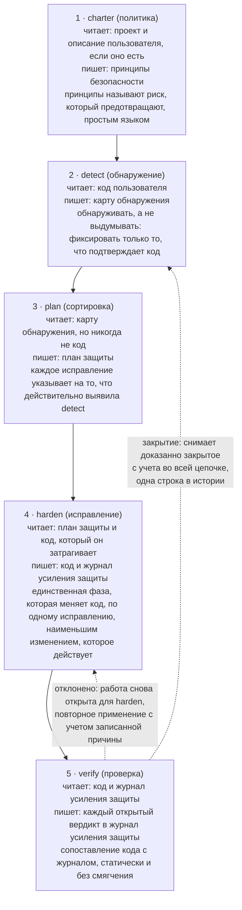
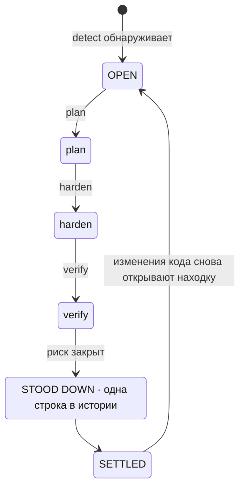
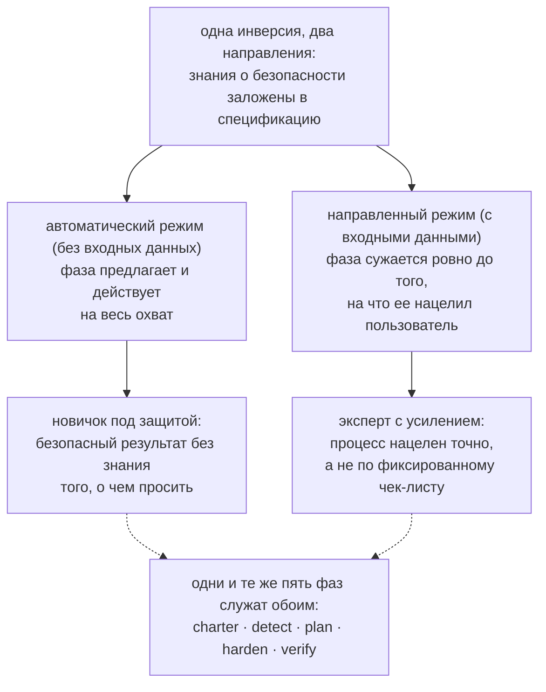
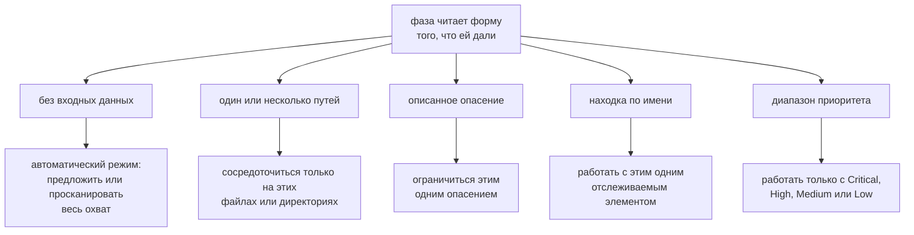
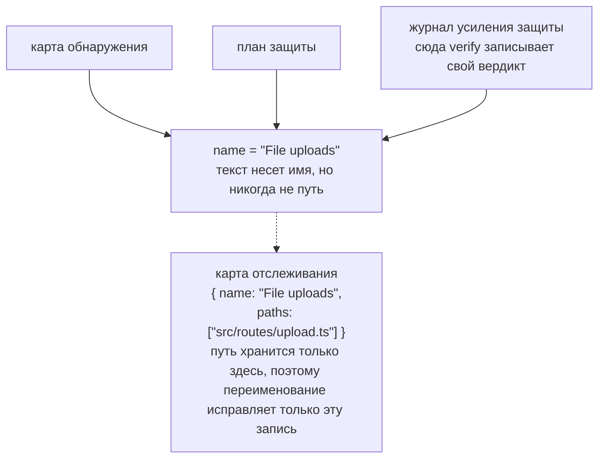
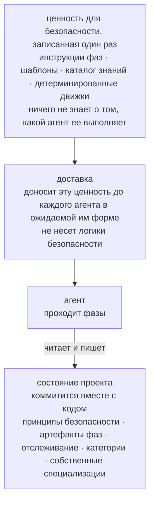
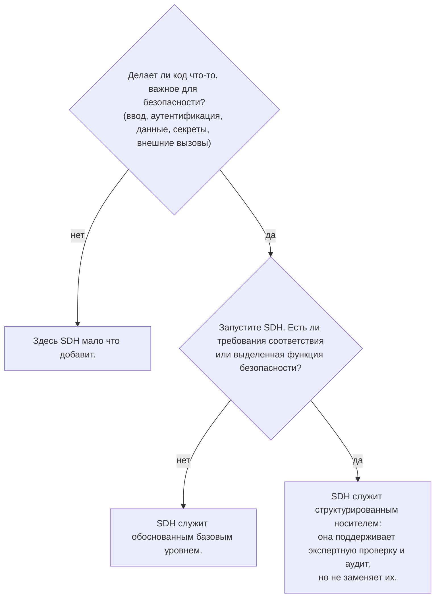

# Security-Driven Hardening: конвенция для эпохи разработки с помощью ИИ

> Методология Security-Driven Hardening (SDH): конвенция Blue Team с учетом контекста для аудита и усиления защиты ПО, созданного с помощью ИИ и в стиле вайб-кодинга.

Канонический URL: https://lagune.ai/ru-RU/docs/references/paper
Язык: ru-RU
Оригинал: https://lagune.ai/docs/references/paper
Последнее обновление: 2026-11-03

- **Weslley Araújo**
- **Статья о методологии, 2026.**

---

## Аннотация

Security-Driven Hardening (SDH) представляет собой структурированную методологию безопасности на основе ИИ, ориентированную только на защиту и созданную для эпохи, в которой программы все чаще пишут ИИ-агенты и люди, не являющиеся специалистами по безопасности. Вместо проверки по общему чек-листу SDH сначала выявляет, что на самом деле делает система (вход в систему, загрузка файлов, платежи, раскрытие данных и так далее), а затем ведет работу по безопасности, характерную именно для этого контекста. Ею управляют принципы безопасности по умолчанию, она целиком построена вокруг защиты и выражена простым языком, чтобы любой пользователь мог действовать на ее основе.

В этом документе утверждается, что SDH представляет собой недостающую конвенцию, а не отдельный инструмент. Знания о безопасности заложены в методологию и ее специализации, загружаемые по запросу, это базовый уровень, на который может опереться любой пользователь, и именно это позволяет обслуживать новичка и эксперта через один и тот же процесс. Два свойства отличают ее от прежних подходов, основанных на спецификации `[1]`. SDH **не зависит от состояния**: она подстраивается под пустую директорию, проект в процессе разработки, отдельный pull request или большую унаследованную кодовую базу на любом стеке. И SDH **закрываема**: риск, проверенный и закрытый, снимается с учета во всем процессе, поэтому находка достигает устойчивого состояния и открывается снова, только когда меняется код. SDH не заменяет специалистов по безопасности или специализированные инструменты Blue Team. Она расширяет собственные знания разработчика, и чем лучше разработчик понимает безопасность, тем больше он может ею управлять.

**Lagune** является эталонной реализацией и доказывает, что методологию можно построить и перенести. SDH предлагается как конвенция, которую могут принять другие.

> **Ключевые слова**
>
> разработка с помощью ИИ, безопасность ПО, защитная безопасность, разработка на основе спецификаций, усиление безопасности, рабочие процессы под управлением агентов, закрываемость, безопасность с учетом контекста, знания по запросу, инструменты, независимые от агента.

---

## I. Введение: брешь в безопасности, которую открыла разработка с помощью ИИ

Программы все чаще выпускают люди и ИИ-агенты, которые не могут надежно распознать небезопасный шаблон: утекший секрет, отсутствующую проверку авторизации, запрос, уязвимый к инъекции. Это не экзотические риски. Они входят в классы рисков, которые преобладают в реальных инцидентах и годами документируются в публичных источниках `[6]`, `[7]`, а недавние исследования сообщают, что заметная доля кода, сгенерированного ИИ, выходит именно с такими дефектами `[8]`. ИИ-ассистенты для программирования обострили проблему, позволив не разработчикам выпускать настоящие программы, но брешь шире любой отдельной аудитории. Большинство проектов так и не проходят проверку безопасности, учитывающую то, что они на самом деле делают. Экосистема становится все более хрупкой с каждым преждевременным решением "работает, выпускаем".

Общие советы по безопасности эту брешь не закрывают. Статический чек-лист не учитывает, что делает система, поэтому заваливает небольшой проект нерелевантными пунктами и все равно упускает риск, важный именно для этого проекта. Проблема не в нехватке знаний о безопасности в мире. Проблема в том, чтобы сопоставить нужные знания с системой, которая на самом деле перед пользователем, и сделать это для того, кто может не знать, о чем спрашивать.

SDH отвечает на это одной инверсией: **знания о безопасности заложены в спецификацию и ее специализации, загружаемые по запросу, это базовый уровень, на который может опереться любой пользователь**. Методология выявляет контекст, сортирует риски, которые этот контекст несет, и направляет исправления, поэтому разработчик и не разработчик проходят один и тот же процесс. Находки и рекомендации остаются на простом языке, поэтому на их основе можно действовать независимо от технической подготовки читателя. Эксперта это не ограничивает, а усиливает, и эту двойственность мы развиваем в `§VI`.

> **Ключевая мысль**
>
> **Основная инверсия:** знания о безопасности заложены в спецификацию и ее специализации, загружаемые по запросу, это базовый уровень, на который может опереться любой пользователь. Методология узнает, что делает система, подбирает под нее работу по безопасности и расширяет то, что пользователь уже знает.

Представьте разработчика, который говорит ИИ-ассистенту: "мое приложение позволяет пользователям загружать фото профиля". Без проверки безопасности ассистент выдает работающий код, который молча доверяет всему, что присылает клиент: заявленному типу файла, имени файла, размеру. Загрузка выходит в продакшен, и файл, замаскированный под изображение, может нести код, специально сформированное имя может вырваться за пределы пути хранения, а слишком большой файл может исчерпать ресурсы сервера. Ничего из этого не видно на демонстрации, поэтому все это выходит в продакшен.

Тот же код, пропущенный через SDH, ведет себя иначе. Методология выявляет, что система принимает файлы извне (detect), сортирует это по рискам, которые несет загрузка (triage), предлагает проверять настоящий тип и размер файла, переименовывать его при сохранении и хранить там, где код не может выполниться (remediate), а затем читает результат и подтверждает, что каждая мера защиты действительно действует (verify). Разработчику не нужно было знать фразу "unrestricted file upload". Методология подставила ее за него.

Этот документ вносит следующий вклад:

- Точное определение SDH как методологии, независимой от какой-либо одной реализации, вместе с ее принципами проектирования (`§III`).
- Пятифазный защитный жизненный цикл, в котором вкладом является само разделение обязанностей: обнаружение никогда не выдумывает, планирование никогда не читает код, только одна фаза меняет код, а проверка никогда не смягчает свое суждение (`§IV`).
- **Закрываемость** как методологическая позиция: у отдельной находки есть конечное состояние, а не бесконечный цикл (`§V`).
- Двойственность **расширителя знаний разработчика**: один процесс, который защищает новичка и усиливает эксперта (`§VI`).
- **Невызываемые специализации и промпт по запросу**: профильные знания о безопасности, которые агент загружает, когда этого требует контекст проекта, и никогда по умолчанию (`§VII`).
- **Независимость от состояния** и **неавторитарная адаптивность**: SDH подходит для любого состояния разработки и подстраивается под сценарий, а не навязывает фиксированный охват (`§VIII`).
- **Превентивный режим**: та же защита, запускаемая во время обычной работы, чтобы код появлялся безопасным по умолчанию, а фазам оставалось меньше исправлять (`§IX`).
- Отдельное сравнение со Spec-Driven Development, линией, из которой SDH выросла и от которой затем отошла (`§X`).
- Инженерные дисциплины, которые позволяют методологии пережить рефакторинг и оставаться независимой от любого агента: отслеживание с идентификацией по имени (`§XI`) и носитель, независимый от агента (`§XII`).

---

## II. Предпосылки и связанные работы

SDH опирается на предшествующие работы. Она наследует проверенную структуру разработки на основе спецификаций под управлением агентов `[1]`, `[2]`, `[3]`: шаблоны, slash-команды, которые потребляет агент, управляющий документ и агента, который проходит фазы. Она реализует эту структуру заново с защитной целью. Эта преемственность сознательна, и один из рабочих принципов SDH прямо ее называет: строить рабочий процесс на проверенной структуре, а затем нацеливать его на безопасность.

SDH не является статическим чек-листом общих рекомендаций. Чек-лист много знает о безопасности в целом и ничего не знает о проекте перед ним. SDH переворачивает этот акцент. Первые усилия она тратит на обнаружение, на то, чтобы узнать, что делает система, и только потом обращается к знаниям, которые это обнаружение делает релевантными.

SDH также не заменяет специалистов по безопасности или специализированные инструменты Blue Team. Она расширяет знания разработчика (`§VI`). Команде с выделенной функцией безопасности стоит ее сохранить. SDH дает такой команде структурированный носитель, а команде без нее дает обоснованный базовый уровень.

SDH также соседствует с детерминированными сканерами безопасности (статический анализ, линтеры) `[4]`, `[5]`. Эти инструменты ценны именно тем, что детерминированы и воспроизводимы. SDH по большей части опирается на рассуждения агента, что меняет строгую детерминированность на учет контекста. Методология не делает вид, что это не так. Там, где важна детерминированность, она встраивает детерминированный движок в рассуждение (`§VII`): агент решает, стоит ли проверять входные данные, а детерминированная программа решает, опасны ли эти данные.

Самый прямой предшественник представляет собой Spec-Driven Development (SDD), семейство методологий на основе спецификаций, которые ведут разработку вперед от исполняемой спецификации. Мы рассматриваем SDD как класс. Наиболее четко она изложена как практическая методология в отчете Piskala `[1]`, ее самый заметный инструментарий под управлением агентов представляет собой Spec Kit от GitHub `[2]`, а OpenSpec `[3]` служит вторым инструментом из того же семейства. Это канонические источники для сравнения в `§X`.

---

## III. SDH: определение и принципы проектирования

**Security-Driven Hardening** представляет собой структурированную методологию безопасности на основе ИИ, которая делает кодовую базу безопаснее, ведя работу по спецификации, которую выполняет агент, а не через разрозненные исправления. Название вдохновлено **Blue Teams**, защитниками в безопасности. SDH посвящена защите, усилению защиты и проверке и никогда не нападению.

> **Определение**
>
> **Security-Driven Hardening (SDH):** структурированная методология безопасности на основе ИИ, ориентированная только на защиту, которая сначала выявляет, что на самом деле делает система, а затем ведет работу по безопасности под этот контекст, следуя принципам безопасности по умолчанию и используя простой язык.

SDH определяется набором обязательных принципов. Каждый из них является правилом, и каждый дает пользователю конкретную гарантию.

| Принцип                                                                  | Правило                                                                                                                                                                                               | Что он гарантирует пользователю                                                                                                                                                     |
| ------------------------------------------------------------------------ | ----------------------------------------------------------------------------------------------------------------------------------------------------------------------------------------------------- | ----------------------------------------------------------------------------------------------------------------------------------------------------------------------------------- |
| Безопасность по умолчанию, простым языком, для всех одинаково            | Каждое значение по умолчанию, сообщение и исправление безопасно сразу и понятно любому читателю, разработчику или нет. Ни один уровень пользователей не имеет преимуществ.                            | Новичок получает безопасный базовый уровень, не прося об этом, и читает результат в понятных ему терминах.                                                                          |
| Учет контекста вместо общих решений                                      | Каждая фаза начинает с контекста, выявленного в detect, и действует исходя из того, что на самом деле делает система.                                                                                 | Рекомендации подходят проекту, а не чек-листу. Знания о безопасности заложены в спецификацию и ее специализации, загружаемые по запросу, и расширяют то, что приносит пользователь. |
| Гибкость вместо жесткости                                                | Принципы, требования и рекомендации служат отправной точкой. Пользователь может переформулировать, убрать, добавить или сузить что угодно.                                                            | Методология подстраивается под проект и пользователя и никогда не бывает жестче, чем хочет пользователь. Гибкость никогда не ослабляет базовый уровень безопасности по умолчанию.   |
| Сверять, а не только дописывать                                          | Артефакты представляют собой живые документы, а не журналы. Каждый запуск перепроверяет каждую запись: сохраняет то, что верно, переписывает то, что изменилось, удаляет то, что больше не применимо. | Запись всегда отражает настоящее, поэтому никогда не превращается в устаревший бэклог.                                                                                              |
| Только защита                                                            | SDH проводит аудит, усиливает защиту и проверяет. Она никогда не создает наступательных инструментов, эксплойтов для злонамеренного использования или способов обхода обнаружения во вред.            | Методологию нельзя превратить в оружие. Материалы двойного назначения появляются только в явно защитном контексте.                                                                  |
| Сначала спецификация, под управлением агента, с прицелом на безопасность | Рабочий процесс строится из шаблонов, команд, управляющих принципов безопасности и агента, который проходит фазы.                                                                                     | Проверенная структура разработки, перепрофилированная так, чтобы основную работу по безопасности выполнял агент.                                                                    |

**Таблица 1.** Принципы проектирования SDH и гарантия, которую каждый из них дает пользователю.

Эти принципы не декоративны. Это ограничения, которые обязана соблюдать каждая из описанных ниже фаз, и обсуждение в `§XV` возвращается к ним, чтобы обозначить пределы методологии.

Остальная часть документа развивает девять именованных опор. Это части, которые читатель должен держать в голове, и части, которые другая команда реализовала бы заново, чтобы утверждать, что она применяет SDH.

| Опора                                                    | Что она дает                                                                                                                               | Раздел      |
| -------------------------------------------------------- | ------------------------------------------------------------------------------------------------------------------------------------------ | ----------- |
| Инверсия с учетом контекста                              | Знания о безопасности заложены в спецификацию и ее специализации, загружаемые по запросу, поэтому новичок и эксперт проходят один процесс. | `§I`, `§VI` |
| Пятифазный защитный жизненный цикл                       | Разделение обязанностей: политика, обнаружение, сортировка, исправление, проверка, у каждой одна задача.                                   | `§IV`       |
| Закрываемость                                            | У находки есть конечное состояние, а не бесконечный цикл. Закрытая работа снимается с учета.                                               | `§V`        |
| Двойственность расширителя знаний разработчика           | Один процесс, который защищает новичка и усиливает эксперта, никого из них не заменяя.                                                     | `§VI`       |
| Промпт по запросу, невызываемые знания                   | Нужные знания о безопасности загружаются под то, чем является проект, и никогда по умолчанию.                                              | `§VII`      |
| Независимость от состояния и неавторитарная адаптивность | Подходит для любого состояния разработки на любом стеке и подстраивается под сценарий, а не навязывает охват.                              | `§VIII`     |
| Превентивный режим                                       | Та же защита работает во время создания новой работы, поэтому код появляется безопасным по умолчанию.                                      | `§IX`       |
| Отслеживание с идентификацией по имени                   | Находка остается одним элементом во всех фазах, а переименование ломает связь в одном месте.                                               | `§XI`       |
| Носитель, независимый от агента                          | Ценность для безопасности записана один раз и не зависит ни от агента, ни от стека.                                                        | `§XII`      |

**Таблица 2.** Девять именованных опор SDH и раздел, где развивается каждая.

---

## IV. Пятифазный процесс Blue Team

SDH выстраивает работу как пятифазный защитный жизненный цикл (рисунок 1). Каждая фаза построена вокруг защиты, каждая опирается на предыдущую, и фазы повторяют реальную деятельность Blue Team: установить политику, обнаружить, отсортировать, исправить, проверить.



**Рисунок 1.** Пятифазный процесс: что читает каждая фаза, что она пишет и на каком инварианте держится. Verify управляет обоими возвратами: отклоненная мера защиты снова открывает harden, а доказанно закрытая находка снимается с учета во всей цепочке, оставляя одну строку в истории.

Вкладом является само разделение обязанностей. Поскольку у каждой фазы одна задача, сбой ограничен одним местом, и читатель может доверять тому, что утверждает каждый артефакт.

> **Ключевая мысль**
>
> **Применено не значит проверено:** harden фиксирует, что исправление применено. Verify проверяет его, сопоставляя код с этой записью, и вердикт никогда не смягчается ради соответствия записи. Мера защиты может присутствовать в коде и все равно оставлять риск достижимым, и тогда честный вердикт: "риск не закрыт".

### charter (политика)

Charter задает принципы безопасности проекта, правила, которые обязана соблюдать каждая следующая фаза. Это управляющий уровень, своего рода проверка во время компиляции для уровня защищенности проекта. У каждого принципа есть понятное название, обязательное правило, которое можно проверить по коду, и строка `Why:`, называющая риск, который он предотвращает, а не только исправление. Charter всегда читает сам проект (его манифесты, структуру и зависимости), а описание пользователя, если оно есть, служит направлением, которое чтение затем расширяет за пределы названного пользователем. Без описания единственным источником остается проект. Эти два источника дополняют друг друга, а не соперничают, и charter фиксирует политику, которой должен придерживаться проект, а не состояние его кода. Не разработчик должен суметь прочитать его и понять и правило, и риск.

### detect (обнаружение)

Detect читает код и выявляет, что на самом деле делает система такого, что имеет вес с точки зрения безопасности. Главное правило: "обнаруживать, а не выдумывать": фиксировать только то, что подтверждает код, со свидетельствами, которые нужны следующим фазам. Detect нейтральна. Она не подгоняет свои находки под принципы безопасности, потому что сопоставлять риски с правилами принципов безопасности должна фаза plan. Каждая находка состоит из трех частей: что это такое (описание простым языком), почему это важно (риск, а не только факт) и свидетельство (функция или маршрут, где она находится). Свидетельство не содержит пути к файлу. Путь хранится только в карте отслеживания (`§XI`), поэтому в тексте никогда нет пути, который может устареть.

### plan (сортировка)

Plan превращает каждую находку в исправление, названное по классу риска (со ссылкой на признанные источники, CWE и OWASP, там, где они его обосновывают) и привязанное к принципу безопасности, который это исправление поддерживает. Приоритет (Critical, High, Medium, Low) не выбирается произвольно: plan оценивает каждую находку по методу CVSS v4.0 с метриками Base и Environmental, поэтому диапазон представляет собой оценку простыми словами, обоснованную одной строкой простым языком об открытости и ставках, и два запуска дают одинаковый порядок. Вектор служит точной опорой для эксперта, а диапазон и его обоснование представляют ту же оценку в виде, понятном любому. Plan работает только с картой обнаружения и никогда не читает код. Это сознательное ограничение, а не недостаток: оно заставляет каждое исправление указывать на то, что detect действительно обнаружила. Если какой-то охват так и не был выявлен, plan останавливается и отправляет пользователя обратно к detect, а не гадает.

### harden (исправление)

Harden является единственной фазой, которая меняет код, поэтому действует осторожно. Нужно ли одобрение пользователя для правки, решает агент и режим разрешений, в котором он работает, поэтому harden не добавляет собственного шага подтверждения. Она применяет исправления по одному, сначала зависимости, затем самый высокий приоритет, чтобы каждое изменение оставалось небольшим, проверяемым и легко отменяемым. Она никогда не ослабляет существующую меру защиты, чтобы вписать новое исправление, и никогда не нарушает принцип безопасности. Если исправление противоречит принципу, harden останавливается и сообщает о конфликте, а не применяет его. Каждый блок фиксируется как Applied, Partial или Blocked. "Применено еще не значит проверено", и именно этим занимается следующая фаза.

### verify (проверка)

Verify проверяет каждую примененную меру защиты, читая код и сопоставляя его с тем, что зафиксировала harden. Проверкой служит само это сопоставление кода с журналом, и оно статично: оно подтверждает, что мера защиты присутствует в коде и реализована правильно, а не то, что она выдерживает атаку на работающей системе. Такая проверка во время выполнения, при которой против работающей системы запускаются реальные или имитированные атаки, намеренно находится вне охвата. Verify выносит один из трех вердиктов: риск закрыт, риск не закрыт или по коду определить нельзя. Собственного артефакта она не создает: harden и verify делят журнал усиления защиты, harden владеет тем, что сделано, а verify вердиктом и его причиной, и ни одна из них никогда не пишет в поля другой. Отклоненная мера защиты становится снова открытой работой для harden, которая при следующем запуске считает вердикт приоритетнее собственного прочтения кода и применяет исправление заново, нацеливаясь ровно на тот пробел, который называет причина. Verify доверяет коду больше, чем журналу, потому что журнал может заявлять больше, чем дает код. Код пользователя она только читает и никогда не смягчает вердикт ради соответствия журналу. Мера защиты может присутствовать и все равно оставлять риск достижимым другим путем, и в этом случае честный вердикт: "риск не закрыт". Если при чтении verify замечает проблему безопасности, которую карта обнаружения так и не охватила, она не выдумывает для нее вердикт, поскольку обнаружение относится к задачам detect: она сообщает о проблеме и отправляет пользователя обратно к detect, чтобы находка вошла через тот же процесс, а не в обход него.

> **Сквозной пример: загрузка файлов.** Одна находка показывает весь путь от начала до конца.
>
> - **detect** находит ее: система принимает файлы от пользователей, а обработчик загрузки доверяет MIME-типу, который присылает клиент, не проверяя настоящий тип файла. _Почему это важно:_ файл, замаскированный под изображение, может скрывать вредоносный код.
> - **plan** определяет исправление с приоритетом **Critical**, поддерживающее принцип "Любой ввод считается недоверенным, пока не проверен": проверять настоящий тип и размер файла, переименовывать его при сохранении и хранить загрузки там, где их нельзя выполнить как код.
> - **harden** применяет его со статусом **Applied**: теперь обработчик определяет настоящий тип по содержимому, ограничивает размер, отклоняет все неожиданное, переименовывает файл при сохранении и хранит его там, где код не может выполниться.
> - **verify** читает обработчик, сопоставляет его с журналом и выносит вердикт **риск закрыт**: код делает ровно то, что заявлено в журнале.
>
> Одно и то же имя находки проходит через карту обнаружения, план и журнал усиления защиты, и verify работает с этим журналом под тем же именем: открытый вердикт записывается в блок находки, а доказанно закрытая находка снимается с учета (`§V`). Это общее имя служит ее идентификатором (`§XI`).

---

## V. Закрываемость: у находки есть конечное состояние

Большинство инструментов безопасности оставляют пользователю бэклог, который только растет. SDH занимает другую позицию: **находка закрываема, поэтому у нее есть конечное состояние, а не жизнь в бесконечном бэклоге** (рисунок 2). Это прямо следует из принципа сверки.

> **Определение**
>
> **Закрываемость:** риск, проверенный и закрытый, снимается с учета во всем процессе, поэтому находка достигает устойчивого состояния и открывается снова, только когда меняется код. У находки есть конечное состояние, хотя сама программа безопасности остается непрерывной.

Артефакты SDH представляют собой живые документы, а не журналы событий. Каждый раз, когда фаза запускается заново, она перепроверяет каждую существующую запись по текущему положению дел и делает одно из трех: сохраняет то, что по-прежнему верно, переписывает то, что изменилось, или удаляет то, что больше не применимо. Находка, которая по коду теперь устранена, просто удаляется. Рабочая запись отражает настоящее, а не прошлое.

Закрытие представляет собой ту же сверку, дошедшую до завершения. Когда verify проверяет, что риск закрыт, она снимает находку с учета во всем процессе: в карте обнаружения, плане, журнале усиления защиты и карте отслеживания. Именно поэтому verify является единственной фазой, которая пишет в артефакты других фаз: это фаза, замыкающая цикл. Когда находка покидает цепочку, снятие с учета сводит ее к короткой записи в журнале истории, который находится вне рабочей цепочки и никогда не обрабатывается повторно. В этом граница между исчезновением и закрытием: находка, которую сверка удалила, потому что она перестала быть верной, ничего после себя не оставляет, а доказанно закрытая находка заслуживает строку в истории. Снятая с учета находка затем отсутствует во всех рабочих артефактах, и это отсутствие ожидаемо, а не признак сломанной цепочки.



**Рисунок 2.** Конечный автомат закрываемости. Находка проходит путь OPEN → STOOD DOWN → SETTLED и открывается снова, только когда меняется код.

Когда все в пределах охвата снято с учета, цикл приходит в устойчивое состояние, и у этого состояния есть конкретная форма: артефакт, последняя находка которого закрыта, удаляется целиком, поэтому полностью закрытая цепочка оставляет только принципы безопасности и историю, политику и доказательство. Цикл открывается снова, только когда меняется код. Методология дает каждой находке определенный конец, а именно этого не может дать бесконечный бэклог.

---

## VI. Двойственность расширителя знаний разработчика

SDH не заменяет людей и не заменяет специализированные инструменты Blue Team. Она **расширяет собственные знания разработчика**. Чем лучше разработчик понимает безопасность, тем точнее он может управлять процессом и тем больше у него автономии. Разработчик, который понимает мало, все равно получает безопасный результат, потому что его оберегает автоматический режим.

Инверсия из `§I`, согласно которой знания о безопасности заложены в спецификацию, действует в обе стороны. Для новичка это защита: ему не нужно знать, о чем просить, потому что спецификация предлагает сама. Для эксперта это усиление: та же спецификация позволяет ему точно нацеливать процесс, а не бороться с фиксированным чек-листом.

Каждая фаза несет эту двойственность в собственной работе (рисунок 3). Запущенная без входных данных, она действует на весь охват от имени пользователя. Получив направление, та же фаза сужается ровно до того, на что ее нацелил пользователь.



**Рисунок 3.** Двойственность расширителя знаний разработчика. Одна инверсия служит двум аудиториям: автоматический режим защищает новичка, а направленный режим усиливает эксперта, через одни и те же пять фаз.

Специализации, загружаемые по запросу (`§VII`), делают эту двойственность явной в собственном тексте. Каждая из них говорит агенту, что ее знания "расширяют твое суждение", и велит продолжать рассуждать за пределами того, что дает специализация. Знания служат полом, а не потолком. Именно это обслуживает обе аудитории в том балансе, на который рассчитан документ: сообщество разработчиков получает весомый инструмент, а практик Blue Team получает структурированный носитель, который не делает вид, что выполняет его работу за него.

---

## VII. Невызываемые специализации и промпт по запросу

Это самый новаторский шаблон методологии. SDH несет профильные знания о безопасности в виде специализаций, которые загружаются **только по запросу**, и агент сам решает, какие загрузить, сопоставляя их с контекстом проекта. Мы называем это **промптом по запросу**: способом, которым агент выбирает, какие знания активировать, исходя из охвата проекта, в котором он находится, вместо того чтобы запускать все проверки по умолчанию. Специализации эволюционируют, и любую из них можно в любой момент изменить или заменить. Вкладом является шаблон, а не сами специализации.

> **Определение**
>
> **Промпт по запросу:** агент выбирает, какие знания о безопасности активировать, сопоставляя их с охватом проекта перед ним, поэтому нужные знания подключаются под то, чем проект является на самом деле, а не все проверки запускаются по умолчанию.

> **Определение**
>
> **Невызываемая специализация:** профильная единица знаний о безопасности, независимая от языка, для одного контекста, например загрузки файлов или кода, выполняемого в браузере. Она проводит аудит и объясняет, никогда не переписывает код и никогда не создает атакующих входных данных. Это не команда: она загружается, когда охватываемый ею контекст находится в пределах охвата, или когда промпт просит ее по имени.

Каждая специализация называет более безопасные формы для рисков, которые охватывает, и говорит агенту, как действовать с находкой в каждой фазе, которая ее использует: как оценить ее при обнаружении, как безопасно применить исправление при исправлении и как доказать его при проверке.

Определяющая черта специализации в том, что она **сама по себе невызываема**: это не команда, и внутри процесса ее загружает совпадение. Фаза обнаружения один раз получает каталог, сопоставляет контекст проекта с тем, что охватывает каждая запись, и загружает только специализации, чей контекст присутствует в пределах охвата. Следующие фазы повторно используют этот подобранный список, а не получают каталог заново, поэтому одно сопоставление служит всей цепочке, а превентивный режим (`§IX`) выполняет то же сопоставление для работы, которую предстоит создать. Специализация, чей контекст отсутствует, пропускается, и за пропуск отвечают так же, как за загрузку: каждая запись в каталоге получает явный вердикт, применена или пропущена, с причиной, прочитанной из кода, поэтому смутное ощущение нерелевантности никогда не подменяет отсутствие. Не найти ни одной применимой специализации тоже допустимый результат.

Каталог представляет собой данные, и рост означает один файл знаний плюс одну строку каталога, а не новую команду. Встроенные специализации сгруппированы по категориям, таким как OWASP, язык или интеграции с ИИ, а каталог, который использует проект, содержит встроенные специализации выбранных категорий плюс собственные специализации проекта. Проект фиксирует этот выбор вместе с остальным своим состоянием, поэтому вся команда сопоставляет код с одним и тем же каталогом. Это тот же принцип учета контекста, что и у фаз, примененный к знаниям: нужные знания подключаются под то, чем проект является на самом деле, а не все проверки запускаются по умолчанию. То же свойство позволяет пополнять каталог не только мейнтейнеру, но и пользователю: источник или тема по безопасности, которые дает пользователь, превращаются в новую специализацию, принадлежащую проекту, которая попадает в его каталог при любых категориях и загружается точно так же, как встроенная, заменяя встроенную с тем же именем. Создание специализации само по себе ориентировано только на защиту и подчиняется той же границе, которую соблюдают специализации: разбор атаки может быть источником, но полученная специализация проводит аудит и объясняет и никогда не выдает работающий эксплойт. Так инверсия из `§I`, согласно которой интеллект живет в спецификации, распространяется на сам каталог, который пользователь может углублять под свой контекст, не написав ни строки кода.

Промпт по запросу хорошо показывает короткий пример. Detect читает папку с кодом, который выполняется в браузере. Она находит этот контекст в каталоге, загружает специализацию, которая его охватывает, и выводит находку на стороне клиента через обычные шаги detect. Специализации, чей контекст в этом охвате отсутствует, не совпадают, поэтому никогда не загружаются, и каждая из них фиксируется как пропущенная. Какие знания релевантны, решил проект, а не фиксированная конфигурация.

Детерминированность появляется именно там, где она важна. Специализация может нести детерминированную проверку, а не только текст: там, где у класса рисков есть четкая процедура принятия решения, небольшая программа возвращает фиксированный вердикт для заданных входных данных, например одно из короткого набора слов, такого как `safe`, `unsafe` или `invalid input`. Некоторые классы рисков детерминированно разрешимы именно таким образом, и за процедурой принятия решения стоит корпус предшествующих работ `[9]`, `[10]`, `[11]`. Проверка либо оценивает кандидатов, которых предоставляет агент, либо сама сканирует охват, чтобы их найти, и в обоих случаях вердикт возвращает проверка, а не агент. Достаточно универсальную специализацию можно пометить в каталоге как обязательную, и тогда она применяется всегда, а ее проверка запускается по всему охвату. Это единственный случай, когда знания загружаются без совпадения контекста, и он объявлен в данных каталога, а не решается агентом в моменте. Именно здесь SDH закрепляет рассуждения агента на чем-то воспроизводимом, не делая вид, что весь процесс детерминирован.

Наконец, специализации **отделяемы**. Поскольку знания самодостаточны, пользователь может запустить специализацию напрямую в промпте, который никак не связан с полным процессом SDH, сохраняя безопасность рядом с обычной разработкой. Специализация с детерминированной проверкой может, например, отсеивать каждого кандидата, созданного во время обычного программирования, и оставлять только безопасных. Эта отделяемость отчасти объясняет, почему SDH подстраивается под столько ситуаций, о чем идет речь в `§VIII`, а наиболее полно она выражена в превентивном режиме (`§IX`), где те же знания охраняют обычную разработку от начала до конца.

---

## VIII. Независимость от состояния и неавторитарная адаптивность

Два свойства отличают SDH от жестких методологий на основе спецификаций.

### Независимость от состояния

> **Определение**
>
> **Независимость от состояния:** методология не зависит от состояния разработки. Она подходит для пустой директории, проекта в процессе разработки, отдельного pull request или большой унаследованной кодовой базы на любом стеке, потому что узнает отправную точку, читая ее.

Каждая фаза работает одинаково, будь проект совсем новым или уже существующим. Charter выводит принципы из любого присутствующего кода. Detect выявляет то, что есть в коде, даже если кода совсем мало. Никакой предполагаемой отправной точки нет.

### Неавторитарная адаптивность

> **Определение**
>
> **Неавторитарная адаптивность:** методология подстраивается под сценарий, а не навязывает фиксированный охват, которому пользователь обязан следовать. Когда пользователь не знает, что сказать, она читает окружение, в котором ее вызвали, формирует контекст и задает вопросы, определяющие ее дальнейшие действия.

Самый наглядный случай представляет собой режим предложения в charter: SDH выводит безопасные по умолчанию принципы безопасности, анализируя проект, спрашивает пользователя только тогда, когда пробел действительно меняет результат, затем записывает их и представляет каждый принцип простым языком вместе с риском, который он предотвращает. Принципы безопасности служат живым документом, который пользователь перерабатывает повторными запусками, а не контрактом, закрытым за запросом одобрения, поэтому от пользователя никогда не требуется знать, о чем просить.

Эта адаптивность проявляется как чувствительность к форме входных данных: одна и та же фаза читает то, что ей дали, и выбирает режим (рисунок 4). Файл в промпте, находка из списка, опасение, целенаправленная миссия против известного слабого места или просьба о полном сканировании методом перебора: каждый вариант отвечает потребности пользователя, потому что процесс неавторитарен по замыслу. Ничто из этого не ослабляет базовый уровень безопасности по умолчанию. Гибкость определяет, как применяется базовый уровень, но никогда его не понижает.



**Рисунок 4.** Неавторитарная адаптивность. Одна и та же фаза читает форму своих входных данных и выбирает режим, поэтому охват всегда принадлежит пользователю и никогда не навязывается.

---

## IX. Универсальный превентивный режим: та же защита во время создания работы

SDH несет один дополняющий режим: обычную разработку, во время которой при написании кода активна та же защита. Пользователь просит саму работу, страницу входа, загрузку, эндпоинт, а методология охраняет разработку по ходу дела, поэтому результат безопасен по умолчанию с момента появления, а не после более позднего прохода по усилению защиты.

> **Определение**
>
> **Превентивный режим:** обычная разработка, идущая под управляющим уровнем и знаниями SDH. Принципы безопасности связывают разработку, специализации, релевантные тому, что предстоит создать, загружаются по запросу, а результат сопоставляется ровно с той защитой, которая использовалась, прежде чем работа будет признана завершенной.

Режим повторно использует каждую часть, которую уже несут фазы, направляя ее на код, которого еще не существует. Выявление контекста переходит от кода к намерению: агент продумывает, что он собирается создать и какие границы пересекает эта работа (вход в систему подразумевает учетные данные, сессию и ввод извне), и именно с этим рассуждением сопоставляется каталог знаний. Промпт по запросу (`§VII`) здесь обобщается: контекст можно выявить в плане кода, а не только в уже существующем коде. Принципы безопасности управляют, как всегда, а просьба, которая нарушила бы принцип, выводится как конфликт и никогда не реализуется. Защита применяется прямо по ходу, в момент написания каждой части: проверка на границе и выбор безопасной конструкции с первого раза, поэтому работающей, но небезопасной версии, которую пришлось бы исправлять, просто не возникает.

Режим заканчивается так, как начинается verify. Прежде чем работа будет признана завершенной, создатель сопоставляет собственный результат с использованной защитой: мера защиты должна стоять на пути риска, а не рядом с ним, она должна быть полной, а там, где специализация несет детерминированную проверку, вердикт проверки ставится выше собственного прочтения агента. Найденный здесь пробел закрывается в рамках той же работы, потому что закончить работу значит закончить ее безопасно.

То, от чего режим отказывается, так же продуманно, как то, что он делает. Он создает только то, о чем просили, и ничего вокруг не проверяет: аудит существующего относится к фазам. Он не пишет артефактов и не отслеживает находок, потому что находка представляет собой риск, обнаруженный в существующем, а цель этого режима в том, чтобы небезопасная версия вообще не появилась. Два направления дополняют друг друга: фазы закрывают то, что уже есть (`§V`), а превентивный режим не дает новой работе открыть это снова. Цепочка в состоянии покоя остается в покое не потому, что разработка остановилась, а потому, что все, что создается, пока она в покое, создается под защитой.

---

## X. Security-Driven Hardening и Spec-Driven Development

Security-Driven Hardening (SDH) выросла на основе Spec-Driven Development (SDD), а затем резко отошла от нее. Структурное наследие реально и признано: спецификация на первом месте, управление агентом, управляющий документ и набор поэтапных команд, которые выполняет агент. SDH сознательно повторно использует эту структуру. Различаются цель, модель полномочий, предполагаемое состояние и условие завершения. Мы рассматриваем SDD как класс, используя отчет Piskala `[1]` как каноническое изложение методологии, Spec Kit от GitHub `[2]` как канонический инструментарий для агентов, а OpenSpec `[3]` как второй инструмент из того же семейства.

SDD переворачивает традиционную разработку, делая спецификации исполняемыми: спецификация напрямую порождает работающую реализацию, а не просто направляет ее `[1]`. Ее набор фаз ведет разработку вперед `[2]` (установить управляющие принципы, описать, что создавать, спланировать технологический стек, разбить план на задачи, затем реализовать). Ее управляющий документ, конституция принципов, представляет собой основу, которой агент обязан придерживаться на протяжении всей работы. В этом суть различия. Полномочия SDD текут от спецификации к разработке, и от реализации ожидается, что она будет ей следовать.

SDH переворачивает почти каждую ось этого контракта (таблица 3).

> **Ключевая мысль**
>
> **Главное различие:** полномочия SDD текут от спецификации к разработке, и от реализации ожидается, что она будет ей следовать. SDH неавторитарна и течет в обратную сторону, внутрь от выявленного контекста системы, усиливая защиту того, что уже есть.

| Ось                       | SDD                                                                                                       | SDH                                                                                                                              |
| ------------------------- | --------------------------------------------------------------------------------------------------------- | -------------------------------------------------------------------------------------------------------------------------------- |
| Цель                      | Поставлять функции. Спецификация становится работающей реализацией.                                       | Усиливать защиту того, что существует или создается. Каждая фаза построена вокруг защиты.                                        |
| Модель полномочий         | Авторитарная. Спецификация и конституция ограничивают разработку охватом, которому она обязана следовать. | Неавторитарная. SDH подстраивается под сценарий, а пользователь может переформулировать, убрать или сузить охват.                |
| Предположение о состоянии | Разработка вперед от спецификации.                                                                        | Независимость от состояния: пустая директория, проект в процессе разработки, отдельный PR или унаследованный код.                |
| Условие завершения        | Заканчивается, когда функция создана.                                                                     | Закрываемость. Находка достигает устойчивого состояния и открывается снова, только когда меняется код.                           |
| Управляющий документ      | Конституция принципов, которой агент обязан придерживаться.                                               | Принципы безопасности, сформулированные через риски (у каждого есть строка `Why:`), явно не фиксированный контракт.              |
| Как растут знания         | Добавить команду (или расширить набор фаз).                                                               | Добавить невызываемую специализацию, которую агент загружает по запросу: один файл плюс одна строка каталога, без новой команды. |
| Кому служит               | Тому, кто создает функцию и ведет ее вперед.                                                              | Любому пользователю, разработчику или нет, через один и тот же процесс.                                                          |
| Что меняет код            | Фаза реализации порождает сборку.                                                                         | Код меняет только фаза harden, по одному исправлению.                                                                            |

**Таблица 3.** SDD и SDH по восьми осям. Заимствованная структура, перевернутый контракт.

Справедливости ради по отношению к истокам: SDD является проверенной предшествующей работой, и SDH обязана ей структурой, на которой работает. Расхождение не является критикой SDD, которая хорошо решает другую задачу (разработку вперед). SDH берет тот же проверенный механизм и направляет его на защиту, адаптивность и закрытие. OpenSpec `[3]`, построенный вокруг предложений изменений, списков задач и спецификаций для каждого изменения, подтверждает шаблон: семейство ведет разработку вперед от спецификации, а SDH усиливает защиту системы внутрь от ее выявленного контекста. Даже превентивный режим SDH (`§IX`), единственное место, где она сопровождает разработку вперед, сохраняет перевернутый контракт: он управляет тем, как создается работа, и никогда не решает, что создавать.

---

## XI. Инженерная строгость: дисциплина отслеживания

Дисциплине "сверять, а не дописывать" (`§V`) нужна основа, которая переживает рефакторинг. Находка должна оставаться одним элементом во всех фазах, которые с ней работают, а переименованный или перемещенный файл не должен ломать цепочку. SDH решает это с помощью **идентификации по имени** и **путей, которые хранятся только в отслеживании**.

> **Определение**
>
> **Идентификация по имени:** идентификатор находки представляет собой ее имя, записанное одинаково в каждом артефакте. Текст несет имя, но никогда не путь. Пути к файлам хранятся только в карте отслеживания, поэтому переименование или перемещение файла ломает связь ровно в одном месте.

Каждая находка detect представляет собой один отслеживаемый элемент. Его идентификатор представляет собой **имя**, заголовок раздела, записанный одинаково в карте обнаружения, плане и журнале усиления защиты. Следующие фазы дословно повторяют это имя, работая с тем же элементом, а verify записывает свой вердикт в журнал усиления защиты под тем же именем. Карта отслеживания хранит отслеживание и ничего больше, по одной записи на элемент:

```json
{ "name": "File uploads", "paths": ["src/routes/upload.ts"] }
```

Карта не хранит ни текста, ни аннотаций, ни отдельного идентификатора, ни фазы. Текстовые артефакты несут формулировки, а карта несет только идентификатор и пути. Пути к файлам представляют собой единственное изменчивое, и они хранятся только здесь. Переименование или перемещение файла может сломать связь ровно в одном месте, а не в двух расходящихся копиях.



**Рисунок 5.** Конвейер идентификации. Одно имя находки проходит через каждый артефакт, а ее путь хранится только в карте отслеживания, поэтому переименование исправляется в одном месте.

В обычном процессе карту поддерживают два действия, а третье стоит особняком как обслуживание. **Track** выполняет регистрацию с добавлением: фаза сообщает о находках, которые записала, а движок фиксирует новые и для остальных следует за переименованным путем, классифицируя каждую как новую, перемещенную или неизменную. Он никогда не удаляет ничего, о чем фаза не сообщила. **Untrack** снимает с учета находки, которые закрыла verify: за один детерминированный проход сводит каждую к записи в истории, удаляет весь ее раздел из артефактов, удаляет артефакт, последняя находка которого исчезла, и убирает ее запись отслеживания, поэтому агенту не приходится делать ничего из этого вручную. Там, где детерминированный проход не может безопасно действовать, например когда имя снятой с учета находки все еще цитируется в тексте другой находки, он помечает это место для агента, а не гадает с правкой. Эти два действия фазы вызывают по ходу работы. **Repair** представляет собой действие по обслуживанию: фаза автоматически делегирует ему работу, когда ее собственная сверка находит отслеживание несогласованным (записанный путь больше не существует), а в остальных случаях его запускают по требованию. Он выравнивает всю карту сразу, читая каждый артефакт и текущий код, исправляя пути каждого элемента и выводя то, что не может решить сам: сироту (отслеживаемый элемент, который больше не называет ни один артефакт) или кандидата на переименование (элемент, пути которого совпадают с другим сообщенным именем).

Repair является обслуживанием, а не шестой фазой. Он не трогает ни код пользователя, ни текстовые артефакты, только отслеживание. Исходный код пользователя он читает только по одной причине: чтобы узнать новый путь переименованного файла, и никогда не пишет содержимое о безопасности. Последнее слово остается за человеком в том единственном вопросе, в котором движок отказывается гадать: была ли исчезнувшая находка устранена или просто переименована. Лучше спросить, чем гадать, потому что ошибочно удаленный элемент ломает цепочку.

Методология применяет собственную защитную дисциплину к самой себе. Детерминированные движки вызываются как программы командной строки, и каждое входное значение передается отдельным аргументом процесса, что делает его инертным, поэтому значение с кавычками или обратными кавычками никогда не может внедриться в команду. Неизвестная проверка завершается ошибкой, а не отвечает, поэтому проверка с опечаткой в имени никогда не выглядит как чистый результат. SDH не освобождает собственную инфраструктуру от принципа безопасности по умолчанию.

---

## XII. Носитель: архитектура, независимая от агента, как доказательство переносимости

Чтобы SDH стала конвенцией, которую принимают другие, она не должна быть привязана к одному агенту или одному стеку, поэтому ее носитель разделяет три области ответственности (рисунок 6). Lagune доказывает, что это достижимо.

**Ценность для безопасности** записана один раз и ничего не знает о том, какой агент ее выполняет: инструкции фаз и шаблоны, которые они заполняют, каталог знаний и детерминированные движки. **Доставка** тонкая: ее единственная задача в том, чтобы донести эту ценность до конкретного агента в той форме и в то место, которые агент ожидает, и собственной логики безопасности она не несет. **Состояние проекта** принадлежит проекту: принципы безопасности, артефакты фаз, карта отслеживания, выбранные категории и собственные специализации, которые коммитятся и проверяются, как любая другая часть его кода.



**Рисунок 6.** Носитель, независимый от агента. Ценность для безопасности записана один раз, тонкая доставка доносит ее до каждого агента, а состояние остается за проектом.

Поскольку доставка не несет логики безопасности, то, как она построена, ничего не меняет в SDH. Носитель может построить доставку сам или передать ее экосистеме, которая уже распространяет навыки для агентов, как это делает эталонная реализация, и фазы, их артефакты и их гарантии остаются прежними. Ничто из этого не привязано и к языку или среде выполнения. Эталонная реализация написана на одном конкретном стеке, но методология определяется границей между этими областями ответственности, а не инструментарием, которым они построены. Тот же замысел можно было бы заново реализовать на совсем другом языке, не меняя того, чем является SDH.

---

## XIII. Сквозной случай: SDH от начала до конца

> **Сквозной случай**
>
> **Защитное усиление поверхности загрузки и администрирования.**
> **Контекст:** небольшое приложение, которое принимает загрузку файлов от пользователей и показывает их на странице администратора.
> **Схема:** charter → detect (со знаниями по запросу, активированными контекстом) → plan → harden → verify, с одним закрытием и одним настоящим провалом.
> **Результат (возможности):** один риск проверен как закрытый и снят с учета во всей цепочке, а одна мера защиты проверена как _не_ закрытая и отправлена обратно к harden. Вердикт отражает код, а не журнал.

_Это наглядный пример работы механизмов методологии, а не исследование с полевыми измерениями, и метрик эффективности в нем нет._

Один непрерывный разбор показывает методологию в действии, а не только ее части. Мы продолжаем сквозной пример с загрузкой файлов из `§IV`, добавляя активацию знаний по запросу и закрытие, и включаем один настоящий провал.

1. **charter** предлагает принцип "Любой ввод считается недоверенным, пока не проверен" с описанием риска простым языком: непроверенный ввод представляет собой самый распространенный способ взломать систему.
2. **detect** сканирует маршрут загрузки и небольшую страницу администратора, на которой перечислены загруженные файлы. Она обнаруживает находку загрузки (обработчик доверяет MIME-типу от клиента). Страница администратора выполняется в браузере, а этот контекст распознает промпт по запросу (`§VII`), поэтому detect загружает специализацию для этого контекста и выводит вторую находку: место, где имя файла записывается на страницу как разметка, а не как текст, поэтому специально сформированное имя может выполниться как скрипт в браузере посетителя. Специализации, чей контекст в этом охвате отсутствует, никогда не загружаются, и каждый пропуск фиксируется вместе с отсутствием, прочитанным из кода.
3. **plan** присваивает исправлению загрузки приоритет Critical и привязывает его к принципу: проверять настоящий тип и размер файла, переименовывать его при сохранении, хранить там, где код не может выполниться. Второму исправлению она присваивает приоритет High: выводить имя файла как текст, а не как разметку.
4. **harden** сначала применяет исправление загрузки (наивысший приоритет) и фиксирует его как Applied, а затем второе, тоже Applied.
5. **verify** читает каждое место и сопоставляет код с журналом. Мера защиты загрузки действует: обработчик определяет настоящий тип по содержимому, ограничивает размер и отклоняет все остальное. Вердикт: риск закрыт. Verify снимает находку загрузки с учета во всей цепочке, а ее краткая сводка попадает в историю.

Затем следует настоящий провал. Предположим, что второе исправление harden добавило безопасную функцию вывода текста, но оставило старый вызов, записывающий разметку, достижимым по другому пути в коде. Verify читает страницу, видит безопасную функцию, а также видит, что небезопасный путь все еще работает. Мера защиты присутствует, но риск не закрыт. Verify отказывается смягчать вердикт ради соответствия журналу. Она выносит вердикт "риск не закрыт", фиксирует пробел и указывает обратно на harden. Мера защиты, которая не устраняет риск полностью, не считается пройденной.

Таков характер методологии в одном примере: обнаружение с учетом контекста, исправления с приоритетами, привязанные к принципам, аккуратное применение и проверка, которая сообщает фактическое состояние кода независимо от журнала.

---

## XIV. Когда использовать SDH и ее пределы

SDH редко бывает избыточной так, как бывает тяжеловесный процесс, потому что она не зависит от состояния и закрываема: она масштабируется вниз до одного файла и одного опасения и приходит в устойчивое состояние, а не оставляет постоянную нагрузку. Ее граница определяется не размером проекта, а **глубиной гарантий**.



**Рисунок 7.** Когда использовать SDH. Сначала ветвление идет по важности для безопасности, затем по глубине гарантий и никогда по размеру проекта.

Где SDH достигает своей границы: поведение, которое проявляется только при работе системы (verify читает код и не запускает систему), риск, зависящий от конфигурации или окружения, которое агент не может прочитать, и контексты с высокими ставками, где экспертная проверка требуется в любом случае. Во всех этих случаях SDH все равно приносит пользу как структурированный первый проход, но она служит полом, а не потолком.

> **Ключевая мысль**
>
> **Граница:** предел SDH определяется глубиной гарантий, а не размером проекта. Она может служить обоснованным базовым уровнем почти везде и поддерживает экспертную проверку там, где этого требуют ставки, но не заменяет тестирование работающей системы или суждение специалиста по безопасности.

---

## XV. Обсуждение: позиционирование, пределы и то, чего SDH не утверждает

SDH точно обозначает свои границы.

### Она расширяет, а не заменяет

SDH не заменяет специалистов по безопасности или специализированные инструменты Blue Team. Она расширяет знания разработчика (`§VI`). Взвешенное утверждение здесь единственно верное: при правильном применении SDH **может** эффективно закрывать реальные риски, особенно в проектах, которые иначе вообще не получили бы проверки безопасности. Это не гарантия и не замена экспертной проверки там, где ее требуют ставки.

### Только защита, по устройству

SDH проводит аудит, усиливает защиту и проверяет. Она никогда не создает наступательных инструментов, эксплойтов или способов обхода обнаружения во вред. Материалы двойного назначения допустимы только в явно защитном и санкционированном контексте. Это жесткая граница, а не предпочтение.

### Проверка содержательная, а не показная

Verify проверяет, читая код и сопоставляя его с журналом, а не запуская систему. Это статическая проверка: она подтверждает, что мера защиты присутствует в коде и реализована правильно, и не доказывает, что мера выдерживает атаку во время выполнения. Поэтому "по коду определить нельзя" является законным вердиктом, а не провалом, скрытым за успешным результатом. Когда свидетельств в коде нет (они зависят от конфигурации или от пути, который агент не может прочитать), SDH так и говорит, а не гадает.

### Детерминированность ограничена и названа

Большая часть SDH опирается на рассуждения агента, и именно это делает возможным учет контекста. Детерминированность закреплена за детерминированными движками: проверками, которые может нести специализация (`§VII`), и движком отслеживания (`§XI`). Документ не размывает эту границу. Там, где результат детерминирован, это результат программы. Там, где он выведен рассуждением, это прочтение кода агентом, а последнее слово остается за пользователем.

### Стоимость и масштаб

Полное сканирование расходует много токенов. Ручные режимы (`§VI`, `§VIII`) существуют отчасти для того, чтобы стоимость оставалась соразмерной опасению.

### Последнее слово за пользователем

SDH просит человека решить, переименована находка или устранена, а одобрение правок кода остается там, где пользователь уже управляет своим агентом, в режиме разрешений, в котором он его запускает. Методология предлагает и проверяет. Она не отменяет решения человека.

### Возражения и ответы

Справедливый скептик выдвинет несколько возражений. Существенные из них стоит сформулировать их же словами.

**"Разве это не просто статический анализатор с прикрученной LLM?"** Нет. Статический анализатор по умолчанию запускает все свои правила. SDH сначала выявляет, чем является система, затем обращается к релевантным знаниям (`§II`, `§VII`) и _встраивает_ детерминированную проверку только там, где у класса рисков есть четкая процедура принятия решения. Рассуждение начинается с контекста, а детерминированность точечна.

**"Разве это не просто чек-лист безопасности?"** Нет. SDH переворачивает чек-лист: сначала идет обнаружение, а знания подключаются под то, что проект делает на самом деле (`§II`, `§VII`).

**"Разве это не просто SDD, переименованная под безопасность?"** Нет. SDH заимствует структуру SDD и переворачивает ее контракт: полномочия, предположение о состоянии, условие завершения и то, кому она служит, различаются (`§X`). Тот же механизм, противоположное направление.

**"Разве метод на основе рассуждений ИИ не будет просто галлюцинировать находки?"** Замысел ограничивает выдумку, а не полагается на хорошее поведение модели. Detect фиксирует только то, что подтверждает код ("обнаруживать, а не выдумывать", `§IV`), verify сопоставляет код с журналом и может ответить "по коду определить нельзя" (`§XV`), детерминированные проверки обосновывают однозначно решаемые случаи (`§VII`), а последнее слово остается за пользователем. Это не делает агента непогрешимым, но делает его утверждения проверяемыми.

Замечание о позиционировании. Здесь SDH определена независимо от ее эталонной реализации. Пять фаз, принципы безопасности, сформулированные через риски, правило "сверять, а не дописывать" и закрываемость, знания по запросу, превентивный режим, отслеживание с идентификацией по имени и граница "только защита" составляют методологию. Другая команда могла бы реализовать их на другом стеке и в другой экосистеме агентов, и результат все равно был бы SDH. Lagune является ее доказательством, а не определением.

---

## XVI. Ловушки и то, как SDH структурно их избегает

У методологий этого семейства есть общий известный набор сбоев. Ответ SDH на большинство из них структурный: он встроен в процесс, а не оставлен на дисциплину.

| Ловушка                                 | Сбой                                                              | Структурный ответ SDH                                                                                                                            |
| --------------------------------------- | ----------------------------------------------------------------- | ------------------------------------------------------------------------------------------------------------------------------------------------ |
| Гниение спецификации, устаревший бэклог | Артефакты накапливают мертвые записи, которым никто не доверяет   | Сверять, а не дописывать (`§V`): каждый запуск перепроверяет каждую запись и удаляет то, что устранено                                           |
| Ложная уверенность, успешный результат  | Считается, что присутствующая мера защиты закрывает риск          | Verify сопоставляет код с журналом, поэтому "риск не закрыт" и "определить нельзя" являются полноценными вердиктами (`§IV`, `§XV`)               |
| Лавина чек-листа                        | Общие пункты заслоняют единственный важный риск                   | Учет контекста вместо общих решений, а промпт по запросу загружает только то, чего требует охват (`§VII`)                                        |
| Привязка к инструменту                  | Метод намертво связан с одним поставщиком или агентом             | Носитель, независимый от агента: ценность для безопасности записана один раз, а ее доставка каждому агенту не несет логики безопасности (`§XII`) |
| Бесконечный цикл                        | Бэклог никогда не закрывается, работа никогда не приходит в покой | Закрываемость и устойчивое состояние (`§V`)                                                                                                      |

**Таблица 4.** Известные ловушки этого семейства методологий и структурный ответ SDH на каждую.

Смысл в том, чтобы назвать ловушку и указать на механизм: это не предупреждения быть осторожнее, а свойства процесса.

---

## XVII. Дальнейшая работа

У методологии и ее эталонной реализации есть ясные следующие шаги.

- **Пополнять каталог знаний:**
  Каждое добавление сохраняет форму из `§VII`: файл знаний и строка каталога, без новой команды. Путь со стороны пользователя там уже есть: пользователь по запросу создает собственные специализации. Больше встроенных языков, сред выполнения и классов рисков, каждый из которых входит в категорию, составляют направление со стороны мейнтейнера, а сами специализации будут эволюционировать.
- **Больше детерминированных проверок:**
  Там, где у класса рисков есть четкая процедура принятия решения, специализация может нести детерминированную проверку, которая закрепляет рассуждения агента на воспроизводимом вердикте. Распространить это на большее число классов рисков представляется естественным направлением.
- **Эмпирическая оценка:**
  Самый важный открытый вопрос касается измеренной эффективности: качества закрытия и доли ошибочных вердиктов на реальных кодовых базах. Исследование результатов SDH в области безопасности относится к дальнейшей работе, и утверждения здесь сформулированы с учетом этого.

---

## XVIII. Заключение

Разработка с помощью ИИ открыла брешь в безопасности, которую общие чек-листы не могут закрыть, потому что важный риск зависит от того, что на самом деле делает система, а тот, кто ее выпускает, может не знать, о чем спрашивать. SDH закрывает эту брешь процессом с учетом контекста, ориентированным только на защиту и закрываемым, в котором знания о безопасности заложены в методологию и ее специализации, загружаемые по запросу, это базовый уровень, на который может опереться любой пользователь. Она выявляет реальный контекст системы, сортирует риски, которые этот контекст несет, аккуратно применяет исправления и проверяет каждое из них, а затем снимает с учета то, что закрыла, чтобы каждая находка достигла конечного состояния. Та же защита работает и превентивно, пока создается новая работа, поэтому то, что процесс закрыл, остается закрытым. Она подстраивается под любое состояние разработки на любом стеке и расширяет знания разработчика, а не заменяет людей и инструменты, которые уже выполняют эту работу.

Lagune является доказательством, но вкладом является конвенция. SDH предлагается как основной процесс безопасности для эпохи разработки с ИИ, чтобы другие могли принять ее, уточнить и реализовать на своих стеках.

---

## Источники

**[1]** D. B. Piskala, "Spec-Driven Development: From Code to Contract in the Age of AI Coding Assistants," arXiv preprint arXiv:2602.00180v1 [cs.SE], Jan. 2026. (Submitted to AIWare 2026.) [Online]. Available: https://arxiv.org/abs/2602.00180

**[2]** GitHub, "Spec Kit: Toolkit for Spec-Driven Development." [Online]. Available: https://github.com/github/spec-kit. Accessed: 2026.

**[3]** Fission AI, "OpenSpec: Spec-Driven Development for AI Coding Assistants." [Online]. Available: https://github.com/Fission-AI/OpenSpec. Accessed: 2026.

**[4]** B. Chess and G. McGraw, "Static Analysis for Security," IEEE Security & Privacy, vol. 2, no. 6, pp. 76-79, 2004, doi: 10.1109/MSP.2004.111.

**[5]** OWASP Foundation, "Source Code Analysis Tools." [Online]. Available: https://owasp.org/www-community/Source_Code_Analysis_Tools. Accessed: 2026.

**[6]** OWASP Foundation, "OWASP Top 10:2021." [Online]. Available: https://owasp.org/Top10/. Accessed: 2026.

**[7]** MITRE, "Common Weakness Enumeration (CWE)." [Online]. Available: https://cwe.mitre.org/. Accessed: 2026.

**[8]** N. Perry, M. Srivastava, D. Kumar, and D. Boneh, "Do Users Write More Insecure Code with AI Assistants?," in Proc. ACM SIGSAC Conf. on Computer and Communications Security (CCS '23), 2023, pp. 2785-2799, doi: 10.1145/3576915.3623157. [Online]. Available: https://arxiv.org/abs/2211.03622

**[9]** J. Davis and contributors, "safe-regex: Detect Possibly Catastrophic, Exponential-Time Regular Expressions." [Online]. Available: https://github.com/davisjam/safe-regex. Accessed: 2026.

**[10]** D. Soshnikov, "regexp-tree: Regular Expressions Processor in JavaScript." [Online]. Available: https://github.com/DmitrySoshnikov/regexp-tree. Accessed: 2026.

**[11]** T. Jenkinson, "redos-detector: A CLI and Library to Score How Vulnerable a Regex Pattern Is to ReDoS Attacks." [Online]. Available: https://github.com/tjenkinson/redos-detector. Accessed: 2026.

---

## Приложение A: принципы дословно

1. **Безопасность по умолчанию, простым языком, для всех одинаково:**
   Каждое значение по умолчанию, сообщение и исправление должно быть безопасным сразу и понятным любому пользователю, разработчику или нет. Ни один уровень пользователей не имеет преимуществ перед другим.
2. **Учет контекста вместо общих решений:**
   Каждая фаза должна начинать с контекста, выявленного в detect, и действовать исходя из того, что на самом деле делает система. Предпочитайте рекомендации, характерные для этого контекста, общим чек-листам. Знания о безопасности заложены в спецификацию и ее специализации, загружаемые по запросу, и расширяют то, что приносит пользователь.
3. **Гибкость вместо жесткости:**
   SDH подстраивается под проект и пользователя. Принципы, требования и рекомендации служат отправной точкой, а не фиксированным контрактом. Позвольте пользователю переформулировать, убрать, добавить или сузить что угодно. Гибкость никогда не ослабляет базовый уровень безопасности по умолчанию, она лишь позволяет пользователю определять, как он применяется.
4. **Сверять, а не только дописывать:**
   Артефакты представляют собой живые документы, а не журналы. Когда фаза запускается снова, сверяйте каждую существующую запись с текущим положением дел: сохраняйте то, что по-прежнему верно, переписывайте то, что изменилось, и удаляйте то, что больше не применимо. Закрытие представляет собой ту же сверку, дошедшую до завершения.
5. **Только защита:**
   SDH проводит аудит, усиливает защиту и проверяет. Она никогда не создает наступательных инструментов, эксплойтов для злонамеренного использования или способов обхода обнаружения во вред. Материалы двойного назначения допустимы только в явно защитном и санкционированном контексте.
6. **Сначала спецификация, под управлением агента, с прицелом на безопасность:**
   Стройте рабочий процесс на проверенной структуре: шаблоны, команды, управляющие принципы безопасности и агент, который проходит фазы. Реализуйте эту структуру заново с защитной целью.
