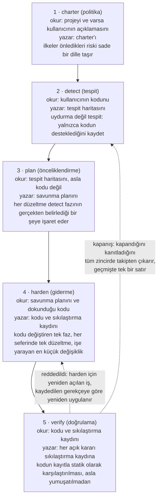
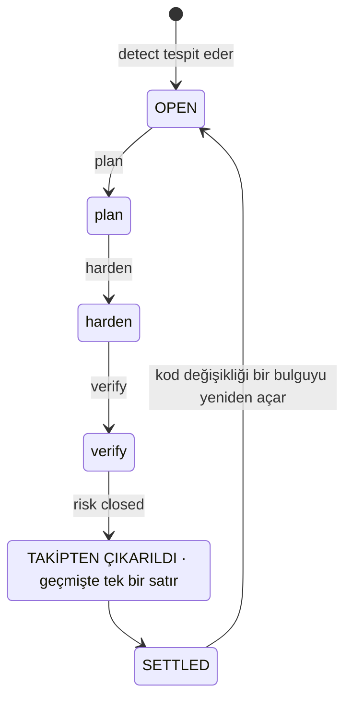
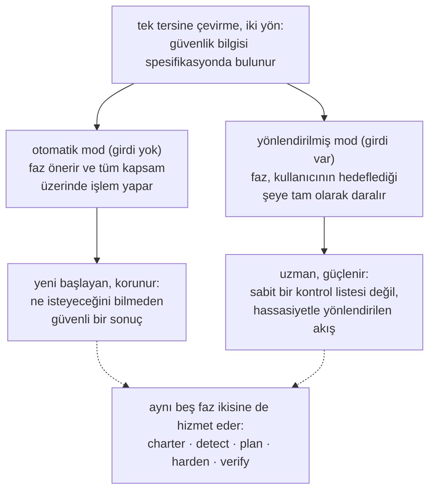
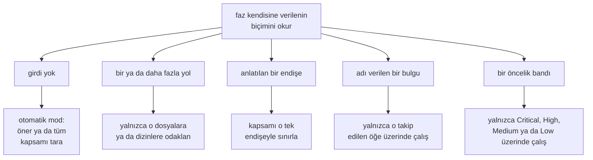
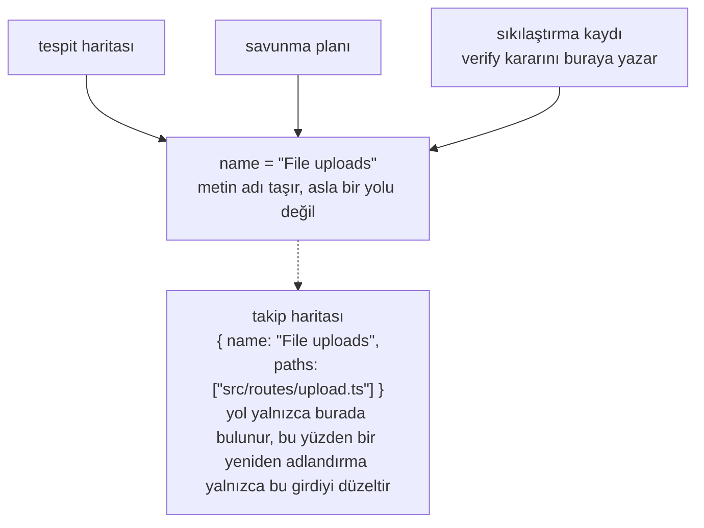
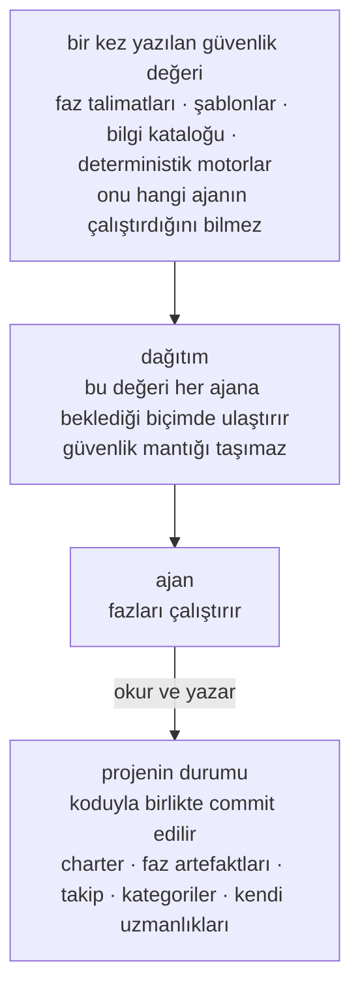
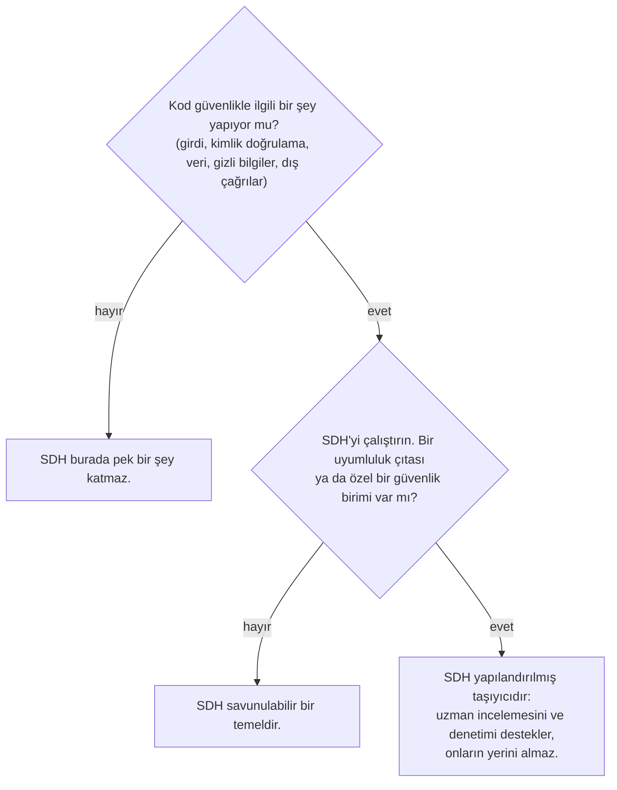

# Security-Driven Hardening: yapay zeka destekli geliştirme çağı için bir yaklaşım

> Security-Driven Hardening (SDH) metodolojisi: yapay zeka desteğiyle ve vibe coding ile geliştirilen yazılımları denetlemek ve sıkılaştırmak için bağlama duyarlı bir Blue Team yaklaşımı.

Kanonik URL: https://lagune.ai/tr-TR/docs/references/paper
Dil: tr-TR
Orijinal: https://lagune.ai/docs/references/paper
Son güncelleme: 2026-11-05

- **Weslley Araújo**
- **Metodoloji makalesi, 2026.**

---

## Özet

Security-Driven Hardening (SDH), yazılımları giderek daha çok yapay zeka ajanlarının ve güvenlik uzmanı olmayan kişilerin yazdığı bir dönem için tasarlanmış, yapılandırılmış, yapay zeka güdümlü ve yalnızca savunma odaklı bir güvenlik metodolojisidir. SDH genel bir kontrol listesi uygulamak yerine önce bir sistemin gerçekte ne yaptığını (oturum açma, dosya yükleme, ödemeler, veri ifşası vb.) tespit eder, ardından o bağlama özgü güvenlik çalışmasını yönlendirir. Varsayılan olarak güvenli ilkelerle yönetilir, tamamen savunma üzerine kuruludur ve her kullanıcının harekete geçebilmesi için sade bir dille ifade edilir.

Bu belge, SDH'nin tek bir araç değil, eksik olan bir yaklaşım olduğunu savunur. Güvenlik bilgisi metodolojide ve onun talep üzerine yüklenen uzmanlıklarında, yani her kullanıcının üzerine inşa edebileceği bir temelde bulunur. Bu sayede aynı akış hem yeni başlayana hem de uzmana hizmet eder. İki özellik SDH'yi önceki spec-first yaklaşımlardan `[1]` ayırır. SDH **durumdan bağımsızdır**: boş bir dizine, devam eden bir projeye, tek bir pull request'e ya da büyük ve eski bir kod tabanına, her teknoloji yığınında uyum sağlar. SDH ayrıca **kapatılabilirdir**: kapandığı doğrulanan bir risk tüm akışta takipten çıkarılır, böylece o bulgu durgun bir duruma ulaşır ve yalnızca kod değiştiğinde yeniden açılır. SDH güvenlik profesyonellerinin ya da özelleşmiş Blue Team araçlarının yerini almaz. Geliştiricinin kendi bilgisini genişletir ve geliştirici güvenliği ne kadar iyi anlarsa akışı o kadar iyi yönlendirebilir.

**Lagune** referans uygulamadır ve metodolojinin hayata geçirilebilir ve taşınabilir olduğunu kanıtlar. SDH, başkalarının benimseyebileceği bir yaklaşım olarak sunulur.

> **Anahtar terimler**
>
> Yapay zeka destekli geliştirme, yazılım güvenliği, savunma güvenliği, spec-driven development, güvenlik sıkılaştırması, ajan güdümlü iş akışları, kapatılabilirlik, bağlama duyarlı güvenlik, talep üzerine bilgi, ajandan bağımsız araçlar.

---

## I. Giriş: yapay zeka destekli geliştirmenin açtığı güvenlik boşluğu

Yazılımları giderek daha çok, güvensiz bir kalıbı güvenilir biçimde tanıyamayan kişiler ve yapay zeka ajanları yayına alıyor: sızdırılmış bir gizli bilgi, eksik bir yetkilendirme kontrolü, enjeksiyona açık bir sorgu. Bunlar sıra dışı riskler değildir. Gerçek olaylarda baskın olan ve yıllardır kamuya açık kaynaklarda belgelenen risk sınıfları arasında yer alırlar `[6]`, `[7]`. Son çalışmalar da yapay zekanın ürettiği kodun azımsanmayacak bir kısmının tam olarak bu tür kusurlarla yayına çıktığını bildiriyor `[8]`. Yapay zeka kodlama asistanları, geliştirici olmayanların gerçek yazılım yayınlamasını mümkün kılarak sorunu keskinleştirdi, ancak boşluk tek bir kitleden çok daha geniştir. Çoğu proje, gerçekte yaptığı şeye özgü bir güvenlik incelemesinden hiç geçmez. Ekosistem, her erken "çalışıyor, yayınla" kararıyla biraz daha kırılganlaşır.

Genel güvenlik tavsiyeleri bu boşluğu kapatmaz. Statik bir kontrol listesi bir sistemin ne yaptığına özgü olmadığı için küçük bir projeyi alakasız maddelerle boğar ve yine de o projede önemli olan riski kaçırır. Sorun, dünyada güvenlik bilgisinin az olması değildir. Sorun, doğru bilgiyi kullanıcının önündeki gerçek sistemle eşleştirmek ve bunu ne isteyeceğini bilmeyebilecek biri için yapmaktır.

SDH buna tek bir tersine çevirmeyle yanıt verir: **güvenlik bilgisi spesifikasyonda ve onun talep üzerine yüklenen uzmanlıklarında, yani her kullanıcının üzerine inşa edebileceği bir temelde bulunur**. Metodoloji bağlamı tespit eder, o bağlamın taşıdığı riskleri önceliklendirir ve düzeltmelere rehberlik eder, böylece geliştirici de geliştirici olmayan da aynı akıştan yararlanır. Bulgular ve öneriler sade bir dille kalır, bu yüzden okuyucunun teknik derinliği ne olursa olsun uygulanabilirler. Bu yaklaşım uzmanı kısıtlamaz, tersine güçlendirir. Bu ikiliği `§VI` bölümünde ele alıyoruz.

> **Temel fikir**
>
> **Temel tersine çevirme:** Güvenlik bilgisi spesifikasyonda ve onun talep üzerine yüklenen uzmanlıklarında, yani her kullanıcının üzerine inşa edebileceği bir temelde bulunur. Metodoloji sistemin ne yaptığını öğrenir, güvenlik çalışmasını buna göre eşleştirir ve kullanıcının zaten bildiklerini genişletir.

Bir yapay zeka asistanına "uygulamam kullanıcıların profil fotoğrafı yüklemesine izin veriyor" diyen bir geliştirici düşünün. Bir güvenlik incelemesi olmadan asistan, istemcinin gönderdiği her şeye sessizce güvenen, çalışan bir kod üretir: beyan edilen dosya türüne, dosya adına, boyuta. Yükleme özelliği yayına çıkar. Görsel kılığına girmiş bir dosya kod taşıyabilir, özel hazırlanmış bir ad depolama yolunun dışına çıkabilir, aşırı büyük bir dosya sunucuyu tüketebilir. Bunların hiçbiri bir demoda görünmez, bu yüzden yayına çıkar.

Aynı kod SDH'den geçtiğinde farklı bir sonuç ortaya çıkar. SDH sistemin dışarıdan dosya kabul ettiğini tespit eder (tespit), bunu bir yüklemenin taşıdığı risklere göre önceliklendirir (önceliklendirme), gerçek dosya türünü ve boyutunu kontrol etmeyi, kaydederken yeniden adlandırmayı ve kodun çalışamayacağı bir yerde saklamayı önerir (giderme), ardından sonucu okuyup her kontrolün gerçekten işe yaradığını doğrular (doğrulama). Geliştiricinin "kısıtlamasız dosya yükleme" ifadesini bilmesi hiç gerekmedi. Metodoloji bunu onun yerine sağladı.

Bu belgenin katkıları şunlardır:

- SDH'nin herhangi bir uygulamadan bağımsız, tasarım ilkeleriyle birlikte bir metodoloji olarak kesin tanımı (`§III`).
- Görev ayrımının kendisinin katkı olduğu beş fazlı bir savunma yaşam döngüsü: tespit asla uydurmaz, planlama asla kodu okumaz, kodu yalnızca tek bir faz değiştirir ve doğrulama kararını asla yumuşatmaz (`§IV`).
- Metodolojik bir duruş olarak **kapatılabilirlik**: tek bir bulgunun sonsuz bir döngüsü değil, bir son durumu vardır (`§V`).
- **Geliştirici bilgisini genişletme** ikiliği: yeni başlayanı koruyan ve uzmanı güçlendiren tek bir akış (`§VI`).
- **Tek başına çağrılamayan uzmanlıklar ve talep üzerine prompt**: ajanın varsayılan olarak değil, yalnızca projenin bağlamı gerektirdiğinde yüklediği odaklı güvenlik bilgisi (`§VII`).
- **Durumdan bağımsızlık** ve **dayatmayan uyarlanabilirlik**: SDH her geliştirme durumuna uyar ve sabit bir kapsam dayatmak yerine senaryoya uyum sağlar (`§VIII`).
- **Önleyici mod**: sıradan iş geliştirilirken çalışan aynı savunma, böylece kod varsayılan olarak güvenli hâlde ortaya çıkar ve fazlara düzeltecek daha az şey kalır (`§IX`).
- SDH'nin içinden çıktığı ve sonra ayrıldığı soy olan Spec-Driven Development ile ayrıntılı bir karşılaştırma (`§X`).
- Metodolojinin yeniden düzenlemelere dayanmasını ve herhangi bir ajandan bağımsız kalmasını sağlayan mühendislik disiplinleri: ada dayalı kimlik takibi (`§XI`) ve ajandan bağımsız bir taşıyıcı (`§XII`).

---

## II. Arka plan ve ilgili çalışmalar

SDH önceki çalışmaların üzerine kuruludur. Spec-first ve ajan güdümlü geliştirmeden `[1]`, `[2]`, `[3]` kanıtlanmış bir yapı devralır: şablonlar, bir ajanın kullandığı slash komutları, yönetici bir belge ve fazları çalıştıran bir ajan. Bu yapıyı savunma amacıyla yeniden uygular. Bu soy bilinçli bir tercihtir ve SDH'nin çalışma ilkelerinden biri bunu doğrudan adlandırır: iş akışını kanıtlanmış bir yapıdan kurun, ardından onu güvenlik için çerçeveleyin.

SDH, genel önerilerden oluşan statik bir kontrol listesi değildir. Bir kontrol listesi genel olarak güvenlik hakkında çok şey bilir, ama önündeki proje hakkında hiçbir şey bilmez. SDH bu vurguyu tersine çevirir. İlk çabasını tespite, yani sistemin ne yaptığını öğrenmeye harcar ve ancak ondan sonra tespitin önemli kıldığı bilgiye başvurur.

SDH, güvenlik uzmanlarının ya da özelleşmiş Blue Team araçlarının yerine geçmez. Geliştiricinin bilgisini genişletir (`§VI`). Özel bir güvenlik birimi olan bir ekip onu korumalıdır. SDH böyle bir ekibe yapılandırılmış bir taşıyıcı, böyle bir birimi olmayan ekibe de savunulabilir bir temel sağlar.

SDH ayrıca deterministik güvenlik tarayıcılarının (statik analiz, linter'lar) `[4]`, `[5]` yanında durur. Bu araçlar tam da deterministik ve tekrarlanabilir oldukları için değerlidir. SDH ise büyük ölçüde ajanın akıl yürütmesine dayanır ve katı determinizmi bağlama duyarlılık karşılığında bırakır. Metodoloji bunun aksini iddia etmez. Determinizmin önemli olduğu yerde akıl yürütmenin içine deterministik bir motor yerleştirir (`§VII`): bir girdinin kontrol edilmeye değer olup olmadığına ajan, o girdinin tehlikeli olup olmadığına ise deterministik bir program karar verir.

En doğrudan önceki çalışma, bir yapıyı çalıştırılabilir bir spesifikasyondan ileriye doğru inşa eden spec-first metodolojiler ailesi olan Spec-Driven Development'tır (SDD). SDD'yi bir sınıf olarak ele alıyoruz. Bir uygulayıcı metodolojisi olarak en açık ifadesi Piskala'nın raporu `[1]`, ajan güdümlü en görünür araç seti ise GitHub'ın Spec Kit'idir `[2]`. Aynı aileden ikinci bir araç olarak OpenSpec `[3]` de vardır. Bunlar `§X` bölümündeki karşılaştırmanın temel kaynaklarıdır.

---

## III. SDH: tanım ve tasarım ilkeleri

**Security-Driven Hardening**, işi geçici düzeltmelerle değil ajanın çalıştırdığı bir spesifikasyondan yönlendirerek bir kod tabanını daha güvenli hâle getiren, yapılandırılmış ve yapay zeka güdümlü bir güvenlik metodolojisidir. Adı, güvenlikte savunma tarafını temsil eden **Blue Team**'lerden esinlenmiştir. SDH savunma, sıkılaştırma ve doğrulama ile ilgilidir, asla saldırıyla değil.

> **Tanım**
>
> **Security-Driven Hardening (SDH):** Önce bir sistemin gerçekte ne yaptığını tespit eden, ardından bağlama özgü güvenlik çalışmasını yönlendiren, varsayılan olarak güvenli ilkelerle yönetilen ve sade bir dille ifade edilen, yapılandırılmış, yapay zeka güdümlü ve yalnızca savunma odaklı bir güvenlik metodolojisi.

SDH bir dizi bağlayıcı ilkeyle tanımlanır. Her biri bir kuraldır ve her biri kullanıcıya belirli bir güvence verir.

| İlke                                                        | Kural                                                                                                                                                                         | Kullanıcıya sağladığı güvence                                                                                                                                                          |
| ----------------------------------------------------------- | ----------------------------------------------------------------------------------------------------------------------------------------------------------------------------- | -------------------------------------------------------------------------------------------------------------------------------------------------------------------------------------- |
| Varsayılan olarak güvenli, sade bir dille, herkes için eşit | Her varsayılan, mesaj ve düzeltme kutudan çıktığı gibi güvenlidir ve geliştirici olsun olmasın her okuyucu için anlaşılırdır. Hiçbir kullanıcı grubu ayrıcalıklı değildir.    | Yeni başlayan biri istemeden güvenli bir temel alır ve sonucu kendi anladığı dille okur.                                                                                               |
| Genel yerine bağlama duyarlı                                | Her faz detect fazında tespit edilen bağlamdan başlar ve sistemin gerçekte ne yaptığına göre hareket eder.                                                                    | Öneriler bir kontrol listesine değil, projeye uyar. Güvenlik bilgisi spesifikasyonda ve onun talep üzerine yüklenen uzmanlıklarında bulunur ve kullanıcının getirdiklerini genişletir. |
| Katı yerine esnek                                           | İlkeler, gereksinimler ve öneriler birer başlangıç noktasıdır. Kullanıcı her şeyi yeniden ifade edebilir, çıkarabilir, ekleyebilir ya da kapsamını daraltabilir.              | Metodoloji projeye ve kullanıcıya uyar, asla kullanıcının istediğinden daha katı olmaz. Esneklik, varsayılan olarak güvenli temeli asla zayıflatmaz.                                   |
| Uzlaştır, asla yalnızca ekleme                              | Artefaktlar günlük değil, yaşayan belgelerdir. Her çalıştırma her girdiyi yeniden kontrol eder: geçerli olanı korur, değişeni yeniden yazar, artık geçerli olmayanı kaldırır. | Kayıt her zaman bugünü yansıtır, böylece asla güncelliğini yitirmiş bir iş yığınına dönüşmez.                                                                                          |
| Yalnızca savunma                                            | SDH denetler, sıkılaştırır ve doğrular. Asla saldırı aracı, kötü amaçlı kullanım için exploit ya da zarar vermek için tespitten kaçınma yöntemi üretmez.                      | Metodoloji bir silaha dönüştürülemez. Çift kullanımlı içerik yalnızca açıkça savunma amaçlı bir çerçevede yer alır.                                                                    |
| Spec-first, ajan güdümlü, güvenlik için çerçevelenmiş       | İş akışı şablonlardan, komutlardan, yönetici bir charter'dan ve fazları çalıştıran bir ajandan oluşur.                                                                        | Ajanın asıl güvenlik işini yapacağı şekilde yeniden amaçlandırılmış, kanıtlanmış bir geliştirme yapısı.                                                                                |

**Tablo 1.** SDH'nin tasarım ilkeleri ve her birinin kullanıcıya sağladığı güvence.

Bu ilkeler süs değildir. Aşağıdaki her fazın uyması gereken kısıtlardır ve `§XV` bölümündeki tartışma, metodolojinin sınırlarını belirlemek için onlara geri döner.

Belgenin geri kalanı adı konmuş dokuz temel sütunu ele alır. Bunlar okuyucunun aklında tutabilmesi gereken parçalar ve başka bir ekibin SDH uyguladığını söyleyebilmek için yeniden uygulaması gereken parçalardır.

| Sütun                                               | Sağladığı                                                                                                                                          | Bölüm       |
| --------------------------------------------------- | -------------------------------------------------------------------------------------------------------------------------------------------------- | ----------- |
| Bağlama duyarlı tersine çevirme                     | Güvenlik bilgisi spesifikasyonda ve onun talep üzerine yüklenen uzmanlıklarında bulunur, böylece yeni başlayan da uzman da tek bir akışı paylaşır. | `§I`, `§VI` |
| Beş fazlı savunma yaşam döngüsü                     | Görev ayrımı: politika, tespit, önceliklendirme, giderme, doğrulama, her birinin tek bir görevi vardır.                                            | `§IV`       |
| Kapatılabilirlik                                    | Bir bulgunun sonsuz bir döngüsü değil, bir son durumu vardır. Kapanan iş takipten çıkarılır.                                                       | `§V`        |
| Geliştirici bilgisini genişletme ikiliği            | Yeni başlayanı koruyan ve uzmanı güçlendiren, hiçbirinin yerini almayan tek bir akış.                                                              | `§VI`       |
| Talep üzerine prompt, tek başına çağrılamayan bilgi | İlgili güvenlik bilgisi varsayılan olarak değil, projenin ne olduğuna göre yüklenir.                                                               | `§VII`      |
| Durumdan bağımsızlık ve dayatmayan uyarlanabilirlik | Her teknoloji yığınında her geliştirme durumuna uyar ve bir kapsam dayatmak yerine senaryoya uyum sağlar.                                          | `§VIII`     |
| Önleyici mod                                        | Aynı savunma yeni iş geliştirilirken çalışır, böylece kod varsayılan olarak güvenli hâlde ortaya çıkar.                                            | `§IX`       |
| Ada dayalı kimlik takibi                            | Bir bulgu fazlar boyunca tek bir öğe olarak kalır ve bir yeniden adlandırma bağlantıyı yalnızca tek bir yerde koparır.                             | `§XI`       |
| Ajandan bağımsız taşıyıcı                           | Güvenlik değeri bir kez yazılır ve hiçbir ajana ya da teknoloji yığınına bağlı değildir.                                                           | `§XII`      |

**Tablo 2.** SDH'nin adı konmuş dokuz sütunu ve her birinin ele alındığı bölüm.

---

## IV. 5 fazlı Blue Team akışı

SDH işi beş fazlı bir savunma yaşam döngüsü olarak yapılandırır (Şekil 1). Her faz savunma etrafında kurgulanır, her biri bir öncekinin üzerine inşa edilir ve fazlar gerçek Blue Team faaliyetini izler: politika belirleme, tespit, önceliklendirme, giderme, doğrulama.



**Şekil 1.** Beş fazlı akış: her fazın ne okuduğu, ne yazdığı ve dayandığı değişmez kural. Verify her iki dönüşü de yönetir: reddedilen bir kontrol harden fazını yeniden açar, kapandığı kanıtlanan bir bulgu ise tüm zincirde takipten çıkarılır ve geçmişte tek bir satır olarak kalır.

Görev ayrımı katkının ta kendisidir. Her fazın tek bir görevi olduğu için bir hata tek bir yerde sınırlı kalır ve okuyucu her artefaktın iddia ettiğine güvenebilir.

> **Temel fikir**
>
> **Applied, doğrulanmış demek değildir:** Harden bir düzeltmenin uygulandığını kaydeder. Verify ise kodu bu kayıtla karşılaştırarak onu doğrular ve karar asla kayda uysun diye yumuşatılmaz. Bir kontrol kodda bulunup yine de riski erişilebilir bırakabilir. O durumda dürüst karar "risk not closed" olur.

### charter (politika)

Charter, projenin güvenlik ilkelerini, yani sonraki her fazın uyması gereken kuralları belirler. Yönetici katmandır, projenin güvenlik duruşu için bir tür derleme zamanı kontrolüdür. Her ilkenin açık bir adı, koda karşı kontrol edilebilen pazarlığa kapalı bir kuralı ve yalnızca düzeltmeyi değil, önlediği riski de belirten bir `Why:` satırı vardır. Charter her zaman projenin kendisini (manifestlerini, yapısını ve bağımlılıklarını) okur. Kullanıcı bir açıklama verdiğinde bu bir yöndür ve okuma, kullanıcının adını koyduğu şeylerin ötesine genişler. Açıklama yoksa tek kaynak projedir. İkisi birbiriyle yarışmaz, birbirini tamamlar ve charter kodun durumunu değil, projenin uyması gereken politikayı kaydeder. Geliştirici olmayan biri onu okuyup hem kuralı hem de riski anlayabilmelidir.

### detect (tespit)

Detect kodu okur ve sistemin güvenlik açısından ağırlık taşıyan, gerçekte yaptığı şeyleri belirler. Yol gösteren talimat "uydurma değil, tespit"tir: yalnızca kodun desteklediğini, sonraki fazların ihtiyaç duyduğu kanıtla birlikte kaydet. Detect tarafsızdır. Bulgularını charter'a uydurmaya zorlamaz, çünkü riskleri charter'ın kurallarıyla eşleştirmek plan fazının işidir. Her bulgu üç parça taşır: ne olduğu (sade bir dille açıklama), neden önemli olduğu (yalnızca olgu değil, risk) ve kanıt (bulunduğu fonksiyon ya da rota). Kanıt dosya yolu içermez. Yol yalnızca takip haritasında bulunur (`§XI`), böylece metin asla güncelliğini yitirebilecek bir yol barındırmaz.

### plan (önceliklendirme)

Plan her bulguyu, risk sınıfıyla adlandırılmış (dayanak oldukları yerde yerleşik kaynaklara, CWE ve OWASP'a atıf yaparak) ve düzeltmenin koruduğu charter ilkesine bağlı bir düzeltmeye dönüştürür. Öncelik (Critical, High, Medium, Low) serbest bir seçim değildir: plan her bulguyu CVSS v4.0 Base ve Environmental yöntemiyle puanlar. Böylece öncelik bandı, puanın sade kelimelerle ifadesidir, maruziyeti ve riskteki değeri anlatan sade bir satırla gerekçelendirilir ve iki çalıştırma aynı sıralamaya ulaşır. Vektör uzman için kesin dayanaktır, bant ve gerekçesi ise herkesin izleyebileceği aynı puanlamadır. Plan yalnızca tespit haritasından çalışır ve kodu asla okumaz. Bu bir sınırlama değil, bilinçli bir kısıttır: her düzeltmeyi detect fazının gerçekten tespit ettiği bir şeye işaret etmeye zorlar. Bir kapsam hiç haritalanmamışsa plan tahmin yürütmek yerine durur ve kullanıcıyı detect fazına geri yönlendirir.

### harden (giderme)

Harden kodu değiştiren tek fazdır, bu yüzden dikkatli ilerler. Bir düzenlemenin kullanıcı onayı gerektirip gerektirmediğine ajan ve onun çalıştığı izin modu karar verir, bu yüzden harden kendine ait bir onay adımı eklemez. Düzeltmeleri teker teker uygular, önce bağımlılıkları, sonra en yüksek önceliği ele alır, böylece her değişiklik küçük, incelenebilir ve kolayca geri alınabilir kalır. Yeni bir düzeltmeyi sığdırmak için mevcut bir kontrolü asla zayıflatmaz ve bir charter ilkesini asla çiğnemez. Bir düzeltme bir ilkeyle çatışacaksa harden onu uygulamak yerine durur ve çatışmayı ortaya koyar. Her blok Applied, Partial ya da Blocked olarak kaydedilir. "Applied henüz doğrulanmış demek değildir" ve bir sonraki faz tam olarak bu endişeyi ele alır.

### verify (doğrulama)

Verify, uygulanan her kontrolü kodu okuyup harden fazının kaydettikleriyle karşılaştırarak doğrular. Doğrulama bu karşılaştırmanın, kodun kayda karşı sınanmasının kendisidir ve statiktir: bir kontrolün kodda bulunduğunu ve doğru olduğunu teyit eder, çalışan bir sistemde saldırı altında işe yaradığını değil. Canlı sisteme karşı gerçek ya da simüle saldırılar yürüten bu tür çalışma zamanı kontrolü, tasarım gereği kapsam dışındadır. Verify üç karardan birini döndürür: risk closed, risk not closed ya da cannot tell from the code. Kendine ait bir artefakt üretmez: harden ve verify sıkılaştırma kaydını paylaşır, yapılanlar harden fazına, karar ve gerekçesi verify fazına aittir ve hiçbiri asla diğerinin alanlarına yazmaz. Reddedilen bir kontrol harden için yeniden açılan iştir. Harden bir sonraki çalıştırmasında bu kararı kodu kendi okumasının önüne koyar ve gerekçenin adını koyduğu boşluğa karşı düzeltmeyi yeniden uygular. Verify kayıt yerine koda güvenir, çünkü bir kayıt kodun sağladığından fazlasını iddia edebilir. Kullanıcının kodunda yalnızca okuma yapar ve bir kararı kayda uysun diye asla yumuşatmaz. Bir kontrol mevcut olup riski başka bir yoldan erişilebilir bırakabilir ve bu durumda dürüst karar "risk not closed" olur. Verify okurken tespit haritasının hiç kapsamadığı bir güvenlik sorunu fark ederse, tespit detect fazının işi olduğu için onun için bir karar uydurmaz: sorunu ortaya koyar ve kullanıcıyı detect fazına geri yönlendirir, böylece bulgu akışı atlamak yerine aynı akıştan girer.

> **Örnek akış: dosya yükleme.** Tek bir bulgu, akışın omurgasını baştan sona gösterir.
>
> - **detect** onu bulur: sistem kullanıcılardan dosya kabul eder ve yükleme işleyicisi, dosyanın gerçek türünü kontrol etmeden istemcinin gönderdiği MIME türüne güvenir. _Neden önemli:_ görsel kılığına girmiş bir dosya kötü amaçlı kod gizleyebilir.
> - **plan** düzeltmeye karar verir, öncelik **Critical**, korunan ilke "Doğrulanana kadar her girdi güvenilmezdir": dosyanın gerçek türünü ve boyutunu kontrol et, kaydederken yeniden adlandır ve yüklemeleri kod olarak çalıştırılamayacakları bir yerde sakla.
> - **harden** düzeltmeyi uygular, durum **Applied**: işleyici artık gerçek türü içerikten tespit eder, bir boyut sınırı uygular, beklenmeyen her şeyi reddeder, kaydederken yeniden adlandırır ve kodun çalışamayacağı bir yerde saklar.
> - **verify** işleyiciyi okur, kayıtla karşılaştırır ve **risk closed** döndürür: kod tam olarak kaydın iddia ettiğini yapar.
>
> Aynı bulgu adı tespit haritası, plan ve sıkılaştırma kaydı boyunca taşınır ve verify o kayıt üzerinde aynı adla işlem yapar: açık bir karar bulgunun bloğuna yazılır, kapandığı kanıtlanan bir bulgu ise takipten çıkarılır (`§V`). Bu ortak ad, bulgunun kimliğidir (`§XI`).

---

## V. Kapatılabilirlik: bir bulgunun son durumu vardır

Güvenlik araçlarının çoğu kullanıcıyı yalnızca büyüyen bir iş yığınıyla baş başa bırakır. SDH farklı bir tutum benimser: **bir bulgu kapatılabilir, bu yüzden sonsuz bir iş yığınında yaşamak yerine bir son durumu vardır** (Şekil 2). Bu, doğrudan uzlaştırma ilkesinden çıkar.

> **Tanım**
>
> **Kapatılabilirlik:** Kapandığı doğrulanan bir risk tüm akışta takipten çıkarılır, böylece o bulgu durgun bir duruma ulaşır ve yalnızca kod değiştiğinde yeniden açılır. Güvenlik programının kendisi sürekli olsa da bir bulgunun bir son durumu vardır.

SDH artefaktları günlük değil, yaşayan belgelerdir. Bir faz her yeniden çalıştığında mevcut her girdiyi güncel gerçeğe göre yeniden kontrol eder ve üç şeyden birini yapar: hâlâ geçerli olanı korur, değişeni yeniden yazar ya da artık geçerli olmayanı kaldırır. Kodun artık çözüldüğünü gösterdiği bir bulgu doğrudan kaldırılır. Çalışma kaydı geçmişi değil, bugünü yansıtır.

Kapanış, aynı uzlaştırmanın sonuca ulaşmasıdır. Verify bir riskin kapandığını doğruladığında bulguyu tüm akışta takipten çıkarır: tespit haritasında, planda, sıkılaştırma kaydında ve takip haritasında. Verify fazının diğer fazların artefaktlarına yazan tek faz olmasının nedeni budur: döngüyü kapatan fazdır. Bulgu zincirden ayrılırken takipten çıkarma işlemi onu, çalışma zincirinin dışında duran ve asla yeniden işlenmeyen bir geçmiş kaydında kısa bir girdiye dönüştürür. Kaybolmakla kapanmak arasındaki çizgi budur: artık doğru olmadığı için uzlaştırmanın kaldırdığı bir bulgu geride hiçbir şey bırakmaz, kapandığı kanıtlanan bir bulgu ise geçmişte kendi satırını hak eder. Takipten çıkarılan bir bulgu bundan sonra hiçbir çalışma artefaktında yer almaz ve bu yokluk kopuk bir zincir değil, beklenen bir durumdur.



**Şekil 2.** Kapatılabilirlik durum makinesi. Bir bulgu OPEN → TAKİPTEN ÇIKARILDI → SETTLED yolunu izler ve yalnızca kod değiştiğinde yeniden açılır.

Kapsamdaki her şey takipten çıkarıldığında döngü durgun hâle gelir ve bu durgun durumun somut bir biçimi vardır: son bulgusu kapanan bir artefakt bütünüyle kaldırılır, böylece tamamen kapanmış bir zincirde yalnızca charter ve geçmiş, yani politika ve kanıt kalır. Döngü yalnızca kod değiştiğinde yeniden açılır. Metodoloji her bulguya kesin bir son verir ve sonsuz bir iş yığınının yapamadığı da tam olarak budur.

---

## VI. Geliştirici bilgisini genişletme ikiliği

SDH insanların yerini almaz ve özelleşmiş Blue Team araçlarının da yerini almaz. **Geliştiricinin kendi bilgisini genişletir**. Geliştirici güvenliği ne kadar iyi anlarsa akışı o kadar hassas yönlendirebilir ve o kadar fazla özerkliğe sahip olur. Az şey bilen bir geliştirici de güvenli bir sonuç alır, çünkü otomatik mod onu korur.

`§I` bölümündeki tersine çevirme, yani güvenlik bilgisinin spesifikasyonda bulunması, iki yönde de geçerlidir. Yeni başlayan için bu bir korumadır: ne isteyeceğini bilmesi gerekmez, çünkü öneriyi spesifikasyon yapar. Uzman için ise bir güçlendirmedir: aynı spesifikasyon, sabit bir kontrol listesiyle boğuşmak yerine akışı hassasiyetle yönlendirmesini sağlar.

Her faz bu ikiliği kendi işleyişinde taşır (Şekil 3). Girdi verilmeden çalıştırıldığında kullanıcı adına tüm kapsam üzerinde işlem yapar. Bir yön verildiğinde aynı faz, kullanıcının hedeflediği şeye tam olarak daralır.



**Şekil 3.** Geliştirici bilgisini genişletme ikiliği. Tek bir tersine çevirme iki kitleye hizmet eder: otomatik mod yeni başlayanı korur, yönlendirilmiş mod ise aynı beş faz üzerinden uzmanı güçlendirir.

Talep üzerine yüklenen uzmanlıklar (`§VII`) bu ikiliği kendi metinlerinde açıkça ortaya koyar. Her biri ajana, bilgisinin "muhakemesini genişlettiğini" ve uzmanlığın sunduklarının ötesinde akıl yürütmeye devam etmesini söyler. Bilgi bir tavan değil, bir tabandır. Belgenin hedeflediği dengede iki kitleye de hizmet eden budur: geliştirici topluluğu güçlü bir araç kazanır, Blue Team uygulayıcısı ise kendi işini onun yerine yapıyormuş gibi davranmayan yapılandırılmış bir taşıyıcı kazanır.

---

## VII. Tek başına çağrılamayan uzmanlıklar ve talep üzerine prompt

Bu, metodolojinin en yenilikçi kalıbıdır. SDH odaklı güvenlik bilgisini **yalnızca talep üzerine** yüklenen uzmanlıklar olarak taşır ve hangisinin yükleneceğine projenin bağlamıyla eşleştirerek ajanın kendisi karar verir. Buna **talep üzerine prompt** diyoruz: ajanın her kontrolü varsayılan olarak çalıştırmak yerine, içinde bulunduğu projenin kapsamına göre hangi bilgiyi etkinleştireceğini seçmesinin bir yolu. Uzmanlıklar evrimseldir ve herhangi biri her an değişebilir ya da başkasıyla değiştirilebilir. Katkı uzmanlıkların kendisi değil, kalıptır.

> **Tanım**
>
> **Talep üzerine prompt:** Ajan, hangi güvenlik bilgisini etkinleştireceğini önündeki projenin kapsamıyla eşleştirerek seçer, böylece her kontrol varsayılan olarak çalışmak yerine projenin gerçekte ne olduğuna uygun bilgi devreye girer.

> **Tanım**
>
> **Tek başına çağrılamayan uzmanlık:** Dosya yükleme ya da tarayıcıda çalışan kod gibi tek bir bağlam için odaklı ve dilden bağımsız bir güvenlik bilgisi birimi. Denetler ve açıklar, asla kodu yeniden yazmaz ve asla saldırı girdisi üretmez. Bir komut değildir: kapsadığı bağlam kapsamdayken ya da bir prompt onu adıyla istediğinde yüklenir.

Her uzmanlık, kapsadığı riskler için daha güvenli biçimleri adlandırır ve ajana onu kullanan her fazda bir bulguya nasıl yaklaşacağını söyler: tespitte onu nasıl değerlendireceğini, gidermede düzeltmesini nasıl güvenle uygulayacağını ve doğrulamada onu nasıl kanıtlayacağını.

Belirleyici özellik, bir uzmanlığın **tek başına çağrılamamasıdır**: bir komut değildir ve akışın içinde onu yükleyen şey bir eşleşmedir. Tespit fazı kataloğu bir kez listeler, projenin bağlamını her girdinin kapsadığı şeyle eşleştirir ve yalnızca bağlamı kapsamda bulunan uzmanlıkları yükler. Sonraki fazlar yeniden listelemek yerine bu eşleşen listeyi kullanır, böylece tek bir eşleşme tüm zincire hizmet eder. Önleyici mod (`§IX`) da aynı eşleştirmeyi inşa edilmek üzere olan işe karşı çalıştırır. Bağlamı bulunmayan bir uzmanlık atlanır ve atlama da yükleme kadar hesap verebilirdir: katalogdaki her girdi açık bir karar alır, uygulandı ya da gerekçesi koddan okunarak atlandı, böylece belirsiz bir alakasızlık hissi asla yokluğun yerini tutmaz. Hiçbirinin uygulanabilir olmaması da geçerli bir sonuçtur.

Katalog veridir ve büyüme asla yeni bir komut değil, bir bilgi dosyası ile bir katalog satırıdır. Yerleşik uzmanlıklar OWASP, bir programlama dili ya da yapay zeka entegrasyonları gibi kategorilerde gruplanır ve bir projenin kullandığı katalog, seçtiği kategorilerin yerleşik uzmanlıklarını ve projenin kendi uzmanlıklarını içerir. Proje bu seçimi durumunun geri kalanıyla birlikte kaydeder, böylece tüm ekip aynı katalogla eşleştirme yapar. Bu, fazlardaki bağlama duyarlılık ilkesinin bilgiye uygulanmış hâlidir: her kontrol varsayılan olarak çalışmak yerine projenin gerçekte ne olduğuna uygun bilgi devreye girer. Aynı özellik, kataloğu yalnızca bakımcının değil kullanıcının da büyütmesine imkân verir: kullanıcının sağladığı bir güvenlik kaynağının ya da konunun özü çıkarılarak projeye ait yeni bir uzmanlık oluşturulur. Bu uzmanlık kategoriler ne olursa olsun projenin kataloğuna katılır, tıpkı yerleşik bir uzmanlık gibi yüklenir ve aynı adı taşıyan yerleşik uzmanlığın yerini alır. Bir uzmanlık yazmak da yalnızca savunma odaklıdır ve uzmanlıkların uyguladığı sınıra uyar: kaynak bir saldırı yazısı olabilir, ama ondan çıkan uzmanlık denetler ve açıklar, asla çalışan bir exploit üretmez. Böylece `§I` bölümündeki tersine çevirme, yani zekânın spesifikasyonda bulunması, kullanıcının kod yazmadan kendi bağlamı için derinleştirebileceği kataloğun kendisine kadar uzanır.

Kısa bir örnek talep üzerine prompt'u açıklar. Detect, tarayıcıda çalışan kodlardan oluşan bir klasörü okur. Bu bağlamı katalogda eşleştirir, onu kapsayan uzmanlığı yükler ve detect fazının normal adımlarıyla istemci tarafı bir bulguyu ortaya koyar. Bağlamı bu kapsamda bulunmayan uzmanlıklar eşleşmez, bu yüzden hiç yüklenmez ve her biri atlandı olarak kaydedilir. Hangi bilginin ilgili olduğuna sabit bir yapılandırma değil, proje karar verdi.

Determinizm tam da önemli olduğu yerde ortaya çıkar. Bir uzmanlık yalnızca metin değil, deterministik bir denetleyici de taşıyabilir: bir risk sınıfının net bir karar prosedürü olduğu yerde küçük bir program, verilen bir girdi için sabit bir karar döndürür, örneğin `safe`, `unsafe` ya da `invalid input` gibi kısa bir kelime kümesi. Bazı risk sınıfları tam olarak bu şekilde deterministik olarak karara bağlanabilir ve karar prosedürünün arkasında önceki çalışmalardan oluşan bir birikim vardır `[9]`, `[10]`, `[11]`. Denetleyici ya ajanın sağladığı adayları puanlar ya da onları bulmak için kapsamı kendisi tarar ve her iki durumda da kararı ajan değil denetleyici verir. Yeterince evrensel bir uzmanlık katalogda zorunlu olarak işaretlenebilir ve o zaman her zaman uygulanır, denetleyicisi tüm kapsam üzerinde çalışır. Bilginin bağlam eşleşmesi olmadan yüklendiği tek durum budur ve bu durum asla o anda ajan tarafından kararlaştırılmaz, katalog verisinde beyan edilir. SDH, akışın tamamının deterministik olduğunu iddia etmeden, ajanın akıl yürütmesini burada tekrarlanabilir bir şeye dayandırır.

Son olarak uzmanlıklar **bağımsız kullanılabilir**. Bilgi kendi başına ayakta durduğu için kullanıcı bir uzmanlığı, SDH akışının tamamıyla hiçbir ilgisi olmayan bir prompt'ta doğrudan çalıştırabilir ve güvenliği sıradan geliştirmenin yanında tutabilir. Örneğin deterministik bir denetleyici taşıyan bir uzmanlık, sıradan kodlama sırasında üretilen her adayı eleyip yalnızca güvenli olanları tutabilir. Bu bağımsızlık, SDH'nin bu kadar çok duruma uyum sağlamasının nedenlerinden biridir ve `§VIII` bölümünün konusudur. En eksiksiz ifadesi ise aynı bilginin sıradan geliştirmeyi baştan sona koruduğu önleyici moddur (`§IX`).

---

## VIII. Durumdan bağımsızlık ve dayatmayan uyarlanabilirlik

İki özellik SDH'yi katı spesifikasyon metodolojilerinden ayırır.

### Durumdan bağımsızlık

> **Tanım**
>
> **Durumdan bağımsızlık:** Metodoloji geliştirme durumuna bağlı değildir. Başlangıç noktasını okuyarak öğrendiği için boş bir dizine, devam eden bir projeye, tek bir pull request'e ya da büyük ve eski bir kod tabanına, her teknoloji yığınında uyar.

Her faz, proje yepyeni de olsa zaten var da olsa aynı şekilde çalışır. Charter mevcut koddan ilkeler çıkarır. Detect, çok az da olsa orada bulunan kodu haritalar. Varsayılan bir başlangıç noktası yoktur.

### Dayatmayan uyarlanabilirlik

> **Tanım**
>
> **Dayatmayan uyarlanabilirlik:** Metodoloji, kullanıcının izlemesi gereken sabit bir kapsam dayatmak yerine senaryoya uyum sağlar. Kullanıcı ne söyleyeceğini bilmediğinde çağrıldığı ortamı okur, bağlam üretir ve bir sonraki adımını şekillendiren soruları sorar.

En açık örnek charter'ın öneri modudur: SDH projeyi analiz ederek varsayılan olarak güvenli bir charter çıkarır, kullanıcıya yalnızca bir boşluk sonucu gerçekten değiştirdiğinde soru sorar, ardından charter'ı yazar ve her ilkeyi önlediği riskle birlikte sade bir dille sunar. Charter, bir onay isteminin arkasına kilitlenmiş bir sözleşme değil, kullanıcının yeniden çalıştırarak üzerinde çalıştığı yaşayan bir belgedir, bu yüzden kullanıcının ne isteyeceğini bilmesini asla gerektirmez.

Bu uyarlanabilirlik, girdinin biçimine duyarlılık olarak kendini gösterir: aynı faz kendisine verileni okur ve bir mod seçer (Şekil 4). Prompt'taki bir dosya, listeden bir bulgu, bir endişe, bilinen bir zayıf noktaya karşı odaklı bir görev ya da tam kapsamlı bir kaba kuvvet taraması talebi: her biri kullanıcının ihtiyacına uyar, çünkü akış tasarım gereği dayatmaz. Bunların hiçbiri varsayılan olarak güvenli temeli zayıflatmaz. Esneklik temelin nasıl uygulanacağını şekillendirir, onu asla düşürmez.



**Şekil 4.** Dayatmayan uyarlanabilirlik. Aynı faz girdisinin biçimini okur ve bir mod seçer, böylece kapsam her zaman kullanıcınındır, asla dayatılmaz.

---

## IX. Evrensel önleyici mod: iş inşa edilirken aynı savunma

SDH tamamlayıcı bir mod taşır: kod yazılırken aynı savunmanın etkin olduğu sıradan geliştirme. Kullanıcı işin kendisini, bir oturum açma sayfasını, bir yüklemeyi, bir uç noktayı ister ve metodoloji inşa sürecini olduğu anda korur, böylece sonuç sonradan yapılacak bir sıkılaştırma geçişinden sonra değil, ortaya çıktığı anda varsayılan olarak güvenlidir.

> **Tanım**
>
> **Önleyici mod:** SDH'nin yönetici katmanı ve bilgisi altında yürütülen sıradan geliştirme. Charter inşa sürecini bağlar, oluşturulmak üzere olan şeyle ilgili uzmanlıklar talep üzerine yüklenir ve iş bitti denmeden önce sonuç, tam olarak kullanılan savunmayla karşılaştırılır.

Mod, fazların zaten taşıdığı her parçayı yeniden kullanır, ama bunları henüz var olmayan koda yöneltir. Bağlam tespiti koddan niyete döner: ajan inşa etmek üzere olduğu şeyi ve o işin geçtiği sınırları düşünür (bir oturum açma özelliği kimlik bilgilerini, bir oturumu ve dışarıdan gelen girdiyi gerektirir) ve bilgi kataloğu bu akıl yürütmeyle eşleştirilir. Talep üzerine prompt (`§VII`) burada genelleşir: bağlam yalnızca var olan kodda değil, kodun planında da tespit edilebilir. Charter her zamanki gibi yönetir ve bir ilkeyi çiğneyecek bir istek asla inşa edilmez, bir çatışma olarak ortaya konur. Savunma satır içinde, her parçanın yazıldığı anda uygulanır: sınırda doğrulama yapılır ve ilk seferde güvenli yapıya başvurulur, böylece düzeltilmesi gereken, çalışan ama güvensiz bir sürüm hiç var olmaz.

Mod, verify fazının başladığı şekilde biter. İş bitti denmeden önce inşa eden, kendi sonucunu kullandığı savunmayla karşılaştırır: kontrol riskin yanında değil, yolunun üzerinde durmalı ve eksiksiz olmalıdır. Bir uzmanlık deterministik bir denetleyici taşıyorsa denetleyicinin kararı ajanın kendi okumasının önüne geçer. Burada bulunan bir boşluk aynı işin parçası olarak kapatılır, çünkü işi bitirmek onu güvenli biçimde bitirmek demektir.

Modun reddettikleri de yaptıkları kadar bilinçlidir. Yalnızca isteneni inşa eder ve çevresindeki hiçbir şeyi denetlemez: var olanı denetlemek fazların işidir. Hiçbir artefakt yazmaz ve hiçbir bulguyu takip etmez, çünkü bir bulgu var olan şeyde tespit edilmiş bir risktir ve bu modun amacı güvensiz sürümün hiç ortaya çıkmamasıdır. İki yön birbirini tamamlar: fazlar zaten orada olanı kapatır (`§V`), önleyici mod ise yeni işin onu yeniden açmasını engeller. Durgun bir zincir, geliştirme durduğu için değil, durgunken inşa edilen her şey savunmalı inşa edildiği için durgun kalır.

---

## X. Security-Driven Hardening ile Spec-Driven Development karşılaştırması

Security-Driven Hardening (SDH), Spec-Driven Development (SDD) temelinden doğdu ve ardından ondan keskin biçimde ayrıldı. Yapısal miras gerçektir ve kabul edilir: spec-first, ajan güdümlü, yönetici bir belge ve ajanın çalıştırdığı fazlara ayrılmış bir komut kümesi. SDH bu yapıyı bilinçli olarak yeniden kullanır. Farklı olan amaç, yetki modeli, varsayılan durum ve bitiş koşuludur. SDD'yi bir sınıf olarak ele alıyoruz: metodolojinin temel ifadesi olarak Piskala'nın raporunu `[1]`, temel ajan araç seti olarak GitHub'ın Spec Kit'ini `[2]` ve aynı aileden ikinci bir araç olarak OpenSpec'i `[3]` kullanıyoruz.

SDD, spesifikasyonları çalıştırılabilir kılarak geleneksel geliştirmeyi tersine çevirir: spesifikasyon uygulamaya yalnızca rehberlik etmekle kalmaz, doğrudan çalışan bir uygulama üretir `[1]`. Faz kümesi bir inşa sürecini ileriye doğru yürütür `[2]` (yönetici ilkeleri belirle, ne inşa edileceğini tanımla, teknoloji yığınını planla, planı görevlere böl, ardından uygula). Yönetici belgesi, bir ilkeler anayasası, ajanın baştan sona uyması gereken temel parçadır. Farkın özü buradadır. SDD'de yetki spesifikasyondan inşa sürecine akar ve uygulamanın ona uyması beklenir.

SDH bu sözleşmenin neredeyse her eksenini tersine çevirir (Tablo 3).

> **Temel fikir**
>
> **Temel fark:** SDD'de yetki spesifikasyondan inşa sürecine akar ve uygulamanın ona uyması beklenir. SDH dayatmaz ve ters yönde, sistemin tespit edilen bağlamından içeriye doğru akar ve zaten orada olanı sıkılaştırır.

| Eksen              | SDD                                                                                   | SDH                                                                                                                            |
| ------------------ | ------------------------------------------------------------------------------------- | ------------------------------------------------------------------------------------------------------------------------------ |
| Amaç               | Özellik teslim etmek. Spesifikasyon çalışan bir uygulamaya dönüşür.                   | Var olanı ya da inşa edilmekte olanı sıkılaştırmak. Her faz savunma için çerçevelenir.                                         |
| Yetki modeli       | Dayatır. Spesifikasyon ve anayasa, inşa sürecini uyması gereken bir kapsama hapseder. | Dayatmaz. SDH senaryoya uyum sağlar ve kullanıcı yeniden ifade edebilir, çıkarabilir ya da kapsamı daraltabilir.               |
| Durum varsayımı    | Bir spesifikasyondan ileriye doğru inşa.                                              | Durumdan bağımsız: boş dizin, devam eden proje, tek bir PR ya da eski kod.                                                     |
| Bitiş koşulu       | Özellik inşa edildiğinde biter.                                                       | Kapatılabilir. Bir bulgu durgun bir duruma ulaşır ve yalnızca kod değiştiğinde yeniden açılır.                                 |
| Yönetici belge     | Ajanın uyması gereken bir ilkeler anayasası.                                          | Riske göre çerçevelenmiş ilkelerden oluşan bir charter (her biri bir `Why:` satırı taşır), açıkça sabit bir sözleşme değildir. |
| Bilginin büyümesi  | Bir komut eklemek (ya da faz kümesini genişletmek).                                   | Ajanın talep üzerine yüklediği, tek başına çağrılamayan bir uzmanlık eklemek: bir dosya ve bir katalog satırı, yeni komut yok. |
| Kime hizmet eder   | Bir özelliği ileriye taşıyan bir geliştiriciye.                                       | Geliştirici olsun olmasın, aynı akıştan yararlanan her kullanıcıya.                                                            |
| Kodu ne değiştirir | Uygulama fazı inşa sürecini üretir.                                                   | Kodu yalnızca harden fazı değiştirir, her seferinde tek bir düzeltme.                                                          |

**Tablo 3.** Sekiz eksende SDD ile SDH. Ödünç alınmış yapı, tersine çevrilmiş sözleşme.

Bu soya hakkını vermek gerekirse: SDD kanıtlanmış bir önceki çalışmadır ve SDH üzerinde çalıştığı yapıyı ona borçludur. Ayrışma, farklı bir sorunu (ileriye doğru inşayı) iyi çözen SDD'ye yönelik bir eleştiri değildir. SDH aynı kanıtlanmış mekanizmayı alır ve savunmaya, uyarlanabilirliğe ve kapanışa yöneltir. Değişiklik önerileri, görev listeleri ve değişiklik başına spesifikasyonlar etrafında düzenlenen OpenSpec `[3]` de bu kalıbı doğrular: aile bir yapıyı spesifikasyondan ileriye doğru inşa eder, SDH ise bir sistemi tespit edilen bağlamından içeriye doğru sıkılaştırır. SDH'nin ileriye doğru bir inşaya eşlik ettiği tek yer olan önleyici mod (`§IX`) bile tersine çevrilmiş sözleşmeyi korur: işin nasıl inşa edileceğini yönetir, neyin inşa edileceğine asla karar vermez.

---

## XI. Mühendislik titizliği: takip disiplini

Uzlaştır, asla ekleme disiplini (`§V`), yeniden düzenlemelere dayanan bir altyapıya ihtiyaç duyar. Bir bulgu, ona dokunan her fazda tek bir öğe olarak kalmalı ve yeniden adlandırılan ya da taşınan bir dosya zinciri koparmamalıdır. SDH bunu **ada dayalı kimlik** ve **yalnızca takipte tutulan yollar** ile çözer.

> **Tanım**
>
> **Ada dayalı kimlik:** Bir bulgunun kimliği, her artefaktta aynı şekilde yazılan adıdır. Metin adı taşır, asla bir yolu değil. Dosya yolları yalnızca takip haritasında bulunur, böylece bir yeniden adlandırma ya da taşınan bir dosya bağlantıyı tam olarak tek bir yerde koparır.

Her detect bulgusu takip edilen tek bir öğedir. Kimliği, tespit haritasında, planda ve sıkılaştırma kaydında aynı şekilde yazılan bölüm başlığı, yani **adıdır**. Sonraki fazlar aynı öğe üzerinde çalışırken bu adı kelimesi kelimesine yeniden kullanır ve verify kararını sıkılaştırma kaydına aynı adla yazar. Takip haritası takipten başka bir şey tutmaz, her öğe için tek bir girdi:

```json
{ "name": "File uploads", "paths": ["src/routes/upload.ts"] }
```

Harita metin, not, ayrı bir tanımlayıcı ya da faz kaydetmez. Metin artefaktları ifadeyi, harita ise yalnızca kimliği ve yolları taşır. Dosya yolları tek değişken şeydir ve yalnızca burada bulunur. Bir yeniden adlandırma ya da taşınan bir dosya bağlantıyı tam olarak tek bir yerde koparabilir, asla birbirinden ayrışan iki kopyada değil.



**Şekil 5.** Kimlik taşıyıcısı. Tek bir bulgu adı her artefakttan geçer, yolu ise yalnızca takip haritasında bulunur, böylece bir yeniden adlandırma tek bir yerde düzeltilir.

Haritayı normal akışta iki işlem korur, üçüncüsü ise bakım işlemi olarak ayrı durur. **Track** eklemeli bir kayıttır: bir faz yazdığı bulguları bildirir, motor yenilerini kaydeder ve geri kalanlar için yeniden adlandırılmış bir yolu izler, her birini yeni, taşınmış ya da değişmemiş olarak sınıflandırır. Fazın bildirmediği hiçbir şeyi asla kaldırmaz. **Untrack**, verify fazının kapattığı bulguları takipten çıkarır: tek bir deterministik geçişte her birini geçmiş girdisine dönüştürür, bölümünün tamamını artefaktlardan kaldırır, son bulgusu kalmayan bir artefaktı siler ve takip girdisini düşürür, böylece ajan bunların hiçbirini elle yapmaz. Deterministik geçişin güvenle gidemediği yerde, örneğin takipten çıkarılan bir ad başka bir bulgunun metninde hâlâ anılıyorsa, bir düzenleme tahmin etmek yerine o noktayı ajan için işaretler. Fazların çalışırken çağırdığı bu ikisidir. **Repair** bakım işlemidir: bir faz kendi uzlaştırması takibi tutarsız bulduğunda (kaydedilmiş bir yol artık yoksa) işi otomatik olarak ona devreder, bunun dışında talep üzerine çalıştırılır. Tüm haritayı bir kerede yeniden hizalar, her artefaktı ve güncel kodu okur, her öğenin yollarını düzeltir ve tek başına karar veremediği şeyleri ortaya koyar: bir sahipsiz öğe (artık hiçbir artefaktın adını anmadığı, takip edilen bir öğe) ya da bir yeniden adlandırma adayı (yolları bildirilen farklı bir adla eşleşen bir öğe).

Repair bir bakım işlemidir, altıncı bir faz değildir. Ne kullanıcının koduna ne de metin artefaktlarına dokunur, yalnızca takibe dokunur. Kullanıcının kaynak kodunu tek bir nedenle, yeniden adlandırılmış bir dosyanın yeni yolunu öğrenmek için okur ve asla güvenlik içeriği yazmaz. Motorun tahmin etmeyi reddettiği tek konuda, yani kaybolan bir öğenin çözülüp çözülmediği ya da yalnızca yeniden adlandırılıp adlandırılmadığı konusunda son sözü insan söyler. Tahmin etmek yerine sormak tercih edilir, çünkü yanlışlıkla düşürülen bir öğe zinciri koparır.

Metodoloji kendi savunma disiplinini kendisine de uygular. Deterministik motorlar komut satırı programları olarak çağrılır ve her girdi kendi süreç argümanı olarak aktarılır. Bu, girdiyi etkisiz tutar, böylece tırnak ya da ters tırnak içeren bir değer komuta asla enjekte edilemez. Bilinmeyen bir kontrol yanıt vermek yerine başarısız olur, böylece yanlış yazılmış bir kontrol asla temiz bir sonuç gibi okunmaz. SDH kendi altyapısını varsayılan olarak güvenli ilkesinden muaf tutmaz.

---

## XII. Taşıyıcı: taşınabilirliğin kanıtı olarak ajandan bağımsız mimari

SDH'nin başkalarının benimsediği bir yaklaşım olabilmesi için tek bir ajana ya da tek bir teknoloji yığınına bağlı olmaması gerekir, bu yüzden taşıyıcısı üç sorumluluğu birbirinden ayrı tutar (Şekil 6). Lagune bunun başarılabilir olduğunu kanıtlar.

**Güvenlik değeri** bir kez yazılır ve onu hangi ajanın çalıştırdığı hakkında hiçbir şey bilmez: faz talimatları ve doldurdukları şablonlar, bilgi kataloğu ve deterministik motorlar. **Dağıtım** incedir: tek görevi bu değeri belirli bir ajana, ajanın beklediği biçimde ve yerde ulaştırmaktır ve kendine ait hiçbir güvenlik mantığı taşımaz. **Projenin durumu** projeye aittir: charter, faz artefaktları, takip haritası, seçtiği kategoriler ve kendi uzmanlıkları, kodunun herhangi bir parçası gibi commit edilir ve incelenebilir.



**Şekil 6.** Ajandan bağımsız taşıyıcı. Güvenlik değeri bir kez yazılır, ince bir dağıtım katmanı onu her ajana ulaştırır ve durum projede kalır.

Dağıtım hiçbir güvenlik mantığı taşımadığı için nasıl inşa edildiği SDH'de hiçbir şeyi değiştirmez. Bir taşıyıcı dağıtımı kendisi inşa edebilir ya da referans uygulamanın yaptığı gibi ajan becerilerini zaten dağıtan bir ekosisteme devredebilir. Fazlar, artefaktları ve güvenceleri aynı kalır. Bunların hiçbiri bir programlama diline ya da çalışma ortamına da özgü değildir. Referans uygulama tesadüfen tek bir teknoloji yığınıyla yazılmıştır, ama metodoloji bu sorumluluklar arasındaki sınırdır, onları inşa eden araç zinciri değil. Aynı tasarım SDH'nin ne olduğunu değiştirmeden tamamen başka bir dilde yeniden uygulanabilir.

---

## XIII. Uygulamalı örnek: baştan sona SDH

> **Uygulamalı örnek**
>
> **Bir yükleme ve yönetim yüzeyinin savunma amaçlı sıkılaştırılması.**
> **Bağlam:** kullanıcıların dosya yüklemesini kabul eden ve bunları bir yönetim sayfasında listeleyen küçük bir uygulama.
> **Kalıp:** charter → detect (bağlamla etkinleşen talep üzerine bilgiyle) → plan → harden → verify, bir kapanış ve bir gerçek başarısızlıkla.
> **Sonuç (yetenek):** kapandığı doğrulanıp tüm zincirde takipten çıkarılan bir risk ve kapanmadığı doğrulanıp harden fazına geri gönderilen bir kontrol. Karar kaydı değil, kodu yansıtır.

_Bu, metodolojinin işleyişini gösteren açıklayıcı bir örnektir, sahada ölçülmüş bir çalışma değildir ve hiçbir etkinlik ölçümü bildirmez._

Tek ve kesintisiz bir anlatım, metodolojinin yalnızca parçalarını değil, işleyişini de gösterir. `§IV` bölümündeki dosya yükleme örneğini talep üzerine bir bilgi etkinleştirmesi ve bir kapanışla genişletiyor ve bir gerçek başarısızlığı da dahil ediyoruz.

1. **charter**, riskini sade bir dille belirterek "Doğrulanana kadar her girdi güvenilmezdir" ilkesini önerir: kontrol edilmeyen girdi, bir sistemin kırılmasının en yaygın yoludur.
2. **detect**, yükleme rotasını ve yüklenen dosyaları listeleyen küçük yönetim sayfasını tarar. Yükleme bulgusunu tespit eder (işleyici istemcinin MIME türüne güvenir). Yönetim sayfası tarayıcıda çalışır ve talep üzerine prompt (`§VII`) bu bağlamı tanır, bu yüzden detect o bağlamın uzmanlığını yükler ve ikinci bir bulguyu ortaya koyar: bir dosya adının sayfaya metin olarak değil işaretleme (markup) olarak yazıldığı bir yer. Bu yüzden özel hazırlanmış bir ad, ziyaretçinin tarayıcısında betik olarak çalışabilir. Bağlamı bu kapsamda bulunmayan uzmanlıklar hiç yüklenmez ve her atlama, koddan okunan yoklukla birlikte kaydedilir.
3. **plan**, ilkeye bağlı olarak yükleme düzeltmesine Critical önceliğini verir: dosyanın gerçek türünü ve boyutunu kontrol et, kaydederken yeniden adlandır, kodun çalışamayacağı yerde sakla. İkinci düzeltmeye High önceliğini verir: dosya adını işaretleme olarak değil, metin olarak göster.
4. **harden** önce yükleme düzeltmesini (en yüksek öncelik) uygular ve Applied olarak kaydeder, ardından ikincisini uygular, Applied.
5. **verify** her noktayı okur ve kodu kayıtla karşılaştırır. Yükleme kontrolü işe yarar: işleyici gerçek türü içerikten tespit eder, bir boyut sınırı uygular ve geri kalanı reddeder. Karar: risk closed. Verify yükleme bulgusunu tüm zincirde takipten çıkarır ve bulgunun özeti geçmişe geçer.

Ardından gerçek başarısızlık gelir. Harden fazının ikinci düzeltmesinin güvenli bir metin gösterme yardımcısı eklediğini, ama işaretleme yazan eski çağrıyı başka bir kod yolunda hâlâ erişilebilir bıraktığını varsayalım. Verify sayfayı okur, güvenli yardımcıyı görür ve güvensiz yolun hâlâ etkin olduğunu da görür. Kontrol mevcuttur, ama risk kapanmamıştır. Verify kararı kayda uysun diye yumuşatmayı reddeder. "risk not closed" döndürür, boşluğu kaydeder ve harden fazına geri işaret eder. Riski tam olarak ele almayan bir kontrol geçer not almaz.

Metodolojinin karakteri bu tek örnekte görülür: bağlama duyarlı tespit, ilkelere bağlı ve önceliklendirilmiş düzeltmeler, dikkatli uygulama ve kayıt ne derse desin kodun gerçek durumunu bildiren bir doğrulama.

---

## XIV. SDH ne zaman kullanılır ve sınırları

SDH, ağır bir sürecin olabileceği gibi orantısız hâle nadiren gelir, çünkü durumdan bağımsız ve kapatılabilirdir: tek bir dosyaya ve tek bir endişeye kadar küçülebilir ve kalıcı bir yük bırakmak yerine durgun bir duruma ulaşır. Sınırı proje boyutu değil, **güvence derinliğidir**.



**Şekil 7.** SDH ne zaman kullanılır. Ayrım önce güvenlikle ilgililiğe, sonra güvence derinliğine göre yapılır, asla proje boyutuna göre değil.

SDH'nin sınırına ulaştığı yerler: yalnızca sistem çalışırken ortaya çıkan davranışlar (verify kodu okur, sistemi çalıştırmaz), ajanın okuyamadığı bir yapılandırmaya ya da ortama bağlı riskler ve ne olursa olsun uzman incelemesinin gerektiği yüksek riskli bağlamlar. Bunların her birinde SDH yapılandırılmış bir ilk geçiş olarak yine değer katar, ama bir tavan değil, bir tabandır.

> **Temel fikir**
>
> **Sınır:** SDH'nin sınırı proje boyutu değil, güvence derinliğidir. Neredeyse her yerde savunulabilir bir temel olarak hizmet edebilir ve risklerin gerektirdiği yerde uzman incelemesini destekler, ama çalışan sistem testlerinin ya da bir güvenlik profesyonelinin muhakemesinin yerini almaz.

---

## XV. Tartışma: konumlandırma, sınırlar ve SDH'nin iddia etmedikleri

SDH sınırları konusunda nettir.

### Genişletir, yerini almaz

SDH güvenlik profesyonellerinin ya da özelleşmiş Blue Team araçlarının yerini almaz. Geliştiricinin bilgisini genişletir (`§VI`). Doğru iddia ölçülü olandır: iyi uygulandığında SDH, özellikle aksi hâlde hiçbir güvenlik incelemesinden geçmeyecek projelerde, gerçek riskleri etkili biçimde **kapatabilir**. Bu bir garanti değildir ve risklerin gerektirdiği yerde uzman incelemesinin yerine geçmez.

### Yapısı gereği yalnızca savunma

SDH denetler, sıkılaştırır ve doğrular. Asla saldırı aracı, exploit ya da zarar vermek için tespitten kaçınma yöntemi üretmez. Çift kullanımlı güvenlik içeriği yalnızca açıkça savunma amaçlı ve yetkilendirilmiş bir çerçevede kabul edilebilir. Bu bir tercih değil, kesin bir sınırdır.

### Doğrulama göstermelik değil, özlüdür

Verify sistemi çalıştırarak değil, kodu okuyup kayıtla karşılaştırarak doğrular. Bu statik doğrulamadır: bir kontrolün kodda bulunduğunu ve doğru olduğunu teyit eder, kontrolün çalışma zamanında saldırı altında işe yaradığını kanıtlamaz. Bu yüzden "cannot tell from the code", başarılı bir sonucun arkasına gizlenmiş bir başarısızlık değil, meşru bir karardır. Kanıt kodda bulunmadığında (bir yapılandırmaya ya da ajanın okuyamadığı bir yola bağlıysa) SDH tahmin etmek yerine bunu açıkça söyler.

### Determinizmin kapsamı belirlidir ve adı konmuştur

SDH'nin büyük kısmı ajanın akıl yürütmesine dayanır ve bağlama duyarlılığını mümkün kılan da budur. Determinizm deterministik motorlara ayrılmıştır: bir uzmanlığın taşıyabileceği denetleyiciler (`§VII`) ve takip motoru (`§XI`). Belge bu çizgiyi bulanıklaştırmaz. Bir sonuç deterministikse bir programın sonucudur. Akıl yürütmeye dayanıyorsa ajanın kodu okuyuşudur ve son söz kullanıcıya aittir.

### Maliyet ve ölçek

Tam bir tarama çok token tüketir. Manuel modlar (`§VI`, `§VIII`) kısmen maliyeti endişeyle orantılı tutmak için vardır.

### Son söz kullanıcınındır

SDH, yeniden adlandırma ile çözülme arasındaki kararı insana bırakır ve kod düzenlemelerinin onayı, kullanıcının ajanını zaten yönettiği yerde, ajanı çalıştırdığı izin modunda kalır. Metodoloji önerir ve doğrular. Kişinin kararını çiğnemez.

### İtirazlar ve yanıtlar

Adil bir şüpheci birkaç itiraz dile getirecektir. Esaslı olanları kendi sözleriyle sormaya değer.

**"Bu, üzerine LLM eklenmiş bir statik analizci değil mi?"** Hayır. Bir statik analizci sahip olduğu her kuralı varsayılan olarak çalıştırır. SDH önce sistemin ne olduğunu tespit eder, sonra ilgili bilgiye başvurur (`§II`, `§VII`) ve deterministik bir denetleyiciyi yalnızca bir risk sınıfının net bir karar prosedürü olduğu yerde _yerleştirir_. Akıl yürütme bağlamı önceler, determinizm hedeflidir.

**"Bu sadece bir güvenlik kontrol listesi değil mi?"** Hayır. SDH kontrol listesini tersine çevirir: önce tespit gelir ve bilgi, projenin gerçekte ne yaptığına göre devreye girer (`§II`, `§VII`).

**"Bu, güvenlik için yeniden markalanmış SDD değil mi?"** Hayır. SDH, SDD'nin yapısını ödünç alır ve sözleşmesini tersine çevirir: yetki, durum varsayımı, bitiş koşulu ve kime hizmet ettiği tamamen farklıdır (`§X`). Aynı mekanizma, ters yön.

**"Yapay zekanın akıl yürütmesine dayanan bir yöntem bulgu uydurmaz mı?"** Tasarım, modelin düzgün davranacağına güvenmek yerine uydurmayı kısıtlar. Detect yalnızca kodun desteklediğini kaydeder ("uydurma değil, tespit", `§IV`), verify kodu kayıtla karşılaştırır ve "cannot tell from the code" yanıtını verebilir (`§XV`), deterministik denetleyiciler karara bağlanabilen durumları sağlam bir zemine oturtur (`§VII`) ve son söz kullanıcınındır. Bu, ajanı yanılmaz kılmaz, iddialarını kontrol edilebilir kılar.

Konumlandırma üzerine bir not. SDH burada referans uygulamasından bağımsız olarak tanımlanmıştır. Beş faz, riske göre çerçevelenmiş charter, uzlaştır-asla-ekleme ilkesi ve onun getirdiği kapatılabilirlik, talep üzerine bilgi, önleyici mod, ada dayalı kimlik takibi ve yalnızca savunma sınırı metodolojinin kendisidir. Başka bir ekip bunları başka bir teknoloji yığınında ve başka bir ajan ekosisteminde uygulayabilir ve sonuç yine SDH olur. Lagune onun tanımı değil, kanıtıdır.

---

## XVI. Tuzaklar ve SDH'nin onlardan yapısal olarak nasıl kaçındığı

Bu ailedeki metodolojiler bilinen bir dizi başarısızlık biçimini paylaşır. SDH'nin bunların çoğuna yanıtı yapısaldır, disipline bırakılmak yerine akışın içine yerleştirilmiştir.

| Tuzak                                     | Başarısızlık                                             | SDH'nin yapısal yanıtı                                                                                                    |
| ----------------------------------------- | -------------------------------------------------------- | ------------------------------------------------------------------------------------------------------------------------- |
| Spesifikasyon çürümesi, eskiyen iş yığını | Artefaktlar kimsenin güvenmediği ölü girdiler biriktirir | Uzlaştır, asla ekleme (`§V`): her çalıştırma her girdiyi yeniden kontrol eder ve çözüleni kaldırır                        |
| Sahte güven, başarılı sonuç               | Mevcut bir kontrolün riski kapattığı varsayılır          | Verify kodu kayıtla karşılaştırır, böylece "risk not closed" ve "cannot tell" birinci sınıf kararlardır (`§IV`, `§XV`)    |
| Kontrol listesi seli                      | Genel maddeler önemli olan tek riski gölgede bırakır     | Genel yerine bağlama duyarlı, talep üzerine prompt ile yalnızca kapsamın gerektirdiği yüklenir (`§VII`)                   |
| Araca kilitlenme                          | Yöntem tek bir sağlayıcıya ya da ajana kaynaklanmıştır   | Ajandan bağımsız taşıyıcı: güvenlik değeri bir kez yazılır ve her ajana dağıtımı hiçbir güvenlik mantığı taşımaz (`§XII`) |
| Sonsuz döngü                              | İş yığını hiç kapanmaz, iş hiç durulmaz                  | Kapatılabilirlik ve durgun durum (`§V`)                                                                                   |

**Tablo 4.** Bu metodoloji ailesindeki bilinen tuzaklar ve SDH'nin her birine yapısal yanıtı.

Önemli olan tuzağı adlandırmak ve mekanizmayı göstermektir: bunlar dikkatli olma uyarıları değil, akışın özellikleridir.

---

## XVII. Gelecek çalışmalar

Metodolojinin ve referans uygulamasının net sonraki adımları vardır.

- **Bilgi kataloğunu büyütmek:**
  Her ekleme `§VII` biçimini korur: bir bilgi dosyası ve bir katalog satırı, yeni komut yok. Kullanıcı tarafındaki yol zaten mevcuttur: kullanıcı kendi uzmanlıklarının özünü talep üzerine çıkarır. Her biri bir kategoriye katılan daha fazla yerleşik dil, çalışma ortamı ve risk sınıfı bakımcı tarafındaki yöndür ve uzmanlıkların evrilmesi beklenir.
- **Daha fazla deterministik denetleyici:**
  Bir risk sınıfının net bir karar prosedürü olduğu yerde bir uzmanlık, ajanın akıl yürütmesini tekrarlanabilir bir karara dayandıran deterministik bir denetleyici taşıyabilir. Bunu daha fazla risk sınıfına genişletmek doğal bir yöndür.
- **Ampirik değerlendirme:**
  En güçlü açık soru ölçülmüş etkinliktir: gerçek kod tabanlarında kapanış kalitesi ve hatalı karar oranları. SDH'nin güvenlik sonuçlarına dair bir çalışma gelecek işidir ve buradaki iddiaların kapsamı buna göre belirlenmiştir.

---

## XVIII. Sonuç

Yapay zeka destekli geliştirme, genel kontrol listelerinin dolduramayacağı bir güvenlik boşluğu açtı, çünkü önemli olan risk bir sistemin gerçekte ne yaptığına özgüdür ve onu yayına alan kişi ne isteyeceğini bilmeyebilir. SDH bu boşluğu, güvenlik bilgisinin metodolojide ve onun talep üzerine yüklenen uzmanlıklarında, yani her kullanıcının üzerine inşa edebileceği bir temelde bulunduğu, bağlama duyarlı, yalnızca savunma odaklı ve kapatılabilir bir akışla kapatır. Sistemin gerçek bağlamını tespit eder, o bağlamın taşıdığı riskleri önceliklendirir, düzeltmeleri dikkatle uygular ve her birini doğrular, ardından kapattığı şeyleri takipten çıkarır, böylece her bulgu bir son duruma ulaşır. Aynı savunma yeni iş inşa edilirken önleyici olarak da çalışır, böylece akışın kapattığı şey kapalı kalır. Her teknoloji yığınında her geliştirme durumuna uyum sağlar ve bu işi zaten yapan insanların ve araçların yerini almak yerine geliştiricinin bilgisini genişletir.

Lagune kanıttır, ama katkı yaklaşımın kendisidir. SDH, yapay zekayla geliştirme çağı için temel güvenlik akışı olarak, başkalarının benimsemesi, geliştirmesi ve kendi teknoloji yığınlarında uygulaması için sunulur.

---

## Kaynaklar

**[1]** D. B. Piskala, "Spec-Driven Development: From Code to Contract in the Age of AI Coding Assistants," arXiv preprint arXiv:2602.00180v1 [cs.SE], Jan. 2026. (Submitted to AIWare 2026.) [Online]. Available: https://arxiv.org/abs/2602.00180

**[2]** GitHub, "Spec Kit: Toolkit for Spec-Driven Development." [Online]. Available: https://github.com/github/spec-kit. Accessed: 2026.

**[3]** Fission AI, "OpenSpec: Spec-Driven Development for AI Coding Assistants." [Online]. Available: https://github.com/Fission-AI/OpenSpec. Accessed: 2026.

**[4]** B. Chess and G. McGraw, "Static Analysis for Security," IEEE Security & Privacy, vol. 2, no. 6, pp. 76-79, 2004, doi: 10.1109/MSP.2004.111.

**[5]** OWASP Foundation, "Source Code Analysis Tools." [Online]. Available: https://owasp.org/www-community/Source_Code_Analysis_Tools. Accessed: 2026.

**[6]** OWASP Foundation, "OWASP Top 10:2021." [Online]. Available: https://owasp.org/Top10/. Accessed: 2026.

**[7]** MITRE, "Common Weakness Enumeration (CWE)." [Online]. Available: https://cwe.mitre.org/. Accessed: 2026.

**[8]** N. Perry, M. Srivastava, D. Kumar, and D. Boneh, "Do Users Write More Insecure Code with AI Assistants?," in Proc. ACM SIGSAC Conf. on Computer and Communications Security (CCS '23), 2023, pp. 2785-2799, doi: 10.1145/3576915.3623157. [Online]. Available: https://arxiv.org/abs/2211.03622

**[9]** J. Davis and contributors, "safe-regex: Detect Possibly Catastrophic, Exponential-Time Regular Expressions." [Online]. Available: https://github.com/davisjam/safe-regex. Accessed: 2026.

**[10]** D. Soshnikov, "regexp-tree: Regular Expressions Processor in JavaScript." [Online]. Available: https://github.com/DmitrySoshnikov/regexp-tree. Accessed: 2026.

**[11]** T. Jenkinson, "redos-detector: A CLI and Library to Score How Vulnerable a Regex Pattern Is to ReDoS Attacks." [Online]. Available: https://github.com/tjenkinson/redos-detector. Accessed: 2026.

---

## Ek A: İlkeler, olduğu gibi

1. **Varsayılan olarak güvenli, sade bir dille, herkes için eşit:**
   Her varsayılan, mesaj ve düzeltme kutudan çıktığı gibi güvenli olmalı ve geliştirici olsun olmasın her kullanıcı için anlaşılır olmalıdır. Hiçbir kullanıcı grubu diğerinden ayrıcalıklı değildir.
2. **Genel yerine bağlama duyarlı:**
   Her faz detect fazında tespit edilen bağlamdan başlamalı ve sistemin gerçekte ne yaptığına göre hareket etmelidir. Genel kontrol listeleri yerine o bağlama özgü önerileri tercih edin. Güvenlik bilgisi spesifikasyonda ve onun talep üzerine yüklenen uzmanlıklarında bulunur ve kullanıcının getirdiklerini genişletir.
3. **Katı yerine esnek:**
   SDH projeye ve kullanıcıya uyum sağlar. İlkeler, gereksinimler ve öneriler sabit bir sözleşme değil, birer başlangıç noktasıdır. Kullanıcının her şeyi yeniden ifade etmesine, çıkarmasına, eklemesine ya da kapsamını daraltmasına izin verin. Esneklik varsayılan olarak güvenli temeli asla zayıflatmaz, yalnızca kullanıcının onun nasıl uygulanacağını şekillendirmesine izin verir.
4. **Uzlaştır, asla yalnızca ekleme:**
   Artefaktlar günlük değil, yaşayan belgelerdir. Bir faz yeniden çalıştığında mevcut her girdiyi güncel gerçeğe göre uzlaştırın: hâlâ geçerli olanı koruyun, değişeni yeniden yazın ve artık geçerli olmayanı kaldırın. Kapanış, aynı uzlaştırmanın sonuca ulaşmasıdır.
5. **Yalnızca savunma:**
   SDH denetler, sıkılaştırır ve doğrular. Asla saldırı aracı, kötü amaçlı kullanım için exploit ya da zarar vermek için tespitten kaçınma yöntemi üretmez. Çift kullanımlı güvenlik içeriği yalnızca açıkça savunma amaçlı ve yetkilendirilmiş bir çerçevede kabul edilebilir.
6. **Spec-first, ajan güdümlü, güvenlik için çerçevelenmiş:**
   İş akışını kanıtlanmış bir yapıdan kurun: şablonlar, komutlar, yönetici bir charter ve fazları çalıştıran bir ajan. Bu yapıyı savunma amacıyla yeniden uygulayın.
