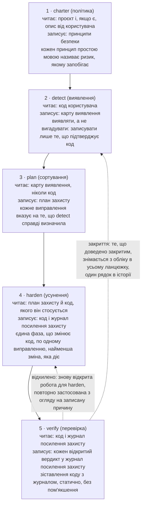
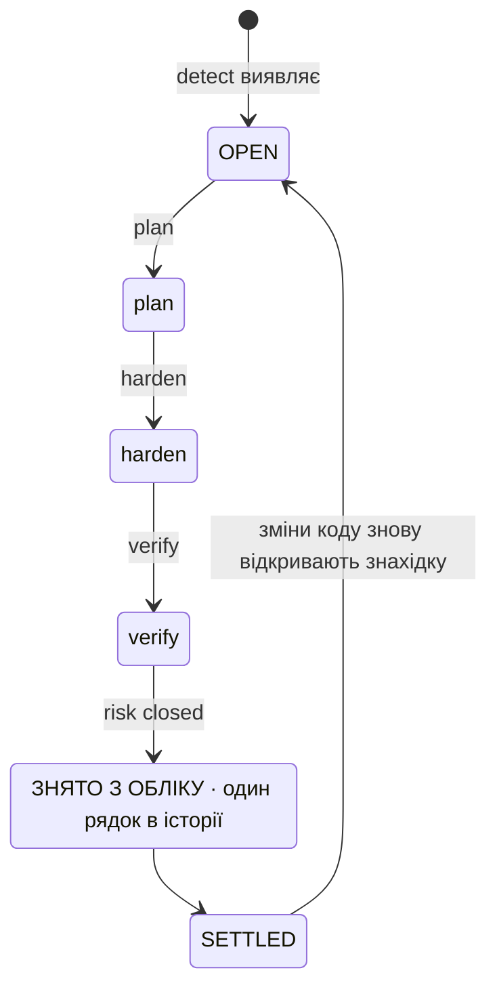
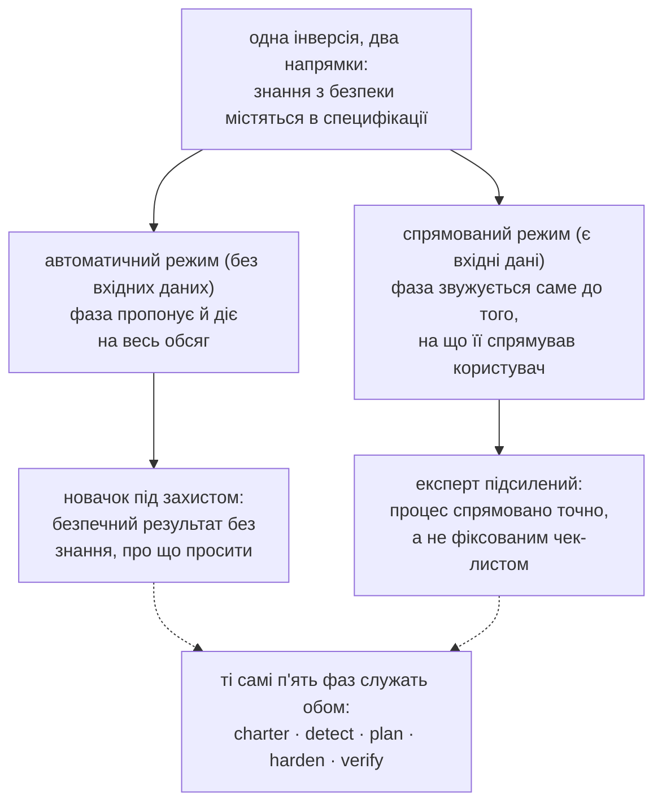
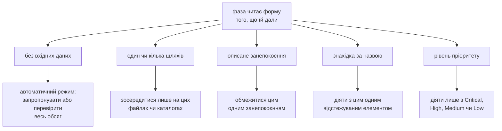
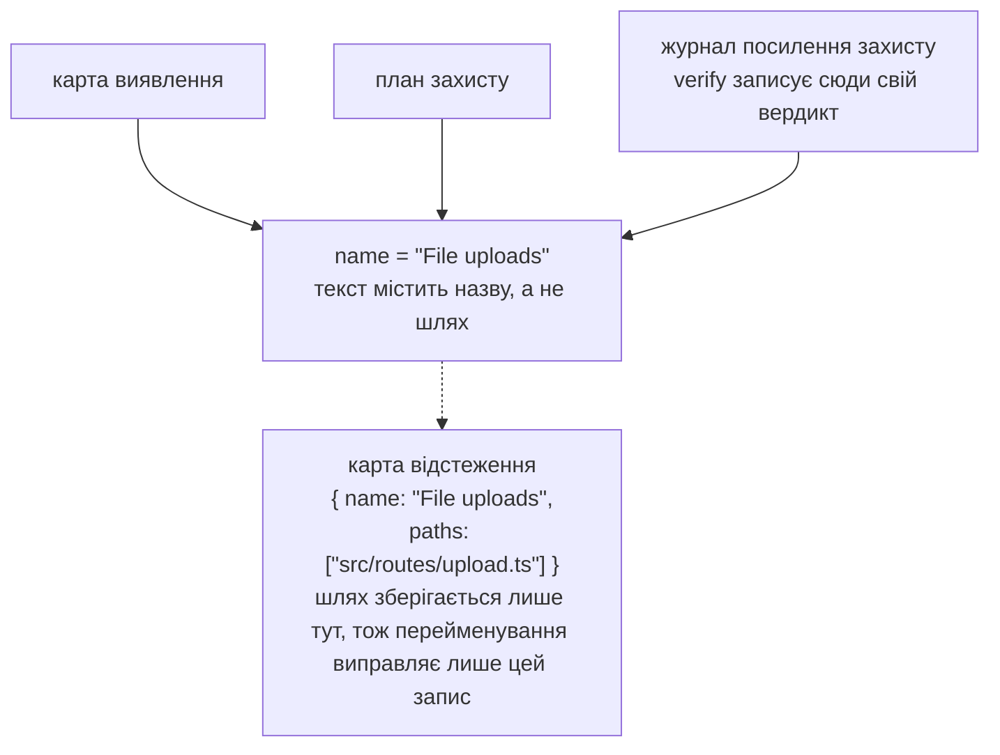
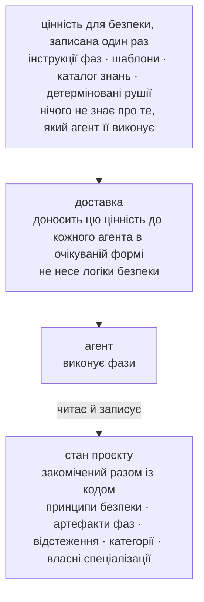
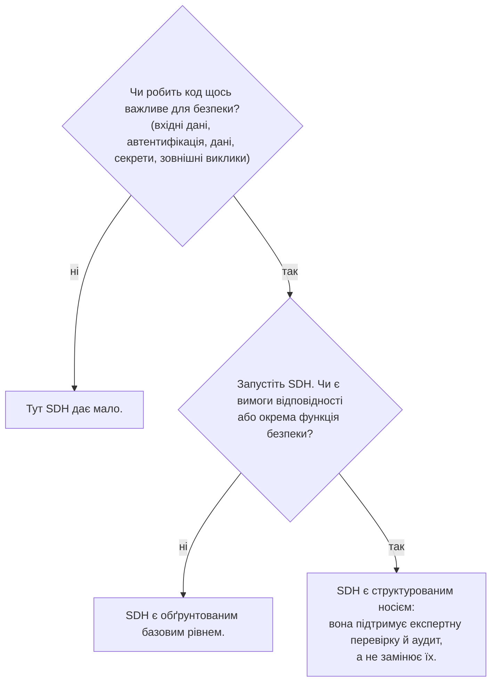

# Security-Driven Hardening: конвенція для епохи розробки з допомогою ШІ

> Методологія Security-Driven Hardening (SDH): конвенція Blue Team з урахуванням контексту для аудиту й посилення захисту програм, створених з допомогою ШІ та у стилі vibe coding.

Канонічна URL-адреса: https://lagune.ai/uk-UA/docs/references/paper
Мова: uk-UA
Оригінал: https://lagune.ai/docs/references/paper
Останнє оновлення: 2026-11-05

- **Weslley Araújo**
- **Стаття про методологію, 2026.**

---

## Анотація

Security-Driven Hardening (SDH) є структурованою, керованою ШІ, суто оборонною методологією безпеки для епохи, у якій програмне забезпечення дедалі частіше пишуть ШІ-агенти й люди, що не є фахівцями з безпеки. Замість загального чек-листа SDH спершу визначає, що насправді робить система (вхід, завантаження файлів, платежі, розкриття даних тощо), а потім спрямовує роботу з безпеки, специфічну саме для цього контексту. Нею керують принципи безпеки за замовчуванням, вона повністю зосереджена на захисті й викладена простою мовою, щоб будь-який користувач міг діяти на її основі.

Цей документ стверджує, що SDH є відсутньою конвенцією, а не окремим інструментом. Знання з безпеки містяться в методології та її спеціалізаціях на вимогу, базовому рівні, на який може спиратися кожен користувач, і це дає їй змогу обслуговувати новачка й експерта тим самим процесом. Дві властивості вирізняють її серед попередніх підходів, що ставлять специфікацію на перше місце `[1]`. SDH **не залежить від стану**: вона пристосовується до порожнього каталогу, проєкту в роботі, окремого pull request чи великої застарілої кодової бази в будь-якому стеку. І в SDH **безпеку можна закрити**: ризик, закриття якого перевірено, знімається з обліку в усьому процесі, тож знахідка досягає усталеного стану й відкривається знову лише тоді, коли змінюється код. SDH не замінює фахівців з безпеки чи спеціалізовані інструменти Blue Team. Вона розширює власні знання розробника, і що краще розробник розуміє безпеку, то більше він може нею керувати.

**Lagune** є еталонною реалізацією, і він доводить, що методологію можна побудувати й перенести. SDH пропонується як конвенція, яку можуть прийняти інші.

> **Ключові терміни**
>
> Розробка з допомогою ШІ, безпека програмного забезпечення, оборонна безпека, spec-driven development, посилення захисту, робочі процеси під керуванням агентів, закриваність, безпека з урахуванням контексту, знання на вимогу, інструменти, незалежні від агента.

---

## I. Вступ: прогалина в безпеці, яку відкрила розробка з допомогою ШІ

Програмне забезпечення дедалі частіше випускають люди й ШІ-агенти, які не можуть надійно розпізнати небезпечний шаблон: витік секрету, відсутню перевірку авторизації, запит, уразливий до ін'єкції. Це не екзотичні ризики. Вони належать до класів ризиків, що домінують у реальних інцидентах і роками описуються в публічних джерелах `[6]`, `[7]`, а нещодавні дослідження повідомляють, що помітна частка коду, згенерованого ШІ, виходить саме з такими дефектами `[8]`. ШІ-асистенти для програмування загострили проблему, давши нерозробникам змогу випускати реальне програмне забезпечення, але прогалина ширша за будь-яку окрему аудиторію. Більшість проєктів ніколи не проходять перевірку безпеки, специфічну для того, що вони насправді роблять. Екосистема стає крихкішою з кожним передчасним рішенням "працює, випускаємо".

Загальні поради з безпеки не закривають цю прогалину. Статичний чек-лист не враховує, що робить система, тож засипає невеликий проєкт нерелевантними пунктами й усе одно пропускає ризик, важливий саме для цього проєкту. Проблема не в нестачі знань з безпеки у світі. Проблема в тому, щоб підібрати правильні знання до системи, яка справді перед користувачем, і зробити це для людини, яка може не знати, про що просити.

SDH відповідає на це однією інверсією: **знання з безпеки містяться в специфікації та її спеціалізаціях на вимогу, базовому рівні, на який може спиратися кожен користувач**. Методологія визначає контекст, сортує за пріоритетом ризики, які несе цей контекст, і спрямовує виправлення, тож розробник і нерозробник обслуговуються тим самим процесом. Знахідки й рекомендації залишаються викладеними простою мовою, тож на їхній основі можна діяти незалежно від технічної глибини читача. Експерта це не обмежує, а підсилює, і цю двоїстість ми розвиваємо в `§VI`.

> **Ключова думка**
>
> **Основна інверсія:** знання з безпеки містяться в специфікації та її спеціалізаціях на вимогу, базовому рівні, на який може спиратися кожен користувач. Методологія дізнається, що робить система, підбирає до неї роботу з безпеки й розширює те, що користувач уже знає.

Уявіть розробника, який каже ШІ-асистенту: "мій застосунок дає користувачам завантажити фото профілю". Без перевірки безпеки асистент видає робочий код, який непомітно довіряє всьому, що надсилає клієнт: заявленому типу файлу, імені файлу, розміру. Завантаження йде в реліз, і файл, замаскований під зображення, може нести код, підроблене ім'я може вирватися за межі шляху сховища, а завеликий файл може вичерпати ресурси сервера. Нічого з цього не видно на демо, тож воно йде в реліз.

Той самий код, пропущений через SDH, поводиться інакше. Методологія визначає, що система приймає файли ззовні (виявлення), сортує це в ризики, які несе завантаження (сортування), пропонує перевіряти справжній тип і розмір файлу, перейменовувати його під час збереження й зберігати там, де код не може виконатися (усунення), а потім читає результат і підтверджує, що кожен засіб захисту справді діє (перевірка). Розробнику ніколи не довелося знати фразу "unrestricted file upload". Методологія підставила її за нього.

Цей документ робить такі внески:

- Точне визначення SDH як методології, незалежної від будь-якої окремої реалізації, з її принципами проєктування (`§III`).
- П'ятифазний оборонний життєвий цикл, у якому розподіл обов'язків сам є внеском: виявлення ніколи не вигадує, планування ніколи не читає код, лише одна фаза змінює код, а перевірка ніколи не пом'якшує свого судження (`§IV`).
- **Закриваність** як методологічна позиція: окрема знахідка має кінцевий стан, а не нескінченний цикл (`§V`).
- Двоїстість **розширювача знань розробника**: один процес, що захищає новачка й підсилює експерта (`§VI`).
- **Спеціалізації, які не викликаються напряму, і промпт на вимогу**: цільові знання з безпеки, які агент завантажує, коли цього вимагає контекст проєкту, а не за замовчуванням (`§VII`).
- **Незалежність від стану** й **неавторитарна адаптивність**: SDH підходить до будь-якого стану розробки й пристосовується до сценарію, а не нав'язує фіксований обсяг (`§VIII`).
- **Превентивний режим**: той самий захист працює під час створення звичайної роботи, тож код з'являється безпечним за замовчуванням, а фазам залишається менше виправляти (`§IX`).
- Окреме порівняння зі Spec-Driven Development, лінією, з якої виросла SDH і від якої потім відійшла (`§X`).
- Інженерні дисципліни, що дають методології пережити рефакторинги й залишатися незалежною від будь-якого агента: відстеження з ідентичністю за назвою (`§XI`) і носій, незалежний від агента (`§XII`).

---

## II. Передумови й пов'язані роботи

SDH спирається на попередні роботи. Вона успадковує перевірену структуру розробки, що ставить специфікацію на перше місце й керується агентом `[1]`, `[2]`, `[3]`: шаблони, slash-команди, які споживає агент, керівний документ і агента, що виконує фази. Вона заново реалізує цю структуру з оборонною метою. Ця спадкоємність свідома, і один із робочих принципів SDH прямо її називає: будуй робочий процес на перевіреній структурі, а потім спрямовуй його на безпеку.

SDH не є статичним чек-листом загальних рекомендацій. Чек-лист знає багато про безпеку загалом і нічого про проєкт перед ним. SDH змінює цей акцент на протилежний. Свої перші зусилля вона витрачає на виявлення, на те, щоб дізнатися, що робить система, і лише потім звертається до знань, які виявлення робить доречними.

SDH також не замінює фахівців з безпеки чи спеціалізовані інструменти Blue Team. Вона розширює знання розробника (`§VI`). Команді з окремою функцією безпеки варто її зберегти. SDH дає такій команді структурований носій, а команді без неї дає обґрунтований базовий рівень.

SDH також стоїть поруч із детермінованими сканерами безпеки (статичний аналіз, лінтери) `[4]`, `[5]`. Ці інструменти цінні саме тому, що вони детерміновані й відтворювані. SDH здебільшого спирається на міркування агента, тобто обмінює сувору детермінованість на врахування контексту. Методологія не вдає, що це не так. Там, де детермінованість важлива, вона вбудовує детермінований рушій у міркування (`§VII`): агент вирішує, чи варто перевіряти вхідні дані, а детермінована програма вирішує, чи вони небезпечні.

Найближчим попереднім підходом є Spec-Driven Development (SDD), сімейство методологій, що ставлять специфікацію на перше місце й ведуть розробку від виконуваної специфікації. Ми розглядаємо SDD як клас. Найчіткіше як практичну методологію її сформульовано у звіті Piskala `[1]`, а її найпомітнішим інструментарієм під керуванням агента є Spec Kit від GitHub `[2]`, тоді як OpenSpec `[3]` є другим інструментом із того самого сімейства. Вони є канонічними джерелами для порівняння в `§X`.

---

## III. SDH: визначення й принципи проєктування

**Security-Driven Hardening** є структурованою, керованою ШІ методологією безпеки, що робить кодову базу безпечнішою, спрямовуючи роботу від специфікації, яку виконує агент, а не від ситуативних виправлень. Назву натхнено **Blue Teams**, захисниками в безпеці. SDH стосується захисту, посилення захисту й перевірки, а ніколи не нападу.

> **Визначення**
>
> **Security-Driven Hardening (SDH):** структурована, керована ШІ, суто оборонна методологія безпеки, що спершу визначає, що насправді робить система, а потім спрямовує роботу з безпеки, специфічну для контексту, під керуванням принципів безпеки за замовчуванням і простою мовою.

SDH визначається набором обов'язкових принципів. Кожен із них є правилом, і кожен дає користувачу певну гарантію.

| Принцип                                                                  | Правило                                                                                                                                                                     | Що він гарантує користувачу                                                                                                                                                   |
| ------------------------------------------------------------------------ | --------------------------------------------------------------------------------------------------------------------------------------------------------------------------- | ----------------------------------------------------------------------------------------------------------------------------------------------------------------------------- |
| Безпечно за замовчуванням, простою мовою, для всіх однаково              | Кожне значення за замовчуванням, повідомлення й виправлення безпечне одразу й зрозуміле будь-якому читачу, розробнику чи ні. Жоден рівень користувачів не має переваг.      | Новачок отримує безпечний базовий рівень, не просячи про нього, і читає результат своїми словами.                                                                             |
| Контекст понад загальність                                               | Кожна фаза починає з контексту, виявленого в detect, і діє відповідно до того, що насправді робить система.                                                                 | Рекомендації відповідають проєкту, а не чек-листу. Знання з безпеки містяться в специфікації та її спеціалізаціях на вимогу й розширюють усе, що приносить користувач.        |
| Гнучкість понад жорсткість                                               | Принципи, вимоги й рекомендації є відправними точками. Користувач може переформулювати, прибрати, додати будь-що або звузити його обсяг.                                    | Методологія підлаштовується під проєкт і користувача й ніколи не буває суворішою, ніж хоче користувач. Гнучкість ніколи не послаблює базовий рівень безпеки за замовчуванням. |
| Узгоджувати, а не лише дописувати                                        | Артефакти є живими документами, а не журналами. Кожен запуск перевіряє кожен запис: зберігає те, що досі слушне, переписує змінене, прибирає те, що вже не стосується.      | Запис завжди відображає теперішнє, тож ніколи не перетворюється на застарілий беклог.                                                                                         |
| Лише захист                                                              | SDH перевіряє, посилює захист і верифікує. Вона ніколи не створює наступальних інструментів, експлойтів для зловмисного використання чи способів обійти виявлення на шкоду. | Методологію неможливо перетворити на зброю. Вміст подвійного призначення з'являється лише в чітко оборонному контексті.                                                       |
| Специфікація на першому місці, керування агентом, спрямування на безпеку | Робочий процес побудовано з шаблонів, команд, керівних принципів безпеки й агента, що виконує фази.                                                                         | Перевірена структура розробки, перепрофільована так, щоб агент виконував суттєву роботу з безпеки.                                                                            |

**Таблиця 1.** Принципи проєктування SDH і гарантія, яку кожен із них дає користувачу.

Ці принципи не декоративні. Це обмеження, яких має дотримуватися кожна фаза нижче, і обговорення в `§XV` повертається до них, щоб окреслити межі методології.

Решта документа розвиває дев'ять іменованих стовпів. Це частини, які читач має тримати в голові, і частини, які інша команда реалізувала б заново, щоб стверджувати, що вона практикує SDH.

| Стовп                                                 | Що він дає                                                                                                         | Розділ      |
| ----------------------------------------------------- | ------------------------------------------------------------------------------------------------------------------ | ----------- |
| Інверсія з урахуванням контексту                      | Знання з безпеки містяться в специфікації та її спеціалізаціях на вимогу, тож новачок і експерт мають один процес. | `§I`, `§VI` |
| П'ятифазний оборонний життєвий цикл                   | Розподіл обов'язків: політика, виявлення, сортування, усунення, перевірка, і в кожної одне завдання.               | `§IV`       |
| Закриваність                                          | Знахідка має кінцевий стан, а не нескінченний цикл. Закриту роботу знімають з обліку.                              | `§V`        |
| Двоїстість розширювача знань розробника               | Один процес, що захищає новачка й підсилює експерта, не замінюючи жодного з них.                                   | `§VI`       |
| Промпт на вимогу, знання, які не викликаються напряму | Доречні знання з безпеки завантажуються для того, чим є проєкт, а не за замовчуванням.                             | `§VII`      |
| Незалежність від стану й неавторитарна адаптивність   | Підходить до будь-якого стану розробки в будь-якому стеку й пристосовується до сценарію, а не нав'язує обсяг.      | `§VIII`     |
| Превентивний режим                                    | Той самий захист працює під час створення нової роботи, тож код з'являється безпечним за замовчуванням.            | `§IX`       |
| Відстеження з ідентичністю за назвою                  | Знахідка залишається одним елементом між фазами, а перейменування розриває зв'язок в одному місці.                 | `§XI`       |
| Носій, незалежний від агента                          | Цінність для безпеки записано один раз, і вона не залежить від жодного агента чи стеку.                            | `§XII`      |

**Таблиця 2.** Дев'ять іменованих стовпів SDH і де кожен із них розвивається.

---

## IV. П'ятифазний процес Blue Team

SDH структурує роботу як п'ятифазний оборонний життєвий цикл (рисунок 1). Кожна фаза зосереджена на захисті, кожна спирається на попередню, а фази відтворюють реальну діяльність Blue Team: встановити політику, виявити, відсортувати, усунути, перевірити.



**Рисунок 1.** П'ятифазний процес: що читає кожна фаза, що вона записує і її ключовий інваріант. Verify керує обома поверненнями: відхилений засіб захисту знову відкриває harden, а знахідку, закриття якої доведено, знімають з обліку в усьому ланцюжку, залишаючи один рядок в історії.

Розподіл обов'язків і є внеском. Оскільки кожна фаза має одне завдання, збій залишається в одному місці, а читач може довіряти тому, що стверджує кожен артефакт.

> **Ключова думка**
>
> **Applied не означає перевірене:** harden записує, що виправлення застосовано. Verify перевіряє це, зіставляючи код із цим записом, і вердикт ніколи не пом'якшується, щоб відповідати запису. Засіб захисту може бути в коді й при цьому залишати ризик досяжним, і тоді чесний вердикт: "risk not closed".

### charter (політика)

Charter встановлює принципи безпеки проєкту, правила, яких має дотримуватися кожна наступна фаза. Це керівний рівень, своєрідна перевірка під час компіляції для рівня захищеності проєкту. Кожен принцип має чітку назву, непорушне правило, яке можна перевірити за кодом, і рядок `Why:`, що називає ризик, якому принцип запобігає, а не лише виправлення. Charter завжди читає сам проєкт (його маніфести, структуру й залежності), а опис користувача, якщо він є, задає напрям, який аналіз потім розширює за межі названого користувачем. Без опису проєкт є єдиним джерелом. Ці джерела доповнюють, а не заперечують одне одного, і charter записує політику, якої має дотримуватися проєкт, а не стан його коду. Нерозробник має змогу прочитати її й зрозуміти і правило, і ризик.

### detect (виявлення)

Detect читає код і визначає, що насправді робить система з того, що має вагу для безпеки. Головна настанова: "виявляти, а не вигадувати", тобто записувати лише те, що підтверджує код, разом із доказами, потрібними наступним фазам. Detect нейтральна. Вона не підганяє свої знахідки під принципи безпеки, бо зіставляти ризики з правилами принципів безпеки є завданням фази plan. Кожна знахідка має три частини: що це (опис простою мовою), чому це важливо (ризик, а не лише факт) і доказ (функція чи маршрут, де вона міститься). Доказ не містить шляху до файлу. Шлях зберігається лише в карті відстеження (`§XI`), тож текст ніколи не містить шляху, який може застаріти.

### plan (сортування)

Plan перетворює кожну знахідку на виправлення, назване за класом ризику (з посиланням на усталені джерела, CWE та OWASP, там, де вони його обґрунтовують) і прив'язане до принципу безпеки, який підтримує виправлення. Пріоритет (Critical, High, Medium, Low) не є вільним вибором: plan оцінює кожну знахідку методом CVSS v4.0 з метриками Base і Environmental, тож рівень є оцінкою, переказаною простими словами й обґрунтованою одним рядком простою мовою про відкритість і значущість, і два запуски дають той самий порядок. Вектор є точною опорою для експерта, а рівень і його обґрунтування є тим самим рейтингом, зрозумілим будь-кому. Plan працює лише з картою виявлення й ніколи не читає код. Це свідоме обмеження, а не недолік: воно змушує кожне виправлення вказувати на те, що detect справді виявила. Якщо якусь область ще не досліджено, plan зупиняється й повертає користувача до detect, а не вгадує.

### harden (усунення)

Harden є єдиною фазою, що змінює код, тож вона діє обережно. Чи потребує правка схвалення користувача, вирішують агент і режим дозволів, у якому він працює, тож harden не додає власного кроку підтвердження. Вона застосовує по одному виправленню, спершу залежності, потім найвищий пріоритет, тож кожна зміна залишається невеликою, зручною для перегляду й легкою для скасування. Вона ніколи не послаблює наявний засіб захисту, щоб припасувати нове виправлення, і ніколи не порушує принцип безпеки. Якщо виправлення суперечило б принципу, harden зупиняється й показує конфлікт замість того, щоб застосувати виправлення. Кожен блок записується як Applied, Partial чи Blocked. "Applied ще не означає перевірене", і саме цим займається наступна фаза.

### verify (перевірка)

Verify перевіряє кожен застосований засіб захисту, читаючи код і зіставляючи його з тим, що записала harden. Перевіркою є саме це зіставлення коду з журналом, і воно статичне: воно підтверджує, що засіб захисту наявний і коректний у коді, а не що він витримує атаку на працюючу систему. Така перевірка під час виконання, що проводить реальні чи змодельовані атаки на робочу систему, свідомо лишається поза обсягом. Verify повертає один із трьох вердиктів: risk closed, risk not closed або cannot tell from the code. Вона не створює власного артефакту: harden і verify ділять журнал посилення захисту, при цьому harden володіє тим, що зроблено, а verify вердиктом і його причиною, і жодна з них ніколи не пише в поля іншої. Відхилений засіб захисту є знову відкритою роботою для harden, яка під час наступного запуску ставить вердикт вище за власне прочитання коду й повторно застосовує виправлення саме до тієї прогалини, яку називає причина. Verify довіряє коду більше, ніж журналу, бо журнал може заявляти більше, ніж дає код. Код користувача вона лише читає й ніколи не пом'якшує вердикт, щоб він відповідав журналу. Засіб захисту може бути наявним і все одно залишати ризик досяжним іншим шляхом, і в такому разі чесний вердикт: "risk not closed". Якщо під час читання verify помічає проблему безпеки, якої карта виявлення ніколи не охоплювала, вона не вигадує для неї вердикт, бо виявлення є завданням detect: вона показує проблему й повертає користувача до detect, тож знахідка входить тим самим процесом, а не в обхід нього.

> **Наскрізний приклад: завантаження файлів.** Одна знахідка показує весь хребет від початку до кінця.
>
> - **detect** знаходить її: система приймає файли від користувачів, а обробник завантаження довіряє MIME-типу, який надсилає клієнт, не перевіряючи справжній тип файлу. _Чому це важливо:_ файл, замаскований під зображення, може приховувати шкідливий код.
> - **plan** визначає виправлення з пріоритетом **Critical**, що підтримує принцип "Усі вхідні дані недовірені, доки їх не перевірено": перевіряти справжній тип і розмір файлу, перейменовувати його під час збереження й зберігати завантаження там, де їх неможливо виконати як код.
> - **harden** застосовує його зі статусом **Applied**: обробник тепер визначає справжній тип за вмістом, обмежує розмір, відхиляє все неочікуване, перейменовує файл під час збереження й зберігає його там, де код не може виконатися.
> - **verify** читає обробник, зіставляє його з журналом і повертає **risk closed**: код робить саме те, що заявлено в журналі.
>
> Та сама назва знахідки проходить через карту виявлення, план і журнал посилення захисту, а verify діє з цим журналом під тією самою назвою: відкритий вердикт записується в блок знахідки, а знахідку, закриття якої доведено, знімають з обліку (`§V`). Ця спільна назва є її ідентичністю (`§XI`).

---

## V. Закриваність: знахідка має кінцевий стан

Більшість інструментів безпеки залишає користувачу беклог, який лише росте. SDH займає іншу позицію: **знахідку можна закрити, тож вона має кінцевий стан, а не живе в нескінченному беклозі** (рисунок 2). Це прямо випливає з принципу узгодження.

> **Визначення**
>
> **Закриваність:** ризик, закриття якого перевірено, знімається з обліку в усьому процесі, тож знахідка досягає усталеного стану й відкривається знову лише тоді, коли змінюється код. Знахідка має кінцевий стан, хоча сама програма безпеки залишається безперервною.

Артефакти SDH є живими документами, а не журналами подій. Щоразу, коли фаза запускається повторно, вона звіряє кожен наявний запис із поточною правдою й робить одне з трьох: зберігає те, що досі слушне, переписує змінене або прибирає те, що вже не стосується. Знахідку, яку, як показує код, уже розв'язано, просто прибирають. Робочий запис відображає теперішнє, а не минуле.

Закриття є тим самим узгодженням, доведеним до завершення. Коли verify підтверджує, що ризик закрито, вона знімає знахідку з обліку в усьому процесі: у карті виявлення, плані, журналі посилення захисту й карті відстеження. Саме тому verify є єдиною фазою, що пише в артефакти інших фаз: це фаза, що замикає цикл. Коли знахідка залишає ланцюжок, зняття з обліку стисло переносить її в короткий запис в історії, яка зберігається поза робочим ланцюжком і ніколи не обробляється повторно. У цьому й полягає межа між зникненням і закриттям: знахідка, яку узгодження прибрало, бо вона перестала бути правдою, нічого по собі не залишає, тоді як знахідка, закриття якої доведено, заслуговує на свій рядок в історії. Знахідки, знятої з обліку, після цього немає в жодному робочому артефакті, і ця відсутність очікувана, а не ознака розірваного ланцюжка.



**Рисунок 2.** Машина станів закриваності. Знахідка переходить OPEN → ЗНЯТО З ОБЛІКУ → SETTLED і відкривається знову лише тоді, коли змінюється код.

Коли все в межах обсягу знято з обліку, цикл переходить у стан спокою, і цей стан має конкретну форму: артефакт, остання знахідка якого закрилася, прибирається повністю, тож повністю закритий ланцюжок залишає лише принципи безпеки й історію, тобто політику й доказ. Цикл відкривається знову лише тоді, коли змінюється код. Методологія дає кожній знахідці чітке завершення, а саме цього не може нескінченний беклог.

---

## VI. Двоїстість розширювача знань розробника

SDH не замінює людей і не замінює спеціалізовані інструменти Blue Team. Вона **розширює власні знання розробника**. Що краще розробник розуміє безпеку, то точніше він може керувати процесом і то більше має автономії. Розробник, який розуміє мало, все одно отримує безпечний результат, бо автоматичний режим його захищає.

Інверсія з `§I`, за якою знання з безпеки містяться в специфікації, діє в обох напрямках. Для новачка це захист: йому не треба знати, про що просити, бо специфікація пропонує сама. Для експерта це підсилення: та сама специфікація дає йому змогу точно спрямовувати процес, а не боротися з фіксованим чек-листом.

Кожна фаза несе цю двоїстість у власній роботі (рисунок 3). Запущена без вхідних даних, вона діє на весь обсяг від імені користувача. Отримавши вказівки, та сама фаза звужується саме до того, на що її спрямував користувач.



**Рисунок 3.** Двоїстість розширювача знань розробника. Одна інверсія служить двом аудиторіям: автоматичний режим захищає новачка, а спрямований режим підсилює експерта, через ті самі п'ять фаз.

Спеціалізації на вимогу (`§VII`) роблять цю двоїстість явною у власному тексті. Кожна з них каже агенту, що її знання "розширюють твоє судження", і просить міркувати далі за межі того, що дає спеціалізація. Знання є мінімумом, а не стелею. Саме це служить обом аудиторіям у тому балансі, який задумав документ: спільнота розробників отримує вагомий інструмент, а практик Blue Team отримує структурований носій, який не вдає, що виконує його роботу за нього.

---

## VII. Спеціалізації, які не викликаються напряму, і промпт на вимогу

Це найновіший шаблон методології. SDH несе цільові знання з безпеки у вигляді спеціалізацій, що завантажуються **лише на вимогу**, і агент сам вирішує, які завантажити, зіставляючи їх із контекстом проєкту. Ми називаємо це **промптом на вимогу**: способом для агента вибирати, які знання активувати, залежно від обсягу проєкту, у якому він працює, а не запускати всі перевірки за замовчуванням. Спеціалізації еволюціонують, і будь-яку з них можна будь-коли змінити чи замінити. Внеском є шаблон, а не самі спеціалізації.

> **Визначення**
>
> **Промпт на вимогу:** агент вибирає, які знання з безпеки активувати, зіставляючи їх з обсягом проєкту перед ним, тож потрібні знання підтягуються для того, чим насправді є проєкт, замість того щоб за замовчуванням запускалися всі перевірки.

> **Визначення**
>
> **Спеціалізація, яка не викликається напряму:** цільова, незалежна від мови програмування одиниця знань з безпеки для одного контексту, як-от завантаження файлів чи код, що виконується в браузері. Вона перевіряє й пояснює, ніколи не переписує код і ніколи не створює вхідних даних для атаки. Це не команда: вона завантажується, коли контекст, який вона охоплює, потрапляє в обсяг, або коли промпт просить її за назвою.

Кожна спеціалізація називає безпечніші форми для ризиків, які вона охоплює, і пояснює агенту, як діяти зі знахідкою в кожній фазі, що її використовує: як оцінити її під час виявлення, як безпечно застосувати її виправлення під час усунення і як довести його під час перевірки.

Визначальна риса полягає в тому, що спеціалізація **сама по собі не викликається**: це не команда, і всередині процесу її завантажує збіг. Фаза виявлення один раз переглядає каталог, зіставляє контекст проєкту з тим, що охоплює кожен запис, і завантажує лише ті спеціалізації, чий контекст присутній в обсязі. Наступні фази повторно використовують цей список збігів, а не переглядають каталог знову, тож один збіг служить усьому ланцюжку, а превентивний режим (`§IX`) виконує те саме зіставлення для роботи, яку ось-ось буде створено. Спеціалізацію, чийого контексту немає, пропускають, і за пропуск звітують так само, як за завантаження: кожен запис у каталозі отримує явний вердикт, застосовано чи пропущено, з причиною, прочитаною з коду, тож розмите відчуття нерелевантності ніколи не підміняє відсутність. Не знайти жодної доречної спеціалізації є цілком прийнятним результатом.

Каталог є даними, і його зростання означає один файл знань плюс один рядок у каталозі, а ніколи не нову команду. Вбудовані спеціалізації згруповано в категорії, як-от OWASP, мова програмування чи інтеграції зі ШІ, а каталог, який використовує проєкт, містить вбудовані спеціалізації обраних ним категорій плюс його власні спеціалізації. Проєкт записує цей вибір разом з рештою свого стану, тож уся команда зіставляє код з тим самим каталогом. Це той самий принцип урахування контексту, що й у фазах, застосований до знань: потрібні знання підтягуються для того, чим насправді є проєкт, замість того щоб за замовчуванням запускалися всі перевірки. Та сама властивість дає змогу розширювати каталог не лише мейнтейнеру, а й користувачу: джерело чи тема з безпеки, які надає користувач, стисло викладаються в нову спеціалізацію, що належить проєкту, потрапляє до його каталогу незалежно від категорій і завантажується точно так само, як вбудована, замінюючи вбудовану з тією самою назвою. Створення спеціалізації саме по собі суто оборонне й підпорядковане тій самій межі, яку забезпечують спеціалізації: опис атаки може бути джерелом, але спеціалізація, яку з нього отримано, перевіряє й пояснює і ніколи не видає робочого експлойту. Тож інверсія з `§I`, за якою інтелект міститься в специфікації, поширюється й на сам каталог, який користувач може поглиблювати для власного контексту, не пишучи коду.

Короткий приклад ілюструє промпт на вимогу. Detect читає папку з кодом, що виконується в браузері. Вона знаходить цей контекст у каталозі, завантажує спеціалізацію, яка його охоплює, і виявляє знахідку на боці клієнта звичайними кроками detect. Спеціалізації, чийого контексту немає в цьому обсязі, не збігаються, тож ніколи не завантажуються, і кожну з них записано як пропущену. Які знання доречні, вирішив проєкт, а не фіксована конфігурація.

Детермінованість з'являється саме там, де вона важлива. Спеціалізація може містити детермінований перевіряльник, а не лише текст: там, де клас ризику має чітку процедуру вирішення, невелика програма повертає фіксований вердикт для заданих вхідних даних, наприклад коротке слово на кшталт `safe`, `unsafe` чи `invalid input`. Деякі класи ризиків детерміновано розв'язні саме так, і за процедурою вирішення стоїть масив попередніх робіт `[9]`, `[10]`, `[11]`. Перевіряльник або оцінює кандидатів, яких надає агент, або сам перевіряє обсяг, щоб їх знайти, і в обох випадках вердикт повертає перевіряльник, а не агент. Достатньо універсальну спеціалізацію можна позначити в каталозі як обов'язкову, і тоді вона застосовується завжди, а її перевіряльник запускається на весь обсяг. Це єдиний випадок, коли знання завантажуються без збігу з контекстом, і він задекларований у даних каталогу, а не вирішується агентом у моменті. Саме тут SDH підкріплює міркування агента чимось відтворюваним, не вдаючи, що весь процес детермінований.

Нарешті, спеціалізації **від'єднувані**. Оскільки знання самодостатні, користувач може запустити одну з них напряму в промпті, який не має нічого спільного з повним процесом SDH, і тримати безпеку поруч зі звичайною розробкою. Спеціалізація з детермінованим перевіряльником може, наприклад, перевіряти кожного кандидата, створеного під час звичайного програмування, і залишати лише безпечні. Ця від'єднуваність є однією з причин, чому SDH пристосовується до такої кількості ситуацій, про що йдеться в `§VIII`, а її повний вияв є превентивним режимом (`§IX`), у якому ті самі знання захищають звичайну розробку від початку до кінця.

---

## VIII. Незалежність від стану й неавторитарна адаптивність

Дві властивості відрізняють SDH від жорстких методологій на основі специфікацій.

### Незалежність від стану

> **Визначення**
>
> **Незалежність від стану:** методологія не залежить від стану розробки. Вона підходить до порожнього каталогу, проєкту в роботі, окремого pull request чи великої застарілої кодової бази в будь-якому стеку, бо дізнається вихідну точку, читаючи її.

Кожна фаза працює однаково, хоч проєкт зовсім новий, хоч він уже існує. Charter виводить принципи з будь-якого наявного коду. Detect визначає будь-який код, що є, навіть якщо його зовсім мало. Жодної припущеної вихідної точки немає.

### Неавторитарна адаптивність

> **Визначення**
>
> **Неавторитарна адаптивність:** методологія пристосовується до сценарію, а не нав'язує фіксований обсяг, якого має дотримуватися користувач. Коли користувач не знає, що сказати, вона читає середовище, у якому її викликано, генерує контекст і ставить запитання, що визначають її подальші дії.

Режим пропозиції в charter є найчіткішим прикладом: SDH виводить безпечні за замовчуванням принципи безпеки, аналізуючи проєкт, і питає користувача лише тоді, коли прогалина справді змінює результат, а потім записує їх і подає кожен принцип простою мовою разом із ризиком, якому він запобігає. Принципи безпеки є живим документом, який користувач переробляє повторним запуском, а не контрактом, захованим за запитом на схвалення, тож вони ніколи не вимагають від користувача знати, про що просити.

Ця адаптивність проявляється як чутливість до форми вхідних даних: та сама фаза читає те, що їй дали, і вибирає режим (рисунок 4). Файл у промпті, знахідка зі списку, побоювання, цільова місія проти відомого слабкого місця чи запит на повну перевірку перебором: кожен варіант відповідає потребі користувача, бо процес неавторитарний за задумом. Ніщо з цього не послаблює базовий рівень безпеки за замовчуванням. Гнучкість визначає, як застосовується базовий рівень, і ніколи його не знижує.



**Рисунок 4.** Неавторитарна адаптивність. Та сама фаза читає форму своїх вхідних даних і вибирає режим, тож обсяг завжди належить користувачу, а не нав'язується.

---

## IX. Універсальний превентивний режим: той самий захист під час створення роботи

SDH має один доповнювальний режим: звичайну розробку з тим самим захистом, активним під час написання коду. Користувач просить саму роботу, сторінку входу, завантаження, ендпоінт, а методологія захищає розробку в процесі, тож результат безпечний за замовчуванням із моменту появи, а не після пізнішого проходу посилення захисту.

> **Визначення**
>
> **Превентивний режим:** звичайна розробка під керівним рівнем і знаннями SDH. Принципи безпеки зобов'язують розробку, спеціалізації, доречні для того, що ось-ось буде створено, завантажуються на вимогу, а результат зіставляється саме з тим захистом, який використовувався, перш ніж роботу визнають завершеною.

Режим повторно використовує кожну частину, яку вже несуть фази, спрямовуючи її на код, якого ще не існує. Визначення контексту переходить від коду до наміру: агент міркує над тим, що ось-ось створить, і над межами, які перетинає ця робота (вхід передбачає облікові дані, сесію й вхідні дані ззовні), і саме з цим міркуванням зіставляється каталог знань. Промпт на вимогу (`§VII`) тут узагальнюється: контекст можна виявити в плані коду, а не лише в коді, що вже існує. Принципи безпеки керують, як завжди, а запит, що порушив би принцип, показується як конфлікт і ніколи не виконується. Захист застосовується одразу, у момент написання кожної частини: перевірка на межі й безпечна конструкція з першого разу, тож робочої, але небезпечної версії, яку довелося б виправляти, ніколи не існує.

Режим завершується так, як починається verify. Перш ніж роботу визнають завершеною, той, хто її створює, зіставляє власний результат із захистом, який використав: засіб захисту має стояти на шляху ризику, а не поруч, він має бути повним, а там, де спеціалізація містить детермінований перевіряльник, вердикт перевіряльника стоїть вище за власне прочитання агента. Прогалину, знайдену тут, закривають у межах тієї самої роботи, бо завершити роботу означає завершити її безпечно.

Те, від чого режим відмовляється, так само свідоме, як і те, що він робить. Він створює лише те, про що просили, і нічого не перевіряє навколо: аудит наявного належить фазам. Він не пише артефактів і не відстежує знахідок, бо знахідка є ризиком, виявленим у тому, що вже існує, а мета цього режиму в тому, щоб небезпечна версія взагалі ніколи не з'явилася. Два напрямки доповнюють один одного: фази закривають те, що вже є (`§V`), а превентивний режим не дає новій роботі знову це відкрити. Ланцюжок у стані спокою залишається в ньому не тому, що розробка зупинилася, а тому, що все створене, поки він спочиває, створюється під захистом.

---

## X. Security-Driven Hardening проти Spec-Driven Development

Security-Driven Hardening (SDH) виросла з основи Spec-Driven Development (SDD), а потім різко відійшла від неї. Структурна спадковість реальна й визнана: специфікація на першому місці, керування агентом, керівний документ і набір поетапних команд, які виконує агент. SDH свідомо повторно використовує цю структуру. Відрізняються мета, модель повноважень, припущений стан і умова завершення. Ми розглядаємо SDD як клас, беручи звіт Piskala `[1]` за канонічне формулювання методології, Spec Kit від GitHub `[2]` за канонічний інструментарій для агентів, а OpenSpec `[3]` за другий інструмент із того самого сімейства.

SDD перевертає традиційну розробку, роблячи специфікації виконуваними: специфікація напряму генерує робочу реалізацію, а не лише спрямовує її `[1]`. Її набір фаз веде розробку вперед `[2]` (встановити керівні принципи, описати, що створювати, спланувати технологічний стек, розбити план на завдання, а потім реалізувати). Її керівний документ, конституція принципів, є основою, якої агент має дотримуватися весь час. У цьому суть відмінності. Повноваження SDD течуть від специфікації в розробку, і від реалізації очікують, що вона їй слідуватиме.

SDH перевертає майже кожну вісь цього контракту (таблиця 3).

> **Ключова думка**
>
> **Основна відмінність:** повноваження SDD течуть від специфікації в розробку, і від реалізації очікують, що вона їй слідуватиме. SDH неавторитарна й тече в протилежному напрямку, всередину від виявленого контексту системи, посилюючи захист того, що вже є.

| Вісь                  | SDD                                                                                               | SDH                                                                                                                                          |
| --------------------- | ------------------------------------------------------------------------------------------------- | -------------------------------------------------------------------------------------------------------------------------------------------- |
| Мета                  | Постачати функції. Специфікація стає робочою реалізацією.                                         | Посилювати захист того, що існує чи створюється. Кожна фаза спрямована на захист.                                                            |
| Модель повноважень    | Авторитарна. Специфікація й конституція обмежують розробку обсягом, якого вона має дотримуватися. | Неавторитарна. SDH пристосовується до сценарію, а користувач може переформулювати, прибрати чи звузити обсяг.                                |
| Припущення щодо стану | Розробка вперед від специфікації.                                                                 | Незалежність від стану: порожній каталог, проєкт у роботі, окремий PR чи застарілий код.                                                     |
| Умова завершення      | Завершується, коли функцію створено.                                                              | Безпеку можна закрити. Знахідка досягає усталеного стану й відкривається знову лише тоді, коли змінюється код.                               |
| Керівний документ     | Конституція принципів, якої має дотримуватися агент.                                              | Принципи безпеки, сформульовані через ризики (кожен має рядок `Why:`), які явно не є фіксованим контрактом.                                  |
| Як ростуть знання     | Додати команду (або розширити набір фаз).                                                         | Додати спеціалізацію, яка не викликається напряму й яку агент завантажує на вимогу: один файл плюс один рядок у каталозі, без нової команди. |
| Кому служить          | Тому, хто веде створення функції вперед.                                                          | Будь-якому користувачу, розробнику чи ні, через той самий процес.                                                                            |
| Що змінює код         | Фаза реалізації генерує розробку.                                                                 | Код змінює лише фаза harden, по одному виправленню.                                                                                          |

**Таблиця 3.** SDD проти SDH за вісьмома осями. Запозичена структура, перевернутий контракт.

Щодо справедливості до попередників: SDD є перевіреним попереднім підходом, і SDH завдячує йому структурою, на якій працює. Розбіжність не є критикою SDD, яка добре розв'язує іншу проблему (розробку вперед). SDH бере той самий перевірений механізм і спрямовує його на захист, адаптивність і закриття. OpenSpec `[3]`, організований довкола пропозицій змін, списків завдань і специфікацій для кожної зміни, підтверджує шаблон: це сімейство веде розробку вперед від специфікації, тоді як SDH посилює захист системи всередину від її виявленого контексту. Навіть превентивний режим SDH (`§IX`), єдине місце, де вона супроводжує розробку вперед, зберігає перевернутий контракт: він визначає, як створюється робота, і ніколи не вирішує, що створювати.

---

## XI. Інженерна ретельність: дисципліна відстеження

Дисципліна "узгоджувати, а не дописувати" (`§V`) потребує основи, що переживає рефакторинги. Знахідка має залишатися одним елементом у кожній фазі, що її торкається, а перейменований чи переміщений файл не має розривати ланцюжок. SDH розв'язує це за допомогою **ідентичності за назвою** і **шляхів, що зберігаються лише у відстеженні**.

> **Визначення**
>
> **Ідентичність за назвою:** ідентичністю знахідки є її назва, записана однаково в кожному артефакті. Текст містить назву, а не шлях. Шляхи до файлів зберігаються лише в карті відстеження, тож перейменування чи переміщений файл розриває зв'язок рівно в одному місці.

Кожна знахідка detect є одним відстежуваним елементом. Її ідентичністю є **назва**, тобто заголовок розділу, записаний однаково в карті виявлення, плані й журналі посилення захисту. Наступні фази дослівно повторно використовують цю назву, діючи з тим самим елементом, а verify записує свій вердикт у журнал посилення захисту під тією самою назвою. Карта відстеження містить відстеження й нічого більше, по одному запису на елемент:

```json
{ "name": "File uploads", "paths": ["src/routes/upload.ts"] }
```

Карта не записує ні тексту, ні анотацій, ні окремого ідентифікатора, ні фази. Текстові артефакти містять формулювання, а карта містить лише ідентичність і шляхи. Шляхи до файлів є єдиним мінливим елементом, і вони зберігаються лише тут. Перейменування чи переміщений файл може розірвати зв'язок рівно в одному місці, а не у двох копіях, що розійшлися.



**Рисунок 5.** Конвеєр ідентичності. Одна назва знахідки проходить через кожен артефакт, а її шлях зберігається лише в карті відстеження, тож перейменування виправляють в одному місці.

Два акти підтримують карту у звичайному процесі, а третій стоїть окремо як обслуговування. **Track** є адитивною реєстрацією: фаза повідомляє про знахідки, які записала, а рушій записує нові й стежить за перейменованим шляхом для решти, класифікуючи кожну як нову, переміщену чи незмінну. Він ніколи не прибирає нічого, про що фаза не повідомила. **Untrack** знімає з обліку знахідки, які закрила verify: за один детермінований прохід він стисло переносить кожну в її запис в історії, прибирає весь її розділ з артефактів, видаляє артефакт, остання знахідка якого зникла, і прибирає її запис у відстеженні, тож агент нічого з цього не робить вручну. Там, де детермінований прохід не може безпечно діяти, наприклад коли назву знятої з обліку знахідки досі цитує текст іншої знахідки, він позначає це місце для агента, а не вгадує правку. Ці два акти фази викликають під час роботи. **Repair** є актом обслуговування: фаза автоматично делегує йому роботу, коли її власне узгодження виявляє, що відстеження неузгоджене (записаний шлях більше не існує), а в інших випадках його запускають на вимогу. Він вирівнює всю карту одразу, читаючи кожен артефакт і поточний код, виправляючи шляхи кожного елемента й показуючи те, чого не може вирішити сам: сироту (відстежуваний елемент, який більше не називає жоден артефакт) чи кандидата на перейменування (елемент, чиї шляхи збігаються з іншою повідомленою назвою).

Repair є обслуговуванням, а не шостою фазою. Він не торкається ні коду користувача, ні текстових артефактів, лише відстеження. Він читає вихідний код користувача лише з однією метою, щоб дізнатися новий шлях перейменованого файлу, і ніколи не пише вміст про безпеку. Людина є остаточним арбітром у тому єдиному питанні, яке рушій відмовляється вгадувати: чи зниклий елемент розв'язано, чи лише перейменовано. Краще спитати, ніж вгадувати, бо помилково прибраний елемент розриває ланцюжок.

Методологія застосовує власну дисципліну захисту до самої себе. Детерміновані рушії викликаються як програми командного рядка, і кожне вхідне значення передається як окремий аргумент процесу, що залишає його інертним, тож значення з лапками чи зворотними апострофами ніколи не може здійснити ін'єкцію в команду. Невідома перевірка завершується помилкою, а не відповіддю, тож перевірка з помилкою в назві ніколи не виглядає як чистий результат. SDH не звільняє власну інфраструктуру від принципу безпеки за замовчуванням.

---

## XII. Носій: архітектура, незалежна від агента, як доказ переносимості

Щоб SDH стала конвенцією, яку приймають інші, вона не має бути прив'язаною до одного агента чи одного стеку, тож її носій розділяє три аспекти (рисунок 6). Lagune доводить, що це досяжно.

**Цінність для безпеки** записано один раз, і вона нічого не знає про те, який агент її виконує: інструкції фаз і шаблони, які вони заповнюють, каталог знань і детерміновані рушії. **Доставка** тонка: її єдине завдання полягає в тому, щоб донести цю цінність до конкретного агента у формі й місці, яких він очікує, і вона не несе власної логіки безпеки. **Стан проєкту** належить проєкту: принципи безпеки, артефакти фаз, карта відстеження, обрані ним категорії й власні спеціалізації, закомічені й доступні для перегляду, як і будь-яка інша частина його коду.



**Рисунок 6.** Носій, незалежний від агента. Цінність для безпеки записано один раз, тонка доставка доносить її до кожного агента, а стан залишається за проєктом.

Оскільки доставка не несе логіки безпеки, те, як її побудовано, нічого не змінює в SDH. Носій може побудувати доставку сам або передати її екосистемі, яка вже поширює навички агентів, як це робить еталонна реалізація, і фази, їхні артефакти та їхні гарантії залишаються тими самими. Ніщо з цього не специфічне й для мови чи середовища виконання. Еталонну реалізацію написано в одному стеку, але методологія є межею між цими аспектами, а не інструментарієм, що їх будує. Той самий дизайн можна було б заново реалізувати зовсім іншою мовою, не змінюючи того, чим є SDH.

---

## XIII. Наскрізний випадок: SDH від початку до кінця

> **Наскрізний випадок**
>
> **Оборонне посилення захисту поверхні завантаження й адміністрування.**
> **Контекст:** невеликий застосунок, що приймає завантаження файлів від користувачів і показує їх на сторінці адміністратора.
> **Шаблон:** charter → detect (зі знаннями на вимогу, активованими контекстом) → plan → harden → verify, з одним закриттям і одним справжнім провалом.
> **Результат (можливості):** один ризик, закриття якого перевірено й знято з обліку в усьому ланцюжку, і один засіб захисту, щодо якого перевірено, що ризик _не_ закрито, і який повернуто до harden. Вердикт відображає код, а не журнал.

_Це ілюстративний наскрізний приклад механіки методології, а не дослідження з польовими вимірюваннями, і він не наводить метрик ефективності._

Один безперервний розбір показує методологію в дії, а не лише її частини. Ми розширюємо приклад із завантаженням файлів з `§IV` активацією знань на вимогу й закриттям і додаємо один справжній провал.

1. **charter** пропонує принцип "Усі вхідні дані недовірені, доки їх не перевірено" з ризиком, викладеним простою мовою: неперевірені вхідні дані є найпоширенішим способом зламати систему.
2. **detect** перевіряє маршрут завантаження й невелику сторінку адміністратора, що показує завантажені файли. Вона виявляє знахідку щодо завантаження (обробник довіряє MIME-типу від клієнта). Сторінка адміністратора виконується в браузері, і цей контекст розпізнає промпт на вимогу (`§VII`), тож detect завантажує спеціалізацію для цього контексту й виявляє другу знахідку: місце, де ім'я файлу записується на сторінку як розмітка, а не як текст, тож підроблене ім'я може виконатися як скрипт у браузері відвідувача. Спеціалізації, чийого контексту немає в цьому обсязі, ніколи не завантажуються, і кожен пропуск записується разом із відсутністю, прочитаною з коду.
3. **plan** призначає виправленню завантаження пріоритет Critical, прив'язаний до принципу: перевіряти справжній тип і розмір файлу, перейменовувати під час збереження, зберігати там, де код не може виконатися. Другому виправленню вона призначає пріоритет High: відображати ім'я файлу як текст, а не розмітку.
4. **harden** спершу застосовує виправлення завантаження (найвищий пріоритет) і записує його як Applied, а потім друге, теж Applied.
5. **verify** читає кожне місце й зіставляє код із журналом. Засіб захисту завантаження діє: обробник визначає справжній тип за вмістом, обмежує розмір і відхиляє решту. Вердикт: risk closed. Verify знімає знахідку щодо завантаження з обліку в усьому ланцюжку, а її стислий підсумок потрапляє в історію.

Далі йде справжній провал. Припустімо, друге виправлення harden додало безпечну допоміжну функцію для відображення тексту, але старий виклик, що записує розмітку, залишився досяжним іншим шляхом у коді. Verify читає сторінку, бачить безпечну допоміжну функцію, а також бачить, що небезпечний шлях досі активний. Засіб захисту наявний, але ризик не закрито. Verify відмовляється пом'якшувати вердикт, щоб він відповідав журналу. Вона повертає "risk not closed", записує прогалину й повертає до harden. Засіб захисту, який не повністю усуває ризик, не вважається пройденим.

У цьому прикладі видно характер методології: виявлення з урахуванням контексту, упорядковані за пріоритетом виправлення, прив'язані до принципів, обережне застосування й перевірка, яка повідомляє фактичний стан коду незалежно від журналу.

---

## XIV. Коли використовувати SDH і її межі

SDH рідко буває надмірною, як це буває з важким процесом, бо вона не залежить від стану й безпеку в ній можна закрити: вона масштабується аж до одного файлу й одного занепокоєння й досягає усталеного стану, а не залишає постійного тягаря. Її межею є не розмір проєкту, а **глибина гарантій**.



**Рисунок 7.** Коли використовувати SDH. Розгалуження спершу йде за важливістю для безпеки, потім за глибиною гарантій, але ніколи не за розміром проєкту.

Де SDH досягає своєї межі: поведінка, що проявляється лише під час роботи системи (verify читає код, а не виконує систему), ризик, що залежить від конфігурації чи середовища, яких агент не може прочитати, і контексти з високими ставками, де експертна перевірка потрібна за будь-яких умов. У кожному з цих випадків SDH все одно додає цінності як структурований перший прохід, але вона є мінімумом, а не стелею.

> **Ключова думка**
>
> **Межа:** межею SDH є глибина гарантій, а не розмір проєкту. Вона може слугувати обґрунтованим базовим рівнем майже будь-де й підтримує експертну перевірку там, де цього вимагають ставки, але не замінює тестування працюючої системи чи судження фахівця з безпеки.

---

## XV. Обговорення: позиціонування, межі й те, чого SDH не стверджує

SDH точно окреслює свої межі.

### Вона розширює, а не замінює

SDH не замінює фахівців з безпеки чи спеціалізовані інструменти Blue Team. Вона розширює знання розробника (`§VI`). Виважене твердження тут є правильним: за належного застосування SDH **може** ефективно закривати реальні ризики, особливо для проєктів, які інакше взагалі не пройшли б перевірки безпеки. Це не гарантія і не заміна експертної перевірки там, де її вимагають ставки.

### Лише захист, за побудовою

SDH перевіряє, посилює захист і верифікує. Вона ніколи не створює наступальних інструментів, експлойтів чи способів обійти виявлення на шкоду. Вміст подвійного призначення з безпеки прийнятний лише в чітко оборонному, авторизованому контексті. Це жорстка межа, а не вподобання.

### Перевірка суттєва, а не показова

Verify перевіряє, читаючи код і зіставляючи його з журналом, а не запускаючи систему. Це статична перевірка: вона підтверджує, що засіб захисту наявний і коректний у коді, і не доводить, що він витримує атаку під час виконання. Тож "cannot tell from the code" є законним вердиктом, а не провалом, прихованим за успішним результатом. Коли доказу немає в коді (він залежить від конфігурації чи шляху, який агент не може прочитати), SDH так і каже, а не вгадує.

### Детермінованість обмежена й названа

Більша частина SDH спирається на міркування агента, і саме це дає їй змогу враховувати контекст. Детермінованість зарезервована за детермінованими рушіями: перевіряльниками, які може містити спеціалізація (`§VII`), і рушієм відстеження (`§XI`). Документ не розмиває цю межу. Там, де результат детермінований, це результат програми. Там, де він виведений міркуванням, це прочитання коду агентом, а остаточним арбітром є користувач.

### Вартість і масштаб

Повна перевірка витрачає багато токенів. Ручні режими (`§VI`, `§VIII`) існують почасти для того, щоб вартість залишалася пропорційною занепокоєнню.

### Остаточний арбітр: користувач

SDH просить людину вирішити, чи елемент перейменовано, чи розв'язано, а схвалення правок коду залишається там, де користувач уже керує своїм агентом, у режимі дозволів, у якому він його запускає. Методологія пропонує й перевіряє. Вона не переважує рішення людини.

### Заперечення й відповіді

Сумлінний скептик висуне кілька заперечень. Суттєві з них варто навести його власними словами.

**"Хіба це не просто статичний аналізатор із прикрученою LLM?"** Ні. Статичний аналізатор за замовчуванням запускає всі свої правила. SDH спершу визначає, чим є система, а потім звертається до доречних знань (`§II`, `§VII`) і _вбудовує_ детермінований перевіряльник лише там, де клас ризику має чітку процедуру вирішення. Міркування спираються насамперед на контекст, а детермінованість цільова.

**"Хіба це не просто чек-лист безпеки?"** Ні. SDH перевертає чек-лист: першим іде виявлення, а знання підтягуються для того, що насправді робить проєкт (`§II`, `§VII`).

**"Хіба це не просто SDD під новою назвою для безпеки?"** Ні. SDH запозичує структуру SDD і перевертає її контракт: повноваження, припущення щодо стану, умова завершення й те, кому вона служить, різняться (`§X`). Той самий механізм, протилежний напрямок.

**"Хіба метод на основі міркувань ШІ не вигадує знахідки?"** Дизайн обмежує вигадування, а не покладається на те, що модель поводитиметься належно. Detect записує лише те, що підтверджує код ("виявляти, а не вигадувати", `§IV`), verify зіставляє код із журналом і може відповісти "cannot tell from the code" (`§XV`), детерміновані перевіряльники обґрунтовують розв'язні випадки (`§VII`), а остаточним арбітром є користувач. Це не робить агента непогрішним, але робить його твердження перевірюваними.

Примітка щодо позиціонування. SDH визначено тут незалежно від її еталонної реалізації. П'ять фаз, принципи безпеки, сформульовані через ризики, дисципліна "узгоджувати, а не дописувати" та її закриваність, знання з промпту на вимогу, превентивний режим, відстеження з ідентичністю за назвою й межа "лише захист" і є методологією. Інша команда могла б реалізувати їх в іншому стеку й іншій екосистемі агентів, і результат усе одно був би SDH. Lagune є її доведенням, а не визначенням.

---

## XVI. Пастки й те, як SDH структурно їх уникає

Методології цього сімейства мають спільний відомий набір збоїв. Відповідь SDH на більшість із них структурна, закладена в процес, а не покладена на дисципліну.

| Пастка                                 | Збій                                                       | Структурна відповідь SDH                                                                                                              |
| -------------------------------------- | ---------------------------------------------------------- | ------------------------------------------------------------------------------------------------------------------------------------- |
| Гниття специфікації, застарілий беклог | Артефакти накопичують мертві записи, яким ніхто не довіряє | Узгоджувати, а не дописувати (`§V`): кожен запуск перевіряє кожен запис і прибирає розв'язане                                         |
| Хибна впевненість, успішний результат  | Вважається, що наявний засіб захисту закриває ризик        | Verify зіставляє код із журналом, тож "risk not closed" і "cannot tell" є повноцінними вердиктами (`§IV`, `§XV`)                      |
| Потоп чек-листів                       | Загальні пункти затуляють один ризик, що має значення      | Контекст понад загальність, а промпт на вимогу завантажує лише те, чого вимагає обсяг (`§VII`)                                        |
| Прив'язка до інструментів              | Метод приварено до одного постачальника чи агента          | Носій, незалежний від агента: цінність для безпеки записано один раз, а її доставка до кожного агента не несе логіки безпеки (`§XII`) |
| Нескінченний цикл                      | Беклог ніколи не закривається, робота ніколи не спочиває   | Закриваність і стан спокою (`§V`)                                                                                                     |

**Таблиця 4.** Відомі пастки цього сімейства методологій і структурна відповідь SDH на кожну з них.

Суть у тому, щоб назвати пастку й вказати на механізм: це не застереження бути обережним, а властивості процесу.

---

## XVII. Подальша робота

Методологія та її еталонна реалізація мають чіткі наступні кроки.

- **Розширювати каталог знань:**
  Кожне доповнення зберігає форму з `§VII`: файл знань і рядок у каталозі, без нової команди. Шлях з боку користувача там уже існує: користувач на вимогу стисло викладає власні спеціалізації. Більше вбудованих мов, середовищ виконання й класів ризиків, кожен у своїй категорії, є напрямом з боку мейнтейнера, а спеціалізації, як очікується, еволюціонуватимуть.
- **Більше детермінованих перевіряльників:**
  Там, де клас ризику має чітку процедуру вирішення, спеціалізація може містити детермінований перевіряльник, що підкріплює міркування агента відтворюваним вердиктом. Поширення цього на більше класів ризиків є природним напрямом.
- **Емпірична оцінка:**
  Найважливіше відкрите питання стосується виміряної ефективності: якості закриття й частоти хибних вердиктів на реальних кодових базах. Дослідження результатів SDH для безпеки є подальшою роботою, і твердження тут відповідно обмежено.

---

## XVIII. Висновок

Розробка з допомогою ШІ відкрила прогалину в безпеці, яку не можуть заповнити загальні чек-листи, бо важливий ризик специфічний для того, що насправді робить система, а людина, яка її випускає, може не знати, про що просити. SDH закриває цю прогалину процесом з урахуванням контексту, суто оборонним і таким, що його можна закрити, у якому знання з безпеки містяться в методології та її спеціалізаціях на вимогу, базовому рівні, на який може спиратися кожен користувач. Вона визначає справжній контекст системи, сортує за пріоритетом ризики, які несе цей контекст, обережно застосовує виправлення й перевіряє кожне, а потім знімає з обліку те, що закрила, тож кожна знахідка досягає кінцевого стану. Той самий захист також працює превентивно під час створення нової роботи, тож те, що закрив процес, залишається закритим. Вона пристосовується до будь-якого стану розробки в будь-якому стеку й розширює знання розробника, а не замінює людей та інструменти, які вже виконують цю роботу.

Lagune є доведенням, але внеском є конвенція. SDH пропонується як базовий процес безпеки для епохи розробки з ШІ, щоб інші могли прийняти її, удосконалити й реалізувати у власних стеках.

---

## Джерела

**[1]** D. B. Piskala, "Spec-Driven Development: From Code to Contract in the Age of AI Coding Assistants," arXiv preprint arXiv:2602.00180v1 [cs.SE], Jan. 2026. (Submitted to AIWare 2026.) [Online]. Available: https://arxiv.org/abs/2602.00180

**[2]** GitHub, "Spec Kit: Toolkit for Spec-Driven Development." [Online]. Available: https://github.com/github/spec-kit. Accessed: 2026.

**[3]** Fission AI, "OpenSpec: Spec-Driven Development for AI Coding Assistants." [Online]. Available: https://github.com/Fission-AI/OpenSpec. Accessed: 2026.

**[4]** B. Chess and G. McGraw, "Static Analysis for Security," IEEE Security & Privacy, vol. 2, no. 6, pp. 76-79, 2004, doi: 10.1109/MSP.2004.111.

**[5]** OWASP Foundation, "Source Code Analysis Tools." [Online]. Available: https://owasp.org/www-community/Source_Code_Analysis_Tools. Accessed: 2026.

**[6]** OWASP Foundation, "OWASP Top 10:2021." [Online]. Available: https://owasp.org/Top10/. Accessed: 2026.

**[7]** MITRE, "Common Weakness Enumeration (CWE)." [Online]. Available: https://cwe.mitre.org/. Accessed: 2026.

**[8]** N. Perry, M. Srivastava, D. Kumar, and D. Boneh, "Do Users Write More Insecure Code with AI Assistants?," in Proc. ACM SIGSAC Conf. on Computer and Communications Security (CCS '23), 2023, pp. 2785-2799, doi: 10.1145/3576915.3623157. [Online]. Available: https://arxiv.org/abs/2211.03622

**[9]** J. Davis and contributors, "safe-regex: Detect Possibly Catastrophic, Exponential-Time Regular Expressions." [Online]. Available: https://github.com/davisjam/safe-regex. Accessed: 2026.

**[10]** D. Soshnikov, "regexp-tree: Regular Expressions Processor in JavaScript." [Online]. Available: https://github.com/DmitrySoshnikov/regexp-tree. Accessed: 2026.

**[11]** T. Jenkinson, "redos-detector: A CLI and Library to Score How Vulnerable a Regex Pattern Is to ReDoS Attacks." [Online]. Available: https://github.com/tjenkinson/redos-detector. Accessed: 2026.

---

## Додаток A: принципи дослівно

1. **Безпечно за замовчуванням, простою мовою, для всіх однаково:**
   Кожне значення за замовчуванням, повідомлення й виправлення має бути безпечним одразу й зрозумілим будь-якому користувачу, розробнику чи ні. Жоден рівень користувачів не має переваг над іншим.
2. **Контекст понад загальність:**
   Кожна фаза має починати з контексту, виявленого в detect, і діяти відповідно до того, що насправді робить система. Віддавайте перевагу рекомендаціям, специфічним для цього контексту, а не загальним чек-листам. Знання з безпеки містяться в специфікації та її спеціалізаціях на вимогу й розширюють усе, що приносить користувач.
3. **Гнучкість понад жорсткість:**
   SDH підлаштовується під проєкт і користувача. Принципи, вимоги й рекомендації є відправними точками, а не фіксованим контрактом. Дозвольте користувачу переформулювати, прибрати, додати будь-що або звузити його обсяг. Гнучкість ніколи не послаблює базовий рівень безпеки за замовчуванням, вона лише дає користувачу змогу визначити, як його застосовувати.
4. **Узгоджувати, а не лише дописувати:**
   Артефакти є живими документами, а не журналами. Коли фаза запускається повторно, звіряйте кожен наявний запис із поточною правдою: зберігайте те, що досі слушне, переписуйте змінене й прибирайте те, що вже не стосується. Закриття є тим самим узгодженням, доведеним до завершення.
5. **Лише захист:**
   SDH перевіряє, посилює захист і верифікує. Вона ніколи не створює наступальних інструментів, експлойтів для зловмисного використання чи способів обійти виявлення на шкоду. Вміст подвійного призначення з безпеки прийнятний лише в чітко оборонному, авторизованому контексті.
6. **Специфікація на першому місці, керування агентом, спрямування на безпеку:**
   Будуйте робочий процес на перевіреній структурі: шаблони, команди, керівні принципи безпеки й агент, що виконує фази. Реалізуйте цю структуру заново з оборонною метою.
