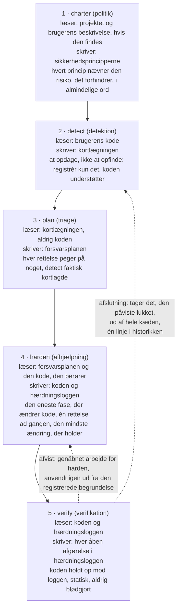
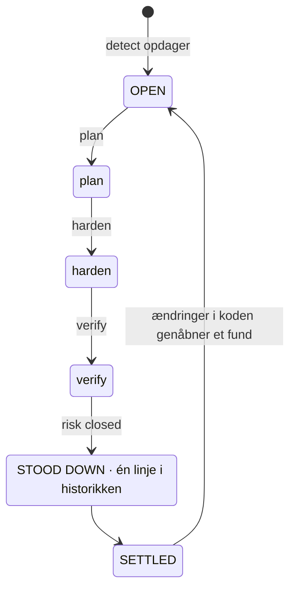
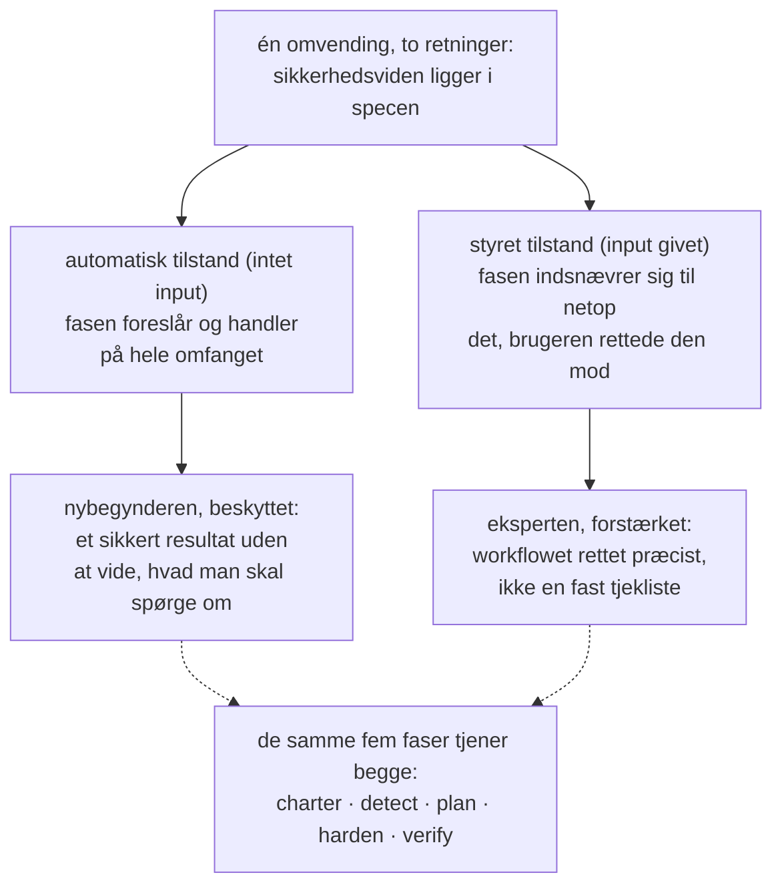
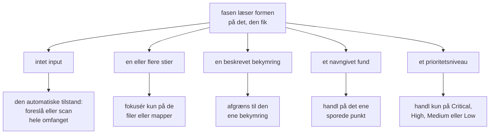
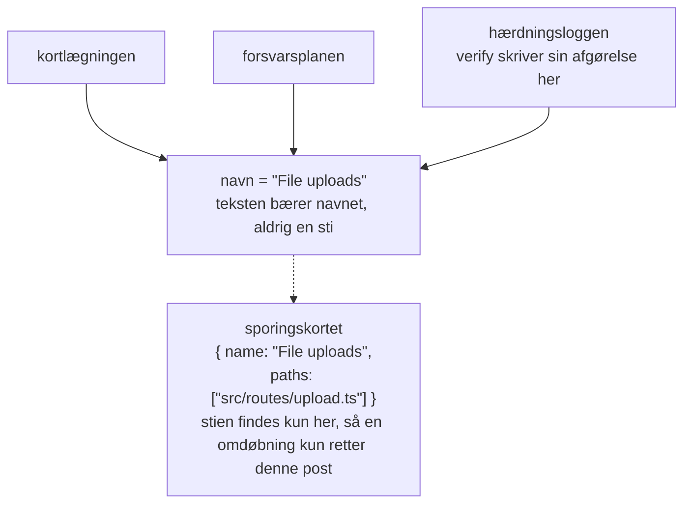
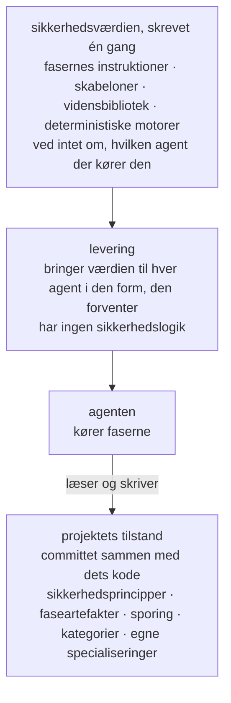
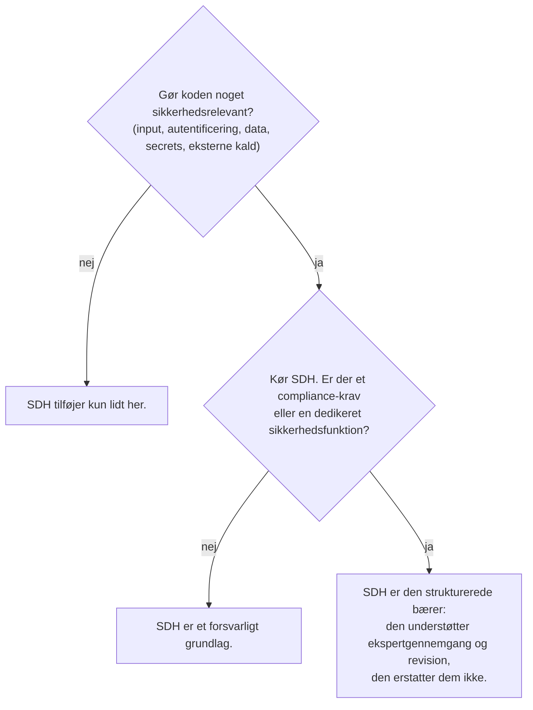

# Security-Driven Hardening (SDH): en konvention for tiden med AI-assisteret udvikling

- **Weslley Araújo**
- **Metodeartikel, 2026.**

---

## Resumé

Security-Driven Hardening (SDH) er en struktureret, AI-drevet og udelukkende defensiv sikkerhedsmetode til en tid, hvor software i stigende grad skrives af AI-agenter og af folk, der ikke er sikkerhedsspecialister. I stedet for at køre en generisk tjekliste finder SDH først ud af, hvad et system rent faktisk gør (login, filupload, betalinger, eksponering af data og så videre), og driver derefter det sikkerhedsarbejde, der er specifikt for den kontekst. Den styres af principper, der er sikre som standard, er udelukkende rettet mod forsvar og formuleres i almindelige ord, så enhver bruger kan handle på den.

Denne artikel argumenterer for, at SDH er en manglende konvention, ikke et enkelt værktøj. Sikkerhedsviden ligger i metoden og dens specialiseringer efter behov, et grundlag, som enhver bruger kan bygge videre på, og det gør det muligt at betjene en nybegynder og en ekspert gennem det samme workflow. To egenskaber adskiller den fra tidligere spec-first-tilgange `[1]`. SDH er **uafhængig af tilstand**: den tilpasser sig en tom mappe, et projekt under udvikling, en enkelt pull request eller en stor legacy-kodebase, i enhver stak. Og SDH **kan afsluttes**: en risiko, der er verificeret lukket, bliver taget ud af hele workflowet, så fundet når en afklaret tilstand og først åbnes igen, når koden ændrer sig. SDH erstatter ikke sikkerhedsprofessionelle eller specialiserede Blue Team-værktøjer. Den udvider udviklerens egen viden, og jo mere en udvikler forstår af sikkerhed, desto mere kan vedkommende styre den.

**Lagune** er referenceimplementeringen, og den beviser, at metoden kan bygges og flyttes. SDH tilbydes som en konvention, som andre kan tage i brug.

> **Nøgleord**
>
> AI-assisteret udvikling, softwaresikkerhed, defensiv sikkerhed, spec-driven development, sikkerhedshærdning, agentdrevne workflows, afslutning, kontekstbevidst sikkerhed, viden efter behov, agentuafhængige værktøjer.

---

## I. Introduktion: det sikkerhedshul, som AI-assisteret udvikling åbnede

Software bliver i stigende grad udgivet af mennesker, og af AI-agenter, der ikke pålideligt kan genkende et usikkert mønster: en lækket secret, et manglende autorisationstjek, en forespørgsel, der kan injiceres. Det er ikke eksotiske risici. De hører til de risikoklasser, der dominerer reelle hændelser, og som i årevis er dokumenteret i offentlige referencer `[6]`, `[7]`, og nyere undersøgelser viser, at en betydelig andel af AI-genereret kode bliver udgivet med netop sådanne fejl `[8]`. AI-kodeassistenter gjorde det akut ved at lade ikke-udviklere udgive rigtig software, men hullet er bredere end en enkelt målgruppe. De fleste projekter får aldrig en sikkerhedsgennemgang, der er specifik for det, de rent faktisk gør. Økosystemet bliver mere skrøbeligt for hver forhastet beslutning om, at "det virker, så udgiv det".

Generiske sikkerhedsråd lukker ikke dette hul. En statisk tjekliste er ikke specifik for det, et system gør, så den oversvømmer et lille projekt med irrelevante punkter og overser stadig den risiko, der betyder noget for netop det projekt. Problemet er ikke mangel på sikkerhedsviden i verden. Problemet er at matche den rette viden med det system, brugeren faktisk står med, og at gøre det for en, der måske ikke ved, hvad vedkommende skal spørge om.

SDH besvarer dette med en enkelt omvending: **sikkerhedsviden ligger i specen og dens specialiseringer efter behov, et grundlag, som enhver bruger kan bygge videre på**. Metoden finder konteksten, prioriterer de risici, den kontekst indebærer, og guider rettelserne, så en udvikler og en ikke-udvikler betjenes gennem det samme workflow. Fundene og anbefalingerne forbliver i almindelige ord, så de kan bruges uanset læserens tekniske niveau. Eksperten bliver ikke begrænset af det, men forstærket, en dualitet, vi udfolder i `§VI`.

> **Kerneindsigt**
>
> **Den centrale omvending:** Sikkerhedsviden ligger i specen og dens specialiseringer efter behov, et grundlag, som enhver bruger kan bygge videre på. Metoden lærer, hvad systemet gør, matcher sikkerhedsarbejdet til det og udvider det, brugeren allerede ved.

Forestil dig en udvikler, der fortæller en AI-assistent: "min app lader brugerne uploade et profilbillede." Uden en sikkerhedsgennemgang producerer assistenten fungerende kode, der i det stille stoler på alt, hvad klienten sender: den angivne filtype, filnavnet, størrelsen. Uploaden bliver udgivet, og en fil forklædt som et billede kan indeholde kode, et manipuleret navn kan bryde ud af lagringsstien, og en for stor fil kan opbruge serverens ressourcer. Intet af dette er synligt i en demo, så det bliver udgivet.

Den samme kode, kørt gennem SDH, opfører sig anderledes. Den opdager, at systemet tager imod filer udefra (detektion), prioriterer det til de risici, en upload indebærer (triage), foreslår at tjekke den reelle filtype og størrelse, omdøbe ved lagring og gemme et sted, hvor kode ikke kan køre (afhjælpning), og læser derefter resultatet og bekræfter, at hver kontrol faktisk holder (verifikation). Udvikleren behøvede aldrig at kende udtrykket "unrestricted file upload". Metoden leverede det på vedkommendes vegne.

Denne artikel bidrager med følgende:

- En præcis definition af SDH som metode, uafhængig af en bestemt implementering, med dens designprincipper (`§III`).
- En defensiv livscyklus i fem faser, hvor adskillelsen af ansvar i sig selv er bidraget: detektion opfinder aldrig, planlægning læser aldrig kode, kun én fase ændrer kode, og verifikation blødgør aldrig sin vurdering (`§IV`).
- **Afslutning** som metodisk holdning: et enkelt fund har en sluttilstand, ikke en endeløs løkke (`§V`).
- Dualiteten **udvidelse af udviklerens viden**: ét workflow, der beskytter nybegynderen og forstærker eksperten (`§VI`).
- **Ikke-kaldbare specialiseringer og prompt efter behov**: fokuseret sikkerhedsviden, som agenten indlæser, når projektets kontekst kræver det, aldrig som standard (`§VII`).
- **Uafhængighed af tilstand** og **ikke-autoritativ tilpasningsevne**: SDH passer til enhver udviklingstilstand og tilpasser sig scenariet i stedet for at påtvinge et fast omfang (`§VIII`).
- En **forebyggende tilstand**: det samme forsvar, kørt mens almindeligt arbejde bygges, så koden lander sikker som standard, og faserne har mindre at rette (`§IX`).
- En særskilt sammenligning med Spec-Driven Development, den slægt, SDH voksede ud af og derefter skilte sig fra (`§X`).
- De tekniske discipliner, der lader metoden overleve refaktoreringer og forblive uafhængig af en bestemt agent: sporing med identitet ved navn (`§XI`) og en agentuafhængig bærer (`§XII`).

---

## II. Baggrund og relateret arbejde

SDH bygger på tidligere arbejde. Den arver en gennemprøvet struktur fra spec-first, agentdrevet udvikling `[1]`, `[2]`, `[3]`: skabeloner, slash-kommandoer, som en agent bruger, et styrende dokument og en agent, der kører faserne. Den genimplementerer den struktur med et defensivt formål. Slægtskabet er bevidst, og et af SDH's arbejdsprincipper nævner det direkte: byg workflowet ud fra en gennemprøvet struktur, og indram det derefter til sikkerhed.

SDH er ikke en statisk tjekliste med generiske anbefalinger. En tjekliste ved meget om sikkerhed generelt og intet om det projekt, den står over for. SDH vender den vægtning om. Den bruger sin første indsats på detektion, på at lære, hvad systemet gør, og griber først derefter efter den viden, som detektionen gør relevant.

SDH er heller ikke en erstatning for sikkerhedsfolk eller for specialiserede Blue Team-værktøjer. Den udvider udviklerens viden (`§VI`). Et team med en dedikeret sikkerhedsfunktion bør beholde den. SDH giver det team en struktureret bærer, og den giver et team uden en sådan funktion et forsvarligt grundlag.

SDH står også ved siden af deterministiske sikkerhedsscannere (statisk analyse, linters) `[4]`, `[5]`. De værktøjer er værdifulde, netop fordi de er deterministiske og gentagelige. SDH er for det meste ræsonneret af agenten, hvilket bytter streng determinisme for kontekstbevidsthed. Metoden lader ikke som om andet. Hvor determinisme betyder noget, indlejrer den en deterministisk motor i ræsonnementet (`§VII`): agenten afgør, om et input er værd at tjekke, og et deterministisk program afgør, om inputtet er farligt.

Det mest direkte tidligere arbejde er Spec-Driven Development (SDD), familien af spec-first-metoder, der driver et byggeri frem ud fra en eksekverbar specifikation. Vi behandler SDD som en klasse. Den klareste beskrivelse af den som praktisk metode er Piskalas rapport `[1]`, og dens mest synlige agentdrevne værktøjskasse er Spec Kit fra GitHub `[2]`, med OpenSpec `[3]` som endnu et værktøj fra samme familie. De udgør de kanoniske referencer for sammenligningen i `§X`.

---

## III. SDH: definition og designprincipper

**Security-Driven Hardening** er en struktureret, AI-drevet sikkerhedsmetode, der gør en kodebase mere sikker ved at drive arbejdet ud fra en spec, som agenten kører, i stedet for ud fra ad hoc-rettelser. Navnet er inspireret af **Blue Teams**, forsvarerne inden for sikkerhed. SDH handler om forsvar, hærdning og verifikation, aldrig angreb.

> **Definition**
>
> **Security-Driven Hardening (SDH):** En struktureret, AI-drevet og udelukkende defensiv sikkerhedsmetode, der først finder ud af, hvad et system rent faktisk gør, og derefter driver det kontekstspecifikke sikkerhedsarbejde, styret af principper, der er sikre som standard, og formuleret i almindelige ord.

SDH er defineret af et sæt bindende principper. Hvert af dem er en regel, og hvert af dem giver brugeren en bestemt garanti.

| Princip                                               | Reglen                                                                                                                                                                           | Hvad det garanterer brugeren                                                                                                                                                |
| ----------------------------------------------------- | -------------------------------------------------------------------------------------------------------------------------------------------------------------------------------- | --------------------------------------------------------------------------------------------------------------------------------------------------------------------------- |
| Sikker som standard, i almindelige ord, for alle lige | Hver standard, besked og rettelse er sikker fra starten og forståelig for enhver læser, udvikler eller ej. Ingen gruppe af brugere er privilegeret.                              | En nybegynder får et sikkert grundlag uden at bede om det og læser resultatet i sine egne termer.                                                                           |
| Kontekstbevidst frem for generisk                     | Hver fase starter fra den kontekst, der blev fundet i detect, og handler på det, systemet rent faktisk gør.                                                                      | Anbefalingerne passer til projektet, ikke til en tjekliste. Sikkerhedsviden ligger i specen og dens specialiseringer efter behov og udvider det, brugeren selv bringer med. |
| Fleksibel frem for stiv                               | Principper, krav og anbefalinger er udgangspunkter. Brugeren kan omformulere, fjerne, tilføje eller afgrænse hvad som helst.                                                     | Metoden bøjer sig efter projektet og brugeren og aldrig hårdere, end brugeren ønsker. Fleksibilitet svækker aldrig grundlaget, der er sikkert som standard.                 |
| Afstem, aldrig kun tilføj                             | Artefakter er levende dokumenter, ikke logs. Hver kørsel tjekker hver post igen: behold det, der holder, omskriv det, der har ændret sig, og fjern det, der ikke længere gælder. | Registreringen afspejler altid nutiden, så den aldrig forfalder til en forældet backlog.                                                                                    |
| Udelukkende forsvar                                   | SDH gennemgår, hærder og verificerer. Den producerer aldrig offensive værktøjer, exploits til ondsindet brug eller omgåelse af detektion til skade.                              | Metoden kan ikke gøres til et våben. Indhold med dobbelt anvendelse optræder kun i en tydeligt defensiv indramning.                                                         |
| Spec-first, agentdrevet, indrammet til sikkerhed      | Workflowet bygges af skabeloner, kommandoer, styrende sikkerhedsprincipper og en agent, der kører faserne.                                                                       | En gennemprøvet udviklingsstruktur, genbrugt, så agenten udfører det substantielle sikkerhedsarbejde.                                                                       |

**Tabel 1.** Designprincipperne i SDH og den garanti, hvert af dem giver brugeren.

Disse principper er ikke pynt. De er de begrænsninger, hver fase nedenfor skal respektere, og diskussionen i `§XV` vender tilbage til dem for at markere metodens grænser.

Resten af artiklen udfolder ni navngivne søjler. Det er de dele, en læser bør kunne holde i hovedet, og de dele, et andet team skal genimplementere for at kunne sige, at det laver SDH.

| Søjle                                                        | Hvad den giver                                                                                                          | Afsnit      |
| ------------------------------------------------------------ | ----------------------------------------------------------------------------------------------------------------------- | ----------- |
| Den kontekstbevidste omvending                               | Sikkerhedsviden ligger i specen og dens specialiseringer efter behov, så en nybegynder og en ekspert deler ét workflow. | `§I`, `§VI` |
| Den defensive livscyklus i fem faser                         | Adskillelse af ansvar: politik, detektion, triage, afhjælpning, verifikation, hver med én opgave.                       | `§IV`       |
| Afslutning                                                   | Et fund har en sluttilstand, ikke en endeløs løkke. Afsluttet arbejde bliver taget ud.                                  | `§V`        |
| Dualiteten udvidelse af udviklerens viden                    | Ét workflow, der beskytter nybegynderen og forstærker eksperten uden at erstatte nogen af dem.                          | `§VI`       |
| Prompt efter behov, ikke-kaldbar viden                       | Relevant sikkerhedsviden indlæses til det, projektet er, aldrig som standard.                                           | `§VII`      |
| Uafhængighed af tilstand og ikke-autoritativ tilpasningsevne | Passer til enhver udviklingstilstand i enhver stak og tilpasser sig scenariet i stedet for at påtvinge et omfang.       | `§VIII`     |
| Den forebyggende tilstand                                    | Det samme forsvar kører, mens nyt arbejde bygges, så koden lander sikker som standard.                                  | `§IX`       |
| Sporing med identitet ved navn                               | Et fund forbliver ét punkt på tværs af faser, og en omdøbning bryder forbindelsen ét sted.                              | `§XI`       |
| Den agentuafhængige bærer                                    | Sikkerhedsværdien skrives én gang og afhænger hverken af agent eller stak.                                              | `§XII`      |

**Tabel 2.** De ni navngivne søjler i SDH, og hvor hver af dem udfoldes.

---

## IV. Blue Team-workflowet i 5 faser

SDH strukturerer arbejdet som en defensiv livscyklus i fem faser (figur 1). Hver fase er rettet mod forsvar, hver bygger på den forrige, og faserne følger reel Blue Team-aktivitet: fastlæg en politik, opdag, prioritér, afhjælp, verificér.



**Figur 1.** Workflowet i fem faser: hvad hver fase læser, hvad den skriver, og dens bærende invariant. Verify styrer begge veje tilbage: en afvist kontrol genåbner harden, og et fund, der er påvist lukket, bliver taget ud af kæden, med én linje i historikken.

Adskillelsen af ansvar er bidraget. Fordi hver fase har én opgave, er en fejl begrænset til ét sted, og læseren kan stole på det, hvert artefakt påstår.

> **Kerneindsigt**
>
> **Applied er ikke verificeret:** Harden registrerer, at en rettelse er gennemført. Verify verificerer det ved at holde koden op mod den registrering, og afgørelsen blødgøres aldrig for at passe til registreringen. En kontrol kan være til stede i koden og stadig lade risikoen være til at nå, og så er den ærlige afgørelse "risk not closed".

### charter (politik)

Charter fastlægger projektets sikkerhedsprincipper, de regler, hver senere fase skal respektere. Det er det overordnede lag, en slags kompileringstjek for projektets sikkerhedsniveau. Hvert princip har et klart navn, en ufravigelig regel, der kan tjekkes op mod koden, og en linje `Why:`, der angiver den risiko, det forhindrer, ikke kun rettelsen. Charter læser altid selve projektet (dets manifester, struktur og afhængigheder), og en brugers beskrivelse er, når den gives, en retning, som læsningen derefter udvider ud over det, brugeren nævnte. Uden beskrivelse er projektet den eneste kilde. De to supplerer hinanden i stedet for at konkurrere, og charter registrerer den politik, projektet bør overholde, ikke tilstanden af dets kode. En ikke-udvikler bør kunne læse det og forstå både reglen og risikoen.

### detect (detektion)

Detect læser koden og kortlægger det, systemet rent faktisk gør, som har sikkerhedsmæssig vægt. Den styrende instruks er "at opdage, ikke at opfinde": registrér kun det, koden understøtter, med det belæg, de senere faser har brug for. Detect er neutral. Den tvinger ikke sine fund til at passe til charter, fordi det at matche risici med reglerne i charter er opgaven for fasen plan. Hvert fund har tre dele: hvad det er (en beskrivelse i almindelige ord), hvorfor det betyder noget (risikoen, ikke kun faktum) og belægget (den funktion eller rute, hvor det findes). Belægget indeholder ingen filsti. Stien findes kun i sporingskortet (`§XI`), så teksten aldrig indeholder en sti, der kan blive forældet.

### plan (triage)

Plan gør hvert fund til en rettelse, navngivet efter dens risikoklasse (med henvisning til de etablerede referencer, CWE og OWASP, hvor de giver grundlag for det) og knyttet til det princip i charter, som rettelsen opretholder. Prioriteten (Critical, High, Medium, Low) er ikke et frit valg: plan vurderer hvert fund med metoden CVSS v4.0 Base og Environmental, så niveauet er scoren i almindelige ord, begrundet med én linje i almindelige ord om eksponering og indsats, og to kørsler lander i samme rækkefølge. Vektoren er det præcise ankerpunkt for en ekspert, niveauet og dets begrundelse den samme vurdering, som alle kan følge. Plan arbejder kun ud fra kortlægningen og læser aldrig koden. Det er en bevidst begrænsning, ikke en mangel: den tvinger hver rettelse til at pege på noget, detect faktisk opdagede. Hvis et omfang aldrig er blevet kortlagt, stopper plan og sender brugeren tilbage til detect i stedet for at gætte.

### harden (afhjælpning)

Harden er den eneste fase, der ændrer kode, så den går forsigtigt frem. Om en ændring kræver brugerens godkendelse, afgøres af agenten og den tilladelsestilstand, den kører i, så harden tilføjer ingen bekræftelse af sin egen. Den gennemfører én rettelse ad gangen, afhængigheder først og derefter den højeste prioritet, så hver ændring forbliver lille, til at gennemse og nem at fortryde. Den svækker aldrig en eksisterende kontrol for at få en ny rettelse til at passe, og den bryder aldrig et princip i charter. Hvis en rettelse ville komme i konflikt med et princip, stopper harden og bringer konflikten frem i stedet for at gennemføre den. Hver blok registreres som Applied, Partial eller Blocked. "Applied betyder ikke, at den er verificeret endnu", og det er netop det, den næste fase tager sig af.

### verify (verifikation)

Verify verificerer hver gennemført kontrol ved at læse koden og holde den op mod det, harden registrerede. Verifikationen er netop den konfrontation, koden op mod loggen, og den er statisk: den bekræfter, at en kontrol findes og er korrekt i koden, ikke at kontrollen holder under et angreb mod et kørende system. Det tjek under kørsel, den slags, der udfører reelle eller simulerede angreb mod det kørende system, ligger bevidst uden for omfanget. Verify giver én af tre afgørelser: risk closed, risk not closed eller cannot tell from the code. Den producerer intet artefakt af sin egen: harden og verify deler hærdningsloggen, hvor harden ejer det, der blev gjort, og verify ejer afgørelsen og dens begrundelse, og ingen af dem skriver nogensinde i den andens felter. En afvist kontrol er genåbnet arbejde for harden, hvis næste kørsel lader afgørelsen gå forud for sin egen læsning af koden og gennemfører rettelsen igen mod netop det hul, begrundelsen nævner. Verify stoler mere på koden end på loggen, fordi en log kan påstå mere, end koden leverer. Den har kun læseadgang til brugerens kode, og den blødgør aldrig en afgørelse for at passe til loggen. En kontrol kan være til stede og stadig lade risikoen være til at nå ad en anden vej, og i så fald er den ærlige afgørelse "risk not closed". Hvis verify under læsningen bemærker et sikkerhedsproblem, som kortlægningen aldrig dækkede, opfinder den ikke en afgørelse for det, da detektion er opgaven for detect: den bringer problemet frem og sender brugeren tilbage til detect, så fundet kommer ind gennem det samme workflow i stedet for at gå udenom.

> **Gennemgående eksempel: filupload.** Et enkelt fund viser rygraden fra start til slut.
>
> - **detect** finder det: systemet tager imod filer fra brugerne, og upload-handleren stoler på den MIME-type, klienten sender, uden at tjekke filens reelle type. _Hvorfor det betyder noget:_ en fil forklædt som et billede kan skjule ondsindet kode.
> - **plan** beslutter rettelsen, prioritet **Critical**, og opretholder princippet "Alt input er ikke-betroet, indtil det er valideret": tjek filens reelle type og størrelse, omdøb den ved lagring, og gem uploads et sted, hvor de ikke kan køres som kode.
> - **harden** gennemfører den, status **Applied**: handleren bestemmer nu den reelle type ud fra indholdet, håndhæver en størrelsesgrænse, afviser alt uventet, omdøber ved lagring og gemmer et sted, hvor kode ikke kan køre.
> - **verify** læser handleren, holder den op mod loggen og giver afgørelsen **risk closed**: koden gør præcis det, loggen påstår.
>
> Det samme fundnavn går igen i kortlægningen, planen og hærdningsloggen, og verify handler på den log under det samme navn: en åben afgørelse skrives i fundets blok, og et fund, der er påvist lukket, bliver taget ud (`§V`). Det fælles navn er dets identitet (`§XI`).

---

## V. Afslutning: et fund har en sluttilstand

De fleste sikkerhedsværktøjer efterlader brugeren med en backlog, der kun vokser. SDH indtager en anden holdning: **et fund kan afsluttes, så det har en sluttilstand i stedet for at leve i en endeløs backlog** (figur 2). Det følger direkte af princippet om afstemning.

> **Definition**
>
> **Afslutning:** En risiko, der er verificeret lukket, bliver taget ud af hele workflowet, så fundet når en afklaret tilstand og først åbnes igen, når koden ændrer sig. Et fund har en sluttilstand, selvom selve sikkerhedsprogrammet forbliver løbende.

Artefakter i SDH er levende dokumenter, ikke logs. Hver gang en fase kører igen, tjekker den hver eksisterende post op mod den aktuelle sandhed og gør én af tre ting: beholder det, der stadig holder, omskriver det, der har ændret sig, eller fjerner det, der ikke længere gælder. Et fund, som koden viser nu er løst, bliver simpelthen fjernet. Den aktive registrering afspejler nutiden, ikke fortiden.

Afslutning er den samme afstemning, der når sin konklusion. Når verify verificerer, at en risiko er lukket, tager den fundet ud af hele workflowet, kortlægningen, planen, hærdningsloggen og sporingskortet. Det er derfor, verify er den ene fase, der skriver til de andre fasers artefakter: det er den fase, der lukker løkken. Når fundet forlader kæden, destilleres det til en kort post i en historik, der ligger uden for den aktive kæde og aldrig behandles igen. Det er grænsen mellem at forsvinde og at blive afsluttet: et fund, som afstemningen fjernede, fordi det holdt op med at være sandt, efterlader intet, mens et fund, der er påvist lukket, gør sig fortjent til sin linje i historikken. Et fund, der er taget ud, er derefter fraværende i alle aktive artefakter, og det fravær er forventet, ikke en brudt kæde.



**Figur 2.** Tilstandsmaskinen for afslutning. Et fund går fra OPEN → STOOD DOWN → SETTLED og genåbnes kun, når koden ændrer sig.

Når alt inden for omfanget er taget ud, er cyklussen i hvile, og den tilstand har en konkret form: et artefakt, hvis sidste fund er lukket, fjernes helt, så en fuldt afsluttet kæde kun efterlader sikkerhedsprincipperne og historikken, politikken og beviset. Cyklussen åbnes først igen, når koden ændrer sig. Metoden giver hvert fund en bestemt afslutning, hvilket netop er det, en endeløs backlog ikke kan.

---

## VI. Dualiteten udvidelse af udviklerens viden

SDH erstatter ikke mennesker, og den erstatter ikke specialiserede Blue Team-værktøjer. Den **udvider udviklerens egen viden**. Jo mere en udvikler forstår af sikkerhed, desto mere præcist kan vedkommende styre workflowet, og desto mere selvstændighed har vedkommende. En udvikler, der forstår lidt, får stadig et sikkert resultat, fordi den automatiske tilstand beskytter vedkommende.

Omvendingen fra `§I`, at sikkerhedsviden ligger i specen, virker i begge retninger. For nybegynderen er den beskyttelse: vedkommende behøver ikke at vide, hvad der skal spørges om, fordi specen foreslår det. For eksperten er den forstærkning: den samme spec lader vedkommende rette workflowet præcist i stedet for at arbejde op mod en fast tjekliste.

Hver fase bærer denne dualitet i sin egen funktion (figur 3). Kørt uden input handler den på hele omfanget på brugerens vegne. Med en retning indsnævrer den samme fase sig til netop det, brugeren rettede den mod.



**Figur 3.** Dualiteten udvidelse af udviklerens viden. Én omvending tjener to målgrupper: den automatiske tilstand beskytter nybegynderen, og den styrede tilstand forstærker eksperten, gennem de samme fem faser.

Specialiseringerne efter behov (`§VII`) gør dualiteten udtrykkelig i deres egen tekst. Hver af dem fortæller agenten, at dens viden "udvider din dømmekraft", og at den skal fortsætte med at ræsonnere ud over det, specialiseringen giver. Viden er et gulv, ikke et loft. Det er det, der tjener begge målgrupper i den balance, artiklen tilstræber: udviklerfællesskabet får et substantielt instrument, og Blue Team-udøveren får en struktureret bærer, der ikke lader som om, den gør vedkommendes arbejde.

---

## VII. Ikke-kaldbare specialiseringer og prompt efter behov

Dette er metodens mest nyskabende mønster. SDH bærer fokuseret sikkerhedsviden som specialiseringer, der **kun indlæses efter behov**, og agenten afgør selv, hvilke der skal indlæses, ved at matche projektets kontekst. Vi kalder det **prompt efter behov**: en måde, hvorpå agenten vælger, hvilken viden der skal aktiveres, ud fra omfanget af det projekt, den befinder sig i, i stedet for at køre alle tjek som standard. Specialiseringerne udvikler sig, og enhver af dem kan til enhver tid ændres eller erstattes. Bidraget er mønsteret, ikke specialiseringerne selv.

> **Definition**
>
> **Prompt efter behov:** Agenten vælger, hvilken sikkerhedsviden der skal aktiveres, ved at matche den med omfanget af det projekt, den står over for, så den relevante viden hentes ind til det, projektet rent faktisk er, i stedet for at alle tjek kører som standard.

> **Definition**
>
> **Ikke-kaldbar specialisering:** En fokuseret, sprogneutral enhed af sikkerhedsviden til én kontekst, såsom filupload eller kode, der kører i browseren. Den gennemgår og forklarer, omskriver aldrig kode og producerer aldrig et angrebsinput. Den er ikke en kommando: den indlæses, når den kontekst, den dækker, er inden for omfanget, eller når en prompt beder om den ved navn.

Hver specialisering nævner de sikrere former for de risici, den dækker, og fortæller agenten, hvordan den skal handle på et fund i hver fase, der bruger den: hvordan det vurderes ved detektion, hvordan rettelsen gennemføres sikkert ved afhjælpning, og hvordan den påvises ved verifikation.

Det afgørende træk er, at en specialisering **ikke kan kaldes alene**: den er ikke en kommando, og inde i workflowet er det et match, der indlæser den. Detektionsfasen oplister kataloget én gang, matcher projektets kontekst med det, hver post dækker, og indlæser kun de specialiseringer, hvis kontekst er til stede inden for omfanget. De senere faser genbruger den matchede liste i stedet for at oplise igen, så ét match tjener hele kæden, og den forebyggende tilstand (`§IX`) kører det samme match mod det arbejde, der er ved at blive bygget. En specialisering, hvis kontekst mangler, springes over, og overspringet er lige så ansvarligt som indlæsningen: hver post i kataloget får en udtrykkelig afgørelse, anvendt eller sprunget over med begrundelsen aflæst i koden, så en vag fornemmelse af irrelevans aldrig træder i stedet for fravær. At ingen er relevante, er et gyldigt resultat.

Kataloget er data, og vækst er én vidensfil plus én række i kataloget, aldrig en ny kommando. De indbyggede specialiseringer er grupperet i kategorier, såsom OWASP, et sprog eller AI-integrationer, og det katalog, et projekt bruger, indeholder de indbyggede i de kategorier, det har valgt, plus dets egne specialiseringer. Projektet registrerer det valg sammen med resten af sin tilstand, så et helt team matcher mod det samme katalog. Det er det samme kontekstbevidste princip som i faserne, anvendt på viden: den relevante viden hentes ind til det, projektet rent faktisk er, i stedet for at alle tjek kører som standard. Den samme egenskab lader brugeren, ikke kun vedligeholderen, udvide kataloget: en sikkerhedskilde eller et emne, som brugeren leverer, destilleres til en ny specialisering, der tilhører projektet, kommer med i dets katalog uanset kategorierne og indlæses præcis som en indbygget, og den erstatter den indbyggede med samme navn. At skrive en specialisering er i sig selv udelukkende defensivt og følger den samme grænse, som specialiseringerne håndhæver: en beskrivelse af et angreb kan være kilden, men den specialisering, den giver, gennemgår og forklarer og udsender aldrig et fungerende exploit. Så omvendingen fra `§I`, at intelligensen ligger i specen, gælder også selve kataloget, som brugeren kan uddybe til sin egen kontekst uden at skrive kode.

Et kort eksempel illustrerer prompt efter behov. Detect læser en mappe med kode, der kører i browseren. Den matcher den kontekst i kataloget, indlæser den specialisering, der dækker den, og bringer et fund på klientsiden frem gennem de normale trin i detect. De specialiseringer, hvis kontekst mangler i dette omfang, matcher ikke, så de indlæses aldrig, og hver af dem registreres som sprunget over. Det var projektet, der afgjorde, hvilken viden der var relevant, ikke en fast konfiguration.

Determinisme optræder netop dér, hvor den betyder noget. En specialisering kan have et deterministisk tjek med, ikke kun tekst: hvor en risikoklasse har en skarp beslutningsprocedure, returnerer et lille program en fast afgørelse for et givet input, for eksempel et kort sæt ord som `safe`, `unsafe` eller `invalid input`. Nogle risikoklasser kan afgøres deterministisk på netop den måde, med et stykke tidligere arbejde bag beslutningsproceduren `[9]`, `[10]`, `[11]`. Tjekket vurderer enten kandidater, som agenten leverer, eller scanner omfanget for selv at finde dem, og i begge tilfælde er det tjekket, ikke agenten, der returnerer afgørelsen. En specialisering, der er universel nok, kan markeres som påkrævet i kataloget og anvendes så altid, med sit tjek kørt over hele omfanget. Det er det ene tilfælde, hvor viden indlæses uden et kontekstmatch, og det er angivet i katalogets data, aldrig afgjort af agenten i øjeblikket. Det er her, SDH forankrer agentens ræsonnement i noget gentageligt, uden at lade som om hele workflowet er deterministisk.

Endelig kan specialiseringerne **bruges selvstændigt**. Fordi viden står på egne ben, kan en bruger køre en specialisering direkte i en prompt, der intet har med hele SDH-workflowet at gøre, og dermed holde sikkerheden med i almindelig udvikling. En specialisering med et deterministisk tjek kan for eksempel sortere hver kandidat, der bliver produceret under almindelig kodning, og kun beholde de sikre. Denne selvstændighed er en del af grunden til, at SDH tilpasser sig så mange situationer, som er emnet for `§VIII`, og dens fulde udtryk er den forebyggende tilstand (`§IX`), hvor den samme viden beskytter almindelig udvikling fra start til slut.

---

## VIII. Uafhængighed af tilstand og ikke-autoritativ tilpasningsevne

To egenskaber adskiller SDH fra stive spec-metoder.

### Uafhængighed af tilstand

> **Definition**
>
> **Uafhængighed af tilstand:** Metoden afhænger ikke af udviklingstilstanden. Den passer til en tom mappe, et projekt under udvikling, en enkelt pull request eller en stor legacy-kodebase, i enhver stak, fordi den lærer udgangspunktet at kende ved at læse det.

Hver fase virker på samme måde, uanset om projektet er helt nyt eller allerede findes. Charter udleder principper af den kode, der er til stede. Detect kortlægger den kode, der er, selv hvis der er meget lidt. Der er intet forudsat udgangspunkt.

### Ikke-autoritativ tilpasningsevne

> **Definition**
>
> **Ikke-autoritativ tilpasningsevne:** Metoden tilpasser sig scenariet i stedet for at påtvinge et fast omfang, som brugeren skal følge. Når brugeren ikke ved, hvad vedkommende skal sige, læser den det miljø, den blev kaldt i, skaber kontekst og stiller de spørgsmål, der former, hvad den gør derefter.

Tilstanden, hvor charter foreslår, er det tydeligste eksempel: SDH udleder sikkerhedsprincipper, der er sikre som standard, ved at analysere projektet og spørger kun brugeren, når et hul faktisk ændrer resultatet, og skriver dem derefter og præsenterer hvert princip i almindelige ord med den risiko, det forhindrer. Sikkerhedsprincipperne er et levende dokument, som brugeren omarbejder ved at køre igen, ikke en kontrakt låst bag en godkendelsesprompt, så det kræver aldrig, at brugeren ved, hvad der skal spørges om.

Denne tilpasningsevne viser sig som en følsomhed over for inputtets form: den samme fase læser det, den fik, og vælger en tilstand (figur 4). En fil i prompten, et fund fra listen, en bekymring, en fokuseret mission mod et kendt svagt punkt eller en anmodning om en fuld brute force-scanning: hver passer til brugerens behov, fordi workflowet er ikke-autoritativt af design. Intet af dette svækker grundlaget, der er sikkert som standard. Fleksibilitet former, hvordan grundlaget anvendes, men sænker det aldrig.



**Figur 4.** Ikke-autoritativ tilpasningsevne. Den samme fase læser formen på sit input og vælger en tilstand, så omfanget altid er brugerens, aldrig påtvunget.

---

## IX. Den universelle forebyggende tilstand: det samme forsvar, mens arbejdet bygges

SDH har en supplerende tilstand: almindelig udvikling, udført med det samme forsvar aktivt, mens koden skrives. Brugeren beder om selve arbejdet, en loginside, en upload, et endpoint, og metoden beskytter opbygningen, mens den sker, så resultatet er sikkert som standard i det øjeblik, det lander, i stedet for efter en senere hærdning.

> **Definition**
>
> **Den forebyggende tilstand:** almindelig udvikling, der kører under det overordnede lag og den viden, SDH har. Sikkerhedsprincipperne binder opbygningen, de specialiseringer, der er relevante for det, der er ved at blive skabt, indlæses efter behov, og resultatet holdes op mod netop det forsvar, der blev brugt, før arbejdet kaldes færdigt.

Tilstanden genbruger hver del, faserne allerede har, rettet mod kode, der endnu ikke findes. Kontekstdetektionen vender sig fra koden til hensigten: agenten ræsonnerer sig gennem det, den er ved at bygge, og de grænser, arbejdet krydser (et login indebærer loginoplysninger, en session og input udefra), og det ræsonnement er det, vidensbiblioteket matches mod. Prompt efter behov (`§VII`) generaliseres her: kontekst kan opdages i planen for kode, ikke kun i kode, der findes. Sikkerhedsprincipperne styrer, som de altid gør, og en anmodning, der ville bryde et princip, bringes frem som en konflikt og bygges aldrig. Forsvaret anvendes undervejs, i det øjeblik hver del skrives, ved at validere ved grænsen og gribe efter den sikre konstruktion første gang, så en version, der virker, men er usikker, aldrig findes og skal rettes.

Tilstanden slutter, som verify begynder. Før arbejdet kaldes færdigt, holder den, der bygger, sit eget resultat op mod det forsvar, den brugte: kontrollen skal ligge på risikoens vej, ikke ved siden af den, den skal være komplet, og hvor en specialisering har et deterministisk tjek, går tjekkets afgørelse forud for agentens egen læsning. Et hul, der findes her, lukkes som en del af det samme stykke arbejde, fordi at gøre arbejdet færdigt betyder at gøre det færdigt på en sikker måde.

Det, tilstanden afviser, er lige så bevidst som det, den gør. Den bygger kun det, der blev bedt om, og gennemgår intet omkring det: at gennemgå det, der findes, hører til faserne. Den skriver intet artefakt og sporer intet fund, fordi et fund er en risiko, der er opdaget i det, der findes, og formålet med denne tilstand er, at den usikre version aldrig lander. De to retninger supplerer hinanden: faserne lukker det, der allerede er der (`§V`), og den forebyggende tilstand forhindrer nyt arbejde i at åbne det igen. En kæde i hvile forbliver i hvile, ikke fordi udviklingen er stoppet, men fordi det, der bygges, mens den hviler, bliver bygget forsvaret.

---

## X. Security-Driven Hardening over for Spec-Driven Development

Security-Driven Hardening (SDH) voksede ud af grundlaget fra Spec-Driven Development (SDD) og skilte sig derefter markant fra det. Den strukturelle arv er reel og anerkendt: spec-first, agentdrevet, et styrende dokument og et sæt kommandoer i faser, som agenten kører. SDH genbruger bevidst den struktur. Det, der adskiller dem, er formålet, autoritetsmodellen, den forudsatte tilstand og slutbetingelsen. Vi behandler SDD som en klasse og bruger Piskalas rapport `[1]` som den kanoniske beskrivelse af metoden, Spec Kit fra GitHub `[2]` som den kanoniske værktøjskasse til agenter og OpenSpec `[3]` som endnu et værktøj fra samme familie.

SDD vender traditionel udvikling på hovedet ved at gøre specifikationer eksekverbare: specen genererer direkte en fungerende implementering i stedet for blot at guide den `[1]`. Dens sæt af faser driver et byggeri fremad `[2]` (fastlæg styrende principper, specificér, hvad der skal bygges, planlæg den tekniske stak, del planen op i opgaver, og implementér derefter). Dens styrende dokument, en forfatning af principper, er det fundament, agenten hele vejen igennem skal overholde. Det er kernen i forskellen. I SDD flyder autoriteten fra specen ind i byggeriet, og implementeringen forventes at følge den.

SDH vender næsten hver akse i den kontrakt om (tabel 3).

> **Kerneindsigt**
>
> **Den centrale forskel:** I SDD flyder autoriteten fra specen ind i byggeriet, og implementeringen forventes at følge den. SDH er ikke-autoritativ og flyder den anden vej, indad fra systemets opdagede kontekst, og hærder det, der allerede er der.

| Akse                 | SDD                                                                                    | SDH                                                                                                                           |
| -------------------- | -------------------------------------------------------------------------------------- | ----------------------------------------------------------------------------------------------------------------------------- |
| Mål                  | Levere funktioner. Specen bliver til en fungerende implementering.                     | Hærde det, der findes eller er ved at blive bygget. Hver fase er rettet mod forsvar.                                          |
| Autoritetsmodel      | Autoritativ. Specen og forfatningen begrænser byggeriet til et omfang, det skal følge. | Ikke-autoritativ. SDH tilpasser sig scenariet, og brugeren kan omformulere, fjerne eller afgrænse.                            |
| Forudsat tilstand    | Et byggeri fremad ud fra en specifikation.                                             | Uafhængig af tilstand: tom mappe, projekt under udvikling, en enkelt PR eller legacy.                                         |
| Slutbetingelse       | Slutter, når funktionen er bygget.                                                     | Kan afsluttes. Et fund når en afklaret tilstand og genåbnes kun, når koden ændrer sig.                                        |
| Styrende dokument    | En forfatning af principper, som agenten skal overholde.                               | Sikkerhedsprincipper formuleret ud fra risici (hvert med en linje `Why:`), udtrykkeligt ikke en fast kontrakt.                |
| Hvordan viden vokser | Tilføj en kommando (eller udvid sættet af faser).                                      | Tilføj en ikke-kaldbar specialisering, som agenten indlæser efter behov: én fil plus én række i kataloget, ingen ny kommando. |
| Hvem den tjener      | En, der bygger og driver en funktion fremad.                                           | Enhver bruger, udvikler eller ej, betjent gennem det samme workflow.                                                          |
| Hvad ændrer koden    | Implementeringsfasen genererer byggeriet.                                              | Kun fasen harden ændrer kode, én rettelse ad gangen.                                                                          |

**Tabel 3.** SDD over for SDH på otte akser. Lånt struktur, omvendt kontrakt.

For at yde slægtskabet retfærdighed: SDD er gennemprøvet tidligere arbejde, og SDH skylder det den struktur, den kører på. Afvigelsen er ikke en kritik af SDD, som løser et andet problem (at bygge fremad) godt. SDH tager det samme gennemprøvede maskineri og retter det mod forsvar, tilpasningsevne og afslutning. OpenSpec `[3]`, der er organiseret omkring ændringsforslag, opgavelister og specs pr. ændring, bekræfter mønsteret: familien driver et byggeri fremad ud fra en spec, mens SDH hærder et system indad fra dets opdagede kontekst. Selv den forebyggende tilstand i SDH (`§IX`), det ene sted, hvor den ledsager et byggeri fremad, bevarer den omvendte kontrakt: den styrer, hvordan arbejdet bygges, og afgør aldrig, hvad der skal bygges.

---

## XI. Teknisk stringens: disciplinen for sporing

Disciplinen om at afstemme og aldrig kun tilføje (`§V`) kræver et fundament, der overlever refaktoreringer. Et fund skal forblive ét punkt på tværs af hver fase, der rører det, og en omdøbt eller flyttet fil må ikke bryde kæden. SDH løser det med **identitet ved navn** og **stier, der kun findes i sporingen**.

> **Definition**
>
> **Identitet ved navn:** Et funds identitet er dets navn, skrevet ens i hvert artefakt. Teksten bærer navnet, aldrig en sti. Filstier findes kun i sporingskortet, så en omdøbning eller en flyttet fil bryder forbindelsen præcis ét sted.

Hvert fund fra detect er ét sporet punkt. Dets identitet er dets **navn**, afsnitstitlen, skrevet ens i kortlægningen, planen og hærdningsloggen. De senere faser genbruger navnet ordret, når de handler på det samme punkt, og verify skriver sin afgørelse i hærdningsloggen under det samme navn. Sporingskortet indeholder sporing og intet andet, én post pr. punkt:

```json
{ "name": "File uploads", "paths": ["src/routes/upload.ts"] }
```

Kortet registrerer ingen tekst, ingen kommentarer, ingen separat identifikator og ingen fase. Tekstartefakterne bærer formuleringen, og kortet bærer kun identitet og stier. Filstier er det eneste foranderlige, og de findes kun her. En omdøbning eller en flyttet fil kan bryde forbindelsen præcis ét sted, aldrig i to kopier, der glider fra hinanden.



**Figur 5.** Identitetens transportbånd. Ét fundnavn flyder gennem hvert artefakt, mens dets sti kun findes i sporingskortet, så en omdøbning rettes ét sted.

To handlinger vedligeholder kortet i det normale workflow, og en tredje står for sig selv som vedligeholdelse. **Track** er en tilføjende registrering: en fase rapporterer de fund, den har skrevet, og motoren registrerer de nye og følger en omdøbt sti for resten og klassificerer hvert som nyt, flyttet eller uændret. Den fjerner aldrig noget, fasen ikke har rapporteret. **Untrack** tager de fund ud, som verify har lukket: i ét deterministisk gennemløb destillerer den hvert til sin post i historikken, fjerner hele dets afsnit fra artefakterne, sletter et artefakt, hvis sidste fund er væk, og fjerner dets post i sporingen, så agenten ikke udfører noget af det manuelt. Hvor det deterministiske gennemløb ikke sikkert kan gå, et navn, der er taget ud, men stadig citeres i et andet funds tekst, markerer den stedet for agenten i stedet for at gætte en ændring. Disse to er det, faserne kalder, mens de kører. **Repair** er vedligeholdelseshandlingen: en fase uddelegerer automatisk til den, når dens egen afstemning finder sporingen inkonsistent (en registreret sti, der ikke længere findes), og ellers køres den efter behov. Den genopretter hele kortet på én gang, læser hvert artefakt og den aktuelle kode, retter hvert punkts stier og bringer det frem, den ikke kan afgøre alene, et forældreløst punkt (et sporet punkt, som intet artefakt længere nævner) eller en kandidat til omdøbning (et punkt, hvis stier matcher et andet rapporteret navn).

Repair er vedligeholdelse, ikke en sjette fase. Den rører hverken brugerens kode eller tekstartefakterne, kun sporingen. Den læser kun brugerens kildekode af én grund, for at finde en omdøbt fils nye sti, og den skriver aldrig sikkerhedsindhold. Mennesket har det sidste ord i det ene spørgsmål, motoren nægter at gætte på: om et forsvundet punkt blev løst eller blot omdøbt. Spørg hellere end at gætte, for et punkt, der fejlagtigt fjernes, bryder kæden.

Metoden anvender sin egen forsvarsdisciplin på sig selv. De deterministiske motorer kaldes som kommandolinjeprogrammer, og hvert input gives som sit eget procesargument, hvilket holder det uskadeligt, så en værdi med anførselstegn eller backticks aldrig kan injicere noget i kommandoen. Et ukendt tjek fejler i stedet for at svare, så et stavefejlsramt tjek aldrig læses som et rent resultat. SDH fritager ikke sit eget maskinrum fra princippet om at være sikker som standard.

---

## XII. Bæreren: agentuafhængig arkitektur som bevis på flytbarhed

For at SDH kan blive en konvention, som andre tager i brug, må den ikke være bundet til én agent eller én stak, så dens bærer holder tre ansvarsområder adskilt (figur 6). Lagune beviser, at det kan lade sig gøre.

**Sikkerhedsværdien** skrives én gang og ved intet om, hvilken agent der kører den: fasernes instruktioner og de skabeloner, de udfylder, vidensbiblioteket og de deterministiske motorer. **Leveringen** er tynd: dens eneste opgave er at bringe den værdi til en given agent i den form og på det sted, agenten forventer, og den har ingen sikkerhedslogik af sin egen. **Projektets tilstand** tilhører projektet: sikkerhedsprincipperne, faseartefakterne, sporingskortet, de kategorier, det har valgt, og dets egne specialiseringer, committet og til at gennemse som enhver anden del af dets kode.



**Figur 6.** Den agentuafhængige bærer. Sikkerhedsværdien skrives én gang, en tynd levering bringer den til hver agent, og tilstanden forbliver projektets.

Fordi leveringen ikke har nogen sikkerhedslogik, ændrer det intet i SDH, hvordan den er bygget. En bærer kan selv bygge leveringen eller overlade den til et økosystem, der allerede distribuerer skills til agenter, som referenceimplementeringen gør, og faserne, deres artefakter og deres garantier forbliver de samme. Intet af dette er heller specifikt for et sprog eller et runtime. Referenceimplementeringen er tilfældigvis skrevet i én stak, men metoden er grænsen mellem disse ansvarsområder, ikke den værktøjskæde, der bygger dem. Det samme design kunne genimplementeres i et helt andet sprog uden at ændre, hvad SDH er.

---

## XIII. Gennemgået eksempel: SDH fra start til slut

> **Gennemgået eksempel**
>
> **Defensiv hærdning af en upload- og administrationsflade.**
> **Kontekst:** en lille app, der tager imod filer uploadet af brugerne og oplister dem på en administrationsside.
> **Mønster:** charter → detect (med viden efter behov aktiveret af konteksten) → plan → harden → verify, med én afslutning og én reel fejl.
> **Resultat (kapabilitet):** én risiko verificeret lukket og taget ud af hele kæden, og én kontrol verificeret _ikke_ lukket og sendt tilbage til harden. Afgørelsen afspejler koden, ikke loggen.

_Dette er et illustrativt eksempel på metodens mekanik, ikke en undersøgelse målt i praksis, og det rapporterer ingen målinger af effektivitet._

Én sammenhængende gennemgang viser metoden i drift, ikke kun dens dele. Vi udvider tråden om filupload fra `§IV` med en aktivering af viden efter behov og en afslutning, og vi medtager én reel fejl.

1. **charter** foreslår princippet "Alt input er ikke-betroet, indtil det er valideret" med sin risiko i almindelige ord: input, der ikke tjekkes, er den mest almindelige måde, et system bliver brudt på.
2. **detect** scanner upload-ruten og den lille administrationsside, der oplister uploadede filer. Den opdager fundet ved uploaden (handleren stoler på klientens MIME-type). Administrationssiden kører i browseren, en kontekst, som prompt efter behov (`§VII`) genkender, så detect indlæser specialiseringen til den kontekst og bringer et andet fund frem, et sted, hvor et filnavn skrives ind på siden som markup i stedet for tekst, så et manipuleret navn kan køre som script i den besøgendes browser. Specialiseringer, hvis kontekst mangler i dette omfang, indlæses aldrig, og hvert overspring registreres med fraværet aflæst i koden.
3. **plan** giver rettelsen af uploaden prioriteten Critical, knyttet til princippet: tjek filens reelle type og størrelse, omdøb ved lagring, og gem et sted, hvor kode ikke kan køre. Den giver den anden rettelse prioriteten High: vis filnavnet som tekst, ikke som markup.
4. **harden** gennemfører rettelsen af uploaden først (højeste prioritet) og registrerer den som Applied, og derefter den anden, Applied.
5. **verify** læser hvert sted og holder koden op mod loggen. Kontrollen ved uploaden holder: handleren bestemmer den reelle type ud fra indholdet, håndhæver en størrelsesgrænse og afviser resten. Afgørelse: risk closed. Verify tager fundet ved uploaden ud af hele kæden, og dets destillerede resumé havner i historikken.

Den reelle fejl følger. Antag, at den anden rettelse fra harden tilføjede en sikker hjælper til visning af tekst, men lod det gamle kald, der skriver markup, være til at nå ad en anden kodevej. Verify læser siden, ser den sikre hjælper og ser også, at den usikre vej stadig er aktiv. Kontrollen er til stede, men risikoen er ikke lukket. Verify nægter at blødgøre afgørelsen for at passe til loggen. Den giver afgørelsen "risk not closed", registrerer hullet og peger tilbage til harden. En kontrol, der ikke fuldt ud håndterer risikoen, er ikke godkendt.

Det er metodens karakter i ét eksempel: kontekstbevidst detektion, prioriterede rettelser knyttet til principper, omhyggelig gennemførelse og en verifikation, der rapporterer kodens faktiske tilstand uanset loggen.

---

## XIV. Hvornår SDH skal bruges, og dens grænser

SDH er sjældent uforholdsmæssig, sådan som en tung proces kan være, fordi den er uafhængig af tilstand og kan afsluttes: den skalerer ned til en enkelt fil og en enkelt bekymring, og den når en afklaret tilstand i stedet for at efterlade en vedvarende byrde. Dens grænse er ikke projektets størrelse, men **sikkerhedsgarantiens dybde**.



**Figur 7.** Hvornår SDH skal bruges. Forgreningen spørger først om sikkerhedsrelevans, derefter om sikkerhedsgarantiens dybde, aldrig om projektets størrelse.

Hvor SDH når sin grænse: adfærd, der kun viser sig, når systemet kører (verify læser kode, den kører ikke systemet), risiko, der afhænger af konfiguration eller et miljø, som agenten ikke kan læse, og kontekster med meget på spil, hvor ekspertgennemgang under alle omstændigheder er påkrævet. I hvert af disse tilfælde tilfører SDH stadig værdi som et struktureret første gennemløb, men den er et gulv, ikke et loft.

> **Kerneindsigt**
>
> **Grænsen:** Grænsen for SDH er sikkerhedsgarantiens dybde, ikke projektets størrelse. Den kan tjene som et forsvarligt grundlag næsten overalt, og den understøtter ekspertgennemgang, hvor der er meget på spil, men den erstatter hverken test af det kørende system eller en sikkerhedsprofessionels dømmekraft.

---

## XV. Diskussion: placering, grænser og hvad SDH ikke påstår

SDH er præcis om sine grænser.

### Den udvider, den erstatter ikke

SDH erstatter ikke sikkerhedsprofessionelle eller specialiserede Blue Team-værktøjer. Den udvider udviklerens viden (`§VI`). En afmålt påstand er den rigtige: anvendt godt **kan** SDH effektivt lukke reelle risici, især for projekter, der ellers slet ikke ville få en sikkerhedsgennemgang. Den er ikke en garanti, og den er ikke en erstatning for ekspertgennemgang, hvor der er meget på spil.

### Udelukkende forsvar, af konstruktion

SDH gennemgår, hærder og verificerer. Den producerer aldrig offensive værktøjer, exploits eller omgåelse af detektion til skade. Sikkerhedsindhold med dobbelt anvendelse er kun acceptabelt i en tydeligt defensiv og autoriseret indramning. Det er en fast grænse, ikke en præference.

### Verifikationen er substantiel, ikke teatralsk

Verify verificerer ved at læse koden og holde den op mod loggen, ikke ved at køre systemet. Det er statisk verifikation: den bekræfter, at en kontrol findes og er korrekt i koden, og den beviser ikke, at kontrollen holder under et angreb under kørsel. Derfor er "cannot tell from the code" en legitim afgørelse, ikke en fejl skjult bag et godkendt resultat. Når belægget ikke findes i koden (det afhænger af konfiguration eller af en sti, agenten ikke kan læse), siger SDH det i stedet for at gætte.

### Determinisme er afgrænset og navngivet

Det meste af SDH er ræsonneret af agenten, og det er det, der giver dens kontekstbevidsthed. Determinisme er forbeholdt de deterministiske motorer: de tjek, en specialisering kan have med (`§VII`), og sporingsmotoren (`§XI`). Artiklen udvisker ikke denne grænse. Hvor et resultat er deterministisk, er det et programs resultat. Hvor det er ræsonneret, er det agentens læsning af koden, med brugeren som den, der har det sidste ord.

### Omkostninger og skala

En fuld scanning bruger mange tokens. De manuelle tilstande (`§VI`, `§VIII`) findes blandt andet for at holde omkostningerne i forhold til bekymringen.

### Brugeren har det sidste ord

SDH beder mennesket afgøre, om noget er omdøbt eller løst, og godkendelsen af kodeændringerne forbliver dér, hvor brugeren allerede styrer sin agent, i den tilladelsestilstand, vedkommende kører den i. Metoden foreslår og verificerer. Den tilsidesætter ikke personen.

### Indvendinger og svar

En fair skeptiker vil rejse flere indvendinger. De væsentlige er værd at stille med deres egne ord.

**"Er det ikke bare en statisk analysator med en LLM skruet på?"** Nej. En statisk analysator kører som standard alle de regler, den har. SDH finder først ud af, hvad systemet er, og griber derefter efter den relevante viden (`§II`, `§VII`), og den _indlejrer_ kun et deterministisk tjek, hvor en risikoklasse har en skarp beslutningsprocedure. Ræsonnementet tager udgangspunkt i konteksten, og determinismen er målrettet.

**"Er det ikke bare en sikkerhedstjekliste?"** Nej. SDH vender tjeklisten om: detektion kommer først, og viden hentes ind til det, projektet rent faktisk gør (`§II`, `§VII`).

**"Er det ikke bare SDD med nyt navn til sikkerhed?"** Nej. SDH låner strukturen fra SDD og vender dens kontrakt om: autoritet, forudsat tilstand, slutbetingelse og hvem den tjener er alle forskellige (`§X`). Samme maskineri, modsat retning.

**"Hallucinerer en metode, der ræsonneres af AI, ikke bare fund?"** Designet begrænser opfindelse i stedet for at stole på, at modellen opfører sig ordentligt. Detect registrerer kun det, koden understøtter ("at opdage, ikke at opfinde", `§IV`), verify holder koden op mod loggen og kan svare "cannot tell from the code" (`§XV`), deterministiske tjek forankrer de tilfælde, der kan afgøres (`§VII`), og brugeren har det sidste ord. Det gør ikke agenten ufejlbarlig, men det gør dens påstande til at kontrollere.

En bemærkning om placering. SDH defineres her uafhængigt af sin referenceimplementering. De fem faser, sikkerhedsprincipperne formuleret ud fra risici, afstemning frem for tilføjelse og dermed afslutning, viden efter behov, den forebyggende tilstand, sporing med identitet ved navn og grænsen om udelukkende forsvar udgør metoden. Et andet team kunne implementere dem i en anden stak og et andet økosystem af agenter, og resultatet ville stadig være SDH. Lagune er dens bevis, ikke dens definition.

---

## XVI. Faldgruber, og hvordan SDH strukturelt undgår dem

Metoder i denne familie deler et kendt sæt fejltyper. SDH's svar på de fleste af dem er strukturelt, indbygget i workflowet i stedet for overladt til disciplin.

| Faldgrube                         | Fejlen                                                      | SDH's strukturelle svar                                                                                                     |
| --------------------------------- | ----------------------------------------------------------- | --------------------------------------------------------------------------------------------------------------------------- |
| Forfaldne specs, forældet backlog | Artefakter samler døde poster, som ingen stoler på          | Afstem, aldrig kun tilføj (`§V`): hver kørsel tjekker hver post igen og fjerner det, der er løst                            |
| Falsk tryghed, godkendt resultat  | Man antager, at en kontrol, der findes, lukker risikoen     | Verify holder koden op mod loggen, så "risk not closed" og "cannot tell" er førsteklasses afgørelser (`§IV`, `§XV`)         |
| Oversvømmelse af tjeklister       | Generiske punkter skjuler den ene risiko, der betyder noget | Kontekstbevidst frem for generisk, med prompt efter behov, der kun indlæser det, omfanget kræver (`§VII`)                   |
| Fastlåsning til værktøjer         | Metoden er svejset fast til én leverandør eller agent       | Agentuafhængig bærer: sikkerhedsværdien skrives én gang, og dens levering til hver agent har ingen sikkerhedslogik (`§XII`) |
| Den endeløse løkke                | Backloggen lukker aldrig, arbejdet hviler aldrig            | Afslutning og den afklarede tilstand (`§V`)                                                                                 |

**Tabel 4.** Kendte faldgruber i denne familie af metoder og SDH's strukturelle svar på hver af dem.

Pointen er at navngive faldgruben og pege på mekanismen: det er ikke advarsler om at være forsigtig, men egenskaber ved workflowet.

---

## XVII. Fremtidigt arbejde

Metoden og dens referenceimplementering har klare næste skridt.

- **Udvid vidensbiblioteket:**
  Hver tilføjelse bevarer formen fra `§VII`: en vidensfil og en række i kataloget, ingen ny kommando. Vejen for brugeren findes allerede dér: brugeren destillerer sine egne specialiseringer efter behov. Flere indbyggede sprog, runtimes og risikoklasser, der hver kommer med i en kategori, er retningen for vedligeholderen, og specialiseringerne forventes at udvikle sig.
- **Flere deterministiske tjek:**
  Hvor en risikoklasse har en skarp beslutningsprocedure, kan en specialisering have et deterministisk tjek med, der forankrer agentens ræsonnement i en gentagelig afgørelse. At udvide dette til flere risikoklasser er en naturlig retning.
- **Empirisk evaluering:**
  Det stærkeste åbne spørgsmål er den målte effekt: kvaliteten af afslutninger og andelen af forkerte afgørelser på tværs af rigtige kodebaser. En undersøgelse af sikkerhedsresultaterne af SDH er fremtidigt arbejde, og påstandene her er afgrænset derefter.

---

## XVIII. Konklusion

AI-assisteret udvikling åbnede et sikkerhedshul, som generiske tjeklister ikke kan udfylde, fordi den risiko, der betyder noget, er specifik for det, et system rent faktisk gør, og den person, der udgiver det, ved måske ikke, hvad der skal spørges om. SDH lukker det hul med et kontekstbevidst, udelukkende defensivt workflow, der kan afsluttes, hvor sikkerhedsviden ligger i metoden og dens specialiseringer efter behov, et grundlag, som enhver bruger kan bygge videre på. Den finder systemets reelle kontekst, prioriterer de risici, den kontekst indebærer, gennemfører rettelser omhyggeligt og verificerer hver af dem, og tager derefter det ud, den har lukket, så hvert fund når en sluttilstand. Det samme forsvar kører også forebyggende, mens nyt arbejde bygges, så det, workflowet lukker, forbliver lukket. Den tilpasser sig enhver udviklingstilstand i enhver stak, og den udvider udviklerens viden i stedet for at erstatte de mennesker og værktøjer, der allerede gør det arbejde.

Lagune er beviset, men bidraget er konventionen. SDH tilbydes som det essentielle sikkerhedsworkflow i tiden med udvikling med AI, så andre kan tage det i brug, forfine det og implementere det i deres egne stakke.

---

## Referencer

**[1]** D. B. Piskala, "Spec-Driven Development: From Code to Contract in the Age of AI Coding Assistants," arXiv preprint arXiv:2602.00180v1 [cs.SE], Jan. 2026. (Submitted to AIWare 2026.) [Online]. Available: https://arxiv.org/abs/2602.00180

**[2]** GitHub, "Spec Kit: Toolkit for Spec-Driven Development." [Online]. Available: https://github.com/github/spec-kit. Accessed: 2026.

**[3]** Fission AI, "OpenSpec: Spec-Driven Development for AI Coding Assistants." [Online]. Available: https://github.com/Fission-AI/OpenSpec. Accessed: 2026.

**[4]** B. Chess and G. McGraw, "Static Analysis for Security," IEEE Security & Privacy, vol. 2, no. 6, pp. 76-79, 2004, doi: 10.1109/MSP.2004.111.

**[5]** OWASP Foundation, "Source Code Analysis Tools." [Online]. Available: https://owasp.org/www-community/Source_Code_Analysis_Tools. Accessed: 2026.

**[6]** OWASP Foundation, "OWASP Top 10:2021." [Online]. Available: https://owasp.org/Top10/. Accessed: 2026.

**[7]** MITRE, "Common Weakness Enumeration (CWE)." [Online]. Available: https://cwe.mitre.org/. Accessed: 2026.

**[8]** N. Perry, M. Srivastava, D. Kumar, and D. Boneh, "Do Users Write More Insecure Code with AI Assistants?," in Proc. ACM SIGSAC Conf. on Computer and Communications Security (CCS '23), 2023, pp. 2785-2799, doi: 10.1145/3576915.3623157. [Online]. Available: https://arxiv.org/abs/2211.03622

**[9]** J. Davis and contributors, "safe-regex: Detect Possibly Catastrophic, Exponential-Time Regular Expressions." [Online]. Available: https://github.com/davisjam/safe-regex. Accessed: 2026.

**[10]** D. Soshnikov, "regexp-tree: Regular Expressions Processor in JavaScript." [Online]. Available: https://github.com/DmitrySoshnikov/regexp-tree. Accessed: 2026.

**[11]** T. Jenkinson, "redos-detector: A CLI and Library to Score How Vulnerable a Regex Pattern Is to ReDoS Attacks." [Online]. Available: https://github.com/tjenkinson/redos-detector. Accessed: 2026.

---

## Bilag A: principperne ordret

1. **Sikker som standard, i almindelige ord, for alle lige:**
   Hver standard, besked og rettelse skal være sikker fra starten og forståelig for enhver bruger, udvikler eller ej. Ingen gruppe af brugere er privilegeret frem for en anden.
2. **Kontekstbevidst frem for generisk:**
   Hver fase skal starte fra den kontekst, der blev fundet i detect, og handle på det, systemet rent faktisk gør. Foretræk anbefalinger, der er specifikke for den kontekst, frem for generiske tjeklister. Sikkerhedsviden ligger i specen og dens specialiseringer efter behov og udvider det, brugeren selv bringer med.
3. **Fleksibel frem for stiv:**
   SDH bøjer sig efter projektet og brugeren. Principper, krav og anbefalinger er udgangspunkter, ikke en fast kontrakt. Lad brugeren omformulere, fjerne, tilføje eller afgrænse hvad som helst. Fleksibilitet svækker aldrig grundlaget, der er sikkert som standard, den lader kun brugeren forme, hvordan det anvendes.
4. **Afstem, aldrig kun tilføj:**
   Artefakter er levende dokumenter, ikke logs. Når en fase kører igen, så afstem hver eksisterende post med den aktuelle sandhed: behold det, der stadig holder, omskriv det, der har ændret sig, og fjern det, der ikke længere gælder. Afslutning er den samme afstemning, der når sin konklusion.
5. **Udelukkende forsvar:**
   SDH gennemgår, hærder og verificerer. Den producerer aldrig offensive værktøjer, exploits til ondsindet brug eller omgåelse af detektion til skade. Sikkerhedsindhold med dobbelt anvendelse er kun acceptabelt i en tydeligt defensiv og autoriseret indramning.
6. **Spec-first, agentdrevet, indrammet til sikkerhed:**
   Byg workflowet ud fra en gennemprøvet struktur: skabeloner, kommandoer, styrende sikkerhedsprincipper og en agent, der kører faserne. Genimplementér den struktur med et defensivt formål.
