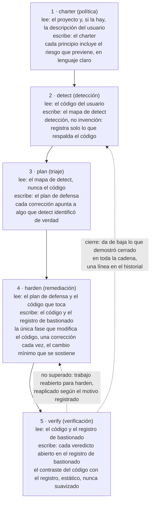
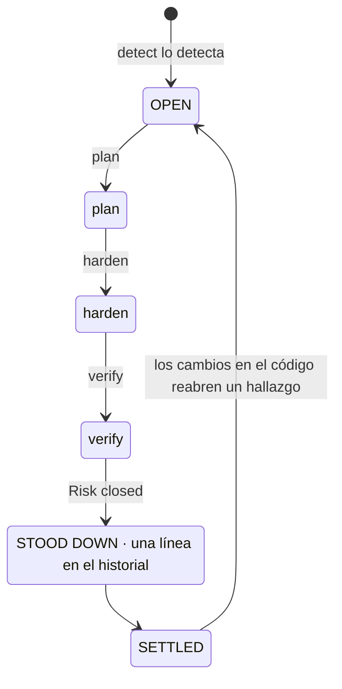
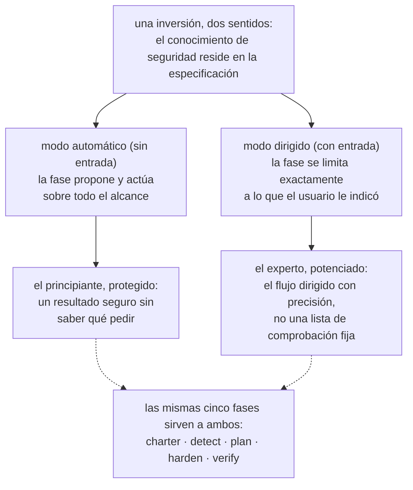
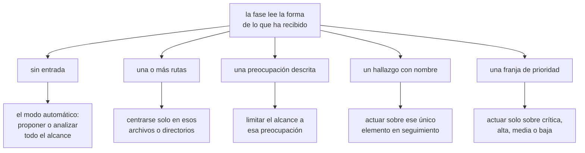
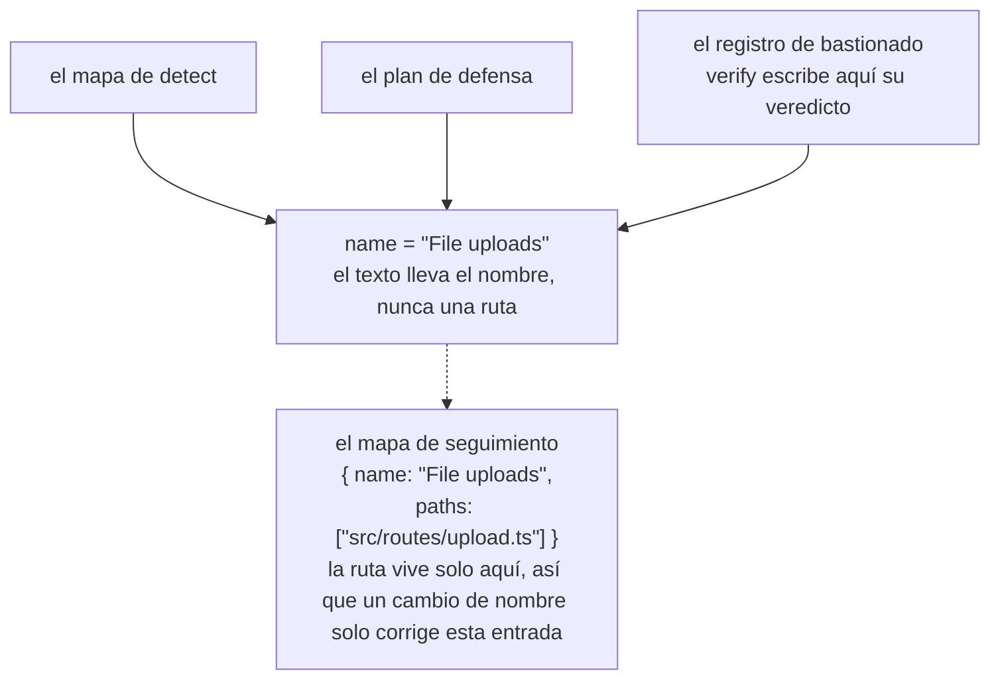
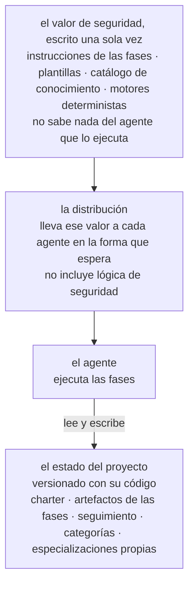
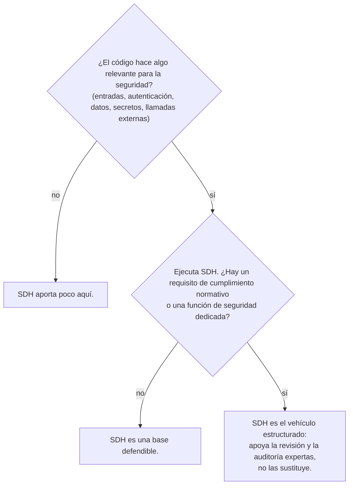

# Security-Driven Hardening (SDH): una convención para la era del desarrollo asistido por IA

- **Weslley Araújo**
- **Artículo de metodología, 2026.**

---

## Resumen

Security-Driven Hardening (SDH) es una metodología de seguridad estructurada, guiada por IA y exclusivamente defensiva, pensada para una época en la que el software lo escriben cada vez más agentes de IA y personas que no son especialistas en seguridad. En lugar de aplicar una lista de comprobación genérica, SDH detecta primero lo que un sistema hace realmente (inicio de sesión, subida de archivos, pagos, exposición de datos, etc.) y después dirige el trabajo de seguridad propio de ese contexto. La rigen principios seguros por defecto, se plantea por completo desde la defensa y se expresa en lenguaje claro para que cualquier usuario pueda actuar a partir de ella.

Este documento sostiene que SDH es una convención que faltaba, no una herramienta concreta. El conocimiento de seguridad reside en la metodología y en sus especializaciones bajo demanda, una base sobre la que cualquier usuario puede construir, y eso le permite atender a un principiante y a un experto con el mismo flujo. Dos propiedades la distinguen de los enfoques spec-first anteriores `[1]`. SDH es **independiente del estado**: se adapta a un directorio vacío, a un proyecto en curso, a un único pull request o a un gran código heredado, con cualquier stack. Y con SDH **la seguridad se puede cerrar**: un riesgo cuyo cierre se ha verificado se da de baja de todo el flujo, de modo que ese hallazgo queda en reposo y solo se reabre cuando cambia el código. SDH no sustituye a los profesionales de seguridad ni a las herramientas especializadas de Blue Team. Amplía el conocimiento del propio desarrollador, y cuanto más sabe de seguridad un desarrollador, más puede dirigir la metodología.

**Lagune** es la implementación de referencia y demuestra que la metodología se puede construir y llevar a otros entornos. SDH se ofrece como una convención que otros pueden adoptar.

> **Palabras clave**
>
> desarrollo asistido por IA, seguridad del software, seguridad defensiva, spec-driven development, bastionado, flujos de trabajo guiados por agentes, posibilidad de cierre, seguridad adaptada al contexto, conocimiento bajo demanda, herramientas independientes del agente.

---

## I. Introducción: la brecha de seguridad que abrió el desarrollo asistido por IA

Cada vez más software sale de manos de personas, y de agentes de IA, que no saben reconocer con fiabilidad un patrón inseguro: un secreto filtrado, una comprobación de autorización que falta, una consulta vulnerable a inyección. No son riesgos exóticos. Figuran entre las clases de riesgo que dominan los incidentes reales, documentadas desde hace años en referencias públicas `[6]`, `[7]`, y estudios recientes indican que una parte significativa del código generado por IA se publica justo con este tipo de defectos `[8]`. Los asistentes de programación con IA agravaron el problema al permitir que personas que no son desarrolladoras publiquen software real, pero la brecha va más allá de cualquier público concreto. La mayoría de los proyectos nunca reciben una revisión de seguridad específica para lo que hacen realmente. El ecosistema se vuelve más frágil con cada decisión precipitada de "funciona, publícalo".

Los consejos de seguridad genéricos no cierran esta brecha. Una lista de comprobación estática no es específica de lo que hace un sistema, así que inunda un proyecto pequeño de elementos irrelevantes y aun así pasa por alto el riesgo que importa en ese proyecto concreto. El problema no es que falte conocimiento de seguridad en el mundo. El problema es asociar el conocimiento adecuado al sistema que el usuario tiene delante, y hacerlo para alguien que quizá no sepa qué pedir.

SDH responde con una sola inversión: **el conocimiento de seguridad reside en la especificación y en sus especializaciones bajo demanda, una base sobre la que cualquier usuario puede construir**. La metodología detecta el contexto, hace el triaje de los riesgos que conlleva ese contexto y guía las correcciones, de modo que el mismo flujo sirve tanto a quien desarrolla como a quien no. Los hallazgos y las recomendaciones se mantienen en lenguaje claro para que se puedan poner en práctica sea cual sea el nivel técnico de quien los lee. Al experto esto no lo limita, sino que lo potencia, una dualidad que desarrollamos en `§VI`.

> **Idea clave**
>
> **La inversión central:** el conocimiento de seguridad reside en la especificación y en sus especializaciones bajo demanda, una base sobre la que cualquier usuario puede construir. La metodología aprende qué hace el sistema, ajusta a él el trabajo de seguridad y amplía lo que el usuario ya sabe.

Pensemos en un desarrollador que le dice a un asistente de IA: "mi aplicación permite a los usuarios subir una foto de perfil". Sin una revisión de seguridad, el asistente produce código que funciona y que, sin que nadie lo note, confía en todo lo que envía el cliente: el tipo de archivo declarado, el nombre del archivo, el tamaño. La subida sale a producción, y un archivo disfrazado de imagen puede llevar código, un nombre manipulado puede escaparse de la ruta de almacenamiento y un archivo demasiado grande puede agotar el servidor. Nada de esto se ve en una demostración, así que sale tal cual.

El mismo código, pasado por SDH, se comporta de otra forma. SDH detecta que el sistema acepta archivos del exterior (detección), lo traduce en los riesgos que conlleva una subida (triaje), propone comprobar el tipo real y el tamaño del archivo, renombrarlo al guardarlo y almacenarlo donde no se pueda ejecutar código (remediación), y después lee el resultado y confirma que cada control se sostiene de verdad (verificación). El desarrollador nunca tuvo que conocer la expresión "subida de archivos sin restricciones". La metodología se la aportó.

Este documento hace las siguientes aportaciones:

- Una definición precisa de SDH como metodología, independiente de cualquier implementación concreta, con sus principios de diseño (`§III`).
- Un ciclo de vida defensivo de cinco fases en el que la separación de responsabilidades es en sí la aportación: la detección nunca inventa, la planificación nunca lee código, solo una fase modifica el código y la verificación nunca suaviza su juicio (`§IV`).
- La **posibilidad de cierre** como postura metodológica: cada hallazgo tiene un estado final, no un bucle sin fin (`§V`).
- La dualidad de la **extensión del conocimiento del desarrollador**: un único flujo que protege al principiante y potencia al experto (`§VI`).
- **Especializaciones no invocables y prompt bajo demanda**: conocimiento de seguridad acotado que el agente carga cuando el contexto del proyecto lo requiere, nunca por defecto (`§VII`).
- **Independencia del estado** y **adaptabilidad no prescriptiva**: SDH se ajusta a cualquier estado de desarrollo y se adapta al escenario en lugar de imponer un alcance fijo (`§VIII`).
- Un **modo preventivo**: la misma defensa aplicada mientras se desarrolla el trabajo habitual, para que el código llegue seguro por defecto y las fases tengan menos que corregir (`§IX`).
- Una comparación específica con Spec-Driven Development, el linaje del que surgió SDH y del que después se apartó (`§X`).
- Las disciplinas de ingeniería que permiten a la metodología sobrevivir a las refactorizaciones y mantenerse independiente de cualquier agente: el seguimiento con identidad por nombre (`§XI`) y un vehículo independiente del agente (`§XII`).

---

## II. Antecedentes y trabajos relacionados

SDH se apoya en trabajos previos. Hereda una estructura probada del desarrollo spec-first guiado por agentes `[1]`, `[2]`, `[3]`: plantillas, comandos de barra que consume un agente, un documento rector y un agente que ejecuta las fases. Reimplementa esa estructura con un propósito defensivo. El linaje es deliberado, y uno de los principios de trabajo de SDH lo nombra directamente: construir el flujo de trabajo a partir de una estructura probada y después orientarlo a la seguridad.

SDH no es una lista de comprobación estática de recomendaciones genéricas. Una lista de comprobación sabe mucho de seguridad en general y nada del proyecto que tiene delante. SDH invierte ese énfasis. Dedica su primer esfuerzo a la detección, a aprender qué hace el sistema, y solo entonces recurre al conocimiento que la detección vuelve relevante.

SDH tampoco sustituye a los profesionales de seguridad ni a las herramientas especializadas de Blue Team. Amplía el conocimiento del desarrollador (`§VI`). Un equipo con una función de seguridad dedicada debería conservarla. SDH le da a ese equipo un vehículo estructurado, y a un equipo sin ella, una base defendible.

SDH convive también con los analizadores de seguridad deterministas (análisis estático, linters) `[4]`, `[5]`. Esas herramientas son valiosas precisamente porque son deterministas y repetibles. SDH se basa sobre todo en el razonamiento del agente, lo que sacrifica el determinismo estricto a cambio de adaptarse al contexto. La metodología no finge lo contrario. Donde el determinismo importa, integra un motor determinista dentro del razonamiento (`§VII`): el agente decide si merece la pena comprobar una entrada, y un programa determinista decide si esa entrada es peligrosa.

El antecedente más directo es Spec-Driven Development (SDD), la familia de metodologías spec-first que hace avanzar la construcción de software a partir de una especificación ejecutable. Tratamos SDD como una clase. Su formulación más clara como metodología práctica es el informe de Piskala `[1]`, y su kit de herramientas guiado por agentes más visible es Spec Kit de GitHub `[2]`, con OpenSpec `[3]` como segunda herramienta de la misma familia. Estas son las referencias canónicas de la comparación de `§X`.

---

## III. SDH: definición y principios de diseño

**Security-Driven Hardening** es una metodología de seguridad estructurada y guiada por IA que hace más seguro un proyecto dirigiendo el trabajo desde una especificación que ejecuta el agente, y no a base de correcciones improvisadas. El nombre se inspira en los **Blue Teams**, los defensores en el ámbito de la seguridad. SDH trata de defensa, bastionado y verificación, nunca de ataque.

> **Definición**
>
> **Security-Driven Hardening (SDH):** una metodología de seguridad estructurada, guiada por IA y exclusivamente defensiva que primero detecta lo que un sistema hace realmente y después dirige el trabajo de seguridad específico de ese contexto, regida por principios seguros por defecto y expresada en lenguaje claro.

SDH se define por un conjunto de principios vinculantes. Cada uno es una regla, y cada uno ofrece al usuario una garantía concreta.

| Principio                                                   | La regla                                                                                                                                                                           | Lo que garantiza al usuario                                                                                                                                                                                      |
| ----------------------------------------------------------- | ---------------------------------------------------------------------------------------------------------------------------------------------------------------------------------- | ---------------------------------------------------------------------------------------------------------------------------------------------------------------------------------------------------------------- |
| Seguro por defecto, en lenguaje claro, para todos por igual | Cada valor por defecto, mensaje y corrección es seguro desde el principio y comprensible para cualquier lector, sea desarrollador o no. No se privilegia a ningún tipo de usuario. | Un principiante recibe una base segura sin pedirla y lee el resultado en sus propios términos.                                                                                                                   |
| Adaptado al contexto antes que genérico                     | Cada fase parte del contexto detectado en detect y actúa sobre lo que el sistema hace realmente.                                                                                   | Las recomendaciones se ajustan al proyecto, no a una lista de comprobación. El conocimiento de seguridad reside en la especificación y en sus especializaciones bajo demanda, y amplía lo que aporte el usuario. |
| Flexible antes que rígido                                   | Los principios, requisitos y recomendaciones son puntos de partida. El usuario puede reformular, descartar, añadir o acotar cualquier cosa.                                        | La metodología se adapta al proyecto y al usuario, y nunca con más rigidez de la que el usuario quiere. La flexibilidad nunca debilita la base segura por defecto.                                               |
| Conciliar, nunca solo añadir                                | Los artefactos son documentos vivos, no logs. Cada ejecución revisa todas las entradas: conserva lo que se sostiene, reescribe lo que cambió y elimina lo que ya no es válido.     | El registro siempre refleja el presente, así que nunca degenera en una lista de pendientes obsoleta.                                                                                                             |
| Solo defensa                                                | SDH audita, bastiona y verifica. Nunca produce herramientas ofensivas, exploits con fines maliciosos ni técnicas de evasión de la detección para causar daño.                      | La metodología no puede convertirse en un arma. El contenido de doble uso solo aparece en un marco claramente defensivo.                                                                                         |
| Spec-first, guiado por agentes, orientado a la seguridad    | El flujo de trabajo se construye con plantillas, comandos, un charter rector y un agente que ejecuta las fases.                                                                    | Una estructura de desarrollo probada, reorientada para que el agente haga el trabajo de seguridad de fondo.                                                                                                      |

**Tabla 1.** Los principios de diseño de SDH y la garantía que cada uno ofrece al usuario.

Estos principios no son decorativos. Son las restricciones que debe respetar cada fase descrita a continuación, y la discusión de `§XV` vuelve sobre ellos para marcar los límites de la metodología.

El resto del documento desarrolla nueve pilares con nombre propio. Son las partes que un lector debería poder retener, y las que otro equipo reimplementaría para afirmar que hace SDH.

| Pilar                                                          | Qué aporta                                                                                                                                                       | Sección     |
| -------------------------------------------------------------- | ---------------------------------------------------------------------------------------------------------------------------------------------------------------- | ----------- |
| La inversión adaptada al contexto                              | El conocimiento de seguridad reside en la especificación y en sus especializaciones bajo demanda, así que un principiante y un experto comparten un mismo flujo. | `§I`, `§VI` |
| El ciclo de vida defensivo de cinco fases                      | Separación de responsabilidades: política, detección, triaje, remediación y verificación, cada una con una sola tarea.                                           | `§IV`       |
| La posibilidad de cierre                                       | Un hallazgo tiene un estado final, no un bucle sin fin. El trabajo cerrado se da de baja.                                                                        | `§V`        |
| La dualidad de la extensión del conocimiento del desarrollador | Un único flujo que protege al principiante y potencia al experto, sin sustituir nunca a ninguno de los dos.                                                      | `§VI`       |
| Prompt bajo demanda, conocimiento no invocable                 | El conocimiento de seguridad relevante se carga según lo que es el proyecto, nunca por defecto.                                                                  | `§VII`      |
| Independencia del estado y adaptabilidad no prescriptiva       | Se ajusta a cualquier estado de desarrollo con cualquier stack, y se adapta al escenario en lugar de imponer un alcance.                                         | `§VIII`     |
| El modo preventivo                                             | La misma defensa actúa mientras se desarrolla el trabajo nuevo, para que el código llegue seguro por defecto.                                                    | `§IX`       |
| Seguimiento con identidad por nombre                           | Un hallazgo sigue siendo un único elemento a lo largo de las fases, y un cambio de nombre rompe el vínculo en un solo lugar.                                     | `§XI`       |
| El vehículo independiente del agente                           | El valor de seguridad se escribe una sola vez y no depende de ningún agente ni stack.                                                                            | `§XII`      |

**Tabla 2.** Los nueve pilares de SDH y dónde se desarrolla cada uno.

---

## IV. El flujo Blue Team de 5 fases

SDH estructura el trabajo como un ciclo de vida defensivo de cinco fases (figura 1). Cada fase se plantea desde la defensa, cada una se apoya en la anterior, y las fases siguen la actividad real de un Blue Team: establecer la política, detectar, hacer el triaje, remediar y verificar.



**Figura 1.** El flujo de cinco fases: qué lee cada fase, qué escribe y su invariante esencial. Verify origina los dos retornos: un control que no supera la verificación reabre harden, y un hallazgo cuyo cierre se ha demostrado se da de baja en toda la cadena, con una línea en el historial.

La separación de responsabilidades es la aportación. Como cada fase tiene una sola tarea, cualquier fallo queda contenido en un solo lugar, y el lector puede fiarse de lo que afirma cada artefacto.

> **Idea clave**
>
> **Applied no significa verificado:** harden registra que se aplicó una corrección. Verify la comprueba contrastando el código con ese registro, y el veredicto nunca se suaviza para que coincida con el registro. Un control puede estar presente en el código y aun así dejar el riesgo alcanzable, y entonces el veredicto honesto es "Risk not closed".

### charter (política)

El charter establece los principios de seguridad del proyecto, las reglas que toda fase posterior debe respetar. Es la capa rectora, una especie de comprobación en tiempo de compilación de la postura de seguridad del proyecto. Cada principio tiene un nombre claro, una regla innegociable que se puede contrastar con el código y una línea `Why:` que expone el riesgo que previene, no solo la corrección. El charter siempre lee el propio proyecto (sus manifiestos, su estructura y sus dependencias), y la descripción del usuario, cuando la hay, es una orientación que esa lectura amplía después más allá de lo que el usuario mencionó. Sin descripción, el proyecto es la única fuente. Ambas se suman en lugar de competir, y el charter registra la política que el proyecto debería cumplir, no el estado de su código. Alguien que no sea desarrollador debería poder leerlo y entender tanto la regla como el riesgo.

### detect (detección)

Detect lee el código e identifica lo que el sistema hace realmente y que tiene peso para la seguridad. La instrucción que lo rige es "detección, no invención": registrar solo lo que respalda el código, con la evidencia que necesitan las fases posteriores. Detect es neutral. No fuerza sus hallazgos para que encajen con el charter, porque cotejar los riesgos con las reglas del charter es tarea de la fase plan. Cada hallazgo tiene tres partes: qué es (una descripción en lenguaje claro), por qué importa (el riesgo, no solo el hecho) y la evidencia (la función o la ruta donde se encuentra). La evidencia no incluye ninguna ruta de archivo. La ruta vive solo en el mapa de seguimiento (`§XI`), así que el texto nunca contiene una ruta que pueda quedar obsoleta.

### plan (triaje)

Plan convierte cada hallazgo en una corrección, nombrada por su clase de riesgo (citando las referencias establecidas, CWE y OWASP, cuando la fundamentan) y vinculada al principio del charter que esa corrección defiende. La prioridad (crítica, alta, media, baja) no es una elección libre: plan puntúa cada hallazgo con el método Base y Environmental de CVSS v4.0, de modo que la franja es la puntuación expresada en palabras sencillas, justificada con una línea en lenguaje claro sobre la exposición y lo que está en juego, y dos ejecuciones dan el mismo orden. El vector es el ancla precisa para un experto, y la franja con su justificación, la misma valoración que cualquiera puede seguir. Plan trabaja solo a partir del mapa de detect y nunca lee el código. Es una restricción deliberada, no una limitación: obliga a que cada corrección apunte a algo que detect detectó de verdad. Si un ámbito nunca se identificó, plan se detiene y devuelve al usuario a detect en lugar de suponer.

### harden (remediación)

Harden es la única fase que modifica el código, así que avanza con cautela. Que una edición necesite o no la aprobación del usuario depende del agente y del modo de permisos con el que se ejecuta, así que harden no añade ningún paso de confirmación propio. Aplica una corrección cada vez, primero las dependencias y después la de mayor prioridad, para que cada cambio sea pequeño, revisable y fácil de deshacer. Nunca debilita un control existente para que encaje una corrección nueva, y nunca incumple un principio del charter. Si una corrección entrara en conflicto con un principio, harden se detiene y expone el conflicto en lugar de aplicarla. Cada bloque se registra como Applied, Partial o Blocked. "Applied todavía no significa verificado", y de eso se ocupa la fase siguiente.

### verify (verificación)

Verify comprueba cada control aplicado leyendo el código y contrastándolo con lo que registró harden. La verificación es ese contraste, el código frente al registro, y es estática: confirma que un control está presente y es correcto en el código, no que el control resista un ataque en un sistema en ejecución. Esa comprobación en tiempo de ejecución, la que lanza ataques reales o simulados contra el sistema en funcionamiento, queda fuera del alcance por diseño. Verify devuelve uno de tres veredictos: Risk closed, Risk not closed o Cannot tell from the code. No produce ningún artefacto propio: harden y verify comparten el registro de bastionado, harden es dueño de lo que se hizo y verify, del veredicto y su motivo, y ninguno escribe nunca en los campos del otro. Un control que no supera la verificación es trabajo reabierto para harden, cuya siguiente ejecución antepone el veredicto a su propia lectura del código y vuelve a aplicar la corrección contra la carencia exacta que indica el motivo. Verify confía más en el código que en el registro, porque un registro puede afirmar más de lo que el código cumple. Es de solo lectura sobre el código del usuario y nunca suaviza un veredicto para que coincida con el registro. Un control puede estar presente y aun así dejar el riesgo alcanzable por otra vía, y en ese caso el veredicto honesto es "Risk not closed". Si, mientras lee, verify advierte un problema de seguridad que el mapa de detect nunca cubrió, no se inventa un veredicto para él, porque detectar es tarea de detect: expone el problema y devuelve al usuario a detect, para que el hallazgo entre por el mismo flujo en lugar de saltárselo.

> **Hilo conductor: subida de archivos.** Un único hallazgo muestra la columna vertebral del flujo de principio a fin.
>
> - **detect** lo encuentra: el sistema acepta archivos de los usuarios, y el handler de subida confía en el tipo MIME que envía el cliente sin comprobar el tipo real del archivo. _Por qué importa:_ un archivo disfrazado de imagen puede ocultar código malicioso.
> - **plan** decide la corrección, con prioridad **crítica**, en defensa del principio "Ninguna entrada es fiable hasta que se valida": comprobar el tipo real y el tamaño del archivo, renombrarlo al guardarlo y almacenar las subidas donde no puedan ejecutarse como código.
> - **harden** la aplica, con estado **Applied**: el handler ahora detecta el tipo real a partir del contenido, impone un límite de tamaño, rechaza todo lo inesperado, renombra al guardar y almacena donde no se puede ejecutar código.
> - **verify** lee el handler, lo contrasta con el registro y devuelve **Risk closed**: el código hace exactamente lo que afirma el registro.
>
> El mismo nombre de hallazgo recorre el mapa de detect, el plan y el registro de bastionado, y verify actúa sobre ese registro con el mismo nombre: un veredicto abierto se escribe en el bloque del hallazgo, y un hallazgo cuyo cierre se ha demostrado se da de baja (`§V`). Ese nombre compartido es su identidad (`§XI`).

---

## V. Posibilidad de cierre: un hallazgo tiene un estado final

La mayoría de las herramientas de seguridad dejan al usuario una lista de pendientes que no para de crecer. SDH adopta otra postura: **un hallazgo se puede cerrar, así que tiene un estado final en lugar de vivir en una lista de pendientes interminable** (figura 2). Esto se deriva directamente del principio de conciliación.

> **Definición**
>
> **Posibilidad de cierre:** un riesgo cuyo cierre se ha verificado se da de baja de todo el flujo, de modo que ese hallazgo queda en reposo y solo se reabre cuando cambia el código. Un hallazgo tiene un estado final, aunque el programa de seguridad en sí siga siendo continuo.

Los artefactos de SDH son documentos vivos, no logs. Cada vez que una fase se vuelve a ejecutar, concilia cada entrada existente con la realidad actual y hace una de tres cosas: conserva lo que sigue siendo válido, reescribe lo que cambió o elimina lo que ya no lo es. Un hallazgo que, según el código, ya está resuelto simplemente se elimina. El registro de trabajo refleja el presente, no el pasado.

El cierre es esa misma conciliación llegando a su conclusión. Cuando verify comprueba que un riesgo está cerrado, da de baja el hallazgo en todo el flujo: el mapa de detect, el plan, el registro de bastionado y el mapa de seguimiento. Por eso verify es la única fase que escribe en los artefactos de las demás: es la fase que cierra el ciclo. Cuando el hallazgo sale de la cadena, darlo de baja lo resume en una entrada breve de un historial que vive fuera de la cadena de trabajo y nunca se vuelve a procesar. Esa es la línea entre desaparecer y cerrarse: un hallazgo que la conciliación eliminó porque dejó de ser cierto no deja rastro, mientras que un hallazgo cuyo cierre se ha demostrado se gana su línea en el historial. Un hallazgo dado de baja ya no aparece en ningún artefacto de trabajo, y esa ausencia es lo esperado, no una cadena rota.



**Figura 2.** La máquina de estados de la posibilidad de cierre. Un hallazgo pasa por OPEN → STOOD DOWN → SETTLED y solo se reabre cuando cambia el código.

Cuando todo lo que está dentro del alcance se ha dado de baja, el ciclo queda en reposo, y ese estado tiene una forma concreta: un artefacto cuyo último hallazgo se cerró se elimina entero, así que una cadena completamente cerrada deja solo el charter y el historial, la política y la prueba. El ciclo solo se reabre cuando cambia el código. La metodología da a cada hallazgo un final definido, justo lo que una lista de pendientes interminable no puede dar.

---

## VI. La dualidad de la extensión del conocimiento del desarrollador

SDH no sustituye a las personas ni a las herramientas especializadas de Blue Team. **Amplía el conocimiento del propio desarrollador**. Cuanto más entiende un desarrollador de seguridad, con más precisión puede dirigir el flujo y más autonomía tiene. Un desarrollador que entiende poco recibe igualmente un resultado seguro, porque el modo automático lo protege.

La inversión de `§I`, según la cual el conocimiento de seguridad reside en la especificación, funciona en ambos sentidos. Para el principiante es protección: no necesita saber qué pedir, porque la especificación propone. Para el experto es amplificación: la misma especificación le permite dirigir el flujo con precisión en lugar de pelearse con una lista de comprobación fija.

Cada fase lleva esta dualidad en su propio funcionamiento (figura 3). Sin ninguna entrada, actúa sobre todo el alcance en nombre del usuario. Con una orientación, la misma fase se limita exactamente a aquello a lo que el usuario la dirigió.



**Figura 3.** La dualidad de la extensión del conocimiento del desarrollador. Una sola inversión sirve a dos públicos: el modo automático protege al principiante y el modo dirigido potencia al experto, con las mismas cinco fases.

Las especializaciones bajo demanda (`§VII`) hacen explícita la dualidad en su propio texto. Cada una le dice al agente que su conocimiento "amplía tu criterio" y que siga razonando más allá de lo que aporta la especialización. El conocimiento es un suelo, no un techo. Esto es lo que sirve a ambos públicos en el equilibrio que busca el documento: la comunidad de desarrolladores obtiene un instrumento sólido, y el profesional de Blue Team, un vehículo estructurado que no pretende hacer su trabajo por él.

---

## VII. Especializaciones no invocables y prompt bajo demanda

Este es el patrón más novedoso de la metodología. SDH incluye conocimiento de seguridad acotado en forma de especializaciones que se cargan **solo bajo demanda**, y es el propio agente quien decide cuáles cargar cotejándolas con el contexto del proyecto. Lo llamamos **prompt bajo demanda**: una forma de que el agente elija qué conocimiento activar según el alcance del proyecto en el que está, en lugar de ejecutar todas las comprobaciones por defecto. Las especializaciones evolucionan, y cualquiera de ellas puede cambiar o sustituirse en cualquier momento. La aportación es el patrón, no las especializaciones en sí.

> **Definición**
>
> **Prompt bajo demanda:** el agente selecciona qué conocimiento de seguridad activar cotejándolo con el alcance del proyecto que tiene delante, de modo que se incorpora el conocimiento relevante para lo que el proyecto es realmente, en lugar de ejecutar todas las comprobaciones por defecto.

> **Definición**
>
> **Especialización no invocable:** una unidad acotada de conocimiento de seguridad, independiente del lenguaje, dedicada a un contexto, como la subida de archivos o el código que se ejecuta en el navegador. Audita y explica, nunca reescribe código y nunca produce una entrada de ataque. No es un comando: se carga cuando el contexto que cubre está dentro del alcance, o cuando un prompt la pide por su nombre.

Cada especialización nombra las formas más seguras para los riesgos que cubre y le indica al agente cómo actuar sobre un hallazgo en cada fase que la usa: cómo valorarlo en la detección, cómo aplicar su corrección de forma segura en la remediación y cómo demostrarlo en la verificación.

El rasgo que la define es que una especialización **no se puede invocar por sí sola**: no es un comando, y dentro del flujo lo que la carga es una coincidencia. La fase de detección lista el catálogo una vez, coteja el contexto del proyecto con lo que cubre cada entrada y carga solo las especializaciones cuyo contexto está presente en el alcance. Las fases posteriores reutilizan esa lista de coincidencias en lugar de volver a listar, así que un solo cotejo sirve a toda la cadena, y el modo preventivo (`§IX`) hace el mismo cotejo con el trabajo que está a punto de desarrollarse. Una especialización cuyo contexto no está presente se omite, y la omisión se justifica igual que la carga: cada entrada del catálogo recibe un veredicto explícito, aplicada u omitida con el motivo extraído del código, de modo que una vaga sensación de irrelevancia nunca sustituye a la ausencia. No encontrar ninguna aplicable es un resultado válido.

El catálogo son datos, y crecer consiste en añadir un archivo de conocimiento y una fila al catálogo, nunca un comando nuevo. Las especializaciones integradas se agrupan en categorías, como OWASP, un lenguaje o las integraciones de IA, y el catálogo que usa un proyecto reúne las integradas de las categorías que eligió más sus propias especializaciones. El proyecto registra esa elección junto con el resto de su estado, así que todo un equipo coteja con el mismo catálogo. Es el mismo principio de adaptación al contexto que el de las fases, aplicado al conocimiento: se incorpora el conocimiento relevante para lo que el proyecto es realmente, en lugar de ejecutar todas las comprobaciones por defecto. Esa misma propiedad permite que sea el usuario, y no solo quien lo mantiene, quien amplíe el catálogo: una fuente o un tema de seguridad que aporta el usuario se condensa en una especialización nueva que pertenece al proyecto, se suma a su catálogo sean cuales sean las categorías y se carga exactamente igual que una integrada, a la que sustituye si tiene el mismo nombre. Crear una especialización también es una actividad exclusivamente defensiva y respeta el mismo límite que imponen las especializaciones: un informe de ataque puede ser la fuente, pero la especialización resultante audita y explica, y nunca emite un exploit funcional. Así, la inversión de `§I`, la inteligencia que reside en la especificación, se extiende al propio catálogo, que el usuario puede enriquecer para su contexto sin escribir código.

Un ejemplo breve ilustra el prompt bajo demanda. Detect lee una carpeta de código que se ejecuta en el navegador. Coteja ese contexto con el catálogo, carga la especialización que lo cubre y expone un hallazgo del lado del cliente siguiendo los pasos habituales de detect. Las especializaciones cuyo contexto no está en este alcance no coinciden, así que nunca se cargan, y cada una queda registrada como omitida. Fue el proyecto, y no una configuración fija, lo que decidió qué conocimiento era relevante.

El determinismo aparece justo donde importa. Una especialización puede incluir un comprobador determinista, no solo prosa: cuando una clase de riesgo tiene un procedimiento de decisión claro, un pequeño programa devuelve un veredicto fijo para una entrada dada, por ejemplo un conjunto corto de palabras como `safe`, `unsafe` o `invalid input`. Algunas clases de riesgo se pueden decidir de forma determinista exactamente así, con un cuerpo de trabajos previos que respalda el procedimiento de decisión `[9]`, `[10]`, `[11]`. El comprobador puntúa los candidatos que le pasa el agente o analiza el alcance para encontrarlos por sí mismo, y en ambos casos es el comprobador, no el agente, quien devuelve el veredicto. Una especialización lo bastante universal puede marcarse como obligatoria en el catálogo, y entonces se aplica siempre, con su comprobador ejecutado sobre todo el alcance. Es el único caso en que un conocimiento se carga sin coincidir con el contexto, y se declara en los datos del catálogo, nunca lo decide el agente sobre la marcha. Aquí es donde SDH ancla el razonamiento del agente en algo repetible, sin fingir que todo el flujo es determinista.

Por último, las especializaciones son **separables**. Como el conocimiento se sostiene por sí mismo, un usuario puede ejecutar una directamente en un prompt que no tiene nada que ver con el flujo completo de SDH, y mantener así la seguridad junto al desarrollo habitual. Una especialización con un comprobador determinista puede, por ejemplo, filtrar cada candidato generado durante la programación habitual y quedarse solo con los seguros. Esta posibilidad de usarlas por separado explica en parte por qué SDH se adapta a tantas situaciones, que es el tema de `§VIII`, y su expresión más completa es el modo preventivo (`§IX`), en el que el mismo conocimiento protege el desarrollo habitual de principio a fin.

---

## VIII. Independencia del estado y adaptabilidad no prescriptiva

Dos propiedades distinguen SDH de las metodologías de especificación rígidas.

### Independencia del estado

> **Definición**
>
> **Independencia del estado:** la metodología no depende del estado del desarrollo. Se ajusta a un directorio vacío, a un proyecto en curso, a un único pull request o a un gran código heredado, con cualquier stack, porque averigua el punto de partida leyéndolo.

Cada fase funciona igual tanto si el proyecto es totalmente nuevo como si ya existe. El charter infiere principios a partir del código que haya. Detect identifica el código que encuentre, aunque sea muy poco. No se presupone ningún punto de partida.

### Adaptabilidad no prescriptiva

> **Definición**
>
> **Adaptabilidad no prescriptiva:** la metodología se adapta al escenario en lugar de imponer un alcance fijo que el usuario deba seguir. Cuando el usuario no sabe qué decir, lee el entorno desde el que se la invocó, genera contexto y hace las preguntas que determinan lo que hará a continuación.

El modo de propuesta del charter es el caso más claro: SDH deriva un charter seguro por defecto analizando el proyecto, pregunta al usuario solo cuando una carencia cambia de verdad el resultado y, después, lo escribe y presenta cada principio en lenguaje claro junto con el riesgo que previene. El charter es un documento vivo que el usuario reelabora volviendo a ejecutarlo, no un contrato bloqueado tras una petición de aprobación, así que nunca exige que el usuario sepa qué pedir.

Esta adaptabilidad se manifiesta como una sensibilidad a la forma de la entrada: la misma fase lee lo que ha recibido y elige un modo (figura 4). Un archivo en el prompt, un hallazgo de la lista, una preocupación, una misión acotada contra un punto débil conocido o la petición de un análisis completo por fuerza bruta: cada uno se ajusta a lo que necesita el usuario, porque el flujo es no prescriptivo por diseño. Nada de esto debilita la base segura por defecto. La flexibilidad determina cómo se aplica la base, nunca la rebaja.



**Figura 4.** Adaptabilidad no prescriptiva. La misma fase lee la forma de su entrada y elige un modo, así que el alcance siempre lo decide el usuario, nunca se impone.

---

## IX. El modo preventivo universal: la misma defensa mientras se desarrolla el trabajo

SDH incluye un modo complementario: el desarrollo habitual hecho con la misma defensa activa mientras se escribe el código. El usuario pide el propio trabajo, una página de inicio de sesión, una subida de archivos, un endpoint, y la metodología protege el desarrollo a medida que avanza, para que el resultado sea seguro por defecto desde el momento en que llega, en lugar de después de una pasada posterior de bastionado.

> **Definición**
>
> **El modo preventivo:** desarrollo habitual ejecutado bajo la capa rectora y el conocimiento de SDH. El charter rige el desarrollo, las especializaciones relevantes para lo que está a punto de crearse se cargan bajo demanda, y el resultado se contrasta exactamente con la defensa que se usó antes de dar el trabajo por terminado.

El modo reutiliza cada pieza que ya llevan las fases, apuntada a código que todavía no existe. La detección de contexto pasa del código a la intención: el agente razona sobre lo que va a construir y las fronteras que cruza ese trabajo (un inicio de sesión implica credenciales, una sesión y entradas del exterior), y ese razonamiento es lo que se coteja con el catálogo de conocimiento. El prompt bajo demanda (`§VII`) se generaliza aquí: el contexto puede detectarse en el plan del código, no solo en código que ya existe. El charter rige como siempre, y una petición que incumpliría un principio se expone como conflicto, nunca se construye. La defensa se aplica sobre la marcha, en el momento en que se escribe cada parte, validando en la frontera y recurriendo a la construcción segura desde el primer momento, así que nunca llega a existir una versión que funciona pero es insegura y que haya que corregir.

El modo termina como empieza verify. Antes de dar el trabajo por terminado, quien lo construye contrasta su propio resultado con la defensa que usó: el control debe estar en el camino del riesgo, no al lado, debe estar completo y, cuando una especialización incluye un comprobador determinista, el veredicto del comprobador prevalece sobre la propia lectura del agente. Una carencia encontrada aquí se cierra como parte del mismo trabajo, porque terminar el trabajo significa terminarlo de forma segura.

Lo que el modo rechaza es tan deliberado como lo que hace. Construye solo lo que se pidió y no audita nada de su alrededor: auditar lo que ya existe es cosa de las fases. No escribe ningún artefacto ni hace seguimiento de ningún hallazgo, porque un hallazgo es un riesgo detectado en lo que ya existe, y el propósito de este modo es que la versión insegura nunca llegue a existir. Las dos direcciones se complementan: las fases cierran lo que ya está ahí (`§V`), y el modo preventivo evita que el trabajo nuevo lo reabra. Una cadena en reposo sigue en reposo no porque el desarrollo se haya detenido, sino porque lo que se construye mientras descansa se construye ya defendido.

---

## X. Security-Driven Hardening frente a Spec-Driven Development

Security-Driven Hardening (SDH) nació de la base de Spec-Driven Development (SDD) y después se apartó claramente de ella. La herencia estructural es real y reconocida: spec-first, guiado por agentes, un documento rector y un conjunto de comandos por fases que ejecuta el agente. SDH reutiliza esa estructura de forma deliberada. Lo que cambia es el propósito, el modelo de autoridad, el estado que se presupone y la condición de finalización. Tratamos SDD como una clase, y tomamos el informe de Piskala `[1]` como la formulación canónica de la metodología, Spec Kit de GitHub `[2]` como el kit de herramientas canónico para agentes y OpenSpec `[3]` como segunda herramienta de la misma familia.

SDD da la vuelta al desarrollo tradicional al hacer ejecutables las especificaciones: la especificación genera directamente una implementación que funciona, en lugar de limitarse a orientarla `[1]`. Su conjunto de fases hace avanzar la construcción `[2]` (establecer los principios rectores, especificar qué construir, planificar el stack tecnológico, dividir el plan en tareas y después implementar). Su documento rector, una constitución de principios, es la pieza fundamental a la que el agente debe ceñirse en todo momento. Ahí está el núcleo de la diferencia. En SDD, la autoridad fluye de la especificación hacia la construcción, y se espera que la implementación la siga.

SDH invierte casi todos los ejes de ese contrato (tabla 3).

> **Idea clave**
>
> **La diferencia central:** en SDD, la autoridad fluye de la especificación hacia la construcción, y se espera que la implementación la siga. SDH es no prescriptiva y fluye en sentido contrario, hacia dentro, a partir del contexto detectado en el sistema, bastionando lo que ya existe.

| Eje                        | SDD                                                                                                     | SDH                                                                                                                                     |
| -------------------------- | ------------------------------------------------------------------------------------------------------- | --------------------------------------------------------------------------------------------------------------------------------------- |
| Objetivo                   | Entregar funcionalidades. La especificación se convierte en una implementación que funciona.            | Bastionar lo que existe o se está construyendo. Cada fase se plantea desde la defensa.                                                  |
| Modelo de autoridad        | Prescriptivo. La especificación y la constitución limitan la construcción a un alcance que debe seguir. | No prescriptivo. SDH se adapta al escenario, y el usuario puede reformular, descartar o acotar.                                         |
| Estado que presupone       | Una construcción hacia delante a partir de una especificación.                                          | Independiente del estado: directorio vacío, proyecto en curso, un único PR o código heredado.                                           |
| Condición de finalización  | Termina cuando se ha construido la funcionalidad.                                                       | Se puede cerrar. Un hallazgo queda en reposo y solo se reabre cuando cambia el código.                                                  |
| Documento rector           | Una constitución de principios a la que el agente debe ceñirse.                                         | Un charter de principios planteados desde el riesgo (cada uno con una línea `Why:`), que expresamente no es un contrato fijo.           |
| Cómo crece el conocimiento | Añadiendo un comando (o ampliando el conjunto de fases).                                                | Añadiendo una especialización no invocable que el agente carga bajo demanda: un archivo más una fila del catálogo, sin comandos nuevos. |
| A quién sirve              | A quien impulsa el desarrollo de una funcionalidad.                                                     | A cualquier usuario, sea desarrollador o no, con el mismo flujo.                                                                        |
| Qué modifica el código     | La fase de implementación genera la construcción.                                                       | Solo la fase harden modifica el código, una corrección cada vez.                                                                        |

**Tabla 3.** SDD frente a SDH en ocho ejes. Estructura prestada, contrato invertido.

Para ser justos con el linaje: SDD es un antecedente probado, y SDH le debe la estructura sobre la que funciona. La divergencia no es una crítica a SDD, que resuelve bien otro problema (construir hacia delante). SDH toma la misma maquinaria probada y la orienta a la defensa, la adaptabilidad y el cierre. OpenSpec `[3]`, organizado en torno a propuestas de cambio, listas de tareas y especificaciones por cambio, confirma el patrón: la familia hace avanzar una construcción a partir de una especificación, mientras que SDH bastiona un sistema hacia dentro a partir de su contexto detectado. Incluso el modo preventivo de SDH (`§IX`), el único punto en el que acompaña una construcción hacia delante, mantiene el contrato invertido: rige cómo se construye el trabajo y nunca decide qué construir.

---

## XI. Rigor de ingeniería: la disciplina del seguimiento

La disciplina de conciliar, nunca solo añadir (`§V`) necesita una base que sobreviva a las refactorizaciones. Un hallazgo debe seguir siendo un único elemento en todas las fases que lo tocan, y un archivo renombrado o movido no debe romper la cadena. SDH lo resuelve con la **identidad por nombre** y las **rutas guardadas solo en el seguimiento**.

> **Definición**
>
> **Identidad por nombre:** la identidad de un hallazgo es su nombre, escrito de forma idéntica en todos los artefactos. El texto lleva el nombre, nunca una ruta. Las rutas de archivo viven solo en el mapa de seguimiento, así que un cambio de nombre o un archivo movido rompe el vínculo en un único lugar.

Cada hallazgo de detect es un elemento en seguimiento. Su identidad es su **nombre**, el título de la sección, escrito de forma idéntica en el mapa de detect, el plan y el registro de bastionado. Las fases posteriores reutilizan ese nombre al pie de la letra cuando actúan sobre el mismo elemento, y verify escribe su veredicto en el registro de bastionado con ese mismo nombre. El mapa de seguimiento contiene seguimiento y nada más, una entrada por elemento:

```json
{ "name": "File uploads", "paths": ["src/routes/upload.ts"] }
```

El mapa no registra texto, ni anotaciones, ni un identificador aparte, ni la fase. Los artefactos de texto llevan la redacción, y el mapa solo lleva la identidad y las rutas. Las rutas de archivo son lo único volátil, y viven solo aquí. Un cambio de nombre o un archivo movido puede romper el vínculo en un único lugar, nunca en dos copias que divergen.



**Figura 5.** La cinta transportadora de la identidad. Un único nombre de hallazgo recorre todos los artefactos, mientras que su ruta vive solo en el mapa de seguimiento, así que un cambio de nombre se corrige en un solo lugar.

Dos actos mantienen el mapa en el flujo normal, y un tercero queda aparte como mantenimiento. **Track** es el registro aditivo: una fase comunica los hallazgos que ha escrito, y el motor registra los nuevos y sigue la ruta renombrada del resto, clasificando cada uno como nuevo, movido o sin cambios. Nunca elimina nada que la fase no haya comunicado. **Untrack** da de baja los hallazgos que verify cerró: en una sola pasada determinista, resume cada uno en su entrada del historial, elimina su sección entera de los artefactos, borra un artefacto cuyo último hallazgo ha desaparecido y quita su entrada de seguimiento, así que el agente no hace nada de eso a mano. Donde la pasada determinista no puede avanzar con seguridad, como un nombre dado de baja que aún se cita en el texto de otro hallazgo, señala ese punto al agente en lugar de adivinar una edición. Estos dos son los que llaman las fases mientras se ejecutan. **Repair** es el acto de mantenimiento: una fase delega en él automáticamente cuando su propia conciliación encuentra el seguimiento incoherente (una ruta registrada que ya no existe), y en los demás casos se ejecuta bajo demanda. Realinea todo el mapa de una vez, leyendo todos los artefactos y el código actual, corrigiendo las rutas de cada elemento y exponiendo lo que no puede decidir solo: un huérfano (un elemento en seguimiento que ya no nombra ningún artefacto) o un posible renombrado (un elemento cuyas rutas coinciden con otro nombre comunicado).

Repair es mantenimiento, no una sexta fase. No toca ni el código del usuario ni los artefactos de texto, solo el seguimiento. Lee el código fuente del usuario por un único motivo, averiguar la nueva ruta de un archivo renombrado, y nunca crea contenido de seguridad. La persona tiene la última palabra en la única decisión que el motor se niega a adivinar: si un elemento desaparecido se resolvió o solo se renombró. Mejor preguntar que adivinar, porque un elemento descartado por error rompe la cadena.

La metodología se aplica a sí misma su disciplina defensiva. Los motores deterministas se invocan como programas de línea de comandos, y cada entrada se pasa como un argumento de proceso independiente, lo que la mantiene inerte, de modo que un valor con comillas o comillas invertidas nunca puede inyectarse en el comando. Una comprobación desconocida falla en lugar de responder, así que una mal escrita nunca se lee como un resultado limpio. SDH no exime a su propia infraestructura interna del principio de seguridad por defecto.

---

## XII. El vehículo: una arquitectura independiente del agente como prueba de portabilidad

Para que SDH sea una convención que otros adopten, no puede estar atada a un agente ni a un stack, así que su vehículo mantiene separadas tres responsabilidades (figura 6). Lagune demuestra que es posible.

**El valor de seguridad** se escribe una sola vez y no sabe nada del agente que lo ejecuta: las instrucciones de las fases y las plantillas que rellenan, el catálogo de conocimiento y los motores deterministas. **La distribución** es ligera: su única tarea es llevar ese valor a cada agente en la forma y el lugar que el agente espera, y no incluye lógica de seguridad propia. **El estado del proyecto** pertenece al proyecto: el charter, los artefactos de las fases, el mapa de seguimiento, las categorías que eligió y sus propias especializaciones, versionados y revisables como cualquier otra parte de su código.



**Figura 6.** El vehículo independiente del agente. El valor de seguridad se escribe una sola vez, una distribución ligera lo lleva a cada agente y el estado sigue siendo del proyecto.

Como la distribución no incluye lógica de seguridad, la forma de construirla no cambia nada en SDH. Un vehículo puede construir la distribución por sí mismo o delegarla en un ecosistema que ya distribuye skills de agentes, como hace la implementación de referencia, y las fases, sus artefactos y sus garantías siguen siendo los mismos. Nada de esto depende tampoco de un lenguaje o un entorno de ejecución. La implementación de referencia está escrita en un stack concreto, pero la metodología es la frontera entre estas responsabilidades, no la cadena de herramientas que las construye. El mismo diseño podría reimplementarse en un lenguaje completamente distinto sin cambiar lo que es SDH.

---

## XIII. Caso práctico: SDH de principio a fin

> **Caso práctico**
>
> **Bastionado defensivo de una superficie de subida de archivos y administración.**
> **Contexto:** una pequeña aplicación que acepta archivos subidos por los usuarios y los lista en una página de administración.
> **Patrón:** charter → detect (con conocimiento bajo demanda activado por el contexto) → plan → harden → verify, con un cierre y un fallo real.
> **Resultado (capacidad):** un riesgo cuyo cierre se verifica y que se da de baja en toda la cadena, y un control que se verifica como _no_ cerrado y se devuelve a harden. El veredicto refleja el código, no el registro.

_Este es un ejemplo práctico ilustrativo de la mecánica de la metodología, no un estudio medido en condiciones reales, y no aporta métricas de eficacia._

Un recorrido continuo muestra la metodología en funcionamiento, no solo sus partes. Ampliamos el hilo de la subida de archivos de `§IV` con una activación de conocimiento bajo demanda y un cierre, e incluimos un fallo real.

1. **charter** propone el principio "Ninguna entrada es fiable hasta que se valida", con su riesgo en lenguaje claro: la entrada que no se comprueba es la forma más habitual de comprometer un sistema.
2. **detect** analiza la ruta de subida y la pequeña página de administración que lista los archivos subidos. Detecta el hallazgo de la subida (el handler confía en el tipo MIME del cliente). La página de administración se ejecuta en el navegador, un contexto que el prompt bajo demanda (`§VII`) reconoce, así que detect carga la especialización de ese contexto y expone un segundo hallazgo: un punto donde un nombre de archivo se escribe en la página como marcado en lugar de como texto, de modo que un nombre manipulado puede ejecutarse como script en el navegador del visitante. Las especializaciones cuyo contexto no está en este alcance nunca se cargan, y cada omisión se registra con la ausencia extraída del código.
3. **plan** asigna a la corrección de la subida la prioridad crítica, vinculada al principio: comprobar el tipo real y el tamaño del archivo, renombrarlo al guardarlo y almacenarlo donde no se pueda ejecutar código. Asigna a la segunda corrección la prioridad alta: mostrar el nombre del archivo como texto, no como marcado.
4. **harden** aplica primero la corrección de la subida (la de mayor prioridad) y la registra como Applied, y después la segunda, también Applied.
5. **verify** lee cada punto y contrasta el código con el registro. El control de la subida se sostiene: el handler detecta el tipo real a partir del contenido, impone un límite de tamaño y rechaza el resto. Veredicto: Risk closed. Verify da de baja el hallazgo de la subida en toda la cadena, y su resumen pasa al historial.

A continuación viene el fallo real. Supongamos que la segunda corrección de harden añadió una función auxiliar segura para mostrar texto, pero dejó la antigua llamada que escribe marcado todavía alcanzable por otro camino del código. Verify lee la página, ve la función auxiliar segura y ve también que el camino inseguro sigue activo. El control está presente, pero el riesgo no está cerrado. Verify se niega a suavizar el veredicto para que coincida con el registro. Devuelve "Risk not closed", registra la carencia y remite de nuevo a harden. Un control que no aborda el riesgo por completo no es un aprobado.

Así es la metodología en un solo ejemplo: detección adaptada al contexto, correcciones priorizadas y vinculadas a principios, aplicación cuidadosa y una verificación que informa del estado real del código, diga lo que diga el registro.

---

## XIV. Cuándo usar SDH y cuáles son sus límites

SDH rara vez resulta desproporcionada como puede serlo un proceso pesado, porque es independiente del estado y se puede cerrar: se reduce a un solo archivo y una sola preocupación, y llega a un estado de reposo en lugar de dejar una carga permanente. Su límite no es el tamaño del proyecto, sino la **profundidad de la garantía**.



**Figura 7.** Cuándo usar SDH. La decisión depende primero de la relevancia para la seguridad y después de la profundidad de la garantía, nunca del tamaño del proyecto.

SDH llega a su límite en estos casos: el comportamiento que solo aparece cuando el sistema se ejecuta (verify lee el código, no ejecuta el sistema), el riesgo que depende de una configuración o de un entorno que el agente no puede leer, y los contextos en los que hay mucho en juego y la revisión experta es obligatoria en cualquier caso. En todos ellos, SDH sigue aportando valor como primera pasada estructurada, pero es un suelo, no un techo.

> **Idea clave**
>
> **El límite:** el límite de SDH es la profundidad de la garantía, no el tamaño del proyecto. Puede servir como base defendible casi en cualquier parte y apoya la revisión experta cuando lo que está en juego lo exige, pero no sustituye las pruebas sobre un sistema en ejecución ni el criterio de un profesional de seguridad.

---

## XV. Discusión: posicionamiento, límites y lo que SDH no afirma

SDH es precisa sobre sus límites.

### Amplía, no sustituye

SDH no sustituye a los profesionales de seguridad ni a las herramientas especializadas de Blue Team. Amplía el conocimiento del desarrollador (`§VI`). Lo correcto es una afirmación mesurada: bien aplicada, SDH **puede** cerrar riesgos reales con eficacia, sobre todo en proyectos que de otro modo no recibirían ninguna revisión de seguridad. No es una garantía, ni sustituye a la revisión experta cuando lo que está en juego la exige.

### Solo defensa, por construcción

SDH audita, bastiona y verifica. Nunca produce herramientas ofensivas, exploits ni técnicas de evasión de la detección para causar daño. El contenido de seguridad de doble uso solo es aceptable en un marco claramente defensivo y autorizado. Es un límite firme, no una preferencia.

### La verificación es sustancial, no teatral

Verify verifica leyendo el código y contrastándolo con el registro, no ejecutando el sistema. Es una verificación estática: confirma que un control está presente y es correcto en el código, y no demuestra que el control resista un ataque en tiempo de ejecución. Por eso "Cannot tell from the code" es un veredicto legítimo, no un fallo disfrazado de aprobado. Cuando la evidencia no está en el código (depende de la configuración o de un camino que el agente no puede leer), SDH lo dice en lugar de suponer.

### El determinismo está acotado y tiene nombre

La mayor parte de SDH se basa en el razonamiento del agente, que es lo que hace posible su adaptación al contexto. El determinismo se reserva para los motores deterministas: los comprobadores que puede incluir una especialización (`§VII`) y el motor de seguimiento (`§XI`). El documento no difumina esta línea. Donde un resultado es determinista, es el resultado de un programa. Donde es razonado, es la lectura del código que hace el agente, con el usuario como árbitro final.

### Coste y escala

Un análisis completo consume muchos tokens. Los modos manuales (`§VI`, `§VIII`) existen en parte para que el coste sea proporcional a la preocupación.

### El usuario es el árbitro final

SDH pide a la persona que decida entre renombrado y resuelto, y la aprobación de sus ediciones de código se queda donde el usuario ya gobierna a su agente, en el modo de permisos con el que lo ejecuta. La metodología propone y verifica. No pasa por encima de la persona.

### Objeciones y respuestas

Un escéptico razonable planteará varias objeciones. Las de fondo merecen formularse con sus propias palabras.

**"¿No es esto solo un analizador estático con un LLM encima?"** No. Un analizador estático ejecuta por defecto todas las reglas que tiene. SDH detecta primero qué es el sistema, después recurre al conocimiento relevante (`§II`, `§VII`), y solo _integra_ un comprobador determinista donde una clase de riesgo tiene un procedimiento de decisión claro. El razonamiento parte del contexto, y el determinismo es selectivo.

**"¿No es esto solo una lista de comprobación de seguridad?"** No. SDH invierte la lista de comprobación: la detección va primero, y el conocimiento se incorpora según lo que el proyecto hace realmente (`§II`, `§VII`).

**"¿No es esto solo SDD rebautizado para la seguridad?"** No. SDH toma prestada la estructura de SDD e invierte su contrato: la autoridad, el estado que presupone, la condición de finalización y a quién sirve son distintos (`§X`). La misma maquinaria, en sentido contrario.

**"¿Un método razonado por IA no se limita a alucinar hallazgos?"** El diseño restringe la invención en lugar de confiar en que el modelo se porte bien. Detect registra solo lo que respalda el código ("detección, no invención", `§IV`), verify contrasta el código con el registro y puede responder "Cannot tell from the code" (`§XV`), los comprobadores deterministas fundamentan los casos decidibles (`§VII`) y el usuario es el árbitro final. Esto no hace infalible al agente, pero sí hace verificables sus afirmaciones.

Una nota sobre el posicionamiento. Aquí SDH se define con independencia de su implementación de referencia. Las cinco fases, el charter planteado desde el riesgo, conciliar en lugar de solo añadir y su posibilidad de cierre, el conocimiento con prompt bajo demanda, el modo preventivo, el seguimiento con identidad por nombre y el límite exclusivamente defensivo son la metodología. Otro equipo podría implementarlos en otro stack y en otro ecosistema de agentes, y el resultado seguiría siendo SDH. Lagune es su prueba, no su definición.

---

## XVI. Escollos y cómo los evita SDH por su estructura

Las metodologías de esta familia comparten un conjunto conocido de modos de fallo. La respuesta de SDH a la mayoría es estructural: está integrada en el flujo en lugar de dejarse a la disciplina.

| Escollo                                                  | El fallo                                                           | La respuesta estructural de SDH                                                                                                                           |
| -------------------------------------------------------- | ------------------------------------------------------------------ | --------------------------------------------------------------------------------------------------------------------------------------------------------- |
| Especificación deteriorada, lista de pendientes obsoleta | Los artefactos acumulan entradas muertas de las que nadie se fía   | Conciliar, nunca solo añadir (`§V`): cada ejecución revisa todas las entradas y elimina lo resuelto                                                       |
| Falsa confianza, resultado favorable                     | Se da por hecho que un control presente cierra el riesgo           | Verify contrasta el código con el registro, así que "Risk not closed" y "Cannot tell" son veredictos de primera clase (`§IV`, `§XV`)                      |
| Avalancha de comprobaciones                              | Los elementos genéricos tapan el único riesgo que importa          | Adaptado al contexto antes que genérico, con el prompt bajo demanda cargando solo lo que pide el alcance (`§VII`)                                         |
| Dependencia de una herramienta                           | El método queda soldado a un proveedor o agente                    | Vehículo independiente del agente: el valor de seguridad se escribe una sola vez, y su distribución a cada agente no incluye lógica de seguridad (`§XII`) |
| El bucle sin fin                                         | La lista de pendientes nunca se cierra y el trabajo nunca descansa | La posibilidad de cierre y el estado de reposo (`§V`)                                                                                                     |

**Tabla 4.** Escollos conocidos en esta familia de metodologías y la respuesta estructural de SDH a cada uno.

Lo importante es nombrar el escollo y señalar el mecanismo: no son avisos para tener cuidado, son propiedades del flujo.

---

## XVII. Trabajo futuro

La metodología y su implementación de referencia tienen próximos pasos claros.

- **Ampliar el catálogo de conocimiento:**
  Cada incorporación mantiene la forma de `§VII`: un archivo de conocimiento y una fila del catálogo, sin comandos nuevos. La vía del usuario ya existe ahí: el usuario condensa sus propias especializaciones bajo demanda. Más lenguajes, entornos de ejecución y clases de riesgo integrados, cada uno dentro de una categoría, son la dirección por parte de quien mantiene el proyecto, y se espera que las especializaciones evolucionen.
- **Más comprobadores deterministas:**
  Cuando una clase de riesgo tiene un procedimiento de decisión claro, una especialización puede incluir un comprobador determinista que ancle el razonamiento del agente en un veredicto repetible. Extender esto a más clases de riesgo es una dirección natural.
- **Evaluación empírica:**
  La pregunta abierta más importante es la eficacia medida: la calidad de los cierres y la tasa de veredictos erróneos en proyectos reales. Un estudio de los resultados de seguridad de SDH queda como trabajo futuro, y las afirmaciones de este documento se limitan en consecuencia.

---

## XVIII. Conclusión

El desarrollo asistido por IA abrió una brecha de seguridad que las listas de comprobación genéricas no pueden cubrir, porque el riesgo que importa depende de lo que hace realmente cada sistema, y quien lo publica puede no saber qué pedir. SDH cierra esa brecha con un flujo adaptado al contexto, exclusivamente defensivo y que se puede cerrar, en el que el conocimiento de seguridad reside en la metodología y en sus especializaciones bajo demanda, una base sobre la que cualquier usuario puede construir. Detecta el contexto real del sistema, hace el triaje de los riesgos que ese contexto conlleva, aplica las correcciones con cuidado y verifica cada una, y después da de baja lo que ha cerrado para que cada hallazgo llegue a un estado final. La misma defensa actúa también de forma preventiva mientras se desarrolla el trabajo nuevo, así que lo que el flujo cierra sigue cerrado. Se adapta a cualquier estado de desarrollo con cualquier stack, y amplía el conocimiento del desarrollador en lugar de sustituir a las personas y herramientas que ya hacen ese trabajo.

Lagune es la prueba, pero la aportación es la convención. SDH se ofrece como el flujo de seguridad esencial para la era del desarrollo con IA, para que otros lo adopten, lo perfeccionen y lo implementen en sus propios stacks.

---

## Referencias

**[1]** D. B. Piskala, "Spec-Driven Development: From Code to Contract in the Age of AI Coding Assistants," arXiv preprint arXiv:2602.00180v1 [cs.SE], Jan. 2026. (Submitted to AIWare 2026.) [Online]. Available: https://arxiv.org/abs/2602.00180

**[2]** GitHub, "Spec Kit: Toolkit for Spec-Driven Development." [Online]. Available: https://github.com/github/spec-kit. Accessed: 2026.

**[3]** Fission AI, "OpenSpec: Spec-Driven Development for AI Coding Assistants." [Online]. Available: https://github.com/Fission-AI/OpenSpec. Accessed: 2026.

**[4]** B. Chess and G. McGraw, "Static Analysis for Security," IEEE Security & Privacy, vol. 2, no. 6, pp. 76-79, 2004, doi: 10.1109/MSP.2004.111.

**[5]** OWASP Foundation, "Source Code Analysis Tools." [Online]. Available: https://owasp.org/www-community/Source_Code_Analysis_Tools. Accessed: 2026.

**[6]** OWASP Foundation, "OWASP Top 10:2021." [Online]. Available: https://owasp.org/Top10/. Accessed: 2026.

**[7]** MITRE, "Common Weakness Enumeration (CWE)." [Online]. Available: https://cwe.mitre.org/. Accessed: 2026.

**[8]** N. Perry, M. Srivastava, D. Kumar, and D. Boneh, "Do Users Write More Insecure Code with AI Assistants?," in Proc. ACM SIGSAC Conf. on Computer and Communications Security (CCS '23), 2023, pp. 2785-2799, doi: 10.1145/3576915.3623157. [Online]. Available: https://arxiv.org/abs/2211.03622

**[9]** J. Davis and contributors, "safe-regex: Detect Possibly Catastrophic, Exponential-Time Regular Expressions." [Online]. Available: https://github.com/davisjam/safe-regex. Accessed: 2026.

**[10]** D. Soshnikov, "regexp-tree: Regular Expressions Processor in JavaScript." [Online]. Available: https://github.com/DmitrySoshnikov/regexp-tree. Accessed: 2026.

**[11]** T. Jenkinson, "redos-detector: A CLI and Library to Score How Vulnerable a Regex Pattern Is to ReDoS Attacks." [Online]. Available: https://github.com/tjenkinson/redos-detector. Accessed: 2026.

---

## Apéndice A: los principios, al pie de la letra

1. **Seguro por defecto, en lenguaje claro, para todos por igual:**
   Cada valor por defecto, mensaje y corrección debe ser seguro desde el principio y comprensible para cualquier usuario, sea desarrollador o no. No se privilegia a ningún tipo de usuario sobre otro.
2. **Adaptado al contexto antes que genérico:**
   Cada fase debe partir del contexto detectado en detect y actuar sobre lo que el sistema hace realmente. Prioriza las recomendaciones específicas de ese contexto frente a las listas de comprobación genéricas. El conocimiento de seguridad reside en la especificación y en sus especializaciones bajo demanda, y amplía lo que aporte el usuario.
3. **Flexible antes que rígido:**
   SDH se adapta al proyecto y al usuario. Los principios, requisitos y recomendaciones son puntos de partida, no un contrato fijo. Deja que el usuario reformule, descarte, añada o acote cualquier cosa. La flexibilidad nunca debilita la base segura por defecto, solo permite al usuario decidir cómo se aplica.
4. **Conciliar, nunca solo añadir:**
   Los artefactos son documentos vivos, no logs. Cuando una fase se vuelve a ejecutar, concilia cada entrada existente con la realidad actual: conserva lo que sigue siendo válido, reescribe lo que cambió y elimina lo que ya no lo es. El cierre es esa misma conciliación llegando a su conclusión.
5. **Solo defensa:**
   SDH audita, bastiona y verifica. Nunca produce herramientas ofensivas, exploits con fines maliciosos ni técnicas de evasión de la detección para causar daño. El contenido de seguridad de doble uso solo es aceptable en un marco claramente defensivo y autorizado.
6. **Spec-first, guiado por agentes, orientado a la seguridad:**
   Construye el flujo de trabajo a partir de una estructura probada: plantillas, comandos, un charter rector y un agente que ejecuta las fases. Reimplementa esa estructura con un propósito defensivo.
