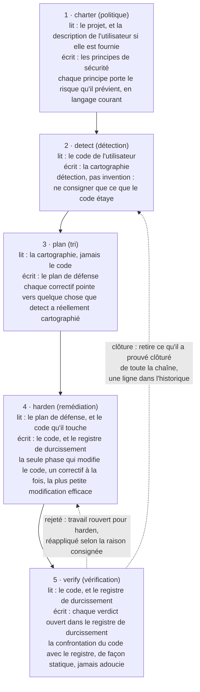
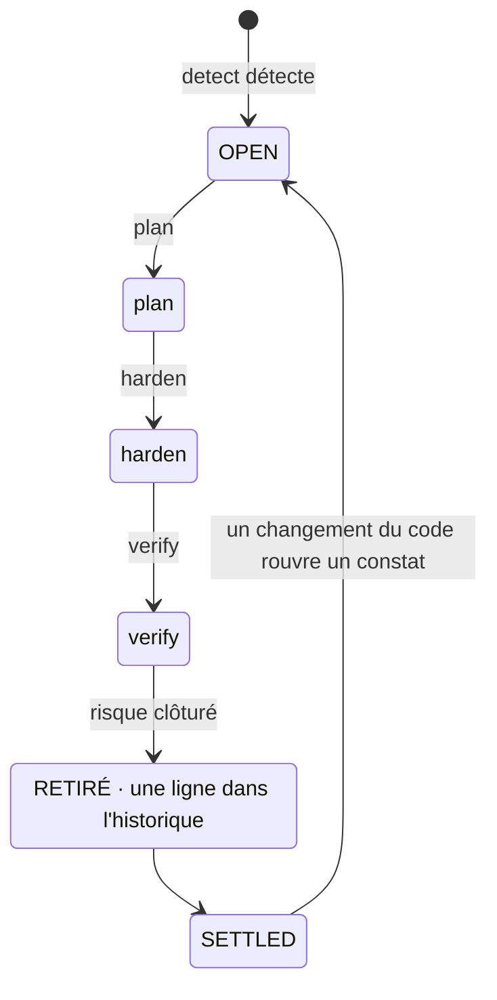
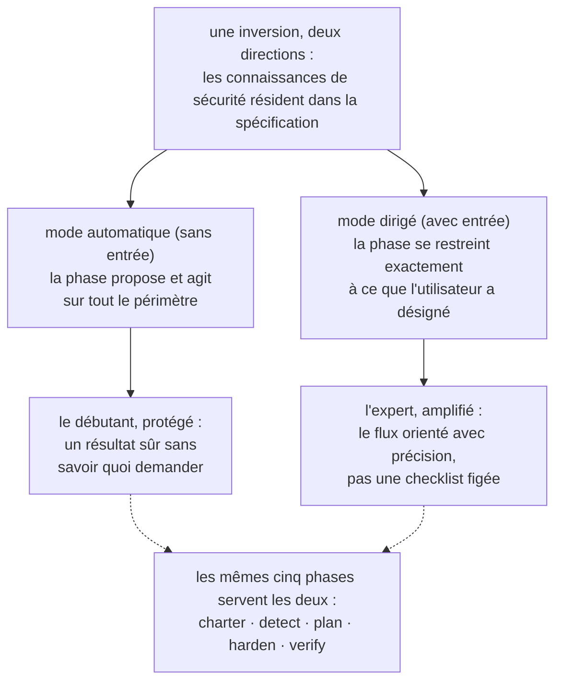
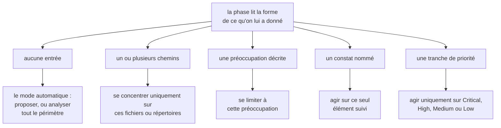
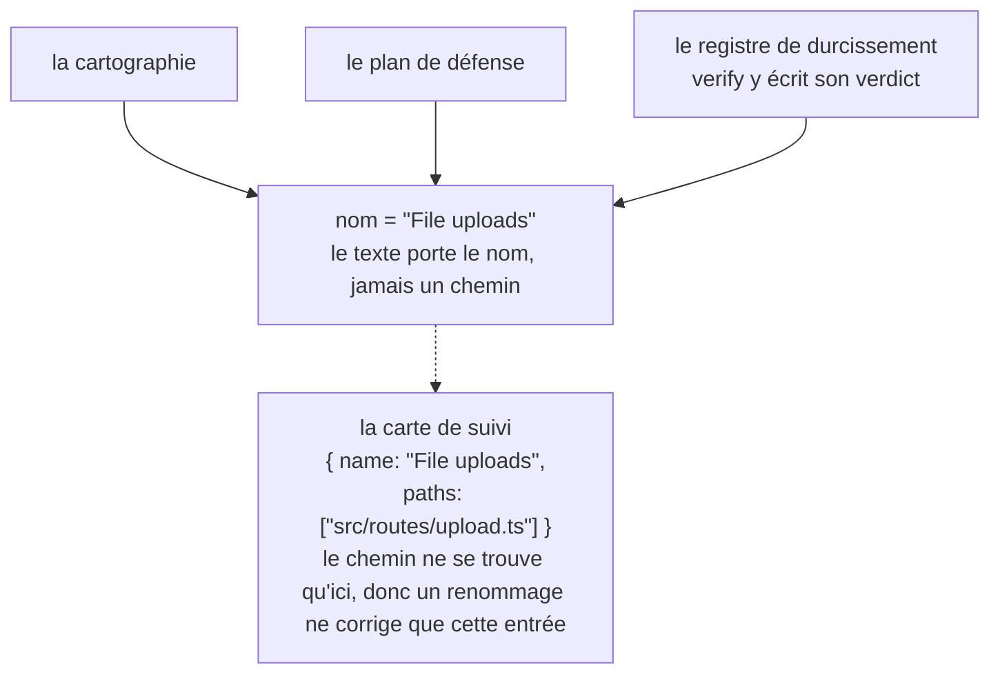
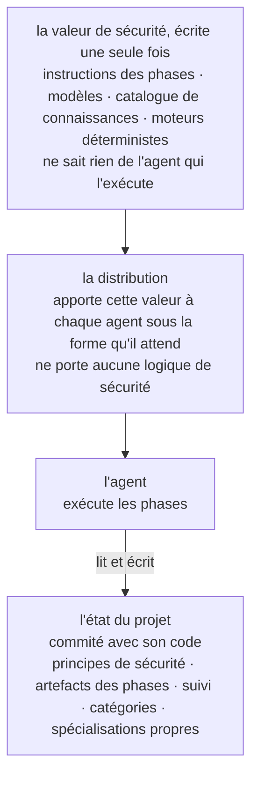
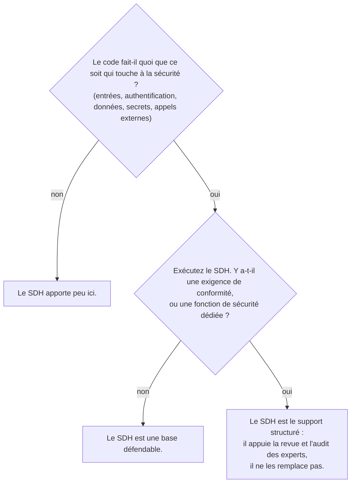

# Security-Driven Hardening (SDH) : une convention pour l'ère du développement assisté par IA

- **Weslley Araújo**
- **Article méthodologique, 2026.**

---

## Résumé

Le Security-Driven Hardening (SDH) est une méthodologie de sécurité structurée, pilotée par IA et exclusivement défensive, pensée pour une époque où les logiciels sont de plus en plus écrits par des agents IA et par des personnes qui ne sont pas spécialistes de la sécurité. Au lieu de dérouler une checklist générique, le SDH détecte d'abord ce que fait réellement un système (connexion, envoi de fichiers, paiements, exposition de données, etc.), puis pilote le travail de sécurité propre à ce contexte. Il est gouverné par des principes sûrs par défaut, entièrement tourné vers la défense, et formulé en langage courant pour que tout utilisateur puisse agir en conséquence.

Ce document soutient que le SDH est une convention qui manquait, et non un outil isolé. Les connaissances de sécurité résident dans la méthodologie et ses spécialisations à la demande, une base sur laquelle chaque utilisateur peut construire, ce qui lui permet de servir un débutant et un expert par le même flux. Deux propriétés le distinguent des approches spec-first antérieures `[1]`. Le SDH est **indépendant de l'état** : il s'adapte à un répertoire vide, à un projet en cours, à une seule pull request ou à une vaste base de code héritée, dans n'importe quelle stack. Et le SDH est **clôturable** : un risque dont la clôture est vérifiée est retiré de tout le flux, si bien que ce constat atteint un état stable et n'est rouvert que lorsque le code change. Le SDH ne remplace ni les professionnels de la sécurité ni les outils Blue Team spécialisés. Il prolonge les connaissances propres du développeur, et plus un développeur comprend la sécurité, plus il peut le piloter.

**Lagune** en est l'implémentation de référence, et il prouve que la méthodologie est réalisable et portable. Le SDH est proposé comme une convention que d'autres peuvent adopter.

> **Mots-clés**
>
> développement assisté par IA, sécurité logicielle, sécurité défensive, spec-driven development, durcissement de la sécurité, workflows pilotés par agent, clôturabilité, sécurité adaptée au contexte, connaissances à la demande, outillage indépendant de l'agent.

---

## I. Introduction : la brèche de sécurité ouverte par le développement assisté par IA

Les logiciels sont de plus en plus livrés par des personnes, et par des agents IA, incapables de reconnaître de façon fiable un motif non sûr : un secret divulgué, une vérification d'autorisation manquante, une requête injectable. Ce ne sont pas des risques exotiques. Ils figurent parmi les classes de risques qui dominent les incidents réels, documentées depuis des années dans des références publiques `[6]`, `[7]`, et des études récentes indiquent qu'une part significative du code généré par IA est livrée avec exactement ce type de défauts `[8]`. Les assistants de programmation IA ont aggravé la situation en permettant à des non-développeurs de livrer de vrais logiciels, mais la brèche dépasse un seul public. La plupart des projets ne bénéficient jamais d'un passage de sécurité propre à ce qu'ils font réellement. L'écosystème se fragilise à chaque décision prématurée du type "ça marche, on livre".

Les conseils de sécurité génériques ne comblent pas cette brèche. Une checklist statique n'est pas propre à ce que fait un système : elle submerge un petit projet d'éléments sans rapport et passe malgré tout à côté du risque qui compte pour ce projet précis. Le problème n'est pas un manque de connaissances en sécurité dans le monde. Le problème est de faire correspondre les bonnes connaissances au système qui se trouve réellement devant l'utilisateur, et de le faire pour quelqu'un qui ne sait peut-être pas quoi demander.

Le SDH y répond par une seule inversion : **les connaissances de sécurité résident dans la spécification et ses spécialisations à la demande, une base sur laquelle chaque utilisateur peut construire**. La méthodologie détecte le contexte, trie les risques que porte ce contexte et guide les correctifs, si bien qu'un développeur et un non-développeur sont servis par le même flux. Les constats et les recommandations restent en langage courant, pour être exploitables quel que soit le niveau technique du lecteur. L'expert n'en est pas bridé, mais amplifié, une dualité que nous développons en `§VI`.

> **Idée clé**
>
> **L'inversion centrale :** les connaissances de sécurité résident dans la spécification et ses spécialisations à la demande, une base sur laquelle chaque utilisateur peut construire. La méthodologie apprend ce que fait le système et y fait correspondre le travail de sécurité, et elle prolonge tout ce que l'utilisateur sait déjà.

Prenons un développeur qui dit à un assistant IA : "mon application permet aux utilisateurs d'envoyer une photo de profil." Sans passage de sécurité, l'assistant produit du code fonctionnel qui fait discrètement confiance à tout ce qu'envoie le client : le type de fichier déclaré, le nom du fichier, la taille. L'envoi est livré, et un fichier déguisé en image peut contenir du code, un nom forgé peut sortir du chemin de stockage, un fichier surdimensionné peut épuiser le serveur. Rien de tout cela n'est visible dans une démo, donc c'est livré.

Le même code passé par le SDH se comporte autrement. Il détecte que le système accepte des fichiers venant de l'extérieur (détection), le traduit en risques que porte un envoi de fichiers (tri), propose de vérifier le type réel et la taille du fichier, de le renommer à l'enregistrement et de le stocker là où du code ne peut pas s'exécuter (remédiation), puis lit le résultat et confirme que chaque mesure de protection est réellement efficace (vérification). Le développeur n'a jamais eu besoin de connaître l'expression "envoi de fichiers sans restriction". La méthodologie l'a fournie à sa place.

Ce document apporte les contributions suivantes :

- Une définition précise du SDH en tant que méthodologie, indépendante de toute implémentation, avec ses principes de conception (`§III`).
- Un cycle de vie défensif en cinq phases dans lequel la séparation des responsabilités est elle-même la contribution : la détection n'invente jamais, la planification ne lit jamais le code, une seule phase modifie le code, et la vérification n'assouplit jamais son jugement (`§IV`).
- La **clôturabilité** comme position méthodologique : un constat individuel a un état final, pas une boucle sans fin (`§V`).
- La dualité **prolongateur des connaissances du développeur** : un même flux qui protège le débutant et amplifie l'expert (`§VI`).
- Les **spécialisations non invocables et le prompt à la demande** : des connaissances de sécurité ciblées que l'agent charge quand le contexte du projet l'exige, jamais par défaut (`§VII`).
- L'**indépendance de l'état** et l'**adaptativité non autoritaire** : le SDH convient à n'importe quel état de développement et s'adapte au scénario au lieu d'imposer un périmètre fixe (`§VIII`).
- Un **mode préventif** : la même défense exécutée pendant la construction du travail ordinaire, pour que le code arrive sûr par défaut et que les phases aient moins à corriger (`§IX`).
- Une comparaison dédiée avec le Spec-Driven Development, la lignée dont le SDH est issu avant de s'en écarter (`§X`).
- Les disciplines d'ingénierie qui permettent à la méthodologie de survivre aux refactorisations et de rester indépendante de tout agent : le suivi par identité de nom (`§XI`) et un support indépendant de l'agent (`§XII`).

---

## II. Contexte et travaux connexes

Le SDH s'appuie sur des travaux antérieurs. Il hérite d'une structure éprouvée du développement spec-first piloté par agent `[1]`, `[2]`, `[3]` : des modèles, des commandes slash qu'un agent consomme, un document de gouvernance et un agent qui exécute les phases. Il réimplémente cette structure dans un but défensif. La filiation est délibérée, et l'un des principes de travail du SDH la nomme directement : construire le workflow à partir d'une structure éprouvée, puis l'orienter vers la sécurité.

Le SDH n'est pas une checklist statique de recommandations génériques. Une checklist sait beaucoup de choses sur la sécurité en général et rien sur le projet qui se trouve devant elle. Le SDH inverse cette priorité. Il consacre son premier effort à la détection, à apprendre ce que fait le système, et seulement ensuite il va chercher les connaissances que la détection rend pertinentes.

Le SDH ne remplace pas non plus les spécialistes de la sécurité ni les outils Blue Team spécialisés. Il prolonge les connaissances du développeur (`§VI`). Une équipe dotée d'une fonction de sécurité dédiée doit la conserver. Le SDH donne à cette équipe un support structuré, et à une équipe qui n'en a pas, une base défendable.

Le SDH se place aussi à côté des scanners de sécurité déterministes (analyse statique, linters) `[4]`, `[5]`. Ces outils sont précieux justement parce qu'ils sont déterministes et reproductibles. Le SDH repose surtout sur le raisonnement de l'agent, ce qui échange un déterminisme strict contre l'adaptation au contexte. La méthodologie ne prétend pas le contraire. Là où le déterminisme compte, elle intègre un moteur déterministe au sein du raisonnement (`§VII`) : l'agent décide si une entrée mérite d'être vérifiée, et un programme déterministe décide si cette entrée est dangereuse.

L'antériorité la plus directe est le Spec-Driven Development (SDD), la famille de méthodologies spec-first qui fait avancer une construction à partir d'une spécification exécutable. Nous traitons le SDD comme une classe. Sa formulation la plus claire en tant que méthodologie de praticien est le rapport de Piskala `[1]`, et sa boîte à outils pilotée par agent la plus visible est Spec Kit de GitHub `[2]`, avec OpenSpec `[3]` comme second outil de la même famille. Ce sont les références canoniques de la comparaison en `§X`.

---

## III. Le SDH : définition et principes de conception

Le **Security-Driven Hardening** est une méthodologie de sécurité structurée et pilotée par IA qui rend une base de code plus sûre en conduisant le travail à partir d'une spécification qu'exécute l'agent, plutôt qu'à partir de correctifs ponctuels. Son nom s'inspire des **Blue Teams**, les défenseurs en sécurité. Le SDH porte sur la défense, le durcissement et la vérification, jamais sur l'attaque.

> **Définition**
>
> **Security-Driven Hardening (SDH) :** une méthodologie de sécurité structurée, pilotée par IA et exclusivement défensive, qui détecte d'abord ce que fait réellement un système, puis pilote le travail de sécurité propre à ce contexte, gouvernée par des principes sûrs par défaut et formulée en langage courant.

Le SDH se définit par un ensemble de principes contraignants. Chacun est une règle, et chacun confère une garantie précise à l'utilisateur.

| Principe                                                | La règle                                                                                                                                                                                   | Ce qu'il garantit à l'utilisateur                                                                                                                                                                                   |
| ------------------------------------------------------- | ------------------------------------------------------------------------------------------------------------------------------------------------------------------------------------------ | ------------------------------------------------------------------------------------------------------------------------------------------------------------------------------------------------------------------- |
| Sûr par défaut, en langage courant, pour tous à égalité | Chaque valeur par défaut, chaque message et chaque correctif est sûr d'emblée et compréhensible par tout lecteur, développeur ou non. Aucun profil d'utilisateur n'est privilégié.         | Un débutant reçoit une base sûre sans la demander, et lit le résultat dans ses propres termes.                                                                                                                      |
| Le contexte plutôt que le générique                     | Chaque phase part du contexte détecté par detect et agit sur ce que fait réellement le système.                                                                                            | Les recommandations correspondent au projet, pas à une checklist. Les connaissances de sécurité résident dans la spécification et ses spécialisations à la demande, et prolongent tout ce qu'apporte l'utilisateur. |
| La souplesse plutôt que la rigidité                     | Les principes, exigences et recommandations sont des points de départ. L'utilisateur peut reformuler, supprimer, ajouter ou réduire la portée de n'importe quoi.                           | La méthodologie s'adapte au projet et à l'utilisateur, et ne se montre jamais plus stricte que ce que l'utilisateur souhaite. La souplesse n'affaiblit jamais la base sûre par défaut.                              |
| Mettre en cohérence, jamais seulement ajouter           | Les artefacts sont des documents vivants, pas des journaux. Chaque exécution revérifie chaque entrée : garder ce qui tient, réécrire ce qui a changé, supprimer ce qui ne s'applique plus. | Le registre reflète toujours le présent, donc il ne se dégrade jamais en backlog périmé.                                                                                                                            |
| Exclusivement défensif                                  | Le SDH audite, durcit et vérifie. Il ne produit jamais d'outils offensifs, d'exploits à usage malveillant ni de contournement de la détection à des fins nuisibles.                        | La méthodologie ne peut pas être transformée en arme. Le contenu à double usage n'apparaît que dans un cadre clairement défensif.                                                                                   |
| Spec-first, piloté par agent, orienté vers la sécurité  | Le workflow est construit à partir de modèles, de commandes, de principes de sécurité qui gouvernent et d'un agent qui exécute les phases.                                                 | Une structure de développement éprouvée, réaffectée pour que l'agent accomplisse le travail de sécurité de fond.                                                                                                    |

**Tableau 1.** Les principes de conception du SDH et la garantie que chacun confère à l'utilisateur.

Ces principes ne sont pas décoratifs. Ce sont les contraintes que chaque phase ci-dessous doit respecter, et la discussion en `§XV` y revient pour marquer les limites de la méthodologie.

La suite du document développe neuf piliers nommés. Ce sont les éléments qu'un lecteur doit pouvoir garder en tête, et ceux qu'une autre équipe réimplémenterait pour affirmer qu'elle pratique le SDH.

| Pilier                                                     | Ce qu'il apporte                                                                                                                                        | Section     |
| ---------------------------------------------------------- | ------------------------------------------------------------------------------------------------------------------------------------------------------- | ----------- |
| L'inversion adaptée au contexte                            | Les connaissances de sécurité résident dans la spécification et ses spécialisations à la demande, donc un débutant et un expert partagent un même flux. | `§I`, `§VI` |
| Le cycle de vie défensif en cinq phases                    | La séparation des responsabilités : politique, détection, tri, remédiation, vérification, chacune avec une seule mission.                               | `§IV`       |
| La clôturabilité                                           | Un constat a un état final, pas une boucle sans fin. Le travail clôturé est retiré.                                                                     | `§V`        |
| La dualité prolongateur des connaissances du développeur   | Un même flux qui protège le débutant et amplifie l'expert, sans jamais remplacer ni l'un ni l'autre.                                                    | `§VI`       |
| Le prompt à la demande, des connaissances non invocables   | Les connaissances de sécurité pertinentes sont chargées pour ce qu'est le projet, jamais par défaut.                                                    | `§VII`      |
| L'indépendance de l'état et l'adaptativité non autoritaire | Convient à n'importe quel état de développement dans n'importe quelle stack, et s'adapte au scénario au lieu d'imposer un périmètre.                    | `§VIII`     |
| Le mode préventif                                          | La même défense s'exécute pendant la construction du nouveau travail, pour que le code arrive sûr par défaut.                                           | `§IX`       |
| Le suivi par identité de nom                               | Un constat reste un seul élément d'une phase à l'autre, et un renommage ne casse le lien qu'à un seul endroit.                                          | `§XI`       |
| Le support indépendant de l'agent                          | La valeur de sécurité est écrite une seule fois et ne dépend d'aucun agent ni d'aucune stack.                                                           | `§XII`      |

**Tableau 2.** Les neuf piliers nommés du SDH et l'endroit où chacun est développé.

---

## IV. Le flux Blue Team en 5 phases

Le SDH structure le travail en un cycle de vie défensif en cinq phases (figure 1). Chaque phase est orientée vers la défense, chacune s'appuie sur la précédente, et les phases suivent l'activité réelle d'une Blue Team : établir une politique, détecter, trier, remédier, vérifier.



**Figure 1.** Le flux en cinq phases : ce que lit chaque phase, ce qu'elle écrit et son invariant structurant. Verify déclenche les deux retours : une mesure rejetée rouvre harden, et un constat dont la clôture est prouvée est retiré de la chaîne, avec une ligne dans l'historique.

La séparation des responsabilités est la contribution. Comme chaque phase a une seule mission, un mode de défaillance reste confiné à un seul endroit, et le lecteur peut se fier à ce qu'affirme chaque artefact.

> **Idée clé**
>
> **Appliqué ne veut pas dire vérifié :** harden consigne qu'un correctif a été appliqué. Verify le vérifie en confrontant le code à ce registre, et le verdict n'est jamais adouci pour correspondre au registre. Une mesure de protection peut être présente dans le code et laisser malgré tout le risque atteignable, et le verdict honnête est alors "risque non clôturé".

### charter (politique)

La phase charter établit les principes de sécurité du projet, les règles que chaque phase suivante doit respecter. C'est la couche de gouvernance, une sorte de vérification à la compilation de la posture de sécurité du projet. Chaque principe a un nom clair, une règle non négociable qui peut être vérifiée dans le code, et une ligne `Why:` qui énonce le risque qu'il prévient, pas seulement le correctif. La phase charter lit toujours le projet lui-même (ses manifestes, sa structure et ses dépendances), et la description de l'utilisateur, quand elle est fournie, donne une direction que la lecture élargit ensuite au-delà de ce que l'utilisateur a nommé. Sans description, le projet est la seule source. Les deux se complètent au lieu de se concurrencer, et la phase charter consigne la politique que le projet doit respecter, pas l'état de son code. Un non-développeur doit pouvoir la lire et comprendre à la fois la règle et le risque.

### detect (détection)

Detect lit le code et cartographie ce que fait réellement le système qui pèse sur la sécurité. Sa consigne directrice est "la détection, pas l'invention" : ne consigner que ce que le code étaye, avec les éléments de preuve dont les phases suivantes ont besoin. Detect est neutre. Il ne force pas ses constats à cadrer avec les principes de sécurité, car confronter les risques aux règles de la charter est le travail de la phase plan. Chaque constat comporte trois parties : ce qu'il est (description en langage courant), pourquoi il compte (le risque, pas seulement le fait) et l'élément de preuve (la fonction ou la route où il se trouve). L'élément de preuve ne contient aucun chemin de fichier. Le chemin ne se trouve que dans la carte de suivi (`§XI`), donc le texte ne contient jamais un chemin susceptible de devenir obsolète.

### plan (tri)

Plan transforme chaque constat en correctif, nommé par sa classe de risque (en citant les références établies, CWE et OWASP, quand elles le fondent) et rattaché au principe de sécurité que le correctif fait respecter. La priorité (Critical, High, Medium, Low) n'est pas un choix libre : plan évalue chaque constat avec la méthode CVSS v4.0 Base et Environmental, donc la tranche est le score exprimé en mots, justifiée par une ligne en langage courant sur l'exposition et les enjeux, et deux exécutions aboutissent au même ordre. Le vecteur est l'ancrage précis pour un expert, la tranche et sa justification sont la même évaluation que n'importe qui peut suivre. Plan travaille uniquement à partir de la cartographie et ne lit jamais le code. C'est une contrainte délibérée, pas une limitation : elle oblige chaque correctif à pointer vers quelque chose que detect a réellement détecté. Si un périmètre n'a jamais été cartographié, plan s'arrête et renvoie l'utilisateur vers detect au lieu de deviner.

### harden (remédiation)

Harden est la seule phase qui modifie le code, donc elle avance avec prudence. Savoir si une modification demande l'accord de l'utilisateur relève de l'agent et du mode d'autorisation dans lequel il s'exécute, donc harden n'ajoute aucune étape de confirmation propre. Elle applique un correctif à la fois, les dépendances d'abord, puis la priorité la plus élevée, pour que chaque modification reste petite, relisible et facile à annuler. Elle n'affaiblit jamais une mesure de protection existante pour faire entrer un nouveau correctif, et elle n'enfreint jamais un principe de sécurité. Si un correctif entrait en conflit avec un principe, harden s'arrête et fait apparaître le conflit au lieu de l'appliquer. Chaque bloc est consigné comme Applied, Partial ou Blocked. "Appliqué ne veut pas encore dire vérifié", et c'est la question que traite la phase suivante.

### verify (vérification)

Verify vérifie chaque mesure appliquée en lisant le code et en le confrontant à ce que harden a consigné. La vérification est cette confrontation du code avec le registre, et elle est statique : elle confirme qu'une mesure est présente et correcte dans le code, pas qu'elle résiste à une attaque sur un système en fonctionnement. Ce contrôle à l'exécution, celui qui lance des attaques réelles ou simulées contre le système en production, est hors périmètre par conception. Verify rend l'un de trois verdicts : risque clôturé, risque non clôturé, ou impossible à déterminer à partir du code. Il ne produit aucun artefact propre : harden et verify partagent le registre de durcissement, harden possédant ce qui a été fait et verify le verdict et sa raison, et aucun n'écrit jamais dans les champs de l'autre. Une mesure rejetée est du travail rouvert pour harden, dont l'exécution suivante fait primer le verdict sur sa propre lecture du code et réapplique le correctif sur l'écart exact que nomme la raison. Verify fait confiance au code plutôt qu'au registre, car un registre peut affirmer plus que ce que le code tient. Il est en lecture seule sur le code de l'utilisateur, et il n'adoucit jamais un verdict pour qu'il corresponde au registre. Une mesure peut être présente et laisser malgré tout le risque atteignable par un autre chemin, et dans ce cas le verdict honnête est "risque non clôturé". Si, en lisant, verify remarque un problème de sécurité que la cartographie n'a jamais couvert, il n'invente pas de verdict pour lui, puisque la détection est le travail de detect : il signale le problème et renvoie l'utilisateur vers detect, pour que le constat entre par le même flux au lieu de le contourner.

> **Fil conducteur : l'envoi de fichiers.** Un seul constat montre la colonne vertébrale de bout en bout.
>
> - **detect** le trouve : le système accepte des fichiers des utilisateurs, et le handler d'envoi fait confiance au type MIME envoyé par le client sans vérifier le type réel du fichier. _Pourquoi c'est important :_ un fichier déguisé en image peut cacher du code malveillant.
> - **plan** décide du correctif, priorité **Critical**, en faisant respecter le principe "Toute entrée est non fiable tant qu'elle n'a pas été validée" : vérifier le type réel et la taille du fichier, le renommer à l'enregistrement et stocker les fichiers envoyés là où ils ne peuvent pas être exécutés comme du code.
> - **harden** l'applique, statut **Applied** : le handler détecte désormais le type réel à partir du contenu, impose une taille maximale, rejette tout ce qui est inattendu, renomme à l'enregistrement et stocke là où du code ne peut pas s'exécuter.
> - **verify** lit le handler, le confronte au registre et rend **risque clôturé** : le code fait exactement ce qu'affirme le registre.
>
> Le même nom de constat traverse la cartographie, le plan et le registre de durcissement, et verify agit sur ce registre sous le même nom : un verdict ouvert est écrit dans le bloc du constat, et un constat dont la clôture est prouvée est retiré (`§V`). Ce nom partagé est son identité (`§XI`).

---

## V. Clôturabilité : un constat a un état final

La plupart des outils de sécurité laissent l'utilisateur avec un backlog qui ne fait que grossir. Le SDH adopte une position différente : **un constat est clôturable, donc il a un état final au lieu de vivre dans un backlog sans fin** (figure 2). Cela découle directement du principe de mise en cohérence.

> **Définition**
>
> **Clôturabilité :** un risque dont la clôture est vérifiée est retiré de tout le flux, si bien que ce constat atteint un état stable et n'est rouvert que lorsque le code change. Un constat a un état final, même si le programme de sécurité lui-même reste continu.

Les artefacts du SDH sont des documents vivants, pas des journaux. Chaque fois qu'une phase est relancée, elle revérifie chaque entrée existante par rapport à la réalité actuelle et fait l'une de trois choses : garder ce qui tient encore, réécrire ce qui a changé ou supprimer ce qui ne s'applique plus. Un constat que le code montre désormais résolu est simplement supprimé. Le registre de travail reflète le présent, pas le passé.

La clôture est cette même mise en cohérence arrivée à son terme. Quand verify vérifie qu'un risque est clôturé, il retire le constat de tout le flux : la cartographie, le plan, le registre de durcissement et la carte de suivi. C'est pourquoi verify est la seule phase qui écrit dans les artefacts des autres phases : c'est la phase qui boucle la boucle. Au moment où le constat quitte la chaîne, le retrait le condense en une courte entrée d'un historique qui vit en dehors de la chaîne de travail et n'est jamais retraité. C'est la frontière entre disparaître et être clôturé : un constat que la mise en cohérence a supprimé parce qu'il avait cessé d'être vrai ne laisse rien derrière lui, alors qu'un constat dont la clôture est prouvée gagne sa ligne dans l'historique. Un constat retiré est ensuite absent de chaque artefact de travail, et cette absence est attendue, ce n'est pas une chaîne cassée.



**Figure 2.** La machine à états de la clôturabilité. Un constat passe de OPEN à RETIRÉ puis à SETTLED, et ne se rouvre que lorsque le code change.

Quand tout ce qui est dans le périmètre a été retiré, le cycle est au repos, et cet état a une forme concrète : un artefact dont le dernier constat a été clôturé est supprimé en entier, donc une chaîne entièrement clôturée ne laisse que les principes de sécurité et l'historique, la politique et la preuve. Le cycle n'est rouvert que lorsque le code change. La méthodologie donne à chaque constat une fin définie, ce qu'un backlog sans fin ne peut justement pas offrir.

---

## VI. La dualité prolongateur des connaissances du développeur

Le SDH ne remplace pas les personnes, et il ne remplace pas les outils Blue Team spécialisés. Il **prolonge les connaissances propres du développeur**. Plus un développeur comprend la sécurité, plus il peut piloter le flux avec précision, et plus il gagne en autonomie. Un développeur qui en comprend peu reçoit malgré tout un résultat sûr, parce que le mode automatique le protège.

L'inversion de `§I`, selon laquelle les connaissances de sécurité résident dans la spécification, s'applique dans les deux sens. Pour le débutant, c'est une protection : il n'a pas besoin de savoir quoi demander, parce que la spécification propose. Pour l'expert, c'est une amplification : la même spécification lui permet d'orienter le flux avec précision au lieu de se battre contre une checklist figée.

Chaque phase porte cette dualité dans son propre fonctionnement (figure 3). Exécutée sans entrée, elle agit sur tout le périmètre à la place de l'utilisateur. Avec une direction, la même phase se restreint exactement à ce que l'utilisateur lui a désigné.



**Figure 3.** La dualité prolongateur des connaissances du développeur. Une seule inversion sert deux publics : le mode automatique protège le débutant et le mode dirigé amplifie l'expert, par les mêmes cinq phases.

Les spécialisations à la demande (`§VII`) rendent cette dualité explicite dans leur propre texte. Chacune indique à l'agent que ses connaissances "prolongent ton jugement" et qu'il doit continuer à raisonner au-delà de ce qu'apporte la spécialisation. Les connaissances sont un plancher, pas un plafond. C'est ce qui sert les deux publics dans l'équilibre voulu par le document : la communauté des développeurs gagne un instrument substantiel, et le praticien Blue Team un support structuré qui ne prétend pas faire son travail à sa place.

---

## VII. Spécialisations non invocables et prompt à la demande

C'est le motif le plus novateur de la méthodologie. Le SDH porte des connaissances de sécurité ciblées sous forme de spécialisations qui se chargent **uniquement à la demande**, et c'est l'agent lui-même qui décide lesquelles charger en les confrontant au contexte du projet. Nous appelons cela le **prompt à la demande** : un moyen pour l'agent de choisir quelles connaissances activer selon le périmètre du projet dans lequel il se trouve, au lieu d'exécuter toutes les vérifications par défaut. Les spécialisations évoluent, et chacune peut changer ou être remplacée à tout moment. La contribution est le motif, pas les spécialisations elles-mêmes.

> **Définition**
>
> **Prompt à la demande :** l'agent choisit quelles connaissances de sécurité activer en les confrontant au périmètre du projet qui se trouve devant lui, si bien que les connaissances pertinentes sont chargées pour ce qu'est réellement le projet, au lieu d'exécuter toutes les vérifications par défaut.

> **Définition**
>
> **Spécialisation non invocable :** une unité de connaissances de sécurité ciblée et indépendante du langage pour un contexte donné, comme l'envoi de fichiers ou le code qui s'exécute dans le navigateur. Elle audite et explique, ne réécrit jamais de code et ne produit jamais d'entrée d'attaque. Ce n'est pas une commande : elle se charge quand le contexte qu'elle couvre est dans le périmètre, ou quand un prompt la demande par son nom.

Chaque spécialisation nomme les formes plus sûres pour les risques qu'elle couvre et indique à l'agent comment traiter un constat dans chaque phase qui l'utilise : comment le juger à la détection, comment appliquer son correctif sans risque à la remédiation et comment le prouver à la vérification.

Son trait distinctif est qu'une spécialisation est **non invocable à elle seule** : ce n'est pas une commande, et au sein du flux, c'est une correspondance qui la charge. La phase de détection liste le catalogue une fois, confronte le contexte du projet à ce que couvre chaque entrée et ne charge que les spécialisations dont le contexte est présent dans le périmètre. Les phases suivantes réutilisent cette liste au lieu de la refaire, donc une seule correspondance sert toute la chaîne, et le mode préventif (`§IX`) applique la même correspondance au travail sur le point d'être construit. Une spécialisation dont le contexte est absent est écartée, et l'écart est aussi justifié que le chargement : chaque entrée du catalogue reçoit un verdict explicite, appliquée ou écartée avec la raison lue dans le code, pour qu'un vague sentiment de non-pertinence ne tienne jamais lieu d'absence. N'en trouver aucune applicable est un résultat valable.

Le catalogue est une donnée, et le faire grandir, c'est un fichier de connaissances plus une ligne de catalogue, jamais une nouvelle commande. Les spécialisations intégrées sont regroupées en catégories, comme l'OWASP, un langage ou les intégrations d'IA, et le catalogue qu'utilise un projet contient les intégrées des catégories qu'il a choisies plus ses propres spécialisations. Le projet consigne ce choix avec le reste de son état, donc toute une équipe utilise le même catalogue. C'est le même principe d'adaptation au contexte que celui des phases, appliqué aux connaissances : les connaissances pertinentes sont chargées pour ce qu'est réellement le projet, au lieu d'exécuter toutes les vérifications par défaut. La même propriété permet à l'utilisateur, et pas seulement au mainteneur, de faire grandir le catalogue : une source ou un sujet de sécurité fourni par l'utilisateur est condensé en une nouvelle spécialisation qui appartient au projet, rejoint son catalogue quelles que soient les catégories et se charge exactement comme une intégrée, en remplaçant l'intégrée du même nom. Rédiger une spécialisation est en soi exclusivement défensif et respecte la même limite que celle que font respecter les spécialisations : la description d'une attaque peut être la source, mais la spécialisation qui en résulte audite et explique, elle n'émet jamais d'exploit fonctionnel. Ainsi, l'inversion de `§I`, selon laquelle l'intelligence réside dans la spécification, s'étend au catalogue lui-même, que l'utilisateur peut approfondir pour son propre contexte sans écrire de code.

Un court exemple illustre le prompt à la demande. Detect lit un dossier de code qui s'exécute dans le navigateur. Il trouve ce contexte dans le catalogue, charge la spécialisation qui le couvre et fait ressortir un constat côté client par les étapes normales de detect. Les spécialisations dont le contexte est absent de ce périmètre ne correspondent pas, donc elles ne se chargent jamais, et chacune est consignée comme écartée. C'est le projet qui a déterminé les connaissances pertinentes, pas une configuration figée.

Le déterminisme apparaît précisément là où il compte. Une spécialisation peut porter un vérificateur déterministe, pas seulement du texte : là où une classe de risques dispose d'une procédure de décision nette, un petit programme rend un verdict fixe pour une entrée donnée, par exemple un court ensemble de mots comme `safe`, `unsafe` ou `invalid input`. Certaines classes de risques sont décidables de façon déterministe exactement de cette manière, avec un ensemble de travaux antérieurs derrière la procédure de décision `[9]`, `[10]`, `[11]`. Le vérificateur évalue soit des candidats fournis par l'agent, soit analyse lui-même le périmètre pour les trouver, et dans les deux cas c'est le vérificateur, pas l'agent, qui rend le verdict. Une spécialisation suffisamment universelle peut être marquée comme requise dans le catalogue : elle est alors toujours appliquée, et son vérificateur s'exécute sur tout le périmètre. C'est le seul cas où des connaissances se chargent sans correspondance de contexte, et il est déclaré dans les données du catalogue, jamais décidé par l'agent sur le moment. C'est là que le SDH ancre le raisonnement de l'agent dans quelque chose de reproductible, sans prétendre que tout le flux est déterministe.

Enfin, les spécialisations sont **détachables**. Comme les connaissances se suffisent à elles-mêmes, un utilisateur peut en exécuter une directement dans un prompt qui n'a rien à voir avec le flux complet du SDH, et garder ainsi la sécurité aux côtés du développement ordinaire. Une spécialisation dotée d'un vérificateur déterministe peut, par exemple, filtrer chaque candidat produit pendant le développement ordinaire et ne garder que ceux qui sont sûrs. Ce caractère détachable explique en partie pourquoi le SDH s'adapte à tant de situations, ce qui est le sujet de `§VIII`, et son expression la plus complète est le mode préventif (`§IX`), où les mêmes connaissances protègent le développement ordinaire de bout en bout.

---

## VIII. Indépendance de l'état et adaptativité non autoritaire

Deux propriétés distinguent le SDH des méthodologies de spécification rigides.

### Indépendance de l'état

> **Définition**
>
> **Indépendance de l'état :** la méthodologie ne dépend pas de l'état du développement. Elle convient à un répertoire vide, à un projet en cours, à une seule pull request ou à une vaste base de code héritée, dans n'importe quelle stack, parce qu'elle découvre le point de départ en le lisant.

Chaque phase fonctionne de la même façon, que le projet soit tout neuf ou existe déjà. La phase charter déduit des principes de tout le code présent. Detect cartographie tout le code qui s'y trouve, même s'il y en a très peu. Il n'y a aucun point de départ supposé.

### Adaptativité non autoritaire

> **Définition**
>
> **Adaptativité non autoritaire :** la méthodologie s'adapte au scénario au lieu d'imposer un périmètre fixe que l'utilisateur doit suivre. Quand l'utilisateur ne sait pas quoi dire, elle lit l'environnement dans lequel elle a été invoquée, génère du contexte et pose les questions qui orientent ce qu'elle fait ensuite.

Le mode de proposition de la phase charter en est l'exemple le plus clair : le SDH déduit des principes de sécurité sûrs par défaut en analysant le projet, en ne posant de question à l'utilisateur que lorsqu'un manque change réellement le résultat, puis les écrit et présente chaque principe en langage courant avec le risque qu'il prévient. Les principes de sécurité sont un document vivant que l'utilisateur retravaille en relançant la phase, pas un contrat soumis à une demande d'approbation, donc ils n'exigent jamais que l'utilisateur sache quoi demander.

Cette adaptativité se manifeste par une sensibilité à la forme de l'entrée : la même phase lit ce qu'on lui a donné et choisit un mode (figure 4). Un fichier dans le prompt, un constat de la liste, une inquiétude, une mission ciblée sur un point faible connu, ou une demande d'analyse exhaustive : chacun répond au besoin de l'utilisateur, parce que le flux est non autoritaire par conception. Rien de tout cela n'affaiblit la base sûre par défaut. La souplesse façonne la manière dont la base est appliquée, elle ne l'abaisse jamais.



**Figure 4.** L'adaptativité non autoritaire. La même phase lit la forme de son entrée et choisit un mode, donc le périmètre appartient toujours à l'utilisateur, il n'est jamais imposé.

---

## IX. Le mode préventif universel : la même défense pendant la construction du travail

Le SDH porte un mode complémentaire : le développement ordinaire, mené avec la même défense active pendant l'écriture du code. L'utilisateur demande le travail lui-même, une page de connexion, un envoi de fichiers, un endpoint, et la méthodologie protège la construction au moment où elle se fait, si bien que le résultat est sûr par défaut dès qu'il arrive, plutôt qu'après une passe de durcissement ultérieure.

> **Définition**
>
> **Le mode préventif :** le développement ordinaire exécuté sous la couche de gouvernance et les connaissances du SDH. Les principes de sécurité encadrent la construction, les spécialisations pertinentes pour ce qui va être créé se chargent à la demande, et le résultat est confronté exactement à la défense utilisée avant que le travail soit déclaré terminé.

Ce mode réutilise chaque élément que les phases portent déjà, pointé vers du code qui n'existe pas encore. La détection du contexte passe du code à l'intention : l'agent raisonne sur ce qu'il s'apprête à construire et sur les frontières que traverse ce travail (une connexion implique des identifiants, une session et des entrées venues de l'extérieur), et c'est à ce raisonnement que le catalogue de connaissances est confronté. Le prompt à la demande (`§VII`) se généralise ici : le contexte peut être détecté dans le plan du code, pas seulement dans du code existant. Les principes de sécurité gouvernent comme toujours, et une demande qui enfreindrait un principe est signalée comme un conflit, jamais construite. La défense est appliquée au fil de l'écriture, au moment où chaque partie est écrite, en validant à la frontière et en choisissant la construction sûre dès le départ, si bien qu'une version fonctionnelle mais non sûre n'existe jamais et n'a pas à être corrigée.

Le mode se termine là où verify commence. Avant que le travail soit déclaré terminé, celui qui construit confronte son propre résultat à la défense qu'il a utilisée : la mesure doit se trouver sur le chemin du risque, pas à côté, elle doit être complète, et là où une spécialisation porte un vérificateur déterministe, le verdict du vérificateur prime sur la propre lecture de l'agent. Un écart trouvé à ce stade est comblé dans le cadre du même travail, parce que finir le travail, c'est le finir de façon sécurisée.

Ce que le mode refuse est aussi délibéré que ce qu'il fait. Il ne construit que ce qui a été demandé et n'audite rien autour : auditer l'existant relève des phases. Il n'écrit aucun artefact et ne suit aucun constat, parce qu'un constat est un risque détecté dans l'existant, et que le but de ce mode est que la version non sûre n'arrive jamais. Les deux directions se complètent : les phases clôturent ce qui est déjà là (`§V`), et le mode préventif empêche le nouveau travail de le rouvrir. Une chaîne au repos reste au repos non parce que le développement s'est arrêté, mais parce que ce qui est construit pendant ce repos est construit défendu.

---

## X. Security-Driven Hardening face au Spec-Driven Development

Le Security-Driven Hardening (SDH) est né du socle du Spec-Driven Development (SDD) avant de s'en écarter nettement. L'héritage structurel est réel et assumé : spec-first, piloté par agent, un document de gouvernance et un ensemble de commandes par phase qu'exécute l'agent. Le SDH réutilise délibérément cette structure. Ce qui diffère, ce sont le but, le modèle d'autorité, l'état supposé et la condition de fin. Nous traitons le SDD comme une classe, en prenant le rapport de Piskala `[1]` comme formulation canonique de la méthodologie, Spec Kit de GitHub `[2]` comme boîte à outils canonique pour agents, et OpenSpec `[3]` comme second outil de la même famille.

Le SDD renverse le développement traditionnel en rendant les spécifications exécutables : la spécification génère directement une implémentation fonctionnelle au lieu de simplement la guider `[1]`. Son ensemble de phases fait avancer une construction `[2]` (établir les principes de gouvernance, spécifier ce qu'il faut construire, planifier la stack technique, découper le plan en tâches, puis implémenter). Son document de gouvernance, une constitution de principes, est la pièce fondatrice que l'agent doit respecter tout du long. C'est le cœur de la différence. L'autorité du SDD va de la spécification vers la construction, et l'implémentation est censée la suivre.

Le SDH inverse presque chaque axe de ce contrat (tableau 3).

> **Idée clé**
>
> **La différence centrale :** l'autorité du SDD va de la spécification vers la construction, et l'implémentation est censée la suivre. Le SDH est non autoritaire et va dans l'autre sens, vers l'intérieur à partir du contexte détecté du système, en durcissant ce qui est déjà là.

| Axe                                   | SDD                                                                                                               | SDH                                                                                                                                        |
| ------------------------------------- | ----------------------------------------------------------------------------------------------------------------- | ------------------------------------------------------------------------------------------------------------------------------------------ |
| Objectif                              | Livrer des fonctionnalités. La spécification devient une implémentation fonctionnelle.                            | Durcir ce qui existe ou est en cours de construction. Chaque phase est orientée vers la défense.                                           |
| Modèle d'autorité                     | Autoritaire. La spécification et la constitution enferment la construction dans un périmètre qu'elle doit suivre. | Non autoritaire. Le SDH s'adapte au scénario, et l'utilisateur peut reformuler, supprimer ou réduire la portée.                            |
| État supposé                          | Une construction qui avance à partir d'une spécification.                                                         | Indépendant de l'état : répertoire vide, projet en cours, une seule PR ou code hérité.                                                     |
| Condition de fin                      | Se termine quand la fonctionnalité est construite.                                                                | Clôturable. Un constat atteint un état stable et n'est rouvert que lorsque le code change.                                                 |
| Document de gouvernance               | Une constitution de principes que l'agent doit respecter.                                                         | Des principes de sécurité formulés en termes de risques (chacun porte une ligne `Why:`), explicitement pas un contrat figé.                |
| Comment les connaissances grandissent | Ajouter une commande (ou étendre l'ensemble des phases).                                                          | Ajouter une spécialisation non invocable que l'agent charge à la demande : un fichier plus une ligne de catalogue, sans nouvelle commande. |
| Qui il sert                           | Quelqu'un qui construit et fait avancer une fonctionnalité.                                                       | Tout utilisateur, développeur ou non, servi par le même flux.                                                                              |
| Ce qui modifie le code                | La phase d'implémentation génère la construction.                                                                 | Seule la phase harden modifie le code, un correctif à la fois.                                                                             |

**Tableau 3.** Le SDD face au SDH sur huit axes. Une structure empruntée, un contrat inversé.

Pour être juste envers cette filiation : le SDD est une antériorité éprouvée, et le SDH lui doit la structure sur laquelle il repose. L'écart n'est pas une critique du SDD, qui résout bien un autre problème (faire avancer une construction). Le SDH reprend la même mécanique éprouvée et l'oriente vers la défense, l'adaptativité et la clôture. OpenSpec `[3]`, organisé autour de propositions de changement, de listes de tâches et de spécifications par changement, confirme le motif : la famille fait avancer une construction à partir d'une spécification, là où le SDH durcit un système vers l'intérieur à partir de son contexte détecté. Même le mode préventif du SDH (`§IX`), le seul endroit où il accompagne une construction qui avance, conserve le contrat inversé : il gouverne la manière dont le travail est construit et ne décide jamais de ce qu'il faut construire.

---

## XI. Rigueur d'ingénierie : la discipline du suivi

La discipline "mettre en cohérence, jamais seulement ajouter" (`§V`) a besoin d'un socle qui survive aux refactorisations. Un constat doit rester un seul élément dans chaque phase qui le touche, et un fichier renommé ou déplacé ne doit pas casser la chaîne. Le SDH résout ce problème avec l'**identité par le nom** et des **chemins conservés uniquement dans le suivi**.

> **Définition**
>
> **Identité par le nom :** l'identité d'un constat est son nom, écrit à l'identique dans chaque artefact. Le texte porte le nom, jamais un chemin. Les chemins de fichiers ne se trouvent que dans la carte de suivi, donc un renommage ou un fichier déplacé ne casse le lien qu'à un seul endroit.

Chaque constat de detect est un élément suivi. Son identité est son **nom**, le titre de section, écrit à l'identique dans la cartographie, le plan et le registre de durcissement. Les phases suivantes réutilisent ce nom tel quel lorsqu'elles agissent sur le même élément, et verify écrit son verdict dans le registre de durcissement sous ce même nom. La carte de suivi ne contient que du suivi, une entrée par élément :

```json
{ "name": "File uploads", "paths": ["src/routes/upload.ts"] }
```

La carte n'enregistre ni texte, ni annotation, ni identifiant distinct, ni phase. Les artefacts rédigés portent la formulation, et la carte ne porte que l'identité et les chemins. Les chemins de fichiers sont la seule donnée volatile, et ils ne se trouvent qu'ici. Un renommage ou un fichier déplacé ne peut casser le lien qu'à un seul endroit, jamais dans deux copies divergentes.



**Figure 5.** Le convoyeur d'identité. Un même nom de constat traverse chaque artefact, tandis que son chemin ne se trouve que dans la carte de suivi, donc un renommage se corrige à un seul endroit.

Deux actes entretiennent la carte dans le flux normal, et un troisième se tient à part, comme maintenance. **Track** est un enregistrement additif : une phase signale les constats qu'elle a écrits, et le moteur enregistre les nouveaux et suit un chemin renommé pour les autres, en classant chacun comme nouveau, déplacé ou inchangé. Il ne supprime jamais rien que la phase n'ait pas signalé. **Untrack** retire les constats que verify a clôturés : en une seule passe déterministe, il condense chacun en son entrée d'historique, supprime toute sa section des artefacts, efface un artefact dont le dernier constat a disparu et supprime son entrée de suivi, si bien que l'agent ne fait rien de tout cela à la main. Là où la passe déterministe ne peut pas aller sans risque, un nom retiré encore cité dans le texte d'un autre constat, il signale l'endroit à l'agent au lieu de deviner une modification. Ce sont ces deux actes que les phases appellent pendant leur exécution. **Repair** est l'acte de maintenance : une phase lui délègue automatiquement le travail quand sa propre mise en cohérence trouve le suivi incohérent (un chemin enregistré qui n'existe plus), et sinon il s'exécute à la demande. Il réaligne toute la carte d'un coup, en lisant chaque artefact et le code actuel, en corrigeant les chemins de chaque élément et en faisant ressortir ce qu'il ne peut pas trancher seul : un orphelin (un élément suivi qu'aucun artefact ne nomme plus) ou un candidat au renommage (un élément dont les chemins correspondent à un autre nom signalé).

Repair est de la maintenance, pas une sixième phase. Il ne touche ni au code de l'utilisateur ni aux artefacts rédigés, seulement au suivi. Il lit le code source de l'utilisateur pour une seule raison, connaître le nouveau chemin d'un fichier renommé, et il ne rédige jamais de contenu de sécurité. L'humain est l'arbitre final sur la seule question que le moteur refuse de deviner : un élément disparu a-t-il été résolu ou simplement renommé ? Mieux vaut demander que deviner, car un élément supprimé à tort casse la chaîne.

La méthodologie s'applique à elle-même sa propre discipline de défense. Les moteurs déterministes sont invoqués comme des programmes en ligne de commande, et chaque entrée est passée comme un argument de processus distinct, ce qui la rend inerte : une valeur contenant des guillemets ou des backticks ne peut jamais s'injecter dans la commande. Une vérification inconnue échoue au lieu de répondre, donc une vérification mal orthographiée ne passe jamais pour un résultat propre. Le SDH n'exempte pas sa propre plomberie du principe de sûreté par défaut.

---

## XII. Le support : une architecture indépendante de l'agent comme preuve de portabilité

Pour que le SDH soit une convention que d'autres adoptent, il ne doit être lié ni à un agent ni à une stack, donc son support sépare trois responsabilités (figure 6). Lagune prouve que c'est réalisable.

**La valeur de sécurité** est écrite une seule fois et ne sait rien de l'agent qui l'exécute : les instructions des phases et les modèles qu'elles remplissent, le catalogue de connaissances et les moteurs déterministes. **La distribution** est mince : sa seule mission est d'apporter cette valeur à un agent donné, sous la forme et à l'endroit qu'il attend, et elle ne porte aucune logique de sécurité propre. **L'état du projet** appartient au projet : les principes de sécurité, les artefacts des phases, la carte de suivi, les catégories qu'il a choisies et ses propres spécialisations, commités et relisibles comme n'importe quelle autre partie de son code.



**Figure 6.** Le support indépendant de l'agent. La valeur de sécurité est écrite une seule fois, une distribution mince l'apporte à chaque agent, et l'état reste celui du projet.

Comme la distribution ne porte aucune logique de sécurité, la façon dont elle est construite ne change rien au SDH. Un support peut construire lui-même la distribution ou la confier à un écosystème qui distribue déjà des skills d'agent, comme le fait l'implémentation de référence, et les phases, leurs artefacts et leurs garanties restent les mêmes. Rien de tout cela n'est propre à un langage ou à un runtime non plus. L'implémentation de référence se trouve écrite dans une stack donnée, mais la méthodologie est la frontière entre ces responsabilités, pas la chaîne d'outils qui les construit. La même conception pourrait être réimplémentée dans un tout autre langage sans changer ce qu'est le SDH.

---

## XIII. Cas pratique : le SDH de bout en bout

> **Cas pratique**
>
> **Durcissement défensif d'une surface d'envoi de fichiers et d'administration.**
> **Contexte :** une petite application qui accepte des fichiers envoyés par les utilisateurs et les liste sur une page d'administration.
> **Schéma :** charter → detect (avec des connaissances à la demande activées par le contexte) → plan → harden → verify, avec une clôture et un véritable échec.
> **Résultat (capacité) :** un risque dont la clôture est vérifiée, retiré de toute la chaîne, et une mesure vérifiée comme _non_ clôturée, renvoyée vers harden. Le verdict reflète le code, pas le registre.

_Ceci est un exemple illustratif du fonctionnement de la méthodologie, pas une étude mesurée sur le terrain, et il ne rapporte aucune métrique d'efficacité._

Un parcours continu montre la méthodologie en action, et pas seulement ses parties. Nous prolongeons le fil de l'envoi de fichiers de `§IV` avec une activation de connaissances à la demande et une clôture, et nous incluons un véritable échec.

1. **charter** propose le principe "Toute entrée est non fiable tant qu'elle n'a pas été validée", avec son risque en langage courant : une entrée non vérifiée est le moyen le plus courant de casser un système.
2. **detect** analyse la route d'envoi et la petite page d'administration qui liste les fichiers envoyés. Il détecte le constat sur l'envoi (le handler fait confiance au type MIME du client). La page d'administration s'exécute dans le navigateur, un contexte que reconnaît le prompt à la demande (`§VII`), donc detect charge la spécialisation de ce contexte et fait ressortir un second constat : un endroit où un nom de fichier est écrit dans la page sous forme de balisage plutôt que de texte, si bien qu'un nom forgé peut s'exécuter comme script dans le navigateur du visiteur. Les spécialisations dont le contexte est absent de ce périmètre ne se chargent jamais, et chaque écart est consigné avec l'absence lue dans le code.
3. **plan** attribue au correctif de l'envoi la priorité Critical, rattachée au principe : vérifier le type réel et la taille du fichier, renommer à l'enregistrement, stocker là où du code ne peut pas s'exécuter. Il attribue au second correctif la priorité High : afficher le nom de fichier comme du texte, pas comme du balisage.
4. **harden** applique d'abord le correctif de l'envoi (priorité la plus élevée) et le consigne Applied, puis le second, Applied.
5. **verify** lit chaque endroit et confronte le code au registre. La mesure sur l'envoi est efficace : le handler détecte le type réel à partir du contenu, impose une taille maximale et refuse le reste. Verdict : risque clôturé. Verify retire le constat de l'envoi de toute la chaîne, et son résumé condensé rejoint l'historique.

Le véritable échec suit. Supposons que le second correctif de harden ait ajouté un utilitaire sûr d'affichage en texte, mais laissé l'ancien appel qui écrit du balisage encore atteignable par un autre chemin de code. Verify lit la page, voit l'utilitaire sûr, et voit aussi que le chemin non sûr est toujours actif. La mesure est présente, mais le risque n'est pas clôturé. Verify refuse d'adoucir le verdict pour qu'il corresponde au registre. Il rend "risque non clôturé", consigne l'écart et renvoie vers harden. Une mesure qui ne traite pas entièrement le risque n'est pas une validation.

C'est le caractère de la méthodologie en un seul exemple : une détection adaptée au contexte, des correctifs priorisés et rattachés à des principes, une application prudente, et une vérification qui rapporte l'état réel du code, quel que soit le registre.

---

## XIV. Quand utiliser le SDH, et ses limites

Le SDH est rarement disproportionné comme peut l'être un processus lourd, parce qu'il est indépendant de l'état et clôturable : il se réduit à un seul fichier et à une seule préoccupation, et il atteint un état stable au lieu de laisser une charge permanente. Sa limite n'est pas la taille du projet, c'est la **profondeur d'assurance**.



**Figure 7.** Quand utiliser le SDH. Le critère est d'abord la pertinence pour la sécurité, puis la profondeur d'assurance, jamais la taille du projet.

Là où le SDH atteint sa limite : les comportements qui n'apparaissent qu'à l'exécution du système (verify lit le code, il n'exécute pas le système), les risques qui dépendent d'une configuration ou d'un environnement que l'agent ne peut pas lire, et les contextes à fort enjeu où une revue d'expert est requise quoi qu'il arrive. Dans chacun de ces cas, le SDH apporte encore de la valeur comme premier passage structuré, mais c'est un plancher, pas un plafond.

> **Idée clé**
>
> **La limite :** la limite du SDH est la profondeur d'assurance, pas la taille du projet. Il peut servir de base défendable presque partout, et il appuie la revue d'experts là où les enjeux l'exigent, mais il ne remplace ni les tests d'un système en fonctionnement ni le jugement d'un professionnel de la sécurité.

---

## XV. Discussion : positionnement, limites et ce que le SDH ne prétend pas

Le SDH est précis sur ses limites.

### Il prolonge, il ne remplace pas

Le SDH ne remplace ni les professionnels de la sécurité ni les outils Blue Team spécialisés. Il prolonge les connaissances du développeur (`§VI`). Une affirmation mesurée est la bonne : bien appliqué, le SDH **peut** clôturer efficacement de vrais risques, en particulier pour des projets qui n'auraient sinon aucun passage de sécurité. Ce n'est pas une garantie, et ce n'est pas un substitut à une revue d'expert là où les enjeux l'exigent.

### Exclusivement défensif, par construction

Le SDH audite, durcit et vérifie. Il ne produit jamais d'outils offensifs, d'exploits ni de contournement de la détection à des fins nuisibles. Le contenu de sécurité à double usage n'est acceptable que dans un cadre clairement défensif et autorisé. C'est une limite stricte, pas une préférence.

### Une vérification de fond, pas de façade

Verify vérifie en lisant le code et en le confrontant au registre, pas en exécutant le système. C'est une vérification statique : elle confirme qu'une mesure est présente et correcte dans le code, et elle ne prouve pas que la mesure résiste à une attaque à l'exécution. Ainsi, "impossible à déterminer à partir du code" est un verdict légitime, pas un échec dissimulé derrière une validation. Quand l'élément de preuve n'est pas dans le code (il dépend de la configuration, ou d'un chemin que l'agent ne peut pas lire), le SDH le dit au lieu de deviner.

### Un déterminisme circonscrit, et nommé

L'essentiel du SDH repose sur le raisonnement de l'agent, ce qui permet son adaptation au contexte. Le déterminisme est réservé aux moteurs déterministes : les vérificateurs qu'une spécialisation peut porter (`§VII`) et le moteur de suivi (`§XI`). Le document ne brouille pas cette frontière. Là où un résultat est déterministe, c'est le résultat d'un programme. Là où il est raisonné, c'est la lecture du code par l'agent, avec l'utilisateur comme arbitre final.

### Coût et échelle

Une analyse complète consomme beaucoup de tokens. Les modes manuels (`§VI`, `§VIII`) existent en partie pour garder le coût proportionnel à la préoccupation.

### L'utilisateur est l'arbitre final

Le SDH demande à l'humain de trancher entre renommé et résolu, et l'approbation de ses modifications du code reste là où l'utilisateur gouverne déjà son agent, dans le mode d'autorisation où il l'exécute. La méthodologie propose et vérifie. Elle ne passe pas outre la personne.

### Objections et réponses

Un sceptique de bonne foi soulèvera plusieurs objections. Les plus substantielles méritent d'être posées dans leurs propres termes.

**"N'est-ce pas juste un analyseur statique avec un LLM greffé dessus ?"** Non. Un analyseur statique exécute toutes ses règles par défaut. Le SDH détecte d'abord ce qu'est le système, puis va chercher les connaissances pertinentes (`§II`, `§VII`), et il n'_intègre_ un vérificateur déterministe que là où une classe de risques dispose d'une procédure de décision nette. Le raisonnement part du contexte, le déterminisme est ciblé.

**"N'est-ce pas juste une checklist de sécurité ?"** Non. Le SDH inverse la checklist : la détection vient d'abord, et les connaissances sont chargées pour ce que fait réellement le projet (`§II`, `§VII`).

**"N'est-ce pas juste du SDD rebaptisé pour la sécurité ?"** Non. Le SDH emprunte la structure du SDD et inverse son contrat : l'autorité, l'état supposé, la condition de fin et le public servi diffèrent tous (`§X`). Même mécanique, direction opposée.

**"Une méthode raisonnée par IA n'invente-t-elle pas simplement des constats ?"** La conception contraint l'invention au lieu de compter sur le bon comportement du modèle. Detect ne consigne que ce que le code étaye ("la détection, pas l'invention", `§IV`), verify confronte le code au registre et peut répondre "impossible à déterminer à partir du code" (`§XV`), des vérificateurs déterministes ancrent les cas décidables (`§VII`), et l'utilisateur est l'arbitre final. Cela ne rend pas l'agent infaillible, cela rend ses affirmations vérifiables.

Une remarque sur le positionnement. Le SDH est défini ici indépendamment de son implémentation de référence. Les cinq phases, les principes de sécurité formulés en termes de risques, la règle "mettre en cohérence, jamais seulement ajouter" et sa clôturabilité, les connaissances chargées par prompt à la demande, le mode préventif, le suivi par identité de nom et la limite exclusivement défensive constituent la méthodologie. Une autre équipe pourrait les implémenter dans une autre stack et un autre écosystème d'agents, et le résultat serait toujours du SDH. Lagune en est la preuve, pas la définition.

---

## XVI. Les écueils, et comment le SDH les évite structurellement

Les méthodologies de cette famille partagent un ensemble connu de modes de défaillance. La réponse du SDH à la plupart d'entre eux est structurelle, intégrée au flux plutôt que laissée à la discipline.

| Écueil                                    | La défaillance                                                                 | La réponse structurelle du SDH                                                                                                                                      |
| ----------------------------------------- | ------------------------------------------------------------------------------ | ------------------------------------------------------------------------------------------------------------------------------------------------------------------- |
| Spécification qui pourrit, backlog périmé | Les artefacts accumulent des entrées mortes auxquelles plus personne ne se fie | Mettre en cohérence, jamais seulement ajouter (`§V`) : chaque exécution revérifie chaque entrée et supprime ce qui est résolu                                       |
| Fausse confiance, validation trompeuse    | On suppose qu'une mesure présente clôture le risque                            | Verify confronte le code au registre, donc "risque non clôturé" et "impossible à déterminer" sont des verdicts à part entière (`§IV`, `§XV`)                        |
| Avalanche de checklists                   | Des éléments génériques masquent le seul risque qui compte                     | Le contexte plutôt que le générique, avec un prompt à la demande qui ne charge que ce que le périmètre exige (`§VII`)                                               |
| Dépendance à un outil                     | La méthode est soudée à un seul éditeur ou agent                               | Un support indépendant de l'agent : la valeur de sécurité est écrite une seule fois, et sa distribution à chaque agent ne porte aucune logique de sécurité (`§XII`) |
| La boucle sans fin                        | Le backlog ne se ferme jamais, le travail n'est jamais au repos                | La clôturabilité et l'état de repos (`§V`)                                                                                                                          |

**Tableau 4.** Les écueils connus de cette famille de méthodologies et la réponse structurelle du SDH à chacun.

Nommer l'écueil et désigner le mécanisme, c'est tout l'intérêt : ce ne sont pas des avertissements à la prudence, ce sont des propriétés du flux.

---

## XVII. Travaux futurs

La méthodologie et son implémentation de référence ont des prochaines étapes claires.

- **Faire grandir le catalogue de connaissances :**
  Chaque ajout garde la forme de `§VII` : un fichier de connaissances et une ligne de catalogue, sans nouvelle commande. La voie côté utilisateur existe déjà : l'utilisateur condense ses propres spécialisations à la demande. Davantage de langages, de runtimes et de classes de risques intégrés, chacun rejoignant une catégorie, constituent la direction côté mainteneur, et les spécialisations sont appelées à évoluer.
- **Davantage de vérificateurs déterministes :**
  Là où une classe de risques dispose d'une procédure de décision nette, une spécialisation peut porter un vérificateur déterministe qui ancre le raisonnement de l'agent dans un verdict reproductible. L'étendre à davantage de classes de risques est une direction naturelle.
- **Évaluation empirique :**
  La question ouverte la plus importante est l'efficacité mesurée : la qualité des clôtures et les taux de faux verdicts sur de vraies bases de code. Une étude des résultats de sécurité du SDH relève des travaux futurs, et les affirmations de ce document sont circonscrites en conséquence.

---

## XVIII. Conclusion

Le développement assisté par IA a ouvert une brèche de sécurité que les checklists génériques ne peuvent pas combler, parce que le risque qui compte est propre à ce que fait réellement un système, et que la personne qui le livre ne sait peut-être pas quoi demander. Le SDH comble cette brèche avec un flux adapté au contexte, exclusivement défensif et clôturable, dans lequel les connaissances de sécurité résident dans la méthodologie et ses spécialisations à la demande, une base sur laquelle chaque utilisateur peut construire. Il détecte le contexte réel du système, trie les risques que porte ce contexte, applique les correctifs avec prudence et vérifie chacun, puis retire ce qu'il a clôturé pour que chaque constat atteigne un état final. La même défense s'exécute aussi de façon préventive pendant la construction du nouveau travail, pour que ce que le flux clôture reste clôturé. Il s'adapte à n'importe quel état de développement dans n'importe quelle stack, et il prolonge les connaissances du développeur au lieu de remplacer les personnes et les outils qui font déjà ce travail.

Lagune en est la preuve, mais la contribution est la convention. Le SDH est proposé comme le flux de sécurité essentiel de l'ère du développement avec l'IA, pour que d'autres l'adoptent, l'affinent et l'implémentent dans leurs propres stacks.

---

## Références

**[1]** D. B. Piskala, "Spec-Driven Development: From Code to Contract in the Age of AI Coding Assistants," arXiv preprint arXiv:2602.00180v1 [cs.SE], Jan. 2026. (Submitted to AIWare 2026.) [Online]. Available: https://arxiv.org/abs/2602.00180

**[2]** GitHub, "Spec Kit: Toolkit for Spec-Driven Development." [Online]. Available: https://github.com/github/spec-kit. Accessed: 2026.

**[3]** Fission AI, "OpenSpec: Spec-Driven Development for AI Coding Assistants." [Online]. Available: https://github.com/Fission-AI/OpenSpec. Accessed: 2026.

**[4]** B. Chess and G. McGraw, "Static Analysis for Security," IEEE Security & Privacy, vol. 2, no. 6, pp. 76-79, 2004, doi: 10.1109/MSP.2004.111.

**[5]** OWASP Foundation, "Source Code Analysis Tools." [Online]. Available: https://owasp.org/www-community/Source_Code_Analysis_Tools. Accessed: 2026.

**[6]** OWASP Foundation, "OWASP Top 10:2021." [Online]. Available: https://owasp.org/Top10/. Accessed: 2026.

**[7]** MITRE, "Common Weakness Enumeration (CWE)." [Online]. Available: https://cwe.mitre.org/. Accessed: 2026.

**[8]** N. Perry, M. Srivastava, D. Kumar, and D. Boneh, "Do Users Write More Insecure Code with AI Assistants?," in Proc. ACM SIGSAC Conf. on Computer and Communications Security (CCS '23), 2023, pp. 2785-2799, doi: 10.1145/3576915.3623157. [Online]. Available: https://arxiv.org/abs/2211.03622

**[9]** J. Davis and contributors, "safe-regex: Detect Possibly Catastrophic, Exponential-Time Regular Expressions." [Online]. Available: https://github.com/davisjam/safe-regex. Accessed: 2026.

**[10]** D. Soshnikov, "regexp-tree: Regular Expressions Processor in JavaScript." [Online]. Available: https://github.com/DmitrySoshnikov/regexp-tree. Accessed: 2026.

**[11]** T. Jenkinson, "redos-detector: A CLI and Library to Score How Vulnerable a Regex Pattern Is to ReDoS Attacks." [Online]. Available: https://github.com/tjenkinson/redos-detector. Accessed: 2026.

---

## Annexe A : les principes, mot pour mot

1. **Sûr par défaut, en langage courant, pour tous à égalité :**
   Chaque valeur par défaut, chaque message et chaque correctif doit être sûr d'emblée et compréhensible par tout utilisateur, développeur ou non. Aucun profil d'utilisateur n'est privilégié par rapport à un autre.
2. **Le contexte plutôt que le générique :**
   Chaque phase doit partir du contexte détecté par detect et agir sur ce que fait réellement le système. Préférez les recommandations propres à ce contexte aux checklists génériques. Les connaissances de sécurité résident dans la spécification et ses spécialisations à la demande, et prolongent tout ce qu'apporte l'utilisateur.
3. **La souplesse plutôt que la rigidité :**
   Le SDH s'adapte au projet et à l'utilisateur. Les principes, exigences et recommandations sont des points de départ, pas un contrat figé. Laissez l'utilisateur reformuler, supprimer, ajouter ou réduire la portée de n'importe quoi. La souplesse n'affaiblit jamais la base sûre par défaut, elle permet seulement à l'utilisateur de façonner la manière dont elle s'applique.
4. **Mettre en cohérence, jamais seulement ajouter :**
   Les artefacts sont des documents vivants, pas des journaux. Quand une phase est relancée, mettez chaque entrée existante en cohérence avec la réalité actuelle : gardez ce qui tient encore, réécrivez ce qui a changé et supprimez ce qui ne s'applique plus. La clôture est cette même mise en cohérence arrivée à son terme.
5. **Exclusivement défensif :**
   Le SDH audite, durcit et vérifie. Il ne produit jamais d'outils offensifs, d'exploits à usage malveillant ni de contournement de la détection à des fins nuisibles. Le contenu de sécurité à double usage n'est acceptable que dans un cadre clairement défensif et autorisé.
6. **Spec-first, piloté par agent, orienté vers la sécurité :**
   Construisez le workflow à partir d'une structure éprouvée : des modèles, des commandes, des principes de sécurité qui gouvernent et un agent qui exécute les phases. Réimplémentez cette structure dans un but défensif.
