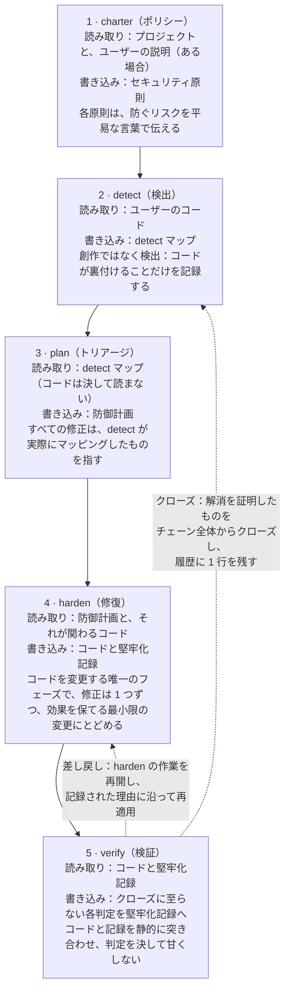
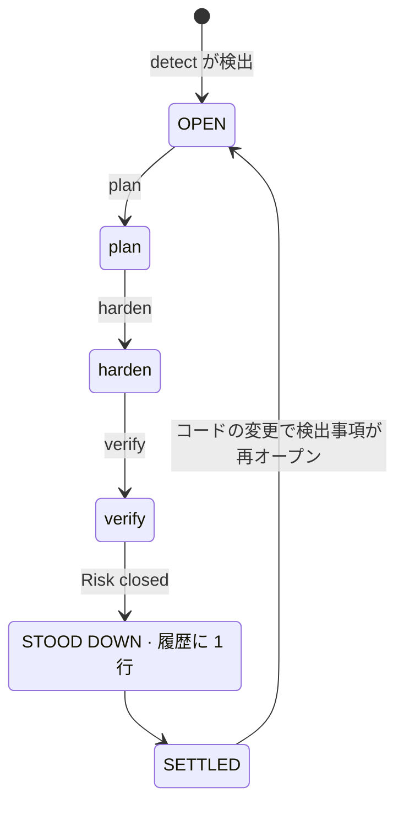
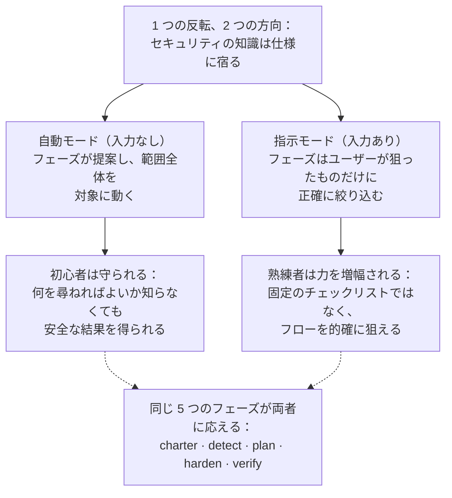
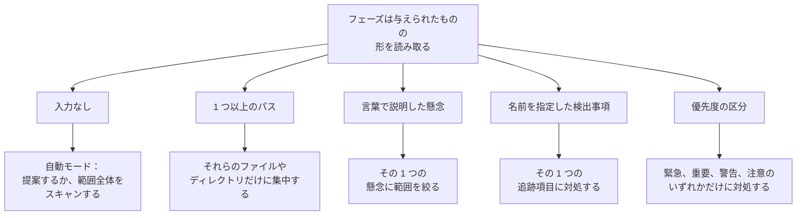
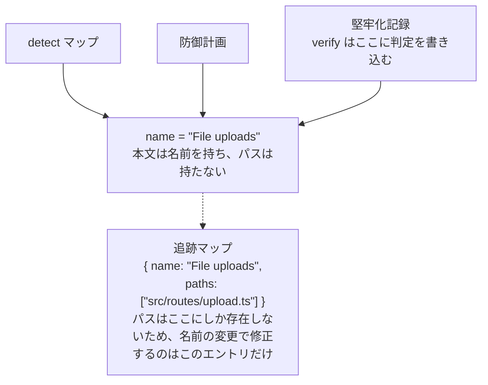
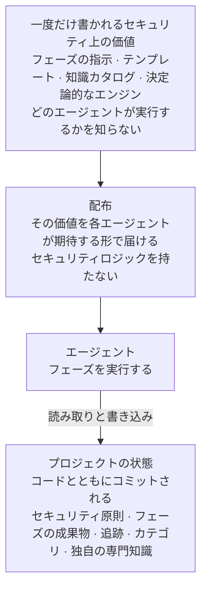
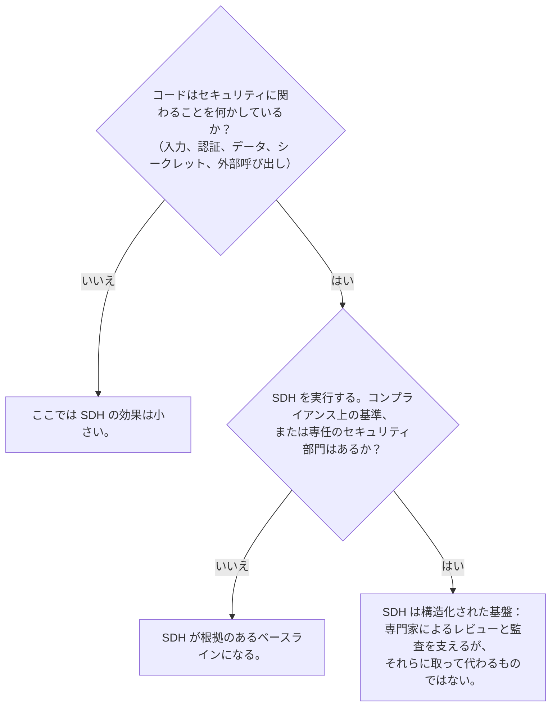

# Security-Driven Hardening（SDH）：AI 支援開発時代のための規約

- **Weslley Araújo**
- **方法論論文、2026 年**

---

## 概要

Security-Driven Hardening（SDH）は、AI エージェントや、セキュリティの専門家ではない人々がソフトウェアを書く機会が増えている時代に向けた、構造化された AI 駆動型かつ防御専用のセキュリティ方法論です。SDH は汎用的なチェックリストを当てはめるのではなく、まずシステムが実際に何をしているか（ログイン、ファイルアップロード、決済、データの露出など）を検出し、そのうえでそのコンテキストに固有のセキュリティ作業を進めます。デフォルトで安全であることを求める原則に従い、全面的に防御を軸に組み立てられ、どのユーザーでも行動に移せるよう平易な言葉で表現されます。

本稿は、SDH が単一のツールではなく、これまで欠けていた規約であると論じます。セキュリティの知識は方法論とオンデマンドの専門知識に宿り、すべてのユーザーが積み上げていけるベースラインとなります。そのため、初心者にも熟練者にも同じフローで応えられます。従来の仕様ファーストのアプローチ `[1]` とは、2 つの特性で一線を画します。SDH は**状態非依存**です：空のディレクトリ、進行中のプロジェクト、単一のプルリクエスト、大規模なレガシーコードベースのいずれにも、どの技術スタックでも適応します。さらに SDH は**クローズ可能**です：解消が検証されたリスクはフロー全体からクローズされるため、その検出事項は静止状態に達し、コードが変わったときにだけ再オープンされます。SDH は、セキュリティの専門家や専門的な Blue Team ツールに取って代わるものではありません。開発者自身の知識を拡張するものであり、開発者がセキュリティを深く理解しているほど、SDH をより的確に主導できます。

**Lagune** はそのリファレンス実装であり、この方法論が構築可能で移植可能であることを証明しています。SDH を、ほかの人々も採用できる規約として提案します。

> **キーワード**
>
> AI 支援開発、ソフトウェアセキュリティ、防御的セキュリティ、仕様駆動開発、セキュリティ強化、エージェント駆動のワークフロー、クローズ可能性、コンテキストを踏まえたセキュリティ、オンデマンドの知識、エージェント非依存のツール

---

## I. 序論：AI 支援開発が生んだセキュリティのギャップ

ソフトウェアをリリースするのは、安全でないパターン（漏えいしたシークレット、欠けている認可チェック、インジェクション可能なクエリ）を確実には見抜けない人々や AI エージェントであることが増えています。これらは特殊なリスクではありません。実際のインシデントの大半を占めるリスクの種類に含まれ、公開されたリファレンス `[6]`、`[7]` で長年文書化されてきました。また最近の研究では、AI が生成したコードの無視できない割合が、まさにこうした欠陥を抱えたままリリースされていると報告されています `[8]`。AI コーディングアシスタントによって開発者でない人々も実際のソフトウェアをリリースできるようになり、この問題は深刻化しましたが、このギャップは特定の利用者層にとどまりません。ほとんどのプロジェクトは、自らが実際に行うことに特化したセキュリティチェックを一度も受けません。早まって "動くからリリースしよう" と判断するたびに、エコシステムはより脆弱になっていきます。

汎用的なセキュリティのアドバイスでは、このギャップは埋まりません。静的なチェックリストはシステムが何をするかに特化していないため、小さなプロジェクトを無関係な項目で埋め尽くす一方で、そのプロジェクトにとって重要なリスクを見逃してしまいます。問題は、世の中にセキュリティの知識が不足していることではありません。ユーザーの目の前にある実際のシステムに適切な知識を当てはめること、そしてそれを、何を尋ねればよいのかわからないかもしれない人のために行うことこそが問題なのです。

SDH はこれに、1 つの反転で応えます。**セキュリティの知識は仕様とオンデマンドの専門知識に宿り、すべてのユーザーが積み上げていけるベースラインとなる**、という反転です。方法論はコンテキストを検出し、そのコンテキストが抱えるリスクをトリアージし、修正を導きます。そのため、開発者にもそうでない人にも同じフローで応えられます。検出事項と推奨事項は平易な言葉で書かれたままなので、読み手の技術的な知識の深さにかかわらず行動に移せます。熟練者はこれに制約されるのではなく、むしろ力を増幅されます。この二面性については `§VI` で詳しく論じます。

> **要点**
>
> **核心となる反転**：セキュリティの知識は仕様とオンデマンドの専門知識に宿り、すべてのユーザーが積み上げていけるベースラインとなります。方法論はシステムが何をしているかを把握してセキュリティ作業をそれに合わせ、ユーザーがすでに持っている知識を拡張します。

ある開発者が AI アシスタントに "自分のアプリでは、ユーザーがプロフィール画像をアップロードできる" と伝えたとします。セキュリティチェックがなければ、アシスタントは動作するコードを生成しますが、そのコードはクライアントが送ってくるもの（申告されたファイルの種類、ファイル名、サイズ）を何でも黙って信頼してしまいます。アップロード機能はそのままリリースされ、画像を装ったファイルがコードを含んでいたり、細工された名前が保存先のパスから抜け出したり、巨大なファイルがサーバーのリソースを使い果たしたりする可能性が生まれます。デモではこうした問題が一切見えないため、そのままリリースされてしまいます。

同じコードでも、SDH を通すと話が変わります。SDH は、システムが外部からファイルを受け付けていることを検出し（検出）、それをアップロードにともなうリスクとしてトリアージし（トリアージ）、実際のファイルの種類とサイズの確認、保存時の名前の変更、コードが実行されない場所への保存を提案し（修復）、そのうえで結果を読み取って、各対策が実際に有効であることを確認します（検証）。開発者は "無制限のファイルアップロード" という言葉を知っている必要がありませんでした。方法論が代わりに補ったのです。

本稿の貢献は次のとおりです。

- 特定の実装に依存しない、方法論としての SDH の厳密な定義と、その設計原則（`§III`）。
- 職務分離そのものが貢献となる、5 フェーズの防御ライフサイクル：検出は何も創作せず、計画は決してコードを読まず、コードを変更するのは 1 つのフェーズだけで、検証は判定を決して甘くしません（`§IV`）。
- 方法論上の立場としての**クローズ可能性**：個々の検出事項には、終わりのないループではなく最終状態があります（`§V`）。
- **開発者の知識を拡張する**という二面性：初心者を守り、熟練者の力を増幅する 1 つのフロー（`§VI`）。
- **呼び出せない専門知識とオンデマンドプロンプト**：プロジェクトのコンテキストが必要とするときにだけエージェントが読み込み、デフォルトでは決して読み込まない、焦点を絞ったセキュリティの知識（`§VII`）。
- **状態非依存性**と**非強制的な適応性**：SDH はどのような開発状態にも適合し、固定の範囲を押し付けるのではなく状況に適応します（`§VIII`）。
- **予防モード**：通常の作業を構築している最中にも同じ防御を働かせることで、コードは出来上がった時点でデフォルトで安全になり、フェーズが修正すべきことも少なくなります（`§IX`）。
- SDH がそこから生まれ、やがて分かれていった系譜である Spec-Driven Development との、1 節を割いた比較（`§X`）。
- 方法論がリファクタリングを経ても崩れず、特定のエージェントに依存しないようにするためのエンジニアリング上の規律：名前による識別の追跡（`§XI`）と、エージェント非依存の基盤（`§XII`）。

---

## II. 背景と関連研究

SDH は先行研究の上に成り立っています。仕様ファーストでエージェント駆動の開発 `[1]`、`[2]`、`[3]` から、実績のある構造を受け継いでいます。テンプレート、エージェントが読み込むスラッシュコマンド、規範となる文書、そして各フェーズを実行するエージェントです。SDH はこの構造を、防御を目的として再実装しています。この系譜は意図的なもので、SDH の作業原則の 1 つがそれを直接言い表しています。実績のある構造からワークフローを組み立て、それをセキュリティのために位置づけ直す、という原則です。

SDH は、汎用的な推奨事項を並べた静的なチェックリストではありません。チェックリストはセキュリティ全般については多くを知っていても、目の前のプロジェクトについては何も知りません。SDH はこの重点を逆転させます。最初の労力を検出、つまりシステムが何をしているかを知ることに注ぎ、そのあとで初めて、検出によって関連性が明らかになった知識を手に取ります。

SDH は、セキュリティ担当者や専門的な Blue Team ツールの代わりでもありません。開発者の知識を拡張するものです（`§VI`）。専任のセキュリティ部門を持つチームは、それを維持すべきです。SDH はそうしたチームには構造化された基盤を提供し、そうした部門を持たないチームには根拠のあるベースラインを提供します。

SDH は、決定論的なセキュリティスキャナー（静的解析、リンター）`[4]`、`[5]` とも共存します。これらのツールに価値があるのは、まさに決定論的で再現性があるからです。SDH の大部分はエージェントの推論に基づいており、厳密な決定性と引き換えにコンテキスト認識を得ています。方法論はその点を取り繕いません。決定性が重要な場面では、推論の中に決定論的なエンジンを組み込みます（`§VII`）。入力を確認する価値があるかどうかはエージェントが判断し、その入力が危険かどうかは決定論的なプログラムが判断します。

最も直接的な先行事例は Spec-Driven Development（SDD）です。これは、実行可能な仕様から構築を前へ進める、仕様ファーストの方法論の一群です。本稿では SDD を 1 つの類型として扱います。実務者向けの方法論として最も明確に述べたものが Piskala の報告 `[1]` であり、最もよく知られたエージェント駆動のツールキットが GitHub の Spec Kit `[2]`、同じ系統の 2 つ目のツールが OpenSpec `[3]` です。これらが、`§X` における比較の基準となる文献です。

---

## III. SDH：定義と設計原則

**Security-Driven Hardening** は、場当たり的な修正ではなく、エージェントが実行する仕様から作業を進めることで、コードベースをより安全なものに変える、構造化された AI 駆動型のセキュリティ方法論です。この名前は、セキュリティにおける防御側である **Blue Team** に着想を得ています。SDH が扱うのは防御、堅牢化、検証であり、攻撃は決して扱いません。

> **定義**
>
> **Security-Driven Hardening**（SDH）：まずシステムが実際に何をしているかを検出し、次にそのコンテキストに固有のセキュリティ作業を進める、構造化された AI 駆動型かつ防御専用のセキュリティ方法論です。デフォルトで安全であることを求める原則に従い、平易な言葉で表現されます。

SDH は、拘束力のある一連の原則によって定義されます。各原則は 1 つのルールであり、それぞれがユーザーに具体的な保証をもたらします。

| 原則                                               | ルール                                                                                                                                                             | ユーザーへの保証                                                                                                                                                     |
| -------------------------------------------------- | ------------------------------------------------------------------------------------------------------------------------------------------------------------------ | -------------------------------------------------------------------------------------------------------------------------------------------------------------------- |
| デフォルトで安全、平易な言葉で、すべての人に平等に | すべてのデフォルト、メッセージ、修正が最初から安全で、開発者かどうかを問わずどの読み手にも理解できる。特別扱いされるユーザー層はない。                             | 初心者は求めなくても安全なベースラインを受け取り、結果を自分にわかる言葉で読める。                                                                                   |
| 汎用性よりコンテキスト認識                         | すべてのフェーズが detect で検出したコンテキストから出発し、システムが実際に行っていることに基づいて動く。                                                         | 推奨事項はチェックリストではなく、プロジェクトに合ったものになる。セキュリティの知識は仕様とオンデマンドの専門知識に宿り、ユーザーが持ち込む知識を何であれ拡張する。 |
| 硬直性より柔軟性                                   | 原則、要件、推奨事項は出発点である。ユーザーはどれでも言い換え、削除、追加、範囲の縮小ができる。                                                                   | 方法論はプロジェクトとユーザーに合わせて柔軟に変わり、ユーザーが望む以上に厳しくなることはない。柔軟性がデフォルトで安全なベースラインを弱めることは決してない。     |
| 追記のみにせず、照合する                           | 成果物はログではなく生きたドキュメントである。実行のたびにすべてのエントリを再確認し、有効なものは残し、変わったものは書き直し、もう当てはまらないものは削除する。 | 記録は常に現在を反映するため、古いバックログへと劣化することはない。                                                                                                 |
| 防御専用                                           | SDH は監査し、堅牢化し、検証する。攻撃用ツール、悪用目的のエクスプロイト、危害を目的とした検知回避は決して生み出さない。                                           | 方法論を武器に転用することはできない。デュアルユースの内容は、明確に防御的な文脈でのみ扱われる。                                                                     |
| 仕様ファースト、エージェント駆動、セキュリティ志向 | ワークフローはテンプレート、コマンド、規範となるセキュリティ原則、そして各フェーズを実行するエージェントから組み立てられる。                                       | 実績のある開発の構造を転用し、実質的なセキュリティ作業をエージェントが担う。                                                                                         |

**表 1** SDH の設計原則と、それぞれがユーザーにもたらす保証。

これらの原則は飾りではありません。以下のすべてのフェーズが守らなければならない制約であり、`§XV` の議論ではこれらの原則に立ち返って、方法論の限界を明らかにします。

本稿の残りの部分では、名前を付けた 9 つの柱を展開します。これらは読み手が押さえておくべき部分であり、ほかのチームが SDH を実践していると言うために再実装することになる部分でもあります。

| 柱                                       | 提供するもの                                                                                            | 節          |
| ---------------------------------------- | ------------------------------------------------------------------------------------------------------- | ----------- |
| コンテキスト認識による反転               | セキュリティの知識が仕様とオンデマンドの専門知識に宿るため、初心者と熟練者が 1 つのフローを共有できる。 | `§I`、`§VI` |
| 5 フェーズの防御ライフサイクル           | 職務分離：ポリシーの策定、検出、トリアージ、修復、検証が、それぞれ 1 つの役割だけを担う。               | `§IV`       |
| クローズ可能性                           | 検出事項には、終わりのないループではなく最終状態がある。解消した作業はクローズされる。                  | `§V`        |
| 開発者の知識を拡張するという二面性       | 初心者を守り、熟練者の力を増幅する 1 つのフロー。どちらの代わりにもならない。                           | `§VI`       |
| オンデマンドプロンプトと呼び出せない知識 | プロジェクトの実態に応じて関連するセキュリティの知識を読み込み、デフォルトでは読み込まない。            | `§VII`      |
| 状態非依存性と非強制的な適応性           | どの技術スタックのどの開発状態にも適合し、範囲を押し付けるのではなく状況に適応する。                    | `§VIII`     |
| 予防モード                               | 新しい作業の構築中にも同じ防御が働き、コードはデフォルトで安全な状態で出来上がる。                      | `§IX`       |
| 名前による識別の追跡                     | 検出事項はフェーズをまたいでも 1 つの項目のままで、名前の変更でリンクが切れるのは 1 か所だけである。    | `§XI`       |
| エージェント非依存の基盤                 | セキュリティ上の価値は一度だけ書かれ、どのエージェントにも技術スタックにも依存しない。                  | `§XII`      |

**表 2** SDH の 9 つの柱と、それぞれを展開している節。

---

## IV. 5 フェーズの Blue Team フロー

SDH は作業を 5 フェーズの防御ライフサイクルとして構成します（図 1）。各フェーズは防御を軸に組み立てられ、それぞれが前のフェーズの上に積み重なり、実際の Blue Team の活動（ポリシーの策定、検出、トリアージ、修復、検証）に沿っています。



**図 1** 5 フェーズのフロー：各フェーズが読み取るもの、書き込むもの、そして要となる不変条件。どちらの戻りも verify が起点です。差し戻された対策は harden を再開させ、解消が証明された検出事項はチェーン全体からクローズされ、履歴に 1 行が残ります。

職務分離こそが貢献です。各フェーズの役割が 1 つだけなので、失敗モードは 1 か所に封じ込められ、読み手は各成果物の記述を信頼できます。

> **要点**
>
> **Applied は検証済みではない**：harden は修正が適用されたことを記録します。verify はコードをその記録と突き合わせて検証し、判定を記録に合わせて甘くすることは決してありません。対策がコードに存在していても、リスクが依然として到達可能なままになっていることがあり、そのときの誠実な判定は "Risk not closed" です。

### charter（ポリシー）

charter は、プロジェクトのセキュリティ原則、つまり後続のすべてのフェーズが守るべきルールを定めます。これは全体を統括するレイヤーであり、プロジェクトのセキュリティ態勢に対するコンパイル時チェックのようなものです。各原則には、明確な名前、コードに対して確認できる譲れないルール、そして修正方法だけでなく防ぐリスクを述べた `Why:` 行があります。charter は常にプロジェクトそのもの（マニフェスト、構造、依存関係）を読み取ります。ユーザーの説明がある場合、それは方向性として扱われ、読み取りはユーザーが挙げた範囲を超えて広がります。説明がなければ、プロジェクトが唯一の情報源です。両者は競合するのではなく足し合わされ、charter が記録するのはコードの現状ではなく、プロジェクトが守るべきポリシーです。開発者でない人でも、これを読んでルールとリスクの両方を理解できるべきです。

### detect（検出）

detect はコードを読み取り、システムが実際に行っていることのうち、セキュリティ上の重みを持つものをマッピングします。指針となるのは "創作ではなく検出" という指示です。コードが裏付けることだけを、後続のフェーズが必要とする証拠とともに記録します。detect は中立です。検出事項をセキュリティ原則に無理に合わせることはしません。リスクをセキュリティ原則のルールと照らし合わせるのは plan フェーズの役割だからです。各検出事項は 3 つの部分からなります。それが何か（平易な言葉による説明）、なぜ重要か（事実だけでなくリスク）、そして証拠（それが存在する関数やルート）です。証拠にはファイルパスを含めません。パスは追跡マップ（`§XI`）にだけ保持されるため、本文に古くなりうるパスが残ることはありません。

### plan（トリアージ）

plan は各検出事項を修正に変えます。修正はリスクの種類で名付けられ（根拠となる場合は、確立されたリファレンスである CWE や OWASP を引用します）、その修正が守る原則と結び付けられます。優先度（緊急、重要、警告、注意）は自由に選べるものではありません。plan は CVSS v4.0 の Base-and-Environmental 方式で各検出事項を評価するため、区分はスコアを平易な言葉で表したものになり、露出の程度と影響の大きさを平易に述べた 1 行の根拠が添えられます。そして 2 回実行しても同じ順序になります。ベクトルは熟練者にとっての正確な拠り所であり、区分とその根拠は、誰もが追える同じ評価です。plan は detect マップだけをもとに作業し、コードは決して読みません。これは限界ではなく意図的な制約です。この制約によって、すべての修正が detect で実際に検出されたものを指すようになります。ある範囲がまだマッピングされていなければ、plan は推測せずに停止し、ユーザーを detect へ戻します。

### harden（修復）

harden はコードを変更する唯一のフェーズなので、慎重に進めます。編集にユーザーの承認が必要かどうかは、エージェントと、そのエージェントが動作する権限モードが決めることなので、harden は独自の確認ステップを追加しません。修正は一度に 1 つずつ、ほかの修正が依存するものを先に、次に優先度の高いものから適用するため、各変更は小さく、レビューしやすく、元に戻しやすいまま保たれます。新しい修正を収めるために既存の対策を弱めることも、セキュリティ原則に反することも決してありません。修正が原則と衝突する場合、harden はそれを適用せずに停止し、衝突を提示します。各ブロックは Applied、Partial、Blocked のいずれかとして記録されます。"Applied はまだ検証済みを意味しない" という点こそ、次のフェーズが扱う問題です。

### verify（検証）

verify は、コードを読み取り、harden が記録した内容と突き合わせることで、適用された各対策を検証します。検証とは、このコードと記録の突き合わせそのものであり、静的に行われます。確認するのは、対策がコードの中に存在し正しいことであって、稼働中のシステムで攻撃を受けても対策が有効であることではありません。実際の攻撃や模擬攻撃を稼働中のシステムに対して実行するような実行時のチェックは、設計上、範囲外です。verify は 3 つの判定のいずれかを返します。Risk closed、Risk not closed、Cannot tell from the code です。verify は独自の成果物を作りません。harden と verify は堅牢化記録を共有し、何を行ったかは harden が、判定とその理由は verify が受け持ち、どちらも相手のフィールドに書き込むことはありません。差し戻された対策は harden がやり直す作業となり、harden は次の実行時に、自分でコードを読んだ結果よりもその判定を優先し、理由に示された不足点に対して正確に再適用します。verify は記録よりもコードを信頼します。記録は、コードが実際に実現している以上のことを主張しうるからです。verify はユーザーのコードに対して読み取り専用であり、記録に合わせて判定を甘くすることは決してありません。対策が存在していても、別の経路からリスクに到達できる場合があり、そのときの誠実な判定は "Risk not closed" です。読み取りの途中で、detect マップがまったく扱っていないセキュリティ上の問題に気づいても、verify はそれに対する判定を創作しません。検出は detect の役割だからです。verify はその問題を提示してユーザーを detect へ戻し、検出事項がフローを迂回せず、同じフローを通って入るようにします。

> **通しの例：ファイルアップロード**。1 つの検出事項で、フローの骨格を端から端まで示します。
>
> - **detect** がこれを見つけます：システムはユーザーからファイルを受け付けており、アップロードハンドラーはクライアントが送る MIME タイプを信頼し、ファイルの実際の種類を確認していません。_なぜ重要か_：画像を装ったファイルに悪意のあるコードが隠れている可能性があります。
> - **plan** が修正を決めます。優先度は**緊急**で、"すべての入力は検証されるまで信頼できない" という原則を守るものです：ファイルの実際の種類とサイズを確認し、保存時に名前を変更し、アップロードされたファイルはコードとして実行できない場所に保存します。
> - **harden** が修正を適用し、ステータスは **Applied** です：ハンドラーはファイルの内容から実際の種類を判別し、サイズ制限を適用し、想定外のものを拒否し、保存時に名前を変更し、コードが実行されない場所に保存するようになりました。
> - **verify** はハンドラーを読み取り、記録と突き合わせて **Risk closed** を返します：コードは記録の主張どおりに動作しています。
>
> 同じ検出事項名が detect マップ、防御計画、堅牢化記録を通じて受け継がれ、verify もその記録に対して同じ名前で作用します。クローズに至らない判定は検出事項のブロックに書き込まれ、解消が証明された検出事項はクローズされます（`§V`）。この共通の名前が、その検出事項の同一性です（`§XI`）。

---

## V. クローズ可能性：検出事項には最終状態がある

ほとんどのセキュリティツールは、増える一方のバックログをユーザーに残します。SDH は異なる立場をとります。**検出事項はクローズ可能であり、終わりのないバックログに居続けるのではなく最終状態を持つ**という立場です（図 2）。これは照合の原則から直接導かれます。

> **定義**
>
> **クローズ可能性**：解消が検証されたリスクはフロー全体からクローズされるため、その検出事項は静止状態に達し、コードが変わったときにだけ再オープンされます。セキュリティへの取り組みそのものは継続しても、個々の検出事項には最終状態があります。

SDH の成果物はログではなく、生きたドキュメントです。フェーズは再実行されるたびに、既存の各エントリを現在の実態と照合し、3 つのうちいずれかを行います。今も有効なものは残し、変わったものは書き直し、もう当てはまらないものは削除します。すでに解決したことがコードから明らかな検出事項は、そのまま削除されます。作業中の記録が反映するのは過去ではなく、現在です。

クローズとは、この同じ照合が結論に達したものです。verify がリスクの解消を検証すると、その検出事項をフロー全体、つまり detect マップ、防御計画、堅牢化記録、追跡マップからクローズします。verify がほかのフェーズの成果物に書き込む唯一のフェーズであるのはこのためです。ループを閉じるのが verify だからです。検出事項がチェーンを離れるとき、クローズによってその内容は短いエントリへと要約され、履歴に記録されます。この履歴は作業中のチェーンの外にあり、再処理されることはありません。ここに、消えることとクローズすることの境界があります。もはや事実でなくなったために照合で削除された検出事項は何も残しませんが、解消が証明された検出事項は履歴に 1 行を残します。クローズされた検出事項はそれ以降、作業中のどの成果物にも現れません。それは想定どおりの状態であり、チェーンが壊れたわけではありません。



**図 2** クローズ可能性の状態遷移。検出事項は OPEN → STOOD DOWN → SETTLED と遷移し、コードが変わったときにだけ再オープンされます。

範囲内のすべてがクローズされると、サイクルは静止状態になります。この静止状態には具体的な形があります。最後の検出事項がクローズされた成果物は丸ごと削除されるため、完全にクローズされたチェーンに残るのは、セキュリティ原則と履歴、つまりポリシーと証明だけです。サイクルが再オープンされるのは、コードが変わったときだけです。方法論は各検出事項に明確な終わりを与えます。これこそ、終わりのないバックログにはできないことです。

---

## VI. 開発者の知識を拡張するという二面性

SDH は人に取って代わるものではなく、専門的な Blue Team ツールに取って代わるものでもありません。SDH は**開発者自身の知識を拡張します**。開発者がセキュリティを深く理解しているほど、フローをより的確に主導でき、裁量も大きくなります。理解が浅い開発者でも安全な結果を受け取れます。自動モードが守ってくれるからです。

`§I` で述べた反転、つまりセキュリティの知識が仕様に宿るということは、両方向に働きます。初心者にとって、それは保護です。仕様のほうから提案するので、何を尋ねればよいかを知る必要がありません。熟練者にとって、それは増幅です。同じ仕様によって、固定のチェックリストと格闘するのではなく、フローを的確に狙いどおりの方向へ向けられます。

すべてのフェーズが、それぞれの動作の中にこの二面性を備えています（図 3）。入力なしで実行すると、フェーズはユーザーに代わって範囲全体を対象に動きます。方向が与えられると、同じフェーズがユーザーの狙ったものだけに正確に絞り込みます。



**図 3** 開発者の知識を拡張するという二面性。1 つの反転が 2 種類の利用者に応えます。同じ 5 つのフェーズを通じて、自動モードは初心者を守り、指示モードは熟練者の力を増幅します。

オンデマンドの専門知識（`§VII`）は、この二面性を自らの文面で明示しています。各専門知識はエージェントに対し、その知識は "あなたの判断を拡張する" ものだと伝え、専門知識が提供する範囲を超えて推論を続けるよう求めます。知識は下限であって、上限ではありません。これこそが、本稿の意図するバランスで両方の利用者に応えるものです。開発者コミュニティは実質的な道具を手にし、Blue Team の実務者は、自分の仕事を代わりにこなすふりをしない構造化された基盤を手にします。

---

## VII. 呼び出せない専門知識とオンデマンドプロンプト

これは、この方法論で最も新規性の高いパターンです。SDH は焦点を絞ったセキュリティの知識を、**必要なときにだけ**読み込まれる専門知識として持ち、どれを読み込むかはエージェント自身がプロジェクトのコンテキストとマッチングして決めます。これを**オンデマンドプロンプト**と呼びます。すべてのチェックをデフォルトで実行するのではなく、エージェントが自分のいるプロジェクトの範囲に基づいて、どの知識を有効にするかを選ぶ方法です。専門知識は進化していくものであり、どれもいつでも変更や置き換えがありえます。貢献はこのパターンであって、専門知識そのものではありません。

> **定義**
>
> **オンデマンドプロンプト**：エージェントが、有効にするセキュリティの知識を目の前のプロジェクトの範囲とマッチングして選ぶことです。これにより、すべてのチェックをデフォルトで実行するのではなく、プロジェクトの実態に合った知識が取り込まれます。

> **定義**
>
> **呼び出せない専門知識**：ファイルアップロードやブラウザで動作するコードなど、1 つのコンテキストに焦点を絞った、言語に依存しないセキュリティの知識の単位です。監査と説明を行い、コードを書き換えることも、攻撃用の入力を生成することもありません。コマンドではなく、対象とするコンテキストが範囲内にあるとき、またはプロンプトで名前を指定されたときに読み込まれます。

各専門知識は、扱うリスクに対するより安全な形を示し、それを利用する各フェーズで検出事項にどう対処するかをエージェントに伝えます。検出時にどう判断するか、修復時に修正をどう安全に適用するか、検証時にどう証明するかです。

本質的な特徴は、専門知識が**単独では呼び出せない**ことです。専門知識はコマンドではなく、フローの中ではマッチしたことが読み込みのきっかけになります。検出フェーズはカタログを一度だけ一覧にし、各エントリが扱う内容とプロジェクトのコンテキストをマッチングして、コンテキストが範囲内に存在する専門知識だけを読み込みます。後続のフェーズは一覧を作り直さずにそのマッチ結果を再利用するため、1 回のマッチングがチェーン全体に役立ちます。予防モード（`§IX`）も、これから構築される作業に対して同じマッチングを行います。コンテキストが存在しない専門知識はスキップされますが、スキップにも読み込みと同じ説明責任があります。カタログのすべてのエントリが明示的な判定を受け、適用かスキップかが、コードから読み取った理由とともに示されます。そのため、関係がなさそうだという漠然とした感覚が、存在しないことの代わりになることはありません。適用できるものが 1 つも見つからないのも、正当な結果です。

カタログはデータであり、拡張は知識ファイル 1 つとカタログの 1 行を加えるだけで済み、新しいコマンドは決して必要ありません。組み込みの専門知識は OWASP、特定の言語、AI 連携などのカテゴリに分けられており、プロジェクトが使うカタログには、選んだカテゴリの組み込み専門知識と、プロジェクト独自の専門知識が含まれます。プロジェクトはこの選択をほかの状態と一緒に記録するため、チーム全体が同じカタログに対してマッチングを行います。これはフェーズと同じコンテキスト認識の原則を、知識に適用したものです。すべてのチェックをデフォルトで実行するのではなく、プロジェクトの実態に合った知識が取り込まれます。同じ性質によって、メンテナーだけでなくユーザーもカタログを拡張できます。ユーザーが提供したセキュリティの情報源やトピックは、プロジェクトに属する新しい専門知識へと抽出され、カテゴリにかかわらずそのカタログに加わり、組み込みの専門知識とまったく同じように読み込まれて、同じ名前の組み込み専門知識を置き換えます。専門知識の作成自体も防御専用であり、専門知識が守らせるのと同じ境界に従います。攻撃の解説記事を情報源にしてもかまいませんが、そこから生まれる専門知識は監査と説明を行うだけで、動作するエクスプロイトを出力することは決してありません。こうして、`§I` の反転、つまり知性が仕様に宿るという考え方は、カタログそのものにまで及びます。ユーザーはコードを書かなくても、自分のコンテキストに合わせてカタログを深めていけます。

短い例で、オンデマンドプロンプトを説明します。detect が、ブラウザで動作するコードのフォルダーを読み取るとします。detect はそのコンテキストをカタログでマッチングし、それを扱う専門知識を読み込み、通常の手順を通じてクライアントサイドの検出事項を提示します。この範囲にコンテキストが存在しない専門知識はマッチしないため、読み込まれることはなく、それぞれスキップとして記録されます。どの知識が関連するかを決めたのは、固定の設定ではなく、プロジェクトそのものでした。

決定性は、まさにそれが重要な場所に現れます。専門知識は文章だけでなく、決定論的なチェッカーを持つこともできます。あるリスクの種類に明確な判定手順がある場合、小さなプログラムが与えられた入力に対して固定の判定を返します。たとえば `safe`、`unsafe`、`invalid input` のような少数の語です。リスクの種類の中には、まさにこのように決定論的に判定できるものがあり、その判定手順の背後には先行研究の蓄積があります `[9]`、`[10]`、`[11]`。チェッカーは、エージェントが渡す候補を採点するか、自ら範囲をスキャンして候補を見つけるかのどちらかであり、いずれの場合も判定を返すのはエージェントではなくチェッカーです。十分に汎用的な専門知識は、カタログで必須として指定でき、その場合は常に適用され、チェッカーが範囲全体に対して実行されます。これは、コンテキストのマッチなしに知識が読み込まれる唯一のケースであり、カタログのデータで宣言されるもので、エージェントがその場で決めることはありません。SDH はここで、フロー全体が決定論的であるかのように装うことなく、エージェントの推論を再現可能なものに根ざさせています。

最後に、専門知識は**切り離し可能**です。知識が単独で成り立つため、ユーザーは SDH のフロー全体とは無関係なプロンプトの中で専門知識を直接実行でき、通常の開発と並行してセキュリティを保てます。たとえば決定論的なチェッカーを持つ専門知識なら、通常のコーディング中に生まれる各候補をふるいにかけ、安全なものだけを残せます。この切り離しやすさは SDH が多くの状況に適応できる理由の 1 つであり、それが `§VIII` の主題です。そしてその最も完全な形が予防モード（`§IX`）で、そこでは同じ知識が通常の開発を最初から最後まで守ります。

---

## VIII. 状態非依存性と非強制的な適応性

2 つの特性が、SDH を硬直的な仕様方法論から区別しています。

### 状態非依存性

> **定義**
>
> **状態非依存性**：方法論は開発の状態に依存しません。空のディレクトリ、進行中のプロジェクト、単一のプルリクエスト、大規模なレガシーコードベースのいずれにも、どの技術スタックでも適合します。出発点を、読み取ることによって把握するからです。

プロジェクトがまったく新しいものでも、すでに存在するものでも、すべてのフェーズは同じように動作します。charter は、存在するコードがどのようなものであれ、そこから原則を推定します。detect は、たとえごくわずかでも、そこにあるコードをマッピングします。想定された出発点はありません。

### 非強制的な適応性

> **定義**
>
> **非強制的な適応性**：方法論は、ユーザーが従わなければならない固定の範囲を押し付けるのではなく、状況に適応します。ユーザーが何を言えばよいかわからないときは、自分が呼び出された環境を読み取り、コンテキストを生成し、次に何をするかを形づくる質問を投げかけます。

最もわかりやすい例が charter の提案モードです。SDH はプロジェクトを分析してデフォルトで安全なセキュリティ原則を導き出し、不足している情報が実際に結果を変える場合にだけユーザーに尋ね、そのうえでセキュリティ原則を書き出し、各原則を、それが防ぐリスクとともに平易な言葉で提示します。セキュリティ原則は、承認プロンプトの向こうに閉ざされた契約ではなく、ユーザーが再実行によって作り直していく生きたドキュメントです。そのため、ユーザーが何を尋ねればよいかを知っている必要はまったくありません。

この適応性は、入力の形に対する感度として現れます。同じフェーズが、与えられたものを読み取ってモードを選ぶのです（図 4）。プロンプトに含めたファイル、一覧から選んだ検出事項、気がかりな点、既知の弱点に的を絞ったミッション、総当たりでの全体スキャンの依頼のどれであっても、ユーザーのニーズに応えられます。フローが設計上、非強制的だからです。これらはいずれも、デフォルトで安全なベースラインを弱めるものではありません。柔軟性はベースラインの適用の仕方を形づくるだけで、ベースラインを下げることは決してありません。



**図 4** 非強制的な適応性。同じフェーズが入力の形を読み取ってモードを選ぶため、範囲は常にユーザーが決めるものであり、押し付けられることはありません。

---

## IX. 普遍的な予防モード：構築中の作業にも同じ防御を

SDH には、補完的なモードが 1 つあります。コードを書いている間も同じ防御を働かせたまま行う、通常の開発です。ユーザーはログインページ、アップロード、エンドポイントといった作業そのものを依頼し、方法論はその構築を進行と同時に守ります。そのため結果は、あとから堅牢化の工程を経るのではなく、出来上がった瞬間からデフォルトで安全です。

> **定義**
>
> **予防モード**：SDH の全体を統括するレイヤーと知識のもとで行う通常の開発です。セキュリティ原則が構築を拘束し、これから作るものに関連する専門知識がオンデマンドで読み込まれ、作業を完了とする前に、結果を、使った防御そのものと突き合わせます。

このモードは、フェーズがすでに備えている各要素を、まだ存在しないコードに向けて再利用します。コンテキストの検出は、コードから意図へと対象を移します。エージェントは、これから構築するものと、その作業がまたぐ境界（ログインには認証情報、セッション、外部からの入力がともなう）を推論し、その推論に対して知識カタログをマッチングします。オンデマンドプロンプト（`§VII`）はここで一般化されます。コンテキストは、既存のコードの中だけでなく、コードの計画の中からも検出できるのです。セキュリティ原則はいつもどおり作業を律し、原則に反する依頼は衝突として提示され、構築されることは決してありません。防御は各部分を書くその瞬間にインラインで適用され、境界で検証し、最初から安全な書き方を選びます。そのため、動作はするが安全でないバージョンが生まれて、あとから修正されるということはありません。

このモードは、verify が始まるのと同じやり方で終わります。作業を完了とする前に、構築者は自らの結果を、使った防御と突き合わせます。対策はリスクの経路の脇ではなく経路上になければならず、完全でなければならず、専門知識が決定論的なチェッカーを持つ場合は、エージェント自身の読み取りよりもチェッカーの判定が優先されます。ここで見つかった不足は同じ作業の一部として埋められます。作業を終えるとは、安全に終えることを意味するからです。

このモードが何をしないかは、何をするかと同じくらい意図的に決められています。依頼されたものだけを構築し、その周囲は何も監査しません。既存のものの監査はフェーズの役割だからです。成果物も書かず、検出事項も追跡しません。検出事項とは既存のものの中で検出されたリスクであり、このモードの目的は、安全でないバージョンがそもそも生まれないようにすることだからです。2 つの方向は互いを補い合います。フェーズはすでに存在するものを解消し（`§V`）、予防モードは新しい作業がそれを再び開いてしまうのを防ぎます。静止状態のチェーンが静止状態のまま保たれるのは、開発が止まったからではなく、静止している間に構築されるものが防御されたうえで構築されるからです。

---

## X. Security-Driven Hardening と Spec-Driven Development の比較

Security-Driven Hardening（SDH）は Spec-Driven Development（SDD）を土台として生まれ、その後大きく分岐しました。構造上の継承は実際にあり、それを認めています。仕様ファースト、エージェント駆動、規範となる文書、そしてエージェントが実行するフェーズ分けされたコマンド群です。SDH はこの構造を意図的に再利用しています。異なるのは、目的、強制力のモデル、前提とする状態、そして終了条件です。本稿では SDD を 1 つの類型として扱い、方法論の標準的な記述として Piskala の報告 `[1]` を、標準的なエージェント向けツールキットとして GitHub の Spec Kit `[2]` を、同じ系統の 2 つ目のツールとして OpenSpec `[3]` を用います。

SDD は仕様を実行可能にすることで、従来の開発をひっくり返します。仕様は実装を導くだけでなく、動作する実装を直接生成します `[1]`。そのフェーズ構成は構築を前へ進めるものです `[2]`（基本原則を定め、何を構築するかを仕様化し、技術スタックを計画し、計画をタスクに分割し、そして実装する）。その規範となる文書は原則をまとめた憲法（constitution）であり、エージェントが終始従わなければならない基礎です。ここに違いの核心があります。SDD の強制力は仕様から構築へと流れ、実装はそれに従うことが期待されます。

SDH は、この契約のほぼすべての軸を反転させます（表 3）。

> **要点**
>
> **核心的な違い**：SDD の強制力は仕様から構築へと流れ、実装はそれに従うことが期待されます。SDH は非強制的で、逆向きに流れます。検出されたシステムのコンテキストから内側へ向かい、すでにあるものを堅牢化します。

| 軸                   | SDD                                                    | SDH                                                                                                                                |
| -------------------- | ------------------------------------------------------ | ---------------------------------------------------------------------------------------------------------------------------------- |
| 目的                 | 機能を提供する。仕様が動作する実装になる。             | 既存のもの、または構築中のものを堅牢化する。すべてのフェーズが防御のために組み立てられている。                                     |
| 強制力のモデル       | 強制的。仕様と憲法が、構築を従うべき範囲に閉じ込める。 | 非強制的。SDH は状況に適応し、ユーザーは言い換え、削除、範囲の縮小ができる。                                                       |
| 状態の前提           | 仕様から前へ進める構築。                               | 状態非依存：空のディレクトリ、進行中のプロジェクト、単一の PR、レガシー。                                                          |
| 終了条件             | 機能が構築されたら終わる。                             | クローズ可能。検出事項は静止状態に達し、コードが変わったときにだけ再オープンされる。                                               |
| 規範となる文書       | エージェントが従わなければならない原則の憲法。         | 防ぐリスクを軸にしたセキュリティ原則（各原則に `Why:` 行がある）。固定の契約ではないと明言している。                               |
| 知識の増やし方       | コマンドを追加する（またはフェーズ構成を拡張する）。   | エージェントがオンデマンドで読み込む、呼び出せない専門知識を追加する。ファイル 1 つとカタログの 1 行で済み、新しいコマンドは不要。 |
| 誰に応えるか         | 機能を前へ進める構築者。                               | 開発者かどうかを問わず、あらゆるユーザーに同じフローで応える。                                                                     |
| コードを変更するもの | 実装フェーズが構築物を生成する。                       | コードを変更するのは harden フェーズだけで、修正は一度に 1 つ。                                                                    |

**表 3** 8 つの軸で見た SDD と SDH。構造は借り物、契約は逆。

系譜に対して公平を期すために述べておくと、SDD は実績のある先行事例であり、SDH が動作する構造は SDD に負っています。この分岐は SDD への批判ではありません。SDD は別の問題（前へ進める構築）をうまく解決しています。SDH は同じ実績ある仕組みを取り入れ、それを防御、適応性、クローズへと向けています。変更提案、タスクリスト、変更ごとの仕様を中心に構成された OpenSpec `[3]` も、このパターンを裏付けています。この系統は仕様から構築を前へ進めますが、SDH は検出したコンテキストからシステムを内側へと堅牢化します。SDH の予防モード（`§IX`）は、SDH が前へ進む構築に寄り添う唯一の場面ですが、そこでも反転した契約は保たれます。予防モードは作業をどう構築するかを律するだけで、何を構築するかを決めることは決してありません。

---

## XI. エンジニアリングの厳密さ：追跡の規律

追記せず照合するという規律（`§V`）には、リファクタリングに耐える土台が必要です。検出事項は、それに関わるすべてのフェーズを通じて 1 つの項目であり続けなければならず、ファイルの名前が変わったり移動したりしてもチェーンが壊れてはなりません。SDH はこれを、**名前による識別**と、**追跡にのみ保持されるパス**によって解決します。

> **定義**
>
> **名前による識別**：検出事項の同一性はその名前であり、すべての成果物でまったく同じ表記で書かれます。本文が持つのは名前であって、パスではありません。ファイルパスは追跡マップにのみ存在するため、名前の変更やファイルの移動でリンクが切れるのは、ちょうど 1 か所だけです。

detect の各検出事項は 1 つの追跡項目です。その同一性は**名前**、つまり節の見出しであり、detect マップ、防御計画、堅牢化記録でまったく同じ表記で書かれます。後続のフェーズは同じ項目に作用するとき、その名前を一字一句そのまま再利用し、verify も同じ名前のもとで堅牢化記録に判定を書き込みます。追跡マップが保持するのは追跡情報だけで、項目ごとに 1 つのエントリがあります：

```json
{ "name": "File uploads", "paths": ["src/routes/upload.ts"] }
```

マップには、本文も注釈も、別個の識別子も、フェーズも記録しません。文章の成果物が言葉を担い、マップは同一性とパスだけを担います。変わりやすいのはファイルパスだけで、それはここにしか存在しません。名前の変更やファイルの移動でリンクが切れるとしても、それはちょうど 1 か所だけであり、2 つの食い違うコピーで起こることは決してありません。



**図 5** 同一性を運ぶコンベヤー。1 つの検出事項名がすべての成果物を通って流れる一方、そのパスは追跡マップにだけ存在するため、名前の変更は 1 か所で修正されます。

通常のフローでは 2 つの操作がマップを維持し、3 つ目の操作はメンテナンスとして別に位置づけられます。**Track** は追加のみの登録です。フェーズが自分の書いた検出事項を報告すると、エンジンは新しいものを記録し、それ以外については名前の変わったパスを追跡して、それぞれを新規、移動、変更なしに分類します。フェーズが報告しなかったものを削除することは決してありません。**Untrack** は、verify が解消を確認した検出事項をクローズします。1 回の決定論的な処理の中で、各検出事項を履歴のエントリへと要約し、その節全体を成果物から削除し、最後の検出事項がなくなった成果物を削除し、追跡のエントリを取り除きます。そのため、エージェントがこれらを手作業で行うことはありません。クローズされた名前がまだ別の検出事項の本文で引用されているなど、決定論的な処理では安全に進められない箇所については、編集を推測するのではなく、その箇所をエージェントに指摘します。この 2 つが、フェーズが実行中に呼び出す操作です。**Repair** はメンテナンスのための操作です。フェーズは自身の照合で追跡の不整合（記録されたパスがもう存在しない）を見つけると、自動的に Repair に処理を委ね、それ以外の場合は必要に応じて実行されます。Repair はすべての成果物と現在のコードを読み取り、各項目のパスを修正してマップ全体を一度に整え直し、自分だけでは判断できないもの、つまり孤立項目（どの成果物にももう名前が出てこない追跡項目）やリネーム候補（パスが、報告された別の名前と一致する項目）を提示します。

Repair はメンテナンスであり、6 番目のフェーズではありません。ユーザーのコードにも文章の成果物にも触れず、追跡情報だけを扱います。ユーザーのソースを読むのは、名前の変わったファイルの新しいパスを知るためだけであり、セキュリティの内容を書くことは決してありません。エンジンが推測を拒む唯一の判断、つまり消えた項目が解決されたのか、単に名前が変わっただけなのかについては、人間が最終的な判断者です。推測するより、尋ねることを優先します。誤って削除された項目はチェーンを壊すからです。

方法論は、自らの防御の規律を自分自身にも適用します。決定論的なエンジンはコマンドラインプログラムとして呼び出され、各入力は個別のプロセス引数として渡されます。これにより入力は単なる値として扱われ、引用符やバッククォートを含む値がコマンドに注入されることは決してありません。未知のチェックは答えを返すのではなく失敗するため、スペルを間違えたチェックが問題なしの結果と読み取られることはありません。SDH は、自らの内部の仕組みもデフォルトで安全という原則の例外にはしません。

---

## XII. 基盤：移植性を証明するエージェント非依存のアーキテクチャ

SDH がほかの人々に採用される規約となるには、特定のエージェントや技術スタックに縛られてはなりません。そのため、SDH の基盤は 3 つの関心事を分離しています（図 6）。Lagune は、これが実現可能であることを証明しています。

**セキュリティ上の価値**は一度だけ書かれ、どのエージェントがそれを実行するかについては何も知りません。フェーズの指示とそれが埋めるテンプレート、知識カタログ、決定論的なエンジンがこれにあたります。**配布**は薄い層です。その唯一の役割は、その価値を各エージェントが期待する形と場所で届けることであり、独自のセキュリティロジックは一切持ちません。**プロジェクトの状態**はプロジェクトのものです。セキュリティ原則、フェーズの成果物、追跡マップ、選んだカテゴリ、独自の専門知識がこれにあたり、コードのほかの部分と同様にコミットされ、レビューできます。



**図 6** エージェント非依存の基盤。セキュリティ上の価値は一度だけ書かれ、薄い配布層がそれを各エージェントに届け、状態はプロジェクトのものであり続けます。

配布はセキュリティロジックを持たないため、それがどう作られていても SDH には何の変化もありません。基盤は配布を自前で構築することも、リファレンス実装のように、エージェントのスキルをすでに配布しているエコシステムに任せることもでき、どちらの場合もフェーズ、その成果物、その保証は変わりません。また、これらはいずれも特定の言語やランタイムに固有のものではありません。リファレンス実装はたまたま 1 つの技術スタックで書かれていますが、方法論とはこれらの関心事のあいだの境界であって、それらを構築するツールチェーンではありません。同じ設計をまったく別の言語で再実装しても、SDH の本質は変わりません。

---

## XIII. 実例：SDH を最初から最後まで

> **実例**
>
> **アップロード機能と管理画面の攻撃対象領域に対する防御的な堅牢化**
> **コンテキスト**：ユーザーがアップロードしたファイルを受け付け、管理ページに一覧表示する小さなアプリ。
> **パターン**：charter → detect（コンテキストによって有効化されるオンデマンドの知識を含む）→ plan → harden → verify の流れと、1 回のクローズ、1 回の本物の失敗。
> **結果**（能力）：解消が検証され、チェーン全体からクローズされた 1 つのリスクと、解消*されていない*と検証され、harden へ差し戻された 1 つの対策。判定は記録ではなくコードを反映します。

_これは方法論の仕組みを説明するための例であり、実地で測定した研究ではなく、有効性の指標も報告しません_。

1 つの連続したウォークスルーで、方法論の部品だけでなく、方法論が動いている様子を示します。`§IV` のファイルアップロードの例を拡張し、オンデマンドの知識の有効化とクローズを加え、さらに 1 つの本物の失敗を含めます。

1. **charter** が "すべての入力は検証されるまで信頼できない" という原則を提案し、そのリスクを平易な言葉で添えます：チェックされていない入力は、システムが破られる最もよくある経路です。
2. **detect** は、アップロードのルートと、アップロードされたファイルを一覧表示する小さな管理ページをスキャンします。アップロードに関する検出事項（ハンドラーがクライアントの MIME タイプを信頼している）を見つけます。管理ページはブラウザで動作し、これはオンデマンドプロンプト（`§VII`）が認識するコンテキストなので、detect はそのコンテキスト向けの専門知識を読み込み、2 つ目の検出事項を提示します。ファイル名がテキストではなくマークアップとしてページに書き込まれている箇所があり、細工された名前が訪問者のブラウザでスクリプトとして実行されうるというものです。この範囲にコンテキストが存在しない専門知識は読み込まれず、各スキップは、コードから読み取った不在の根拠とともに記録されます。
3. **plan** はアップロードの修正の優先度を緊急とし、原則と結び付けます：ファイルの実際の種類とサイズを確認し、保存時に名前を変更し、コードが実行されない場所に保存します。2 つ目の修正の優先度は重要とします：ファイル名をマークアップではなくテキストとして描画します。
4. **harden** は、まずアップロードの修正を適用して（優先度が最も高いため）Applied と記録し、次に 2 つ目の修正を適用して、これも Applied と記録します。
5. **verify** は各箇所を読み取り、コードと記録を突き合わせます。アップロードの対策は有効です。ハンドラーは内容から実際の種類を判別し、サイズ制限を適用し、それ以外を拒否しています。判定は Risk closed です。verify はアップロードの検出事項をチェーン全体からクローズし、その要約が履歴に記録されます。

続いて本物の失敗です。harden の 2 つ目の修正が、テキストを安全に描画するヘルパーを追加したものの、マークアップを書き込む古い呼び出しが別のコード経路でまだ到達可能なまま残っていたとします。verify はページを読み取り、安全なヘルパーを確認すると同時に、安全でない経路がまだ生きていることも確認します。対策は存在しますが、リスクは解消されていません。verify は記録に合わせて判定を甘くすることを拒みます。"Risk not closed" を返し、不足点を記録し、harden へ差し戻します。リスクに完全には対処していない対策は、合格ではありません。

この 1 つの例に、方法論の特徴が表れています。コンテキストを認識した検出、原則と結び付いた優先順位付きの修正、慎重な適用、そして記録にかかわらずコードの実際の状態を報告する検証です。

---

## XIV. SDH を使うべきとき、そしてその限界

SDH は状態非依存でクローズ可能なので、重いプロセスにありがちな過剰さに陥ることはめったにありません。単一のファイルや単一の懸念にまで規模を縮められ、負担を残し続けるのではなく静止状態に達します。SDH の境界はプロジェクトの規模ではなく、**保証の深さ**にあります。



**図 7** SDH を使うべきとき。分岐の基準はまずセキュリティとの関連性、次に保証の深さであり、プロジェクトの規模ではありません。

SDH が境界に達するのは、次のような場合です。システムの実行時にしか現れない振る舞い（verify はコードを読むのであって、システムを実行するわけではありません）、エージェントが読み取れない設定や環境に依存するリスク、そして何があっても専門家のレビューが必要な、重大な影響をともなう状況です。いずれの場合も、SDH は構造化された最初のチェックとして価値を加えますが、それは下限であって、上限ではありません。

> **要点**
>
> **境界**：SDH の限界は保証の深さであり、プロジェクトの規模ではありません。ほぼどこでも根拠のあるベースラインとして機能し、重大な影響がかかる場面では専門家のレビューを支えますが、稼働中のシステムに対するテストや、セキュリティの専門家の判断に取って代わるものではありません。

---

## XV. 考察：位置づけ、限界、そして SDH が主張しないこと

SDH は、自らの境界を厳密に定めています。

### 拡張するのであって、置き換えるのではない

SDH は、セキュリティの専門家や専門的な Blue Team ツールに取って代わるものではありません。開発者の知識を拡張するものです（`§VI`）。控えめな主張こそが妥当です。うまく適用すれば、SDH は実在するリスクを効果的に解消**できます**。特に、そうでなければセキュリティチェックをまったく受けないプロジェクトにとってはそうです。とはいえ保証ではなく、重大な影響がかかる場面で専門家のレビューの代わりになるものでもありません。

### 設計段階から防御専用

SDH は監査し、堅牢化し、検証します。攻撃用ツール、エクスプロイト、危害を目的とした検知回避は決して生み出しません。デュアルユースのセキュリティ情報は、明確に防御的で、許可を得た文脈でのみ許容されます。これは好みではなく、越えられない境界です。

### 検証は見せかけではなく実質的

verify は、システムを動かすのではなく、コードを読み取って記録と突き合わせることで検証します。これは静的な検証です。対策がコードの中に存在し正しいことは確認しますが、実行時に攻撃を受けても対策が有効であることは証明しません。したがって "Cannot tell from the code" は正当な判定であり、合格の結果の陰に隠された失敗ではありません。証拠がコードの中にない場合（設定や、エージェントが読み取れないパスに依存している場合）、SDH は推測せずにそう伝えます。

### 決定性は範囲を限定し、明示する

SDH の大部分はエージェントの推論に基づいており、それがコンテキスト認識を可能にしています。決定性は決定論的なエンジン、つまり専門知識が持ちうるチェッカー（`§VII`）と追跡エンジン（`§XI`）に限定されています。本稿はこの線引きをあいまいにしません。結果が決定論的であれば、それはプログラムの結果です。推論によるものであれば、それはエージェントによるコードの読み取りであり、最終的な判断者はユーザーです。

### コストと規模

全体のスキャンは多くのトークンを消費します。手動モード（`§VI`、`§VIII`）が存在する理由の 1 つは、コストを懸念の大きさに見合ったものに保つことです。

### 最終的な判断者はユーザー

SDH は、名前が変わっただけか解決されたのかの判断を人間に委ねます。また、コード編集の承認は、ユーザーがすでにエージェントを管理している場所、つまりエージェントを動かしている権限モードに残ります。方法論は提案し、検証します。人の判断を覆すことはしません。

### 反論と応答

公平な懐疑論者なら、いくつかの反論を挙げるでしょう。そのうち実質的なものは、反論者自身の言葉で提示する価値があります。

"**これは、静的解析ツールに LLM を後付けしただけではないのですか**？" 違います。静的解析ツールは、持っているすべてのルールをデフォルトで実行します。SDH はまずシステムが何であるかを検出し、それから関連する知識を手に取ります（`§II`、`§VII`）。そして、決定論的なチェッカーを*組み込む*のは、リスクの種類に明確な判定手順がある場合だけです。推論はコンテキストを優先し、決定性は的を絞って使われます。

"**これは、単なるセキュリティのチェックリストではないのですか**？" 違います。SDH はチェックリストを逆転させます。検出が先にあり、知識はプロジェクトが実際に行っていることに合わせて取り込まれます（`§II`、`§VII`）。

"**これは、SDD をセキュリティ向けに名前を変えただけではないのですか**？" 違います。SDH は SDD の構造を借りながら、その契約を反転させています。強制力、状態の前提、終了条件、誰に応えるかがすべて異なります（`§X`）。仕組みは同じでも、方向は正反対です。

"**AI の推論に頼る方法では、ハルシネーションで存在しない検出事項を作り出すだけではないのですか**？" この設計は、モデルが行儀よく振る舞うと信頼するのではなく、創作そのものを制約しています。detect はコードが裏付けることだけを記録し（"創作ではなく検出"、`§IV`）、verify はコードと記録を突き合わせて "Cannot tell from the code" と答えることができ（`§XV`）、決定論的なチェッカーが判定可能なケースの根拠となり（`§VII`）、最終的な判断者はユーザーです。これでエージェントが誤りを犯さなくなるわけではありませんが、その主張を検証可能なものにします。

位置づけについて補足します。本稿では、SDH をそのリファレンス実装から独立して定義しています。5 つのフェーズ、リスクを軸にしたセキュリティ原則、追記せず照合する規律とそのクローズ可能性、オンデマンドプロンプトの知識、予防モード、名前による識別の追跡、そして防御専用という境界こそが方法論です。ほかのチームが別の技術スタックや別のエージェントのエコシステムでこれらを実装しても、その結果はやはり SDH です。Lagune は SDH の証明であって、定義ではありません。

---

## XVI. 落とし穴と、SDH がそれを構造的に避ける方法

この系統の方法論には、共通して知られている一連の失敗モードがあります。SDH はその大半に構造で応えます。規律に任せるのではなく、フローそのものに組み込んでいるのです。

| 落とし穴                         | 失敗                                                    | SDH の構造的な答え                                                                                                               |
| -------------------------------- | ------------------------------------------------------- | -------------------------------------------------------------------------------------------------------------------------------- |
| 仕様の腐敗、古くなったバックログ | 成果物に、誰も信頼しない死んだエントリが溜まっていく    | 追記せず照合する（`§V`）：実行のたびにすべてのエントリを再確認し、解決したものを削除する                                         |
| 誤った安心感、見かけ上の合格     | 対策が存在すればリスクは解消されたと見なされる          | verify がコードと記録を突き合わせるため、"Risk not closed" と "Cannot tell" も正式な判定になる（`§IV`、`§XV`）                   |
| チェックリストの氾濫             | 汎用的な項目が、本当に重要な 1 つのリスクを埋もれさせる | 汎用性よりコンテキスト認識を優先し、オンデマンドプロンプトで範囲が必要とするものだけを読み込む（`§VII`）                         |
| ツールへのロックイン             | 方法が 1 つのベンダーやエージェントに固く結び付けられる | エージェント非依存の基盤：セキュリティ上の価値は一度だけ書かれ、各エージェントへの配布はセキュリティロジックを持たない（`§XII`） |
| 終わりのないループ               | バックログが決して閉じず、作業が休まらない              | クローズ可能性と静止状態（`§V`）                                                                                                 |

**表 4** この系統の方法論で知られている落とし穴と、それぞれに対する SDH の構造的な答え。

要点は、落とし穴に名前を付け、仕組みを指し示すことにあります。これらは注意を促す警告ではなく、フローそのものが持つ性質です。

---

## XVII. 今後の課題

方法論とそのリファレンス実装には、明確な次のステップがあります。

- **知識カタログの拡充**：
  追加はどれも `§VII` の形を保ちます。知識ファイル 1 つとカタログの 1 行で、新しいコマンドは不要です。ユーザー側の手段は、そこにすでに用意されています。ユーザーは自分の専門知識を必要に応じて抽出できます。メンテナー側の方向性は、組み込みの言語、ランタイム、リスクの種類を増やし、それぞれをいずれかのカテゴリに加えていくことです。専門知識は進化していくことが想定されています。
- **決定論的なチェッカーの追加**：
  あるリスクの種類に明確な判定手順がある場合、専門知識は決定論的なチェッカーを持つことができ、エージェントの推論を再現可能な判定に根ざさせます。これをより多くのリスクの種類に広げることは、自然な方向性です。
- **実証的な評価**：
  最も大きな未解決の問いは、測定された有効性、つまり実際のコードベースにおけるクローズの質と誤判定の割合です。SDH のセキュリティ上の成果に関する研究は今後の課題であり、本稿の主張もそれに応じて範囲を限定しています。

---

## XVIII. 結論

AI 支援開発は、汎用的なチェックリストでは埋められないセキュリティのギャップを生みました。重要なリスクはシステムが実際に何をしているかに固有であり、それをリリースする人は何を尋ねればよいかを知らないかもしれないからです。SDH はこのギャップを、コンテキストを認識し、防御専用で、クローズ可能なフローによって埋めます。このフローでは、セキュリティの知識は方法論とオンデマンドの専門知識に宿り、すべてのユーザーが積み上げていけるベースラインとなります。SDH はシステムの実際のコンテキストを検出し、そのコンテキストが抱えるリスクをトリアージし、修正を慎重に適用し、一つひとつを検証したうえで、解消したものをクローズし、各検出事項が最終状態に達するようにします。同じ防御は新しい作業の構築中にも予防的に働くため、フローで解消したものは解消されたまま保たれます。SDH はどの技術スタックのどの開発状態にも適応し、すでにその役割を担っている人やツールに取って代わるのではなく、開発者の知識を拡張します。

Lagune は証明ですが、貢献はこの規約にあります。SDH を、ほかの人々が採用し、改良し、それぞれの技術スタックで実装できる、AI とともに開発する時代に欠かせないセキュリティのフローとして提案します。

---

## 参考文献

**[1]** D. B. Piskala, "Spec-Driven Development: From Code to Contract in the Age of AI Coding Assistants," arXiv preprint arXiv:2602.00180v1 [cs.SE], Jan. 2026. (Submitted to AIWare 2026.) [Online]. Available: https://arxiv.org/abs/2602.00180

**[2]** GitHub, "Spec Kit: Toolkit for Spec-Driven Development." [Online]. Available: https://github.com/github/spec-kit. Accessed: 2026.

**[3]** Fission AI, "OpenSpec: Spec-Driven Development for AI Coding Assistants." [Online]. Available: https://github.com/Fission-AI/OpenSpec. Accessed: 2026.

**[4]** B. Chess and G. McGraw, "Static Analysis for Security," IEEE Security & Privacy, vol. 2, no. 6, pp. 76-79, 2004, doi: 10.1109/MSP.2004.111.

**[5]** OWASP Foundation, "Source Code Analysis Tools." [Online]. Available: https://owasp.org/www-community/Source_Code_Analysis_Tools. Accessed: 2026.

**[6]** OWASP Foundation, "OWASP Top 10:2021." [Online]. Available: https://owasp.org/Top10/. Accessed: 2026.

**[7]** MITRE, "Common Weakness Enumeration (CWE)." [Online]. Available: https://cwe.mitre.org/. Accessed: 2026.

**[8]** N. Perry, M. Srivastava, D. Kumar, and D. Boneh, "Do Users Write More Insecure Code with AI Assistants?," in Proc. ACM SIGSAC Conf. on Computer and Communications Security (CCS '23), 2023, pp. 2785-2799, doi: 10.1145/3576915.3623157. [Online]. Available: https://arxiv.org/abs/2211.03622

**[9]** J. Davis and contributors, "safe-regex: Detect Possibly Catastrophic, Exponential-Time Regular Expressions." [Online]. Available: https://github.com/davisjam/safe-regex. Accessed: 2026.

**[10]** D. Soshnikov, "regexp-tree: Regular Expressions Processor in JavaScript." [Online]. Available: https://github.com/DmitrySoshnikov/regexp-tree. Accessed: 2026.

**[11]** T. Jenkinson, "redos-detector: A CLI and Library to Score How Vulnerable a Regex Pattern Is to ReDoS Attacks." [Online]. Available: https://github.com/tjenkinson/redos-detector. Accessed: 2026.

---

## 付録 A：原則の全文

1. **デフォルトで安全、平易な言葉で、すべての人に平等に**：
   すべてのデフォルト、メッセージ、修正は、最初から安全で、開発者かどうかを問わずどのユーザーにも理解できるものでなければなりません。特定のユーザー層がほかより優遇されることはありません。
2. **汎用性よりコンテキスト認識**：
   すべてのフェーズは、detect で検出したコンテキストから出発し、システムが実際に行っていることに基づいて動かなければなりません。汎用的なチェックリストより、そのコンテキストに固有の推奨事項を優先します。セキュリティの知識は仕様とオンデマンドの専門知識に宿り、ユーザーが持ち込む知識を何であれ拡張します。
3. **硬直性より柔軟性**：
   SDH はプロジェクトとユーザーに合わせて柔軟に形を変えます。原則、要件、推奨事項は出発点であり、固定の契約ではありません。ユーザーがどれでも言い換え、削除、追加、範囲の縮小をできるようにします。柔軟性がデフォルトで安全なベースラインを弱めることは決してなく、ベースラインの適用の仕方をユーザーが形づくれるようにするだけです。
4. **追記のみにせず、照合する**：
   成果物はログではなく、生きたドキュメントです。フェーズを再実行するときは、既存の各エントリを現在の実態と照合し、今も有効なものは残し、変わったものは書き直し、もう当てはまらないものは削除します。クローズとは、この同じ照合が結論に達したものです。
5. **防御専用**：
   SDH は監査し、堅牢化し、検証します。攻撃用ツール、悪用目的のエクスプロイト、危害を目的とした検知回避は決して生み出しません。デュアルユースのセキュリティ情報は、明確に防御的で、許可を得た文脈でのみ許容されます。
6. **仕様ファースト、エージェント駆動、セキュリティ志向**：
   実績のある構造、つまりテンプレート、コマンド、規範となるセキュリティ原則、各フェーズを実行するエージェントからワークフローを組み立てます。その構造を、防御を目的として再実装します。
