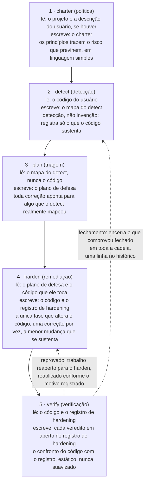
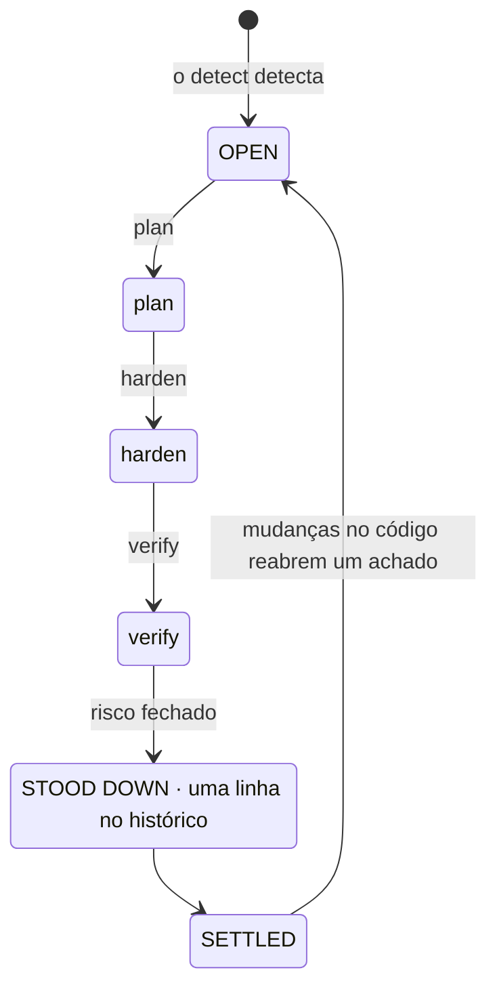
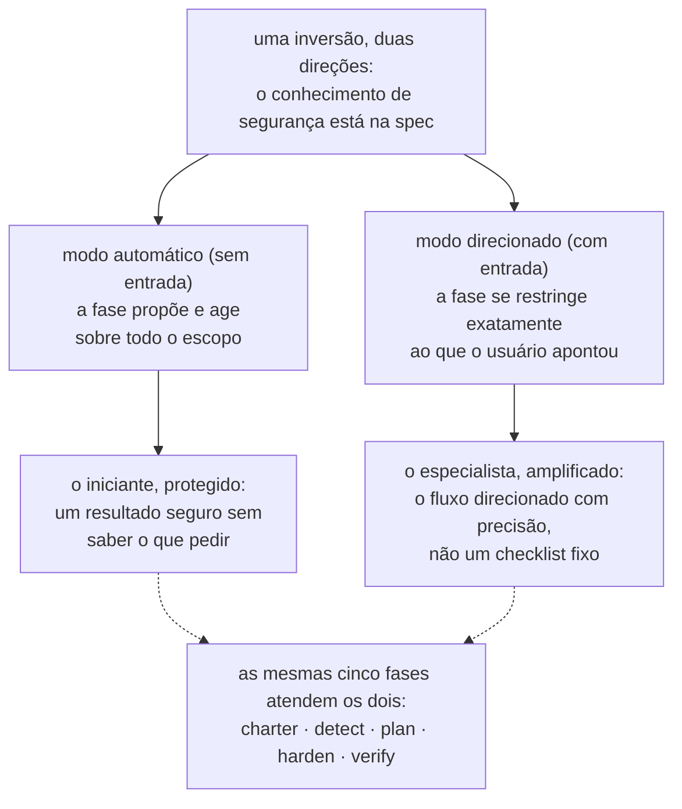
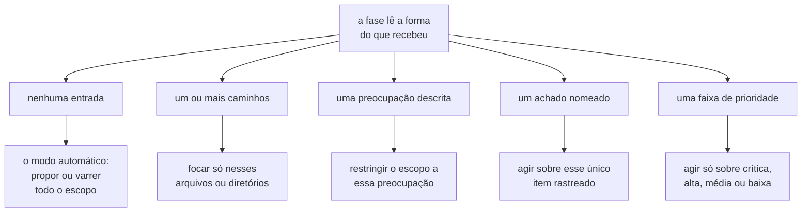
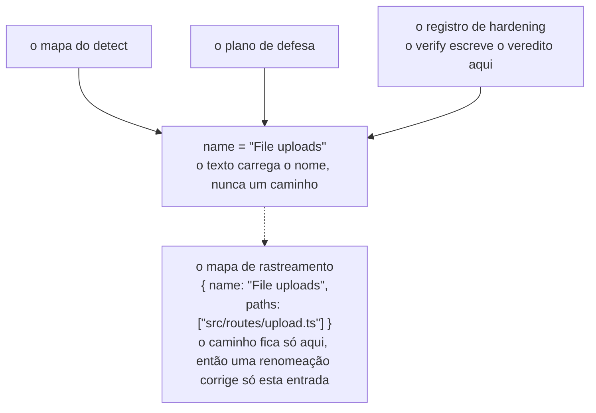
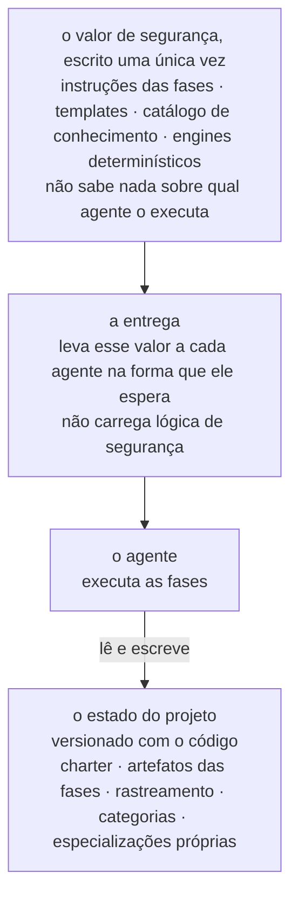
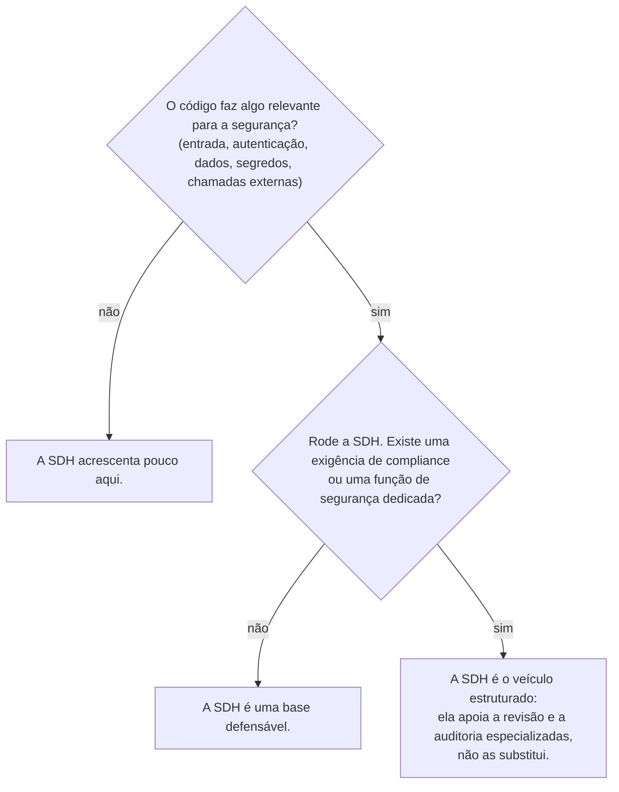

# Security-Driven Hardening (SDH): uma convenção para a era do desenvolvimento assistido por IA

- **Weslley Araújo**
- **Artigo de metodologia, 2026.**

---

## Resumo

Security-Driven Hardening (SDH) é uma metodologia de segurança estruturada, conduzida por IA e exclusivamente defensiva, pensada para uma época em que o software é cada vez mais escrito por agentes de IA e por pessoas que não são especialistas em segurança. Em vez de seguir um checklist genérico, a SDH primeiro detecta o que um sistema realmente faz (login, upload de arquivos, pagamentos, exposição de dados etc.) e então conduz o trabalho de segurança específico desse contexto. Ela é regida por princípios seguros por padrão, inteiramente voltada para a defesa e expressa em linguagem simples, para que qualquer usuário consiga agir a partir dela.

Este documento defende que a SDH é uma convenção que faltava, e não uma ferramenta isolada. O conhecimento de segurança está na metodologia e nas suas especializações sob demanda, uma base sobre a qual todo usuário pode construir, o que permite atender um iniciante e um especialista pelo mesmo fluxo. Duas propriedades a distinguem das abordagens spec-first anteriores `[1]`. A SDH é **independente de estado**: ela se adapta a um diretório vazio, a um projeto em andamento, a um único pull request ou a uma grande base de código legada, em qualquer stack. E a SDH é **encerrável**: um risco cujo fechamento foi verificado é encerrado em todo o fluxo, de modo que aquele achado chega a um estado de repouso e só é reaberto quando o código muda. A SDH não substitui profissionais de segurança nem ferramentas especializadas de Blue Team. Ela amplia o conhecimento do próprio desenvolvedor, e quanto mais um desenvolvedor entende de segurança, mais ele consegue conduzi-la.

O **Lagune** é a implementação de referência e comprova que a metodologia pode ser construída e levada a outros contextos. A SDH é oferecida como uma convenção que outros podem adotar.

> **Palavras-chave**
>
> desenvolvimento assistido por IA, segurança de software, segurança defensiva, spec-driven development, hardening de segurança, fluxos conduzidos por agentes, encerrabilidade, segurança sensível ao contexto, conhecimento sob demanda, ferramentas independentes de agente.

---

## I. Introdução: a lacuna de segurança que o desenvolvimento assistido por IA abriu

O software é cada vez mais entregue por pessoas, e por agentes de IA, que não conseguem reconhecer com segurança um padrão inseguro: um segredo vazado, uma verificação de autorização ausente, uma consulta vulnerável a injeção. Não são riscos exóticos. Eles estão entre as classes de risco que dominam os incidentes reais, documentadas há anos em referências públicas `[6]`, `[7]`, e estudos recentes relatam que uma parcela relevante do código gerado por IA é entregue justamente com esses defeitos `[8]`. Os assistentes de programação com IA agravaram o problema ao permitir que não desenvolvedores entreguem software real, mas a lacuna é mais ampla do que qualquer público específico. A maioria dos projetos nunca recebe uma revisão de segurança específica para o que eles realmente fazem. O ecossistema fica mais frágil a cada decisão precipitada de "funciona, pode publicar".

Conselhos genéricos de segurança não fecham essa lacuna. Um checklist estático não é específico para o que um sistema faz, então ele inunda um projeto pequeno com itens irrelevantes e ainda deixa passar o risco que importa para aquele projeto. O problema não é falta de conhecimento de segurança no mundo. O problema é associar o conhecimento certo ao sistema que está de fato diante do usuário, e fazer isso para alguém que talvez não saiba o que pedir.

A SDH responde a isso com uma única inversão: **o conhecimento de segurança está na spec e nas suas especializações sob demanda, uma base sobre a qual todo usuário pode construir**. A metodologia detecta o contexto, faz a triagem dos riscos que esse contexto traz e orienta as correções, de modo que um desenvolvedor e um não desenvolvedor são atendidos pelo mesmo fluxo. Os achados e as recomendações continuam em linguagem simples, para que sejam acionáveis qualquer que seja a profundidade técnica de quem os lê. O especialista não é limitado por isso, e sim amplificado, uma dualidade que desenvolvemos na `§VI`.

> **Ideia central**
>
> **A inversão central:** o conhecimento de segurança está na spec e nas suas especializações sob demanda, uma base sobre a qual todo usuário pode construir. A metodologia aprende o que o sistema faz, associa a ele o trabalho de segurança adequado e amplia o que o usuário já sabe.

Pense em um desenvolvedor que diz a um assistente de IA: "meu app permite que os usuários enviem uma foto de perfil". Sem uma revisão de segurança, o assistente produz um código que funciona e que, discretamente, confia em tudo o que o cliente envia: o tipo de arquivo declarado, o nome do arquivo, o tamanho. O upload vai para produção, e um arquivo disfarçado de imagem pode carregar código, um nome manipulado pode escapar do caminho de armazenamento e um arquivo grande demais pode esgotar o servidor. Nada disso aparece em uma demonstração, então tudo vai para produção.

O mesmo código, passando pela SDH, se comporta de outro jeito. Ela detecta que o sistema aceita arquivos vindos de fora (detecção), traduz isso nos riscos que um upload traz (triagem), propõe verificar o tipo real e o tamanho do arquivo, renomeá-lo ao salvar e armazená-lo onde código não pode ser executado (remediação), e então lê o resultado e confirma que cada controle realmente se sustenta (verificação). O desenvolvedor nunca precisou conhecer a expressão "upload de arquivos sem restrição". A metodologia a forneceu por ele.

Este documento traz as seguintes contribuições:

- Uma definição precisa da SDH como metodologia, independente de qualquer implementação, com os seus princípios de design (`§III`).
- Um ciclo de vida defensivo de cinco fases em que a própria separação de responsabilidades é a contribuição: a detecção nunca inventa, o planejamento nunca lê o código, só uma fase altera o código e a verificação nunca suaviza o seu julgamento (`§IV`).
- A **encerrabilidade** como postura metodológica: cada achado tem um estado final, e não um ciclo sem fim (`§V`).
- A dualidade do **extensor do conhecimento do desenvolvedor**: um único fluxo que protege o iniciante e amplifica o especialista (`§VI`).
- **Especializações não invocáveis e prompt sob demanda**: conhecimento de segurança focado que o agente carrega quando o contexto do projeto pede, nunca por padrão (`§VII`).
- **Independência de estado** e **adaptabilidade não autoritativa**: a SDH se encaixa em qualquer estado de desenvolvimento e se adapta ao cenário em vez de impor um escopo fixo (`§VIII`).
- Um **modo preventivo**: a mesma defesa aplicada enquanto o trabalho comum é construído, para que o código já chegue seguro por padrão e as fases tenham menos a corrigir (`§IX`).
- Uma comparação dedicada com o Spec-Driven Development, a linhagem da qual a SDH nasceu e da qual depois se afastou (`§X`).
- As disciplinas de engenharia que permitem à metodologia sobreviver a refatorações e permanecer independente de qualquer agente: o rastreamento por identidade pelo nome (`§XI`) e um veículo independente de agente (`§XII`).

---

## II. Contexto e trabalhos relacionados

A SDH se apoia em trabalhos anteriores. Ela herda uma estrutura já comprovada do desenvolvimento spec-first conduzido por agentes `[1]`, `[2]`, `[3]`: templates, slash commands que um agente consome, um documento regente e um agente que executa as fases. Ela reimplementa essa estrutura com um propósito defensivo. A linhagem é intencional, e um dos princípios de trabalho da SDH a nomeia diretamente: construir o fluxo a partir de uma estrutura comprovada e então orientá-lo para a segurança.

A SDH não é um checklist estático de recomendações genéricas. Um checklist sabe muito sobre segurança em geral e nada sobre o projeto diante dele. A SDH inverte essa ênfase. Ela dedica o primeiro esforço à detecção, a aprender o que o sistema faz, e só então recorre ao conhecimento que a detecção torna relevante.

A SDH também não substitui as pessoas de segurança nem as ferramentas especializadas de Blue Team. Ela amplia o conhecimento do desenvolvedor (`§VI`). Uma equipe com uma função de segurança dedicada deve mantê-la. A SDH oferece a essa equipe um veículo estruturado e oferece a uma equipe sem essa função uma base defensável.

A SDH também convive com scanners de segurança determinísticos (análise estática, linters) `[4]`, `[5]`. Essas ferramentas são valiosas justamente por serem determinísticas e repetíveis. A SDH é, em grande parte, raciocinada pelo agente, o que troca o determinismo estrito pela sensibilidade ao contexto. A metodologia não finge o contrário. Onde o determinismo importa, ela embute um engine determinístico dentro do raciocínio (`§VII`): o agente decide se vale a pena verificar uma entrada, e um programa determinístico decide se essa entrada é perigosa.

O trabalho anterior mais diretamente relacionado é o Spec-Driven Development (SDD), a família de metodologias spec-first que conduz uma construção adiante a partir de uma especificação executável. Tratamos o SDD como uma classe. A sua formulação mais clara como metodologia prática é o relatório de Piskala `[1]`, e o seu toolkit mais visível conduzido por agentes é o Spec Kit do GitHub `[2]`, com o OpenSpec `[3]` como uma segunda ferramenta da mesma família. Essas são as referências canônicas da comparação na `§X`.

---

## III. SDH: definição e princípios de design

**Security-Driven Hardening** é uma metodologia de segurança estruturada e conduzida por IA que torna uma base de código mais segura conduzindo o trabalho a partir de uma spec que o agente executa, e não de correções improvisadas. O nome se inspira nos **Blue Teams**, os defensores na segurança. A SDH trata de defesa, hardening e verificação, nunca de ataque.

> **Definição**
>
> **Security-Driven Hardening (SDH):** uma metodologia de segurança estruturada, conduzida por IA e exclusivamente defensiva, que primeiro detecta o que um sistema realmente faz e então conduz o trabalho de segurança específico do contexto, regida por princípios seguros por padrão e expressa em linguagem simples.

A SDH é definida por um conjunto de princípios obrigatórios. Cada um é uma regra, e cada um dá ao usuário uma garantia específica.

| Princípio                                                      | A regra                                                                                                                                                            | O que ele garante ao usuário                                                                                                                                                   |
| -------------------------------------------------------------- | ------------------------------------------------------------------------------------------------------------------------------------------------------------------ | ------------------------------------------------------------------------------------------------------------------------------------------------------------------------------ |
| Seguro por padrão, em linguagem simples, para todos igualmente | Todo padrão, mensagem e correção é seguro desde o início e compreensível para qualquer leitor, desenvolvedor ou não. Nenhum tipo de usuário é privilegiado.        | Um iniciante recebe uma base segura sem precisar pedir e lê o resultado nos próprios termos.                                                                                   |
| Sensível ao contexto em vez de genérico                        | Toda fase parte do contexto identificado no detect e age sobre o que o sistema realmente faz.                                                                      | As recomendações se ajustam ao projeto, e não a um checklist. O conhecimento de segurança está na spec e nas suas especializações sob demanda, ampliando o que o usuário traz. |
| Flexível em vez de rígido                                      | Princípios, requisitos e recomendações são pontos de partida. O usuário pode reformular, descartar, acrescentar ou restringir o escopo de qualquer coisa.          | A metodologia se molda ao projeto e ao usuário, e nunca é mais rígida do que o usuário quer. A flexibilidade nunca enfraquece a base segura por padrão.                        |
| Reconciliar, nunca só acrescentar                              | Os artefatos são documentos vivos, não logs. Cada execução revisa cada entrada: mantém o que se sustenta, reescreve o que mudou e remove o que não se aplica mais. | O registro sempre reflete o presente, então nunca se degrada em um backlog desatualizado.                                                                                      |
| Somente defesa                                                 | A SDH audita, fortalece e verifica. Ela nunca produz ferramentas ofensivas, exploits para uso malicioso nem técnicas de evasão de detecção para causar dano.       | A metodologia não pode ser transformada em arma. Conteúdo de uso duplo só aparece em um enquadramento claramente defensivo.                                                    |
| Spec-first, conduzido por agente, orientado para a segurança   | O fluxo é construído a partir de templates, comandos, um charter regente e um agente que executa as fases.                                                         | Uma estrutura de desenvolvimento comprovada, reaproveitada para que o agente realize o trabalho de segurança de fato.                                                          |

**Tabela 1.** Os princípios de design da SDH e a garantia que cada um dá ao usuário.

Esses princípios não são decorativos. Eles são as restrições que toda fase descrita a seguir precisa respeitar, e a discussão na `§XV` volta a eles para marcar os limites da metodologia.

O restante do documento desenvolve nove pilares nomeados. Eles são as partes que um leitor deve conseguir guardar na memória e as partes que outra equipe reimplementaria para afirmar que está fazendo SDH.

| Pilar                                                     | O que ele oferece                                                                                                                                  | Seção       |
| --------------------------------------------------------- | -------------------------------------------------------------------------------------------------------------------------------------------------- | ----------- |
| A inversão sensível ao contexto                           | O conhecimento de segurança está na spec e nas suas especializações sob demanda, então um iniciante e um especialista compartilham um único fluxo. | `§I`, `§VI` |
| O ciclo de vida defensivo de cinco fases                  | Separação de responsabilidades: política, detecção, triagem, remediação e verificação, cada uma com uma única tarefa.                              | `§IV`       |
| Encerrabilidade                                           | Um achado tem um estado final, e não um ciclo sem fim. O trabalho concluído é encerrado.                                                           | `§V`        |
| A dualidade do extensor do conhecimento do desenvolvedor  | Um único fluxo que protege o iniciante e amplifica o especialista, sem nunca substituir nenhum dos dois.                                           | `§VI`       |
| Prompt sob demanda, conhecimento não invocável            | O conhecimento de segurança relevante é carregado para o que o projeto é, nunca por padrão.                                                        | `§VII`      |
| Independência de estado e adaptabilidade não autoritativa | Encaixa-se em qualquer estado de desenvolvimento, em qualquer stack, e se adapta ao cenário em vez de impor um escopo.                             | `§VIII`     |
| O modo preventivo                                         | A mesma defesa roda enquanto o trabalho novo é construído, para que o código já chegue seguro por padrão.                                          | `§IX`       |
| Rastreamento por identidade pelo nome                     | Um achado continua sendo um único item ao longo das fases, e uma renomeação quebra o vínculo em um só lugar.                                       | `§XI`       |
| O veículo independente de agente                          | O valor de segurança é escrito uma única vez e não depende de nenhum agente nem de nenhuma stack.                                                  | `§XII`      |

**Tabela 2.** Os nove pilares nomeados da SDH e onde cada um é desenvolvido.

---

## IV. O fluxo Blue Team de 5 fases

A SDH estrutura o trabalho como um ciclo de vida defensivo de cinco fases (Figura 1). Cada fase é orientada para a defesa, cada uma se apoia na anterior, e as fases seguem a atividade real de um Blue Team: estabelecer a política, detectar, fazer a triagem, remediar e verificar.



**Figura 1.** O fluxo de cinco fases: o que cada fase lê, o que ela escreve e a sua invariante essencial. O verify conduz os dois retornos: um controle reprovado reabre o harden, e um achado comprovadamente fechado é encerrado em toda a cadeia, com uma linha no histórico.

A separação de responsabilidades é a contribuição. Como cada fase tem uma única tarefa, uma falha fica contida em um só lugar, e o leitor pode confiar no que cada artefato afirma.

> **Ideia central**
>
> **Applied não é verificado:** o harden registra que uma correção foi aplicada. O verify a verifica confrontando o código com esse registro, e o veredito nunca é suavizado para coincidir com o registro. Um controle pode estar presente no código e ainda deixar o risco alcançável, e então o veredito honesto é "risco não fechado".

### charter (política)

O charter estabelece os princípios de segurança do projeto, as regras que todas as fases seguintes precisam respeitar. Ele é a camada regente, uma espécie de verificação em tempo de compilação da postura de segurança do projeto. Cada princípio tem um nome claro, uma regra inegociável que pode ser conferida no código e uma linha `Why:` que declara o risco que ele previne, e não apenas a correção. O charter sempre lê o próprio projeto (os manifestos, a estrutura e as dependências), e a descrição do usuário, quando existe, é uma direção que essa leitura depois amplia para além do que o usuário citou. Sem descrição, o projeto é a única fonte. As duas se somam em vez de competir, e o charter registra a política que o projeto deve seguir, não o estado do código. Um não desenvolvedor deve conseguir lê-lo e entender tanto a regra quanto o risco.

### detect (detecção)

O detect lê o código e mapeia o que o sistema realmente faz que tem peso para a segurança. A instrução que o rege é "detecção, não invenção": registrar só o que o código sustenta, com as evidências de que as fases seguintes precisam. O detect é neutro. Ele não força os achados a se encaixarem no charter, porque confrontar os riscos com as regras do charter é tarefa da fase plan. Cada achado tem três partes: o que ele é (uma descrição em linguagem simples), por que importa (o risco, não apenas o fato) e a evidência (a função ou a rota em que ele está). A evidência não traz caminho de arquivo. O caminho fica apenas no mapa de rastreamento (`§XI`), então o texto nunca guarda um caminho que possa ficar desatualizado.

### plan (triagem)

O plan transforma cada achado em uma correção, nomeada pela sua classe de risco (citando as referências consagradas, CWE e OWASP, quando elas a fundamentam) e vinculada ao princípio do charter que a correção sustenta. A prioridade (crítica, alta, média, baixa) não é uma escolha livre: o plan classifica cada achado pelo método Base-and-Environmental do CVSS v4.0, então a faixa é a nota em palavras simples, justificada por uma linha em linguagem simples sobre a exposição e o que está em jogo, e duas execuções chegam à mesma ordem. O vetor é a âncora precisa para um especialista, e a faixa com a sua justificativa é a mesma classificação que qualquer pessoa consegue acompanhar. O plan trabalha apenas a partir do mapa do detect e nunca lê o código. Essa é uma restrição deliberada, não uma limitação: ela obriga cada correção a apontar para algo que o detect realmente detectou. Se um escopo nunca foi mapeado, o plan para e leva o usuário de volta ao detect em vez de adivinhar.

### harden (remediação)

O harden é a única fase que altera o código, então avança com cautela. Decidir se uma edição precisa da aprovação do usuário cabe ao agente e ao modo de permissão em que ele roda, por isso o harden não acrescenta nenhuma etapa de confirmação própria. Ele aplica uma correção por vez, primeiro as dependências e depois a maior prioridade, para que cada mudança continue pequena, revisável e fácil de desfazer. Ele nunca enfraquece um controle existente para encaixar uma nova correção e nunca viola um princípio do charter. Se uma correção entraria em conflito com um princípio, o harden para e expõe o conflito em vez de aplicá-la. Cada bloco é registrado como Applied, Partial ou Blocked. "Applied ainda não significa verificado", e é dessa questão que a fase seguinte trata.

### verify (verificação)

O verify verifica cada controle aplicado lendo o código e confrontando-o com o que o harden registrou. A verificação é esse confronto, o código contra o registro, e ela é estática: confirma que um controle está presente e correto no código, não que ele resiste a um ataque contra um sistema em execução. Essa verificação em tempo de execução, do tipo que dispara ataques reais ou simulados contra o sistema em produção, fica fora do escopo por design. O verify devolve um de três vereditos: risco fechado, risco não fechado ou não dá para saber pelo código. Ele não produz nenhum artefato próprio: o harden e o verify compartilham o registro de hardening, o harden responde pelo que foi feito e o verify responde pelo veredito e pelo seu motivo, e nenhum dos dois escreve nos campos do outro. Um controle reprovado é trabalho reaberto para o harden, cuja próxima execução trata o veredito como superior à sua própria leitura do código e reaplica a correção exatamente na lacuna que o motivo aponta. O verify confia mais no código do que no registro, porque um registro pode afirmar mais do que o código entrega. Ele é somente leitura no código do usuário e nunca suaviza um veredito para coincidir com o registro. Um controle pode estar presente e ainda deixar o risco alcançável por outro caminho, e nesse caso o veredito honesto é "risco não fechado". Se, durante a leitura, o verify percebe um problema de segurança que o mapa do detect nunca cobriu, ele não inventa um veredito para esse problema, já que detectar é tarefa do detect: ele expõe o problema e leva o usuário de volta ao detect, para que o achado entre pelo mesmo fluxo em vez de contorná-lo.

> **Fio condutor: upload de arquivos.** Um único achado mostra a espinha dorsal de ponta a ponta.
>
> - O **detect** o encontra: o sistema aceita arquivos dos usuários, e o handler de upload confia no tipo MIME que o cliente envia sem verificar o tipo real do arquivo. _Por que importa:_ um arquivo disfarçado de imagem pode esconder código malicioso.
> - O **plan** decide a correção, com prioridade **crítica**, sustentando o princípio "Toda entrada é não confiável até ser validada": verificar o tipo real e o tamanho do arquivo, renomeá-lo ao salvar e armazenar os uploads onde eles não possam ser executados como código.
> - O **harden** a aplica, com status **Applied**: o handler agora detecta o tipo real pelo conteúdo, impõe um limite de tamanho, rejeita qualquer coisa inesperada, renomeia ao salvar e armazena onde código não pode ser executado.
> - O **verify** lê o handler, confronta-o com o registro e devolve **risco fechado**: o código faz exatamente o que o registro afirma.
>
> O mesmo nome de achado atravessa o mapa do detect, o plano e o registro de hardening, e o verify age sobre esse registro com o mesmo nome: um veredito em aberto é escrito no bloco do achado, e um achado comprovadamente fechado é encerrado (`§V`). Esse nome compartilhado é a sua identidade (`§XI`).

---

## V. Encerrabilidade: um achado tem um estado final

A maioria das ferramentas de segurança deixa o usuário com um backlog que só cresce. A SDH adota outra posição: **um achado é encerrável, então tem um estado final em vez de viver em um backlog sem fim** (Figura 2). Isso decorre diretamente do princípio de reconciliação.

> **Definição**
>
> **Encerrabilidade:** um risco cujo fechamento foi verificado é encerrado em todo o fluxo, de modo que aquele achado chega a um estado de repouso e só é reaberto quando o código muda. Um achado tem um estado final, ainda que o programa de segurança em si nunca pare.

Os artefatos da SDH são documentos vivos, não logs. Sempre que uma fase roda de novo, ela confronta cada entrada existente com a verdade atual e faz uma de três coisas: mantém o que ainda se sustenta, reescreve o que mudou ou remove o que não se aplica mais. Um achado que o código mostra estar resolvido é simplesmente removido. O registro de trabalho reflete o presente, não o passado.

O fechamento é essa mesma reconciliação chegando à sua conclusão. Quando o verify comprova que um risco está fechado, ele encerra o achado em todo o fluxo: no mapa do detect, no plano, no registro de hardening e no mapa de rastreamento. É por isso que o verify é a única fase que escreve nos artefatos das outras fases: é a fase que fecha o ciclo. Ao sair da cadeia, o achado encerrado é condensado em uma entrada curta de um registro de histórico que fica fora da cadeia de trabalho e nunca é reprocessado. Essa é a fronteira entre desaparecer e ser fechado: um achado que a reconciliação removeu porque deixou de ser verdadeiro não deixa nada para trás, enquanto um achado comprovadamente fechado ganha a sua linha no histórico. Um achado encerrado fica ausente de todos os artefatos de trabalho dali em diante, e essa ausência é esperada, não uma cadeia quebrada.



**Figura 2.** A máquina de estados da encerrabilidade. Um achado passa por OPEN → STOOD DOWN → SETTLED e só é reaberto quando o código muda.

Quando tudo o que está no escopo foi encerrado, o ciclo entra em repouso, e esse estado de repouso tem uma forma concreta: um artefato cujo último achado foi fechado é removido por inteiro, então uma cadeia totalmente fechada deixa apenas o charter e o histórico, a política e a prova. O ciclo só é reaberto quando o código muda. A metodologia dá a cada achado um fim definido, exatamente o que um backlog sem fim não consegue dar.

---

## VI. A dualidade do extensor do conhecimento do desenvolvedor

A SDH não substitui pessoas nem ferramentas especializadas de Blue Team. Ela **amplia o conhecimento do próprio desenvolvedor**. Quanto mais um desenvolvedor entende de segurança, com mais precisão consegue conduzir o fluxo e mais autonomia tem. Um desenvolvedor que entende pouco ainda recebe um resultado seguro, porque o modo automático o protege.

A inversão da `§I`, segundo a qual o conhecimento de segurança está na spec, vale nas duas direções. Para o iniciante, ela é proteção: ele não precisa saber o que pedir, porque a spec propõe. Para o especialista, ela é amplificação: a mesma spec permite que ele direcione o fluxo com precisão em vez de lutar contra um checklist fixo.

Cada fase carrega essa dualidade no próprio funcionamento (Figura 3). Executada sem nenhuma entrada, ela age sobre todo o escopo em nome do usuário. Com uma direção, a mesma fase se restringe exatamente ao que o usuário apontou.



**Figura 3.** A dualidade do extensor do conhecimento do desenvolvedor. Uma única inversão atende dois públicos: o modo automático protege o iniciante, e o modo direcionado amplifica o especialista, pelas mesmas cinco fases.

As especializações sob demanda (`§VII`) tornam a dualidade explícita no próprio texto. Cada uma diz ao agente que o seu conhecimento "amplia o seu julgamento" e que ele deve continuar raciocinando além do que a especialização oferece. O conhecimento é um piso, não um teto. É isso que atende os dois públicos no equilíbrio que o documento pretende: a comunidade de desenvolvedores ganha um instrumento substancial, e o profissional de Blue Team ganha um veículo estruturado que não finge fazer o trabalho dele.

---

## VII. Especializações não invocáveis e prompt sob demanda

Este é o padrão mais original da metodologia. A SDH carrega conhecimento de segurança focado na forma de especializações que são carregadas **apenas sob demanda**, e o próprio agente decide quais carregar associando-as ao contexto do projeto. Chamamos isso de **prompt sob demanda** (prompt-on-demand): uma forma de o agente escolher qual conhecimento ativar com base no escopo do projeto em que está, em vez de executar todas as verificações por padrão. As especializações são evolutivas, e qualquer uma delas pode mudar ou ser substituída a qualquer momento. A contribuição é o padrão, não as especializações em si.

> **Definição**
>
> **Prompt sob demanda:** o agente seleciona qual conhecimento de segurança ativar confrontando-o com o escopo do projeto diante dele, de modo que o conhecimento relevante é carregado para o que o projeto realmente é, em vez de todas as verificações rodarem por padrão.

> **Definição**
>
> **Especialização não invocável:** uma unidade de conhecimento de segurança focada e independente de linguagem, voltada para um contexto, como upload de arquivos ou código que roda no navegador. Ela audita e explica, nunca reescreve código e nunca produz uma entrada de ataque. Ela não é um comando: é carregada quando o contexto que cobre está no escopo, ou quando um prompt a pede pelo nome.

Cada especialização nomeia as formas mais seguras para os riscos que cobre e diz ao agente como agir sobre um achado em cada fase que a consome: como avaliá-lo na detecção, como aplicar a correção com segurança na remediação e como comprová-lo na verificação.

O traço que a define é que uma especialização **não pode ser invocada por conta própria**: ela não é um comando, e dentro do fluxo é uma correspondência que a carrega. A fase de detecção lista o catálogo uma vez, confronta o contexto do projeto com o que cada entrada cobre e carrega apenas as especializações cujo contexto está presente no escopo. As fases seguintes reutilizam essa lista em vez de listar de novo, então uma única correspondência serve toda a cadeia, e o modo preventivo (`§IX`) faz a mesma correspondência com o trabalho que está prestes a ser construído. Uma especialização cujo contexto está ausente é ignorada, e ignorá-la exige tanta justificativa quanto carregá-la: cada entrada do catálogo recebe um veredito explícito, aplicada ou ignorada, com o motivo tirado do código, de modo que uma vaga impressão de irrelevância nunca substitui a ausência. Não encontrar nenhuma aplicável é um resultado válido.

O catálogo é dado, e crescer significa um arquivo de conhecimento a mais e uma linha a mais no catálogo, nunca um novo comando. As especializações nativas são agrupadas em categorias, como OWASP, uma linguagem ou integrações de IA, e o catálogo que um projeto usa contém as nativas das categorias que ele escolheu, mais as suas próprias especializações. O projeto registra essa escolha junto com o resto do seu estado, então uma equipe inteira faz a correspondência com o mesmo catálogo. É o mesmo princípio sensível ao contexto das fases, aplicado ao conhecimento: o conhecimento relevante é carregado para o que o projeto realmente é, em vez de todas as verificações rodarem por padrão. A mesma propriedade permite que o usuário, e não só o mantenedor, amplie o catálogo: uma fonte ou um tema de segurança que o usuário fornece é condensado em uma nova especialização que pertence ao projeto, entra no catálogo dele quaisquer que sejam as categorias e é carregada exatamente como uma nativa, substituindo a nativa de mesmo nome. Criar uma especialização também é algo exclusivamente defensivo e obedece ao mesmo limite que as especializações impõem: um relato de ataque pode ser a fonte, mas a especialização que resulta dele audita e explica, nunca emite um exploit funcional. Assim, a inversão da `§I`, com a inteligência morando na spec, se estende ao próprio catálogo, que o usuário pode aprofundar para o seu contexto sem escrever código.

Um exemplo curto ilustra o prompt sob demanda. O detect lê uma pasta de código que roda no navegador. Ele encontra esse contexto no catálogo, carrega a especialização que o cobre e expõe um achado do lado do cliente pelas etapas normais do detect. As especializações cujo contexto está ausente desse escopo não correspondem, então nunca são carregadas, e cada uma é registrada como ignorada. Foi o projeto que decidiu qual conhecimento era relevante, não uma configuração fixa.

O determinismo aparece justamente onde importa. Uma especialização pode carregar um verificador determinístico, e não apenas texto: quando uma classe de risco tem um procedimento de decisão bem definido, um pequeno programa devolve um veredito fixo para uma dada entrada, por exemplo um conjunto curto de palavras como `safe`, `unsafe` ou `invalid input`. Algumas classes de risco são decidíveis de forma determinística exatamente assim, com um conjunto de trabalhos anteriores por trás do procedimento de decisão `[9]`, `[10]`, `[11]`. O verificador ou avalia os candidatos que o agente fornece ou varre o escopo para encontrá-los por conta própria, e nos dois casos é o verificador, e não o agente, que devolve o veredito. Uma especialização universal o suficiente pode ser marcada como obrigatória no catálogo e passa a ser sempre aplicada, com o seu verificador rodando sobre todo o escopo. Esse é o único caso em que um conhecimento é carregado sem uma correspondência de contexto, e ele é declarado nos dados do catálogo, nunca decidido pelo agente no momento. É assim que a SDH ancora o raciocínio do agente em algo repetível, sem fingir que todo o fluxo é determinístico.

Por fim, as especializações são **destacáveis**. Como o conhecimento se sustenta sozinho, um usuário pode executar uma delas diretamente em um prompt que não tem nada a ver com o fluxo completo da SDH, mantendo a segurança junto do desenvolvimento comum. Uma especialização com um verificador determinístico pode, por exemplo, filtrar cada candidato produzido durante a programação comum e manter apenas os seguros. Essa capacidade de se destacar é parte do motivo pelo qual a SDH se adapta a tantas situações, que são o tema da `§VIII`, e a sua expressão completa é o modo preventivo (`§IX`), em que o mesmo conhecimento protege o desenvolvimento comum de ponta a ponta.

---

## VIII. Independência de estado e adaptabilidade não autoritativa

Duas propriedades separam a SDH das metodologias de spec rígidas.

### Independência de estado

> **Definição**
>
> **Independência de estado:** a metodologia não depende do estado do desenvolvimento. Ela se encaixa em um diretório vazio, em um projeto em andamento, em um único pull request ou em uma grande base de código legada, em qualquer stack, porque descobre o ponto de partida lendo-o.

Toda fase funciona da mesma forma, seja o projeto totalmente novo ou já existente. O charter infere princípios a partir de qualquer código presente. O detect mapeia o código que houver, mesmo que seja muito pouco. Não existe um ponto de partida pressuposto.

### Adaptabilidade não autoritativa

> **Definição**
>
> **Adaptabilidade não autoritativa:** a metodologia se adapta ao cenário em vez de impor um escopo fixo que o usuário precisa seguir. Quando o usuário não sabe o que dizer, ela lê o ambiente em que foi invocada, gera contexto e faz as perguntas que definem o que ela faz em seguida.

O modo de proposta do charter é o caso mais claro: a SDH deriva um charter seguro por padrão analisando o projeto, pergunta ao usuário apenas quando uma lacuna realmente muda o resultado, e então o escreve e apresenta cada princípio em linguagem simples, com o risco que ele previne. O charter é um documento vivo que o usuário reformula executando-o de novo, não um contrato preso a um pedido de aprovação, então ele nunca exige que o usuário saiba o que pedir.

Essa adaptabilidade aparece como uma sensibilidade à forma da entrada: a mesma fase lê o que recebeu e escolhe um modo (Figura 4). Um arquivo no prompt, um achado da lista, uma preocupação, uma missão focada contra um ponto fraco conhecido ou um pedido de varredura completa por força bruta: cada um atende à necessidade do usuário, porque o fluxo é não autoritativo por design. Nada disso enfraquece a base segura por padrão. A flexibilidade molda como a base é aplicada, nunca a rebaixa.



**Figura 4.** Adaptabilidade não autoritativa. A mesma fase lê a forma da sua entrada e escolhe um modo, então o escopo é sempre do usuário, nunca imposto.

---

## IX. O modo preventivo universal: a mesma defesa enquanto o trabalho é construído

A SDH tem um modo complementar: o desenvolvimento comum feito com a mesma defesa ativa enquanto o código é escrito. O usuário pede o próprio trabalho, uma página de login, um upload, um endpoint, e a metodologia protege a construção enquanto ela acontece, para que o resultado seja seguro por padrão no momento em que chega, e não depois de uma passada posterior de hardening.

> **Definição**
>
> **O modo preventivo:** o desenvolvimento comum executado sob a camada regente e o conhecimento da SDH. O charter vincula a construção, as especializações relevantes para o que está prestes a ser criado são carregadas sob demanda, e o resultado é confrontado exatamente com a defesa que foi usada antes que o trabalho seja dado como concluído.

O modo reaproveita cada peça que as fases já carregam, apontada para um código que ainda não existe. A detecção de contexto se desloca do código para a intenção: o agente raciocina sobre o que está prestes a construir e sobre as fronteiras que esse trabalho atravessa (um login implica credenciais, uma sessão e entrada vinda de fora), e é esse raciocínio que é confrontado com o catálogo de conhecimento. O prompt sob demanda (`§VII`) se generaliza aqui: o contexto pode ser detectado no plano do código, e não apenas no código que já existe. O charter rege como sempre, e um pedido que violaria um princípio é exposto como conflito, nunca construído. A defesa é aplicada na hora, no momento em que cada parte é escrita, validando na fronteira e recorrendo à construção segura logo na primeira vez, então uma versão que funciona mas é insegura nunca chega a existir para ser corrigida.

O modo termina do jeito que o verify começa. Antes que o trabalho seja dado como concluído, quem construiu confronta o próprio resultado com a defesa que usou: o controle precisa estar no caminho do risco, e não ao lado dele, precisa estar completo, e, quando uma especialização carrega um verificador determinístico, o veredito do verificador prevalece sobre a leitura do próprio agente. Uma lacuna encontrada aqui é fechada como parte do mesmo trabalho, porque terminar o trabalho significa terminá-lo com segurança.

O que o modo recusa é tão deliberado quanto o que ele faz. Ele constrói só o que foi pedido e não audita nada ao redor: auditar o que já existe é papel das fases. Ele não escreve nenhum artefato nem rastreia nenhum achado, porque um achado é um risco detectado no que já existe, e o propósito deste modo é que a versão insegura nunca chegue a existir. As duas direções se completam: as fases fecham o que já está lá (`§V`), e o modo preventivo impede que o trabalho novo o reabra. Uma cadeia em repouso continua em repouso não porque o desenvolvimento parou, mas porque o que é construído enquanto ela repousa já é construído com defesa.

---

## X. Security-Driven Hardening versus Spec-Driven Development

O Security-Driven Hardening (SDH) nasceu da base do Spec-Driven Development (SDD) e depois se afastou dele de forma marcante. A herança estrutural é real e reconhecida: spec-first, conduzido por agentes, com um documento regente e um conjunto de comandos em fases que o agente executa. A SDH reaproveita essa estrutura de propósito. O que muda é o propósito, o modelo de autoridade, o estado pressuposto e a condição de término. Tratamos o SDD como uma classe, usando o relatório de Piskala `[1]` como a formulação canônica da metodologia, o Spec Kit do GitHub `[2]` como o toolkit canônico para agentes e o OpenSpec `[3]` como uma segunda ferramenta da mesma família.

O SDD inverte o desenvolvimento tradicional ao tornar as especificações executáveis: a spec gera diretamente uma implementação funcional, em vez de apenas orientá-la `[1]`. O seu conjunto de fases conduz uma construção adiante `[2]` (estabelecer os princípios regentes, especificar o que construir, planejar a stack técnica, dividir o plano em tarefas e então implementar). O seu documento regente, uma constituição de princípios, é a peça fundamental à qual o agente precisa aderir do começo ao fim. É aí que está o cerne da diferença. No SDD, a autoridade flui da spec para a construção, e espera-se que a implementação a siga.

A SDH inverte quase todos os eixos desse contrato (Tabela 3).

> **Ideia central**
>
> **A diferença central:** no SDD, a autoridade flui da spec para a construção, e espera-se que a implementação a siga. A SDH é não autoritativa e flui no sentido oposto, para dentro, a partir do contexto detectado no sistema, fortalecendo a segurança do que já está lá.

| Eixo                       | SDD                                                                                             | SDH                                                                                                                                       |
| -------------------------- | ----------------------------------------------------------------------------------------------- | ----------------------------------------------------------------------------------------------------------------------------------------- |
| Objetivo                   | Entregar funcionalidades. A spec se torna uma implementação funcional.                          | Fortalecer a segurança do que existe ou está sendo construído. Toda fase é orientada para a defesa.                                       |
| Modelo de autoridade       | Autoritativo. A spec e a constituição confinam a construção a um escopo que ela precisa seguir. | Não autoritativo. A SDH se adapta ao cenário, e o usuário pode reformular, descartar ou restringir o escopo.                              |
| Estado pressuposto         | Uma construção adiante a partir de uma especificação.                                           | Independente de estado: diretório vazio, projeto em andamento, um único PR ou código legado.                                              |
| Condição de término        | Termina quando a funcionalidade está construída.                                                | Encerrável. Um achado chega a um estado de repouso e só é reaberto quando o código muda.                                                  |
| Documento regente          | Uma constituição de princípios à qual o agente precisa aderir.                                  | Um charter de princípios orientados ao risco (cada um com uma linha `Why:`), explicitamente não um contrato fixo.                         |
| Como o conhecimento cresce | Acrescentando um comando (ou ampliando o conjunto de fases).                                    | Acrescentando uma especialização não invocável que o agente carrega sob demanda: um arquivo mais uma linha no catálogo, sem novo comando. |
| A quem atende              | A quem constrói e leva uma funcionalidade adiante.                                              | Qualquer usuário, desenvolvedor ou não, atendido pelo mesmo fluxo.                                                                        |
| O que altera o código      | A fase de implementação gera a construção.                                                      | Só a fase harden altera o código, uma correção por vez.                                                                                   |

**Tabela 3.** SDD versus SDH em oito eixos. Estrutura emprestada, contrato invertido.

Para ser justo com a linhagem: o SDD é um trabalho anterior comprovado, e a SDH deve a ele a estrutura sobre a qual roda. O afastamento não é uma crítica ao SDD, que resolve bem um problema diferente (construir adiante). A SDH pega a mesma maquinaria comprovada e a aponta para a defesa, a adaptabilidade e o fechamento. O OpenSpec `[3]`, organizado em torno de propostas de mudança, listas de tarefas e specs por mudança, confirma o padrão: a família conduz uma construção adiante a partir de uma spec, enquanto a SDH fortalece um sistema para dentro, a partir do seu contexto detectado. Até o modo preventivo da SDH (`§IX`), o único lugar em que ela acompanha uma construção adiante, mantém o contrato invertido: ele rege como o trabalho é construído e nunca decide o que construir.

---

## XI. Rigor de engenharia: a disciplina de rastreamento

A disciplina de reconciliar sem nunca só acrescentar (`§V`) precisa de uma base que sobreviva a refatorações. Um achado precisa continuar sendo um único item em todas as fases que o tocam, e um arquivo renomeado ou movido não pode quebrar a cadeia. A SDH resolve isso com **identidade pelo nome** e **caminhos guardados apenas no rastreamento**.

> **Definição**
>
> **Identidade pelo nome:** a identidade de um achado é o seu nome, escrito de forma idêntica em todos os artefatos. O texto carrega o nome, nunca um caminho. Os caminhos de arquivo ficam apenas no mapa de rastreamento, então uma renomeação ou um arquivo movido quebra o vínculo em exatamente um lugar.

Cada achado do detect é um item rastreado. A sua identidade é o seu **nome**, o título da seção, escrito de forma idêntica no mapa do detect, no plano e no registro de hardening. As fases seguintes reutilizam esse nome ao pé da letra ao agir sobre o mesmo item, e o verify escreve o seu veredito no registro de hardening com esse mesmo nome. O mapa de rastreamento guarda rastreamento e nada mais, uma entrada por item:

```json
{ "name": "File uploads", "paths": ["src/routes/upload.ts"] }
```

O mapa não registra texto, anotações, identificador separado nem fase. Os artefatos em texto carregam a redação, e o mapa carrega apenas a identidade e os caminhos. Os caminhos de arquivo são a única coisa volátil, e ficam apenas aqui. Uma renomeação ou um arquivo movido pode quebrar o vínculo em exatamente um lugar, nunca em duas cópias divergentes.



**Figura 5.** A esteira da identidade. Um único nome de achado percorre todos os artefatos, enquanto o seu caminho fica apenas no mapa de rastreamento, então uma renomeação é corrigida em um só lugar.

Dois atos mantêm o mapa no fluxo normal, e um terceiro fica à parte como manutenção. O **Track** é um registro aditivo: uma fase informa os achados que escreveu, e o engine registra os novos e acompanha um caminho renomeado para os demais, classificando cada um como novo, movido ou inalterado. Ele nunca remove nada que a fase não tenha informado. O **Untrack** encerra os achados que o verify fechou: em uma única passada determinística, ele condensa cada um na sua entrada de histórico, remove a seção inteira dele dos artefatos, apaga um artefato cujo último achado se foi e descarta a sua entrada de rastreamento, de modo que o agente não faz nada disso à mão. Onde a passada determinística não consegue ir com segurança, como um nome encerrado que ainda é citado no texto de outro achado, ele sinaliza o ponto para o agente em vez de arriscar uma edição. Esses dois são os que as fases chamam enquanto rodam. O **Repair** é o ato de manutenção: uma fase o aciona automaticamente quando a sua própria reconciliação encontra o rastreamento inconsistente (um caminho registrado que não existe mais) e, fora isso, ele é executado sob demanda. Ele realinha o mapa inteiro de uma vez, lendo todos os artefatos e o código atual, corrigindo os caminhos de cada item e expondo o que não consegue decidir sozinho: um órfão (um item rastreado que nenhum artefato menciona mais) ou um candidato a renomeação (um item cujos caminhos correspondem a outro nome informado).

O Repair é manutenção, não uma sexta fase. Ele não toca no código do usuário nem nos artefatos em texto, apenas no rastreamento. Ele lê o código-fonte do usuário por um único motivo, descobrir o novo caminho de um arquivo renomeado, e nunca escreve conteúdo de segurança. A pessoa é a árbitra final na única decisão que o engine se recusa a adivinhar: se um item que sumiu foi resolvido ou apenas renomeado. É melhor perguntar do que adivinhar, porque um item descartado por engano quebra a cadeia.

A metodologia aplica a si mesma a sua própria disciplina de defesa. Os engines determinísticos são invocados como programas de linha de comando, e cada entrada é passada como um argumento de processo separado, o que a mantém inerte, então um valor com aspas ou crases nunca consegue se injetar no comando. Uma verificação desconhecida falha em vez de responder, então uma verificação com o nome digitado errado nunca é lida como um resultado limpo. A SDH não isenta a sua própria infraestrutura do princípio seguro por padrão.

---

## XII. O veículo: uma arquitetura independente de agente como prova de portabilidade

Para que a SDH seja uma convenção que outros adotem, ela não pode estar presa a um agente nem a uma stack, então o seu veículo mantém três responsabilidades separadas (Figura 6). O Lagune comprova que isso é possível.

**O valor de segurança** é escrito uma única vez e não sabe nada sobre qual agente o executa: as instruções das fases e os templates que elas preenchem, o catálogo de conhecimento e os engines determinísticos. **A entrega** é enxuta: a sua única tarefa é levar esse valor a um agente na forma e no lugar que ele espera, e ela não carrega nenhuma lógica de segurança própria. **O estado do projeto** pertence ao projeto: o charter, os artefatos das fases, o mapa de rastreamento, as categorias que ele escolheu e as suas próprias especializações, versionados e revisáveis como qualquer outra parte do código.



**Figura 6.** O veículo independente de agente. O valor de segurança é escrito uma única vez, uma entrega enxuta o leva a cada agente, e o estado continua sendo do projeto.

Como a entrega não carrega lógica de segurança, a forma como ela é construída não muda nada na SDH. Um veículo pode construir a entrega por conta própria ou passá-la a um ecossistema que já distribui skills para agentes, como faz a implementação de referência, e as fases, os seus artefatos e as suas garantias continuam os mesmos. Nada disso é específico de uma linguagem ou de um runtime. A implementação de referência por acaso é escrita em uma stack, mas a metodologia é a fronteira entre essas responsabilidades, não o conjunto de ferramentas que as constrói. O mesmo design poderia ser reimplementado em outra linguagem sem mudar o que a SDH é.

---

## XIII. Caso prático: a SDH de ponta a ponta

> **Caso prático**
>
> **Hardening defensivo de uma superfície de upload e de administração.**
> **Contexto:** um app pequeno que aceita uploads de arquivos dos usuários e os lista em uma página de administração.
> **Padrão:** charter → detect (com conhecimento sob demanda ativado pelo contexto) → plan → harden → verify, com um fechamento e uma falha real.
> **Resultado (capacidade):** um risco verificado como fechado e encerrado em toda a cadeia, e um controle verificado como _não_ fechado e devolvido ao harden. O veredito reflete o código, não o registro.

_Este é um exemplo ilustrativo do funcionamento da metodologia, não um estudo medido em campo, e não relata métricas de eficácia._

Um único passo a passo contínuo mostra a metodologia em funcionamento, e não apenas as suas partes. Estendemos o fio condutor do upload de arquivos da `§IV` com uma ativação de conhecimento sob demanda e um fechamento, e incluímos uma falha real.

1. O **charter** propõe o princípio "Toda entrada é não confiável até ser validada", com o seu risco em linguagem simples: uma entrada que não é verificada é a forma mais comum de um sistema ser invadido.
2. O **detect** analisa a rota de upload e a pequena página de administração que lista os arquivos enviados. Ele detecta o achado do upload (o handler confia no tipo MIME informado pelo cliente). A página de administração roda no navegador, um contexto que o prompt sob demanda (`§VII`) reconhece, então o detect carrega a especialização desse contexto e expõe um segundo achado: um ponto em que um nome de arquivo é escrito na página como markup, e não como texto, de modo que um nome manipulado pode rodar como script no navegador de quem visita. As especializações cujo contexto está ausente desse escopo nunca são carregadas, e cada uma que é ignorada fica registrada com a ausência constatada no código.
3. O **plan** atribui à correção do upload a prioridade crítica, vinculada ao princípio: verificar o tipo real e o tamanho do arquivo, renomeá-lo ao salvar e armazená-lo onde código não pode ser executado. Ele atribui à segunda correção a prioridade alta: renderizar o nome do arquivo como texto, não como markup.
4. O **harden** aplica primeiro a correção do upload (a de maior prioridade) e a registra como Applied, e depois a segunda, também como Applied.
5. O **verify** lê cada ponto e confronta o código com o registro. O controle do upload se sustenta: o handler detecta o tipo real pelo conteúdo, impõe um limite de tamanho e recusa o resto. Veredito: risco fechado. O verify encerra o achado do upload em toda a cadeia, e o seu resumo condensado vai para o histórico.

Em seguida vem a falha real. Suponha que a segunda correção do harden tenha acrescentado um helper seguro de renderização de texto, mas deixado a antiga chamada que escreve markup ainda alcançável por outro caminho no código. O verify lê a página, vê o helper seguro e também vê que o caminho inseguro continua ativo. O controle está presente, mas o risco não está fechado. O verify se recusa a suavizar o veredito para coincidir com o registro. Ele devolve "risco não fechado", registra a lacuna e aponta de volta para o harden. Um controle que não trata o risco por completo não é uma aprovação.

Este é o caráter da metodologia em um único exemplo: detecção sensível ao contexto, correções priorizadas e vinculadas a princípios, aplicação cuidadosa e uma verificação que relata o estado real do código, independentemente do registro.

---

## XIV. Quando usar a SDH, e os seus limites

A SDH raramente é desproporcional como um processo pesado pode ser, porque é independente de estado e encerrável: ela se reduz a um único arquivo e a uma única preocupação, e chega a um estado de repouso em vez de deixar um fardo permanente. O seu limite não é o tamanho do projeto, e sim a **profundidade da garantia**.



**Figura 7.** Quando usar a SDH. A decisão passa primeiro pela relevância para a segurança e depois pela profundidade da garantia, nunca pelo tamanho do projeto.

Onde a SDH chega ao seu limite: comportamentos que só aparecem quando o sistema está em execução (o verify lê o código, não executa o sistema), riscos que dependem de uma configuração ou de um ambiente que o agente não consegue ler e contextos de alto risco em que a revisão por especialistas é necessária de qualquer forma. Em cada um desses casos, a SDH ainda agrega valor como uma primeira passada estruturada, mas é um piso, não um teto.

> **Ideia central**
>
> **O limite:** o limite da SDH é a profundidade da garantia, não o tamanho do projeto. Ela pode servir como uma base defensável em quase qualquer lugar e apoia a revisão por especialistas onde o que está em jogo exige, mas não substitui os testes de um sistema em execução nem o julgamento de um profissional de segurança.

---

## XV. Discussão: posicionamento, limites e o que a SDH não afirma

A SDH é precisa sobre os seus limites.

### Ela amplia, não substitui

A SDH não substitui profissionais de segurança nem ferramentas especializadas de Blue Team. Ela amplia o conhecimento do desenvolvedor (`§VI`). Uma afirmação comedida é a afirmação certa: bem aplicada, a SDH **pode** fechar riscos reais de forma eficaz, principalmente em projetos que de outro modo não receberiam nenhuma revisão de segurança. Ela não é uma garantia nem substitui a revisão por especialistas onde o que está em jogo a exige.

### Somente defesa, por construção

A SDH audita, fortalece e verifica. Ela nunca produz ferramentas ofensivas, exploits nem técnicas de evasão de detecção para causar dano. Conteúdo de segurança de uso duplo só é aceitável em um enquadramento claramente defensivo e autorizado. Esse é um limite rígido, não uma preferência.

### A verificação é substantiva, não teatral

O verify verifica lendo o código e confrontando-o com o registro, não executando o sistema. Essa é uma verificação estática: ela confirma que um controle está presente e correto no código, e não comprova que o controle resiste a um ataque em tempo de execução. Por isso, "não dá para saber pelo código" é um veredito legítimo, e não uma falha escondida atrás de um resultado aprovado. Quando a evidência não está no código (depende de configuração ou de um caminho que o agente não consegue ler), a SDH diz isso em vez de adivinhar.

### O determinismo é delimitado e nomeado

A maior parte da SDH é raciocinada pelo agente, e é isso que viabiliza a sua sensibilidade ao contexto. O determinismo fica reservado aos engines determinísticos: os verificadores que uma especialização pode carregar (`§VII`) e o engine de rastreamento (`§XI`). O documento não borra essa linha. Onde um resultado é determinístico, ele é o resultado de um programa. Onde é raciocinado, ele é a leitura que o agente faz do código, com o usuário como árbitro final.

### Custo e escala

Uma varredura completa consome muitos tokens. Os modos manuais (`§VI`, `§VIII`) existem em parte para manter o custo proporcional à preocupação.

### O usuário é o árbitro final

A SDH pede à pessoa que decida entre renomeado e resolvido, e a aprovação das edições de código continua onde o usuário já governa o seu agente, no modo de permissão em que o executa. A metodologia propõe e verifica. Ela não passa por cima da pessoa.

### Objeções e respostas

Um cético justo levantará várias objeções. As mais substantivas merecem ser apresentadas nas próprias palavras.

**"Isso não é só um analisador estático com um LLM acoplado?"** Não. Um analisador estático executa por padrão todas as regras que tem. A SDH primeiro detecta o que o sistema é e só então recorre ao conhecimento relevante (`§II`, `§VII`), e ela _embute_ um verificador determinístico apenas onde uma classe de risco tem um procedimento de decisão bem definido. O raciocínio parte do contexto, e o determinismo é pontual.

**"Isso não é só um checklist de segurança?"** Não. A SDH inverte o checklist: a detecção vem primeiro, e o conhecimento é carregado para o que o projeto realmente faz (`§II`, `§VII`).

**"Isso não é só o SDD com um novo nome para segurança?"** Não. A SDH empresta a estrutura do SDD e inverte o seu contrato: a autoridade, o estado pressuposto, a condição de término e o público atendido são todos diferentes (`§X`). A mesma maquinaria, na direção oposta.

**"Um método raciocinado por IA não acaba alucinando achados?"** O design restringe a invenção em vez de confiar que o modelo vai se comportar. O detect registra só o que o código sustenta ("detecção, não invenção", `§IV`), o verify confronta o código com o registro e pode responder "não dá para saber pelo código" (`§XV`), verificadores determinísticos fundamentam os casos decidíveis (`§VII`) e o usuário é o árbitro final. Isso não torna o agente infalível, torna as suas afirmações verificáveis.

Uma nota sobre o posicionamento. A SDH é definida aqui de forma independente da sua implementação de referência. As cinco fases, o charter orientado ao risco, a reconciliação sem nunca só acrescentar e a sua encerrabilidade, o conhecimento por prompt sob demanda, o modo preventivo, o rastreamento por identidade pelo nome e o limite de somente defesa são a metodologia. Outra equipe poderia implementá-los em outra stack e em outro ecossistema de agentes, e o resultado continuaria sendo SDH. O Lagune é a sua prova, não a sua definição.

---

## XVI. Armadilhas, e como a SDH as evita pela estrutura

As metodologias desta família compartilham um conjunto conhecido de falhas. A resposta da SDH à maioria delas é estrutural, embutida no fluxo em vez de deixada à disciplina.

| Armadilha                              | A falha                                                     | A resposta estrutural da SDH                                                                                                                         |
| -------------------------------------- | ----------------------------------------------------------- | ---------------------------------------------------------------------------------------------------------------------------------------------------- |
| Spec apodrecida, backlog desatualizado | Os artefatos acumulam entradas mortas em que ninguém confia | Reconciliar, nunca só acrescentar (`§V`): cada execução revisa cada entrada e remove o que foi resolvido                                             |
| Falsa confiança, resultado aprovado    | Presume-se que um controle presente fecha o risco           | O verify confronta o código com o registro, então "risco não fechado" e "não dá para saber" são vereditos de primeira classe (`§IV`, `§XV`)          |
| Enxurrada de checklist                 | Itens genéricos encobrem o único risco que importa          | Sensível ao contexto em vez de genérico, com o prompt sob demanda carregando só o que o escopo pede (`§VII`)                                         |
| Aprisionamento a ferramentas           | O método fica soldado a um único fornecedor ou agente       | Veículo independente de agente: o valor de segurança é escrito uma única vez, e a sua entrega a cada agente não carrega lógica de segurança (`§XII`) |
| O ciclo sem fim                        | O backlog nunca fecha, o trabalho nunca descansa            | A encerrabilidade e o estado de repouso (`§V`)                                                                                                       |

**Tabela 4.** Armadilhas conhecidas nesta família de metodologias e a resposta estrutural da SDH a cada uma.

O que importa é nomear a armadilha e apontar o mecanismo: não são avisos para tomar cuidado, são propriedades do fluxo.

---

## XVII. Trabalhos futuros

A metodologia e a sua implementação de referência têm próximos passos claros.

- **Ampliar o catálogo de conhecimento:**
  Cada acréscimo mantém o formato da `§VII`: um arquivo de conhecimento e uma linha no catálogo, sem novo comando. O caminho do lado do usuário já existe ali: o usuário condensa as próprias especializações sob demanda. Mais linguagens, runtimes e classes de risco nativos, cada um entrando em uma categoria, são a direção do lado do mantenedor, e espera-se que as especializações evoluam.
- **Mais verificadores determinísticos:**
  Quando uma classe de risco tem um procedimento de decisão bem definido, uma especialização pode carregar um verificador determinístico que ancora o raciocínio do agente em um veredito repetível. Estender isso a mais classes de risco é uma direção natural.
- **Avaliação empírica:**
  A principal questão em aberto é a eficácia medida: a qualidade dos fechamentos e as taxas de vereditos falsos em bases de código reais. Um estudo dos resultados de segurança da SDH é trabalho futuro, e as afirmações aqui são delimitadas de acordo.

---

## XVIII. Conclusão

O desenvolvimento assistido por IA abriu uma lacuna de segurança que checklists genéricos não conseguem preencher, porque o risco que importa é específico do que um sistema realmente faz, e quem o entrega talvez não saiba o que pedir. A SDH fecha essa lacuna com um fluxo sensível ao contexto, exclusivamente defensivo e encerrável, em que o conhecimento de segurança está na metodologia e nas suas especializações sob demanda, uma base sobre a qual todo usuário pode construir. Ela detecta o contexto real do sistema, faz a triagem dos riscos que esse contexto traz, aplica as correções com cuidado e verifica cada uma, e então encerra o que fechou, para que cada achado chegue a um estado final. A mesma defesa também roda de forma preventiva enquanto o trabalho novo é construído, então o que o fluxo fecha continua fechado. Ela se adapta a qualquer estado de desenvolvimento, em qualquer stack, e amplia o conhecimento do desenvolvedor em vez de substituir as pessoas e as ferramentas que já fazem esse trabalho.

O Lagune é a prova, mas a contribuição é a convenção. A SDH é oferecida como o fluxo de segurança essencial para a era do desenvolvimento com IA, para que outros a adotem, a refinem e a implementem nas próprias stacks.

---

## Referências

**[1]** D. B. Piskala, "Spec-Driven Development: From Code to Contract in the Age of AI Coding Assistants," arXiv preprint arXiv:2602.00180v1 [cs.SE], jan. 2026. (Submetido ao AIWare 2026.) [Online]. Disponível em: https://arxiv.org/abs/2602.00180

**[2]** GitHub, "Spec Kit: Toolkit for Spec-Driven Development." [Online]. Disponível em: https://github.com/github/spec-kit. Acesso em: 2026.

**[3]** Fission AI, "OpenSpec: Spec-Driven Development for AI Coding Assistants." [Online]. Disponível em: https://github.com/Fission-AI/OpenSpec. Acesso em: 2026.

**[4]** B. Chess e G. McGraw, "Static Analysis for Security," IEEE Security & Privacy, vol. 2, no. 6, pp. 76-79, 2004, doi: 10.1109/MSP.2004.111.

**[5]** OWASP Foundation, "Source Code Analysis Tools." [Online]. Disponível em: https://owasp.org/www-community/Source_Code_Analysis_Tools. Acesso em: 2026.

**[6]** OWASP Foundation, "OWASP Top 10:2021." [Online]. Disponível em: https://owasp.org/Top10/. Acesso em: 2026.

**[7]** MITRE, "Common Weakness Enumeration (CWE)." [Online]. Disponível em: https://cwe.mitre.org/. Acesso em: 2026.

**[8]** N. Perry, M. Srivastava, D. Kumar e D. Boneh, "Do Users Write More Insecure Code with AI Assistants?," in Proc. ACM SIGSAC Conf. on Computer and Communications Security (CCS '23), 2023, pp. 2785-2799, doi: 10.1145/3576915.3623157. [Online]. Disponível em: https://arxiv.org/abs/2211.03622

**[9]** J. Davis e colaboradores, "safe-regex: Detect Possibly Catastrophic, Exponential-Time Regular Expressions." [Online]. Disponível em: https://github.com/davisjam/safe-regex. Acesso em: 2026.

**[10]** D. Soshnikov, "regexp-tree: Regular Expressions Processor in JavaScript." [Online]. Disponível em: https://github.com/DmitrySoshnikov/regexp-tree. Acesso em: 2026.

**[11]** T. Jenkinson, "redos-detector: A CLI and Library to Score How Vulnerable a Regex Pattern Is to ReDoS Attacks." [Online]. Disponível em: https://github.com/tjenkinson/redos-detector. Acesso em: 2026.

---

## Apêndice A: os princípios, na íntegra

1. **Seguro por padrão, em linguagem simples, para todos igualmente:**
   Todo padrão, mensagem e correção precisa ser seguro desde o início e compreensível para qualquer usuário, desenvolvedor ou não. Nenhum tipo de usuário é privilegiado em relação a outro.
2. **Sensível ao contexto em vez de genérico:**
   Toda fase precisa partir do contexto identificado no detect e agir sobre o que o sistema realmente faz. Prefira recomendações específicas desse contexto a checklists genéricos. O conhecimento de segurança está na spec e nas suas especializações sob demanda, ampliando o que o usuário traz.
3. **Flexível em vez de rígido:**
   A SDH se molda ao projeto e ao usuário. Princípios, requisitos e recomendações são pontos de partida, não um contrato fixo. Deixe o usuário reformular, descartar, acrescentar ou restringir o escopo de qualquer coisa. A flexibilidade nunca enfraquece a base segura por padrão, apenas permite que o usuário molde a forma como ela é aplicada.
4. **Reconciliar, nunca só acrescentar:**
   Os artefatos são documentos vivos, não logs. Quando uma fase roda de novo, reconcilie cada entrada existente com a verdade atual: mantenha o que ainda se sustenta, reescreva o que mudou e remova o que não se aplica mais. O fechamento é essa mesma reconciliação chegando à sua conclusão.
5. **Somente defesa:**
   A SDH audita, fortalece e verifica. Ela nunca produz ferramentas ofensivas, exploits para uso malicioso nem técnicas de evasão de detecção para causar dano. Conteúdo de segurança de uso duplo só é aceitável em um enquadramento claramente defensivo e autorizado.
6. **Spec-first, conduzido por agente, orientado para a segurança:**
   Construa o fluxo a partir de uma estrutura comprovada: templates, comandos, um charter regente e um agente que executa as fases. Reimplemente essa estrutura com um propósito defensivo.
