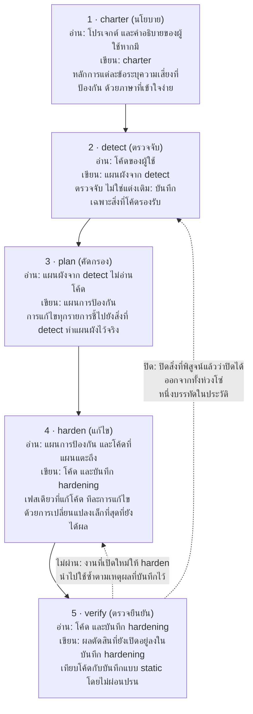
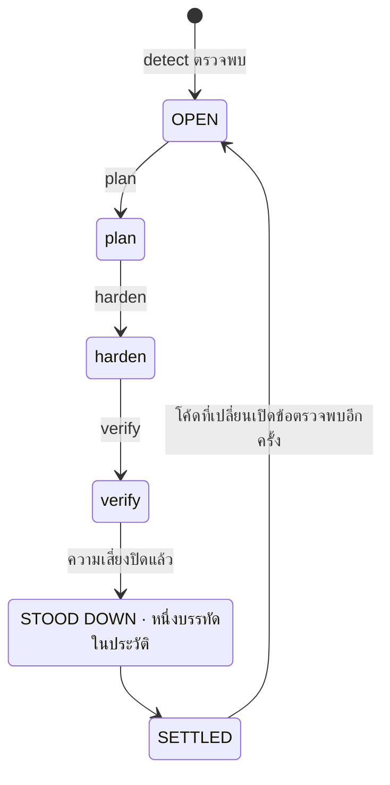
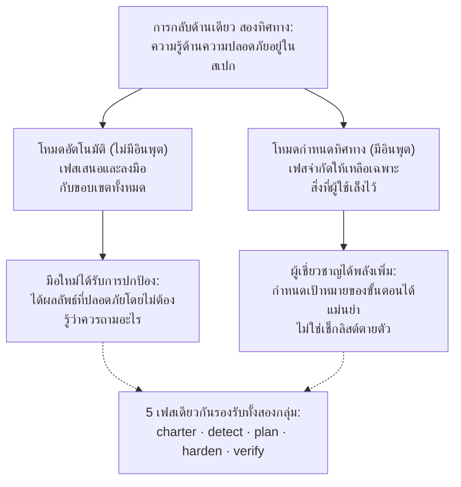
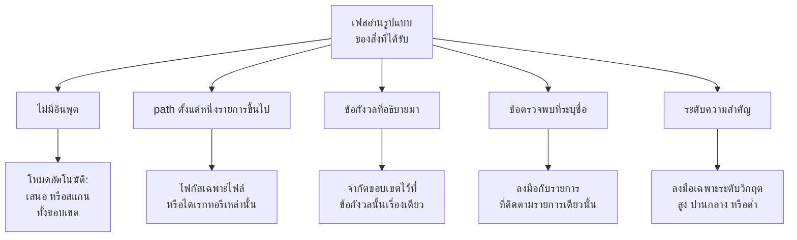
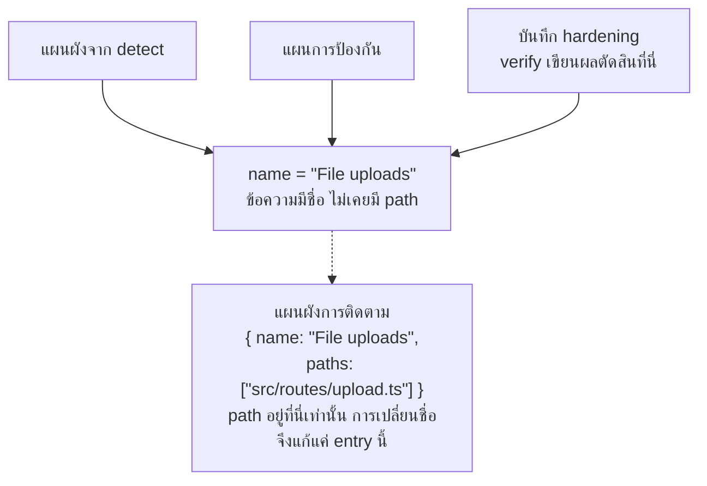
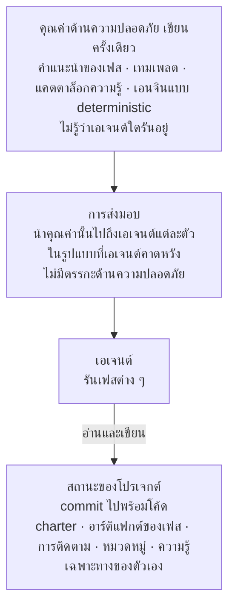
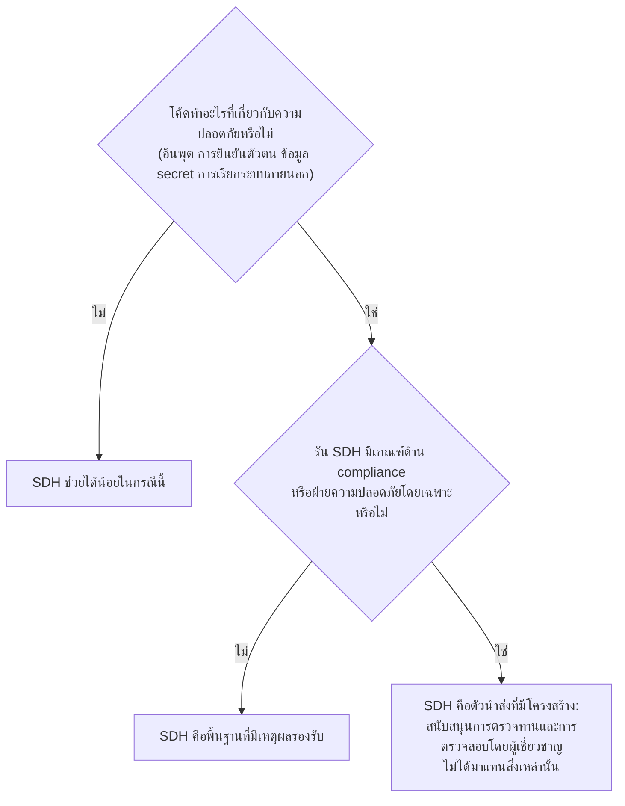

# Security-Driven Hardening (SDH): แนวปฏิบัติสำหรับยุคการพัฒนาที่มี AI ช่วย

- **Weslley Araújo**
- **เอกสารระเบียบวิธี ปี 2026**

---

## บทคัดย่อ

Security-Driven Hardening (SDH) คือระเบียบวิธีด้านความปลอดภัยที่มีโครงสร้างชัดเจน ขับเคลื่อนด้วย AI และเพื่อการป้องกันเท่านั้น สำหรับยุคที่เอเจนต์ AI และผู้ที่ไม่ใช่ผู้เชี่ยวชาญด้านความปลอดภัยเป็นผู้เขียนซอฟต์แวร์มากขึ้นเรื่อย ๆ แทนที่จะไล่ตามเช็กลิสต์ทั่วไป SDH ตรวจจับก่อนว่าระบบทำอะไรจริง (การล็อกอิน การอัปโหลดไฟล์ การชำระเงิน การเปิดเผยข้อมูล และอื่น ๆ) แล้วจึงขับเคลื่อนงานด้านความปลอดภัยที่เฉพาะกับบริบทนั้น SDH ยึดหลักการที่ปลอดภัยตั้งแต่ค่าเริ่มต้น วางกรอบทั้งหมดไว้ที่การป้องกัน และสื่อสารด้วยภาษาที่เข้าใจง่าย ผู้ใช้ทุกคนจึงลงมือทำตามได้

เอกสารนี้เสนอว่า SDH คือแนวปฏิบัติที่ยังขาดหายไป ไม่ใช่เครื่องมือเพียงตัวเดียว ความรู้ด้านความปลอดภัยอยู่ในระเบียบวิธีและความรู้เฉพาะทางที่โหลดเฉพาะเมื่อจำเป็น เป็นพื้นฐานที่ผู้ใช้ทุกคนต่อยอดได้ SDH จึงรองรับทั้งมือใหม่และผู้เชี่ยวชาญผ่านขั้นตอนเดียวกัน คุณสมบัติสองข้อทำให้ SDH ต่างจากแนวทาง spec-first ก่อนหน้า `[1]` ข้อแรก SDH **ไม่ขึ้นกับสถานะ** ของโปรเจกต์: ปรับใช้ได้กับไดเรกทอรีว่าง โปรเจกต์ที่กำลังพัฒนา pull request เดียว หรือโค้ดเบสเก่าขนาดใหญ่ ใน stack ใดก็ได้ ข้อสอง SDH **ปิดให้จบได้**: ความเสี่ยงที่ตรวจยืนยันแล้วว่าปิดแล้วจะปิดออกจากทั้งขั้นตอน ข้อตรวจพบนั้นจึงไปถึงสถานะสิ้นสุด และจะเปิดใหม่ก็ต่อเมื่อโค้ดเปลี่ยนเท่านั้น SDH ไม่ได้มาแทนผู้เชี่ยวชาญด้านความปลอดภัยหรือเครื่องมือ Blue Team เฉพาะทาง แต่ขยายความรู้ของนักพัฒนาเอง ยิ่งนักพัฒนาเข้าใจความปลอดภัยมากเท่าไร ก็ยิ่งกำหนดทิศทางของ SDH ได้มากเท่านั้น

**Lagune** คือต้นแบบอ้างอิง (reference implementation) ที่พิสูจน์ว่าระเบียบวิธีนี้สร้างได้จริงและย้ายไปใช้ที่อื่นได้ SDH เสนอตัวเป็นแนวปฏิบัติที่ผู้อื่นนำไปใช้ได้

> **คำสำคัญ**
>
> การพัฒนาที่มี AI ช่วย ความปลอดภัยของซอฟต์แวร์ ความปลอดภัยเชิงป้องกัน spec-driven development การเสริมความปลอดภัย (security hardening) เวิร์กโฟลว์ที่เอเจนต์ขับเคลื่อน การปิดให้จบได้ ความปลอดภัยที่เข้าใจบริบท ความรู้ที่โหลดเฉพาะเมื่อจำเป็น และเครื่องมือที่ไม่ผูกกับเอเจนต์

---

## I. บทนำ: ช่องว่างด้านความปลอดภัยที่การพัฒนาด้วย AI เปิดไว้

ซอฟต์แวร์ที่ปล่อยออกมาทุกวันนี้มาจากคนและเอเจนต์ AI ที่ดูไม่ออกอย่างน่าเชื่อถือว่ารูปแบบใดไม่ปลอดภัยมากขึ้นเรื่อย ๆ: secret ที่รั่วไหล การตรวจสอบสิทธิ์ที่ขาดหายไป หรือคิวรีที่เปิดช่องให้ injection ความเสี่ยงเหล่านี้ไม่ใช่เรื่องแปลกใหม่ แต่อยู่ในกลุ่มความเสี่ยงที่พบมากที่สุดในเหตุการณ์จริง และมีบันทึกไว้ในเอกสารอ้างอิงสาธารณะมาหลายปี `[6]`, `[7]` ขณะที่งานวิจัยล่าสุดรายงานว่าโค้ดที่ AI สร้างในสัดส่วนที่มีนัยสำคัญมีข้อบกพร่องแบบนี้ติดไปด้วย `[8]` ผู้ช่วยเขียนโค้ด AI ทำให้ปัญหานี้รุนแรงขึ้น เพราะเปิดให้คนที่ไม่ใช่นักพัฒนาปล่อยซอฟต์แวร์ใช้งานจริงได้ แต่ช่องว่างนี้กว้างกว่ากลุ่มผู้ใช้กลุ่มใดกลุ่มหนึ่ง โปรเจกต์ส่วนใหญ่ไม่เคยได้รับการตรวจด้านความปลอดภัยที่เจาะจงกับสิ่งที่โปรเจกต์ทำจริง ระบบนิเวศจึงเปราะบางขึ้นทุกครั้งที่มีการตัดสินใจ "ใช้ได้แล้ว ปล่อยเลย" ก่อนเวลาอันควร

คำแนะนำด้านความปลอดภัยแบบทั่วไปปิดช่องว่างนี้ไม่ได้ เช็กลิสต์ตายตัวไม่ได้เจาะจงกับสิ่งที่ระบบทำ จึงท่วมโปรเจกต์เล็ก ๆ ด้วยรายการที่ไม่เกี่ยวข้อง และยังพลาดความเสี่ยงที่สำคัญสำหรับโปรเจกต์นั้น ปัญหาไม่ได้อยู่ที่โลกขาดความรู้ด้านความปลอดภัย แต่อยู่ที่การจับคู่ความรู้ที่ถูกต้องกับระบบที่อยู่ตรงหน้าผู้ใช้จริง ๆ และต้องทำให้คนที่อาจไม่รู้ด้วยซ้ำว่าควรถามอะไร

SDH ตอบโจทย์นี้ด้วยการกลับด้านเพียงครั้งเดียว: **ความรู้ด้านความปลอดภัยอยู่ในสเปกและความรู้เฉพาะทางที่โหลดเฉพาะเมื่อจำเป็น เป็นพื้นฐานที่ผู้ใช้ทุกคนต่อยอดได้** ระเบียบวิธีนี้ตรวจจับบริบท คัดกรองความเสี่ยงที่บริบทนั้นมี และชี้นำการแก้ไข นักพัฒนาและผู้ที่ไม่ใช่นักพัฒนาจึงได้รับการดูแลผ่านขั้นตอนเดียวกัน ข้อตรวจพบและคำแนะนำใช้ภาษาที่เข้าใจง่าย ผู้อ่านทุกระดับความรู้ทางเทคนิคจึงลงมือทำตามได้ แนวทางนี้ไม่ได้จำกัดผู้เชี่ยวชาญ แต่ช่วยเพิ่มพลังให้ เป็นสองด้านที่เราอธิบายต่อใน `§VI`

> **ข้อคิดสำคัญ**
>
> **การกลับด้านที่เป็นแก่น**: ความรู้ด้านความปลอดภัยอยู่ในสเปกและความรู้เฉพาะทางที่โหลดเฉพาะเมื่อจำเป็น เป็นพื้นฐานที่ผู้ใช้ทุกคนต่อยอดได้ ระเบียบวิธีนี้เรียนรู้ว่าระบบทำอะไร แล้วจับคู่งานด้านความปลอดภัยให้ตรงกับสิ่งนั้น และขยายสิ่งที่ผู้ใช้รู้อยู่แล้ว

ลองนึกถึงนักพัฒนาที่บอกผู้ช่วย AI ว่า "แอปของฉันให้ผู้ใช้อัปโหลดรูปโปรไฟล์ได้" หากไม่มีการตรวจด้านความปลอดภัย ผู้ช่วยจะสร้างโค้ดที่ทำงานได้ แต่เชื่อทุกอย่างที่ไคลเอนต์ส่งมาอย่างเงียบ ๆ: ประเภทไฟล์ที่แจ้งมา ชื่อไฟล์ และขนาด ฟีเจอร์อัปโหลดออกสู่ผู้ใช้ แล้วไฟล์ที่ปลอมตัวเป็นรูปภาพก็อาจแฝงโค้ดมาได้ ชื่อไฟล์ที่จงใจสร้างขึ้นอาจหลุดออกนอก path ที่ใช้จัดเก็บ และไฟล์ขนาดใหญ่เกินไปอาจทำให้ทรัพยากรของเซิร์ฟเวอร์หมด ไม่มีปัญหาใดเลยที่มองเห็นได้ในการเดโม โค้ดจึงออกสู่ผู้ใช้ไปแบบนั้น

โค้ดเดียวกันเมื่อผ่าน SDH จะต่างออกไป SDH ตรวจพบว่าระบบรับไฟล์จากภายนอก (detect) คัดกรองสิ่งนั้นเป็นความเสี่ยงที่การอัปโหลดมี (triage) เสนอให้ตรวจประเภทและขนาดจริงของไฟล์ เปลี่ยนชื่อไฟล์ตอนบันทึก และจัดเก็บในที่ที่โค้ดรันไม่ได้ (remediate) จากนั้นอ่านผลลัพธ์และยืนยันว่ามาตรการควบคุมแต่ละรายการใช้ได้จริง (verify) นักพัฒนาไม่จำเป็นต้องรู้จักคำว่า "unrestricted file upload" เลย ระเบียบวิธีนี้เติมคำนั้นให้แทน

ผลงานของเอกสารนี้มีดังนี้:

- นิยามที่แม่นยำของ SDH ในฐานะระเบียบวิธีที่ไม่ขึ้นกับการนำไปสร้างแบบใดแบบหนึ่ง พร้อมหลักการออกแบบ (`§III`)
- วงจรการป้องกัน 5 เฟสที่การแบ่งหน้าที่คือผลงานในตัวเอง: การตรวจจับไม่แต่งเติม การวางแผนไม่อ่านโค้ด มีเพียงเฟสเดียวที่แก้โค้ด และการตรวจยืนยันไม่ผ่อนปรนการตัดสิน (`§IV`)
- **การปิดให้จบได้** ในฐานะจุดยืนเชิงระเบียบวิธี: ข้อตรวจพบแต่ละรายการมีสถานะสิ้นสุด ไม่ใช่วนไม่รู้จบ (`§V`)
- **ความเป็นสองด้านของการขยายความรู้นักพัฒนา** (dev-knowledge-extender duality): ขั้นตอนเดียวที่ปกป้องมือใหม่และเพิ่มพลังให้ผู้เชี่ยวชาญ (`§VI`)
- **ความรู้เฉพาะทางที่เรียกใช้โดยตรงไม่ได้และ prompt-on-demand**: ความรู้ด้านความปลอดภัยแบบเจาะจงที่เอเจนต์โหลดเมื่อบริบทของโปรเจกต์ต้องการ และไม่โหลดเป็นค่าเริ่มต้น (`§VII`)
- **ความไม่ขึ้นกับสถานะ** และ **การปรับตัวแบบไม่บังคับ**: SDH เข้ากับสถานะการพัฒนาใดก็ได้ และปรับตามสถานการณ์แทนการบังคับขอบเขตตายตัว (`§VIII`)
- **โหมดป้องกันล่วงหน้า**: การป้องกันชุดเดียวกันที่ทำงานขณะสร้างงานทั่วไป โค้ดจึงปลอดภัยตั้งแต่ค่าเริ่มต้นตั้งแต่แรก และเฟสต่าง ๆ มีสิ่งที่ต้องแก้น้อยลง (`§IX`)
- การเปรียบเทียบโดยเฉพาะกับ Spec-Driven Development สายวิวัฒนาการที่ SDH เติบโตมาแล้วแยกทางออกไป (`§X`)
- วินัยทางวิศวกรรมที่ทำให้ระเบียบวิธีอยู่รอดผ่านการ refactor และไม่ผูกกับเอเจนต์ใด: การติดตามด้วยอัตลักษณ์ตามชื่อ (`§XI`) และตัวนำส่งที่ไม่ผูกกับเอเจนต์ (`§XII`)

---

## II. ภูมิหลังและงานที่เกี่ยวข้อง

SDH ต่อยอดจากงานก่อนหน้า โดยรับโครงสร้างที่พิสูจน์แล้วมาจากการพัฒนาแบบ spec-first ที่เอเจนต์ขับเคลื่อน `[1]`, `[2]`, `[3]`: เทมเพลต คำสั่ง slash ที่เอเจนต์ใช้ เอกสารกำกับ และเอเจนต์ที่รันเฟสต่าง ๆ SDH นำโครงสร้างนั้นมาสร้างใหม่โดยมีเป้าหมายเพื่อการป้องกัน สายวิวัฒนาการนี้เป็นความตั้งใจ และหลักการทำงานข้อหนึ่งของ SDH ก็ระบุไว้ตรง ๆ: สร้างเวิร์กโฟลว์จากโครงสร้างที่พิสูจน์แล้ว จากนั้นวางกรอบให้เพื่อความปลอดภัย

SDH ไม่ใช่เช็กลิสต์ตายตัวที่รวมคำแนะนำทั่วไป เช็กลิสต์รู้เรื่องความปลอดภัยทั่วไปมาก แต่ไม่รู้อะไรเลยเกี่ยวกับโปรเจกต์ที่อยู่ตรงหน้า SDH กลับน้ำหนักนั้น โดยทุ่มแรงแรกไปที่การตรวจจับ คือการเรียนรู้ว่าระบบทำอะไร แล้วจึงหยิบความรู้ที่การตรวจจับนั้นทำให้เกี่ยวข้องขึ้นมาใช้

SDH ยังไม่ได้มาแทนคนทำงานด้านความปลอดภัยหรือเครื่องมือ Blue Team เฉพาะทาง แต่เป็นตัวขยายความรู้ของนักพัฒนา (`§VI`) ทีมที่มีฝ่ายความปลอดภัยโดยเฉพาะควรรักษาฝ่ายนั้นไว้ SDH มอบตัวนำส่งที่มีโครงสร้างให้ทีมนั้น และมอบพื้นฐานที่มีเหตุผลรองรับให้ทีมที่ไม่มี

SDH ยังอยู่เคียงข้างเครื่องมือสแกนความปลอดภัยแบบ deterministic (static analysis และ linter) `[4]`, `[5]` เครื่องมือเหล่านั้นมีคุณค่าก็เพราะเป็น deterministic และให้ผลซ้ำได้ SDH ส่วนใหญ่อาศัยการให้เหตุผลของเอเจนต์ ซึ่งแลกความเป็น deterministic อย่างเคร่งครัดกับความเข้าใจบริบท ระเบียบวิธีนี้ไม่แสร้งทำเป็นอย่างอื่น ในจุดที่ความเป็น deterministic สำคัญ SDH ฝังเอนจินแบบ deterministic ไว้ในการให้เหตุผล (`§VII`): เอเจนต์ตัดสินว่าอินพุตใดควรตรวจ และโปรแกรมแบบ deterministic ตัดสินว่าอินพุตนั้นอันตรายหรือไม่

งานก่อนหน้าที่ใกล้เคียงที่สุดคือ Spec-Driven Development (SDD) ตระกูลระเบียบวิธีแบบ spec-first ที่ขับเคลื่อนการสร้างไปข้างหน้าจากสเปกที่รันได้ เราถือว่า SDD เป็นกลุ่มหนึ่ง คำอธิบายที่ชัดเจนที่สุดในฐานะระเบียบวิธีสำหรับผู้ปฏิบัติงานคือรายงานของ Piskala `[1]` และชุดเครื่องมือที่เอเจนต์ขับเคลื่อนซึ่งเป็นที่รู้จักที่สุดคือ Spec Kit ของ GitHub `[2]` โดยมี OpenSpec `[3]` เป็นเครื่องมือที่สองจากตระกูลเดียวกัน ทั้งหมดนี้คือเอกสารอ้างอิงหลักสำหรับการเปรียบเทียบใน `§X`

---

## III. SDH: นิยามและหลักการออกแบบ

**Security-Driven Hardening** คือระเบียบวิธีด้านความปลอดภัยที่มีโครงสร้างและขับเคลื่อนด้วย AI ที่เปลี่ยนโค้ดเบสให้ปลอดภัยขึ้นด้วยการขับเคลื่อนงานจากสเปกที่เอเจนต์รัน แทนการแก้ไขแบบเฉพาะหน้า ชื่อนี้ได้แรงบันดาลใจจาก **Blue Teams** ฝ่ายผู้ป้องกันในวงการความปลอดภัย SDH มุ่งที่การป้องกัน การเสริมความปลอดภัย และการตรวจยืนยัน ไม่เคยเป็นการโจมตี

> **นิยาม**
>
> **Security-Driven Hardening (SDH)**: ระเบียบวิธีด้านความปลอดภัยที่มีโครงสร้าง ขับเคลื่อนด้วย AI และเพื่อการป้องกันเท่านั้น ที่ตรวจจับก่อนว่าระบบทำอะไรจริง แล้วจึงขับเคลื่อนงานด้านความปลอดภัยที่เฉพาะกับบริบทนั้น โดยยึดหลักการที่ปลอดภัยตั้งแต่ค่าเริ่มต้นและใช้ภาษาที่เข้าใจง่าย

SDH นิยามด้วยชุดหลักการที่มีผลผูกพัน แต่ละข้อเป็นกฎ และแต่ละข้อให้หลักประกันที่เจาะจงแก่ผู้ใช้

| หลักการ                                                                | กฎ                                                                                                                                                      | สิ่งที่ผู้ใช้ได้รับประกัน                                                                                                                              |
| ---------------------------------------------------------------------- | ------------------------------------------------------------------------------------------------------------------------------------------------------- | ------------------------------------------------------------------------------------------------------------------------------------------------------ |
| ปลอดภัยตั้งแต่ค่าเริ่มต้น ใช้ภาษาที่เข้าใจง่าย และเท่าเทียมสำหรับทุกคน | ค่าเริ่มต้น ข้อความ และการแก้ไขทุกอย่างปลอดภัยตั้งแต่แรกและเข้าใจได้สำหรับผู้อ่านทุกคน ไม่ว่าจะเป็นนักพัฒนาหรือไม่ ไม่มีผู้ใช้ระดับใดได้สิทธิพิเศษ      | มือใหม่ได้รับพื้นฐานที่ปลอดภัยโดยไม่ต้องร้องขอ และอ่านผลลัพธ์ได้ด้วยภาษาของตัวเอง                                                                      |
| เข้าใจบริบทดีกว่าใช้แบบทั่วไป                                          | ทุกเฟสเริ่มจากบริบทที่ตรวจพบในเฟส detect และลงมือกับสิ่งที่ระบบทำจริง                                                                                   | คำแนะนำเข้ากับโปรเจกต์ ไม่ใช่เข้ากับเช็กลิสต์ ความรู้ด้านความปลอดภัยอยู่ในสเปกและความรู้เฉพาะทางที่โหลดเฉพาะเมื่อจำเป็น และขยายสิ่งที่ผู้ใช้มีอยู่แล้ว |
| ยืดหยุ่นดีกว่าตายตัว                                                   | หลักการ ข้อกำหนด และคำแนะนำเป็นจุดเริ่มต้น ผู้ใช้เขียนใหม่ ตัดออก เพิ่ม หรือจำกัดขอบเขตของสิ่งใดก็ได้                                                   | ระเบียบวิธีปรับตามโปรเจกต์และผู้ใช้ และไม่เคยเข้มงวดเกินกว่าที่ผู้ใช้ต้องการ ความยืดหยุ่นไม่เคยลดทอนพื้นฐานที่ปลอดภัยตั้งแต่ค่าเริ่มต้น                |
| ปรับให้ตรงกับสภาพปัจจุบัน ไม่ใช่แค่ต่อท้าย                             | อาร์ติแฟกต์เป็นเอกสารที่มีชีวิต ไม่ใช่ log การรันแต่ละครั้งตรวจทุกรายการซ้ำ: เก็บสิ่งที่ยังจริง เขียนใหม่ในสิ่งที่เปลี่ยน และลบสิ่งที่ไม่เกี่ยวข้องแล้ว | บันทึกสะท้อนปัจจุบันเสมอ จึงไม่เสื่อมกลายเป็น backlog ที่ล้าสมัย                                                                                       |
| เพื่อการป้องกันเท่านั้น                                                | SDH ตรวจสอบ เสริมความปลอดภัย และตรวจยืนยัน ไม่เคยสร้างเครื่องมือโจมตี exploit เพื่อใช้ในทางร้าย หรือเทคนิคหลบเลี่ยงการตรวจจับเพื่อก่อความเสียหาย        | ไม่มีใครเปลี่ยนระเบียบวิธีนี้เป็นอาวุธได้ เนื้อหาที่ใช้ได้สองทางปรากฏเฉพาะในกรอบที่ชัดเจนว่าเพื่อการป้องกัน                                            |
| spec-first ขับเคลื่อนด้วยเอเจนต์ และวางกรอบเพื่อความปลอดภัย            | เวิร์กโฟลว์สร้างจากเทมเพลต คำสั่ง charter ที่กำกับทุกเฟส และเอเจนต์ที่รันเฟสต่าง ๆ                                                                      | โครงสร้างการพัฒนาที่พิสูจน์แล้ว นำมาปรับใช้ใหม่ให้เอเจนต์ทำงานด้านความปลอดภัยที่เป็นเนื้อหาจริง                                                        |

**ตารางที่ 1** หลักการออกแบบของ SDH และหลักประกันที่แต่ละข้อมอบให้ผู้ใช้

หลักการเหล่านี้ไม่ใช่เครื่องประดับ แต่เป็นข้อจำกัดที่ทุกเฟสด้านล่างต้องเคารพ และการอภิปรายใน `§XV` จะกลับมาที่หลักการเหล่านี้เพื่อระบุข้อจำกัดของระเบียบวิธี

ส่วนที่เหลือของเอกสารพัฒนาเสาหลัก 9 ข้อที่มีชื่อเรียก เป็นส่วนที่ผู้อ่านควรจดจำได้ และเป็นส่วนที่ทีมอื่นต้องสร้างขึ้นใหม่หากจะอ้างว่ากำลังทำ SDH

| เสาหลัก                                            | สิ่งที่มอบให้                                                                                                         | ส่วน        |
| -------------------------------------------------- | --------------------------------------------------------------------------------------------------------------------- | ----------- |
| การกลับด้านที่เข้าใจบริบท                          | ความรู้ด้านความปลอดภัยอยู่ในสเปกและความรู้เฉพาะทางที่โหลดเฉพาะเมื่อจำเป็น มือใหม่และผู้เชี่ยวชาญจึงใช้ขั้นตอนเดียวกัน | `§I`, `§VI` |
| วงจรการป้องกัน 5 เฟส                               | การแบ่งหน้าที่: นโยบาย ตรวจจับ คัดกรอง แก้ไข และตรวจยืนยัน แต่ละเฟสมีงานเดียว                                         | `§IV`       |
| การปิดให้จบได้                                     | ข้อตรวจพบมีสถานะสิ้นสุด ไม่ใช่วนไม่รู้จบ งานที่ปิดแล้วก็ปิดออกจากห่วงโซ่                                              | `§V`        |
| ความเป็นสองด้านของการขยายความรู้นักพัฒนา           | ขั้นตอนเดียวที่ปกป้องมือใหม่และเพิ่มพลังให้ผู้เชี่ยวชาญ โดยไม่แทนที่ใครเลย                                            | `§VI`       |
| prompt-on-demand และความรู้ที่เรียกใช้โดยตรงไม่ได้ | ความรู้ด้านความปลอดภัยที่เกี่ยวข้องโหลดตามสิ่งที่โปรเจกต์เป็น และไม่โหลดเป็นค่าเริ่มต้น                               | `§VII`      |
| ความไม่ขึ้นกับสถานะและการปรับตัวแบบไม่บังคับ       | เข้ากับสถานะการพัฒนาใดก็ได้ใน stack ใดก็ได้ และปรับตามสถานการณ์แทนการบังคับขอบเขต                                     | `§VIII`     |
| โหมดป้องกันล่วงหน้า                                | การป้องกันชุดเดียวกันทำงานขณะสร้างงานใหม่ โค้ดจึงปลอดภัยตั้งแต่ค่าเริ่มต้นทันทีที่เสร็จ                               | `§IX`       |
| การติดตามด้วยอัตลักษณ์ตามชื่อ                      | ข้อตรวจพบยังเป็นรายการเดียวตลอดทุกเฟส และการเปลี่ยนชื่อไฟล์ทำให้การเชื่อมโยงขาดในจุดเดียว                             | `§XI`       |
| ตัวนำส่งที่ไม่ผูกกับเอเจนต์                        | คุณค่าด้านความปลอดภัยเขียนขึ้นครั้งเดียวและไม่พึ่งพาเอเจนต์หรือ stack ใด                                              | `§XII`      |

**ตารางที่ 2** เสาหลัก 9 ข้อของ SDH และส่วนที่อธิบายแต่ละข้อ

---

## IV. ขั้นตอนแบบ Blue Team 5 เฟส

SDH จัดโครงสร้างงานเป็นวงจรการป้องกัน 5 เฟส (ภาพที่ 1) ทุกเฟสวางกรอบไว้ที่การป้องกัน แต่ละเฟสต่อยอดจากเฟสก่อนหน้า และลำดับเฟสเป็นไปตามกิจกรรมจริงของ Blue Team: กำหนดนโยบาย ตรวจจับ คัดกรอง แก้ไข และตรวจยืนยัน



**ภาพที่ 1** ขั้นตอน 5 เฟส: สิ่งที่แต่ละเฟสอ่าน สิ่งที่เขียน และกฎที่ห้ามละเมิดของเฟสนั้น เฟส verify ขับเคลื่อนเส้นทางย้อนกลับทั้งสอง: มาตรการควบคุมที่ไม่ผ่านจะเปิดงานใน harden อีกครั้ง และข้อตรวจพบที่พิสูจน์แล้วว่าปิดได้จะปิดออกจากห่วงโซ่ พร้อมหนึ่งบรรทัดในประวัติ

การแบ่งหน้าที่คือผลงานสำคัญ เพราะแต่ละเฟสมีงานเดียว ความล้มเหลวจึงจำกัดอยู่ในจุดเดียว และผู้อ่านเชื่อถือสิ่งที่อาร์ติแฟกต์แต่ละชิ้นระบุได้

> **ข้อคิดสำคัญ**
>
> **Applied ไม่ได้แปลว่าตรวจยืนยันแล้ว**: harden บันทึกว่าได้นำการแก้ไขไปใช้แล้ว verify ตรวจยืนยันด้วยการเทียบโค้ดกับบันทึกนั้น และไม่เคยผ่อนปรนผลตัดสินให้ตรงกับบันทึก มาตรการควบคุมอาจมีอยู่ในโค้ดแต่ยังปล่อยให้ความเสี่ยงเข้าถึงได้ และในกรณีนั้นผลตัดสินที่ตรงไปตรงมาคือ "ความเสี่ยงยังไม่ปิด"

### charter (นโยบาย)

charter กำหนดหลักการด้านความปลอดภัยของโปรเจกต์ คือกฎที่ทุกเฟสถัดไปต้องเคารพ charter เป็นชั้นที่กำกับทุกเฟส เปรียบได้กับการตรวจตอนคอมไพล์ (compile-time check) สำหรับสถานะความปลอดภัยโดยรวมของโปรเจกต์ หลักการแต่ละข้อมีชื่อที่ชัดเจน มีกฎที่ต่อรองไม่ได้และตรวจกับโค้ดได้ และมีบรรทัด `Why:` ที่บอกความเสี่ยงที่หลักการนั้นป้องกัน ไม่ใช่แค่วิธีแก้ charter อ่านตัวโปรเจกต์เสมอ (manifest โครงสร้าง และ dependency) ส่วนคำอธิบายของผู้ใช้ (ถ้ามี) คือทิศทางที่การอ่านจะขยายต่อให้กว้างกว่าสิ่งที่ผู้ใช้ระบุ เมื่อไม่มีคำอธิบาย โปรเจกต์คือแหล่งข้อมูลเดียว ทั้งสองส่วนเสริมกันแทนที่จะแข่งกัน และ charter บันทึกนโยบายที่โปรเจกต์ควรยึดถือ ไม่ใช่สถานะของโค้ด ผู้ที่ไม่ใช่นักพัฒนาควรอ่านแล้วเข้าใจทั้งกฎและความเสี่ยง

### detect (ตรวจจับ)

detect อ่านโค้ดและทำแผนผังสิ่งที่ระบบทำจริงที่มีน้ำหนักด้านความปลอดภัย คำสั่งหลักคือ "ตรวจจับ ไม่ใช่แต่งเติม": บันทึกเฉพาะสิ่งที่โค้ดรองรับ พร้อมหลักฐานที่เฟสถัดไปต้องใช้ detect เป็นกลาง ไม่บังคับให้ข้อตรวจพบเข้ากับ charter เพราะการจับคู่ความเสี่ยงกับกฎของ charter เป็นงานของเฟส plan ข้อตรวจพบแต่ละรายการมี 3 ส่วน: คืออะไร (คำอธิบายด้วยภาษาที่เข้าใจง่าย) ทำไมจึงสำคัญ (ความเสี่ยง ไม่ใช่แค่ข้อเท็จจริง) และหลักฐาน (ฟังก์ชันหรือ route ที่ข้อตรวจพบอยู่) หลักฐานไม่มี path ของไฟล์ เพราะ path อยู่เฉพาะในแผนผังการติดตาม (`§XI`) ข้อความจึงไม่มี path ที่อาจล้าสมัย

### plan (คัดกรอง)

plan เปลี่ยนข้อตรวจพบแต่ละรายการเป็นการแก้ไข โดยตั้งชื่อตามประเภทความเสี่ยง (อ้างอิงมาตรฐานที่ยอมรับกัน คือ CWE และ OWASP ในจุดที่เป็นฐานรองรับ) และผูกกับหลักการใน charter ที่การแก้ไขนั้นยึดถือ ลำดับความสำคัญ (วิกฤต สูง ปานกลาง และต่ำ) ไม่ใช่การเลือกตามใจ: plan ให้คะแนนข้อตรวจพบแต่ละรายการด้วยวิธี Base-and-Environmental ของ CVSS v4.0 ระดับจึงเป็นคะแนนในรูปคำพูดธรรมดา พร้อมเหตุผลหนึ่งบรรทัดด้วยภาษาเข้าใจง่ายถึงโอกาสที่ถูกโจมตีและสิ่งที่อาจเสียหาย และการรันสองครั้งได้ลำดับเดียวกัน vector คือหลักยึดที่แม่นยำสำหรับผู้เชี่ยวชาญ ส่วนระดับและเหตุผลประกอบคือการให้คะแนนเดียวกันที่ใครก็ติดตามได้ plan ทำงานจากแผนผังจาก detect เท่านั้นและไม่อ่านโค้ด นี่คือข้อจำกัดที่ตั้งใจ ไม่ใช่ข้อด้อย: ข้อจำกัดนี้บังคับให้การแก้ไขทุกรายการชี้ไปยังสิ่งที่ detect ตรวจพบจริง หากขอบเขตใดไม่เคยมีแผนผัง plan จะหยุดและพาผู้ใช้กลับไปที่ detect แทนการเดา

### harden (แก้ไข)

harden เป็นเฟสเดียวที่แก้โค้ด จึงทำงานอย่างระมัดระวัง การแก้ไขแต่ละครั้งต้องได้รับอนุมัติจากผู้ใช้หรือไม่ ขึ้นอยู่กับเอเจนต์และโหมดสิทธิ์ที่เอเจนต์รันอยู่ harden จึงไม่เพิ่มขั้นยืนยันของตัวเอง harden นำการแก้ไขไปใช้ทีละรายการ เริ่มจากการแก้ไขที่รายการอื่นพึ่งพาก่อน แล้วจึงไล่ตามลำดับความสำคัญสูงสุด การเปลี่ยนแปลงแต่ละครั้งจึงเล็ก ตรวจทานง่าย และย้อนกลับได้ง่าย harden ไม่ลดทอนมาตรการควบคุมที่มีอยู่เพื่อให้การแก้ไขใหม่เข้ากันได้ และไม่ละเมิดหลักการใน charter หากการแก้ไขใดจะขัดกับหลักการ harden จะหยุดและแจ้งความขัดแย้งนั้นแทนการนำไปใช้ แต่ละบล็อกบันทึกเป็น Applied, Partial หรือ Blocked "Applied ยังไม่ได้แปลว่าตรวจยืนยันแล้ว" และนั่นคือเรื่องที่เฟสถัดไปจัดการ

### verify (ตรวจยืนยัน)

verify ตรวจยืนยันมาตรการควบคุมแต่ละรายการที่นำไปใช้แล้ว ด้วยการอ่านโค้ดแล้วเทียบกับสิ่งที่ harden บันทึกไว้ การตรวจยืนยันก็คือการเทียบโค้ดกับบันทึกนั้น และเป็นแบบ static: ยืนยันว่ามาตรการควบคุมมีอยู่และถูกต้องในโค้ด ไม่ได้ยืนยันว่าจะต้านการโจมตีได้บนระบบที่กำลังรัน การตรวจขณะรัน (runtime) แบบที่ยิงการโจมตีจริงหรือจำลองใส่ระบบที่ใช้งานอยู่ อยู่นอกขอบเขตโดยการออกแบบ verify ให้ผลตัดสินหนึ่งในสามแบบ: ความเสี่ยงปิดแล้ว ความเสี่ยงยังไม่ปิด หรือบอกไม่ได้จากโค้ด verify ไม่สร้างอาร์ติแฟกต์ของตัวเอง: harden และ verify ใช้บันทึก hardening ร่วมกัน โดย harden เป็นเจ้าของสิ่งที่ทำไป และ verify เป็นเจ้าของผลตัดสินและเหตุผล ทั้งสองไม่เคยเขียนลงในฟิลด์ของอีกฝ่าย มาตรการควบคุมที่ไม่ผ่านคืองานที่เปิดใหม่ให้ harden ซึ่งในการรันครั้งถัดไปจะถือว่าผลตัดสินนั้นอยู่เหนือการอ่านโค้ดของตัวเอง และนำการแก้ไขไปใช้ซ้ำตรงจุดบกพร่องที่เหตุผลระบุไว้พอดี verify เชื่อโค้ดมากกว่าบันทึก เพราะบันทึกอาจอ้างเกินกว่าที่โค้ดทำได้จริง verify อ่านโค้ดของผู้ใช้อย่างเดียว และไม่เคยผ่อนปรนผลตัดสินให้ตรงกับบันทึก มาตรการควบคุมอาจมีอยู่แต่ความเสี่ยงยังเข้าถึงได้ทางอื่น และในกรณีนั้นผลตัดสินที่ตรงไปตรงมาคือ "ความเสี่ยงยังไม่ปิด" หากระหว่างอ่าน verify สังเกตเห็นปัญหาด้านความปลอดภัยที่แผนผังจาก detect ไม่เคยครอบคลุม verify จะไม่แต่งผลตัดสินขึ้นมาเอง เพราะการตรวจจับเป็นงานของ detect: verify แจ้งปัญหาและพาผู้ใช้กลับไปที่ detect ข้อตรวจพบจึงเข้ามาผ่านขั้นตอนเดียวกันแทนการข้ามไป

> **ตัวอย่างต่อเนื่อง: การอัปโหลดไฟล์** ข้อตรวจพบเดียวแสดงแกนหลักของขั้นตอนตั้งแต่ต้นจนจบ
>
> - **detect** พบข้อตรวจพบนี้: ระบบรับไฟล์จากผู้ใช้ และ handler การอัปโหลดเชื่อ MIME type ที่ไคลเอนต์ส่งมาโดยไม่ตรวจประเภทจริงของไฟล์ _ทำไมจึงสำคัญ_: ไฟล์ที่ปลอมตัวเป็นรูปภาพอาจซ่อนโค้ดอันตรายไว้
> - **plan** กำหนดการแก้ไข ลำดับความสำคัญ **วิกฤต** โดยยึดหลักการ "อินพุตทุกอย่างไม่น่าเชื่อถือจนกว่าจะผ่านการตรวจสอบ": ตรวจประเภทและขนาดจริงของไฟล์ เปลี่ยนชื่อตอนบันทึก และจัดเก็บไฟล์อัปโหลดในที่ที่รันเป็นโค้ดไม่ได้
> - **harden** นำไปใช้ สถานะ **Applied**: ตอนนี้ handler ตรวจประเภทจริงจากเนื้อหาไฟล์ บังคับจำกัดขนาด ปฏิเสธสิ่งที่ไม่คาดคิด เปลี่ยนชื่อตอนบันทึก และจัดเก็บในที่ที่โค้ดรันไม่ได้
> - **verify** อ่าน handler เทียบกับบันทึก และให้ผล **ความเสี่ยงปิดแล้ว**: โค้ดทำตรงตามที่บันทึกอ้างทุกประการ
>
> ชื่อข้อตรวจพบเดียวกันส่งต่อผ่านแผนผังจาก detect แผนการป้องกัน และบันทึก hardening และ verify ลงมือกับบันทึกนั้นภายใต้ชื่อเดียวกัน: ผลตัดสินที่ยังเปิดอยู่เขียนลงในบล็อกของข้อตรวจพบ และ verify ปิดข้อตรวจพบที่พิสูจน์แล้วว่าปิดได้ออกจากห่วงโซ่ (`§V`) ชื่อร่วมนั้นคืออัตลักษณ์ของข้อตรวจพบ (`§XI`)

---

## V. การปิดให้จบได้: ข้อตรวจพบมีสถานะสิ้นสุด

เครื่องมือด้านความปลอดภัยส่วนใหญ่ทิ้งผู้ใช้ไว้กับ backlog ที่มีแต่จะยาวขึ้น SDH ยืนอีกจุดหนึ่ง: **ข้อตรวจพบปิดให้จบได้ จึงมีสถานะสิ้นสุดแทนการค้างอยู่ใน backlog ไม่รู้จบ** (ภาพที่ 2) จุดยืนนี้มาจากหลักการปรับให้ตรงกับสภาพปัจจุบันโดยตรง

> **นิยาม**
>
> **การปิดให้จบได้**: ความเสี่ยงที่ตรวจยืนยันแล้วว่าปิดแล้วจะปิดออกจากทั้งขั้นตอน ข้อตรวจพบนั้นจึงไปถึงสถานะสิ้นสุด และจะเปิดใหม่ก็ต่อเมื่อโค้ดเปลี่ยนเท่านั้น ข้อตรวจพบมีจุดสิ้นสุด แม้โปรแกรมด้านความปลอดภัยโดยรวมจะดำเนินต่อเนื่อง

อาร์ติแฟกต์ของ SDH เป็นเอกสารที่มีชีวิต ไม่ใช่ log ทุกครั้งที่เฟสรันซ้ำ เฟสนั้นจะตรวจรายการเดิมแต่ละรายการกับสภาพปัจจุบันแล้วทำอย่างใดอย่างหนึ่งในสามอย่าง: เก็บสิ่งที่ยังจริง เขียนใหม่ในสิ่งที่เปลี่ยน หรือลบสิ่งที่ไม่เกี่ยวข้องแล้ว ข้อตรวจพบที่โค้ดแสดงว่าแก้แล้วก็แค่ลบออก บันทึกการทำงานสะท้อนปัจจุบัน ไม่ใช่อดีต

การปิดคือการปรับให้ตรงกับสภาพปัจจุบันแบบเดียวกันที่ไปถึงข้อสรุป เมื่อ verify ยืนยันว่าความเสี่ยงปิดแล้ว ก็จะปิดข้อตรวจพบนั้นออกจากทั้งขั้นตอน ได้แก่ แผนผังจาก detect แผนการป้องกัน บันทึก hardening และแผนผังการติดตาม นี่คือเหตุผลที่ verify เป็นเฟสเดียวที่เขียนลงในอาร์ติแฟกต์ของเฟสอื่น: verify คือเฟสที่ปิดวงจร เมื่อข้อตรวจพบออกจากห่วงโซ่ การปิดจะกลั่นกรองข้อตรวจพบเป็นรายการสั้น ๆ ในบันทึกประวัติที่อยู่นอกห่วงโซ่การทำงานและไม่มีการประมวลผลซ้ำ นี่คือเส้นแบ่งระหว่างการหายไปกับการปิด: ข้อตรวจพบที่การปรับให้ตรงกับสภาพปัจจุบันลบออกเพราะไม่จริงอีกต่อไปจะไม่ทิ้งอะไรไว้ ขณะที่ข้อตรวจพบที่พิสูจน์แล้วว่าปิดได้จะได้หนึ่งบรรทัดในประวัติ ข้อตรวจพบที่ปิดออกแล้วจะไม่ปรากฏในอาร์ติแฟกต์การทำงานใดอีก และการไม่ปรากฏนั้นเป็นสิ่งที่คาดไว้ ไม่ใช่ห่วงโซ่ที่ขาด



**ภาพที่ 2** state machine ของการปิดให้จบได้ ข้อตรวจพบเคลื่อนจาก OPEN → STOOD DOWN → SETTLED และเปิดใหม่ก็ต่อเมื่อโค้ดเปลี่ยนเท่านั้น

เมื่อทุกอย่างในขอบเขตปิดออกหมดแล้ว รอบการทำงานจึงสิ้นสุดลง และสถานะสิ้นสุดนั้นมีรูปแบบที่จับต้องได้: อาร์ติแฟกต์ที่ข้อตรวจพบสุดท้ายปิดแล้วจะลบออกทั้งไฟล์ ห่วงโซ่ที่ปิดครบจึงเหลือเพียง charter กับประวัติ คือนโยบายและการพิสูจน์ รอบการทำงานจะเปิดใหม่ก็ต่อเมื่อโค้ดเปลี่ยนเท่านั้น ระเบียบวิธีนี้ให้จุดจบที่ชัดเจนแก่ข้อตรวจพบแต่ละรายการ ซึ่งเป็นสิ่งที่ backlog ไม่รู้จบให้ไม่ได้

---

## VI. ความเป็นสองด้านของการขยายความรู้นักพัฒนา

SDH ไม่ได้มาแทนคน และไม่ได้มาแทนเครื่องมือ Blue Team เฉพาะทาง SDH **ขยายความรู้ของนักพัฒนาเอง** ยิ่งนักพัฒนาเข้าใจความปลอดภัยมากเท่าไร ก็ยิ่งกำหนดทิศทางของขั้นตอนได้แม่นยำและมีอิสระมากขึ้นเท่านั้น นักพัฒนาที่เข้าใจน้อยก็ยังได้ผลลัพธ์ที่ปลอดภัย เพราะโหมดอัตโนมัติคอยปกป้อง

การกลับด้านจาก `§I` ที่ว่าความรู้ด้านความปลอดภัยอยู่ในสเปก ใช้ได้ทั้งสองทิศทาง สำหรับมือใหม่ นี่คือการปกป้อง: ไม่จำเป็นต้องรู้ว่าควรถามอะไร เพราะสเปกเสนอให้เอง สำหรับผู้เชี่ยวชาญ นี่คือการเพิ่มพลัง: สเปกเดียวกันช่วยให้กำหนดเป้าหมายของขั้นตอนได้อย่างแม่นยำแทนการทำงานฝืนเช็กลิสต์ตายตัว

ทุกเฟสมีความเป็นสองด้านนี้อยู่ในการทำงานของตัวเอง (ภาพที่ 3) เมื่อรันโดยไม่มีอินพุต เฟสจะลงมือกับขอบเขตทั้งหมดแทนผู้ใช้ เมื่อได้รับทิศทาง เฟสเดียวกันจะจำกัดตัวเองให้เหลือเฉพาะสิ่งที่ผู้ใช้เล็งไว้



**ภาพที่ 3** ความเป็นสองด้านของการขยายความรู้นักพัฒนา การกลับด้านเดียวรองรับผู้ใช้สองกลุ่ม: โหมดอัตโนมัติปกป้องมือใหม่ และโหมดกำหนดทิศทางเพิ่มพลังให้ผู้เชี่ยวชาญ ผ่าน 5 เฟสเดียวกัน

ความรู้เฉพาะทางที่โหลดเฉพาะเมื่อจำเป็น (`§VII`) ระบุความเป็นสองด้านนี้ไว้ชัดในเนื้อหาของตัวเอง แต่ละชิ้นบอกเอเจนต์ว่าความรู้ในนั้น "ขยายวิจารณญาณของคุณ" และให้ใช้เหตุผลต่อไปเกินกว่าที่ความรู้เฉพาะทางนั้นให้ไว้ ความรู้นี้เป็นพื้น ไม่ใช่เพดาน นี่คือสิ่งที่รองรับผู้ใช้ทั้งสองกลุ่มตามความสมดุลที่เอกสารนี้ตั้งใจ: ชุมชนนักพัฒนาได้เครื่องมือที่มีน้ำหนัก และผู้ปฏิบัติงาน Blue Team ได้ตัวนำส่งที่มีโครงสร้างที่ไม่แสร้งว่าทำงานแทนพวกเขาได้

---

## VII. ความรู้เฉพาะทางที่เรียกใช้โดยตรงไม่ได้และ prompt-on-demand

นี่คือรูปแบบที่ใหม่ที่สุดของระเบียบวิธีนี้ SDH เก็บความรู้ด้านความปลอดภัยแบบเจาะจงไว้เป็นความรู้เฉพาะทางที่โหลด **เฉพาะเมื่อจำเป็น** และเอเจนต์เป็นผู้ตัดสินเองว่าจะโหลดชิ้นใดด้วยการจับคู่กับบริบทของโปรเจกต์ เราเรียกสิ่งนี้ว่า **prompt-on-demand**: วิธีที่เอเจนต์เลือกว่าจะเปิดใช้ความรู้ใดตามขอบเขตของโปรเจกต์ที่อยู่ แทนการรันทุกการตรวจเป็นค่าเริ่มต้น ความรู้เฉพาะทางพัฒนาไปเรื่อย ๆ และชิ้นใดก็เปลี่ยนหรือมีชิ้นอื่นมาแทนได้ทุกเมื่อ ผลงานคือรูปแบบ ไม่ใช่ตัวความรู้เฉพาะทาง

> **นิยาม**
>
> **Prompt-on-demand**: เอเจนต์เลือกความรู้ด้านความปลอดภัยที่จะเปิดใช้โดยจับคู่กับขอบเขตของโปรเจกต์ตรงหน้า เอเจนต์จึงดึงความรู้ที่เกี่ยวข้องเข้ามาตามสิ่งที่โปรเจกต์เป็นจริง แทนการรันทุกการตรวจเป็นค่าเริ่มต้น

> **นิยาม**
>
> **ความรู้เฉพาะทางที่เรียกใช้โดยตรงไม่ได้**: หน่วยความรู้ด้านความปลอดภัยแบบเจาะจงที่ไม่ผูกกับภาษาโปรแกรม สำหรับบริบทเดียว เช่น การอัปโหลดไฟล์หรือโค้ดที่รันในเบราว์เซอร์ ความรู้นี้ตรวจสอบและอธิบาย ไม่เคยเขียนโค้ดใหม่ และไม่เคยสร้างอินพุตสำหรับโจมตี ความรู้นี้ไม่ใช่คำสั่ง: จะโหลดเมื่อบริบทที่ครอบคลุมอยู่ในขอบเขต หรือเมื่อ prompt ขอโดยระบุชื่อ

ความรู้เฉพาะทางแต่ละชิ้นระบุรูปแบบที่ปลอดภัยกว่าสำหรับความเสี่ยงที่ครอบคลุม และบอกเอเจนต์ว่าควรจัดการข้อตรวจพบอย่างไรในแต่ละเฟสที่ใช้ความรู้นั้น: ตัดสินอย่างไรตอนตรวจจับ นำการแก้ไขไปใช้อย่างปลอดภัยอย่างไรตอนแก้ไข และพิสูจน์อย่างไรตอนตรวจยืนยัน

ลักษณะเด่นคือความรู้เฉพาะทาง **เรียกใช้โดยตรงไม่ได้**: ไม่ใช่คำสั่ง และภายในขั้นตอน การจับคู่คือสิ่งที่ทำให้โหลด เฟสตรวจจับแสดงรายการแคตตาล็อกครั้งเดียว จับคู่บริบทของโปรเจกต์กับสิ่งที่แต่ละรายการครอบคลุม และโหลดเฉพาะความรู้เฉพาะทางที่บริบทปรากฏอยู่ในขอบเขต เฟสถัดไปใช้รายการที่จับคู่แล้วซ้ำแทนการแสดงรายการใหม่ การจับคู่ครั้งเดียวจึงใช้ได้ทั้งห่วงโซ่ และโหมดป้องกันล่วงหน้า (`§IX`) ก็จับคู่แบบเดียวกันกับงานที่กำลังจะสร้าง เอเจนต์ข้ามความรู้เฉพาะทางที่บริบทไม่ปรากฏ และการข้ามต้องตรวจสอบย้อนได้เท่ากับการโหลด: ทุกรายการในแคตตาล็อกได้รับผลตัดสินที่ชัดเจน คือนำไปใช้ หรือข้ามพร้อมเหตุผลที่อ่านได้จากโค้ด ความรู้สึกลาง ๆ ว่าไม่เกี่ยวจึงไม่มีวันใช้แทนการไม่มีอยู่จริงได้ การไม่พบรายการที่ใช้ได้เลยก็เป็นผลลัพธ์ที่ถูกต้อง

แคตตาล็อกคือข้อมูล และการเติบโตคือไฟล์ความรู้หนึ่งไฟล์บวกแถวแคตตาล็อกหนึ่งแถว ไม่ใช่คำสั่งใหม่ ความรู้เฉพาะทางในตัวจัดกลุ่มเป็นหมวดหมู่ เช่น OWASP ภาษาโปรแกรม หรือการผสานรวม AI และแคตตาล็อกที่โปรเจกต์ใช้ประกอบด้วยความรู้ในตัวของหมวดหมู่ที่เลือก บวกความรู้เฉพาะทางของโปรเจกต์เอง โปรเจกต์บันทึกตัวเลือกนั้นไว้กับสถานะส่วนอื่น ทั้งทีมจึงจับคู่กับแคตตาล็อกเดียวกัน นี่คือหลักการเข้าใจบริบทแบบเดียวกับเฟสต่าง ๆ ที่นำมาใช้กับความรู้: เอเจนต์ดึงความรู้ที่เกี่ยวข้องเข้ามาตามสิ่งที่โปรเจกต์เป็นจริง แทนการรันทุกการตรวจเป็นค่าเริ่มต้น คุณสมบัติเดียวกันนี้ทำให้ผู้ใช้ขยายแคตตาล็อกได้ด้วย ไม่ใช่เฉพาะผู้ดูแล (maintainer): แหล่งความรู้หรือหัวข้อด้านความปลอดภัยที่ผู้ใช้ให้มาจะกลั่นกรองออกมาเป็นความรู้เฉพาะทางใหม่ของโปรเจกต์ เข้าร่วมแคตตาล็อกไม่ว่าจะเลือกหมวดหมู่ใด และโหลดเหมือนความรู้ในตัวทุกประการ โดยแทนที่ความรู้ในตัวที่ใช้ชื่อเดียวกัน การเขียนความรู้เฉพาะทางเองก็เพื่อการป้องกันเท่านั้น และเคารพขอบเขตเดียวกับที่ความรู้เฉพาะทางบังคับใช้: บทความอธิบายการโจมตีอาจเป็นแหล่งข้อมูลได้ แต่ความรู้เฉพาะทางที่ได้ออกมาจะตรวจสอบและอธิบายเท่านั้น ไม่เคยให้ exploit ที่ใช้งานได้จริง การกลับด้านใน `§I` ที่ว่าความฉลาดอยู่ในสเปก จึงขยายไปถึงตัวแคตตาล็อกเอง ซึ่งผู้ใช้เพิ่มความลึกให้เข้ากับบริบทของตัวเองได้โดยไม่ต้องเขียนโค้ด

ตัวอย่างสั้น ๆ ของ prompt-on-demand: detect อ่านโฟลเดอร์โค้ดที่รันในเบราว์เซอร์ จับคู่บริบทนั้นในแคตตาล็อก โหลดความรู้เฉพาะทางที่ครอบคลุม และแสดงข้อตรวจพบฝั่งไคลเอนต์ผ่านขั้นตอนปกติของ detect ความรู้เฉพาะทางที่บริบทไม่ปรากฏในขอบเขตนี้ไม่ตรงกัน จึงไม่โหลดเลย และ detect บันทึกแต่ละชิ้นว่าข้าม โปรเจกต์เป็นตัวกำหนดว่าความรู้ใดเกี่ยวข้อง ไม่ใช่การตั้งค่าตายตัว

ความเป็น deterministic ปรากฏตรงจุดที่สำคัญพอดี ความรู้เฉพาะทางมีตัวตรวจ (checker) แบบ deterministic มาด้วยได้ ไม่ใช่แค่ข้อความ: ในจุดที่ประเภทความเสี่ยงมีขั้นตอนการตัดสินที่ชัดเจน โปรแกรมเล็ก ๆ จะคืนผลตัดสินตายตัวสำหรับอินพุตหนึ่ง ๆ เช่น คำสั้น ๆ อย่าง `safe`, `unsafe` หรือ `invalid input` ความเสี่ยงบางประเภทตัดสินได้แบบ deterministic ในลักษณะนี้พอดี โดยมีงานก่อนหน้าจำนวนมากรองรับขั้นตอนการตัดสิน `[9]`, `[10]`, `[11]` ตัวตรวจจะให้คะแนนตัวเลือกที่เอเจนต์ส่งมา หรือสแกนขอบเขตเพื่อหาตัวเลือกเอง และไม่ว่าแบบใด ตัวตรวจเป็นผู้คืนผลตัดสิน ไม่ใช่เอเจนต์ ความรู้เฉพาะทางที่ใช้ได้กว้างพอจะทำเครื่องหมายว่าจำเป็น (required) ในแคตตาล็อกได้ และจะนำไปใช้เสมอ โดยรันตัวตรวจทั่วทั้งขอบเขต นี่คือกรณีเดียวที่ความรู้โหลดโดยไม่ต้องจับคู่บริบท และประกาศไว้ในข้อมูลของแคตตาล็อก ไม่เคยให้เอเจนต์ตัดสินเอาเองในขณะนั้น นี่คือจุดที่ SDH ยึดการให้เหตุผลของเอเจนต์ไว้กับสิ่งที่ทำซ้ำได้ โดยไม่แสร้งว่าทั้งขั้นตอนเป็น deterministic

สุดท้าย ความรู้เฉพาะทาง **แยกใช้งานได้** เพราะความรู้ยืนได้ด้วยตัวเอง ผู้ใช้จึงรันชิ้นใดชิ้นหนึ่งได้โดยตรงใน prompt ที่ไม่เกี่ยวกับขั้นตอน SDH ทั้งหมด และคงความปลอดภัยไว้ควบคู่กับการพัฒนาทั่วไป ตัวอย่างเช่น ความรู้เฉพาะทางที่มีตัวตรวจแบบ deterministic สามารถคัดกรองตัวเลือกแต่ละตัวที่เกิดขึ้นระหว่างเขียนโค้ดทั่วไป แล้วเก็บไว้เฉพาะตัวที่ปลอดภัย การแยกใช้งานได้นี้เป็นส่วนหนึ่งที่ทำให้ SDH ปรับเข้ากับสถานการณ์ได้มากมาย ซึ่งเป็นหัวข้อของ `§VIII` และรูปแบบที่สมบูรณ์ที่สุดคือโหมดป้องกันล่วงหน้า (`§IX`) ที่ความรู้ชุดเดียวกันปกป้องการพัฒนาทั่วไปตั้งแต่ต้นจนจบ

---

## VIII. ความไม่ขึ้นกับสถานะและการปรับตัวแบบไม่บังคับ

มีคุณสมบัติสองข้อที่แยก SDH ออกจากระเบียบวิธีด้านสเปกที่ตายตัว

### ความไม่ขึ้นกับสถานะ

> **นิยาม**
>
> **ความไม่ขึ้นกับสถานะ** (state-independence): ระเบียบวิธีนี้ไม่ขึ้นกับสถานะการพัฒนา ใช้ได้กับไดเรกทอรีว่าง โปรเจกต์ที่กำลังพัฒนา pull request เดียว หรือโค้ดเบสเก่าขนาดใหญ่ ใน stack ใดก็ได้ เพราะ SDH เรียนรู้จุดเริ่มต้นจากการอ่านสิ่งที่มีอยู่

ทุกเฟสทำงานแบบเดียวกันไม่ว่าโปรเจกต์จะใหม่เอี่ยมหรือมีอยู่แล้ว charter อนุมานหลักการจากโค้ดเท่าที่มี detect ทำแผนผังโค้ดเท่าที่มี แม้จะมีน้อยมาก ไม่มีการสมมติจุดเริ่มต้นไว้ก่อน

### การปรับตัวแบบไม่บังคับ

> **นิยาม**
>
> **การปรับตัวแบบไม่บังคับ** (non-authoritative adaptivity): ระเบียบวิธีปรับตามสถานการณ์แทนการบังคับขอบเขตตายตัวให้ผู้ใช้ทำตาม เมื่อผู้ใช้ไม่รู้ว่าจะพูดอะไร SDH จะอ่านสภาพแวดล้อมที่ผู้ใช้เรียกใช้อยู่ สร้างบริบท และถามคำถามที่กำหนดว่าจะทำอะไรต่อ

โหมดเสนอของ charter คือกรณีที่ชัดที่สุด: SDH สร้าง charter ที่ปลอดภัยตั้งแต่ค่าเริ่มต้นด้วยการวิเคราะห์โปรเจกต์ ถามผู้ใช้เฉพาะเมื่อช่องว่างนั้นเปลี่ยนผลลัพธ์จริง จากนั้นเขียนและนำเสนอหลักการแต่ละข้อด้วยภาษาเข้าใจง่ายพร้อมความเสี่ยงที่ป้องกัน charter เป็นเอกสารที่มีชีวิตที่ผู้ใช้ปรับใหม่ได้ด้วยการรันซ้ำ ไม่ใช่สัญญาที่ต้องรอการอนุมัติ จึงไม่เคยบังคับให้ผู้ใช้ต้องรู้ว่าควรถามอะไร

การปรับตัวนี้แสดงออกเป็นความไวต่อรูปแบบของอินพุต: เฟสเดียวกันอ่านสิ่งที่ได้รับแล้วเลือกโหมด (ภาพที่ 4) ไฟล์ใน prompt ข้อตรวจพบจากรายการ ข้อกังวล ภารกิจที่เจาะจงไปยังจุดอ่อนที่รู้อยู่แล้ว หรือคำขอให้สแกนแบบไล่ทั้งหมด (brute-force): แต่ละแบบตอบความต้องการของผู้ใช้ เพราะขั้นตอนนี้ออกแบบมาให้ไม่บังคับ ไม่มีสิ่งใดในนี้ลดทอนพื้นฐานที่ปลอดภัยตั้งแต่ค่าเริ่มต้น ความยืดหยุ่นกำหนดวิธีใช้พื้นฐาน แต่ไม่เคยลดมาตรฐานลง



**ภาพที่ 4** การปรับตัวแบบไม่บังคับ เฟสเดียวกันอ่านรูปแบบของอินพุตแล้วเลือกโหมด ขอบเขตจึงเป็นของผู้ใช้เสมอ ไม่มีใครบังคับ

---

## IX. โหมดป้องกันล่วงหน้าแบบ universal: การป้องกันชุดเดียวกันขณะสร้างงาน

SDH มีโหมดเสริมอีกหนึ่งโหมด: การพัฒนาทั่วไปที่ทำโดยเปิดการป้องกันชุดเดียวกันไว้ขณะเขียนโค้ด ผู้ใช้ขอตัวงาน เช่น หน้าล็อกอิน การอัปโหลด หรือ endpoint แล้วระเบียบวิธีจะคุ้มกันการสร้างระหว่างที่เกิดขึ้น ผลลัพธ์จึงปลอดภัยตั้งแต่ค่าเริ่มต้นทันทีที่เสร็จ แทนที่จะรอรอบ hardening ภายหลัง

> **นิยาม**
>
> **โหมดป้องกันล่วงหน้า**: การพัฒนาทั่วไปที่รันภายใต้ชั้นที่กำกับทุกเฟสและความรู้ของ SDH charter ผูกมัดการสร้าง ความรู้เฉพาะทางที่เกี่ยวกับสิ่งที่กำลังจะสร้างโหลดเฉพาะเมื่อจำเป็น และผลลัพธ์ต้องผ่านการเทียบกับการป้องกันที่ใช้ไปทุกประการก่อนจะถือว่างานเสร็จ

โหมดนี้ใช้ชิ้นส่วนที่เฟสต่าง ๆ มีอยู่แล้วซ้ำ แต่ชี้ไปที่โค้ดที่ยังไม่มีอยู่ การตรวจจับบริบทเปลี่ยนจากโค้ดไปเป็นเจตนา: เอเจนต์ให้เหตุผลถึงสิ่งที่กำลังจะสร้างและรอยต่อที่งานนั้นข้ามผ่าน (การล็อกอินหมายถึงข้อมูลรับรอง เซสชัน และอินพุตจากภายนอก) และการให้เหตุผลนั้นคือสิ่งที่นำไปจับคู่กับแคตตาล็อกความรู้ prompt-on-demand (`§VII`) ขยายวงกว้างขึ้นตรงนี้: ตรวจจับบริบทได้จากแผนสำหรับโค้ด ไม่ใช่เฉพาะในโค้ดที่มีอยู่ charter กำกับเช่นเคย และคำขอที่จะละเมิดหลักการจะแสดงเป็นความขัดแย้ง ไม่เคยสร้างออกมา การป้องกันนำไปใช้แบบ inline ในขณะที่เขียนแต่ละส่วน ตรวจสอบความถูกต้องที่รอยต่อ และเลือกโครงสร้างที่ปลอดภัยตั้งแต่ครั้งแรก เวอร์ชันที่ทำงานได้แต่ไม่ปลอดภัยจึงไม่เคยเกิดขึ้นให้ต้องแก้

โหมดนี้จบแบบเดียวกับที่ verify เริ่ม ก่อนจะถือว่างานเสร็จ ผู้สร้างเทียบผลลัพธ์ของตัวเองกับการป้องกันที่ใช้: มาตรการควบคุมต้องอยู่บนเส้นทางของความเสี่ยง ไม่ใช่อยู่ข้าง ๆ ต้องครบถ้วน และในจุดที่ความรู้เฉพาะทางมีตัวตรวจแบบ deterministic ผลตัดสินของตัวตรวจอยู่เหนือการอ่านของเอเจนต์เอง จุดบกพร่องที่พบตรงนี้ต้องปิดเป็นส่วนหนึ่งของงานชิ้นเดียวกัน เพราะการทำงานให้เสร็จหมายถึงทำให้เสร็จอย่างปลอดภัย

สิ่งที่โหมดนี้ปฏิเสธก็ตั้งใจพอ ๆ กับสิ่งที่ทำ โหมดนี้สร้างเฉพาะสิ่งที่ขอและไม่ตรวจสอบอะไรรอบข้าง: การตรวจสอบสิ่งที่มีอยู่เป็นหน้าที่ของเฟสต่าง ๆ โหมดนี้ไม่เขียนอาร์ติแฟกต์และไม่ติดตามข้อตรวจพบ เพราะข้อตรวจพบคือความเสี่ยงที่ตรวจพบในสิ่งที่มีอยู่ และเป้าหมายของโหมดนี้คือไม่ให้เวอร์ชันที่ไม่ปลอดภัยเกิดขึ้นเลย สองทิศทางนี้เติมเต็มกัน: เฟสต่าง ๆ ปิดสิ่งที่มีอยู่แล้ว (`§V`) และโหมดป้องกันล่วงหน้าไม่ให้งานใหม่เปิดสิ่งนั้นขึ้นมาอีก ห่วงโซ่ที่สิ้นสุดแล้วยังคงสิ้นสุดอยู่ ไม่ใช่เพราะการพัฒนาหยุดลง แต่เพราะสิ่งที่สร้างขึ้นระหว่างนั้นสร้างขึ้นพร้อมการป้องกัน

---

## X. Security-Driven Hardening เทียบกับ Spec-Driven Development

Security-Driven Hardening (SDH) เติบโตจากฐานของ Spec-Driven Development (SDD) แล้วแยกทางออกไปอย่างชัดเจน การสืบทอดโครงสร้างมีอยู่จริงและเรายอมรับ: spec-first เอเจนต์ขับเคลื่อน มีเอกสารกำกับ และมีชุดคำสั่งเป็นเฟสที่เอเจนต์รัน SDH นำโครงสร้างนั้นมาใช้ซ้ำโดยตั้งใจ สิ่งที่ต่างคือจุดประสงค์ รูปแบบอำนาจ สถานะที่สมมติไว้ และเงื่อนไขการจบ เราถือว่า SDD เป็นกลุ่มหนึ่ง โดยใช้รายงานของ Piskala `[1]` เป็นคำอธิบายหลักของระเบียบวิธี ใช้ Spec Kit ของ GitHub `[2]` เป็นชุดเครื่องมือเอเจนต์หลัก และ OpenSpec `[3]` เป็นเครื่องมือที่สองจากตระกูลเดียวกัน

SDD พลิกการพัฒนาแบบดั้งเดิมด้วยการทำให้สเปกรันได้: สเปกสร้างโค้ดที่ทำงานได้โดยตรง แทนที่จะเป็นแค่แนวทาง `[1]` ชุดเฟสของ SDD ขับเคลื่อนการสร้างไปข้างหน้า `[2]` (กำหนดหลักการกำกับ ระบุสิ่งที่จะสร้าง วางแผน tech stack แตกแผนเป็นงานย่อย แล้วลงมือสร้าง) เอกสารกำกับของ SDD คือธรรมนูญ (constitution) ที่รวมหลักการ เป็นชิ้นส่วนรากฐานที่เอเจนต์ต้องยึดถือตลอด นี่คือหัวใจของความแตกต่าง อำนาจของ SDD ไหลจากสเปกเข้าสู่การสร้าง และคาดหวังให้โค้ดที่สร้างออกมาเดินตามสเปก

SDH กลับด้านสัญญานั้นแทบทุกแกน (ตารางที่ 3)

> **ข้อคิดสำคัญ**
>
> **ความแตกต่างที่เป็นแก่น**: อำนาจของ SDD ไหลจากสเปกเข้าสู่การสร้าง และคาดหวังให้โค้ดที่สร้างออกมาเดินตามสเปก SDH ไม่บังคับและไหลไปอีกทาง คือไหลเข้าด้านในจากบริบทที่ตรวจพบของระบบ เพื่อเสริมความปลอดภัยให้สิ่งที่มีอยู่แล้ว

| แกน               | SDD                                                       | SDH                                                                                                                             |
| ----------------- | --------------------------------------------------------- | ------------------------------------------------------------------------------------------------------------------------------- |
| เป้าหมาย          | ส่งมอบฟีเจอร์ สเปกกลายเป็นโค้ดที่ทำงานได้                 | เสริมความปลอดภัยให้สิ่งที่มีอยู่หรือกำลังสร้าง ทุกเฟสวางกรอบเพื่อการป้องกัน                                                     |
| รูปแบบอำนาจ       | บังคับ สเปกและธรรมนูญจำกัดการสร้างไว้ในขอบเขตที่ต้องทำตาม | ไม่บังคับ SDH ปรับตามสถานการณ์ และผู้ใช้เขียนใหม่ ตัดออก หรือจำกัดขอบเขตได้                                                     |
| สถานะที่สมมติไว้  | การสร้างไปข้างหน้าจากสเปก                                 | ไม่ขึ้นกับสถานะ: ไดเรกทอรีว่าง โปรเจกต์ที่กำลังพัฒนา PR เดียว หรือโค้ดเก่า                                                      |
| เงื่อนไขการจบ     | จบเมื่อสร้างฟีเจอร์เสร็จ                                  | ปิดให้จบได้ ข้อตรวจพบไปถึงสถานะสิ้นสุด และเปิดใหม่ก็ต่อเมื่อโค้ดเปลี่ยนเท่านั้น                                                 |
| เอกสารกำกับ       | ธรรมนูญที่รวมหลักการที่เอเจนต์ต้องยึดถือ                  | charter ที่รวมหลักการที่วางกรอบด้วยความเสี่ยง (แต่ละข้อมีบรรทัด `Why:`) และระบุชัดว่าไม่ใช่สัญญาตายตัว                          |
| วิธีขยายความรู้   | เพิ่มคำสั่ง (หรือขยายชุดเฟส)                              | เพิ่มความรู้เฉพาะทางที่เรียกใช้โดยตรงไม่ได้ที่เอเจนต์โหลดเฉพาะเมื่อจำเป็น: ไฟล์หนึ่งไฟล์บวกแถวแคตตาล็อกหนึ่งแถว ไม่มีคำสั่งใหม่ |
| ผู้ที่ได้ประโยชน์ | ผู้สร้างที่ผลักดันฟีเจอร์ไปข้างหน้า                       | ผู้ใช้ทุกคน จะเป็นนักพัฒนาหรือไม่ก็ตาม ผ่านขั้นตอนเดียวกัน                                                                      |
| สิ่งที่แก้โค้ด    | เฟส implement สร้างโค้ด                                   | มีเพียงเฟส harden ที่แก้โค้ด ทีละการแก้ไข                                                                                       |

**ตารางที่ 3** SDD เทียบกับ SDH ใน 8 แกน ยืมโครงสร้างมา แต่กลับด้านสัญญา

เพื่อความเป็นธรรมต่อสายวิวัฒนาการ: SDD คืองานก่อนหน้าที่พิสูจน์แล้ว และ SDH เป็นหนี้โครงสร้างที่ใช้รันอยู่ให้ SDD การแยกทางไม่ใช่คำวิจารณ์ SDD ซึ่งแก้ปัญหาอีกแบบหนึ่ง (การสร้างไปข้างหน้า) ได้ดี SDH นำกลไกที่พิสูจน์แล้วชุดเดียวกันมาชี้ไปที่การป้องกัน การปรับตัว และการปิดให้จบ OpenSpec `[3]` ซึ่งจัดโครงสร้างรอบข้อเสนอการเปลี่ยนแปลง รายการงาน และสเปกของแต่ละการเปลี่ยนแปลง ยืนยันรูปแบบนี้: ตระกูลนี้ขับเคลื่อนการสร้างไปข้างหน้าจากสเปก ขณะที่ SDH เสริมความปลอดภัยให้ระบบเข้าด้านในจากบริบทที่ตรวจพบ แม้แต่โหมดป้องกันล่วงหน้าของ SDH (`§IX`) จุดเดียวที่ทำงานคู่กับการสร้างไปข้างหน้า ก็ยังคงสัญญาที่กลับด้านไว้: กำกับวิธีสร้างงาน แต่ไม่เคยตัดสินว่าจะสร้างอะไร

---

## XI. ความเข้มงวดทางวิศวกรรม: วินัยการติดตาม

วินัยการปรับให้ตรงกับสภาพปัจจุบันแทนการต่อท้าย (`§V`) ต้องมีฐานรองรับที่อยู่รอดผ่านการ refactor ข้อตรวจพบต้องเป็นรายการเดียวตลอดทุกเฟสที่แตะต้อง และไฟล์ที่เปลี่ยนชื่อหรือย้ายต้องไม่ทำให้ห่วงโซ่ขาด SDH แก้ปัญหานี้ด้วย **อัตลักษณ์ตามชื่อ** และ **path ที่เก็บไว้เฉพาะในการติดตาม**

> **นิยาม**
>
> **อัตลักษณ์ตามชื่อ** (identity-by-name): อัตลักษณ์ของข้อตรวจพบคือชื่อ ที่เขียนเหมือนกันทุกตัวอักษรในทุกอาร์ติแฟกต์ ข้อความมีชื่อ ไม่เคยมี path path ของไฟล์อยู่เฉพาะในแผนผังการติดตาม การเปลี่ยนชื่อหรือย้ายไฟล์จึงทำให้การเชื่อมโยงขาดในจุดเดียวเท่านั้น

ข้อตรวจพบแต่ละรายการจาก detect คือรายการที่ติดตามหนึ่งรายการ อัตลักษณ์ของรายการคือ **ชื่อ** ซึ่งเป็นชื่อหัวข้อที่เขียนเหมือนกันทุกตัวอักษรในแผนผังจาก detect แผนการป้องกัน และบันทึก hardening เฟสถัดไปใช้ชื่อนั้นซ้ำแบบคำต่อคำขณะลงมือกับรายการเดียวกัน และ verify เขียนผลตัดสินลงในบันทึก hardening ภายใต้ชื่อเดียวกัน แผนผังการติดตามเก็บเฉพาะการติดตามเท่านั้น หนึ่ง entry ต่อหนึ่งรายการ:

```json
{ "name": "File uploads", "paths": ["src/routes/upload.ts"] }
```

แผนผังไม่บันทึกข้อความ ไม่มีหมายเหตุ ไม่มีตัวระบุแยก และไม่มีเฟส อาร์ติแฟกต์ที่เป็นข้อความเก็บถ้อยคำ ส่วนแผนผังเก็บเพียงอัตลักษณ์และ path ของไฟล์ path เป็นสิ่งเดียวที่เปลี่ยนแปลงง่าย และอยู่ที่นี่เท่านั้น การเปลี่ยนชื่อหรือย้ายไฟล์จึงทำให้การเชื่อมโยงขาดได้ในจุดเดียว ไม่ใช่ในสองสำเนาที่ไม่ตรงกัน



**ภาพที่ 5** สายพานอัตลักษณ์ ชื่อข้อตรวจพบหนึ่งชื่อไหลผ่านทุกอาร์ติแฟกต์ ขณะที่ path อยู่เฉพาะในแผนผังการติดตาม การเปลี่ยนชื่อจึงแก้ในจุดเดียว

การกระทำสองอย่างดูแลแผนผังในขั้นตอนปกติ และอย่างที่สามแยกออกมาเป็นงานบำรุงรักษา **Track** คือการลงทะเบียนแบบเพิ่มเข้า: เฟสรายงานข้อตรวจพบที่เขียน และเอนจินบันทึกรายการใหม่ แล้วติดตาม path ที่เปลี่ยนชื่อสำหรับรายการที่เหลือ โดยจัดแต่ละรายการเป็นใหม่ ย้าย หรือไม่เปลี่ยน Track ไม่ลบสิ่งใดที่เฟสไม่ได้รายงาน **Untrack** ปิดข้อตรวจพบที่ verify ปิดแล้วออก: ในรอบ deterministic เดียว untrack กลั่นกรองแต่ละรายการเป็นรายการประวัติ ลบทั้งส่วนออกจากอาร์ติแฟกต์ ลบอาร์ติแฟกต์ที่ข้อตรวจพบสุดท้ายหมดไป และลบ entry การติดตาม เอเจนต์จึงไม่ต้องทำสิ่งเหล่านี้ด้วยมือเลย ในจุดที่รอบ deterministic ไปต่ออย่างปลอดภัยไม่ได้ เช่น ชื่อที่ปิดแล้วแต่ข้อความของข้อตรวจพบอื่นยังอ้างถึง untrack จะทำเครื่องหมายจุดนั้นให้เอเจนต์แทนการเดาว่าจะแก้อย่างไร สองอย่างนี้คือสิ่งที่เฟสเรียกใช้ระหว่างรัน **Repair** คืองานบำรุงรักษา: เฟสจะส่งต่อให้ repair โดยอัตโนมัติเมื่อการปรับให้ตรงกับสภาพปัจจุบันของตัวเองพบว่าการติดตามไม่สอดคล้องกัน (path ที่บันทึกไว้ไม่มีอยู่แล้ว) และนอกจากนั้นจะรันเมื่อผู้ใช้สั่ง repair ปรับแผนผังทั้งหมดในครั้งเดียว โดยอ่านทุกอาร์ติแฟกต์และโค้ดปัจจุบัน แก้ path ของแต่ละรายการ และแจ้งสิ่งที่ตัดสินเองไม่ได้ คือ orphan (รายการที่ติดตามที่ไม่มีอาร์ติแฟกต์ใดเอ่ยชื่ออีกแล้ว) หรือ renamed-candidate (รายการที่ path ตรงกับชื่ออื่นที่มีการรายงาน)

repair คืองานบำรุงรักษา ไม่ใช่เฟสที่หก repair ไม่แตะทั้งโค้ดของผู้ใช้และอาร์ติแฟกต์ที่เป็นข้อความ แตะเฉพาะการติดตาม repair อ่านซอร์สของผู้ใช้ด้วยเหตุผลเดียว คือเพื่อหา path ใหม่ของไฟล์ที่เปลี่ยนชื่อ และไม่เคยเขียนเนื้อหาด้านความปลอดภัย มนุษย์คือผู้ตัดสินสุดท้ายในเรื่องเดียวที่เอนจินไม่ยอมเดา: รายการที่หายไปได้รับการแก้แล้วหรือแค่เปลี่ยนชื่อ ถามดีกว่าเดา เพราะรายการที่ลบผิดทำให้ห่วงโซ่ขาด

ระเบียบวิธีนำวินัยการป้องกันของตัวเองมาใช้กับตัวเองด้วย SDH เรียกเอนจินแบบ deterministic เป็นโปรแกรมบรรทัดคำสั่ง และส่งอินพุตแต่ละตัวเป็นอาร์กิวเมนต์ของโปรเซสแยกกัน อินพุตจึงคงสภาพเป็นข้อมูลเฉย ๆ และค่าที่มีเครื่องหมายคำพูดหรือ backtick ก็แทรกเข้าไปในคำสั่งไม่ได้ การตรวจที่ไม่รู้จักจะล้มเหลวแทนการตอบ การตรวจที่สะกดผิดจึงไม่มีวันอ่านเป็นผลว่าผ่าน SDH ไม่ยกเว้นระบบภายในของตัวเองจากหลักการปลอดภัยตั้งแต่ค่าเริ่มต้น

---

## XII. ตัวนำส่ง: สถาปัตยกรรมที่ไม่ผูกกับเอเจนต์ในฐานะข้อพิสูจน์ว่าย้ายไปใช้ที่อื่นได้

เพื่อให้ SDH เป็นแนวปฏิบัติที่ผู้อื่นนำไปใช้ SDH ต้องไม่ผูกกับเอเจนต์หรือ stack ใด ตัวนำส่งจึงแยกเรื่องสามเรื่องออกจากกัน (ภาพที่ 6) Lagune พิสูจน์ว่าทำได้จริง

**คุณค่าด้านความปลอดภัย** เขียนขึ้นครั้งเดียวและไม่รู้เลยว่าเอเจนต์ใดรันอยู่: คำแนะนำของแต่ละเฟสและเทมเพลตที่คำแนะนำเหล่านั้นเติม แคตตาล็อกความรู้ และเอนจินแบบ deterministic **การส่งมอบ** มีขนาดบาง: หน้าที่เดียวคือนำคุณค่านั้นไปถึงเอเจนต์แต่ละตัวในรูปแบบและตำแหน่งที่เอเจนต์คาดหวัง และไม่มีตรรกะด้านความปลอดภัยของตัวเอง **สถานะของโปรเจกต์** เป็นของโปรเจกต์: charter อาร์ติแฟกต์ของเฟส แผนผังการติดตาม หมวดหมู่ที่เลือก และความรู้เฉพาะทางของโปรเจกต์เอง ซึ่ง commit และตรวจทานได้เหมือนโค้ดส่วนอื่น



**ภาพที่ 6** ตัวนำส่งที่ไม่ผูกกับเอเจนต์ คุณค่าด้านความปลอดภัยเขียนขึ้นครั้งเดียว การส่งมอบแบบบางนำคุณค่านั้นไปถึงเอเจนต์แต่ละตัว และสถานะยังเป็นของโปรเจกต์

เพราะการส่งมอบไม่มีตรรกะด้านความปลอดภัย วิธีสร้างการส่งมอบจึงไม่เปลี่ยนอะไรใน SDH ตัวนำส่งอาจสร้างการส่งมอบเอง หรือมอบให้ระบบนิเวศที่แจกจ่าย skill ของเอเจนต์อยู่แล้ว อย่างที่ต้นแบบอ้างอิงทำ โดยที่เฟส อาร์ติแฟกต์ และหลักประกันของเฟสยังคงเหมือนเดิม ทั้งหมดนี้ไม่ได้เจาะจงกับภาษาหรือ runtime ใดเช่นกัน ต้นแบบอ้างอิงบังเอิญเขียนด้วย stack หนึ่ง แต่ระเบียบวิธีคือเส้นแบ่งระหว่างเรื่องเหล่านี้ ไม่ใช่ toolchain ที่ใช้สร้าง การออกแบบเดียวกันนำไปสร้างใหม่ด้วยภาษาอื่นได้ทั้งหมดโดยไม่เปลี่ยนสิ่งที่ SDH เป็น

---

## XIII. กรณีศึกษา: SDH ตั้งแต่ต้นจนจบ

> **กรณีศึกษา**
>
> **การเสริมความปลอดภัยเชิงป้องกันให้ส่วนอัปโหลดและส่วนผู้ดูแลระบบ**
> **บริบท**: แอปขนาดเล็กที่รับไฟล์อัปโหลดจากผู้ใช้และแสดงรายการไฟล์ในหน้าผู้ดูแลระบบ
> **รูปแบบ**: charter → detect (พร้อมความรู้ที่บริบทเปิดใช้เฉพาะเมื่อจำเป็น) → plan → harden → verify โดยมีการปิดหนึ่งครั้งและความล้มเหลวจริงหนึ่งครั้ง
> **ผลลัพธ์ (ความสามารถ)**: ความเสี่ยงหนึ่งรายการตรวจยืนยันว่าปิดแล้วและปิดออกจากทั้งห่วงโซ่ และมาตรการควบคุมหนึ่งรายการตรวจยืนยันว่า _ยังไม่_ ปิด จึงส่งกลับไปที่ harden ผลตัดสินสะท้อนโค้ด ไม่ใช่บันทึก

_นี่คือตัวอย่างประกอบเพื่อแสดงกลไกของระเบียบวิธี ไม่ใช่การศึกษาที่วัดผลจากการใช้งานจริง และไม่ได้รายงานตัวชี้วัดด้านประสิทธิผลใด ๆ_

การไล่ดูต่อเนื่องครั้งเดียวแสดงให้เห็นระเบียบวิธีขณะทำงาน ไม่ใช่แค่ส่วนประกอบ เราขยายตัวอย่างการอัปโหลดไฟล์จาก `§IV` ด้วยการเปิดใช้ความรู้เฉพาะเมื่อจำเป็นและการปิดข้อตรวจพบ และรวมความล้มเหลวจริงหนึ่งครั้งไว้ด้วย

1. **charter** เสนอหลักการ "อินพุตทุกอย่างไม่น่าเชื่อถือจนกว่าจะผ่านการตรวจสอบ" พร้อมความเสี่ยงในภาษาเข้าใจง่าย: อินพุตที่ไม่ได้ตรวจคือสาเหตุที่พบบ่อยที่สุดที่ทำให้ระบบถูกเจาะ
2. **detect** สแกน route การอัปโหลดและหน้าผู้ดูแลระบบเล็ก ๆ ที่แสดงรายการไฟล์ที่อัปโหลด detect พบข้อตรวจพบเรื่องการอัปโหลด (handler เชื่อ MIME type ของไคลเอนต์) หน้าผู้ดูแลระบบรันในเบราว์เซอร์ ซึ่งเป็นบริบทที่ prompt-on-demand (`§VII`) จดจำได้ detect จึงโหลดความรู้เฉพาะทางสำหรับบริบทนั้นและพบข้อตรวจพบที่สอง: จุดที่โค้ดเขียนชื่อไฟล์ลงในหน้าเป็น markup แทนที่จะเป็นข้อความ ชื่อที่จงใจสร้างขึ้นจึงรันเป็นสคริปต์ในเบราว์เซอร์ของผู้เข้าชมได้ ความรู้เฉพาะทางที่บริบทไม่ปรากฏในขอบเขตนี้ไม่เคยโหลด และการข้ามแต่ละครั้งบันทึกไว้พร้อมหลักฐานจากโค้ดว่าบริบทนั้นไม่มีอยู่
3. **plan** กำหนดลำดับความสำคัญระดับวิกฤตให้การแก้ไขเรื่องการอัปโหลด โดยผูกกับหลักการ: ตรวจประเภทและขนาดจริงของไฟล์ เปลี่ยนชื่อตอนบันทึก และจัดเก็บในที่ที่โค้ดรันไม่ได้ และกำหนดลำดับความสำคัญระดับสูงให้การแก้ไขที่สอง: แสดงชื่อไฟล์เป็นข้อความ ไม่ใช่ markup
4. **harden** นำการแก้ไขเรื่องการอัปโหลดไปใช้ก่อน (ลำดับความสำคัญสูงสุด) และบันทึกเป็น Applied แล้วตามด้วยการแก้ไขที่สอง ซึ่งเป็น Applied เช่นกัน
5. **verify** อ่านแต่ละจุดและเทียบโค้ดกับบันทึก มาตรการควบคุมการอัปโหลดใช้ได้จริง: handler ตรวจประเภทจริงจากเนื้อหาไฟล์ บังคับจำกัดขนาด และปฏิเสธส่วนที่เหลือ ผลตัดสิน: ความเสี่ยงปิดแล้ว verify ปิดข้อตรวจพบเรื่องการอัปโหลดออกจากทั้งห่วงโซ่ และสรุปที่กลั่นกรองแล้วไปอยู่ในประวัติ

จากนั้นคือความล้มเหลวจริง สมมติว่าการแก้ไขที่สองของ harden เพิ่ม helper สำหรับแสดงข้อความอย่างปลอดภัย แต่ยังปล่อยให้การเรียกแบบเก่าที่เขียน markup เข้าถึงได้ผ่านเส้นทางโค้ดอื่น verify อ่านหน้านั้น เห็น helper ที่ปลอดภัย และเห็นด้วยว่าเส้นทางที่ไม่ปลอดภัยยังใช้งานอยู่ มาตรการควบคุมมีอยู่ แต่ความเสี่ยงยังไม่ปิด verify ไม่ยอมผ่อนปรนผลตัดสินให้ตรงกับบันทึก verify ให้ผล "ความเสี่ยงยังไม่ปิด" บันทึกจุดบกพร่อง และชี้กลับไปที่ harden มาตรการควบคุมที่จัดการความเสี่ยงไม่ครบไม่ถือว่าผ่าน

นี่คือลักษณะของระเบียบวิธีในตัวอย่างเดียว: การตรวจจับที่เข้าใจบริบท การแก้ไขที่จัดลำดับความสำคัญและผูกกับหลักการ การนำไปใช้อย่างระมัดระวัง และการตรวจยืนยันที่รายงานสถานะจริงของโค้ดไม่ว่าบันทึกจะเขียนไว้อย่างไร

---

## XIV. เมื่อใดควรใช้ SDH และข้อจำกัด

SDH แทบไม่เคยเกินความจำเป็นแบบที่กระบวนการหนัก ๆ มักเป็น เพราะ SDH ไม่ขึ้นกับสถานะและปิดให้จบได้: ย่อขนาดลงเหลือไฟล์เดียวและข้อกังวลเดียวได้ และไปถึงสถานะสิ้นสุดแทนการทิ้งภาระค้างไว้ ขอบเขตของ SDH ไม่ใช่ขนาดโปรเจกต์ แต่คือ **ระดับความลึกของการรับประกัน**



**ภาพที่ 7** เมื่อใดควรใช้ SDH ทางแยกแรกคือความเกี่ยวข้องกับความปลอดภัย ตามด้วยระดับความลึกของการรับประกัน ไม่เคยเป็นขนาดโปรเจกต์

จุดที่ SDH ถึงขอบเขต: พฤติกรรมที่ปรากฏเฉพาะเมื่อระบบรัน (verify อ่านโค้ด ไม่ได้รันระบบ) ความเสี่ยงที่ขึ้นกับการตั้งค่าหรือสภาพแวดล้อมที่เอเจนต์อ่านไม่ได้ และบริบทที่มีเดิมพันสูงที่ต้องมีการตรวจทานโดยผู้เชี่ยวชาญไม่ว่าอย่างไร ในแต่ละกรณี SDH ยังเพิ่มคุณค่าในฐานะการตรวจรอบแรกที่มีโครงสร้าง แต่เป็นพื้น ไม่ใช่เพดาน

> **ข้อคิดสำคัญ**
>
> **ขอบเขต**: ข้อจำกัดของ SDH คือระดับความลึกของการรับประกัน ไม่ใช่ขนาดโปรเจกต์ SDH เป็นพื้นฐานที่มีเหตุผลรองรับได้แทบทุกที่ และสนับสนุนการตรวจทานโดยผู้เชี่ยวชาญในจุดที่เดิมพันสูง แต่ไม่ได้มาแทนการทดสอบบนระบบที่กำลังรันหรือวิจารณญาณของผู้เชี่ยวชาญด้านความปลอดภัย

---

## XV. การอภิปราย: จุดยืน ข้อจำกัด และสิ่งที่ SDH ไม่ได้อ้าง

SDH ระบุขอบเขตของตัวเองอย่างแม่นยำ

### ขยาย ไม่ได้มาแทน

SDH ไม่ได้มาแทนผู้เชี่ยวชาญด้านความปลอดภัยหรือเครื่องมือ Blue Team เฉพาะทาง แต่ขยายความรู้ของนักพัฒนา (`§VI`) การอ้างอย่างพอประมาณคือการอ้างที่ถูกต้อง: เมื่อใช้อย่างดี SDH **สามารถ** ปิดความเสี่ยงจริงได้อย่างมีประสิทธิภาพ โดยเฉพาะสำหรับโปรเจกต์ที่ไม่เช่นนั้นจะไม่ได้รับการตรวจด้านความปลอดภัยเลย SDH ไม่ใช่หลักประกัน และไม่ใช่สิ่งทดแทนการตรวจทานโดยผู้เชี่ยวชาญในจุดที่เดิมพันต้องการ

### เพื่อการป้องกันเท่านั้นโดยโครงสร้าง

SDH ตรวจสอบ เสริมความปลอดภัย และตรวจยืนยัน ไม่เคยสร้างเครื่องมือโจมตี exploit หรือเทคนิคหลบเลี่ยงการตรวจจับเพื่อก่อความเสียหาย เนื้อหาด้านความปลอดภัยที่ใช้ได้สองทางยอมรับได้เฉพาะในกรอบที่ชัดเจนว่าเพื่อการป้องกันและได้รับอนุญาต นี่คือขอบเขตที่เด็ดขาด ไม่ใช่ความชอบส่วนตัว

### การตรวจยืนยันมีเนื้อหาจริง ไม่ใช่การแสดง

verify ตรวจยืนยันด้วยการอ่านโค้ดและเทียบกับบันทึก ไม่ใช่ด้วยการรันระบบ นี่คือการตรวจยืนยันแบบ static: ยืนยันว่ามาตรการควบคุมมีอยู่และถูกต้องในโค้ด และไม่ได้พิสูจน์ว่ามาตรการควบคุมต้านการโจมตีขณะรันได้ ดังนั้น "บอกไม่ได้จากโค้ด" จึงเป็นผลตัดสินที่ชอบธรรม ไม่ใช่ความล้มเหลวที่ซ่อนอยู่หลังผลว่าผ่าน เมื่อหลักฐานไม่ได้อยู่ในโค้ด (ขึ้นกับการตั้งค่า หรือ path ที่เอเจนต์อ่านไม่ได้) SDH จะบอกตรง ๆ แทนการเดา

### ความเป็น deterministic มีขอบเขตและระบุชัด

SDH ส่วนใหญ่อาศัยการให้เหตุผลของเอเจนต์ ซึ่งเป็นสิ่งที่ทำให้เข้าใจบริบทได้ ความเป็น deterministic สงวนไว้สำหรับเอนจินแบบ deterministic: ตัวตรวจที่ความรู้เฉพาะทางอาจมีมาด้วย (`§VII`) และเอนจินการติดตาม (`§XI`) เอกสารนี้ไม่ทำให้เส้นแบ่งนี้พร่ามัว ผลที่เป็น deterministic คือผลของโปรแกรม ผลที่มาจากการให้เหตุผลคือการอ่านโค้ดของเอเจนต์ โดยมีผู้ใช้เป็นผู้ตัดสินสุดท้าย

### ต้นทุนและขนาด

การสแกนเต็มรูปแบบใช้ token มาก โหมดที่ผู้ใช้กำหนดเอง (`§VI`, `§VIII`) มีขึ้นส่วนหนึ่งเพื่อให้ต้นทุนได้สัดส่วนกับข้อกังวล

### ผู้ใช้คือผู้ตัดสินสุดท้าย

SDH ให้มนุษย์ตัดสินว่ารายการเปลี่ยนชื่อหรือแก้แล้ว และการอนุมัติการแก้โค้ดยังอยู่ในจุดที่ผู้ใช้ควบคุมเอเจนต์อยู่แล้ว คือโหมดสิทธิ์ที่ใช้รันเอเจนต์ ระเบียบวิธีเสนอและตรวจยืนยัน แต่ไม่ลบล้างการตัดสินของคน

### ข้อโต้แย้งและคำตอบ

ผู้ที่สงสัยอย่างเป็นธรรมจะยกข้อโต้แย้งหลายข้อ ข้อที่มีสาระควรตั้งด้วยถ้อยคำของพวกเขาเอง

**"นี่ก็แค่ static analyzer ที่เอา LLM มาต่อพ่วงไม่ใช่หรือ"** ไม่ใช่ static analyzer รันกฎทุกข้อที่มีเป็นค่าเริ่มต้น SDH ตรวจจับก่อนว่าระบบเป็นอะไร แล้วจึงหยิบความรู้ที่เกี่ยวข้อง (`§II`, `§VII`) และ _ฝัง_ ตัวตรวจแบบ deterministic เฉพาะในจุดที่ประเภทความเสี่ยงมีขั้นตอนการตัดสินที่ชัดเจน การให้เหตุผลเริ่มจากบริบท ความเป็น deterministic ใช้อย่างเจาะจง

**"นี่ก็แค่เช็กลิสต์ความปลอดภัยไม่ใช่หรือ"** ไม่ใช่ SDH กลับด้านเช็กลิสต์: การตรวจจับมาก่อน แล้วจึงดึงความรู้เข้ามาตามสิ่งที่โปรเจกต์ทำจริง (`§II`, `§VII`)

**"นี่ก็แค่ SDD ที่เปลี่ยนชื่อใหม่มาทำเรื่องความปลอดภัยไม่ใช่หรือ"** ไม่ใช่ SDH ยืมโครงสร้างของ SDD และกลับด้านสัญญา: อำนาจ สถานะที่สมมติไว้ เงื่อนไขการจบ และผู้ที่ได้ประโยชน์ ต่างกันทั้งหมด (`§X`) กลไกเดียวกัน ทิศทางตรงข้าม

**"วิธีที่ใช้ AI ให้เหตุผลก็แค่หลอนข้อตรวจพบขึ้นมาเองไม่ใช่หรือ"** การออกแบบจำกัดการแต่งเติม แทนการเชื่อใจว่าโมเดลจะประพฤติดี detect บันทึกเฉพาะสิ่งที่โค้ดรองรับ ("ตรวจจับ ไม่ใช่แต่งเติม" `§IV`) verify เทียบโค้ดกับบันทึกและตอบได้ว่า "บอกไม่ได้จากโค้ด" (`§XV`) ตัวตรวจแบบ deterministic เป็นหลักยึดให้กรณีที่ตัดสินได้ (`§VII`) และผู้ใช้คือผู้ตัดสินสุดท้าย สิ่งนี้ไม่ได้ทำให้เอเจนต์ไม่มีวันผิด แต่ทำให้ข้อกล่าวอ้างของเอเจนต์ตรวจสอบได้

หมายเหตุเรื่องจุดยืน: เอกสารนี้นิยาม SDH โดยไม่ขึ้นกับต้นแบบอ้างอิง 5 เฟส charter ที่วางกรอบด้วยความเสี่ยง การปรับให้ตรงกับสภาพปัจจุบันแทนการต่อท้ายและการปิดให้จบได้ ความรู้แบบ prompt-on-demand โหมดป้องกันล่วงหน้า การติดตามด้วยอัตลักษณ์ตามชื่อ และขอบเขตเพื่อการป้องกันเท่านั้น คือตัวระเบียบวิธี ทีมอื่นอาจนำไปสร้างใน stack อื่นและระบบนิเวศเอเจนต์อื่น และผลลัพธ์ก็ยังเป็น SDH Lagune คือข้อพิสูจน์ ไม่ใช่นิยาม

---

## XVI. หลุมพราง และวิธีที่ SDH หลีกเลี่ยงด้วยโครงสร้าง

ระเบียบวิธีในตระกูลนี้มีชุดรูปแบบความล้มเหลวที่รู้กันอยู่ คำตอบของ SDH ต่อส่วนใหญ่เป็นเชิงโครงสร้าง ฝังอยู่ในขั้นตอน แทนที่จะปล่อยให้ขึ้นกับวินัย

| หลุมพราง                       | ความล้มเหลว                                        | คำตอบเชิงโครงสร้างของ SDH                                                                                                                |
| ------------------------------ | -------------------------------------------------- | ---------------------------------------------------------------------------------------------------------------------------------------- |
| สเปกเสื่อม และ backlog ล้าสมัย | อาร์ติแฟกต์สะสมรายการที่ตายแล้วที่ไม่มีใครเชื่อถือ | ปรับให้ตรงกับสภาพปัจจุบันแทนการต่อท้าย (`§V`): การรันแต่ละครั้งตรวจทุกรายการซ้ำและลบสิ่งที่แก้แล้ว                                       |
| ความมั่นใจผิด ๆ จากผลว่าผ่าน   | สมมติเอาว่ามาตรการควบคุมที่มีอยู่ปิดความเสี่ยงแล้ว | verify เทียบโค้ดกับบันทึก "ความเสี่ยงยังไม่ปิด" และ "บอกไม่ได้" จึงเป็นผลตัดสินชั้นหนึ่ง (`§IV`, `§XV`)                                  |
| เช็กลิสต์ท่วมท้น               | รายการทั่วไปบดบังความเสี่ยงเดียวที่สำคัญ           | เข้าใจบริบทดีกว่าใช้แบบทั่วไป โดย prompt-on-demand โหลดเฉพาะสิ่งที่ขอบเขตต้องการ (`§VII`)                                                |
| ติดอยู่กับเครื่องมือ           | วิธีการผูกติดกับผู้ให้บริการหรือเอเจนต์รายเดียว    | ตัวนำส่งที่ไม่ผูกกับเอเจนต์: คุณค่าด้านความปลอดภัยเขียนขึ้นครั้งเดียว และการส่งมอบไปยังเอเจนต์แต่ละตัวไม่มีตรรกะด้านความปลอดภัย (`§XII`) |
| วงจรไม่รู้จบ                   | backlog ไม่เคยปิด งานไม่เคยสิ้นสุด                 | การปิดให้จบได้และสถานะสิ้นสุด (`§V`)                                                                                                     |

**ตารางที่ 4** หลุมพรางที่รู้กันในตระกูลระเบียบวิธีนี้ และคำตอบเชิงโครงสร้างของ SDH ต่อแต่ละข้อ

การระบุหลุมพรางและชี้ไปที่กลไกคือประเด็นสำคัญ: สิ่งเหล่านี้ไม่ใช่คำเตือนให้ระวัง แต่เป็นคุณสมบัติของขั้นตอน

---

## XVII. งานในอนาคต

ระเบียบวิธีและต้นแบบอ้างอิงมีขั้นต่อไปที่ชัดเจน

- **ขยายแคตตาล็อกความรู้**:
  การเพิ่มแต่ละครั้งคงรูปแบบของ `§VII`: ไฟล์ความรู้หนึ่งไฟล์และแถวแคตตาล็อกหนึ่งแถว ไม่มีคำสั่งใหม่ เส้นทางฝั่งผู้ใช้มีอยู่แล้วตรงนั้น: ผู้ใช้กลั่นกรองความรู้เฉพาะทางของตัวเองได้เมื่อต้องการ ภาษา runtime และประเภทความเสี่ยงในตัวที่มากขึ้น ซึ่งแต่ละอย่างเข้าร่วมหมวดหมู่หนึ่ง คือทิศทางฝั่งผู้ดูแล และคาดว่าความรู้เฉพาะทางจะพัฒนาต่อไป
- **ตัวตรวจแบบ deterministic เพิ่มขึ้น**:
  ในจุดที่ประเภทความเสี่ยงมีขั้นตอนการตัดสินที่ชัดเจน ความรู้เฉพาะทางมีตัวตรวจแบบ deterministic มาด้วยได้ เพื่อยึดการให้เหตุผลของเอเจนต์ไว้กับผลตัดสินที่ทำซ้ำได้ การขยายสิ่งนี้ไปยังประเภทความเสี่ยงอื่น ๆ เป็นทิศทางที่เป็นธรรมชาติ
- **การประเมินเชิงประจักษ์**:
  คำถามเปิดที่สำคัญที่สุดคือประสิทธิผลที่วัดได้: คุณภาพของการปิดและอัตราผลตัดสินผิดในโค้ดเบสจริง การศึกษาผลลัพธ์ด้านความปลอดภัยของ SDH เป็นงานในอนาคต และข้อกล่าวอ้างในเอกสารนี้จำกัดขอบเขตไว้ตามนั้น

---

## XVIII. บทสรุป

การพัฒนาที่มี AI ช่วยเปิดช่องว่างด้านความปลอดภัยที่เช็กลิสต์ทั่วไปเติมไม่เต็ม เพราะความเสี่ยงที่สำคัญเจาะจงกับสิ่งที่ระบบทำจริง และคนที่ปล่อยระบบอาจไม่รู้ว่าควรถามอะไร SDH ปิดช่องว่างนั้นด้วยขั้นตอนที่เข้าใจบริบท เพื่อการป้องกันเท่านั้น และปิดให้จบได้ โดยความรู้ด้านความปลอดภัยอยู่ในระเบียบวิธีและความรู้เฉพาะทางที่โหลดเฉพาะเมื่อจำเป็น เป็นพื้นฐานที่ผู้ใช้ทุกคนต่อยอดได้ SDH ตรวจจับบริบทจริงของระบบ คัดกรองความเสี่ยงที่บริบทนั้นมี นำการแก้ไขไปใช้อย่างระมัดระวัง และตรวจยืนยันทีละรายการ จากนั้นปิดสิ่งที่ปิดได้แล้วออก ข้อตรวจพบแต่ละรายการจึงไปถึงสถานะสิ้นสุด การป้องกันชุดเดียวกันยังทำงานล่วงหน้าขณะสร้างงานใหม่ สิ่งที่ขั้นตอนปิดไปแล้วจึงยังคงปิดอยู่ SDH ปรับเข้ากับสถานะการพัฒนาใดก็ได้ใน stack ใดก็ได้ และขยายความรู้ของนักพัฒนาแทนที่จะมาแทนคนและเครื่องมือที่ทำงานนั้นอยู่แล้ว

Lagune คือข้อพิสูจน์ แต่ผลงานคือแนวปฏิบัติ SDH เสนอตัวเป็นขั้นตอนด้านความปลอดภัยที่จำเป็นสำหรับยุคการพัฒนาด้วย AI ให้ผู้อื่นนำไปใช้ ปรับปรุง และสร้างขึ้นใน stack ของตัวเอง

---

## เอกสารอ้างอิง

**[1]** D. B. Piskala, "Spec-Driven Development: From Code to Contract in the Age of AI Coding Assistants," arXiv preprint arXiv:2602.00180v1 [cs.SE], Jan. 2026. (ส่งเข้าร่วม AIWare 2026) [ออนไลน์]. เข้าถึงได้ที่: https://arxiv.org/abs/2602.00180

**[2]** GitHub, "Spec Kit: Toolkit for Spec-Driven Development." [ออนไลน์]. เข้าถึงได้ที่: https://github.com/github/spec-kit. เข้าถึงเมื่อ: 2026.

**[3]** Fission AI, "OpenSpec: Spec-Driven Development for AI Coding Assistants." [ออนไลน์]. เข้าถึงได้ที่: https://github.com/Fission-AI/OpenSpec. เข้าถึงเมื่อ: 2026.

**[4]** B. Chess และ G. McGraw, "Static Analysis for Security," IEEE Security & Privacy, vol. 2, no. 6, pp. 76-79, 2004, doi: 10.1109/MSP.2004.111.

**[5]** OWASP Foundation, "Source Code Analysis Tools." [ออนไลน์]. เข้าถึงได้ที่: https://owasp.org/www-community/Source_Code_Analysis_Tools. เข้าถึงเมื่อ: 2026.

**[6]** OWASP Foundation, "OWASP Top 10:2021." [ออนไลน์]. เข้าถึงได้ที่: https://owasp.org/Top10/. เข้าถึงเมื่อ: 2026.

**[7]** MITRE, "Common Weakness Enumeration (CWE)." [ออนไลน์]. เข้าถึงได้ที่: https://cwe.mitre.org/. เข้าถึงเมื่อ: 2026.

**[8]** N. Perry, M. Srivastava, D. Kumar และ D. Boneh, "Do Users Write More Insecure Code with AI Assistants?," in Proc. ACM SIGSAC Conf. on Computer and Communications Security (CCS '23), 2023, pp. 2785-2799, doi: 10.1145/3576915.3623157. [ออนไลน์]. เข้าถึงได้ที่: https://arxiv.org/abs/2211.03622

**[9]** J. Davis และผู้ร่วมพัฒนา, "safe-regex: Detect Possibly Catastrophic, Exponential-Time Regular Expressions." [ออนไลน์]. เข้าถึงได้ที่: https://github.com/davisjam/safe-regex. เข้าถึงเมื่อ: 2026.

**[10]** D. Soshnikov, "regexp-tree: Regular Expressions Processor in JavaScript." [ออนไลน์]. เข้าถึงได้ที่: https://github.com/DmitrySoshnikov/regexp-tree. เข้าถึงเมื่อ: 2026.

**[11]** T. Jenkinson, "redos-detector: A CLI and Library to Score How Vulnerable a Regex Pattern Is to ReDoS Attacks." [ออนไลน์]. เข้าถึงได้ที่: https://github.com/tjenkinson/redos-detector. เข้าถึงเมื่อ: 2026.

---

## ภาคผนวก A: หลักการฉบับเต็มตามต้นฉบับ

1. **ปลอดภัยตั้งแต่ค่าเริ่มต้น ใช้ภาษาที่เข้าใจง่าย และเท่าเทียมสำหรับทุกคน**:
   ค่าเริ่มต้น ข้อความ และการแก้ไขทุกอย่างต้องปลอดภัยตั้งแต่แรกและเข้าใจได้สำหรับผู้ใช้ทุกคน ไม่ว่าจะเป็นนักพัฒนาหรือไม่ ไม่มีผู้ใช้ระดับใดได้สิทธิพิเศษเหนือระดับอื่น
2. **เข้าใจบริบทดีกว่าใช้แบบทั่วไป**:
   ทุกเฟสต้องเริ่มจากบริบทที่ตรวจพบในเฟส detect และลงมือกับสิ่งที่ระบบทำจริง เลือกคำแนะนำที่เจาะจงกับบริบทนั้นมากกว่าเช็กลิสต์ทั่วไป ความรู้ด้านความปลอดภัยอยู่ในสเปกและความรู้เฉพาะทางที่โหลดเฉพาะเมื่อจำเป็น และขยายสิ่งที่ผู้ใช้มีอยู่แล้ว
3. **ยืดหยุ่นดีกว่าตายตัว**:
   SDH ปรับตามโปรเจกต์และผู้ใช้ หลักการ ข้อกำหนด และคำแนะนำเป็นจุดเริ่มต้น ไม่ใช่สัญญาตายตัว ให้ผู้ใช้เขียนใหม่ ตัดออก เพิ่ม หรือจำกัดขอบเขตของสิ่งใดก็ได้ ความยืดหยุ่นไม่เคยลดทอนพื้นฐานที่ปลอดภัยตั้งแต่ค่าเริ่มต้น เพียงให้ผู้ใช้กำหนดวิธีนำพื้นฐานนั้นไปใช้
4. **ปรับให้ตรงกับสภาพปัจจุบัน ไม่ใช่แค่ต่อท้าย**:
   อาร์ติแฟกต์เป็นเอกสารที่มีชีวิต ไม่ใช่ log เมื่อเฟสรันซ้ำ ให้ปรับรายการเดิมแต่ละรายการให้ตรงกับสภาพปัจจุบัน: เก็บสิ่งที่ยังจริง เขียนใหม่ในสิ่งที่เปลี่ยน และลบสิ่งที่ไม่เกี่ยวข้องแล้ว การปิดคือการปรับให้ตรงกับสภาพปัจจุบันแบบเดียวกันที่ไปถึงข้อสรุป
5. **เพื่อการป้องกันเท่านั้น**:
   SDH ตรวจสอบ เสริมความปลอดภัย และตรวจยืนยัน ไม่เคยสร้างเครื่องมือโจมตี exploit เพื่อใช้ในทางร้าย หรือเทคนิคหลบเลี่ยงการตรวจจับเพื่อก่อความเสียหาย เนื้อหาด้านความปลอดภัยที่ใช้ได้สองทางยอมรับได้เฉพาะในกรอบที่ชัดเจนว่าเพื่อการป้องกันและได้รับอนุญาต
6. **spec-first ขับเคลื่อนด้วยเอเจนต์ และวางกรอบเพื่อความปลอดภัย**:
   สร้างเวิร์กโฟลว์จากโครงสร้างที่พิสูจน์แล้ว: เทมเพลต คำสั่ง charter ที่กำกับทุกเฟส และเอเจนต์ที่รันเฟสต่าง ๆ แล้วสร้างโครงสร้างนั้นขึ้นใหม่โดยมีเป้าหมายเพื่อการป้องกัน
