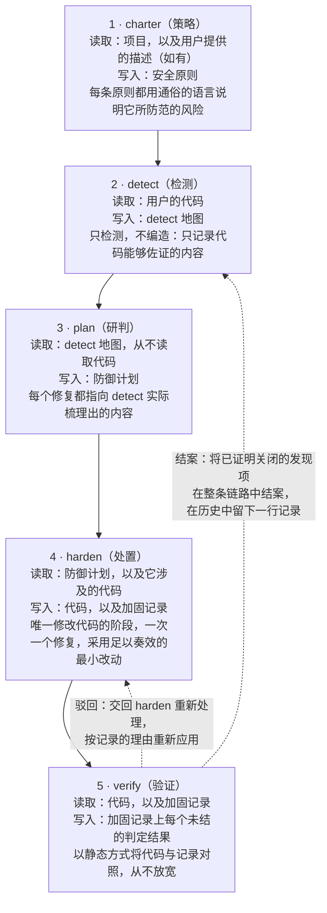
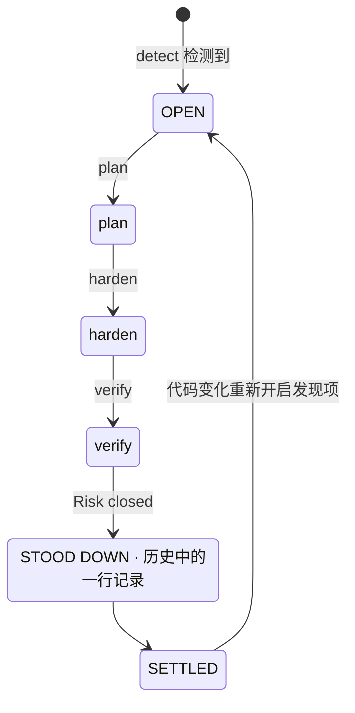
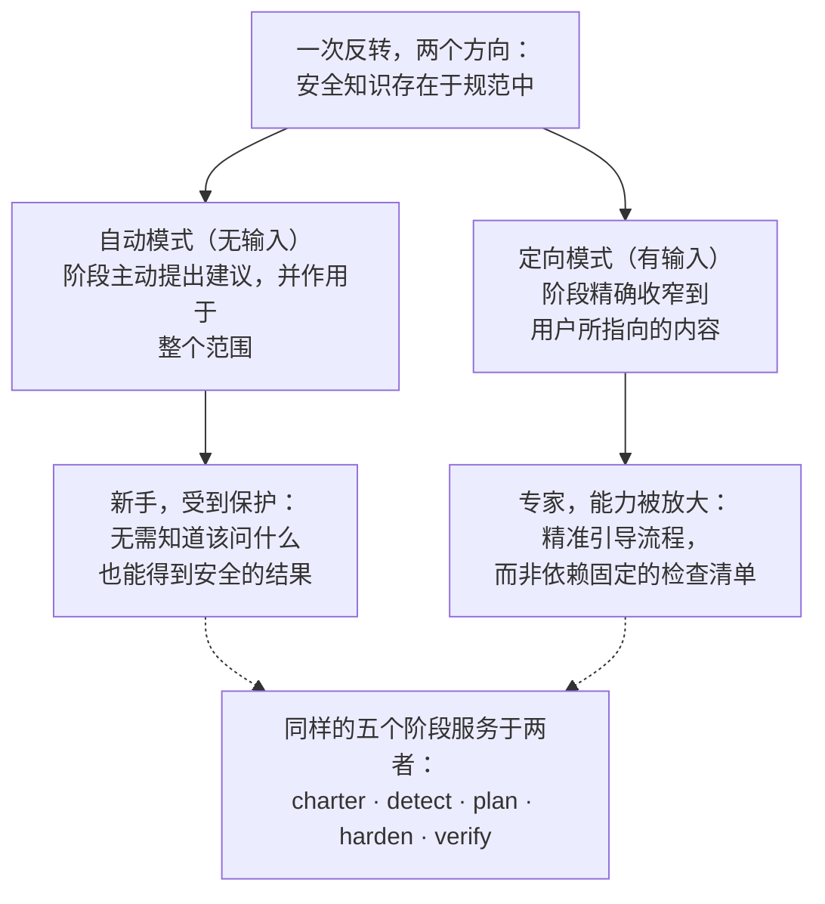
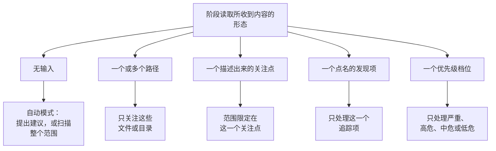
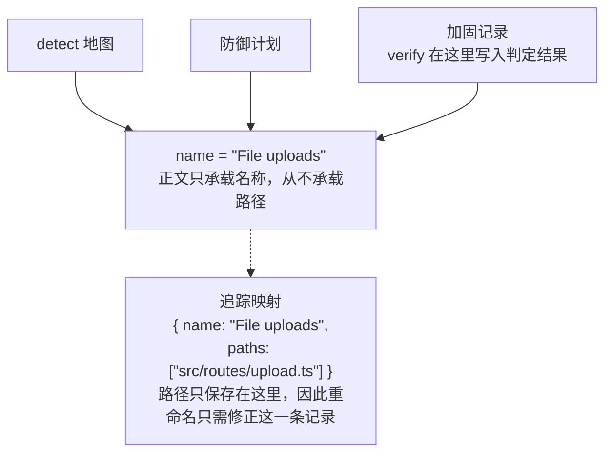
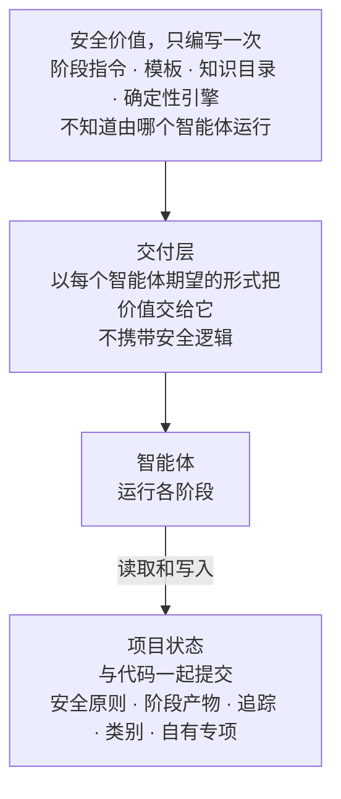
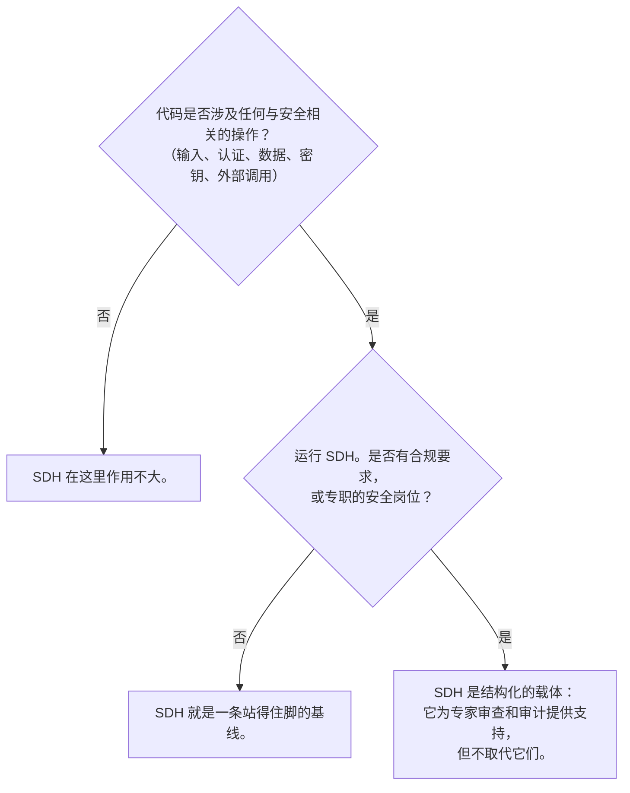

# Security-Driven Hardening（SDH）：面向 AI 辅助开发时代的约定

- **Weslley Araújo**
- **方法论论文，2026 年**

---

## 摘要

Security-Driven Hardening（SDH）是一种结构化、由 AI 驱动、仅限防御的安全方法论，面向这样一个时代：越来越多的软件由 AI 智能体和并非安全专家的人编写。SDH 不套用通用的检查清单，而是先检测系统实际在做什么（登录、文件上传、支付、数据暴露等），再推动针对这一场景的安全工作。它遵循默认安全的原则，完全围绕防御展开，并用通俗的语言表达，让任何用户都能据此行动。

本文认为，SDH 是一项一直缺失的约定，而不是某个单一的工具。安全知识存在于方法论及其按需加载的专项中，这是每个用户都能在此基础上继续拓展的基线，因此新手和专家可以使用同一套流程。有两项特性使它区别于以往的规范优先方法 `[1]`。SDH 是**状态无关**的：无论是空目录、进行中的项目、单个 pull request，还是庞大的遗留代码库，无论使用什么技术栈，它都能适应。SDH 也是**可结案**的：经验证已关闭的风险会从整个流程中结案，使该发现项进入静止状态，只有代码发生变化时才会重新开启。SDH 不能取代安全专业人员或专门的 Blue Team 工具。它扩展的是开发者自身的知识，开发者越懂安全，就越能主导它。

**Lagune** 是参考实现，它证明了这套方法论既可以构建，也可以移植。SDH 作为一项约定提出，供他人采用。

> **关键词**
>
> AI 辅助开发、软件安全、防御性安全、规范驱动开发、安全加固、智能体驱动的工作流、可结案性、场景感知安全、按需知识、与智能体无关的工具

---

## I. 引言：AI 辅助开发带来的安全缺口

越来越多的软件由无法可靠识别不安全模式的人和 AI 智能体交付：泄露的密钥、缺失的授权检查、可被注入的查询。这些并不是罕见的风险。它们属于真实安全事件中最常见的几类风险，多年来一直记录在公开的参考资料中 `[6]`、`[7]`，近期的研究也表明，相当一部分 AI 生成的代码在发布时恰恰带有这类缺陷 `[8]`。AI 编程助手让非开发者也能发布真正的软件，使这一问题愈发突出，但这个缺口远不止影响某一类人群。大多数项目从未经过一次针对其实际功能的安全审查。每一次草率的"能跑就上线"，都让整个生态更加脆弱。

通用的安全建议弥合不了这个缺口。静态检查清单并不针对系统实际在做的事，于是它会用无关的条目淹没一个小项目，却依然漏掉对这个项目真正重要的风险。问题不在于世上缺少安全知识，而在于把正确的知识匹配到用户眼前的这个系统上，并且要为一个可能不知道该问什么的人做到这一点。

SDH 用一次反转来回应这个问题：**安全知识存在于规范及其按需加载的专项中，这是每个用户都能在此基础上继续拓展的基线**。方法论检测场景，研判这一场景带来的风险，并指导修复，因此开发者和非开发者都通过同一套流程获得支持。发现项和建议始终使用通俗的语言，无论读者的技术深浅如何，都能据此行动。专家并不会因此受限，反而能借此放大自己的能力，这种双重性我们将在 `§VI` 中展开。

> **核心洞见**
>
> **核心反转**：安全知识存在于规范及其按需加载的专项中，这是每个用户都能在此基础上继续拓展的基线。方法论先了解系统在做什么，再为它匹配相应的安全工作，并扩展用户已有的知识。

设想一位开发者对 AI 助手说："我的应用允许用户上传头像。"在没有安全审查的情况下，助手会写出能运行的代码，却悄悄信任客户端发来的一切：声明的文件类型、文件名、文件大小。上传功能上线后，伪装成图片的文件可以携带代码，精心构造的文件名可以跳出存储路径，超大的文件可以耗尽服务器资源。这些在演示中都看不出来，于是就这样上线了。

同样的代码经过 SDH，结果就不同了。它检测到系统会接收来自外部的文件（检测），将其研判为上传功能所带来的风险（研判），提出检查文件的真实类型和大小、保存时重命名、存放到代码无法执行的位置（处置），然后读取结果，确认每项控制措施确实有效（验证）。开发者从来不需要知道"无限制文件上传"这个说法。方法论替他们补上了这一点。

本文的贡献如下：

- 对 SDH 这一方法论的精确定义，独立于任何具体实现，并给出其设计原则（`§III`）。
- 一个五阶段的防御生命周期，其中职责分离本身就是贡献：检测从不编造，规划从不读取代码，只有一个阶段会修改代码，验证从不放宽判断（`§IV`）。
- 将**可结案性**作为一种方法论立场：每个发现项都有终态，而不是陷入无尽的循环（`§V`）。
- **开发者知识扩展器**的双重性：同一套流程既保护新手，又放大专家的能力（`§VI`）。
- **不可调用的专项与按需提示词**：智能体在项目场景需要时才加载的聚焦安全知识，绝不默认加载（`§VII`）。
- **状态无关性**与**非强制性适应**：SDH 适用于任何开发状态，并根据场景调整，而不是强加固定的范围（`§VIII`）。
- 一种**预防模式**：在日常开发的同时运行同样的防御，让代码一落地就默认安全，各阶段需要纠正的问题也更少（`§IX`）。
- 与 Spec-Driven Development 的专门比较，SDH 由这一谱系发展而来，随后又与之分道扬镳（`§X`）。
- 让方法论经得起重构、并且不依赖任何智能体的工程纪律：名称即身份的追踪（`§XI`）和与智能体无关的载体（`§XII`）。

---

## II. 背景与相关工作

SDH 建立在已有工作的基础之上。它从规范优先、智能体驱动的开发 `[1]`、`[2]`、`[3]` 中继承了一套成熟的结构：模板、供智能体使用的斜杠命令、一份纲领性文档，以及一个运行各阶段的智能体。它以防御为目的重新实现了这套结构。这种传承是有意为之，SDH 的一条工作原则直接点明了这一点：基于成熟的结构搭建工作流，再让它服务于安全。

SDH 不是一份罗列通用建议的静态检查清单。检查清单对一般意义上的安全了解很多，对眼前的项目却一无所知。SDH 把这种侧重颠倒了过来。它首先把精力花在检测上，弄清系统在做什么，然后才去调用检测结果所指向的知识。

SDH 也不能取代安全人员或专门的 Blue Team 工具。它扩展的是开发者的知识（`§VI`）。设有专职安全岗位的团队应当保留这一岗位。SDH 为这样的团队提供一个结构化的载体，也为没有安全岗位的团队提供一条站得住脚的基线。

SDH 还与确定性的安全扫描器（静态分析、linter）`[4]`、`[5]` 并存。这些工具之所以有价值，恰恰因为它们是确定性的、可重复的。SDH 主要依靠智能体推理，以牺牲严格的确定性换取场景感知。方法论对此并不讳言。在确定性至关重要的地方，它会在推理中嵌入一个确定性引擎（`§VII`）：由智能体判断某个输入是否值得检查，由确定性程序判断该输入是否危险。

最直接的先行工作是 Spec-Driven Development（SDD，规范驱动开发），即一类从可执行规范出发、向前推进构建的规范优先方法论。我们把 SDD 当作一类方法来看待。作为一种实践方法论，它最清晰的表述是 Piskala 的报告 `[1]`，最知名的智能体驱动工具包是 GitHub 的 Spec Kit `[2]`，同一家族的第二个工具则是 OpenSpec `[3]`。它们是 `§X` 中比较所依据的权威参考。

---

## III. SDH：定义与设计原则

**Security-Driven Hardening** 是一种结构化、由 AI 驱动的安全方法论，它以智能体运行的规范来推动工作，而不是依靠临时拼凑的修复，从而让代码库变得更安全。这个名字的灵感来自 **Blue Team**，即安全领域中的防御者。SDH 关注的是防御、加固和验证，从不涉及进攻。

> **定义**
>
> **Security-Driven Hardening**（SDH）：一种结构化、由 AI 驱动、仅限防御的安全方法论，它先检测系统实际在做什么，再推动针对该场景的安全工作，遵循默认安全的原则，并用通俗的语言表达。

SDH 由一组具有约束力的原则来定义。每条原则都是一条规则，并为用户带来一项具体的保证。

| 原则                           | 规则                                                                                                         | 为用户带来的保证                                                                                               |
| ------------------------------ | ------------------------------------------------------------------------------------------------------------ | -------------------------------------------------------------------------------------------------------------- |
| 默认安全、语言通俗、人人平等   | 每项默认设置、每条消息和每个修复都开箱即安全，任何读者（无论是否是开发者）都能看懂。没有哪一类用户享有特权。 | 新手无需开口就能得到安全的基线，并能用自己能理解的方式读懂结果。                                               |
| 场景感知优先于通用方案         | 每个阶段都从 detect 检测到的场景出发，针对系统实际在做的事采取行动。                                         | 建议贴合项目本身，而不是贴合检查清单。安全知识存在于规范及其按需加载的专项中，在用户已有的知识之上进一步扩展。 |
| 灵活优先于僵化                 | 原则、要求和建议都只是起点。用户可以改写、删除、添加任何内容，或缩小其范围。                                 | 方法论会顺应项目和用户，严格程度绝不超出用户的意愿。灵活性从不削弱默认安全的基线。                             |
| 核对并更新，而非只追加         | 产物是活文档，而不是日志。每次运行都会重新检查每个条目：保留仍然成立的，改写已经变化的，删除不再适用的。     | 记录始终反映当下，因此绝不会沦为过时的积压清单。                                                               |
| 仅限防御                       | SDH 负责审计、加固和验证。它从不制作进攻性工具、用于恶意目的的漏洞利用，或用于造成危害的检测规避手段。       | 方法论无法被当作武器使用。两用内容只会出现在明确的防御语境中。                                                 |
| 规范优先、智能体驱动、面向安全 | 工作流由模板、命令、起统领作用的安全原则，以及运行各阶段的智能体构成。                                       | 一套成熟的开发结构，经过改造后由智能体承担实质性的安全工作。                                                   |

**表 1** SDH 的设计原则，以及每条原则为用户带来的保证。

这些原则并非装饰。它们是下文每个阶段都必须遵守的约束，`§XV` 的讨论也会回到这些原则，以划定方法论的边界。

本文其余部分将展开九个有名称的支柱。它们是读者应当记住的部分，也是其他团队若要声称自己在实践 SDH 就需要重新实现的部分。

| 支柱                       | 提供的内容                                                             | 章节        |
| -------------------------- | ---------------------------------------------------------------------- | ----------- |
| 场景感知的反转             | 安全知识存在于规范及其按需加载的专项中，因此新手和专家共用同一套流程。 | `§I`、`§VI` |
| 五阶段防御生命周期         | 职责分离：策略、检测、研判、处置、验证，各司其职。                     | `§IV`       |
| 可结案性                   | 发现项有终态，而不是无尽的循环。已关闭的工作会结案。                   | `§V`        |
| 开发者知识扩展器的双重性   | 同一套流程既保护新手，又放大专家的能力，而不取代任何一方。             | `§VI`       |
| 按需提示词与不可调用的知识 | 根据项目的实际情况加载相关的安全知识，绝不默认加载。                   | `§VII`      |
| 状态无关性与非强制性适应   | 适用于任何技术栈中的任何开发状态，并根据场景调整，而不是强加范围。     | `§VIII`     |
| 预防模式                   | 在构建新功能的同时运行同样的防御，让代码一落地就默认安全。             | `§IX`       |
| 名称即身份的追踪           | 发现项在各阶段之间始终是同一个追踪项，重命名只会在一个地方断开关联。   | `§XI`       |
| 与智能体无关的载体         | 安全价值只需编写一次，不依赖任何智能体或技术栈。                       | `§XII`      |

**表 2** SDH 的九个支柱，以及每个支柱展开的章节。

---

## IV. 五阶段 Blue Team 流程

SDH 把工作组织成一个五阶段的防御生命周期（图 1）。每个阶段都围绕防御展开，并建立在前一个阶段之上，各阶段也对应着 Blue Team 的真实工作：制定策略、检测、研判、处置、验证。



**图 1** 五阶段流程：每个阶段读取什么、写入什么，以及它的关键不变量。两条回路都由 verify 驱动：被驳回的控制措施会让 harden 重新处理，已证明关闭的发现项则会在整条链路中结案，并在历史中留下一行记录。

职责分离正是本文的贡献所在。由于每个阶段只做一件事，任何失效模式都被限制在一个地方，读者也可以信任每个产物所陈述的内容。

> **核心洞见**
>
> **Applied 不等于已验证**：harden 记录的是某个修复已被应用。verify 会将代码与这份记录对照来验证它，判定结果也绝不会为了迎合记录而放宽。控制措施可能已存在于代码中，风险却依然可被触及，此时诚实的判定结果就是 "Risk not closed"。

### charter（策略）

charter 阶段确立项目的安全原则，也就是之后每个阶段都必须遵守的规则。它是治理层，相当于项目安全态势的编译期检查。每条原则都有一个清晰的名称、一条可以对照代码检查且不容商量的规则，以及一行 `Why:`，说明它所防范的风险，而不仅仅是修复方法。charter 始终会读取项目本身（清单文件、结构和依赖），如果用户提供了描述，这份描述只是一个方向，读取时还会扩展到用户提到的范围之外。没有描述时，项目就是唯一的信息来源。两者是叠加关系而非竞争关系，安全原则记录的是项目应当遵守的策略，而不是代码的现状。非开发者也应该能读懂它，并同时理解规则和风险。

### detect（检测）

detect 读取代码，梳理系统实际在做的、与安全相关的事。它的核心准则是"只检测，不编造"：只记录代码能够佐证的内容，并附上后续阶段需要的证据。detect 保持中立。它不会强行让发现项去迎合安全原则，因为将风险与安全原则中的规则相对照是 plan 阶段的工作。每个发现项包含三个部分：它是什么（用通俗语言描述）、为什么重要（风险，而不只是事实），以及证据（它所在的函数或路由）。证据中不包含文件路径。路径只保存在追踪映射中（`§XI`），因此正文中永远不会出现可能过时的路径。

### plan（研判）

plan 把每个发现项转化为一个修复，按风险类型命名（在 CWE 和 OWASP 等公认参考能提供依据时加以引用），并关联到该修复所维护的那条安全原则。优先级（严重、高危、中危、低危）不能随意指定：plan 使用 CVSS v4.0 的 Base-and-Environmental 方法为每个发现项定级，因此优先级档位就是用通俗语言表述的评分，并附上一行通俗说明，解释暴露程度和利害关系，两次运行也会得出相同的排序。向量是供专家参考的精确依据，而档位及其说明则是任何人都能看懂的同一个定级结果。plan 只依据 detect 地图工作，从不读取代码。这是有意为之的约束，而不是局限：它迫使每个修复都指向 detect 实际检测到的内容。如果某个范围从未被梳理过，plan 会停下来，把用户引回 detect，而不是去猜测。

### harden（处置）

harden 是唯一会修改代码的阶段，因此行事谨慎。一次编辑是否需要用户批准，由智能体及其运行时的权限模式决定，所以 harden 不会另设自己的确认关卡。它一次只应用一个修复，先处理依赖项，再按优先级从高到低进行，让每次改动都保持精简、便于审查、易于撤销。它从不为了容纳新的修复而削弱已有的控制措施，也从不违背任何一条安全原则。如果某个修复会与某条原则冲突，harden 会停下来指出冲突，而不是照样应用。每个区块都会被记录为 Applied、Partial 或 Blocked。"Applied 并不代表已经验证"，这正是下一个阶段要解决的问题。

### verify（验证）

verify 通过读取代码并与 harden 的记录相对照，来验证每项已应用的控制措施。验证就是这种代码与记录的对照，而且是静态的：它确认的是控制措施在代码中存在且正确，而不是控制措施在运行中的系统上能抵御攻击。那种运行时检查，即对线上系统执行真实或模拟攻击的检查，在设计上就不属于它的范围。verify 会给出三种判定结果之一：Risk closed、Risk not closed 或 Cannot tell from the code。它不产出自己的产物：harden 和 verify 共用加固记录，harden 负责记录做了什么，verify 负责判定结果及其理由，双方都从不改写对方的字段。被驳回的控制措施会成为 harden 需要重新处理的工作，harden 下次运行时会以该判定结果为准，而不是以自己对代码的解读为准，并针对理由中指出的具体缺口重新应用修复。verify 更相信代码而不是记录，因为记录声称的可能多于代码实际做到的。它对用户的代码只读，也从不为了迎合记录而放宽判定结果。控制措施可能已经存在，风险却仍可通过其他途径被触及，这种情况下诚实的判定结果就是 "Risk not closed"。如果 verify 在读取过程中注意到 detect 地图从未涵盖的安全问题，它不会为此编造判定结果，因为检测是 detect 的职责：它会指出这个问题，并把用户引回 detect，让这个发现项通过同一套流程进入，而不是绕过流程。

> **贯穿示例：文件上传**。单个发现项就能完整展示整条主线。
>
> - **detect** 发现它：系统会接收用户上传的文件，而上传 handler 直接信任客户端发送的 MIME 类型，没有检查文件的真实类型。_为什么重要_：伪装成图片的文件可能藏有恶意代码。
> - **plan** 确定修复方案，优先级为**严重**，维护的原则是"所有输入在验证之前都不可信"：检查文件的真实类型和大小，保存时重命名，并把上传的文件存放在无法作为代码执行的位置。
> - **harden** 应用修复，状态为 **Applied**：handler 现在会根据内容识别真实类型，限制文件大小，拒绝任何意外的内容，保存时重命名，并存放到代码无法执行的位置。
> - **verify** 读取 handler，将它与记录对照，给出 **Risk closed**：代码所做的与记录所述完全一致。
>
> 同一个发现项名称贯穿 detect 地图、防御计划和加固记录，verify 也以同一个名称处理这份记录：未结的判定结果会写入该发现项的区块，已证明关闭的发现项则会结案（`§V`）。这个共用的名称就是它的身份（`§XI`）。

---

## V. 可结案性：发现项有终态

大多数安全工具留给用户的，是一份只增不减的积压清单。SDH 采取了不同的立场：**发现项是可结案的，因此它有终态，而不是永远停留在无尽的积压清单中**（图 2）。这直接源于核对并更新的原则。

> **定义**
>
> **可结案性**：经验证已关闭的风险会从整个流程中结案，使该发现项进入静止状态，只有代码发生变化时才会重新开启。即使安全工作本身持续进行，每个发现项也都有终态。

SDH 的产物是活文档，而不是日志。每当某个阶段重新运行，它都会对照当前的实际情况重新检查每个已有条目，并做三件事之一：保留仍然成立的，改写已经变化的，删除不再适用的。代码显示已经解决的发现项会被直接删除。工作记录反映的是当下，而不是过去。

结案正是同样的核对并更新走到了终点。当 verify 验证某个风险已关闭时，它会在整个流程中将该发现项结案，涉及 detect 地图、防御计划、加固记录和追踪映射。这就是为什么 verify 是唯一会写入其他阶段产物的阶段：它是让循环闭合的那个阶段。在发现项离开链路时，结案会把它提炼成历史记录中的一条简短条目，这份历史记录位于工作链路之外，永远不会被重新处理。这正是消失与结案的分界：因不再成立而在核对并更新中被删除的发现项不会留下任何痕迹，而已证明关闭的发现项则会在历史中留下一行记录。被结案的发现项此后不会出现在任何工作产物中，这种缺失是预期之中的，而不是链路断裂。



**图 2** 可结案性状态机。发现项依次经历 OPEN → STOOD DOWN → SETTLED，只有代码发生变化时才会重新开启。

当范围内的一切都已结案，循环就进入静止状态，而静止状态有其具体形态：最后一个发现项已关闭的产物会被整体删除，因此一条完全关闭的链路只会留下安全原则和历史记录，也就是策略与证明。只有代码发生变化时，循环才会重新开启。方法论为每个发现项都设定了明确的终点，而这恰恰是无尽的积压清单做不到的。

---

## VI. 开发者知识扩展器的双重性

SDH 不能取代人，也不能取代专门的 Blue Team 工具。它**扩展的是开发者自身的知识**。开发者越懂安全，就越能精准地主导流程，拥有的自主权也越大。即使开发者懂得不多，也依然能得到安全的结果，因为自动模式会保护他们。

`§I` 中的反转，即安全知识存在于规范中，在两个方向上都成立。对新手而言，这是保护：他们不需要知道该问什么，因为规范会主动提出建议。对专家而言，这是放大：同一份规范让他们能精准地引导流程，而不必与一份固定的检查清单较劲。

每个阶段在自身的运作中都体现了这种双重性（图 3）。不提供任何输入时，它会代表用户处理整个范围。给出方向时，同一个阶段会精确收窄到用户所指向的内容。



**图 3** 开发者知识扩展器的双重性。一次反转服务于两类人群：通过同样的五个阶段，自动模式保护新手，定向模式放大专家的能力。

按需加载的专项（`§VII`）在其文本中明确体现了这种双重性。每个专项都会告诉智能体，它的知识是在"扩展你的判断"，并要求智能体在专项提供的内容之外继续推理。这些知识是下限，而不是上限。正是这一点让本文所追求的平衡同时惠及两类人群：开发者社区获得了一件实用的工具，Blue Team 从业者则获得了一个结构化的载体，而这个载体并不会假装替他们完成本职工作。

---

## VII. 不可调用的专项与按需提示词

这是该方法论中最具新意的模式。SDH 以专项的形式承载聚焦的安全知识，这些专项**只会按需加载**，由智能体自己根据项目的场景决定加载哪些。我们称之为**按需提示词**（prompt-on-demand）：让智能体根据所在项目的范围选择激活哪些知识，而不是默认运行所有检查。专项是不断演进的，其中任何一个都可能随时变更或被替换。本文的贡献在于这种模式，而不在于专项本身。

> **定义**
>
> **按需提示词**：智能体将安全知识与眼前项目的范围进行匹配，以此选择激活哪些知识，从而根据项目的实际情况引入相关知识，而不是默认运行所有检查。

> **定义**
>
> **不可调用的专项**：针对单一场景、聚焦且与编程语言无关的安全知识单元，例如文件上传或在浏览器中运行的代码。它只负责审计和解释，从不改写代码，也从不生成攻击输入。它不是命令：当它所涵盖的场景在范围内，或者提示词点名要求它时，它才会加载。

每个专项都会为其涵盖的风险给出更安全的写法，并告诉智能体在使用它的每个阶段应如何处理发现项：在检测时如何判断，在处置时如何安全地应用修复，在验证时如何证明。

专项的决定性特征在于它**无法单独调用**：它不是命令，在流程中由匹配来加载它。检测阶段会列出一次目录，将项目的场景与每个条目涵盖的内容进行匹配，只加载场景确实存在于范围内的专项。后续阶段复用这份匹配结果，而不是重新列出，因此一次匹配就能服务整条链路，预防模式（`§IX`）也会针对即将构建的工作执行同样的匹配。场景不存在的专项会被跳过，而跳过与加载一样需要有据可查：目录中的每个条目都会得到明确的判定结果，即应用或跳过，并附上从代码中得出的理由，因此模糊的"不相关"印象绝不能代替确实不存在。没有找到任何适用的专项，也是有效的结果。

目录是数据，扩充目录只需一个知识文件加上目录中的一行，从不需要新增命令。内置专项按类别分组，例如 OWASP、某种编程语言或 AI 集成，项目所使用的目录则包含它所选类别中的内置专项，以及它自己的专项。项目会把这一选择与其他状态一起记录下来，因此整个团队都对照同一份目录进行匹配。这与各阶段遵循的是同一条场景感知原则，只是应用在知识上：根据项目的实际情况引入相关知识，而不是默认运行所有检查。同样的特性也让用户（而不仅仅是维护者）能够扩充目录：用户提供的安全资料或主题会被提炼成一个属于该项目的新专项，无论项目选择了哪些类别，它都会加入目录，并像内置专项一样加载，同时取代同名的内置专项。编写专项本身也仅限防御，并遵守专项所执行的同一条边界：攻击类的技术文章可以作为资料来源，但由此产出的专项只负责审计和解释，绝不会生成可用的漏洞利用代码。因此，`§I` 中的反转，即智能存在于规范之中，也延伸到了目录本身，用户无需编写代码，就能针对自己的场景不断深化目录。

举一个简短的例子来说明按需提示词。detect 读取一个包含浏览器端代码的文件夹。它在目录中匹配到这一场景，加载涵盖它的专项，并通过 detect 的常规步骤指出一个客户端发现项。场景不在此范围内的专项不会被匹配，因此永远不会加载，每一个都会被记录为已跳过。决定哪些知识相关的是项目本身，而不是某个固定的配置。

确定性恰好出现在最需要它的地方。专项除了文字之外，还可以携带一个确定性检查器：当某类风险有明确的判定方法时，一个小程序会针对给定的输入返回固定的判定结果，例如 `safe`、`unsafe` 或 `invalid input` 这样的少数几个词。有些风险类型正是可以用这种方式确定性地判定的，其判定方法背后也有一批先行工作 `[9]`、`[10]`、`[11]`。检查器要么对智能体提供的候选项打分，要么自行扫描范围来找出候选项，无论哪种情况，返回判定结果的都是检查器，而不是智能体。足够通用的专项可以在目录中被标记为必需，从而始终被应用，并在整个范围内运行它的检查器。这是知识在没有场景匹配的情况下被加载的唯一情形，而且它在目录数据中声明，从不由智能体临时决定。SDH 正是在这里让智能体的推理建立在可重复的基础之上，同时又不假装整个流程都是确定性的。

最后，专项是**可独立使用的**。由于这些知识可以自成一体，用户可以在与完整 SDH 流程毫不相关的提示词中直接运行某个专项，让安全与日常开发并行。例如，带有确定性检查器的专项可以筛查日常编码中产生的每个候选项，只保留安全的那些。这种可独立使用的特性正是 SDH 能适应如此多情况的部分原因，这也是 `§VIII` 的主题，而它最完整的体现是预防模式（`§IX`），在这种模式下，同样的知识会全程守护日常开发。

---

## VIII. 状态无关性与非强制性适应

有两项特性让 SDH 区别于僵化的规范方法论。

### 状态无关性

> **定义**
>
> **状态无关性**：方法论不依赖开发所处的状态。无论是空目录、进行中的项目、单个 pull request，还是庞大的遗留代码库，无论使用什么技术栈，它都适用，因为它通过阅读来了解起点。

无论项目是全新的还是已经存在，每个阶段的工作方式都相同。charter 会根据现有的任何代码推断原则。detect 会梳理现有的任何代码，哪怕只有很少一点。不存在预设的起点。

### 非强制性适应

> **定义**
>
> **非强制性适应**：方法论根据场景调整自身，而不是强加一个用户必须遵循的固定范围。当用户不知道该说什么时，它会读取自己被调用时所处的环境，生成上下文，并提出决定下一步行动的问题。

charter 的提议模式就是最清楚的例子：SDH 通过分析项目，推导出一套默认安全的安全原则，只在某个缺口确实会改变结果时才询问用户，然后写下这些原则，并用通俗的语言逐条呈现，说明每条原则所防范的风险。安全原则是一份活文档，用户通过重新运行来修改它，而不是一份要先经过审批提示才能生效的契约，因此它从不要求用户知道该问什么。

这种适应性体现为对输入形态的敏感：同一个阶段会读取它收到的内容，并选择相应的模式（图 4）。提示词中的一个文件、列表中的一个发现项、一个担忧、一次针对已知薄弱点的专项任务，或是一次全面的暴力扫描请求：每一种都能满足用户的需要，因为流程在设计上就是非强制性的。这些都不会削弱默认安全的基线。灵活性决定的是基线如何应用，而从不降低基线。



**图 4** 非强制性适应。同一个阶段读取输入的形态并选择模式，因此范围始终由用户决定，从不被强加。

---

## IX. 通用预防模式：在构建过程中运行同样的防御

SDH 还有一种互补的模式：在编写代码的同时启用同样的防御，进行日常开发。用户直接提出要做的工作，比如一个登录页、一个上传功能、一个接口，方法论会在构建过程中全程守护，让结果在落地的那一刻就默认安全，而不是等到之后再做一轮加固。

> **定义**
>
> **预防模式**：在 SDH 的治理层和知识之下进行的日常开发。安全原则约束构建过程，与即将创建的内容相关的专项会按需加载，并且在工作被宣告完成之前，结果会与所用的防御逐一对照。

这种模式复用了各阶段已有的每个部分，只是对准的是尚不存在的代码。场景检测从代码转向意图：智能体会推演它即将构建的内容，以及这项工作会跨越哪些边界（登录意味着凭据、会话和来自外部的输入），知识目录匹配的正是这种推演。按需提示词（`§VII`）在这里得到了推广：场景不仅可以从已有的代码中检测，也可以从编写代码的计划中检测。安全原则一如既往地发挥治理作用，任何会违背某条原则的请求都会作为冲突被指出，而绝不会被构建出来。防御会在编写每个部分的当下就地应用，在边界处进行校验，并一开始就采用安全的写法，因此"能用但不安全"的版本根本不会出现，也就无需纠正。

这种模式以 verify 开始的方式收尾。在宣告工作完成之前，构建者会将自己的结果与所用的防御相对照：控制措施必须位于风险的路径上，而不是旁边，必须完整无缺，而且当专项带有确定性检查器时，检查器的判定结果优先于智能体自己的解读。在这里发现的缺口会作为同一项工作的一部分被补上，因为完成工作就意味着安全地完成它。

这种模式拒绝做的事，与它要做的事一样经过深思熟虑。它只构建被要求的内容，不审计周围的任何东西：审计已有的内容是各阶段的职责。它不写入任何产物，也不追踪任何发现项，因为发现项是在已有内容中检测到的风险，而这种模式的目的是让不安全的版本根本不会落地。两个方向相辅相成：各阶段关闭已经存在的问题（`§V`），预防模式则防止新的工作把它们重新打开。处于静止状态的链路之所以能保持静止，不是因为开发停止了，而是因为在静止期间构建的一切都带着防御。

---

## X. Security-Driven Hardening 与 Spec-Driven Development 对比

Security-Driven Hardening（SDH）脱胎于 Spec-Driven Development（SDD），随后却与之大相径庭。两者在结构上的传承真实存在，也得到了承认：规范优先、智能体驱动、一份纲领性文档，以及一组由智能体运行的分阶段命令。SDH 有意复用了这套结构。不同之处在于目的、约束模型、假定的状态和终止条件。我们把 SDD 当作一类方法来看待，以 Piskala 的报告 `[1]` 作为这一方法论的权威表述，以 GitHub 的 Spec Kit `[2]` 作为权威的智能体工具包，并以 OpenSpec `[3]` 作为同一家族的第二个工具。

SDD 通过让规范变得可执行，颠覆了传统开发：规范直接生成可运行的实现，而不只是起指导作用 `[1]`。它的阶段设置推动构建向前推进 `[2]`（确立治理原则、明确要构建什么、规划技术栈、把计划拆分为任务，然后实现）。它的纲领性文档是一部由原则构成的宪法（constitution），是智能体自始至终必须遵守的基础。这正是差异的核心所在。SDD 的约束力从规范流向构建，实现应当遵循规范。

SDH 几乎在这份契约的每个维度上都反其道而行（表 3）。

> **核心洞见**
>
> **核心差异**：SDD 的约束力从规范流向构建，实现应当遵循规范。SDH 是非强制性的，方向正好相反：从检测到的系统场景出发向内推进，加固已经存在的东西。

| 维度         | SDD                                                | SDH                                                                              |
| ------------ | -------------------------------------------------- | -------------------------------------------------------------------------------- |
| 目标         | 交付功能。规范变成可运行的实现。                   | 加固已有的或正在构建的内容。每个阶段都围绕防御展开。                             |
| 约束模型     | 强制性。规范和宪法把构建限定在它必须遵循的范围内。 | 非强制性。SDH 根据场景调整，用户可以改写、删除或缩小范围。                       |
| 状态假设     | 从一份规范出发向前构建。                           | 状态无关：空目录、进行中的项目、单个 PR 或遗留代码。                             |
| 终止条件     | 功能构建完成即结束。                               | 可结案。发现项进入静止状态，只有代码发生变化时才会重新开启。                     |
| 纲领性文档   | 一部智能体必须遵守的原则宪法。                     | 一份以风险为出发点的安全原则（每条都带有 `Why:` 行），明确不是一份固定的契约。   |
| 知识如何扩充 | 新增命令（或扩展阶段设置）。                       | 新增一个由智能体按需加载的不可调用专项：一个文件加上目录中的一行，无需新增命令。 |
| 服务对象     | 推动功能向前的构建者。                             | 任何用户，无论是否是开发者，都通过同一套流程获得支持。                           |
| 由谁修改代码 | 实现阶段生成构建结果。                             | 只有 harden 阶段修改代码，一次一个修复。                                         |

**表 3** SDD 与 SDH 在八个维度上的对比。结构是借来的，契约是反转的。

公平地说：SDD 是经过检验的先行工作，SDH 运行所依托的结构也得益于它。两者的分歧并不是对 SDD 的批评，SDD 很好地解决了另一个问题（向前构建）。SDH 借用同一套成熟的机制，把它对准防御、适应性和结案。OpenSpec `[3]` 围绕变更提案、任务清单和逐个变更的规范来组织，也印证了这一模式：这一家族从规范出发向前推进构建，而 SDH 则从检测到的场景出发向内加固系统。即便是 SDH 的预防模式（`§IX`），也就是它唯一伴随向前构建的地方，也保持着反转的契约：它约束的是工作如何构建，从不决定要构建什么。

---

## XI. 工程严谨性：追踪纪律

核对并更新而非追加的纪律（`§V`）需要一个经得起重构的底层基础。一个发现项在涉及它的每个阶段中都必须保持为同一个追踪项，文件被重命名或移动也不能让链路断裂。SDH 用**名称即身份**和**路径只保存在追踪中**来解决这个问题。

> **定义**
>
> **名称即身份**：发现项的身份就是它的名称，在每个产物中都以完全相同的写法出现。正文只承载名称，从不承载路径。文件路径只保存在追踪映射中，因此重命名或移动文件只会在一个地方断开关联。

每个 detect 发现项都是一个追踪项。它的身份就是它的**名称**，即章节标题，在 detect 地图、防御计划和加固记录中都以完全相同的写法出现。后续阶段在处理同一个追踪项时会逐字复用这个名称，verify 也会以同一个名称把判定结果写入加固记录。追踪映射只保存追踪信息，别无其他，每个追踪项对应一条记录：

```json
{ "name": "File uploads", "paths": ["src/routes/upload.ts"] }
```

映射中不记录正文、注释、单独的标识符，也不记录阶段。文字类产物承载措辞，映射只承载身份和路径。文件路径是唯一易变的内容，而它们只保存在这里。重命名或移动文件只可能在一个地方断开关联，绝不会出现两份互相矛盾的副本。



**图 5** 身份传送带。一个发现项名称贯穿所有产物，而它的路径只保存在追踪映射中，因此重命名只需在一个地方修正。

在常规流程中，有两种操作负责维护映射，第三种则作为维护操作单独存在。**Track** 是增量登记：阶段报告它写入的发现项，引擎记录其中新增的部分，并为其余发现项跟踪重命名后的路径，把每一项归类为新增、已移动或未变化。它从不删除阶段没有报告的任何内容。**Untrack** 负责将 verify 已关闭的发现项结案：在一次确定性处理中，它把每个发现项提炼成历史条目，从产物中删除它的整个章节，删除最后一个发现项已移除的产物，并去掉它的追踪记录，因此这些工作都不需要智能体手动完成。如果确定性处理无法安全进行，比如已结案的名称仍在另一个发现项的正文中被引用，它会为智能体标记出这个位置，而不是去猜测该怎么修改。这两种操作是各阶段在运行时调用的。**Repair** 是维护操作：当某个阶段在自身的核对并更新中发现追踪信息不一致（记录的路径已不存在）时，会自动把工作交给它，其他情况下则按需运行。它会一次性重新校准整个映射，读取每个产物和当前代码，修正每个追踪项的路径，并指出它无法独自决定的情况：孤立项（不再被任何产物提及的追踪项），或疑似重命名项（路径与另一个已报告名称相匹配的追踪项）。

Repair 是维护操作，而不是第六个阶段。它既不触碰用户的代码，也不触碰文字类产物，只处理追踪信息。它读取用户源代码只有一个原因，就是了解被重命名文件的新路径，而且它从不编写安全内容。在引擎拒绝猜测的那个判断上，人是最终裁决者：一个消失的追踪项究竟是已经解决，还是仅仅被重命名了。宁可询问也不要猜测，因为错误删除的追踪项会让链路断裂。

方法论也把自己的防御纪律用在自己身上。确定性引擎以命令行程序的形式调用，每个输入都作为独立的进程参数传入，使它始终只是普通数据，因此含有引号或反引号的值永远无法注入命令。未知的检查会直接失败，而不是给出答案，因此拼错名称的检查绝不会被误读为干净的结果。SDH 不会让自己的底层管道免于默认安全原则的约束。

---

## XII. 载体：以与智能体无关的架构证明可移植性

要让 SDH 成为他人采用的约定，它就不能绑定某个智能体或某个技术栈，因此它的载体将三个关注点彼此分开（图 6）。Lagune 证明了这是可以做到的。

**安全价值**只需编写一次，并且完全不知道由哪个智能体来运行它：各阶段的指令及其要填写的模板、知识目录，以及确定性引擎。**交付层**很薄：它唯一的任务是以智能体期望的形式、在智能体期望的位置把这些价值交给它，自身不携带任何安全逻辑。**项目状态**属于项目本身：安全原则、各阶段产物、追踪映射、项目选择的类别以及它自己的专项，都像代码的其他部分一样提交到仓库并可供审查。



**图 6** 与智能体无关的载体。安全价值只编写一次，由一层很薄的交付层把它带给每个智能体，而状态始终属于项目。

由于交付层不携带安全逻辑，它如何构建不会改变 SDH 的任何内容。载体可以自己构建交付层，也可以像参考实现那样，把交付交给一个已经在分发智能体 skill 的生态，而各阶段、它们的产物和保证都保持不变。这一切也不局限于某种语言或运行时。参考实现恰好是用某个技术栈编写的，但方法论在于这些关注点之间的边界，而不是构建它们的工具链。同样的设计完全可以用另一种语言重新实现，而不会改变 SDH 的本质。

---

## XIII. 实例：SDH 的完整流程

> **实例**
>
> **对上传与管理后台攻击面的防御性加固**
> **背景**：一个小型应用，接收用户上传的文件，并在管理页面中列出这些文件。
> **流程**：charter → detect（由场景激活按需知识）→ plan → harden → verify，其中包含一次结案和一次真实的失败。
> **结果**（能力）：一项风险经验证已关闭，并在整条链路中结案，另一项控制措施经验证*并未*关闭，被交回 harden。判定结果反映的是代码，而不是记录。

_这是一个说明方法论运作机制的示例，而非实地测量的研究，也不报告任何效果指标_。

下面用一个连贯的完整演练来展示方法论的实际运作，而不只是它的各个组成部分。我们在 `§IV` 的文件上传贯穿示例基础上，加入一次按需知识激活和一次结案，并纳入一次真实的失败。

1. **charter** 提出原则"所有输入在验证之前都不可信"，并用通俗的语言说明其风险：未经检查的输入是系统被攻破最常见的途径。
2. **detect** 扫描上传路由，以及列出已上传文件的小型管理页面。它检测到上传相关的发现项（handler 信任客户端提供的 MIME 类型）。管理页面在浏览器中运行，这是按需提示词（`§VII`）能够识别的场景，因此 detect 会加载针对该场景的专项，并指出第二个发现项：页面中有一处以标记而非文本的形式写入文件名，因此精心构造的文件名可能在访问者的浏览器中作为脚本运行。场景不在此范围内的专项永远不会加载，每一次跳过都会连同从代码中确认的缺失情况一起记录下来。
3. **plan** 将上传修复的优先级定为严重，并关联到该原则：检查文件的真实类型和大小，保存时重命名，存放到代码无法执行的位置。它将第二个修复的优先级定为高危：把文件名渲染为文本，而不是标记。
4. **harden** 先应用上传修复（优先级最高），记录为 Applied，再应用第二个修复，同样记录为 Applied。
5. **verify** 读取每一处代码，并将代码与记录对照。上传的控制措施确实有效：handler 根据内容识别真实类型，限制文件大小，并拒绝其余一切。判定结果：Risk closed。verify 在整条链路中将上传发现项结案，其提炼后的摘要被写入历史记录。

接下来是那次真实的失败。假设 harden 的第二个修复添加了一个安全的文本渲染辅助函数，却让旧的写入标记的调用在另一条代码路径上依然可被触及。verify 读取页面，看到了安全的辅助函数，也看到不安全的路径仍然有效。控制措施存在，但风险并未关闭。verify 拒绝为了迎合记录而放宽判定结果。它给出 "Risk not closed"，记录下缺口，并指回 harden。没有完全解决风险的控制措施不算通过。

这一个例子就体现了方法论的特点：场景感知的检测、与原则挂钩并排好优先级的修复、谨慎的应用，以及不受记录左右、如实报告代码实际状态的验证。

---

## XIV. 何时使用 SDH，以及它的局限

SDH 很少像繁重的流程那样显得大材小用，因为它是状态无关且可结案的：它可以缩小到单个文件和单个关注点，并且会进入静止状态，而不是留下长期的负担。它的边界不在于项目规模，而在于**保障深度**。



**图 7** 何时使用 SDH。先看是否与安全相关，再看保障深度，从不看项目规模。

SDH 触及边界的情况包括：只有在系统运行时才会出现的行为（verify 读取的是代码，并不执行系统），取决于智能体无法读取的配置或环境的风险，以及无论如何都必须由专家审查的高风险场合。在这些情况下，SDH 作为结构化的第一轮检查仍然有价值，但它是下限，而不是上限。

> **核心洞见**
>
> **边界**：SDH 的局限在于保障深度，而不在于项目规模。它几乎在任何地方都能充当站得住脚的基线，并在风险较高时为专家审查提供支持，但它不能取代对运行中系统的测试，也不能取代安全专业人员的判断。

---

## XV. 讨论：定位、局限，以及 SDH 不作的主张

SDH 对自身的边界有清晰的界定。

### 扩展，而非取代

SDH 不能取代安全专业人员或专门的 Blue Team 工具。它扩展的是开发者的知识（`§VI`）。恰当的说法应当是审慎的：只要运用得当，SDH **能够**有效关闭真实存在的风险，尤其是对那些原本根本得不到任何安全审查的项目而言。但它不是一种保证，在风险较高、需要专家审查的场合，它也无法替代专家审查。

### 从构造上就仅限防御

SDH 负责审计、加固和验证。它从不制作进攻性工具、漏洞利用，或用于造成危害的检测规避手段。两用的安全内容只有在明确防御性且经过授权的语境中才可接受。这是一条硬性边界，而不是一种偏好。

### 验证是实质性的，而非走过场

verify 通过读取代码并将其与记录对照来进行验证，而不是运行系统。这是静态验证：它确认控制措施在代码中存在且正确，但并不证明控制措施在运行时能抵御攻击。因此，"Cannot tell from the code" 是一个正当的判定结果，而不是藏在通过结果背后的失败。当证据不在代码中时（它取决于配置，或取决于智能体无法读取的路径），SDH 会如实说明，而不是去猜测。

### 确定性有明确的范围和名称

SDH 的大部分内容依靠智能体推理，这正是它能够感知场景的原因。确定性只留给确定性引擎：专项可能携带的检查器（`§VII`）和追踪引擎（`§XI`）。本文不会模糊这条界线。凡是确定性的结果，都是程序给出的结果。凡是推理得出的结果，都是智能体对代码的解读，并由用户作为最终裁决者。

### 成本与规模

一次全面扫描会消耗大量 token。手动模式（`§VI`、`§VIII`）之所以存在，部分原因就是让成本与关注点相称。

### 用户是最终裁决者

SDH 会请人来判断某个追踪项是被重命名了还是已经解决，而对代码修改的批准，仍然留在用户原本就用来管理智能体的地方，也就是用户运行智能体时所用的权限模式。方法论负责提出和验证。它不会推翻人的决定。

### 异议与回应

一位公正的怀疑者会提出几项异议。其中实质性的几项值得用原话提出来。

"**这不就是在静态分析器上硬加了一个 LLM 吗**？"不是。静态分析器默认会运行它拥有的每一条规则。SDH 先检测系统是什么，再调用相关的知识（`§II`、`§VII`），并且只在某类风险有明确判定方法的地方才*嵌入*确定性检查器。推理以场景为先，确定性则有的放矢。

"**这不就是一份安全检查清单吗**？"不是。SDH 把检查清单颠倒了过来：检测在先，再根据项目实际在做的事引入知识（`§II`、`§VII`）。

"**这不就是把 SDD 换个名字用在安全上吗**？"不是。SDH 借用了 SDD 的结构，却反转了它的契约：约束力、状态假设、终止条件和服务对象全都不同（`§X`）。机制相同，方向相反。

"**依靠 AI 推理的方法难道不会凭空捏造发现项吗**？"这套设计约束的是编造本身，而不是寄希望于模型自觉守规矩。detect 只记录代码能够佐证的内容（"只检测，不编造"，`§IV`），verify 将代码与记录对照，并且可以回答 "Cannot tell from the code"（`§XV`），确定性检查器为可判定的情形提供依据（`§VII`），而用户是最终裁决者。这并不会让智能体永不出错，但会让它的主张可以被检验。

关于定位，还需说明一点。本文对 SDH 的定义独立于它的参考实现。五个阶段、以风险为出发点的安全原则、核对并更新而非追加的纪律及其可结案性、按需提示词知识、预防模式、名称即身份的追踪，以及仅限防御的边界，这些构成了方法论本身。其他团队可以在另一种技术栈和另一个智能体生态中实现它们，结果依然是 SDH。Lagune 是它的证明，而不是它的定义。

---

## XVI. 常见陷阱，以及 SDH 如何从结构上避开它们

这一家族的方法论有一组共同的已知失效模式。SDH 对其中大多数的应对是结构性的，直接融入流程，而不是依赖使用者自觉。

| 陷阱                   | 失效表现                             | SDH 的结构性应对                                                                                    |
| ---------------------- | ------------------------------------ | --------------------------------------------------------------------------------------------------- |
| 规范腐化、积压清单过时 | 产物堆积着没人信任的失效条目         | 核对并更新而非追加（`§V`）：每次运行都会重新检查每个条目，并删除已解决的条目                        |
| 虚假的信心、表面的通过 | 认定只要控制措施存在，风险就已关闭   | verify 将代码与记录对照，因此 "Risk not closed" 和 "Cannot tell" 都是一等的判定结果（`§IV`、`§XV`） |
| 检查清单泛滥           | 通用条目掩盖了真正重要的那个风险     | 场景感知优先于通用方案，按需提示词只加载范围所需的内容（`§VII`）                                    |
| 工具锁定               | 方法被绑死在某个供应商或智能体上     | 与智能体无关的载体：安全价值只编写一次，把它交付给各个智能体的交付层不携带任何安全逻辑（`§XII`）    |
| 无尽的循环             | 积压清单永远清不完，工作永远停不下来 | 可结案性与静止状态（`§V`）                                                                          |

**表 4** 这一方法论家族中的已知陷阱，以及 SDH 对每个陷阱的结构性应对。

关键在于点明陷阱并指出对应的机制：这些不是提醒大家小心的警告，而是流程本身具备的特性。

---

## XVII. 未来工作

方法论及其参考实现都有明确的下一步方向。

- **扩充知识目录**：
  每次新增都保持 `§VII` 中的形式：一个知识文件加上目录中的一行，无需新增命令。用户这一侧的途径已经存在：用户可以按需提炼自己的专项。更多内置的编程语言、运行时和风险类型（每一项都归入某个类别）是维护者这一侧的方向，而专项本身也会不断演进。
- **更多确定性检查器**：
  当某类风险有明确的判定方法时，专项可以携带一个确定性检查器，让智能体的推理建立在可重复的判定结果之上。把这一点扩展到更多风险类型，是自然而然的方向。
- **实证评估**：
  最重要的悬而未决的问题是可度量的效果：在真实代码库中的结案质量和误判率。对 SDH 安全成效的研究属于未来的工作，本文的主张也相应地限定了范围。

---

## XVIII. 结论

AI 辅助开发带来了一个通用检查清单无法填补的安全缺口，因为真正重要的风险取决于系统实际在做什么，而发布它的人可能并不知道该问什么。SDH 用一套场景感知、仅限防御、可结案的流程来弥合这一缺口，在这套流程中，安全知识存在于方法论及其按需加载的专项中，这是每个用户都能在此基础上继续拓展的基线。它检测系统的真实场景，研判这一场景带来的风险，谨慎地应用修复，并逐一验证，然后将已关闭的内容结案，让每个发现项都抵达终态。同样的防御也会在构建新工作时以预防的方式运行，因此流程关闭的东西会一直保持关闭。它适应任何技术栈中的任何开发状态，扩展开发者的知识，而不是取代那些已经在做这项工作的人和工具。

Lagune 是证明，但贡献在于这项约定。SDH 作为 AI 开发时代必不可少的安全流程提出，供他人采用、完善，并在各自的技术栈中实现。

---

## 参考文献

**[1]** D. B. Piskala, "Spec-Driven Development: From Code to Contract in the Age of AI Coding Assistants," arXiv preprint arXiv:2602.00180v1 [cs.SE], Jan. 2026. (Submitted to AIWare 2026.) [Online]. Available: https://arxiv.org/abs/2602.00180

**[2]** GitHub, "Spec Kit: Toolkit for Spec-Driven Development." [Online]. Available: https://github.com/github/spec-kit. Accessed: 2026.

**[3]** Fission AI, "OpenSpec: Spec-Driven Development for AI Coding Assistants." [Online]. Available: https://github.com/Fission-AI/OpenSpec. Accessed: 2026.

**[4]** B. Chess and G. McGraw, "Static Analysis for Security," IEEE Security & Privacy, vol. 2, no. 6, pp. 76-79, 2004, doi: 10.1109/MSP.2004.111.

**[5]** OWASP Foundation, "Source Code Analysis Tools." [Online]. Available: https://owasp.org/www-community/Source_Code_Analysis_Tools. Accessed: 2026.

**[6]** OWASP Foundation, "OWASP Top 10:2021." [Online]. Available: https://owasp.org/Top10/. Accessed: 2026.

**[7]** MITRE, "Common Weakness Enumeration (CWE)." [Online]. Available: https://cwe.mitre.org/. Accessed: 2026.

**[8]** N. Perry, M. Srivastava, D. Kumar, and D. Boneh, "Do Users Write More Insecure Code with AI Assistants?," in Proc. ACM SIGSAC Conf. on Computer and Communications Security (CCS '23), 2023, pp. 2785-2799, doi: 10.1145/3576915.3623157. [Online]. Available: https://arxiv.org/abs/2211.03622

**[9]** J. Davis and contributors, "safe-regex: Detect Possibly Catastrophic, Exponential-Time Regular Expressions." [Online]. Available: https://github.com/davisjam/safe-regex. Accessed: 2026.

**[10]** D. Soshnikov, "regexp-tree: Regular Expressions Processor in JavaScript." [Online]. Available: https://github.com/DmitrySoshnikov/regexp-tree. Accessed: 2026.

**[11]** T. Jenkinson, "redos-detector: A CLI and Library to Score How Vulnerable a Regex Pattern Is to ReDoS Attacks." [Online]. Available: https://github.com/tjenkinson/redos-detector. Accessed: 2026.

---

## 附录 A：原则全文

1. **默认安全、语言通俗、人人平等**：
   每项默认设置、每条消息和每个修复都必须开箱即安全，并且任何用户（无论是否是开发者）都能看懂。没有哪一类用户比其他用户更享有特权。
2. **场景感知优先于通用方案**：
   每个阶段都必须从 detect 检测到的场景出发，针对系统实际在做的事采取行动。优先采用针对该场景的建议，而不是通用的检查清单。安全知识存在于规范及其按需加载的专项中，在用户已有的知识之上进一步扩展。
3. **灵活优先于僵化**：
   SDH 会灵活适应项目和用户。原则、要求和建议都只是起点，而不是固定的契约。允许用户改写、删除、添加任何内容，或缩小其范围。灵活性从不削弱默认安全的基线，它只是让用户决定基线如何应用。
4. **核对并更新，而非只追加**：
   产物是活文档，而不是日志。阶段重新运行时，要对照当前的实际情况核对并更新每个已有条目：保留仍然成立的，改写已经变化的，删除不再适用的。结案正是同样的核对并更新走到了终点。
5. **仅限防御**：
   SDH 负责审计、加固和验证。它从不制作进攻性工具、用于恶意目的的漏洞利用，或用于造成危害的检测规避手段。两用的安全内容只有在明确防御性且经过授权的语境中才可接受。
6. **规范优先、智能体驱动、面向安全**：
   基于成熟的结构搭建工作流：模板、命令、起统领作用的安全原则，以及运行各阶段的智能体。以防御为目的重新实现这套结构。
